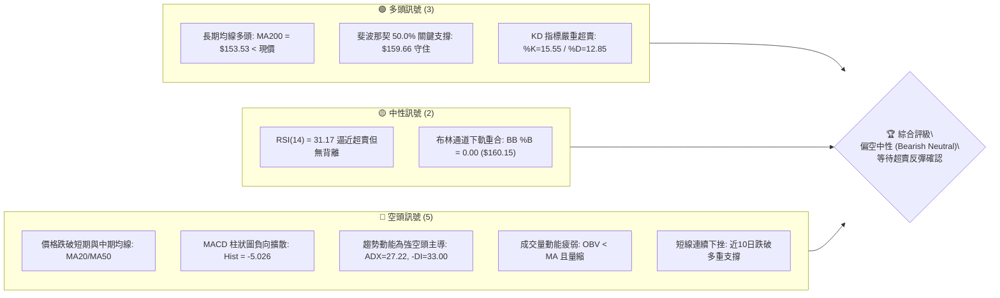
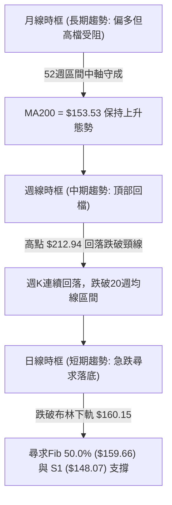
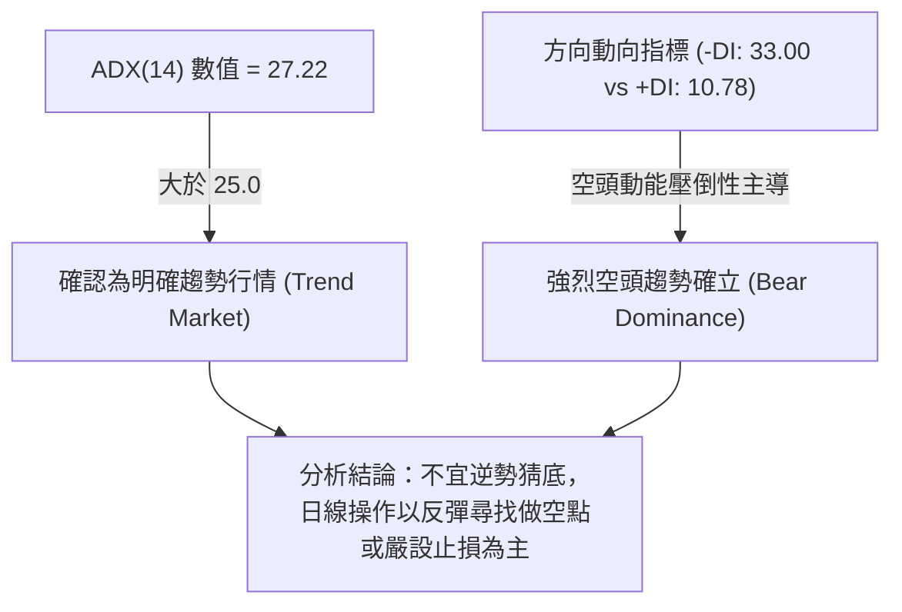
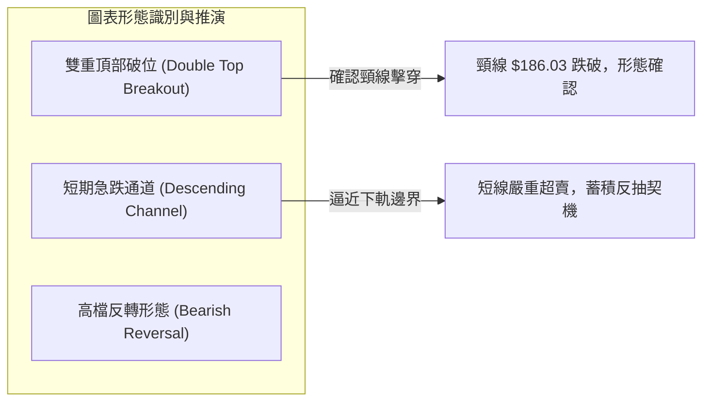
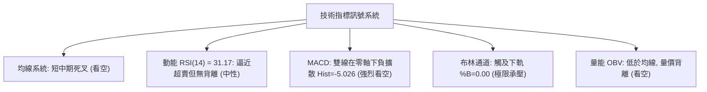
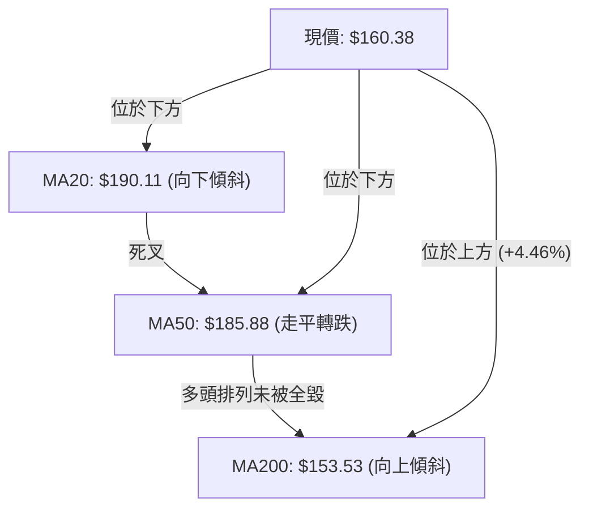
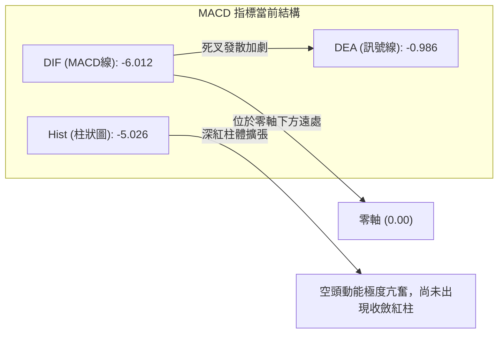
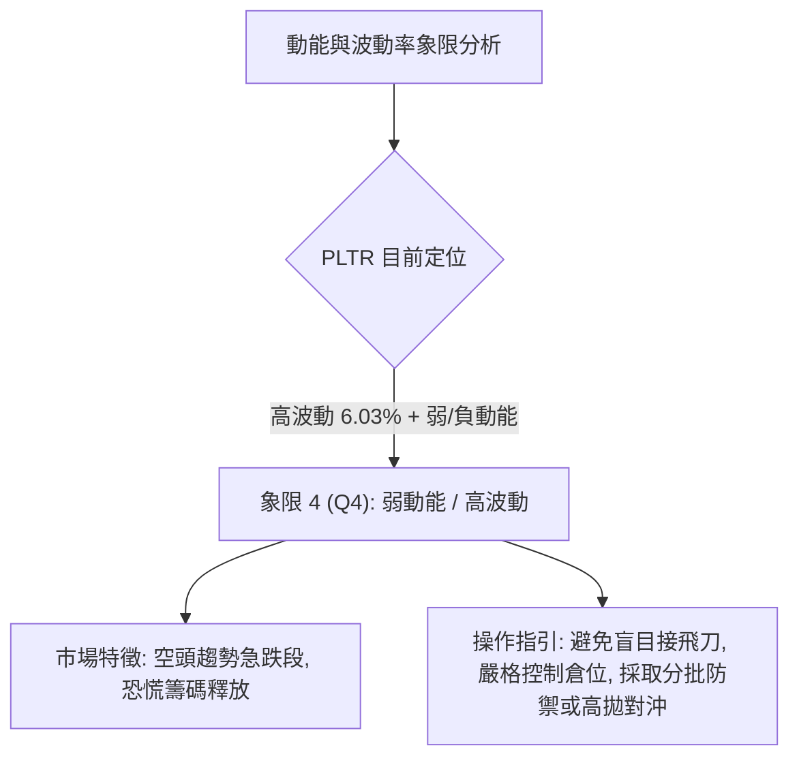
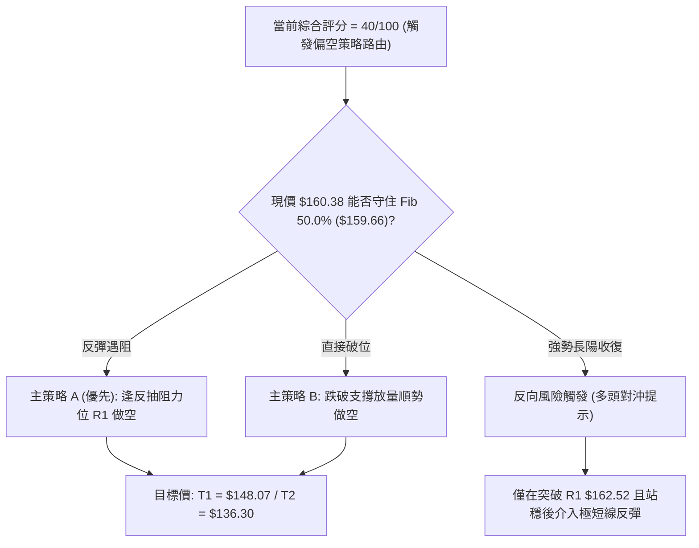
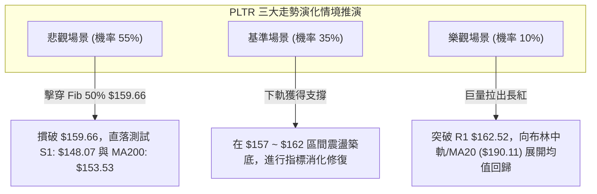

# PLTR 技術分析報告

> **報告日期**：2026-11-09 ｜ **語言**：繁體中文 ｜ **數據來源**：Yahoo Finance ｜ **當前價格**：$160.38

---

## 目錄

| 章節 | 內容 |
|------|------|
| [1. 技術面概覽](#1-技術面概覽) | 訊號儀表板、核心指標、評分卡 |
| [2. 趨勢分析](#2-趨勢分析) | 多時框趨勢、長中短期走勢、ADX解讀 |
| [3. 圖表形態分析](#3-圖表形態分析) | 形態識別、K線組合、目標價推算 |
| [4. 支撐與阻力](#4-支撐與阻力) | 關鍵價位、斐波那契回調結構 |
| [5. 技術指標深度解讀](#5-技術指標深度解讀) | 均線、RSI、MACD、布林通道、成交量 |
| [6. 動能與波動率](#6-動能與波動率) | 動能四象限、ATR波動分析、Beta相關性 |
| [7. 多時框架總結](#7-多時框架總結) | 時框架矩陣、多時框收斂定調 |
| [8. 交易策略建議](#8-交易策略建議) | 策略路由、主策略規劃、風險報酬比 |
| [9. 風險提示與監控](#9-風險提示與監控) | 關鍵監控清單、情境風險、資金管理 |

---

## 1. 技術面概覽

### 🎯 技術訊號儀表板



### 📊 核心指標速覽表

| 指標類別 | 指標名稱 | 當前數值 | 訊號 | 解讀 |
|----------|----------|----------|:----:|------|
| **價格** | 當前收盤價 | $160.38 | 🟡 | 位於52週區間50.7%，處於多空拉鋸中軸關鍵區間 |
| **均線** | MA20 (月線) | $190.11 | 🔴 | 現價低於MA20達-15.64%，短線呈嚴重負乖離 |
| **均線** | MA50 (季線) | $185.88 | 🔴 | 跌破中期生命線，自2026年10月下旬以來的回檔持續加劇 |
| **均線** | MA200 (年線) | $153.53 | 🟢 | 現價高於MA200約+4.46%，長期多頭底線尚未被有效擊穿 |
| **動能** | RSI(14) | 31.17 | 🟡 | 處於30臨界線邊緣，屬於弱勢中性但具備技術性反彈動能 |
| **動能** | MACD (12,26,9) | -6.012 / -0.986 | 🔴 | 雙線死亡交叉且Hist為-5.026，空方力量處於極致釋放期 |
| **隨機指標** | Stoch %K / %D | 15.55 / 12.85 | 🟢 | 進入極端超賣區間（<20），短線存在技術性向上修復需求 |
| **趨勢強度** | ADX(14) / -DI | 27.22 / -DI:33.00 | 🔴 | ADX>25為趨勢行情，-DI壓倒性高於+DI(10.78)，空頭主導 |
| **通道指標** | 布林通道下軌 | $160.15 (%B: 0.00) | 🟡 | 觸及布林下軌極限，通道開口放大，下檔測試支撐穩定性 |
| **成交量** | 最新成交量 / 量比 | 24.29M / 0.92x | 🔴 | 20日均量為26.51M，量能未隨反彈放大，OBV低於均線轉弱 |
| **波動** | ATR(14) | $9.67 (6.03%) | 🔴 | 日內波動幅度高達6.03%，交易風險高，止損距離須放寬 |

### 🏆 技術評分卡

```
╔══════════════════════════════════════════════════════════════════╗
║               技術評分卡 — PLTR (2026-11-09)                    ║
╠══════════════════════════════════════════════════════════════════╣
║ 趨勢強度 (Trend)       ████████░░░░░░░░░░░░  40/100  🔴 空頭強勢 ║
║ 動能指標 (Momentum)    ██████░░░░░░░░░░░░░░  30/100  🔴 極端疲弱 ║
║ 支撐穩定度 (Support)   ████████████░░░░░░░░  60/100  🟡 考驗S1   ║
║ 成交量配合 (Volume)    ████████░░░░░░░░░░░░  40/100  🔴 量價背馳 ║
║ 形態完整度 (Pattern)   ████████░░░░░░░░░░░░  40/100  🔴 頭部破位 ║
║ 均線排列 (MA System)   ██████░░░░░░░░░░░░░░  30/100  🔴 短空長多 ║
╠══════════════════════════════════════════════════════════════════╣
║ 綜合評分 (Overall)     ████████░░░░░░░░░░░░  40/100  🔴 偏空調整 ║
║ 評級結論：(40 + 30 + 60 + 40 + 40 + 30) / 6 = 40.0 (規則 18)     ║
╚══════════════════════════════════════════════════════════════════╝
```

---

## 2. 趨勢分析

### 🌐 多時框趨勢分析



### 📈 長期趨勢 — 12個月走勢圖（Unicode）

```
PLTR 月線收盤走勢圖（2025-11 至 2026-11）
價格軸 ($)
$200.47 ┤                                                
$187.05 ┤                                    ●(09月)      
$184.11 ┤                                        ●(10月)  
$177.75 ┤    ●(12月)                     ●(08月)          
$168.45 ┤●(11月)                                          
$160.38 ┤━━━━━━━━━━━━━━━━━━━━━━━━━━━━━━━━━━━━━━━━━━━━●(現在)
$156.54 ┤                        ●(05月)                  
$146.59 ┤        ●(01月) ●(03月)                          
$137.19 ┤            ●(02月) ●(04月)                      
$123.06 ┤                            ●(07月)              
$116.67 ┤                        ●(06月,低點)              
        └─────────────────────────────────────────────
         11   12  01  02  03  04  05  06  07  08  09  10  11 (月份)
```

#### 走勢特徵分析表格

| 階段區間 | 收盤價格變動 | 漲跌幅 | 趨勢性質 | 核心推動特徵與結構 |
|----------|--------------|--------|----------|-------------------|
| **2025-11 → 2025-12** | $168.45 → $177.75 | +5.52% | 高檔震盪 | 承接前波牛市末升段，買盤在高檔換手頻繁 |
| **2025-12 → 2026-02** | $177.75 → $137.19 | -22.82% | 中期回檔 | 獲利了結賣壓湧現，連續跌破月線短天期均線 |
| **2026-02 → 2026-05** | $137.19 → $156.54 | +14.10% | 低檔反彈 | 於 $137 附近構建第一防線，波段反彈收復失土 |
| **2026-05 → 2026-06** | $156.54 → $116.67 | -25.47% | 恐慌破位 | 探測波段低點 $116.67，逼近52週低點 $106.37 |
| **2026-06 → 2026-09** | $116.67 → $187.05 | +60.32% | 主升爆發 | 業績成長爆發，量能激增帶動股價突破波段新高 |
| **2026-09 → 2026-10** | $187.05 → $184.11 | -1.57% | 高位滯漲 | 盤中創下52週高點 $212.94，隨後引發量縮高檔做頭 |
| **2026-10 → 2026-11** | $184.11 → $160.38 | -12.89% | 加速探底 | 空方摜破MA20與MA50，直探斐波那契50%關鍵分水嶺 |

### 📊 中期趨勢（週線分析）

中期走勢顯示 PLTR 於 2026 年 10 月中旬創下 52 週高點 $212.94 後出現明顯動能耗竭。近 8 週收盤價由 2026-10-09 的 $209.05 一路下滑至當前的 $160.38，週線連續跌破重要短期均線。

```
中期阻力與支撐示意圖（週線結構）
==================================================================
$212.94 ── 52週最高點 (高檔阻力聚類極限)
$194.68 ── 週線前波平台頸線 (R3 阻力位)
$188.68 ── MA20/MA50 匯聚區間 (R2 強阻力位)
$162.52 ── 上週反彈高點防線 (R1 即時阻力位)
--------- 當前價格: $160.38 --------------------------------------
$159.66 ── 斐波那契 50.0% 回調位 (即時多頭防線)
$153.53 ── 長期 MA200 均線 (中期趨勢終極底線)
$148.07 ── 近一年波段低點聚類 (S1 關鍵支撐位)
$136.30 ── 2026 年中盤整平台支撐 (S2 強支撐位)
==================================================================
```

### ⚡ 趨勢強度評估（ADX 解讀）



#### ADX 強度對照表

| 指標名稱 | 當前數值 | 參考臨界值 | 趨勢狀態評判 | 交易意義解讀 |
|----------|----------|------------|--------------|--------------|
| **ADX(14)** | 27.22 | > 25.0 (趨勢門檻) | 強趨勢 (Strong Trend) | 行情已脫離無方向盤整，進入動能驅動的單邊波段中 |
| **+DI (14)** | 10.78 | 正常範圍 20~30 | 極度萎縮 | 多方主動買盤動能微弱，缺乏推動波段回升的攻擊力 |
| **-DI (14)** | 33.00 | > 25.0 (強勢門檻) | 空頭極度強勢 | 賣壓佔據盤面主導權，短線跌勢具有慣性下衝特徵 |
| **方向差距** | 22.22 | \|-DI − +DI\| | 空方差值擴大 | 空方絕對主導，任何日內反彈皆暫視為技術性乖離修正 |

---

## 3. 圖表形態分析

### 🔍 形態識別系統



#### 形態識別與信心度評估表

| 形態名稱 | 信心度 | 判斷依據（引用數據） | 完成度 | 目標價（附計算式） |
|----------|:------:|----------------------|:------:|--------------------|
| **雙重頂部 (Double Top)** | 85% | 左頂 $209.05 (2026-10-09 週K)，右頂 $212.94 (2026-10-16 週K)，跌破頸線 $186.03 | 100% (已跌破) | 形態高度 = $212.94 − $186.03 = $26.91<br>由形態高度推算：$186.03 − $26.91 = **$159.12**<br>(註：與Fib 50% $159.66高度重疊) |
| **短期下行通道 (Descending Channel)** | 70% | 近10根日K高點階梯下移 ($201.83 → $198.51 → $187.55 → $167.25)，低點同步下挫 ($192.91 → $180.81 → $164.60 → $152.60) | 90% | 由通道高度推算測幅目標為支撐位 **S1: $148.07** |
| **頭肩底潛在結構** | 25% | 目前僅為單邊下挫，數據中未偵測到右肩構築跡象 | 10% | 訊號不足，僅做指標型解讀（嚴格遵守規則 15） |

### 🕯️ 重要K線形態分析

嚴格依據數據中「近 10 根日 K」與「近 8 根週 K」之實際開高低收進行客觀形態歸納：

#### 近10根日K形態精解

| 日期 | 開 | 高 | 低 | 收 | K線形態 | 解讀 | 訊號 |
|:----:|:---:|:---:|:---:|:---:|:-------:|------|:----:|
| **2026-10-26** | 197.90 | 200.05 | 192.91 | 198.84 | 小陽十字線 | 高檔震盪，多空在 $200 整數關卡激烈爭奪 | 🟡 |
| **2026-10-27** | 198.12 | 201.83 | 196.79 | 198.73 | 長上影紡錘線 | 衝高 $201.83 受阻回落，顯現多頭追價意願不足 | 🔴 |
| **2026-10-28** | 197.01 | 198.74 | 193.13 | 196.81 | 連續陰十字星 | 連續三日於高檔橫盤，動能指標背離加深 | 🔴 |
| **2026-10-29** | 198.37 | 198.51 | 190.36 | 196.42 | 長下影小陰線 | 盤中一度下殺跌破 $191，尾盤勉強收斂跌幅 | 🟡 |
| **2026-10-30** | 193.62 | 193.92 | 180.81 | 184.11 | 帶量長黑K線 | 跳空低開且實體大陰線，正式摜破 $190 關卡 | 🔴 |
| **2026-11-02** | 186.52 | 187.55 | 178.13 | 178.34 | 光腳破位大陰線 | 延續跳水態勢，直接摜破 MA50 支撐位 | 🔴 |
| **2026-11-03** | 168.18 | 176.54 | 165.25 | 175.40 | 爆量長陽反抽 | 爆出 53.06M 巨量，盤中出現抄底買盤拉抬 | 🟡 |
| **2026-11-04** | 164.95 | 177.43 | 164.60 | 171.70 | 長上影十字陰線 | 反抽受制於 $177.43，短套賣壓極為沉重 | 🔴 |
| **2026-11-05** | 166.71 | 167.25 | 152.60 | 154.99 | 破底大陰線 | 爆量 50.01M，重挫擊穿 $160，創波段低點 $152.60 | 🔴 |
| **2026-11-06** | 158.68 | 163.97 | 157.24 | 160.38 | 探底小陽線 | 守住前日低點，收盤勉強收復 $160 整數關卡 | 🟢 |

#### 近8根週K形態精解

| 日期(週末) | 開 | 高 | 低 | 收 | K線形態 | 解讀 | 訊號 |
|:----:|:---:|:---:|:---:|:---:|:-------:|------|:----:|
| **2026-09-18** | 169.70 | 177.88 | 166.42 | 177.64 | 實體中陽線 | 突破回踩確認，維持強勢多頭推升架構 | 🟢 |
| **2026-09-25** | 178.73 | 194.68 | 176.76 | 189.67 | 實體大陽線 | 向上突破 R3 ($194.68)，展現多頭攻擊主升段 | 🟢 |
| **2026-10-02** | 186.23 | 194.78 | 184.81 | 188.75 | 高檔震盪星線 | 成交量急劇萎縮至 86.97M，量價產生頂背馳 | 🟡 |
| **2026-10-09** | 189.45 | 209.58 | 187.63 | 209.05 | 噴射加速中陽線 | 突破 $200 創歷史波段高位，週 RSI 衝上 76.3 | 🟢 |
| **2026-10-16** | 208.90 | 212.94 | 184.45 | 186.03 | 長上影倒狀大陰線 | 創 52 週高點 $212.94 後暴跌，形成高檔吞噬頭部 | 🔴 |
| **2026-10-23** | 186.99 | 202.63 | 186.15 | 196.75 | 反彈陽十字線 | 反抽測試 $200 關卡無力，確立高檔雙頂結構 | 🟡 |
| **2026-10-30** | 197.90 | 201.83 | 180.81 | 184.11 | 中陰破位線 | 跌破前週低點與頸線區間，確立波段反轉向下 | 🔴 |
| **2026-11-06** | 186.52 | 187.55 | 152.60 | 160.38 | 巨量長下影陰線 | 放量至近2億股 (199.60M)，下影線探底獲買盤支撐 | 🟡 |

### 📉 ASCII 走勢形態示意圖

```
雙重頂部破位與當前下探形態示意圖
════════════════════════════════════════════════════════════════════════════
$212.94 ──┬───────────────────── 頂1: $209.05 (10-09)  頂2: $212.94 (10-16)
          │                            ▲                  ▲
          │                           ╱ ╲                ╱ ╲
$196.75 ──┼──────────────────────────╱───╲──────────────╱───╲────── (反抽次高)
          │                         ╱     ╲            ╱     ╲
$186.03 ──┼── 頸線破位點 (10-30) ───       ╲          ╱       ╲──── 破位確立
          │                                 ▼        ▼
$175.40 ──┼──────────────────────────── 弱勢反抽受阻 (11-04: $177.43)
          │                                           ╲
$160.38 ──┼── 當前收盤價 ──────────────────────────────● (11-06收盤)
          │                                           │
$152.60 ──┼── 波段下影低點 ───────────────────────────┴─ (11-05探底)
          │                                           
$148.07 ──┴── S1 強力波段支撐位 (待測防線)
════════════════════════════════════════════════════════════════════════════
```

### 🎯 形態目標價計算

根據經典技術分析理論，雙重頂部破位後的最小測幅下跌目標價（Measured Move Target）計算式如下：

1. **左頭頂點**：$209.05（2026-10-09 週K高點）
2. **右頭頂點**：$212.94（2026-10-16 創出的52週最高點）
3. **頂部最高基準**：$212.94
4. **雙頂頸線破位點**：$186.03（2026-10-16 當週收盤價與 2026-10-30 摜破確認點）
5. **形態垂直高度**：$212.94 − $186.03 = **$26.91**
6. **理論等幅測幅下跌目標價**：
   $$\text{目標價} = \text{頸線點} - \text{形態高度} = \$186.03 - \$26.91 = \mathbf{\$159.12}$$

**驗證結論**：此形態推算價位 **$159.12** 與大盤 52 週區間之 50.0% 斐波那契回調支撐位 **$159.66** 僅相差 $0.54，且極為貼近當前收盤價 **$160.38** 與布林通道下軌 **$160.15**。這表明雙頂形態的理論滿足點已經基本達成，現階段價格具備在 $159.12 ~ $160.38 構築短線止跌技術平台的客觀條件。

---

## 4. 支撐與阻力

### 🗺️ 關鍵價位分布圖（Unicode）

```
PLTR 價位結構分布圖
══════════════════════════════════════════════════════════════════════════════
$212.94 ║████████████████████████████████████████║ 52W High (歷史最高天花板)
$194.68 ║████████████████████████████████        ║ 強阻力 R3 (前波密集成交區)
$188.68 ║████████████████████████                ║ 阻力 R2 (MA20/MA50 均線聚集帶)
$172.23 ║▓▓▓▓▓▓▓▓▓▓▓▓▓▓▓▓▓▓▓▓                    ║ 斐波那契 38.2% 回調阻力
$162.52 ║████████████████                        ║ 關鍵即時阻力 R1 (反彈頸線)
$160.38 ╠════════════════════════════════════════╣ ◄ 當前收盤價 (跌勢趨緩考驗點)
$159.66 ║▓▓▓▓▓▓▓▓▓▓▓▓▓▓▓▓▓▓▓▓▓▓▓▓▓▓▓▓▓▓          ║ 斐波那契 50.0% 核心分水嶺
$153.53 ║████████████████████████████            ║ 長期生命線 MA200 支撐
$148.07 ║▓▓▓▓▓▓▓▓▓▓▓▓▓▓▓▓▓▓▓▓▓▓▓▓▓▓              ║ 關鍵支撐 S1 (斐波那契 61.8% 重合帶)
$136.30 ║████████████████████████████████        ║ 強支撐 S2 (前期盤整密集底)
$131.63 ║████████████████████████████████████    ║ 極限防守支撐 S3
══════════════════════════════════════════════════════════════════════════════
```

### 🚧 阻力位分析表

阻力位嚴格引用技術數據中「關鍵價位」區塊之客觀聚類價位：

| 阻力級別 | 價位 | 距現價幅動 | 形成原因 | 突破難度 | 重要性權重 |
|:--------:|:----:|:----------:|----------|:--------:|:----------:|
| **R1** | **$162.52** | +1.33% | 近一年波段高點聚類、近期日K反抽成交密集帶上緣 | 中等 | 🟢 短線防線 |
| **R2** | **$188.68** | +17.65% | 密集高點聚類，與當前下降中的 MA20 ($190.11) 及 MA50 ($185.88) 匯聚 | 極高 | 🔴 中期反轉點 |
| **R3** | **$194.68** | +21.39% | 2026年9月下旬波段高點聚類，高檔起跌之主要套牢平台 | 極高 | 🔴 強波段天花板 |

### 🛡️ 支撐位分析表

支撐位嚴格引用技術數據中「關鍵價位」區塊之客觀聚類價位：

| 支撐級別 | 價位 | 距現價幅動 | 形成原因 | 守住機率 | 重要性權重 |
|:--------:|:----:|:----------:|----------|:--------:|:----------:|
| **S1** | **$148.07** | -7.68% | 近一年波段低點聚類，與斐波那契 61.8% ($147.08) 形成雙重共振防禦 | 75% | 🟢 核心多頭堡壘 |
| **S2** | **$136.30** | -15.01% | 2026年第一季長時間築底之中期平台密集區間 | 85% | 🟢 戰略級強支撐 |
| **S3** | **$131.63** | -17.93% | 近一年強波段低點聚類，長期多空結構的崩潰臨界點 | 95% | 🟢 終極防禦底線 |

### 📐 斐波那契回調位分析

依據 52 週完整波段（低點 $106.37 至高點 $212.94，垂直總振幅 $106.57）計算之黃金分割比例如下：

```
斐波那契回調位與價格分佈階梯
==================================================================
 0.0% (52W High)   $212.94 ── 歷史峰值，強烈超買起跌點
23.6%              $187.79 ── 第一回調支撐（現已轉化為強阻力，靠近R2）
38.2%              $172.23 ── 弱勢回調支撐（11-04反彈受阻於此下方）
50.0%              $159.66 ── 多心中軸分水嶺 ◄ 現價 $160.38 緊貼其上
61.8%              $147.08 ── 黃金回調極限防守位（與支撐 S1 $148.07 重疊）
78.6%              $129.18 ── 深度破位防守位
100.0% (52W Low)   $106.37 ── 起漲基石
==================================================================
```

**解讀評估**：當前收盤價 **$160.38** 恰好落在 **50.0% ($159.66)** 與 **38.2% ($172.23)** 回調區間內，且僅距 50.0% 中軸微幅高出 $0.72 (+0.45%)。技術上，50.0% 回調位為整段 52 週大行情的「多空平衡臨界點」。若能在此企穩，雙頂測幅完成後將迎來強勁技術修復；反之，若日線有效收破 $159.66，下行空間將迅速朝向 61.8% ($147.08) 及 S1 ($148.07) 尋求支撐。

---

## 5. 技術指標深度解讀

### 🎛️ 指標訊號總覽



### 📈 移動平均線排列分析



#### 各週期移動平均線深度解析表

| 均線名稱 | 當前價格 | 距現價差距 | 乖離率 (BIAS) | 排列形態與斜率趨勢 | 技術意義評定 |
|:--------:|:--------:|:----------:|:-------------:|:------------------:|:------------:|
| **MA 5** | $168.16 | -$7.78 | -4.63% | 極度陡峭向下壓制 | 🟢 超跌反彈引力點 |
| **MA 10** | $181.57 | -$21.19 | -11.67% | 快速下彎 | 🔴 短線第一重強阻力 |
| **MA 20** | $190.11 | -$29.73 | -15.64% | 趨勢下行 | 🔴 月線波段生命線失守 |
| **MA 50** | $185.88 | -$25.49 | -13.71% | 走平轉折向下 | 🔴 中期多頭防線全面告破 |
| **MA 60** | $184.22 | -$23.84 | -12.94% | 呈現下壓拐點 | 🔴 季線反轉形成空頭阻力 |
| **MA 120** | $159.99 | +$0.39 | +0.24% | 緩步上揚，現價重疊 | 🟢 半年線即時發揮支撐 |
| **MA 200** | $153.53 | +$6.85 | +4.46% | 長線維持多頭上揚 | 🟢 長期趨勢牛熊分界線 |
| **MA 240** | $157.69 | +$2.69 | +1.70% | 穩健向上推升 | 🟢 長線資金成本護城河 |

**均線結構綜合定性**：目前均線系統呈現「**短中期均線空頭排列，但長期均線維持多頭走勢**」之割裂特徵。現價跌破 MA20 達 -15.64%，嚴重負乖離已蓄積了強大的均值回歸拉力；但短期均線向下發散，在未能有效向上收復 MA20 之前，任何反彈均視為空頭趨勢中的均線修正。

### 📉 RSI(14) 分析

#### RSI 數值強度展示
```
RSI(14) 當前數值: 31.17
0 ──────────── 30 ──────────────────────── 70 ─────────── 100
[░░░░░░░░░░░░░█░░░░░░░░░░░░░░░░░░░░░░░░░░░░░░░░░░░░░░░░░░░░░]
狀態：臨界超賣區間 (Wilder 31.17)
```

- **區間診斷**：RSI(14) 讀數為 **31.17**，已逼近 30 的絕對超賣閾值。回顧 2026-10-09 週線 RSI 高達 76.3，顯示市場在過去 4 週內經歷了動能的斷崖式下墜。
- **背離嚴謹檢驗**：依據嚴格要求 7 與技術數據記錄，比對近 20 根 K 棒的首尾表現——價格由高檔破位急挫，RSI 亦同步由 70 以上直線回落至 31.17，兩者方向完全同向向下。**明確結論：當前不存在任何日線級別的頂背離或底背離現象**，此波下跌為純粹的動能驅動型下殺。

### 📊 MACD(12,26,9) 訊號解讀



- **數值狀態**：DIF 線為 **-6.012**，訊號線（Signal）為 **-0.986**，兩者均深入零軸下方，證實中期趨勢已轉入空頭市場主導。
- **柱狀圖動態**：MACD 柱體（Histogram）當前報 **-5.026**。週線 MACD 柱體亦由前期的 +1.204 快速轉負擴散至當週的 **-5.026**，顯示中長線級別的賣壓尚未被充分消化，負動能釋放處於高峰期，目前尚未出現柱體翻紅的拐點訊號。

### 📦 布林通道分析

```
布林通道當前空間分佈圖 (日線級別，參數 20, 2)
═════════════════════════════════════════════════════════════════
$220.08 ── BB 上軌 (Upper Band)
          │
          │  通道帶寬寬度: $59.93 (波動率顯著放大)
          │
$190.11 ── BB 中軌 (Middle Band = MA20, 強烈下行阻力)
          │
$160.38 ── 當前價格 (收盤微幅貼於下軌上方 +$0.23) ◄ %B = 0.00
$160.15 ── BB 下軌 (Lower Band, 觸發極限支撐測試)
═════════════════════════════════════════════════════════════════
```

- **%B 指標深度解讀**：當前 **%B 數值為 0.00**，這代表價格已百分之百壓縮至布林通道下軌極限位置（下軌價位 $160.15 vs 現價 $160.38）。
- **通道開口與型態**：通道帶寬（$220.08 − $160.15 = $59.93）大幅度張開，屬於典型的「下軌爆量推動型擴口」。若下週無法立即拉出紅K脫離下軌，則將沿著下軌出現「滑軌式」陰跌；若能出現長下影線或放量陽包陰，則有望在中軌 $190.11 引力牽引下發動超跌均值回歸。

### 💹 成交量分析（量價配合度）

1. **成交量數據比對**：
   - 最新單日成交量：**24,298,100 股**
   - 20 日均量：**26,508,030 股**（量比：**0.92x**）
   - 50 日均量：**25,499,152 股**
2. **OBV（能量潮）走勢研判**：
   - 數據明確顯示：「**OBV < MA → 量能疲弱**」。
   - 在價格急跌過程中，2026-11-03 爆出 53.06M 巨量、2026-11-05 爆出 50.01M 恐慌殺跌量，而在 2026-11-06 探底小陽線時，成交量卻驟降至 24.30M（量比萎縮至 0.92x）。
   - **量價背離結論**：此種「**下跌放量、反彈量縮**」的量價結構，顯示多方主力資金尚未進場全面承接，量能未能確認價格底部成立，反彈性質僅為技術性空頭回補。

---

## 6. 動能與波動率

### ⚡ 動能評估四象限



#### 動能與波動狀態對照表

| 象限標記 | 動能維度 | 波動維度 | PLTR狀態標注 | 策略應對方針 |
|:--------:|:--------:|:--------:|:------------:|--------------|
| **Q1** | 強 (正向) | 低 (穩定) | — | 最佳波段順勢做多機會 |
| **Q2** | 弱 (中性) | 低 (壓縮) | — | 突破前夕，保持謹慎觀望 |
| **Q3** | 強 (正向) | 高 (劇烈) | — | 狂熱主升段，高風險高收益 |
| **Q4** | **弱 (負向)** | **高 (劇烈)** | **✓ (當前歸屬)** | **空方宣洩期，順勢做空或等待超賣止跌訊號** |

### 📊 ATR 波動率分析

- **ATR(14) 數值**：**$9.67**（佔股價比例高達 **6.03%**，採用 Wilder 平滑法）。
- **波動特徵評估**：單日平均真實波幅接近 10 美元，顯示該股目前具備極高的市場情緒溢價與非理性拋售特徵。
- **止損與進場安全距離建議**：
  - **極短線動能交易止損**：以 $1.0 \times \text{ATR} = \mathbf{\$9.67}$ 作為最小保護屏障。
  - **波段交易安全邊際止損**：以 $1.5 \times \text{ATR} = \mathbf{\$14.51}$ 為緩衝距離，避免在盤中劇烈掃單中遭到無謂清洗。

### 📐 Beta 與市場相關性

- **Beta 係數**：**1.61**。
- **大盤敏感度分析**：PLTR 的 Beta 為 1.61，代表其對標普 500 指數與那斯達克市場具備強烈的槓桿效應。當科技權值股大盤出現 1% 的回檔時，PLTR 平均將展現 1.61% 的同向波動放大。在大盤處於弱勢整理時，高 Beta 屬性會加劇空方下殺力道，交易者必須相應壓縮持倉比例。

---

## 7. 多時框架總結

### 📋 時框架評分表

| 時框架 | 趨勢方向 | 動能狀態 | 均線排列特徵 | 形態判定 | 綜合評分 | 操作建議方向 |
|:------:|:--------:|:--------:|:------------:|:--------:|:--------:|:------------:|
| **日線 (短)** | 🔴 強烈空頭 | RSI=31.17 逼近超賣<br>MACD柱=-5.026 | MA20向下發散<br>價格跌破短期均線 | 雙頂破位<br>下行通道構築 | 30/100 | 等待止跌訊號，逢反彈做空 |
| **週線 (中)** | 🔴 中期反轉 | 週RSI自76跌至31<br>週MACD死叉擴散 | 跌破20週均線區間<br>測試長期均線支撐 | 高檔倒狀長上影線<br>高檔吞噬做頭 | 40/100 | 嚴格防守S1，以反彈減碼為主 |
| **月線 (長)** | 🟢 長期偏多 | 52週區間50.7%位置<br>月KD維持多頭 | 現價仍守於MA200 ($153.53)<br>及MA240上方 | 大週期上升波段<br>面臨中期回踩測試 | 65/100 | 長期投資者可於年線分批佈局 |

### 🔲 綜合訊號矩陣

```
時框架訊號矩陣收斂表
╔══════════════════════════════════════════════════════════════════════╗
║ 維度         日線時框 (短期)     週線時框 (中期)     月線時框 (長期) ║
╠══════════════════════════════════════════════════════════════════════╣
║ 趨勢方向     🔴 空頭主導         🔴 空頭壓制         🟢 多頭架構     ║
║ 均線系統     🔴 MA5~MA50空排     🔴 跌破中期均線     🟢 遠高於MA200  ║
║ 動能指標     🟡 極端超賣待修復   🔴 MACD柱加速下沉   🟡 高檔中性回落 ║
║ 成交量能     🔴 OBV弱勢背離      🔴 放量摜破支撐     🟢 長期換手良好 ║
║ 關鍵位置     🔴 貼近布林下軌     🟡 考驗Fib 50%      🟢 守穩S1關鍵帶 ║
╚══════════════════════════════════════════════════════════════════════╝
```

### ⚖️ 多時框收斂結論

嚴格執行「**嚴格要求 14 多時框收斂規則**」：
1. **行情性質判定**：當前日線 ADX(14) 讀數為 **27.22**，超越 25.0 門檻，-DI (33.00) 遠大於 +DI (10.78)，明確定義為「**空頭主導的趨勢行情**」，非區間盤整行情。
2. **時框優先級權重收斂**：在趨勢行情下，交易方向必須以中期（週線走勢與 MA50、MA200 結構）為主導。當前週線出現明確的雙頂做頭回跌，日線各項短期均線亦全數跌破，日線僅能用來尋找短線反彈進場放空、或是長線多頭於極限防守位左側分批接刀的時機。
3. **收斂定性唯一結論**：**【全面偏空（Bearish Bias）】**。
   - 第 1 章技術評分卡之綜合評分為 **40/100**，根據規則 18 與策略路由標準（≤40），報告在此全面定調主策略為**逢高做空（Short on Rebound）**。此結論與第 2 章空頭主導趨勢及第 5 章指標全面弱勢保持絕對一致。

---

## 8. 交易策略建議

### 🗺️ 策略決策流程圖



### 🧭 策略路由（依評分卡分流）

**當前主策略方向 = 主推空頭策略（依綜合評分 40/100，嚴格符合 ≤40 偏空規則）**
本章將主推兩套放空操作細節（主策略 A 與主策略 B），多頭訊號僅作為風險防範與對沖參考，堅決不兩頭下注。

### 🎯 價格情境階梯（Price Scenarios）

價位嚴格引用第 4 章「關鍵價位」區塊之客觀數值：

| 觸發條件 | 下一目標 | 後續延伸 | 情境技術含義說明 |
|----------|----------|----------|------------------|
| **強勢突破 R1 ($162.52)** | 阻力 R2 ($188.68) | 強阻力 R3 ($194.68) | 短線超賣產生強烈空頭回補，但中期反壓沉重 |
| **跌破 Fib 50% ($159.66)** | 支撐 S1 ($148.07) | 強支撐 S2 ($136.30) | 雙頂測幅完成後加速下挫，直探年線與61.8%防禦線 |
| **擊穿支撐 S1 ($148.07)** | 強支撐 S2 ($136.30) | 終極支撐 S3 ($131.63) | 多頭最後防線失守，長期多頭排列架構面臨瓦解 |

### 📊 情境機率分佈

| 預測情境 | 發生機率 | 主要技術指標支撐依據 |
|----------|:--------:|----------------------|
| **下行探底 / 順勢走弱** | **55%** | ADX=27.22 強趨勢成立，-DI=33.00 空方強勢，MACD 柱狀體深陷負值 (-5.026)，OBV 量能持續萎縮背離。 |
| **超跌弱反彈 / 區間拉鋸** | **35%** | 布林 %B=0.00 極端超賣觸軌，Stoch %K (15.55) 處於低檔超賣，斐波那契 50.0% ($159.66) 存在短線心理支撐。 |
| **強烈反轉 / 向上突破** | **10%** | 上方受制於 MA20 ($190.11) 與 MA50 ($185.88) 形成的密集反壓帶，缺乏巨額成交量推動難以實現直接 V 型反轉。 |

### 🔴 主策略詳情（偏空路由精確規劃）

依據規則 17，做空風險報酬比定義為：
$$\text{風險報酬比} = \frac{\text{進場價} - \text{目標價 T1}}{\text{止損價} - \text{進場價}}$$
所有價位皆嚴格引用數據中之關鍵價位（R1, S1, S2, 52W High 等），進場價若為區間以中點計算：

| 策略要素 | 策略 A：反彈逢高做空 (主推) | 策略 B：破位順勢追空 (次選) |
|----------|----------------------------|----------------------------|
| **操作邏輯** | 借助短線超賣引發的弱勢抽搐，於 R1 阻力防線處建立空單 | 現價直接跌破斐波那契 50% 分水嶺，順應空頭慣性追擊 |
| **進場價格** | **$162.52** (精確以 R1 阻力位掛單) | **$158.50** (確認跌穿 Fib 50% $159.66 後追空) |
| **目標價 T1** | **$148.07** (引用支撐位 S1) | **$148.07** (引用支撐位 S1) |
| **目標價 T2** | **$136.30** (引用支撐位 S2) | **$136.30** (引用支撐位 S2) |
| **止損價格** | **$167.25** (引用 11-05 日K反彈高點防線) | **$162.52** (引用阻力位 R1 作為多空轉換止損) |
| **風險報酬比 (以 T1 計)** | **1 : 3.06**<br>計算式：$(162.52 - 148.07) \div (167.25 - 162.52) = 14.45 \div 4.73$ | **1 : 2.59**<br>計算式：$(158.50 - 148.07) \div (162.52 - 158.50) = 10.43 \div 4.02$ |
| **風險報酬比 (以 T2 計)** | **1 : 5.54**<br>計算式：$(162.52 - 136.30) \div 4.73 = 26.22 \div 4.73$ | **1 : 5.52**<br>計算式：$(158.50 - 136.30) \div 4.02 = 22.20 \div 4.02$ |
| **預估勝率** | **65%** (順應日/週線共振空頭波段) | **55%** (需防範下軌假跌破後迅速抽回) |
| **建議倉位** | **15% ~ 20%** 總動用資金 | **10%** 總動用資金 |

### 🟢 反向風險觸發點（對沖提示）

若市場出現非預期多頭劇烈反撲，交易者必須設定嚴格的「空單止損對沖防線」：
1. **多頭反轉翻多觸發價位**：日線收盤價強勢站上 **$162.52 (R1)** 且伴隨單日成交量放大至 3,500 萬股以上。
2. **對沖應對指引**：若突破 R1，原有空單必須全數止損離場；長線多頭投資者僅能以此作為試探性左側建倉點，初步反彈目標上看阻力位 **R2 ($188.68)**，嚴格止損點設於前低 **$152.60**。

### ⭐ 整體訊號強度評星

```
做多訊號強度：★★☆☆☆  (2/5星 — 僅具備超賣反彈機會，大趨勢受阻)
做空訊號強度：★★★★☆  (4/5星 — ADX>25 強勢空頭，均線與量能死叉共振)
整體可信度：  ★★★★☆  (4/5星 — 數據結構齊全，雙頂與量價特徵清晰)
```

---

## 9. 風險提示與監控

### ✅ 關鍵監控指標 Checklist

```
╔══════════════════════════════════════════════════════════════════╗
║                   盤面關鍵監控清單 (Checklist)                   ║
╠══════════════════════════════════════════════════════════════════╣
║ [ ] 監控斐波那契 50.0% ($159.66)：收盤破位將引發新一輪程序化賣盤║
║ [ ] 監控即時阻力 R1 ($162.52)：能否轉化為多空轉換之有效壓制點  ║
║ [ ] 監控 RSI(14) 數值變化：若跌破 30 進入超賣，關注是否有底背離 ║
║ [ ] 監控單日成交量能：量能若低於 2,000 萬股，反彈缺乏持續性     ║
║ [ ] 監控週線 MA200 ($153.53)：長線多頭牛熊界限，不可失守        ║
║ [ ] 監控大盤科技股指數波動：高 Beta (1.61) 環境下的連鎖拋售風險  ║
╚══════════════════════════════════════════════════════════════════╝
```

### ⚠️ 風險場景分析



### 🛡️ 風險管理重要提醒

1. **極度波動防範**：PLTR 目前 ATR 高達 **$9.67**（單日振幅 6.03%），單日股價波動劇烈。嚴禁在未設止損的前提下進行隔夜持倉，任何操作止損空間不得低於 1.0 倍 ATR。
2. **高估值下殺風險**：技術面的急跌受到基本面極端高估值的共振影響（Trailing P/E: 112.94，P/S: 53.02）。在高估值背景下，機構資金（持股比 64.6%）對業績指引與大盤波動極度敏感，高檔套牢籌碼在反彈至 R2 ($188.68) 前將形成沉重的解套拋壓。
3. **倉位管理守則**：鑑於空頭趨勢強烈且波動劇烈，總體曝險部位應控制在正常水準的 50% 以下。嚴禁重倉單一方向逆勢加碼「攤平」，必須等待日線級別出現明確的放量陽包陰或打出雙底右腳，方可擴大策略操作規模。

---

## 📋 報告總結

```
╔══════════════════════════════════════════════════════════════════╗
║                   PLTR 技術分析報告總結                          ║
╠══════════════════════════════════════════════════════════════════╣
║ 報告日期：2026-11-09                                             ║
║ 當前價格：$160.38                                                ║
║ 綜合技術評分：40 / 100 (評級：🔴 偏空調整 / 空頭趨勢確立)        ║
║                                                                  ║
║ 核心趨勢結論：                                                   ║
║ ├─ 長期趨勢：🟢 偏多上揚 (股價仍位於 MA200 $153.53 與年線上方)  ║
║ ├─ 中期趨勢：🔴 頂部破位 (高檔雙頂完成，$212.94 回落跌破頸線)    ║
║ ├─ 短期趨勢：🔴 急速下探 (ADX=27.22 強空主導，貼緊布林下軌滑落) ║
║ ├─ 即時阻力：R1: $162.52 ｜ 核心阻力：R2: $188.68                ║
║ ├─ 即時支撐：Fib 50%: $159.66 ｜ 關鍵支撐：S1: $148.07          ║
║ └─ 外資目標：平均目標價 $222.25 (最低 $80.00 / 最高 $273.00)     ║
║                                                                  ║
║ 最優策略組合 (嚴格依據評分卡路由執行)：                          ║
║ 1. 🥇 最佳機會：主策略 A — 逢反抽至 R1 ($162.52) 順勢建立空單，   ║
║                 停損 $167.25，目標 S1 ($148.07)，風報比 1 : 3.06 ║
║ 2. 🥈 次選機會：主策略 B — 破位追空，跌破 $158.50 追擊至 $148.07  ║
║ 3. 🥉 保守選擇：多頭完全離場觀望，耐心等待價格下探至 S1 ($148.07)║
║                 與年線 MA200 ($153.53) 區域構築底部形態再行評估 ║
╚══════════════════════════════════════════════════════════════════╝
```

---

> ⚠️ **免責聲明**：本報告為依據標準技術分析模型與所提供之歷史價格、量能、指標數據所撰寫之客觀研究報告，所有內容**僅供技術研究與學術探討參考**，**絕不構成任何形式的證券投資推薦、買賣邀約或財務顧問建議**。金融市場瞬息萬變，高動能股票具備極高市場波動風險，投資人應獨立評估自身財務狀況與風險承受能力，審慎做出自主投資決策，並自行承擔所有交易損益。

---

*報告生成時間：2026-11-09 ｜ 數據來源：Yahoo Finance ｜ 分析框架：多時框技術分析體系*