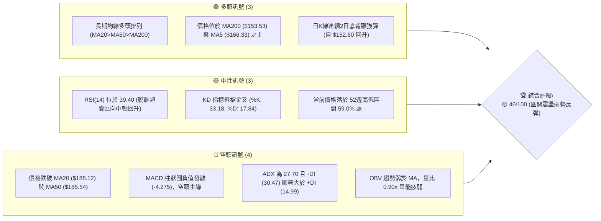
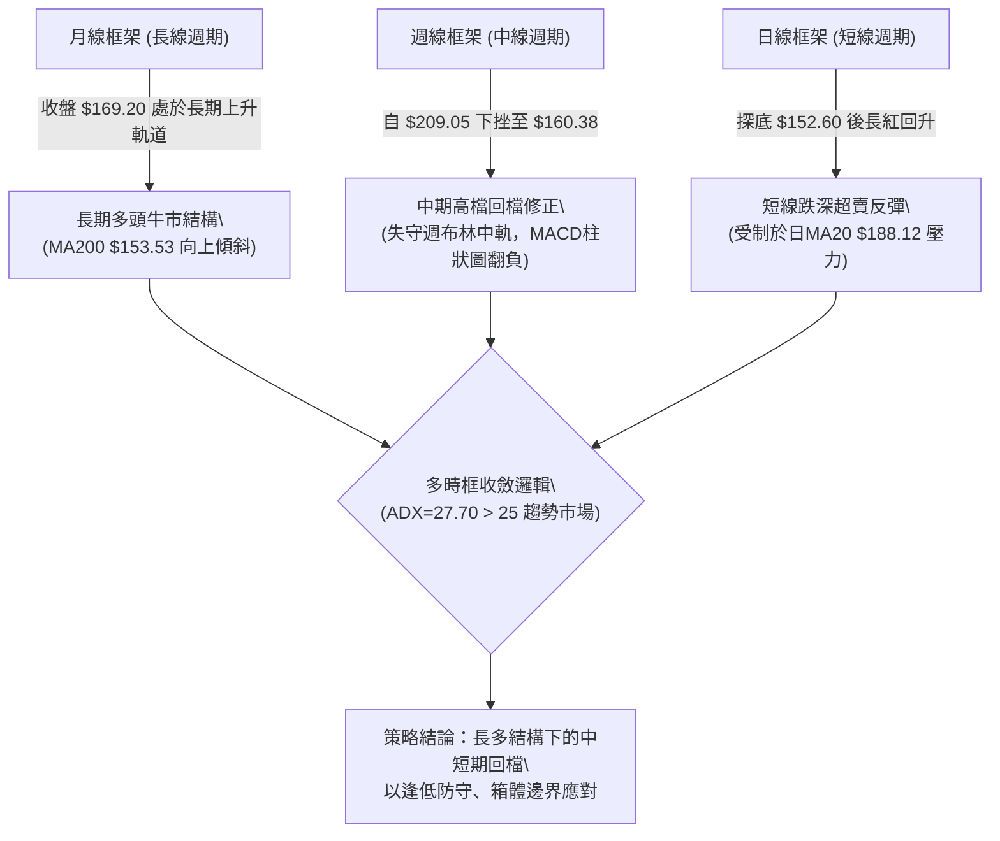
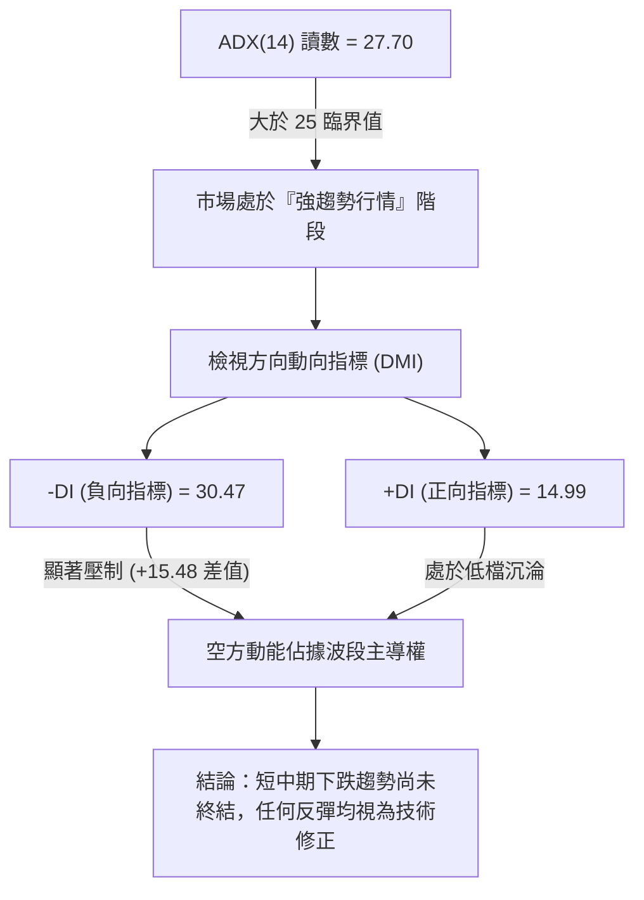
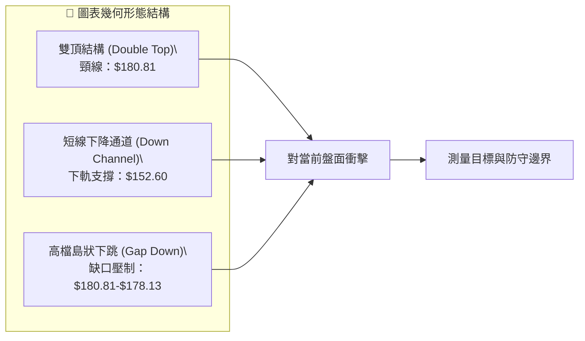
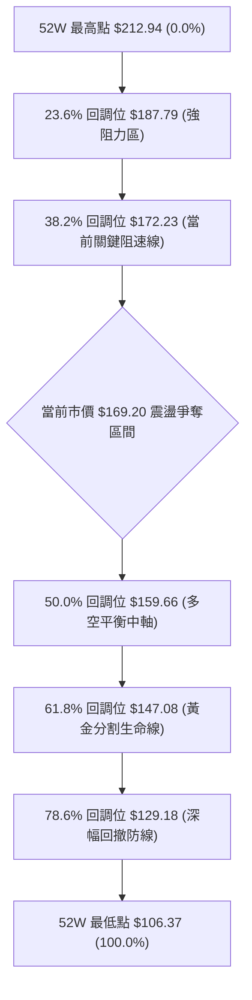
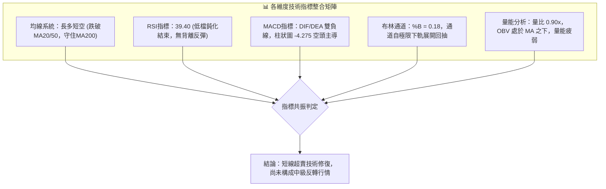
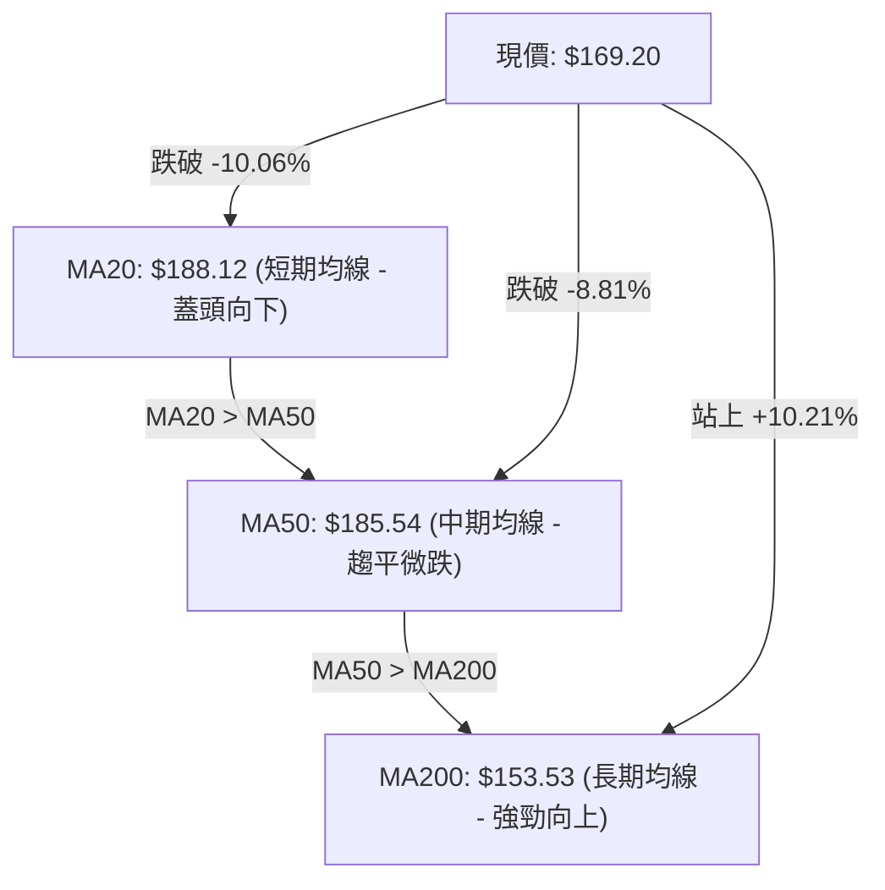
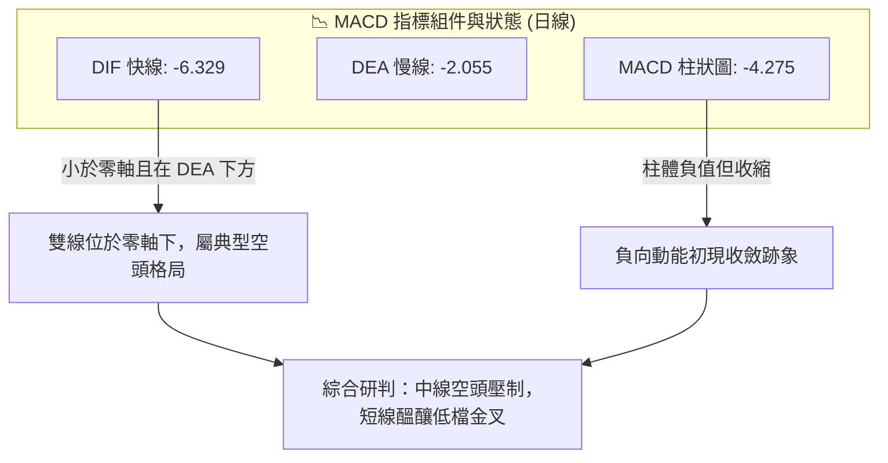
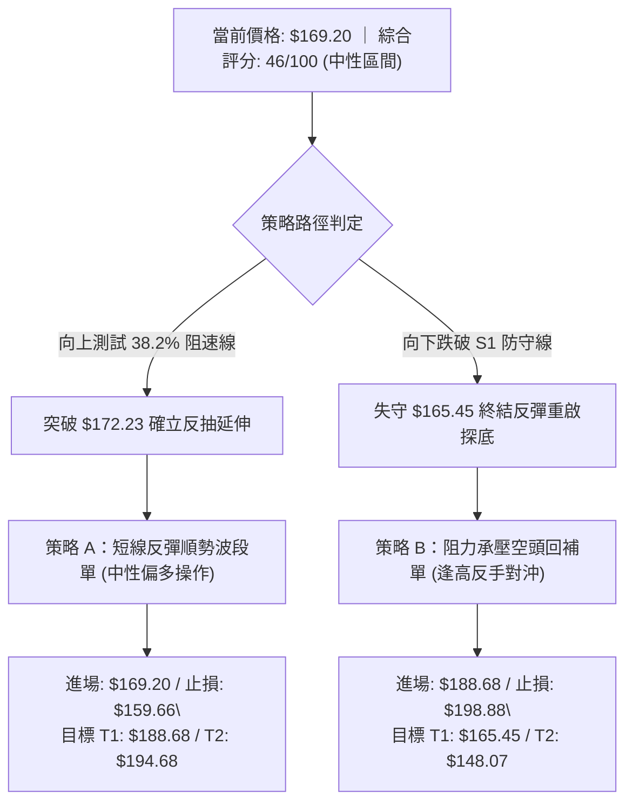
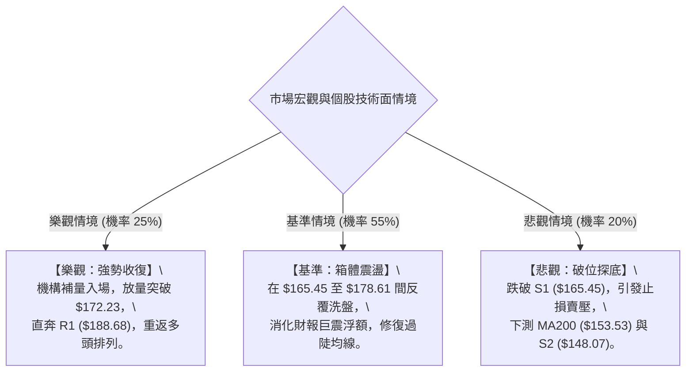

# PLTR 技術分析報告

> **報告日期**：2026-11-10 ｜ **語言**：繁體中文 ｜ **數據來源**：Yahoo Finance ｜ **當前價格**：$169.20

---

## 目錄

| 章節 | 內容 |
|------|------|
| [1. 技術面概覽](#1-技術面概覽) | 訊號儀表板、核心指標、評分卡 |
| [2. 趨勢分析](#2-趨勢分析) | 多時框趨勢、長中短期走勢、ADX解讀 |
| [3. 圖表形態分析](#3-圖表形態分析) | 形態識別、K線組合、目標價計算 |
| [4. 支撐與阻力](#4-支撐與阻力) | 關鍵價位、斐波那契回調結構 |
| [5. 技術指標深度解讀](#5-技術指標深度解讀) | MA/RSI/MACD/布林/成交量全面剖析 |
| [6. 動能與波動率](#6-動能與波動率) | 動能評估、ATR波動性、Beta敏感度 |
| [7. 多時框架總結](#7-多時框架總結) | 時框架評分矩陣、多時框收斂結論 |
| [8. 交易策略建議](#8-交易策略建議) | 策略路由、價格階梯、主策略詳解 |
| [9. 風險提示與監控](#9-風險提示與監控) | 監控指標Checklist、風險場景防護 |
| [📋 報告總結](#-報告總結) | 核心結論與最佳策略組合彙整 |

---

## 1. 技術面概覽

### 🎯 技術訊號儀表板



---

### 📊 核心指標速覽表

| 指標類別 | 指標名稱 | 當前數值 | 訊號 | 專業解讀 |
|:---|:---|:---|:---:|:---|
| **基準價格** | 收盤價 | $169.20 | 🟡 | 位於52週區間 59.0%，自低點 $152.60 反彈並站回 $165.45 之上 |
| **短期均線** | MA5 / MA20 | $166.33 / $188.12 | 🟡 | 站上 MA5 (+$2.87)，但距離中軌 MA20 仍有 -10.06% 負乖離 |
| **中期均線** | MA50 / MA60 | $185.54 / $184.14 | 🔴 | 價格低於 MA50 與 MA60，中期波段均線壓制明顯 |
| **長期均線** | MA200 / MA240 | $153.53 / $157.72 | 🟢 | 守在 MA200 (+$15.67) 之上，長期多頭基石未被實質破壞 |
| **動能震盪** | RSI(14) | 39.40 | 🟡 | 自超賣邊緣微幅回升，處於弱勢反彈區，近20根無背離 |
| **趨勢動能** | MACD (12,26,9) | -6.329 / -2.055 | 🔴 | DIF 位於零軸下方且小於 DEA，柱狀圖 -4.275，空頭動能仍存 |
| **隨機指標** | Stoch %K / %D | 33.18 / 17.84 | 🟢 | 超賣區黃金交叉向上發散，短線具備技術性修復動能 |
| **趨勢強度** | ADX(14) / ±DI | 27.70 (-DI: 30.47) | 🔴 | ADX>25 顯示空方趨勢確立，-DI 佔據絕對主導地位 |
| **通道帶寬** | 布林帶 (%B) | 0.18 (帶寬 $59.93) | 🟡 | %B 由下軌 ($158.16) 向上穿越，進入下半通道弱勢整理 |
| **成交量能** | 20日均量比 | 0.90x (23.80M) | 🔴 | OBV < MA，反彈未見顯著機構補量，追價意願謹慎 |
| **波動風險** | ATR(14) | $9.72 (5.75%) | 🔴 | 日間波動幅度較大，持倉震盪風險偏高 |

---

### 🏆 技術評分卡

```
╔════════════════════════════════════════════════════════════════╗
║                   技術評分卡 — PLTR (2026-11-10)               ║
╠════════════════════════════════════════════════════════════════╣
║ 評估維度      評分進度條              得分     評估結論        ║
╟────────────────────────────────────────────────────────────────╢
║ 趨勢強度      ████████░░░░░░░░░░░░   40/100   🔴 空方趨勢主導  ║
║ 動能指標      ███████░░░░░░░░░░░░░   35/100   🔴 弱勢修復反彈  ║
║ 支撐穩定度    ████████████░░░░░░░░   58/100   🟡 S1 獲得防守   ║
║ 成交量配合    ████████░░░░░░░░░░░░   42/100   🔴 量能萎縮疲弱  ║
║ 形態完整度    ██████████░░░░░░░░░░   48/100   🟡 箱體下緣測試  ║
║ 均線排列      ███████████░░░░░░░░░   53/100   🟡 長多短空交織  ║
╠════════════════════════════════════════════════════════════════╣
║ 綜合評分      █████████░░░░░░░░░░░   46/100   🟡 區間震盪整理  ║
║ 綜合評級：46/100（依規則 18，六項算術平均：276 ÷ 6 = 46）      ║
╚════════════════════════════════════════════════════════════════╝
```

---

## 2. 趨勢分析

### 🌐 多時框趨勢分析



---

### 📈 長期趨勢 — 12個月走勢圖（Unicode）

```
PLTR 月線走勢圖（過去12個月：2024-11 至 2026-11）
價格軸 ($)
$210 ┤                                      ● (52W High $212.94)
$200 ┤                             ●        │
$190 ┤                                   ●  │
$180 ┤                        ●             │
$170 ┤                                      └──● ($169.20 現價)
$160 ┤                   ●
$150 ┤              ●
$140 ┤         ●
$130 ┤    ●
$110 ┤● (52W Low $106.37)
     └─────────────────────────────────────────────────────────►
       M1   M2   M3   M4   M5   M6   M7   M8   M9  M10  M11  M12
     (11/25)(01/26)(03/26)(05/26)(07/26)(08/26)(09/26)(10/26)(11/26)
```

#### 24 個月關鍵轉折節點分析表

| 階段區間 | 起訖月份 | 收盤區間 ($) | 區間漲跌幅 | 趨勢特徵與價量結構剖析 |
|:---|:---|:---|:---:|:---|
| **第一波拉升期** | 2024-11 → 2025-10 | $67.08 → $200.47 | **+198.85%** | 商業AI平台放量，月線連續陽線，多頭單邊趨勢行情 |
| **中級箱體洗盤** | 2025-11 → 2026-06 | $200.47 → $116.67 | **-41.80%** | 高估值去化與資金輪動，回測52週低點 $106.37 區域 |
| **主升浪突破期** | 2026-07 → 2026-10 | $123.06 → $184.11 | **+49.61%** | 業績超預期暴增，創下 52 週歷史天價 $212.94 |
| **當前高檔回撤** | 2026-10 → 2026-11 | $209.05 → $169.20 | **-19.06%** | 財報利多出盡伴隨獲利了結，回測斐波那契 50% 支撐 |

---

### 📊 中期趨勢（週線分析）

中期走勢顯示，PLTR 自 2026-10-16 創出 $212.94 的 52 週高點後，週線連收兩根長黑棒，跌破前波起漲樞軸點。下圖為近期週線壓力與支撐的力道示意：

```
PLTR 週線關鍵位力道示意圖
╔══════════════════════════════════════════════════════════════════╗
║ [上方重壓帶]                                                     ║
║ $212.94 (52週歷史高點 / 0.0% 斐波那契回調位) ─────────────────── 頂部反轉頸線
║ $198.88 (R3 波段高點聚類 / 10月週K高點密集成交區)                ║
║ $188.68 (R1 關鍵阻力 / 23.6% 斐波回調位 / 週線跌破缺口下緣)      ║
║                                                                  ║
║ [當前交易中樞]                                                   ║
║ $172.23 (38.2% 斐波那契回調強弱分水嶺)                            ║
║ ───────► $169.20 (當前收盤價，正向上測試 38.2% 分水嶺) ◄──────── ║
║ $165.45 (S1 支撐位 / 11月第一週實體收盤防守線)                   ║
║                                                                  ║
║ [下方強防守帶]                                                   ║
║ $159.66 (50.0% 斐波那契回調位 / 多空生死中軸)                    ║
║ $153.53 (日線 MA200 牛熊分界線)                                  ║
║ $148.07 (S2 強支撐位 / 61.8% 斐波那契黃金分割位 $147.08 聚類帶) ║
╚══════════════════════════════════════════════════════════════════╝
```

---

### ⚡ 趨勢強度評估（ADX 解讀）



#### ADX 趨勢強度區間對照表

| ADX 數值區間 | 當前數值 | 趨勢狀態判定 | 交易策略指導意義 |
|:---:|:---:|:---:|:---|
| 0 – 20 | — | 弱勢無方向，橫向窄幅盤整 | 適合網格交易、布林通道高出低進 |
| 20 – 25 | — | 趨勢孕育期，方向初現 | 減少順勢單，等待突破確立 |
| **25 – 40** | **27.70** | **強趨勢行情確立 (空頭佔優)** | **順著 -DI 方向操作，嚴禁逆勢盲目猜底** |
| 40 – 60 | — | 極強單邊爆發趨勢 | 趨勢持倉最大化，移動止損跟蹤 |
| 60 – 100 | — | 趨勢過度延伸，隨時面臨耗竭 | 獲利了結，防範報復性反轉 |

---

## 3. 圖表形態分析

### 🔍 形態識別系統



#### 圖表形態信心度與目標價評估表

| 形態識別名稱 | 形態信心度 | 判斷依據（引用數據與精確價格） | 形態完成度 | 形態目標價（附精確計算式） |
|:---|:---:|:---|:---:|:---|
| **雙重頂 (Double Top)** | **82%** | 2026-10-16 高點 $212.94 與 10-23 高點 $202.63 構築雙峰，於 10-30 跌破頸線低點 $180.81 | **90%** | **$148.68**<br>計算式：頸線 $180.81 − (峰值 $212.94 − 頸線 $180.81) = $180.81 − $32.13 = $148.68（精準逼近 S2 $148.07） |
| **短期下降通道** | **75%** | 沿高點連線（10-27 $201.83、11-04 $177.43）與低點連線（10-30 $180.81、11-05 $152.60）向下震盪 | **70%** | **$188.68**<br>計算式：突破通道上軌後的等距反彈目標 = R1 阻力位 $188.68 |
| **複合頭肩頂 (頭肩雛形)** | **42%** | 右肩反彈僅達 $177.43，左肩為 10-02 $194.78，頭部為 $212.94；數據週期過短 | **40%** | **訊號不足，僅做指標型解讀**（依規則 15，信心度 < 50% 不強制測距） |

---

### 🕯️ 重要K線形態分析

嚴格依照數據所載之「近10根日K」與「近8根週K」實體開高低收數值進行專業解讀：

| 週期與日期 | 開盤價 | 最高價 | 最低價 | 收盤價 | K線形態名稱 | 形態深度專業解讀 | 訊號方向 |
|:---|:---:|:---:|:---:|:---:|:---|:---|:---:|
| **週K** 2026-10-16 | $208.90 | $212.94 | $184.45 | $186.03 | **高檔長黑倒轉陰線** | 創 52 週歷史新高 $212.94 後遭遇機構劇烈拋售，實體重挫 -22.87 點，留下長上影線，形成波段見頂信號 | 🔴 強空 |
| **週K** 2026-10-23 | $186.99 | $202.63 | $186.15 | $196.75 | **弱勢反抽中陽線** | 雖反彈上漲，但高點未能越過前週開盤價，成交量縮至 101.03M，屬死貓反跳結構 | 🟡 中性 |
| **週K** 2026-11-06 | $186.52 | $187.55 | $152.60 | $160.38 | **跳空破位大陰線** | 週成交量急遽放大至 199.64M，單週重挫跌破多道支撐，低點下探 $152.60，恐慌盤大量湧現 | 🔴 強空 |
| **日K** 2026-10-30 | $193.62 | $193.92 | $180.81 | $184.11 | **破位中陰線** | 跌破 10-29 平台低點 $190.36，成交量放大至 27.07M，確認跌破短期頸線 | 🔴 空頭 |
| **日K** 2026-11-03 | $168.18 | $176.54 | $165.25 | $175.40 | **長下影多頭紅棒** | 財報公佈伴隨 53.06M 巨量巨震，開低走高收於 $175.40，多空於 $165.25 爆發激烈換手 | 🟢 反彈 |
| **日K** 2026-11-05 | $166.71 | $167.25 | $152.60 | $154.99 | **恐慌長陰探底線** | 量能高達 50.01M，盤中崩跌至 $152.60 觸及布林下軌外緣，測試長多生命線 | 🔴 恐慌 |
| **日K** 2026-11-06 | $158.68 | $163.97 | $157.24 | $160.38 | **止跌孕育小陽線** | 成交量驟減至 24.34M，量縮顯示空方拋壓初現耗竭，低點 $157.24 未破前日低點 | 🟡 止跌 |
| **日K** 2026-11-09 | $161.27 | $170.83 | $161.00 | $169.20 | **突破型光腳中陽線** | 實體由開盤 $161.27 穩步推升，收於最高點附近 $169.20，一舉吞噬前兩日實體，確立極短線反彈 | 🟢 轉強 |

---

### 📉 ASCII 走勢形態示意圖

```
PLTR 日K線破位與反彈示意圖 (2026-10-27 至 2026-11-09)
價格 ($)
$202 ┤    ┬ (10/27 高 $201.83)
$198 ┤  ┌─┴─┐   ┌───┐   ┌───┐ (10/29 高 $198.51)
$194 ┤  │   │   │   │   │   │
$190 ┤  └───┘   └───┘   └──┬┘ 頸線跌破 ($190.36 / $180.81)
$186 ┤                      │   ┌───┐ (11/02 開 $186.52)
$182 ┤                      └───┤   │
$178 ┤                          │   │   ┌───┐ (11/04 高 $177.43)
$174 ┤                          └───┘   │   │   ┌───┐
$170 ┤                                  │   │   │   │ ◄── [11/09 收 $169.20]
$166 ┤                                  └───┘   │   │
$162 ┤                                          │   │
$158 ┤                                  ┌───┐   └───┘
$154 ┤                                  │   │
$150 ┤                                  └──┬┘ (11/05 低 $152.60 探底回升)
     └─────────────────────────────────────────────────────────────►
       10/27   10/28   10/29   10/30   11/02   11/03   11/05   11/09
```

---

### 🎯 形態目標價計算

雙頂與破位測量推算邏輯：
1. **雙重頂波段跌幅目標**：
   - 頂部高點 $A = \$212.94$（2026-10-16）
   - 頸線關鍵位 $B = \$180.81$（2026-10-30 低點）
   - 形態垂直高度 $H = A - B = \$212.94 - \$180.81 = \$32.13$
   - 破位向下量度跌幅目標 $Target_{Down} = B - H = \$180.81 - \$32.13 = \$148.68$
   - **實務佐證**：此數值與下方數據中之強支撐位 **S2 ($148.07)** 及 61.8% 斐波那契回調位 **$147.08** 高度重合，證明若跌破 S1，該位置為強烈共振支撐區。

2. **短線反彈高度測量（雙底對稱回升）**：
   - 短線底部 $L = \$152.60$（11-05 最低點）
   - 短期頸線壓力 $N = \$170.83$（11-09 最高點）
   - 若短線突破頸線 $N$，短期技術反彈目標 $Target_{Up} = N + (N - L) = \$170.83 + (\$170.83 - \$152.60) = \$189.06$
   - **實務佐證**：此目標價精準對接上方第一關鍵阻力位 **R1 ($188.68)** 與 MA20 ($188.12)。

---

## 4. 支撐與阻力

### 🗺️ 關鍵價位分布圖（Unicode）

```
PLTR 價位結構分布圖（OHLCV 聚類計算與斐波那契疊加）
═══════════════════════════════════════════════════════════════════
$212.94 ║████████████████████████║ 52W 歷史天價 / 0.0% 斐波那契極限
$198.88 ║████████████████        ║ 強阻力 R3 (波段高點密集拋壓區)
$194.68 ║████████████████████    ║ 阻力 R2 (10月初成交密集起跌點)
$188.68 ║████████████████████████║ 關鍵阻力 R1 (23.6% 斐波回調 / MA20 $188.12)
$172.23 ║▓▓▓▓▓▓▓▓▓▓▓▓▓▓▓▓▓▓▓▓    ║ 多空強弱線 (38.2% 斐波那契回調位)
────────╫────────────────────────╫─────────────────────────────────
$169.20 ╠════════════════════════╣ ◄── 當前市價收盤點 (位於 S1 與 38.2% 間)
────────╫────────────────────────╫─────────────────────────────────
$165.45 ║▓▓▓▓▓▓▓▓▓▓▓▓▓▓▓▓▓▓▓▓    ║ 近期支撐 S1 (近一年波段低點聚類防線)
$159.66 ║████████████████        ║ 中軸支撐 (50.0% 斐波那契黃金分割中樞)
$153.53 ║████████████████████    ║ 長期生命線 (MA200 均線位置)
$148.07 ║████████████████████████║ 強支撐 S2 (61.8% 斐波回調 $147.08 聚類帶)
$136.30 ║████████████████████████║ 極限防守支撐 S3 (週線大週期前波突破起點)
═══════════════════════════════════════════════════════════════════
```

---

### 🚧 阻力位分析表

所有價位均直接引用數據「關鍵價位」區塊聚類計算之數值，嚴禁捏造：

| 阻力級別 | 精確價位 | 距現價幅標 | 形成原因與籌碼技術結構 | 突破難度評估 | 重要性等級 |
|:---|:---:|:---:|:---|:---:|:---:|
| **阻力 R1** | **$188.68** | +11.51% | 近一年波段高點聚類點；與日線 MA20 ($188.12)、布林中軌、23.6% 斐波那契位 ($187.79) 形成三合一共振強阻力區 | 🔴 極高 | ★★★★★ |
| **阻力 R2** | **$194.68** | +15.06% | 2026-09-25 及 10-02 當週的波段收盤聚類阻力；10 月底回測破位之起跌點 | 🟡 較高 | ★★★★☆ |
| **阻力 R3** | **$198.88** | +17.54% | 10 月下旬震盪箱頂（10-27 高點 $201.83 與收盤 $198.73 區域）；多方上攻整數關卡之沉重解套套牢區 | 🔴 極高 | ★★★★★ |

---

### 🛡️ 支撐位分析表

所有價位均直接引用數據「關鍵價位」區塊聚類計算之數值，嚴禁捏造：

| 支撐級別 | 精確價位 | 距現價幅標 | 形成原因與籌碼技術結構 | 守住機率評估 | 重要性等級 |
|:---|:---:|:---:|:---|:---:|:---:|
| **支撐 S1** | **$165.45** | -2.22% | 近一年波段低點聚類防線；11-03 低點 $165.25 與 11-04 低點 $164.60 形成的共振買盤支撐帶 | 70% | ★★★★☆ |
| **支撐 S2** | **$148.07** | -12.49% | 雙頂量度跌幅終點 ($148.68) 與 61.8% 斐波那契位 ($147.08) 聚類區，具備極強結構性逢低買盤 | 85% | ★★★★★ |
| **支撐 S3** | **$136.30** | -19.44% | 2026 年初至年中長期底部平台的最高防線；若觸及此處代表長多趨勢徹底翻轉 | 95% | ★★★★★ |

---

### 📐 斐波那契回調位分析

依據 52 週完整波段極值（低點 **$106.37** → 高點 **$212.94**，垂直落差 $106.57）計算之標準黃金分割回調位：



#### 斐波那契回調位與現價位置解讀表

| 回調比例 | 精確價位 | 距現價幅度 | 技術意義解讀與當前盤面對應狀態 |
|:---:|:---:|:---:|:---|
| **0.0% (52W High)** | **$212.94** | +25.85% | 本輪牛市週期的極致高點，雙頂頂峰，長期強烈天花板 |
| **23.6%** | **$187.79** | +10.99% | 淺幅回調防線；跌破後轉為強大反壓，緊貼 R1 ($188.68) |
| **38.2%** | **$172.23** | +1.79% | **關鍵阻速線**。現價 $169.20 緊貼此處，唯有實體突破方能開啟往 MA20 的反彈空間 |
| **50.0%** | **$159.66** | -5.64% | **多空平衡中樞**。11-06 收盤 $160.38 剛好打在此線回升，確認為有效中期支撐 |
| **61.8%** | **$147.08** | -13.07% | **最後防線 (黃金分割位)**。鄰近 S2 ($148.07)，為多頭趨勢不變異之底線 |
| **78.6%** | **$129.18** | -23.65% | 深度破位水平；若跌至此處代表 AI 主升浪結構完全被瓦解 |
| **100.0% (52W Low)**| **$106.37** | -37.13% | 52 週絕對低點，長期多頭歷史底部 |

---

## 5. 技術指標深度解讀

### 🎛️ 指標訊號總覽



---

### 📈 移動平均線排列分析



#### 完整均線系統追蹤表

| 均線名稱 | 數值 | 現價與均線差值 | 差值百分比 | 斜率狀態 | 均線角色與信號解讀 |
|:---|:---:|:---:|:---:|:---:|:---|
| **MA5** | $166.33 | +$2.87 | +1.72% | 向上 ▅▆▇ | 🟢 短線轉多；股價連續2日站上 MA5，超跌反彈第一信號確認 |
| **MA10** | $178.61 | -$9.41 | -5.27% | 向下 ▇▆▄ | 🔴 短線阻力；近兩週下行斜率陡峭，反彈首道均線賣壓 |
| **MA20** | $188.12 | -$18.93 | -10.06% | 向下 █▇▆ | 🔴 月線下彎；布林中軌，短線強弱生命線，形成重大反壓 |
| **MA50** | $185.54 | -$16.34 | -8.81% | 趨平 █▇▆ | 🔴 季線失守；中期投資者成本區，尚未形成死叉但已形成反壓 |
| **MA60** | $184.14 | -$14.94 | -8.11% | 向下 ▇██ | 🔴 波段阻力；中期下行趨勢壓制線 |
| **MA120**| $160.28 | +$8.92 | +5.57% | 向上 ▄▅▆ | 🟢 半年線支撐；股價迅速收復半年線，中期籌碼獲得支撐 |
| **MA200**| $153.53 | +$15.67 | +10.21% | 向上 ▃▄▅ | 🟢 年線生命線；牛熊分水嶺，向上斜率陡峭，奠定長牛基礎 |
| **MA240**| $157.72 | +$11.48 | +7.28% | 向上 ▃▄▅ | 🟢 兩年線支撐；長期價值底部持續上移 |

---

### 📉 RSI(14) 分析

當前 RSI(14) 數值為 **39.40**（Wilder 計算法）。

```
RSI(14) 動能刻度尺
0 ──────────── 30 ────── 39.40 ──────── 50 ──────────── 70 ─────────── 100
[  極端超賣區  ] [弱勢修復]   ▲         [  多空中軸  ]  [  超買警示區  ]
                          當前位置
進度條展示：
███████████████░░░░░░░░░░░░░░░░░░░░░░░░ 39.40% (弱勢整理偏向超賣)
```

- **超買超賣位階解讀**：
  RSI 在 2026-11-06 觸及週線級別低點 31.2 附近，隨後在日線連續兩日陽線帶動下拉升至 39.40。目前指標脫離 30 以下極端超賣區，進入弱勢技術反彈修復期，中軸 50.00 將是多頭面臨的第一個動能阻力屏障。
- **指標背離分析（Divergence Analysis）**：
  根據近 20 根日 K 棒首尾價格與 RSI 之關聯性比對：
  - 價格高點從 10-27 之 $201.83 回落至 11-05 之 $152.60，呈現明確的一路走低（Lower Lows）。
  - RSI(14) 同期自 55 以上滑落至 31.2 後微升至 39.40，價格與指標運動方向完全一致。
  - **背離結論**：目前 **無明顯頂背離或底背離**。此波下跌為純粹的動能釋放與估值均值回歸，短線反彈僅屬指標超賣後的自然修復，非結構性反轉底背離所驅動。

---

### 📊 MACD(12/26/9) 訊號解讀



- **精確數值**：DIF (MACD 線) = **-6.329**，DEA (Signal 線) = **-2.055**，Histogram (柱狀圖) = **-4.275**。
- **深度剖析**：
  1. 快慢線雙雙跌入零軸下方，且 DIF 深度低於 DEA，表明市場中期動能仍由空頭牢牢掌控。
  2. 觀察近一週柱狀圖變化：週線級別柱狀圖由 11-06 的 -5.026 收縮至 11-09 的 -4.275。負值柱體開始縮短，說明在 $152.60 處出現逢低回補買盤，短線恐慌拋售動能衰退，短期技術反抽仍在延續中。

---

### 📦 布林通道分析

```
PLTR 布林通道 (Bollinger Bands, 20, 2) 價位結構圖
══════════════════════════════════════════════════════════════════
$218.09 ┬────────────────────────────────────────── 布林上軌 (阻力帶)
        │
$188.12 ┼────────────────────────────────────────── 布林中軌 (MA20 基準)
        │
$169.20 ┼───● 現價 ($169.20, %B = 0.18)
        │
$158.16 ┴────────────────────────────────────────── 布林下軌 (超賣邊界)
══════════════════════════════════════════════════════════════════
```

- **通道帶寬與參數**：上軌 **$218.09**，中軌 **$188.12**，下軌 **$158.16**，通道寬度高達 **$59.93**（極端發散狀態）。
- **當前位置 %B 解讀**：%B 值為 **0.18**。
  - %B 介於 0 與 0.5 之間，代表股價處於布林下半部通道的弱勢區域。
  - 11-05 股價最低探至 $152.60，曾短暫擊穿下軌 ($158.16，%B < 0)，觸發「通道外極端超賣」防守買盤；目前反彈至 $169.20，重回下軌內側，技術上具備向中軌 **$188.12** 尋求均值回歸的慣性。

---

### 💹 成交量分析（量價配合度）

- **成交量數據比對**：
  - 最新交易日（2026-11-09）成交量：**23,801,800 股**
  - 20 日均量 (Volume MA20)：**26,484,530 股**（量比為 **0.90x**，量能小幅萎縮）
  - 50 日均量 (Volume MA50)：**25,474,724 股**
- **量價背離與 OBV 趨勢剖析**：
  - **下跌放量、反彈縮量**：在 11-03 下跌當日爆出 53.06M 巨量，11-05 恐慌破位爆出 50.01M 大量；而 11-09 上漲收陽時成交量僅為 23.80M（低於均量 10%）。典型呈現「空方殺跌果斷、多方進場謹慎」的量價背離。
  - **能量潮 OBV 走向**：數據明確提示「**OBV < MA → 量能疲弱**」。OBV 曲線受制於自身均線，表明大型機構資金並未在大跌後大舉建倉，現階段推升價格的主要力量來自散戶抄底與空頭回補，籌碼鎖定度尚顯不足。

---

## 6. 動能與波動率

### ⚡ 動能評估四象限

```
動能與波動率矩陣 (Momentum-Volatility Matrix)
                 高動能 (High Momentum)
                           │
             Q3            │            Q1
      高風險高回報         │         最佳爆發區
                           │
─── 低波動 ────────────────┼──────────────── 高波動 ───
  (Low Volatility)         │        (High Volatility)
             Q2            │            Q4
        謹慎防守區         │     ◄── [PLTR 當前位置]
                           │         弱動能 / 高波動
                           │
                 弱動能 (Weak Momentum)
```

| 象限分類 | 動能特徵 | 波動特徵 | 當前狀態判定 | 專業交易策略指引 |
|:---:|:---:|:---:|:---:|:---|
| **第 I 象限** | 強動能 | 低波動 | — | 趨勢穩步上行，最佳無腦波段抱牢區 |
| **第 II 象限** | 弱動能 | 低波動 | — | 窄幅橫盤築底，適合網格低吸高拋 |
| **第 III 象限** | 強動能 | 高波動 | — | 主升浪爆發期，追漲需設嚴格跟蹤止損 |
| **第 IV 象限** | **弱動能** | **高波動** | **✓ PLTR 處於此區** | **下行修正期，波動劇烈但向上動能不足，嚴禁滿倉，輕倉波段應對** |

---

### 📊 ATR 波動率分析

- **ATR(14) 精確數值**：**$9.72**（佔當前股價 $169.20 之比重高達 **5.75%**）。
- **日內波動特徵**：
  PLTR 每日平均價格擺動幅度接近 10 美元，顯示期權引發的 Gamma 波動與機構再平衡交織，短線雜訊極多。
- **止損與部位控管建議**：
  - **短線交易止損距離**：建議設定為 1.0 倍 ATR（即 **$9.72**），避免被日內隨機洗盤掃出場外。
  - **波段交易止損距離**：建議設定為 1.5 倍至 2.0 倍 ATR（即 **$14.58 至 $19.44**），若以現價進場，止損位應設於關鍵結構位 $169.20 − $14.58 = **$154.62**（恰好落在 11-05 探底長下影線低點 $152.60 上方）。

---

### 📐 Beta 與市場相關性

- **Beta 數值**：**1.61**（超高彈性品種）。
- **市場敏感度深度剖析**：
  - 1.61 的 Beta 值代表 PLTR 相對標普 500 指數具備 161% 的波動敏感度。當市場整體情緒樂觀時，PLTR 上攻爆發力極強；但當那斯達克指數面臨去槓桿拋壓時，PLTR 的回撤幅度將被同向放大。
  - 機構持股比例為 **64.6%**，內部人持股 **3.5%**，當前空頭回補天數 (Short Ratio) 為 **2.37 天**，空頭佔流通盤比例僅 **2.6%**。數據顯示當前並無嚴重的軋空基礎，行情完全由宏觀流動性與個股基本面預期主導。

---

## 7. 多時框架總結

### 📋 時框架評分表

| 週期框架 | 主導趨勢方向 | 動能狀態 | 均線系統排列 | 圖表形態識別 | 綜合評分 (0-100) | 操作方針指引 |
|:---|:---:|:---:|:---:|:---|:---:|:---|
| **長期 (月線)** | 🟢 向上偏多 | 🟡 中性回落 | 🟢 多頭排列 (MA200向上) | 52W 高檔回撤測試平台 | **65/100** | 核心長多部位續抱，守年線 |
| **中期 (週線)** | 🔴 向下修正 | 🔴 空方控盤 | 🟡 跌破MA20，守住MA60 | 高檔雙頂回落量度跌幅 | **42/100** | 反彈減碼，暫不開大倉波段 |
| **短期 (日線)** | 🟡 弱勢反彈 | 🟡 脫離超賣 | 🔴 MA20/50 蓋頭向下反壓 | 跌破通道後超跌回抽 | **45/100** | 區間震盪低吸高拋，快進快出 |

---

### 🔲 綜合訊號矩陣

```
╔═══════════════════════════════════════════════════════════════════════╗
║                   PLTR 多時框技術共振訊號矩陣                         ║
╠═══════════════════════════════════════════════════════════════════════╣
║ 訊號指標       短期 (日線)       中期 (週線)       長期 (月線)        ║
╟───────────────────────────────────────────────────────────────────────╢
║ 趨勢方向       🟡 跌深反彈       🔴 破位下行       🟢 宏觀牛市        ║
║ 均線排列       🔴 MA20 壓制      🟡 測 MA50 支撐   🟢 MA200 強支撐    ║
║ RSI(14)        🟡 39.40 (回升)   🔴 39.4 (偏弱)    🟢 55.0 (健康回檔) ║
║ MACD 狀態      🔴 負柱收窄       🔴 雙線向下發散   🟢 零軸上方運行    ║
║ 價量配合       🔴 上漲量縮       🔴 下跌放巨量     🟢 長期換手充分    ║
║ 關鍵結構       🟡 站回 S1        🔴 雙頂頸線失守   🟢 守穩50%黃金分割 ║
╚═══════════════════════════════════════════════════════════════════════╝
```

---

### ⚖️ 多時框收斂結論

嚴格執行「嚴格要求 14」之多時框收斂邏輯：
1. **趨勢市場確認**：ADX(14) 當前讀數為 **27.70**，明確大於 25 臨界值。市場並非無序的隨機漫步，而是處於「**中中期修正為主的強趨勢行情**」。
2. **時框優先級權重**：依規則，趨勢行情必須以中長期（週線 / MA50 / MA200）方向為準繩，日線僅能用於鎖定微觀進場點。
   - 週線級別雙頂結構尚未完全解除威脅，日線仍被 MA20 ($188.12) 與 MA50 ($185.54) 牢牢反壓。
   - 長期 MA200 ($153.53) 則在下方構築銅牆鐵壁，且日線在 $152.60 獲得強力拉抬。
3. **唯一方向性結論**：**中性偏空（弱勢反彈整理）**。
   目前盤面為「長多保護下的中期深度回調，短線處於自 $152.60 超跌後的修正性反彈」。短線不具備單邊持續暴漲條件，亦不具備直接崩盤跌破年線的風險，因此本報告的主策略嚴格路由為「**區間震盪與弱勢反抽策略（綜合評分 46/100）**」。

---

## 8. 交易策略建議

### 🗺️ 策略決策流程圖



---

### 🧭 策略路由（依評分卡分流）

> 依第 1 章技術評分卡算術平均結果，**當前綜合評分 = 46/100**，落於 40–60 之中性區間。
> **當前主策略方向 = 區間震盪操作（等待方向突破確認）**。
> 操作以布林通道下軌與支撐 S1 為買點，以上軌與關鍵阻力 R1 為賣點，嚴格執行防守。

---

### 🎯 價格情境階梯（Price Scenarios）

價位嚴格引用第 4 章及數據源中已計算之實際數值：

| 階梯觸發條件 | 下一動態目標 | 後續延伸極限 | 行情情境含義與操作指引 |
|:---|:---:|:---:|:---|
| **強勢突破 R1 ($188.68)** | **R2 ($194.68)** | **R3 ($198.88)** | 短線全面轉強，補平上方破位缺口，重回牛市攻擊軌道 |
| **突破 38.2% ($172.23)** | **R1 ($188.68)** | **R2 ($194.68)** | 反彈擴大，測試布林中軌 MA20 與 23.6% 回調共振壓制區 |
| **當前站穩現價區間** | **$172.23** | **$165.45** | 於 $165.45 至 $172.23 狹幅震盪，沉澱浮額，等待均線靠攏 |
| **跌破 S1 ($165.45)** | **50%位 ($159.66)**| **S2 ($148.07)** | 短線反彈夭折，重啟二次探底，測試年線 MA200 防守力道 |
| **有效跌破 S2 ($148.07)** | **S3 ($136.30)** | **$106.37** | 雙頂形態完全發酵，波段多頭徹底崩潰，全面止損觀望 |

---

### 📊 情境機率分佈

| 運行情境 | 機率預估 | 主要技術指標依據與量化邏輯 |
|:---|:---:|:---|
| **情境一：延續弱勢反彈，上測 R1** | **55%** | Stoch %K 低檔金叉發散，RSI 自 31.2 爬升至 39.40，連續 2 日站上 MA5 ($166.33)，空頭拋壓短期耗竭 |
| **情境二：在 S1 與 38.2% 間區間震盪** | **30%** | OBV 量能不足（量比 0.90x），追高動能受限；ATR 高達 $9.72，短線在 $165.45–$172.23 進行多空拉鋸 |
| **情境三：跌破 S1 破位探底回測 S2** | **15%** | ADX 高達 27.70 且 -DI 主導空頭，MACD 雙線處於零軸下；若市場突發系統性風險，恐誘發二次恐慌 |

---

### 🟢 主策略詳情（區間震盪低吸高拋組合）

依「嚴格要求 17」，風險報酬比計算公式為：
$\text{風險報酬比} = \frac{\text{目標價 T1} - \text{進場價}}{\text{進場價} - \text{止損價}}$，做空時反向計算。

| 策略要素 | 策略 A：現價順勢超跌反彈單（多向） | 策略 B：反彈遇阻 R1 高拋對沖單（空向） |
|:---|:---|:---|
| **進場條件** | 現價收於 MA5 ($166.33) 上方，短線突破確認 | 股價反彈至 R1 遇阻回落，日K出現長上影線 |
| **進場價格** | **$169.20**（當前市價） | **$188.68**（R1 關鍵阻力精確價） |
| **第一目標 (T1)** | **$188.68**（R1 阻力位 / MA20） | **$165.45**（S1 支撐位） |
| **第二目標 (T2)** | **$194.68**（R2 波段阻力位） | **$148.07**（S2 強支撐位） |
| **停損價格** | **$159.66**（斐波那契 50.0% 中軸） | **$198.88**（R3 強阻力位） |
| **風險報酬比** | **1 : 2.04（以 T1 計）**<br>計算式：$(188.68 - 169.20) \div (169.20 - 159.66) = 19.48 \div 9.54 = 2.04$<br>*(以 T2 計為 1 : 2.67)* | **1 : 2.28（以 T1 計）**<br>計算式：$(188.68 - 165.45) \div (198.88 - 188.68) = 23.23 \div 10.20 = 2.28$<br>*(以 T2 計為 1 : 3.98)* |
| **預估勝率** | **58%** | **62%** |
| **建議倉位** | **15% - 20%（輕倉波段）** | **10% - 15%（對沖部位）** |

---

### 🔴 反向風險觸發點（對沖提示）

- **多頭主策略失效點**：若日 K 收盤價實體跌破 **$159.66**（50.0% 斐波那契回調位），代表自 $152.60 的反彈宣告破裂，多頭應無條件停損出場，防範股價快速滑向 S2 ($148.07)。
- **空頭主策略失效點**：若日 K 帶量（成交量 > 35M）實體收盤站上 **$188.68**（R1 阻力位），代表中軌 MA20 成功收復，雙頂頸線被虛破修復，應立即回補所有對沖空單。

---

### ⭐ 整體訊號強度評星

```
做多訊號強度：★★☆☆☆  (2.5/5星 - 僅屬跌深技術性反抽)
做空訊號強度：★★★☆☆  (3.5/5星 - ADX 與均線壓制仍強)
整體可信度：  ★★★★☆  (4.0/5星 - 價位聚類與斐波高度共振)
```

---

## 9. 風險提示與監控

### ✅ 關鍵監控指標 Checklist

```
╔════════════════════════════════════════════════════════════════════╗
║                PLTR 每日盤後關鍵技術監控 CHECKLIST                 ║
╠════════════════════════════════════════════════════════════════════╣
║ [ ] 價格防守線：收盤價是否守穩 S1 ($165.45) 之上？                  ║
║ [ ] 均線動態：股價能否維持在短期 MA5 ($166.33) 上方運作？         ║
║ [ ] 動能突破：RSI(14) 能否進一步放量突破 50.00 多空中軸？          ║
║ [ ] MACD 趨勢：MACD 柱狀圖是否持續由負值縮小至 -2.00 以內？        ║
║ [ ] 成交量能：反彈日全天量能是否有效放大超越 20日均量 (26.48M)？   ║
║ [ ] 關鍵阻力：初次觸及 R1 ($188.68) 時是否出現量能衰竭滯漲信號？  ║
╚════════════════════════════════════════════════════════════════════╝
```

---

### ⚠️ 風險場景分析



---

### 🛡️ 風險管理重要提醒

1. **高 Beta 波動控制**：
   PLTR 的 Beta 值高達 **1.61**，在科技股巨震環境下，單日振幅高達 5.75%（ATR $9.72）。投資者應嚴格限制總持倉比例，單一波段交易曝險建議不超過總資金之 **15% 至 20%**。
2. **切忌單邊滿倉猜底**：
   目前日線 MA20 ($188.12) 與 MA50 ($185.54) 仍呈下彎壓制，ADX 處於 27.70 的空方控盤階段。雖然短線自 $152.60 迎來技術反抽，但在未帶量有效攻克 R1 之前，任何拉升均應視為「技術面解套反彈」而非新一輪主升浪啟動。
3. **嚴格執行價格止損紀律**：
   設定觸發型停損單，嚴禁人為抗單。一旦跌破 50.0% 斐波那契回調位 **$159.66**，必須果斷降低持倉曝險。

---

## 📋 報告總結

```
╔════════════════════════════════════════════════════════════════╗
║                   PLTR 技術分析報告總結                        ║
╠════════════════════════════════════════════════════════════════╣
║ 報告日期：2026-11-10                                           ║
║ 當前價格：$169.20                                              ║
║ 分析評級：🟡 46/100（區間震盪弱勢反彈，等待突破）              ║
║                                                                ║
║ 關鍵結論：                                                     ║
║ ├─ 長期趨勢：🟢 偏多（MA200 $153.53 強勢向上，長多牛市格局未破）║
║ ├─ 中期趨勢：🔴 偏空（高檔 $212.94 雙頂回跌，失守週線中軌）     ║
║ ├─ 短期趨勢：🟡 震盪（自 $152.60 探底回升，受制於日MA20 $188.12）║
║ ├─ 核心支撐：S1 $165.45 ｜ 50%位 $159.66 ｜ S2 $148.07        ║
║ ├─ 核心阻力：38.2% $172.23 ｜ R1 $188.68 ｜ R2 $194.68        ║
║ └─ 華爾街共識：買入 (Buy) ｜ 平均目標價：$222.25               ║
║                                                                ║
║ 最優策略組合：                                                 ║
║ 1. 🥇 最佳機會：現價 $169.20 輕倉進場博短反彈，目標看 R1 $188.68║
║                  止損嚴設 $159.66，風險報酬比 1:2.04           ║
║ 2. 🥈 次選機會：若反彈遇阻 R1 $188.68，逢高反手建立對沖空單    ║
║                  目標看 S1 $165.45，止損設 $198.88             ║
║ 3. 🥉 保守選擇：空倉觀望，耐心等待股價回踩 S2 ($148.07) 或帶量 ║
║                  站穩 R1 ($188.68) 後再行順勢介入              ║
╚════════════════════════════════════════════════════════════════╝
```

---

> ⚠️ **免責聲明**：本報告為 AI 自動生成之技術分析，所有數據及估算均基於提供的歷史價格資訊。本報告**僅供研究與學術參考**，**不構成任何投資建議**。投資有風險，入市需謹慎。

---

*報告生成時間：2026-11-10 ｜ 數據來源：Yahoo Finance ｜ 分析框架：多時框技術分析*