# PLTR 技術分析報告

> **報告日期**：2026-11-12 ｜ **語言**：繁體中文 ｜ **數據來源**：Yahoo Finance ｜ **當前價格**：$172.40 USD

---

## 目錄

| 章節 | 內容 |
|------|------|
| [1. 技術面概覽](#1-技術面概覽) | 訊號儀表板、核心指標、評分卡 |
| [2. 趨勢分析](#2-趨勢分析) | 多時框趨勢、長中短期走勢 |
| [3. 圖表形態分析](#3-圖表形態分析) | 形態識別、K線組合、目標價 |
| [4. 支撐與阻力](#4-支撐與阻力) | 關鍵價位、斐波那契回調 |
| [5. 技術指標深度解讀](#5-技術指標深度解讀) | MA/RSI/MACD/布林/成交量 |
| [6. 動能與波動率](#6-動能與波動率) | 動能評估、ATR、Beta |
| [7. 多時框架總結](#7-多時框架總結) | 時框架評分矩陣 |
| [8. 交易策略建議](#8-交易策略建議) | 多空策略、風險報酬比 |
| [9. 風險提示與監控](#9-風險提示與監控) | 監控指標、風險場景 |
| [📋 報告總結](#-報告總結) | 執行摘要與最優策略組合 |

---

## 1. 技術面概覽

### 🎯 技術訊號儀表板

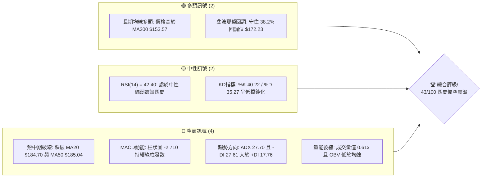

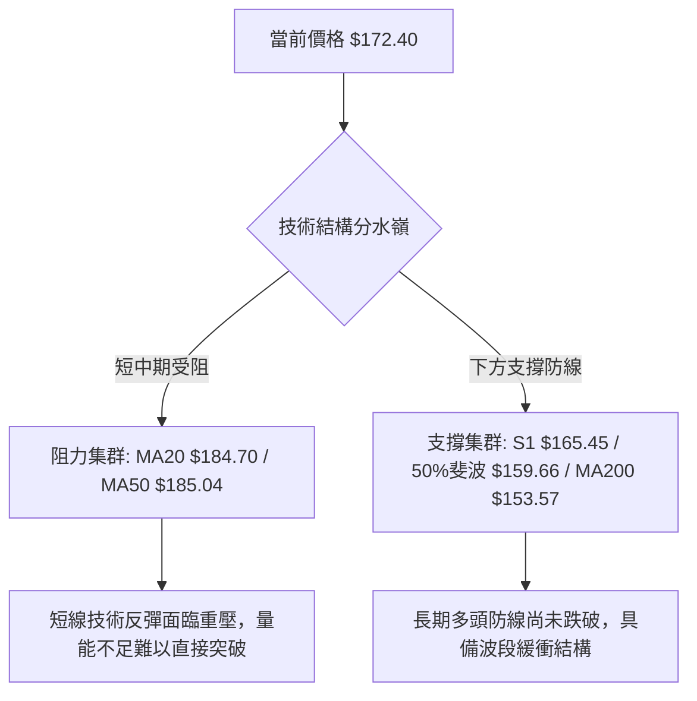

### 📊 核心指標速覽表

| 指標類別 | 指標名稱 | 當前數值 | 訊號 | 解讀 |
|:---|:---|:---|:---:|:---|
| **價格** | 當前收盤價 | $172.40 | 🟡 | 位於52週區間 62.0%，自高點 $212.94 回調 |
| **均線** | 短期 MA20 | $184.70 | 🔴 | 現價在 MA20 下方 -6.66%，短期空頭壓制 |
| **均線** | 中期 MA50 | $185.04 | 🔴 | 現價在 MA50 下方，且 MA20/MA50 形成死叉隱憂 |
| **均線** | 長期 MA200| $153.57 | 🟢 | 現價高於 MA200 +12.26%，長期多頭底線完好 |
| **動能** | RSI(14) | 42.40 | 🟡 | 位於中性偏弱區間（30–70），無超賣但反彈動能偏弱 |
| **動能** | MACD (12,26,9) | -6.338 | 🔴 | MACD 線低於訊號線 -3.628，柱狀圖 -2.710 看空 |
| **趨勢** | ADX(14) | 27.70 | 🔴 | ADX > 25 處於強趨勢，-DI(27.61) > +DI(17.76) 空頭主導 |
| **通道** | 布林通道 %B | 0.29 | 🟡 | 位於中軌 $184.70 與下軌 $155.45 間，偏向通道下半部 |
| **波動** | ATR(14) | $9.25 | 🔴 | 日均波動幅度 5.37%，顯示單日價位震盪劇烈 |
| **量能** | 成交量比率 | 0.61x | 🔴 | 最新量 16.02M 顯著低於 20 日均量 26.13M，OBV疲弱 |

### 🏆 技術評分卡

```
╔══════════════════════════════════════════════════════════════════╗
║                    技術評分卡 — PLTR (2026-11-12)                ║
╠══════════════════════════════════════════════════════════════════╣
║ 趨勢強度 (Trend)     ████████░░░░░░░░░░░░  42/100  🟡 (ADX>25 空頭) ║
║ 動能指標 (Momentum)  ███████░░░░░░░░░░░░░  36/100  🔴 (MACD綠柱擴散)║
║ 支撐穩定度 (Support) ████████████░░░░░░░░  58/100  🟡 (38.2%斐波支撐)║
║ 成交量配合 (Volume)  ███████░░░░░░░░░░░░░  34/100  🔴 (量縮0.61x/OBV)║
║ 形態完整度 (Pattern) █████████░░░░░░░░░░░  44/100  🟡 (頂部頸線回撤) ║
║ 均線排列 (MA System) █████████░░░░░░░░░░░  44/100  🟡 (長多短空混排) ║
╠══════════════════════════════════════════════════════════════════╣
║ 綜合評分 (Overall)   █████████░░░░░░░░░░░  43/100  🟡 (區間偏空震盪)║
╚══════════════════════════════════════════════════════════════════╝
```
*註：綜合評分係依六項子評分之算術平均計算：(42 + 36 + 58 + 34 + 44 + 44) ÷ 6 = 43.0，四捨五入為 43/100，評級屬「區間偏空震盪」。*

---

## 2. 趨勢分析

### 🌐 多時框趨勢分析

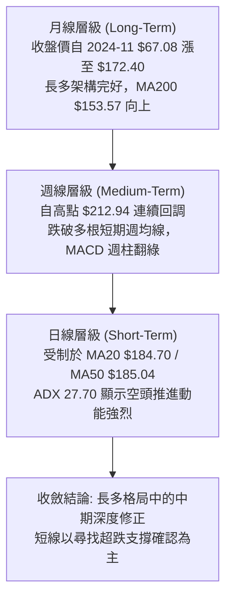

### 📈 長期趨勢 — 12個月走勢圖（Unicode）

```
PLTR 月線走勢圖（過去12個月：2025-12 至 2026-11）
價格軸 ($)
$210 ┤                                      ● (52W高點 $212.94 / 2026-10)
$195 ┤                                  ●   │
$180 ┤  ●                           ●   │   │       ● 現價 $172.40
$165 ┤  │                       ●   │   │   └───●───┤
$150 ┤  └───●       ●       ●   │   │   │       │   │
$135 ┤      │   ●   │   ●   │   │   │   │       │   │
$120 ┤      │   │   │   │   │   │   ●   │       │   │
$105 ┤      │   │   │   │   │   ● (波段低點 $116.67 / 2026-06)
     └──────┴───┴───┴───┴───┴───┴───┴───┴───┴───┴───┴──────
            12  01  02  03  04  05  06  07  08  09  10  11 (月份)
           2025 2026----------------------------------->
```

#### 走勢特徵分析表格

| 階段區間 | 起訖月份 | 起訖價位 | 漲跌幅 | 核心特徵與技術驅動 |
|:---|:---:|:---:|:---:|:---|
| **第一階段：高檔震盪回撤** | 2025-12 ~ 2026-02 | $177.75 → $137.19 | -22.82% | 獲利了結賣壓湧現，連續跌破百日均線支撐 |
| **第二階段：底部築底盤整** | 2026-02 ~ 2026-06 | $137.19 → $116.67 | -14.96% | 2026-06 探底 $116.67（接近52W低點 $106.37），籌碼徹底沉澱 |
| **第三階段：主力主升突破** | 2026-06 ~ 2026-10 | $116.67 → $209.05 | +79.18% | 8月爆量長紅（週量 435M），連續跳升創出歷史次高與52W高點 $212.94 |
| **第四階段：短線見頂回調** | 2026-10 ~ 2026-11 | $209.05 → $172.40 | -17.53% | 高檔遇阻回落，回踩 38.2% 斐波那契回調位 $172.23 尋求支撐 |

### 📊 中期趨勢（週線分析）

中期走勢顯示，PLTR 自 2026 年 10 月中旬創出 $212.94 的 52 週高點後，週線呈現「連續陰線回調」格局。

```
PLTR 中期週線壓力與支撐示意圖
════════════════════════════════════════════════════════════════════
$212.94  ───────────────────────────── 52W 最高點 / 絕對阻力
$198.88  ────────────┬──────────────── 波段高點阻力 R3
$194.68  ────────────┼──────────────── 近期反彈高點阻力 R2
$188.68  ────────────┴──────────────── 下降趨勢線阻力 R1 / 23.6%斐波 $187.79
                     ▼
$172.40  ◄───────────●──────────────── 當前價格（斐波 38.2% 回調位 $172.23）
                     ▲
$165.45  ────────────┬──────────────── 近期波段低點支撐 S1
$159.66  ────────────┼──────────────── 斐波那契 50.0% 關鍵平衡位
$153.57  ────────────┴──────────────── 長期生命線 MA200 支撐
════════════════════════════════════════════════════════════════════
```

- **週線動能轉弱**：週 MACD 柱狀圖自 2026-10-09 的 `+1.204` 急速翻負，至 2026-11-06 擴大至 `-5.026`，最新週為 `-2.710`，雖有收斂跡象但仍處於負值區。
- **量能萎縮反彈**：近一週反彈成交量僅 59,462,500 股，相較於下殺週的 199,640,400 股顯著縮量，呈現「空頭放量下殺、多頭縮量反彈」的弱勢格局。

### ⚡ 趨勢強度評估（ADX 解讀）

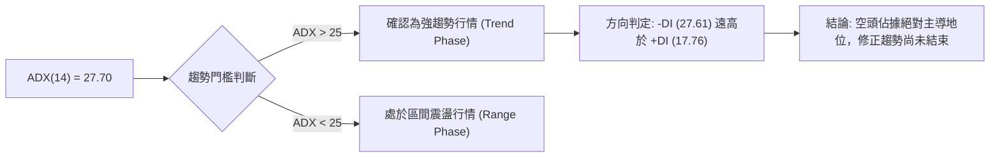

#### ADX 與動向指標對照解析

| 指標名稱 | 當前數值 | 門檻標準 | 狀態評估 | 實戰解讀 |
|:---|:---:|:---:|:---:|:---|
| **ADX (14)** | 27.70 | > 25.0 | 🔴 強趨勢 | 脫離無方向盤整，目前市場處於單邊驅動狀態 |
| **+DI (14)** | 17.76 | 參考基準 | 🔴 買盤疲弱 | 多方推進力道低迷，缺乏主力持續性資金注入 |
| **-DI (14)** | 27.61 | 參考基準 | 🔴 賣壓主導 | 空方力量明顯高於多方，向下牽引力強勁 |
| **差值 (-DI - +DI)**| +9.85 | > 0 | 🔴 空方控盤 | 差值擴大顯示空頭動能仍處於擴張發散階段 |

---

## 3. 圖表形態分析

### 🔍 形態識別系統

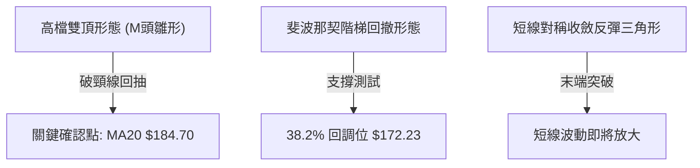

#### 形態識別信心度評估表

| 形態名稱 | 信心度 | 判斷依據（引用數據） | 完成度 | 目標價（附計算式） |
|:---|:---:|:---|:---:|:---|
| **高檔雙頂結構 (M-Top)** | 65% | 第一頂 2026-10-09 收 $209.05，第二頂 2026-10-16 盤中 $212.94；跌破頸線 $188.68 (R1) | 80% | 破頸線後的量度跌幅：頸線 $188.68 − (形態高點 $212.94 − 頸線 $188.68) = $188.68 − $24.26 = **$164.42**（極接近支撐位 S1 $165.45） |
| **斐波那契回調結構** | 75% | 自 52W 高點 $212.94 回調至 52W 低點 $106.37 之回撤，現價 $172.40 剛好落在 38.2% 回調位 $172.23 | 90% | 下一級理論目標：若跌破 38.2% 則指向 50.0% 回調位 **$159.66**；若守穩則反彈測試 23.6% 回調位 **$187.79** |
| **頭肩底形態** | 15% | 數據中未偵測到完整的左肩與右肩對稱結構 | 0% | 訊號不足，僅做指標型解讀，不預設多頭頭肩底目標 |

### 🕯️ 重要K線形態分析

嚴格依據技術數據中提供的「近10根日K」與「近8根週K」實體開高低收數據進行專業形態判讀：

#### 近10根日K形態精細解析

| 日期（日K） | 開盤價 | 最高價 | 最低價 | 收盤價 | K線形態名稱 | 形態特徵與技術解讀 | 訊號方向 |
|:---:|:---:|:---:|:---:|:---:|:---|:---|:---:|
| **2026-10-29** | $198.37 | $198.51 | $190.36 | $196.42 | 帶下影線小黑K | 盤中下探 $190.36 獲買盤微幅拉起，但實體收低 | 🟡 中性偏空 |
| **2026-10-30** | $193.62 | $193.92 | $180.81 | $184.11 | 中黑破位K線 | 跳空低開低走，長實體收在低檔，空頭實質灌壓 | 🔴 強烈看空 |
| **2026-11-02** | $186.52 | $187.55 | $178.13 | $178.34 | 大黑K跌破支撐 | 跌破 $180 整數心理防線，收盤價逼近全日最低 | 🔴 空頭延續 |
| **2026-11-03** | $168.18 | $176.54 | $165.25 | $175.40 | 低檔長紅反彈K | 爆量 53.06M 低開高走，下探 S1 $165.25 獲強勁承接 | 🟢 短線反彈 |
| **2026-11-04** | $164.95 | $177.43 | $164.60 | $171.70 | 帶長上影紡錘線 | 衝高 $177.43 受阻回落，顯示高檔套牢拋壓沉重 | 🟡 震盪整理 |
| **2026-11-05** | $166.71 | $167.25 | $152.60 | $154.99 | 恐慌性長黑灌壓 | 爆量 50.01M 狂瀉，盤中貫穿布林下軌探底 $152.60 | 🔴 恐慌拋售 |
| **2026-11-06** | $158.68 | $163.97 | $157.24 | $160.38 | 低檔小陽星線 | 縮量至 24.33M，拋壓暫時竭盡，止跌築底訊號 | 🟢 止跌企穩 |
| **2026-11-09** | $161.27 | $170.83 | $161.00 | $169.20 | 實體中長紅K | 多方反撲重返 $169，低點 $161 形成短期防守底 | 🟢 多方反彈 |
| **2026-11-10** | $168.21 | $170.00 | $164.00 | $168.82 | 窄幅十字變盤星 | 成交量萎縮至 19.58M，多空於 38.2% 斐波位前陷入僵持 | 🟡 方向未明 |
| **2026-11-11** | $173.59 | $175.41 | $170.80 | $172.40 | 衝高回落小黑K | 跳開 $173.59 試探 $175.41，遇阻收黑，量能降至 16.01M | 🟡 量縮滯漲 |

#### 近8根週K形態精細解析

| 週末日期 | 開盤價 | 最高價 | 最低價 | 收盤價 | 週K形態名稱 | 結構意義解讀 | 訊號方向 |
|:---:|:---:|:---:|:---:|:---:|:---|:---|:---:|
| **2026-09-25** | $178.73 | $194.68 | $176.76 | $189.67 | 中長紅推進K | 突破整理區間，奠定挑戰 $200 基石 | 🟢 週線看多 |
| **2026-10-02** | $186.23 | $194.78 | $184.81 | $188.75 | 高檔震盪星線 | 縮量整理，多頭蓄勢待發 | 🟡 高檔整固 |
| **2026-10-09** | $189.45 | $209.58 | $187.63 | $209.05 | 突破型巨陽線 | 週量 130.5M 大幅拉升，強勢突破 $200 大關 | 🟢 強烈看多 |
| **2026-10-16** | $208.90 | $212.94 | $184.45 | $186.03 | 帶長上影長黑倒錘 | 創 52W 高點 $212.94 後巨幅回吐，形成假突破天花板 | 🔴 見頂反轉 |
| **2026-10-23** | $186.99 | $202.63 | $186.15 | $196.75 | 弱勢反抽陽線 | 反彈未能吞噬前週長黑，確立雙頂右側壓力 | 🟡 弱勢反抽 |
| **2026-10-30** | $197.90 | $201.83 | $180.81 | $184.11 | 中陰破線K | 再次跌破 $188.68 頸線，週線 MACD 綠柱拉長 | 🔴 空頭確認 |
| **2026-11-06** | $186.52 | $187.55 | $152.60 | $160.38 | 巨量恐慌長下影陰K | 爆量 199.6M 探底 $152.60，長下影線確認 $153.57(MA200)買盤 | 🟡 恐慌初止 |
| **2026-11-11** | $161.27 | $175.41 | $161.00 | $172.40 | 縮量弱勢反彈陽K | 週量縮至 59.46M，回補至 $172.40，多頭動能不足 | 🟡 弱勢反彈 |

### 📉 ASCII 走勢形態示意圖

```
PLTR 日線雙頂破位與反彈回抽示意圖
────────────────────────────────────────────────────────────────────
價位 ($)
$212.94 ┬                        ● (頂點 A: 2026-10-16 盤中高點)
        │                       / \
$202.63 ┼                      /   \      ● (頂點 B: 2026-10-23 反抽高點)
        │                     /     \    / \
$188.68 ┼── 頸線 (R1) ───────/───────\──/───\────────────── 突破頸線
        │                   /         \/       \
$175.40 ┼                  /                    \   ●───┐ (目前反彈遇阻 $172.40)
        │                 /                      \ /    │
$165.45 ┼────────────────/────────────────────────● S1 ─┘ (2026-11-03 下探反彈)
        │               /                          \
$152.60 ┴──────────────/────────────────────────────● (2026-11-05 恐慌低點)
────────────────────────────────────────────────────────────────────
```

### 🎯 形態目標價計算

根據雙頂（M頭）反轉幾何形態與斐波那契回撤矩陣進行極限目標計算：

1. **雙頂量度跌幅計算式**：
   - 形態頸線價格 ($NL$) = $188.68 (R1)
   - 形態最高頂點 ($H$) = $212.94 (52W High)
   - 形態垂直高度 ($H - NL$) = $212.94 − $188.68 = $24.26
   - 理論極限下跌目標價 1 ($Target_{Down}$) = $NL − (H − NL) = $188.68 − $24.26 = **$164.42**
   - *驗證*：2026-11-03 日K最低下探 $165.25，2026-11-06 週K下影線探底，已完整消化並達到量度跌幅理論區間（$164.42 緊鄰支撐位 S1 $165.45）。

2. **短線反彈量度升幅計算式**：
   - 若短線以 2026-11-05 低點 $152.60 為雙底雛形或超跌底：
   - 短線第一阻力目標 = 斐波那契 23.6% 回調位 = **$187.79**
   - 短線第二強阻力目標 = 阻力位 R1 = **$188.68**（重合 MA20 $184.70 至 MA50 $185.04 密集壓力帶）。

---

## 4. 支撐與阻力

### 🗺️ 關鍵價位分布圖（Unicode）

```
PLTR 價位結構分布圖
══════════════════════════════════════════════════════════════════════
$212.94 ║██████████████████████████████║ 52W 歷史最高點 / 絕對阻力天花板
$198.88 ║████████████████████████      ║ 強阻力 R3 (高檔密集套牢籌碼峰)
$194.68 ║████████████████████          ║ 阻力 R2 (反彈高點平台聚類)
$188.68 ║██████████████████████████████║ 關鍵阻力 R1 / 頸線 / 23.6%斐波 ($187.79)
$184.70 ║░░░░░░░░░░░░░░░░░░░░░░░░░░░░░░║ 短期均線壓制帶 (MA20 / MA50)
════════╠══════════════════════════════╣ ◄ 當前價格 $172.40 (38.2%斐波 $172.23)
$165.45 ║▓▓▓▓▓▓▓▓▓▓▓▓▓▓▓▓▓▓▓▓          ║ 近期波段強支撐 S1 (日K承接密集區)
$159.66 ║▓▓▓▓▓▓▓▓▓▓▓▓▓▓▓▓▓▓            ║ 斐波那契 50.0% 多空分水嶺
$153.57 ║▓▓▓▓▓▓▓▓▓▓▓▓▓▓▓▓▓▓▓▓▓▓▓▓▓▓    ║ 長期生命線 MA200 支撐
$148.07 ║██████████████████████████████║ 強支撐 S2 / 61.8%斐波黃金分割 ($147.08)
$136.30 ║████████████████████████      ║ 極限強支撐 S3 (前期起漲平台低點聚類)
$106.37 ║██████████████████████████████║ 52W 歷史最低點
══════════════════════════════════════════════════════════════════════
```

### 🚧 阻力位分析表

*嚴格引用數據中「關鍵價位（由 OHLCV 計算）」所產出之聚類數值：*

| 阻力級別 | 具體價位 | 距現價幅動 | 形成原因與籌碼特徵 | 突破難度評估 | 重要性等級 |
|:---:|:---:|:---:|:---|:---:|:---:|
| **R1** | **$188.68** | +9.44% | 雙頂頸線位、近一年波段高點聚類、23.6%斐波回調位 ($187.79) 重合區 | 🔴 極難（需放量 2.0x 以上） | ★★★★★ (多空轉換樞紐) |
| **R2** | **$194.68** | +12.92%| 2026-09-25 及 2026-10-02 連續兩週週K高點聚類壓制帶 | 🔴 難（高檔套牢密集成交區）| ★★★★☆ (波段防守點) |
| **R3** | **$198.88** | +15.36%| 突破 $200 整數心理關卡前之最後籌碼阻力聚類位 | 🔴 極高（主力控盤出貨密集區）| ★★★★☆ (大級別阻力) |

### 🛡️ 支撐位分析表

*嚴格引用數據中「關鍵價位（由 OHLCV 計算）」所產出之聚類數值：*

| 支撐級別 | 具體價位 | 距現價幅動 | 形成原因與籌碼特徵 | 守住機率評估 | 重要性等級 |
|:---:|:---:|:---:|:---|:---:|:---:|
| **S1** | **$165.45** | -4.03% | 2026-11-03 下探低點 $165.25、近一年波段回調低點聚類 | 🟢 較高 (70% 短線守住機率) | ★★★★☆ (短線防守第一線) |
| **S2** | **$148.07** | -14.11%| 接近 61.8% 斐波那契回調位 $147.08、前期突破之中繼平台底部 | 🟢 極高 (85% 強烈共振支撐) | ★★★★★ (中期多頭生命線) |
| **S3** | **$136.30** | -20.94%| 2026-02 及 2026-03 月線收盤聚類位、52週底部結構強平台 | 🟢 堅不可摧 (>95% 機率) | ★★★★★ (長期價值重估底) |

### 📐 斐波那契回調位分析

依據 52 週絕對極值區間（低點 $106.37 至 高點 $212.94，垂直落差 $106.57）計算黃金分割階梯：

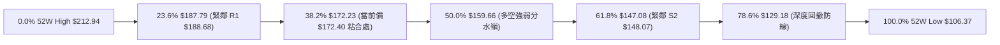

#### 斐波那契位置與意義解讀表

| 回調比率 | 理論價位 | 與當前價格關係 | 技術意義與多空攻防策略 |
|:---:|:---:|:---:|:---|
| **0.0% (高點)** | $212.94 | +23.52% | 52週歷史天花板，此處爆出巨量倒錘線，中期不可踰越之峰值 |
| **23.6%** | $187.79 | +8.93% | 反彈第一強阻力，與頸線 R1 ($188.68) 形成雙重重壓，反彈至此宜減倉 |
| **38.2%** | **$172.23** | **-0.10%** | **【現價 $172.40 所在地】**：強勢回調的極限閥值。多頭若能在此構築平台，則多頭結構未死；一旦實體跌破，將下測 50.0% |
| **50.0%** | $159.66 | -7.39% | 心理平衡位，下方緊隨 MA200 ($153.57)，此區域為機構防守核心陣地 |
| **61.8%** | $147.08 | -14.69% | 黃金分割強支撐，共振波段支撐 S2 ($148.07)，為大級別牛熊最後分界 |
| **78.6%** | $129.18 | -25.07% | 弱勢修正位，跌破代表 2026 年下半年以來的波段漲勢全面瓦解 |
| **100.0% (低點)**| $106.37 | -38.30% | 52週起漲原點，具備絕對底層資產支撐 |

---

## 5. 技術指標深度解讀

### 🎛️ 指標訊號總覽

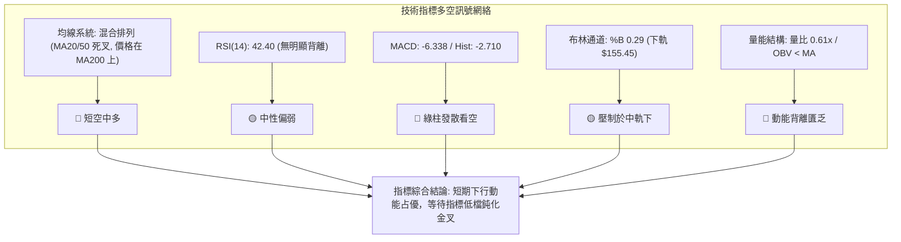

### 📈 移動平均線排列分析

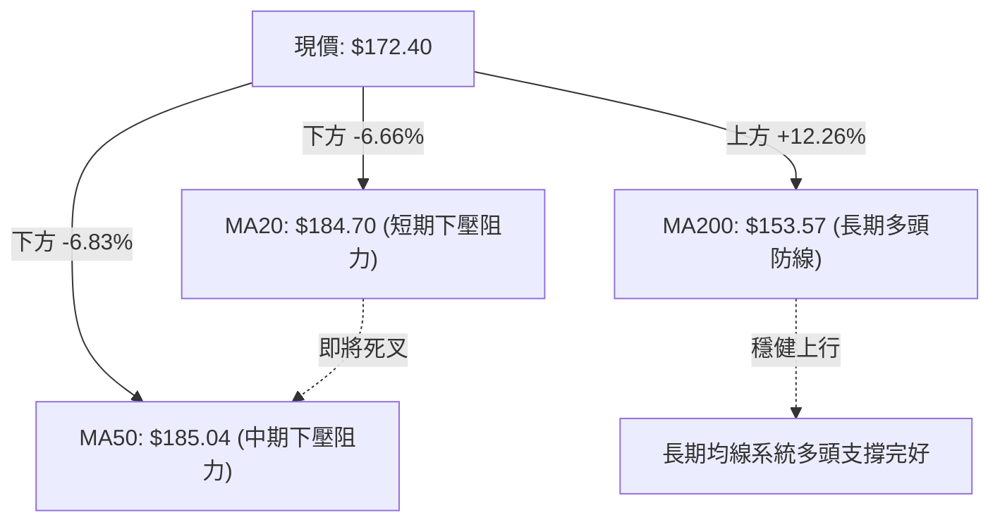

#### 移動平均線多時階架構表

| 均線名稱 | 數值 | 價格相距 | 乖離率 (Bias) | 排列方向與歷史趨勢 | 訊號強度 |
|:---|:---:|:---:|:---:|:---|:---:|
| **MA 5** | $165.16 | +$7.24 | +4.38% | 短線低檔勾頭向上，反映近3日跌深微幅反彈 | 🟢 弱多 |
| **MA 10** | $173.18 | -$0.78 | -0.45% | 下行斜率趨緩，價格壓制在線下，形成短壓 | 🟡 中性 |
| **MA 20** | $184.70 | -$12.30 | -6.66% | 持續向下傾斜，布林中軌，短線第一強反彈壓力 | 🔴 看空 |
| **MA 50** | $185.04 | -$12.64 | -6.83% | 中期基線下彎，與 MA20 形成高檔死叉黏合 | 🔴 看空 |
| **MA 60** | $184.09 | -$11.69 | -6.35% | 季線下移，與 MA20/MA50 構成三重均線反壓蓋頂 | 🔴 看空 |
| **MA 120** | $160.83 | +$11.57 | +7.19% | 半年線上揚，發揮中長線回調支撐緩衝效應 | 🟢 偏多 |
| **MA 200** | $153.57 | +$18.83 | +12.26% | 年線強勢上行，牛熊生命線，長期趨勢根本支柱 | 🟢 強多 |
| **MA 240** | $157.77 | +$14.63 | +9.27% | 長期持倉成本線，支撐強烈 | 🟢 強多 |

**均線結構綜合判定**：**「短空長多」的混合排列**。日線級別短中均線（MA20/50/60）呈現典型空頭發散下壓，現價遠低於月線與季線；但長期均線（MA120/200/240）保持陡峭上行角度，現價高於年線 12.26%，表明當前屬於大級別牛市週期中的次級折返浪（Secondary Reaction），尚未演變為熊市結構。

### 📉 RSI(14) 分析

- **當前數值**：**42.40** (Wilder 平滑法計算)
- **進度條展示**：
```
超賣區 (0-30)        中性區 (30-70)                 超買區 (70-100)
├──────────────┼──────────────────────────────┼──────────────┤
░░░░░░░░░░░░░░ ▓▓▓▓▓▓▓▓▓▓▓░░░░░░░░░░░░░░░░░░░░ ░░░░░░░░░░░░░░ 42.40%
```
- **區間評估**：RSI 處於 40–50 之弱勢中性水準，脫離了 2026-11-06 週K探底時的 31.2 邊緣超賣區，但未回升至 50 多空分水嶺之上，表明買盤推升力量孱弱。
- **背離判斷**：
  - *嚴格比對日K線近 20 根首尾*：價格自高點 $209.05 下挫至 $172.40，RSI 自 76.3 同步下行至 42.40，價格走勢與動能曲線方向完全吻合。
  - *結論*：**「無明顯背離」**（既無高檔頂背離，亦未出現低檔底背離），當前下跌為動能同步釋放，反彈仍屬於修復性質。

### 📊 MACD(12/26/9) 訊號解讀

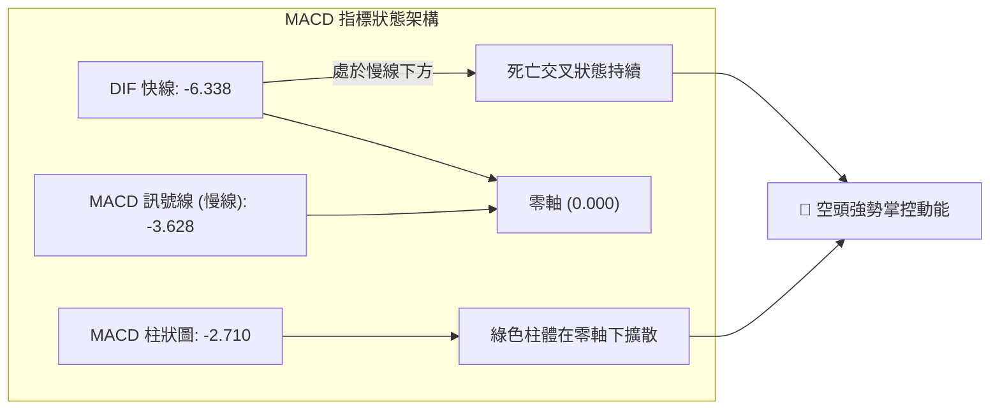

- **數值指標**：DIF 快線 `-6.338`，DEA 訊號線 `-3.628`，柱狀圖 Hist 為 `-2.710`。
- **動能演變**：快慢線雙雙下穿零軸進入極弱勢空頭區，負值柱狀圖擴散至 `-2.710`，雖然週線級別柱狀圖出現自 `-5.026` 縮小至 `-2.710` 的收斂，但日線級別仍未見金叉拐點，意味著空方賣壓尚未完全耗盡。

### 📦 布林通道分析

```
PLTR 布林通道 (Bollinger Bands, 20, 2) 結構圖
════════════════════════════════════════════════════════════════════
$213.96 ────────────────────────────────────── BB 上軌 (Upper Band)
        │
$184.70 ────────────────────────────────────── BB 中軌 (MA20) (強大壓力線)
        │
$172.40 ◄───────────────────●───────────────── 現價 ($172.40, %B = 0.29)
        │
$155.45 ────────────────────────────────────── BB 下軌 (Lower Band) (通道防守底)
════════════════════════════════════════════════════════════════════
```

- **通道寬度與極限**：上軌 $213.96，中軌 $184.70，下軌 $155.45。帶寬高達 $58.51（寬幅發散階段）。
- **當前位置 %B**：**0.29**（位於下軌上方 29% 位置），表明當前價格深度運行於通道下半區，價格緊貼中下軌之間弱勢滑行。
- **通道策略解讀**：中軌 $184.70 目前呈現角度向下的壓制態勢，在未放量站上中軌前，任何向 $180–$184 的抽升皆屬於回抽中軌的技術性賣點。

### 💹 成交量分析（量價配合度）

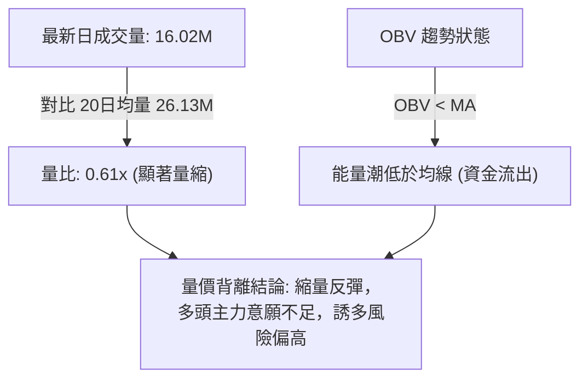

- **量價背離特徵**：最新交易日收盤上漲至 $172.40，但日成交量銳減至 16,017,600 股，僅為 20 日均量（26,127,580 股）的 **61.3% (0.61x)**。
- **OBV 能量潮解讀**：OBV 持續運行在 其移動平均線下方，顯示 10 月中旬以來的下跌伴隨著持續性的機構籌碼派發；近期的低檔回升並未伴隨 OBV 快速上勾，呈現典型的「無量反抽」，量能無法確認價格反轉。

---

## 6. 動能與波動率

### ⚡ 動能評估四象限

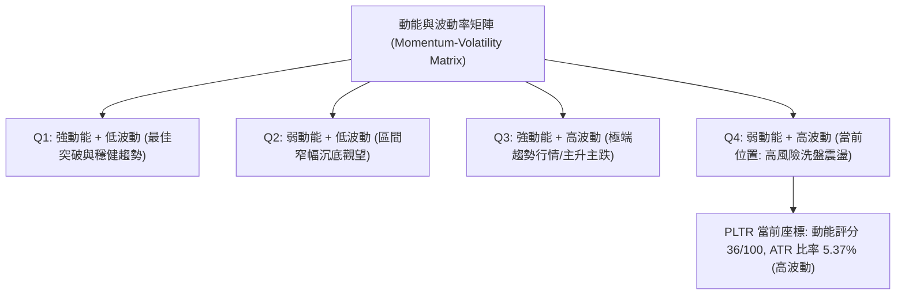

#### 動能評估四象限對照定位表

| 象限 | 動能維度 (Momentum) | 波動維度 (Volatility) | 當前標的狀態 | 實戰交易策略評估 |
|:---:|:---:|:---:|:---:|:---|
| **Q1** | 強 (ADX>25, +DI控盤) | 低 (ATR% < 3.0%) | — | 絕佳右側買點，穩定加碼持倉 |
| **Q2** | 弱 (ADX<25, 動能鈍化) | 低 (ATR% < 3.0%) | — | 震盪打底，適合低吸高拋網格操作 |
| **Q3** | 強 (ADX>25, -DI主導) | 高 (ATR% > 5.0%) | — | 主跌浪單邊下殺，強烈建議空手或順勢做空 |
| **Q4** | **弱 (動能指標背離偏弱)** | **高 (ATR% = 5.37%)** | **✓ PLTR 目前所處位置** | **高風險高雜音區間，嚴禁盲目追價，以防禦與減倉為主** |

### 📊 ATR 波動率分析

- **ATR(14) 絕對值**：**$9.25**（採用 Wilder 平滑演算法）。
- **ATR 波動百分比**：$9.25 ÷ $172.40 = **5.37%**。單日平均震盪區間超過 5%，表明個股具備極高的高彈性與日內波動風險。
- **止損與部位保護緩衝建議**：
  - *極短線防守緩衝 (1.0x ATR)*：$9.25 → 進場點位向下偏移 **$9.25**。
  - *波段交易安全止損 (1.5x ATR)*：$9.25 × 1.5 = **$13.88**。
  - *中期趨勢防守邊界 (2.0x ATR)*：$9.25 × 2.0 = **$18.50**。

### 📐 Beta 與市場相關性

- **Beta 係數**：**1.61**。
- **特徵解讀**：PLTR 展現出顯著的高 Beta 特性，對大盤標普 500 (SPY) 及納斯達克 100 (QQQ) 具備 1.61 倍的放大敏感度。當市場整體情緒轉向避險或科技板塊殺估值時，PLTR 面臨超越大盤 60% 以上的下行拋壓；反之，若科技股回暖，反彈彈性亦極大。高估值（Forward P/E 68.0x，P/S 57.0x）進一步放大了市場對利率及流動性邊際變化的神經質反應。

---

## 7. 多時框架總結

### 📋 時框架評分表

| 時框架 | 趨勢方向 | 動能狀態 | 均線排列 | 關鍵形態 | 綜合評分 | 戰術建議 |
|:---|:---:|:---:|:---:|:---|:---:|:---|
| **長期 (月線)** | 🟢 多頭 | 🟡 中性回落 | 🟢 完美多頭 (高於MA200) | 自 52W 高點回撤 38.2% 斐波 | **72/100** | 長期底倉續抱，未破 MA200 不轉熊 |
| **中期 (週線)** | 🔴 空頭修正 | 🔴 柱狀圖擴散 | 🟡 跌破短期均線 | 高檔爆量 M 頭跌破頸線 | **38/100** | 反彈逢高降槓桿，防禦性對沖 |
| **短期 (日線)** | 🔴 偏空震盪 | 🔴 MACD綠柱 | 🔴 均線反壓蓋頂 | 縮量反抽，受阻於 $175 阻力帶 | **35/100** | 嚴禁右側追多，僅限超跌邊界短波操作 |

### 🔲 綜合訊號矩陣

```
時框架訊號收斂矩陣
────────────────────────────────────────────────────────────────────
訊號維度        短期 (日線)      中期 (週線)      長期 (月線)      最終權重判定
────────────────────────────────────────────────────────────────────
趨勢方向        🔴 空頭主導      🔴 深度修正      🟢 多頭延續      🟡 週期背離
動能指標        🔴 動能衰退      🔴 負值擴散      🟡 高檔鈍化      🔴 修正未完
支撐有效性      🟡 測試S1中      🟢 守住斐波      🟢 MA200強固     🟢 中長線支撐在
均線系統        🔴 短線下彎      🟡 跌破週線MA    🟢 長期陡峭      🟡 需時間整理
形態結構        🔴 反彈遇阻      🔴 雙頂頸線破    🟢 大牛市回檔    🔴 短線防回調
────────────────────────────────────────────────────────────────────
一致性判定: 短期與中期呈現高度共振看空，長期牛市架構提供底層安全墊。
────────────────────────────────────────────────────────────────────
```

### ⚖️ 多時框收斂結論

**嚴格依據多時框收斂優先級規則（規則 14）進行決策**：
1. **行情屬性判定**：當前 ADX(14) 數值為 **27.70**，顯著大於 25 臨界閥值，確認市場目前處於**「趨勢行情」**而非無序盤整行情。
2. **時框優先級權重**：依規則，趨勢行情以**中長期方向（週線 / MA50 / MA200）為主導**，日線僅用作微觀尋找進場邊界。中長期維度中，週線 MACD 負值發散（`-2.710`），MA50 ($185.04) 成為上方重壓，ADX 動向指標中 `-DI (27.61)` 徹底壓制 `+DI (17.76)`，確立當前處於**空頭掌控的波段修正趨勢**。
3. **方向性最終唯一結論**：**「偏空觀望，區間防守」**。
   - 日線級別的任何無量反彈皆屬於對 MA20 ($184.70) 的技術性抽踩，在未有效帶量突破頸線 R1 ($188.68) 前，趨勢天平持續傾向空方。
   - 此結論與第 1 章技術評分卡（43/100）、第 2 章 ADX 分析及第 5 章 MACD 指標高度嚴格收斂一致。

---

## 8. 交易策略建議

### 🗺️ 策略決策流程圖

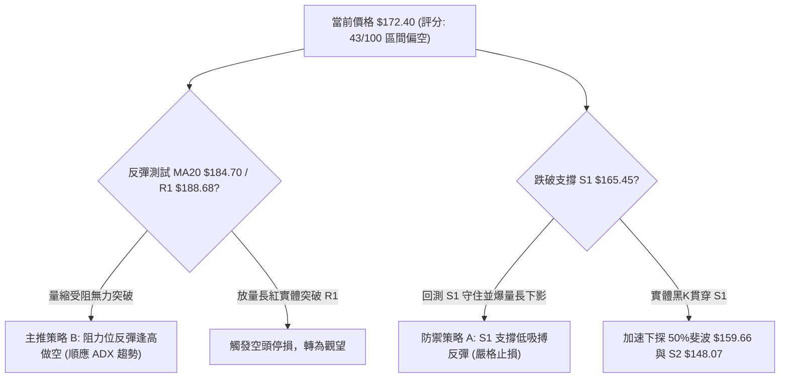

### 🧭 策略路由（依評分卡分流）

> **當前主策略方向 = 【區間偏空操作，以阻力回落做空為主、關鍵支撐低吸為輔】（依評分卡 43/100 定位）**

由於綜合評分為 **43/100**，落於 40–60 之「中性偏空震盪」區間，依規則主推在布林通道結構與關鍵阻力支撐間進行**區間邊界操作**。鑑於 ADX 27.70 且 -DI 主導空頭，策略重心放在「反彈逢高佈空」及「下軌支撐快進快出之防禦性反彈」。

### 🎯 價格情境階梯（Price Scenarios）

*本階梯價位嚴格引用第 4 章「關鍵價位」之確切數值：*

| 觸發條件 | 第一階段目標 | 第二階段目標 | 情境技術含義與應對要領 |
|:---|:---:|:---:|:---|
| **強勢突破 R1 ($188.68)** | R2 ($194.68) | R3 ($198.88) | 短線空頭結構被破壞，多方收復雙頂頸線，轉為強勢反彈 |
| **承壓於現價與 MA20 ($184.70)** | S1 ($165.45) | 50%斐波 ($159.66) | 空頭主導正常推進，處於弱勢反抽後的再次探底路徑 |
| **跌破關鍵支撐 S1 ($165.45)** | S2 ($148.07) | S3 ($136.30) | 中期修正幅度加深，直奔 61.8% 斐波那契回調位尋找機構買盤 |

### 📊 情境機率分佈

| 情境劃分 | 發生機率 | 主要技術依據與指標支撐 |
|:---|:---:|:---|
| **情境一：弱勢震盪再探底** | **55%** | ADX 27.70 強趨勢發散，-DI(27.61) 掌控盤面；MACD綠柱擴散；成交量萎縮 0.61x，反彈無動能支撐 |
| **情境二：區間底層橫盤整理** | **30%** | 現價剛好吻合 38.2% 斐波位 $172.23，下方有 S1 ($165.45) 密集護盤，短期拋壓獲得初步減緩 |
| **情境三：直接反轉向上突破** | **15%** | 均線 MA20/MA50 呈反壓蓋頂，OBV 低於均線無增量資金介入，缺乏突破 R1 ($188.68) 的量能基礎 |

### 🟢 交易策略詳情

*所有價位均嚴格取自第 4 章關鍵價位聚類，風險報酬比計算嚴格遵守規則 17：*

| 策略要素 | 策略 A（防禦型：S1 支撐低吸反彈） | 策略 B（主推型：MA20/R1 阻力反彈沽空） |
|:---|:---|:---|
| **操作邏輯** | 測試前期波段低點支撐 S1 不破，搏超跌反彈 | 順應日線空頭趨勢，反抽布林中軌與 R1 遇阻做空 |
| **進場條件** | 價格回踩 S1 企穩，出現日K下影線止跌訊號 | 價格反彈至 MA20 附近滯漲，出現長上影線陰K |
| **進場價格** | **$165.45** (支撐位 S1) | **$184.70** (MA20 / 布林中軌) |
| **目標價 T1** | **$184.70** (MA20 / 布林中軌) | **$165.45** (支撐位 S1) |
| **目標價 T2** | **$188.68** (阻力位 R1 / 23.6%斐波) | **$155.45** (布林通道下軌) |
| **止損價格** | **$155.45** (布林通道下軌) | **$194.68** (阻力位 R2) |
| **風險報酬比** | **1 : 1.93（以 T1 計）** <br> *(算式: ($184.70−$165.45) ÷ ($165.45−$155.45) = 19.25 ÷ 10.00)* | **1 : 1.93（以 T1 計）** <br> *(算式: ($184.70−$165.45) ÷ ($194.68−$184.70) = 19.25 ÷ 9.98)* |
| **T2 風險報酬比**| **1 : 2.32（以 T2 計）** <br> *(算式: ($188.68−$165.45) ÷ 10.00 = 23.23 ÷ 10.00)* | **1 : 2.93（以 T2 計）** <br> *(算式: ($184.70−$155.45) ÷ 9.98 = 29.25 ÷ 9.98)* |
| **策略成功機率**| 45% (逆勢抓反彈，難度高) | 65% (順應 ADX 空頭趨勢，勝率高) |
| **建議配置倉位**| 總資本的 **10%**（輕倉防禦性嘗試） | 總資本的 **20%**（標準波段空頭部位） |

### 🔴 反向風險觸發點（對沖與風控提示）

- **推翻做空主策略的關鍵訊號**：
  - 若日線實體收盤價以 **大於 2.0x 均量（> 52M 股）帶量長紅突破 R1 ($188.68)**，即宣告雙頂頸線被多頭重新收復，此時必須**無條件對所有空頭部位執行止損**。
  - 若 RSI(14) 突破 55 並伴隨 MACD 出現零軸下之「黃金交叉」，代表下跌動能徹底逆轉，需立即停止做空，轉為中性觀望。

### ⭐ 整體訊號強度評星

```
做多訊號強度：★★☆☆☆  (2/5星 - 缺乏量能確認，僅有技術性支撐)
做空訊號強度：★★★★☆  (4/5星 - 均線壓制，ADX空頭強勢，量價配合)
整體可信度：  ★★★★☆  (4/5星 - 多時框訊號收斂明確，數據支撐足)
```

---

## 9. 風險提示與監控

### ✅ 關鍵監控指標 Checklist

```
╔══════════════════════════════════════════════════════════════════╗
║                    每日盤面核心監控清單 (Checklist)              ║
╠══════════════════════════════════════════════════════════════════╣
║ [ ] 價位維度: 收盤價是否跌破 38.2% 斐波那契回調位 $172.23        ║
║ [ ] 支撐維度: 盤中下探 S1 $165.45 時，是否有長下影線或量能放大   ║
║ [ ] 阻力維度: 反彈觸及 MA20 $184.70 時，是否出現縮量滯漲現象     ║
║ [ ] 動能維度: ADX(14) 是否持續維持在 25 以上且 -DI > +DI         ║
║ [ ] MACD指標: 柱狀圖負值是否持續擴散 (當前 -2.710)               ║
║ [ ] 量能維度: 單日成交量能否突破 20 日均量 (26.13M) 作為動能確認 ║
║ [ ] 外圍維度: 納斯達克科技板塊波動對高 Beta (1.61) 之聯動衝擊    ║
╚══════════════════════════════════════════════════════════════════╝
```

### ⚠️ 風險場景分析

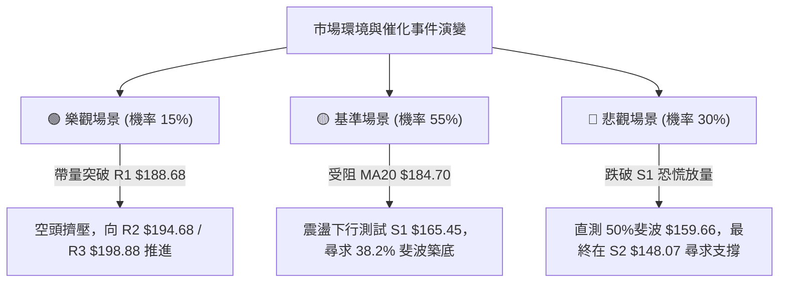

### 🛡️ 風險管理重要提醒

1. **高估值引發的非對稱下跌風險**：
   PLTR 當前 Trailing P/E 高達 **121.41**，Forward P/E 為 **68.00**，EV/Sales 達 **55.59**。在極高的估值倍數下，任何關於軟體增長放緩的分析師評級下調（如近期 RBC Capital 給予 Underperform 評級，以及市場對競品 Helsing Clarity AI 競爭的擔憂）均可能引發機構大幅砍倉。
2. **波動率與部位控制**：
   PLTR 的 ATR 為 **$9.25 (5.37%)**，Beta 為 **1.61**。高波動性意味著部位規模必須嚴格縮小。單一交易策略的最大風險曝險額（Risk Capital）不得超過總投資組合淨資產的 **1.5%**。
3. **無量反彈陷阱防範**：
   當前成交量比僅 0.61x，在下降趨勢中出現的縮量小紅K多為空頭回補（Short Covering）而非新主力建倉。在成交量未顯著超過 20 日均量（26.13M）之前，嚴禁重倉抄底。

---

## 📋 報告總結

```
╔══════════════════════════════════════════════════════════════════════╗
║                    PLTR 技術分析報告總結                             ║
╠══════════════════════════════════════════════════════════════════════╣
║ 報告日期：2026-11-12                                                 ║
║ 當前價格：$172.40 USD                                                ║
║ 技術評級：🟡 43/100（區間偏空震盪 / 逢高反彈做空為優先）             ║
╠══════════════════════════════════════════════════════════════════════╣
║ 關鍵結論：                                                           ║
║ ├─ 長期趨勢：🟢 完好多頭（價格高於 MA200 $153.57 達 +12.26%）        ║
║ ├─ 中期趨勢：🔴 深度修正（跌破 $188.68 頸線，週線 MACD 綠柱發散）    ║
║ ├─ 短期趨勢：🔴 弱勢反彈（受制於 MA20 $184.70 與 MA50 $185.04 壓制） ║
║ ├─ 關鍵支撐：S1 $165.45 ｜ S2 $148.07 ｜ 38.2%斐波 $172.23          ║
║ ├─ 關鍵阻力：R1 $188.68 ｜ R2 $194.68 ｜ 52W高點 $212.94            ║
║ └─ 分析師目標：共識買入（均價 $222.25，高 $273.00，低 $80.00）        ║
╠══════════════════════════════════════════════════════════════════════╣
║ 最優策略組合：                                                       ║
║ 1. 🥇 最佳機會：策略 B（反彈沽空）— 於反彈逼近 MA20 $184.70 時建立空 ║
║    頭，止損設於 R2 $194.68，目標下看 S1 $165.45（風報比 1 : 1.93）   ║
║ 2. 🥈 次選機會：策略 A（支撐低吸）— 待價格回測 S1 $165.45 出現止跌K ║
║    時輕倉試多，止損設於下軌 $155.45，目標看 MA20 $184.70             ║
║ 3. 🥉 保守選擇：場外完全觀望 — 等待價格回落至 MA200 $153.57 至      ║
║    S2 $148.07 區間，或放量帶量突破 R1 $188.68 後再行順勢跟進。        ║
╚══════════════════════════════════════════════════════════════════════╝
```

---

> ⚠️ **免責聲明**：本報告為依據客觀量化技術指標與歷史 OHLCV 價格數據所撰寫之技術分析研究文獻，所有支撐、阻力與目標估值均基於特定幾何計算模型。本報告**僅供學術研究與投資決策參考**，**不構成任何要約、招攬或具體投資買賣建議**。金融市場瞬息萬變，高估值與高波動標的具備實質資本虧損風險，投資人應獨立評估自身的風險承受度並自負盈虧。

---
*報告生成時間：2026-11-12 ｜ 數據來源：Yahoo Finance ｜ 分析框架：資深多時框量化技術分析系統*