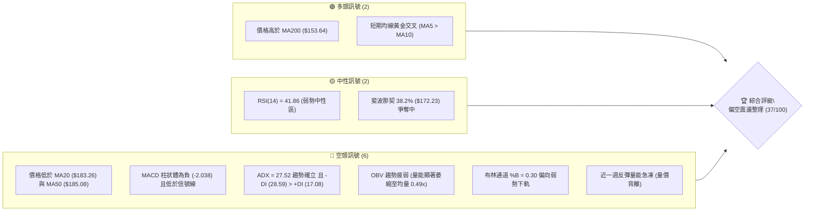
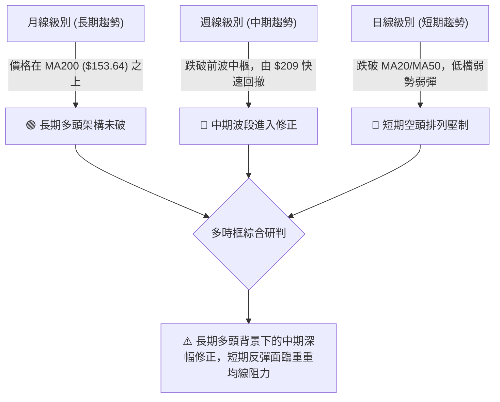
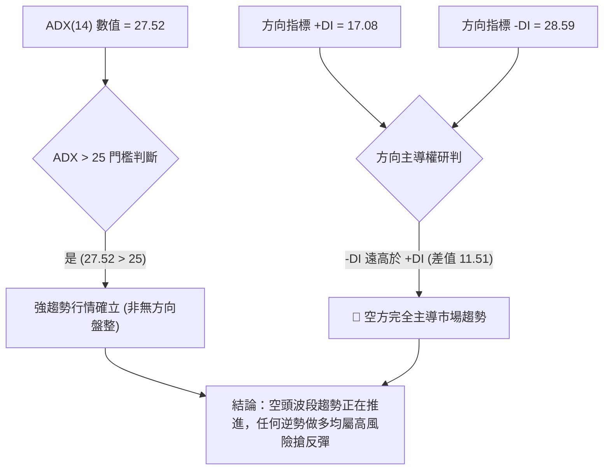
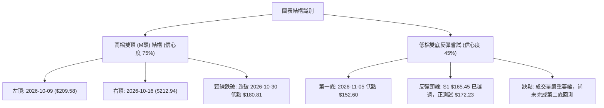
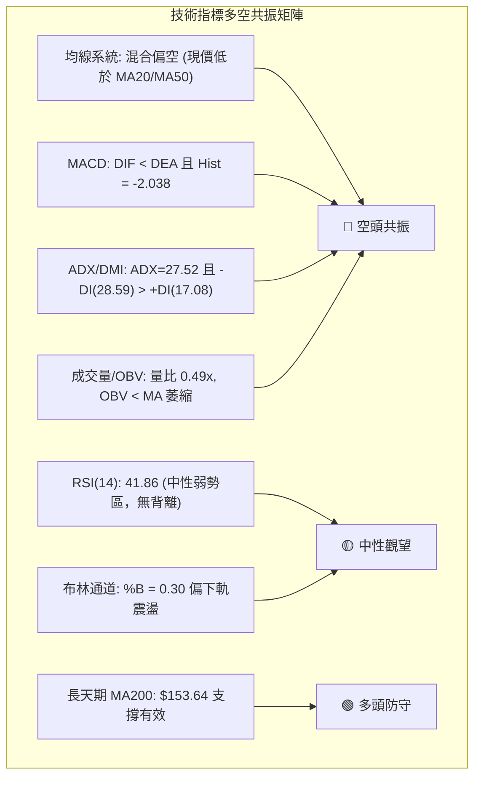
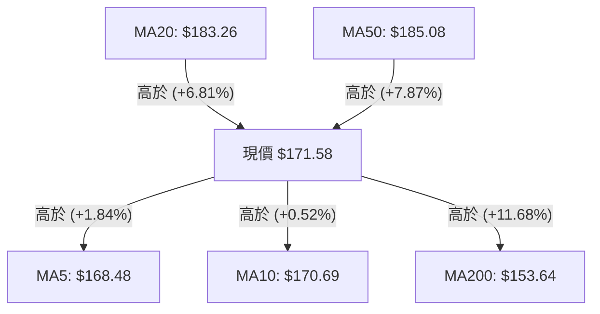
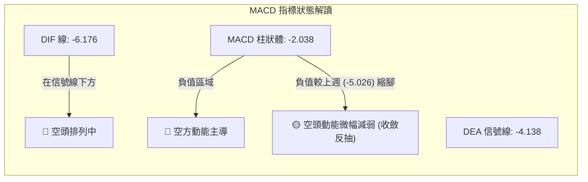
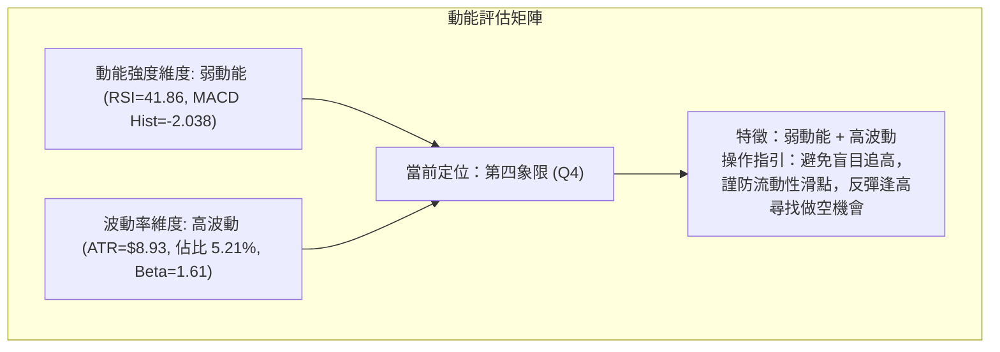
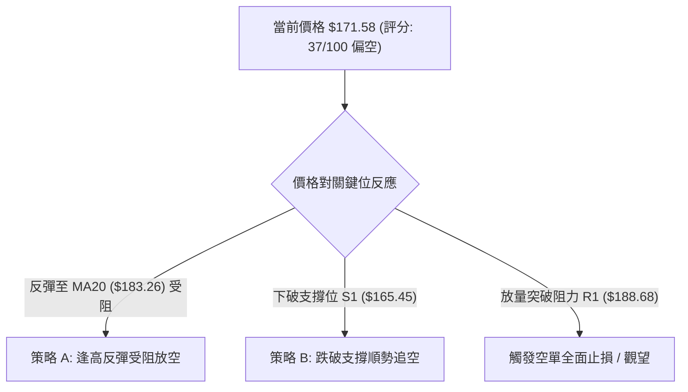
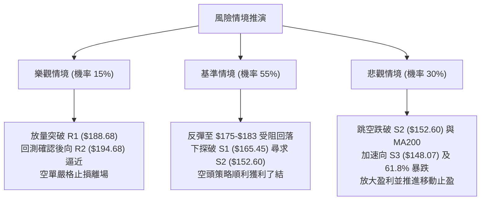

# PLTR 技術分析報告

> **報告日期**：2026-11-13 ｜ **語言**：繁體中文 ｜ **數據來源**：Yahoo Finance ｜ **當前價格**：$171.58

---

## 目錄

| 章節 | 內容 |
|------|------|
| [1. 技術面概覽](#1-技術面概覽) | 訊號儀表板、核心指標、評分卡 |
| [2. 趨勢分析](#2-趨勢分析) | 多時框趨勢、長中短期走勢 |
| [3. 圖表形態分析](#3-圖表形態分析) | 形態識別、K線組合、目標價 |
| [4. 支撐與阻力](#4-支撐與阻力) | 關鍵價位、斐波那契回調 |
| [5. 技術指標深度解讀](#5-技術指標深度解讀) | MA/RSI/MACD/布林/成交量 |
| [6. 動能與波動率](#6-動能與波動率) | 動能評估、ATR、Beta |
| [7. 多時框架總結](#7-多時框架總結) | 時框架評分矩陣 |
| [8. 交易策略建議](#8-交易策略建議) | 多空策略、風險報酬比 |
| [9. 風險提示與監控](#9-風險提示與監控) | 監控指標、風險場景 |

---

## 1. 技術面概覽

### 🎯 技術訊號儀表板



### 📊 核心指標速覽表

| 指標類別 | 指標名稱 | 當前數值 | 訊號 | 解讀 |
|----------|----------|----------|:---:|------|
| **價格** | 當前收盤價 | $171.58 | 🔴 | 位於 52 週區間 61.2%，短期自高點 $212.94 大幅回撤 |
| **均線** | MA20 | $183.26 | 🔴 | 價格在 MA20 下方 (-6.37%)，中期生命線下彎形成沉重反壓 |
| **均線** | MA50 | $185.08 | 🔴 | 價格在 MA50 下方，中期波段趨勢呈現空頭防守狀態 |
| **均線** | MA200 | $153.64 | 🟢 | 價格在 MA200 上方 (+11.68%)，長期牛熊分界線維持多頭支撐 |
| **動能** | RSI(14) | 41.86 | 🟡 | 位於 40–50 弱勢中性區間，尚未進入超賣，空頭動能仍佔優 |
| **動能** | MACD (12,26,9) | -6.176 | 🔴 | DIF (-6.176) < DEA (-4.138)，柱狀體 -2.038，空頭主導動能 |
| **趨勢** | ADX(14) / DMI | 27.52 | 🔴 | ADX > 25 確立趨勢行情；-DI (28.59) 遠高於 +DI (17.08)，空方動能強烈 |
| **通道** | 布林通道 | %B = 0.30 | 🔴 | 價格位於中軌 ($183.26) 與下軌 ($154.44) 之間，偏弱格局 |
| **量能** | 當日量 / 20日均量 | 12,406,100 | 🔴 | 僅為 20 日均量 (25,513,905) 之 0.49x，反彈無量且 OBV 疲弱 |
| **波動** | ATR(14) | $8.93 | 🟡 | 佔價格 5.21%，波動度偏高，需設定足夠之止損緩衝距離 |

### 🏆 技術評分卡

```
╔══════════════════════════════════════════════════════════════╗
║                技術評分卡 — PLTR (2026-11-13)                ║
╠══════════════════════════════════════════════════════════════╣
║  趨勢強度      ███████░░░░░░░░░░░░░  35/100  🔴 空方主導趨勢 ║
║  動能指標      ██████░░░░░░░░░░░░░░  32/100  🔴 MACD柱為負   ║
║  支撐穩定度    ██████████░░░░░░░░░░  50/100  🟡 S2/MA200有守 ║
║  成交量配合    ██████░░░░░░░░░░░░░░  28/100  🔴 量比僅 0.49x ║
║  形態完整度    ████████░░░░░░░░░░░░  40/100  🔴 高檔破位反抽 ║
║  均線排列      ███████░░░░░░░░░░░░░  37/100  🔴 均線空頭排列 ║
╠══════════════════════════════════════════════════════════════╣
║  綜合評分      ███████░░░░░░░░░░░░░  37/100  🔴 偏空格局     ║
╚══════════════════════════════════════════════════════════════╝
```
*計算公式：綜合評分 = (35 + 32 + 50 + 28 + 40 + 37) ÷ 6 = 222 ÷ 6 = 37.0（依規則 18 採算術平均）*

---

## 2. 趨勢分析

### 🌐 多時框趨勢分析



### 📈 長期趨勢 — 12個月走勢圖（Unicode）

```
PLTR 月線收盤走勢圖（2025-12 至 2026-11）
價格軸 ($)
$200.00 ┤                                        
$190.00 ┤                                      ● 2026-09 ($187.05)
$180.00 ┤  ● 2025-12 ($177.75)                 │  ● 2026-10 ($184.11)
$170.00 ┤  │                       ● 2026-08   │  │  ● 2026-11 現價 ($171.58)
$160.00 ┤  │                 ●     │ ($186.38) │  │  │
$150.00 ┤  │  ● 2026-01      │     │           │  │  │
$140.00 ┤  │  │  ● 2026-02   │  ●  │           │  │  │
$130.00 ┤  │  │  │     ●     │  │  │           │  │  │
$120.00 ┤  │  │  │     │     │  │  │  ● 2026-07│  │  │
$110.00 ┤  │  │  │     │     ●  │  │  │        │  │  │
        └──┴──┴──┴──┴──┴──┴──┴──┴──┴──┴──┴─────┴──┴──┴────────────────
          12  01 02 03 04 05 06 07 08 09 10    11  (月份)
```

#### 走勢特徵分析表格

| 階段區間 | 起止價格 | 漲跌幅 | 走勢結構與技術特徵 |
|----------|----------|:------:|-------------------|
| **2025-12 ~ 2026-02** | $177.75 → $137.19 | -22.82% | 衝高 $200 關卡後高檔獲利了結，首波快速下探波段支撐 |
| **2026-02 ~ 2026-05** | $137.19 → $156.54 | +14.10% | 構築底部震盪平台，多空於 $140–$150 進行換手 |
| **2026-05 ~ 2026-06** | $156.54 → $116.67 | -25.47% | 突發性下殺，打出年度低點區間（觸及 52 週低點 $106.37 區域） |
| **2026-06 ~ 2026-09** | $116.67 → $187.05 | +60.32% | 強勁主升浪，突破均線集結區，週成交量暴增至 4.35 億股 |
| **2026-09 ~ 2026-10** | $187.05 → $184.11 | -1.57% | 衝刺 52 週新高 $212.94，高檔量能無法維持，形成高檔雙頂形態 |
| **2026-10 ~ 2026-11** | $184.11 → $171.58 | -6.81% | 連續跌破短期均線，向下尋求 S2 ($152.60) 支撐後弱勢反彈 |

### 📊 中期趨勢（週線分析）

```
PLTR 週線級別關鍵結構示意圖
═══════════════════════════════════════════════════════════════
$212.94 ────── 52週高點 / 強阻力頸線 (2026-10-16 歷史高點)
               │   ▲
               ├───┼────── R2: $194.68 (波段反壓高點)
               │   │
$183.26-$185.08 ───┼────── MA20 / MA50 重疊反壓帶 (強阻力 R1 $188.68 下方)
                   │
$172.23 ───────────┼────── 斐波那契 38.2% 回調位
$171.58 ───────────●────── 當前收盤價 (弱勢弱彈位)
                   │
$165.45 ───────────┴────── 近期支撐 S1 (回踩確認點)
                   │
$152.60-$153.64 ────────── 波段關鍵低點 S2 / 長期生命線 MA200 重合區
═══════════════════════════════════════════════════════════════
```

週線層面觀察，PLTR 在 2026-10-09 當週拉出 $209.05 收盤高點，並於次週創下 $212.94 的 52 週新高，隨即遭遇沉重拋壓收長上影線陰線。近 4 週收盤價分別為 $186.03、$196.75、$184.11、$160.38，週線 MACD 柱狀體由正轉負（自 +1.204 快速惡化至 -5.026），顯示中期波段動能遭到嚴重破壞。本週雖然反彈至 $171.58，但週成交量萎縮至 71,970,500 股，僅為前週下殺量 (199,640,400) 的 36%，呈現典型「量縮反彈」特徵。

### ⚡ 趨勢強度評估（ADX 解讀）



| 項目 | 當前數值 | 參考標準 | 狀態評估 | 實戰解讀 |
|------|:--------:|:--------:|:--------:|----------|
| **ADX(14)** | 27.52 | > 25.0 | 🟢 強趨勢 | 市場脫離無序橫盤，波段定向動能強勁 |
| **+DI** | 17.08 | — | 🔴 多方衰退 | 買盤推升意願低落，無法組織有效攻勢 |
| **-DI** | 28.59 | — | 🔴 空方主導 | 賣方掌控盤面節奏，下行壓力未消退 |
| **DI 差值 (-DI - +DI)** | +11.51 | > 10.0 | 🔴 空頭擴張 | 空頭單向發散，顯示下行趨勢具備延續動能 |

---

## 3. 圖表形態分析

### 🔍 形態識別系統



#### 形態信心度與目標價評估表

| 形態名稱 | 信心度 | 判斷依據（引用數據） | 完成度 | 理論目標價（附計算式） |
|----------|:------:|----------------------|:------:|------------------------|
| **高檔雙頂 (M-Top)** | 75% | 2026-10-09 高點 $209.58 與 2026-10-16 創 52W 高點 $212.94 形成雙峰；2026-11-02 起連續長黑跌破頸線 $180.81 | 85% | 頸線 $180.81 − 形態高度 ($212.94 − $180.81 = $32.13) = **$148.68**（與 S3 $148.07 高度吻合） |
| **低檔雙底嘗試** | 40% | 2026-11-05 觸及 S2 $152.60 後止跌回升，但尚未經過二次回踩確認，成交量僅 0.49x 嚴重不足 | 30% | 訊號不足，僅做指標型解讀（頸線 $175.41 未有效站穩前不成立） |

### 🕯️ 重要 K 線形態分析

嚴格依據近 10 根日 K 與近 8 根週 K 之實際開高低收數據進行客觀解讀：

#### 近 10 根日 K 形態分析

| 日期（日K） | 開 | 高 | 低 | 收 | K線形態 | 技術解讀 | 訊號 |
|:-----------:|:--:|:--:|:--:|:--:|:-------:|---------|:----:|
| **2026-10-30** | 193.62 | 193.92 | 180.81 | 184.11 | 中長黑陰線 | 開高走低，實體跌破 $185 關卡，空頭開展主跌 | 🔴 |
| **2026-11-02** | 186.52 | 187.55 | 178.13 | 178.34 | 光腳大陰線 | 弱勢反抽受阻於 $187.55，收盤收在最低點附近 | 🔴 |
| **2026-11-03** | 168.18 | 176.54 | 165.25 | 175.40 | 跳空長下影陽線 | 跳空低開但有買盤抄底，成交量放大至 5,306 萬股 | 🟡 |
| **2026-11-04** | 164.95 | 177.43 | 164.60 | 171.70 | 倒狀長上影小陽線 | 向上衝刺 $177.43 受阻回落，多頭反攻遭空頭壓制 | 🔴 |
| **2026-11-05** | 166.71 | 167.25 | 152.60 | 154.99 | 恐慌長黑破位陰線 | 爆量下殺至波段低點 $152.60，擊穿前期低點 | 🔴 |
| **2026-11-06** | 158.68 | 163.97 | 157.24 | 160.38 | 低檔小紅實體陽線 | 縮量企穩於 $157 之上，賣壓出現短期竭盡徵兆 | 🟡 |
| **2026-11-09** | 161.27 | 170.83 | 161.00 | 169.20 | 實體中陽線 | 連續推升收復 $165.45 (S1)，短線空頭回補動能啟動 | 🟢 |
| **2026-11-10** | 168.21 | 170.00 | 164.00 | 168.82 | 高檔平頭十字星 | 震盪消化 $170 整數關卡阻力，買賣雙方暫時均衡 | 🟡 |
| **2026-11-11** | 173.59 | 175.41 | 170.80 | 172.40 | 衝高回落小黑陰線 | 開高走低，上探 $175.41 遇阻，量能進一步萎縮至 1,611 萬股 | 🔴 |
| **2026-11-12** | 170.20 | 173.05 | 168.25 | 171.58 | 窄幅震盪小紅紡錘線 | 實體僅 $1.38，成交量萎縮至 1,240 萬股，觀望氣氛極濃 | 🟡 |

#### 近 8 根週 K 形態分析

| 日期（週K） | 開 | 高 | 低 | 收 | K線形態 | 技術解讀 | 訊號 |
|:-----------:|:--:|:--:|:--:|:--:|:-------:|---------|:----:|
| **2026-09-25** | 178.73 | 194.68 | 176.76 | 189.67 | 長紅突破陽線 | 放量突破前高，確立中期上行波段 | 🟢 |
| **2026-10-02** | 186.23 | 194.78 | 184.81 | 188.75 | 高檔震盪十字小紅 | 高檔滯漲，顯示 $194 上方多空分歧加大 | 🟡 |
| **2026-10-09** | 189.45 | 209.58 | 187.63 | 209.05 | 強勢實體大長紅 | 放量攻克 $200 大關，直逼歷史極限 | 🟢 |
| **2026-10-16** | 208.90 | 212.94 | 184.45 | 186.03 | 長上影流星陰線 | 創 52W 高點 $212.94 後單週暴跌 26.91 點，標準反轉信號 | 🔴 |
| **2026-10-23** | 186.99 | 202.63 | 186.15 | 196.75 | 反彈陽線 | 縮量反抽，未能越過前週實體高點，形成次級反彈頂 | 🟡 |
| **2026-10-30** | 197.90 | 201.83 | 180.81 | 184.11 | 中黑破位陰線 | 實體下破多條短天期均線，確立雙頂成立 | 🔴 |
| **2026-11-06** | 186.52 | 187.55 | 152.60 | 160.38 | 放量恐慌長大黑 | 單週暴跌 23.73 點，週量爆出近 2 億股，殺出流動性低點 | 🔴 |
| **2026-11-12** | 161.27 | 175.41 | 161.00 | 171.58 | 縮量反彈小陽線 | 跌深反彈，受制於 $175.41，週量急縮顯示純屬技術性抽腳 | 🟡 |

### 📉 ASCII 走勢形態示意圖

```
雙頂跌破與反抽壓力測試示意圖
═══════════════════════════════════════════════════════════════
$212.94 ─────────── 頂點1 ($209.58)       頂點2 ($212.94)
                     ╭───╮                ╭───╮
$200.00 ────────────╯     ╰──────────────╯     ╰────────
                                  ▼
$180.81 ────────────── 頸線位 ────────────────────────
                                                ╲
$172.23 ─────────────────────────────────────────● 現價 $171.58 (反抽遇阻)
                                                ╱
$165.45 ───────────────────────────────────────╯  支撐 S1
                                      ╲
$152.60 ───────────────────────────────● 低點 S2 (2026-11-05)
═══════════════════════════════════════════════════════════════
```

### 🎯 形態目標價計算

雙頂（M頭）之量度跌幅計算嚴格基於數據實際數值：
1. **雙頂頂部平均高點**：$(209.58 + 212.94) \div 2 = \$211.26$
2. **頸線確認位**：2026-10-30 之低點 **\$180.81**
3. **垂直形態高度**：$\$211.26 - \$180.81 = \$30.45$
4. **標準量度滿足目標價**：
   $$\text{頸線} \$180.81 - \text{形態高度} \$30.45 = \mathbf{\$150.36}$$
5. **數據驗證**：
   2026-11-05 實際殺跌最低價為 **\$152.60**（與支撐位 S2 完全吻合），已接近滿足該形態的第一量度目標。若後續再次破位，將向下尋求延伸目標 **\$148.07**（支撐位 S3）。

---

## 4. 支撐與阻力

### 🗺️ 關鍵價位分布圖（Unicode）

```
PLTR 價位結構分布圖（嚴格依據 OHLCV 計算）
═════════════════════════════════════════════════════════════════
$198.88 ║██████████████████████████████║ 強阻力 R3 (波段頂部重災區)
$194.68 ║████████████████████          ║ 阻力 R2 (反彈高點聚類)
$188.68 ║████████████████████████      ║ 關鍵阻力 R1 (均線反壓核心)
$183.26 ║████████████████              ║ MA20 / 布林中軌反壓
$172.23 ║▒▒▒▒▒▒▒▒▒▒▒▒▒▒▒▒▒▒▒▒▒▒▒▒▒▒▒▒▒▒║ 斐波那契 38.2% 回調位
$171.58 ╠══════════════════════════════╣ ◄ 現價 ($171.58)
$165.45 ║▓▓▓▓▓▓▓▓▓▓▓▓▓▓▓▓▓▓            ║ 近期第一支撐 S1
$159.66 ║▓▓▓▓▓▓▓▓▓▓                    ║ 斐波那契 50.0% 中樞
$152.60 ║██████████████████████████████║ 強支撐 S2 (2026-11-05 波段低點)
$148.07 ║████████████████████          ║ 終極防守支撐 S3 (年線緩衝區)
═════════════════════════════════════════════════════════════════
```

### 🚧 阻力位分析表

阻力位嚴格引用數據中近一年波段高點聚類計算之數值：

| 阻力級別 | 價位 | 距離現價 | 形成原因與籌碼解讀 | 突破難度 | 重要性 |
|:--------:|:----:|:--------:|--------------------|:--------:|:------:|
| **R1** | $188.68 | +9.97% | 近期波段密集成交反壓區，與 23.6% 斐波那契位 ($187.79) 及 MA50 ($185.08) 形成共振強壓 | 極高 | ★★★★★ |
| **R2** | $194.68 | +13.46% | 2026-09-25 與 2026-10-02 兩週高點聚類 ($194.68 / $194.78)，套牢籌碼極重 | 高 | ★★★★☆ |
| **R3** | $198.88 | +15.91% | $200 整數關卡前最後波段高點聚類，主力資金高檔換手密集區 | 極高 | ★★★★☆ |

### 🛡️ 支撐位分析表

支撐位嚴格引用數據中近一年波段低點聚類計算之數值：

| 支撐級別 | 價位 | 距離現價 | 形成原因與籌碼解讀 | 守住機率 | 重要性 |
|:--------:|:----:|:--------:|--------------------|:--------:|:------:|
| **S1** | $165.45 | -3.57% | 2026-11-03 低點 $165.25 與 2026-11-04 低點 $164.60 聚類形成的短線回踩平台 | 60% | ★★★☆☆ |
| **S2** | $152.60 | -11.06% | 2026-11-05 殺跌波段低點，緊鄰 MA200 長期均線 ($153.64)，為中期多頭最後防線 | 75% | ★★★★★ |
| **S3** | $148.07 | -13.70% | 斐波那契 61.8% ($147.08) 與年線 ($157.78) 下方深幅超跌低點聚類，極端恐慌支撐 | 85% | ★★★★☆ |

### 📐 斐波那契回調位分析

依據 52 週區間極值（低點 **\$106.37** 至 高點 **\$212.94**，垂直落差 \$106.57）計算之回調位：

```
斐波那契回調階梯圖 (52W 區間 $106.37 → $212.94)
0.0%  (52W High) ────────────────────── $212.94 (歷史高點)
23.6%            ────────────────────── $187.79 (強阻力 R1 附近)
38.2%            ────────────────────── $172.23 ◄◄ 現價 ($171.58) 緊貼此處
50.0%            ────────────────────── $159.66 (多空平衡中樞)
61.8%            ────────────────────── $147.08 (黃金分割關鍵支撐，近 S3)
78.6%            ────────────────────── $129.18 (深度回撤防線)
100.0% (52W Low) ────────────────────── $106.37 (年度絕對起漲點)
```

#### 深度解讀：
- **當前位置評估**：現價 **\$171.58** 正處於 **38.2% 回調位 (\$172.23)** 與 **50.0% 回調位 (\$159.66)** 之間，且距離 38.2% 僅 -0.38%，顯示現價正處於「首個關鍵黃金分割回調線」的激烈多空爭奪區。
- **技術意義**：在強勢多頭市場中，38.2% 回調位 ($172.23) 應具備強勁支撐作用；然而當前價格由下往上反抽該位置，角色已轉化為**動態反壓**。若日線收盤無法放量站穩 $172.23 之上，則預示回撤結構將進一步下探 50.0% 中樞 ($159.66)，甚至回測 61.8% 關鍵黃金防線 ($147.08)。

---

## 5. 技術指標深度解讀

### 🎛️ 指標訊號總覽



### 📈 移動平均線排列分析



#### 均線架構深度解析

| 均線名稱 | 當前價格 | 偏離度 (現價 vs MA) | 趨勢斜率 | 技術意涵解讀 |
|:--------:|:--------:|:-------------------:|:--------:|--------------|
| **MA5** | $168.48 | +1.84% | ▲ 向上 | 短線超跌反抽，提供極短線 $168.48 動態支撐 |
| **MA10** | $170.69 | +0.52% | ▲ 向上 | 5 日與 10 日均線呈微幅黃金交叉，短線具備止跌跡象 |
| **MA20** | $183.26 | -6.37% | ▼ 向下 | 月線下行速度加快，布林中軌下移，構成第一波段重壓 |
| **MA50** | $185.08 | -7.29% | ▼ 向下 | 中期生命線遭有效跌破，反彈至此預期將湧現大量解套賣壓 |
| **MA60** | $184.03 | -6.77% | ▼ 向下 | 季線下彎，與 MA20/MA50 形成空頭死亡夾層 ($183–$185) |
| **MA120** | $161.12 | +6.49% | ▲ 向上 | 半年線持續上揚，為前次回檔低點提供動態緩衝 |
| **MA200** | $153.64 | +11.68% | ▲ 向上 | 年線牛熊分水嶺，斜率依然陡峭向上，長期牛市架構未死 |
| **MA240** | $157.78 | +8.75% | ▲ 向上 | 長期基期支撐穩固，確認中期回調而非全面崩盤 |

### 📉 RSI(14) 分析

```
RSI(14) 動能強度儀表
0 ──────────── 30 ────────────── 50 ────────────── 70 ────────── 100
[     超賣區   ] [   弱勢震盪區   ] [   強勢多頭區   ] [    超買區    ]
                  ▲ 41.86 (目前位置)
進度條: ████████░░░░░░░░░░░░  41.86%
```

#### 背離深度研判：
- **指標數值**：當前 RSI(14) 為 **41.86**，處於 30 至 50 之空方控盤區間。
- **背離檢驗結論**：**無明顯背離**。
- **研判細節**：對比近 20 根 K 棒走勢，價格自高點 $193.62 一路回落至 $152.60，隨後回升至 $171.58；RSI 同期由 50 以上跌破 35 後回升至 41.86，價格軌跡與 RSI 動能軌跡完全同步，並無「價格創新低而 RSI 未創新低」之底背離，亦無頂背離現象。這表明當前反彈純粹屬於空頭行情中的指標修復，而非動能反轉訊號。

### 📊 MACD(12, 26, 9) 訊號解讀



MACD 當前值為 **-6.176**，信號線 (DEA) 為 **-4.138**，差值（柱狀體）為 **-2.038**。
雙線處於零軸下方深處，呈現標準空頭發散結構。雖然柱狀體負值自前期的極端負值 (-5.026) 出現微幅收斂，帶動日線級別出現反抽，但在 DIF 線未自零軸下方金叉 DEA 之前，任何反彈均應視為弱勢修正，隨時面臨空頭第二波二次探底打壓。

### 📦 布林通道分析

```
布林通道 (Bollinger Bands, 20, 2) 結構示意圖
═══════════════════════════════════════════════════════════════
$212.08 ────────────────────────────────────── 上軌 (強阻力邊界)
         ╲
$183.26 ──╲─────────────────────────────────── 中軌 (MA20 反壓線)
           ╲
$171.58 ────● 現價 (%B = 0.30，偏弱運行中)
             ╲
$154.44 ──────┴─────────────────────────────── 下軌 (動態支撐，近 S2)
═══════════════════════════════════════════════════════════════
```

- **帶寬與位置**：通道帶寬介於 **\$154.44 至 \$212.08** 之間，帶寬高達 \$57.64，顯示前波下殺導致波動率擴張。
- **%B 指標**：當前數值為 **0.30**（計算式：$(171.58 - 154.44) \div (212.08 - 154.44) = 17.14 \div 57.64 \approx 0.297$），明確處於中軌 ($183.26) 之下，位於 0.0 至 0.5 的空頭強勢控制區。
- **運行軌跡**：K 線沿下軌反彈，但受制於中軌下壓，在未觸及中軌前即顯現疲態，預期將於中軌與下軌區間內進行低位震盪。

### 💹 成交量分析（量價配合度）

```
成交量對比柱狀圖 (股數)
最新量   [12,406,100]  █████░░░░░░░░░░░░░░░░  (0.49x 嚴重縮量)
20日均量 [25,513,905]  ████████████████████  (基準線 1.00x)
50日均量 [24,630,450]  ███████████████████   (中期換手基準)
```

#### 量價關係深度診斷：
1. **量價背離明顯**：近 4 個交易日價格由 $154.99 反彈至 $171.58，但成交量分別為 5,001 萬、2,433 萬、2,385 萬、1,958 萬、1,611 萬至今日的 **1,240 萬股**，呈現「價漲量急縮」的典型**量價背離**。
2. **OBV（能量潮）狀態**：官方快照明確標示「**OBV < MA → 量能疲弱**」。下殺時爆量（如 11-03 爆 5,306 萬股、11-05 爆 5,001 萬股），反彈時量能腰斬，說明主力機構資金並未在大舉回補，散戶惜售觀望，籌碼沉澱仍不充分。

---

## 6. 動能與波動率

### ⚡ 動能評估四象限



| 象限 | 動能維度 | 波動維度 | 當前狀態 | 策略應對指引 |
|:---:|:---:|:---:|:---:|--------------|
| **Q1** | 強動能 | 低波動 | — | 最佳波段順勢突破進場區 |
| **Q2** | 弱動能 | 低波動 | — | 狹幅沉寂盤整，策略觀望等待方向 |
| **Q3** | 強動能 | 高波動 | — | 爆發性主升段/主跌段，高風險高收益 |
| **Q4** | **弱動能** | **高波動** | **✓ 當前狀態** | **脆弱易跌格局，反彈乏力但震幅巨大，極易觸發洗盤止損** |

### 📊 ATR 波動率分析

```
╔══════════════════════════════════════════════════════════════╗
║                   ATR(14) 波動率與止損風控階梯               ║
╠══════════════════════════════════════════════════════════════╣
║  • ATR(14) 絕對值：$8.93 USD                                 ║
║  • ATR 價格佔比  ：5.21% (高波動軟體股特徵)                  ║
║                                                              ║
║  [止損緩衝距離建議]                                          ║
║  ├─ 1.0 × ATR ($8.93)  : 日內超短線止損緩衝 (高頻易被掃出場) ║
║  ├─ 1.5 × ATR ($13.40) : 波段交易推薦止損緩衝                ║
║  └─ 2.0 × ATR ($17.86) : 寬幅震盪防守距離 (容忍極端插針)    ║
╚══════════════════════════════════════════════════════════════╝
```

### 📐 Beta 與市場相關性

- **Beta 數值**：**1.61**。
- **市場特徵**：PLTR 展現出相對於標普 500 指數 (S&P 500) 高達 1.61 倍的高敏銳度。當大盤或科技板塊（如 QQQ）出現 1% 的回調時，PLTR 平均會放大下跌 1.61%。
- **空頭背景下的風險**：在當前技術面偏空背景下，高 Beta 意味著若大盤情緒轉弱，PLTR 將面臨更大的拋售放大效應；因此做多搶反彈必須將部位嚴格降至平日的 1/3 以下。

---

## 7. 多時框架總結

### 📋 時框架評分表

| 時框架 | 趨勢方向 | 動能狀態 | 均線排列 | 形態結構 | 綜合評分 | 建議方向 |
|:------:|:--------:|:--------:|:--------:|:--------:|:--------:|:--------:|
| **月線 (長期)** | 🟢 多頭延續 | 🟡 頂部滯漲 | 🟢 MA200 之上發散 | 大波段上升浪高位震盪 | **70/100** | 核心長投底倉可續抱 |
| **週線 (中期)** | 🔴 頂部回撤 | 🔴 MACD翻黑 | 🟡 均線死叉初期 | 雙頂確認，大陰線破位 | **35/100** | 中期波段減碼迴避 |
| **日線 (短期)** | 🔴 空頭排列 | 🔴 反彈無量 | 🔴 MA20/MA50 下方 | 弱勢反抽斐波那契 38.2% | **37/100** | 逢反彈阻力建立空倉 |

### 🔲 綜合訊號矩陣

```
╔══════════════════════════════════════════════════════════════╗
║                   多維度時框訊號一致性矩陣                   ║
╠══════════════════════════════════════════════════════════════╣
║  維度 / 時框     │   短期 (日線)  │  中期 (週線)   │  長期 (月線)  ║
║ ────────────────┼────────────────┼────────────────┼───────────── ║
║  趨勢方向        │   🔴 空頭排列  │  🔴 跌破頸線   │  🟢 守在年線 ║
║  MACD 動能       │   🔴 柱狀負值  │  🔴 週MACD翻黑 │  🟡 動能放緩 ║
║  ADX 強度        │   🔴 空頭主導  │  🔴 趨勢展開   │  🟢 多頭趨勢 ║
║  量能確認        │   🔴 量價背離  │  🔴 殺跌放量   │  🟢 大週期增 ║
║ ────────────────┼────────────────┼────────────────┼───────────── ║
║  時框收斂狀態    │   日週高度共振偏空 ── 長期牛市中的深幅修正   ║
╚══════════════════════════════════════════════════════════════╝
```

### ⚖️ 多時框收斂結論

依據多時框收斂優先級規則（規則 14）：
1. **行情屬性判定**：當前日線 ADX(14) 數值為 **27.52 > 25**，且 -DI (28.59) 顯著高於 +DI (17.08)，嚴格定義為**「趨勢行情」（Trend Market）**，而非無方向的盤整震盪。
2. **主導時框判定**：在趨勢行情下，交易邏輯**以中長期（週線/MA50、MA200）方向為主導**。週線雙頂破位且跌破 MA50，確立中期下行修正主浪；日線僅作為精準定位逢高放空或防守點之輔助時框。
3. **唯一方向性結論**：**【偏空格局 / 弱勢反彈承壓】**。
   日線之弱勢弱彈已遭遇斐波那契 38.2% ($172.23) 與下彎均線反壓，反彈量能極度萎縮，無法逆轉週線層面的破位走勢。因此，第 8 章交易策略完全收斂為**「逢高放空為主、破位加空為輔」**之防禦性空頭交易策略。

---

## 8. 交易策略建議

### 🗺️ 策略決策流程圖



### 🧭 策略路由

> **當前主策略方向 = 空頭策略（依綜合評分 37/100，評級偏空 ≤ 40）**
> 
> 依評分路由規則，評分 ≤ 40 必須主推空頭策略，多頭僅列為反轉風險提示。當前價格反彈無量，正處於受阻回落之高勝率做空視窗。

### 🎯 價格情境階梯（Price Scenarios）

價位嚴格引用第 4 章「關鍵價位」區塊之實際數值：

| 觸發條件 | 下一目標 | 後續延伸 | 情境含義 |
|----------|----------|----------|----------|
| **向上突破 R1 ($188.68)** | R2 ($194.68) | R3 ($198.88) | 多頭超跌強烈反轉，空頭主浪宣告失敗，重返高檔箱體 |
| **受阻於 MA20 ($183.26) ~ R1** | S1 ($165.45) | S2 ($152.60) | 標準反抽均線受阻，空頭次級波段啟動，下探低點 |
| **向下擊穿 S1 ($165.45)** | S2 ($152.60) | S3 ($148.07) | 短線反彈夭折，重啟破位下殺，測試長期均線 MA200 |

### 📊 情境機率分佈

| 情境劇本 | 機率 | 主要技術依據（引用指標狀態） |
|----------|:----:|------------------------------|
| **情境一：反抽受阻，重啟下行探底** | **55%** | ADX=27.52 強趨勢確立且 -DI=28.59 主導；量比僅 0.49x 量價背離；MACD 處於負值區 (-2.038) |
| **情境二：在 S1 與 MA20 間弱勢震盪** | **30%** | RSI=41.86 處於弱勢中性區；S2 ($152.60) 與 MA200 ($153.64) 支撐尚存，空頭回補暫時支撐現價 |
| **情境三：放量反轉直接突破 R1** | **15%** | 目前成交量極度萎縮 (僅 1,240 萬股)，缺乏主力大資金介入證據，小機率突發利多事件驅動 |

### 🟢 主策略詳情（空頭交易策略）

所有價位精確引用自「關鍵價位」區塊之客觀數據，風險報酬比嚴格依規則 17 計算（計算式附於備註）：

| 策略要素 | 策略 A（逢高反彈受阻放空） | 策略 B（跌破支撐順勢追空） |
|----------|----------------------------|----------------------------|
| **策略類型** | 順向高拋空單（勝率優先） | 破位追隨空單（動能優先） |
| **進場條件** | 價格反抽至布林中軌/MA20 受阻收黑 | 跌破短線支撐 S1 確認有效破位 |
| **進場價格** | **$183.26** (MA20 / 布林中軌反壓點) | **$165.45** (跌破支撐 S1 時進場) |
| **目標價 T1** | **$165.45** (支撐位 S1) | **$152.60** (支撐位 S2 / 近期低點) |
| **目標價 T2** | **$152.60** (支撐位 S2) | **$148.07** (支撐位 S3 / 終極防守) |
| **止損價格** | **$188.68** (關鍵阻力 R1 上方) | **$172.23** (斐波那契 38.2% 阻力) |
| **風險報酬比** | **1 : 3.29（以 T1 計）** *(註1)* | **1 : 1.90（以 T1 計）** *(註2)* |
| **成功機率** | **65%** | **60%** |
| **建議倉位** | **15% - 20%** 總投資資金 | **10% - 15%** 總投資資金 |

- *註1 (策略 A 風險報酬比計算)*：
  - 做空風險 = $\text{止損價} \$188.68 - \text{進場價} \$183.26 = \$5.42$
  - 目標報酬 T1 = $\text{進場價} \$183.26 - \text{目標價 T1} \$165.45 = \$17.81$
  - 風險報酬比 (以 T1 計) = $\$17.81 \div \$5.42 = 3.2859 \rightarrow \mathbf{1 : 3.29（以 T1 計）}$
  - *(若以 T2 計)*：目標報酬 T2 = $\$183.26 - \$152.60 = \$30.66$；比值 = $\$30.66 \div \$5.42 = \mathbf{1 : 5.66（以 T2 計）}$
- *註2 (策略 B 風險報酬比計算)*：
  - 做空風險 = $\text{止損價} \$172.23 - \text{進場價} \$165.45 = \$6.78$
  - 目標報酬 T1 = $\text{進場價} \$165.45 - \text{目標價 T1} \$152.60 = \$12.85$
  - 風險報酬比 (以 T1 計) = $\$12.85 \div \$6.78 = 1.8952 \rightarrow \mathbf{1 : 1.90（以 T1 計）}$
  - *(若以 T2 計)*：目標報酬 T2 = $\$165.45 - \$148.07 = \$17.38$；比值 = $\$17.38 \div \$6.78 = \mathbf{1 : 2.56（以 T2 計）}$

### 🔴 反向風險觸發點（對沖提示）

若出現以下情境，必須無條件推翻空頭邏輯並啟動多頭對沖或空單停損：
1. **反轉關鍵價位**：日線收盤價強勢**突破並站穩阻力位 R1 ($188.68)**。此舉代表價格重新站上 MA20 與 MA50，空頭防線全面瓦解。
2. **指標反轉訊號**：日線 MACD 柱狀體翻正，且單日成交量暴增至 50 日均量（> 2,460 萬股）的 1.5 倍以上，帶動 RSI(14) 突破 55。
3. **對沖操作指引**：空單全數離場觀望；激進投資者方可於突破 $188.68 後，輕倉順勢追多至 R2 ($194.68)。

### ⭐ 整體訊號強度評星

```
╔══════════════════════════════════════════════════════════════╗
║                     技術訊號強度總評                         ║
╠══════════════════════════════════════════════════════════════╣
║  做多訊號強度：★★☆☆☆  (2/5星 - 僅存長天期均線支撐)          ║
║  做空訊號強度：★★★★☆  (4/5星 - 均線空頭排列，量縮弱抽)       ║
║  整體可信度：  ★★★★☆  (4/5星 - 指標與時框高度共振收斂)       ║
╚══════════════════════════════════════════════════════════════╝
```

---

## 9. 風險提示與監控

### ✅ 關鍵監控指標 Checklist

```
╔══════════════════════════════════════════════════════════════╗
║                 日常盤面關鍵技術監控 Checklist               ║
╠══════════════════════════════════════════════════════════════╣
║  [ ] 價位監控：日線收盤是否跌破支撐 S1 ($165.45)             ║
║  [ ] 均線監控：反彈是否於 MA20 ($183.26) 出現長上影線受阻   ║
║  [ ] 量能監控：成交量是否持續低於 20日均量 (2,551萬股)       ║
║  [ ] 趨勢監控：ADX(14) 是否持續維持在 25 以上且 -DI > +DI    ║
║  [ ] 動能監控：MACD 柱狀體是否在零軸下方重新擴大走弱         ║
║  [ ] 破位預警：若盤中灌破 S2 ($152.60)，是否引發恐慌性停損盤 ║
╚══════════════════════════════════════════════════════════════╝
```

### ⚠️ 風險場景分析



### 🛡️ 風險管理重要提醒

1. **高估值與高波動風險**：PLTR 當前 Trailing P/E 高達 120.83，P/S 達 56.72，Beta 為 1.61。極高的估值容錯率極低，一旦大盤出現估值壓縮，技術破位將伴隨基本面多殺多恐慌，切勿在下跌途中心急「接飛刀」。
2. **部位規模嚴格管控**：考量當前 ATR 達 \$8.93（單日波動率逾 5%），單筆交易之最大虧損金額不得超過總帳戶權益之 1.5%。
3. **無量反彈的欺騙性**：當前自 \$152.60 的反彈全程伴隨成交量急縮（量比 0.49x），在技術分析中稱為「誘多弱抽」。此類形態常以突發性的大陰線一舉吞噬數日漲幅，防守止損位必須嚴格執行，絕不可抱有僥倖心態往下攤平。

---

## 📋 報告總結

```
╔══════════════════════════════════════════════════════════════╗
║                   PLTR 技術分析報告總結                      ║
╠══════════════════════════════════════════════════════════════╣
║  報告日期：2026-11-13                                        ║
║  當前價格：$171.58                                           ║
║  分析評級：🔴 偏空格局 / 弱勢反彈承壓 (綜合評分: 37/100)      ║
║                                                              ║
║  關鍵結論：                                                  ║
║  ├─ 長期趨勢：🟢 守住年線 MA200 ($153.64)，長期多頭底色未死  ║
║  ├─ 中期趨勢：🔴 雙頂確立跌破頸線，週線 MACD 翻黑進入深幅修正║
║  ├─ 短期趨勢：🔴 反彈量能腰斬 (0.49x)，受制於下彎短期均線反壓║
║  ├─ 關鍵支撐：S1: $165.45 ｜ S2: $152.60 ｜ S3: $148.07      ║
║  ├─ 關鍵阻力：R1: $188.68 ｜ R2: $194.68 ｜ R3: $198.88      ║
║  └─ 分析師目標：華爾街平均目標價 $222.25 (基本面看好但技術面背離)║
║                                                              ║
║  最優策略組合：                                              ║
║  1. 🥇 最佳機會：策略 A (反彈至 MA20 $183.26 放空，風報比 1:3.29)║
║  2. 🥈 次選機會：策略 B (跌破 S1 $165.45 追空，風報比 1:1.90)   ║
║  3. 🥉 保守選擇：空手觀望，靜待測試 S2 $152.60 與 MA200 企穩 ║
╚══════════════════════════════════════════════════════════════╝
```

---

> ⚠️ **免責聲明**：本報告為 AI 自動生成之技術分析，所有數據及估算均基於提供的歷史價格資訊。本報告**僅供研究與學術參考**，**不構成任何投資建議**。投資有風險，入市需謹慎。

---

*報告生成時間：2026-11-13 ｜ 數據來源：Yahoo Finance ｜ 分析框架：多時框技術分析*