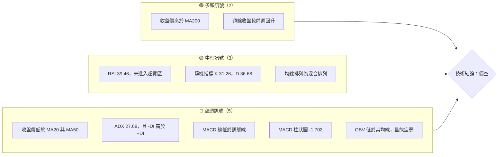
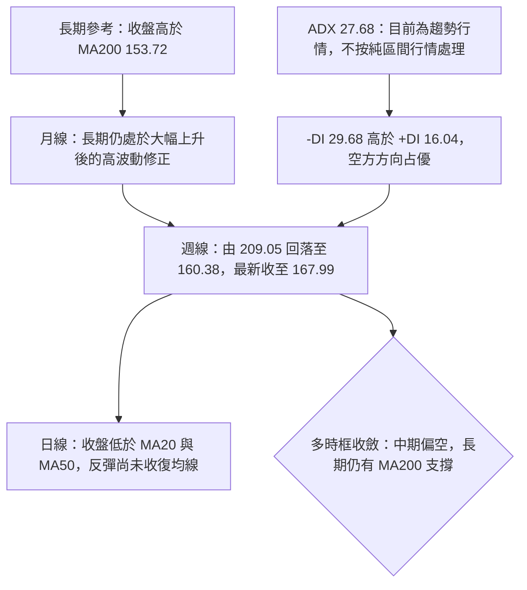
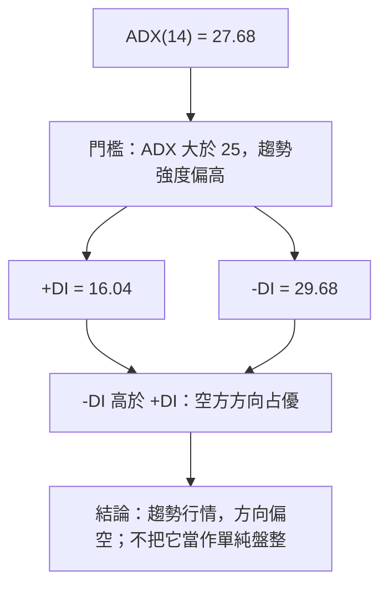
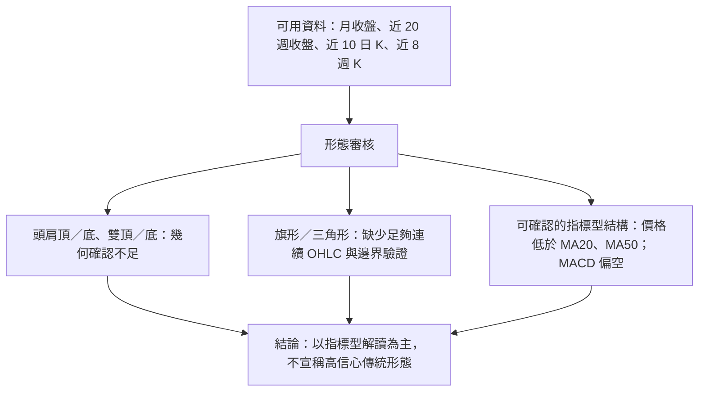
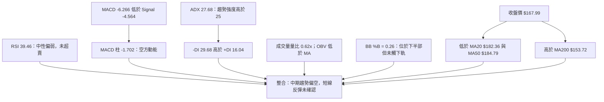
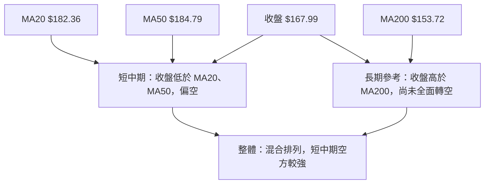
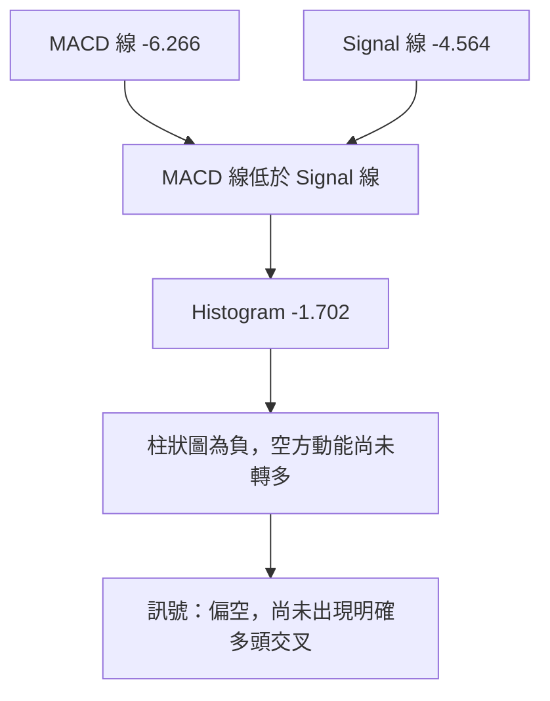
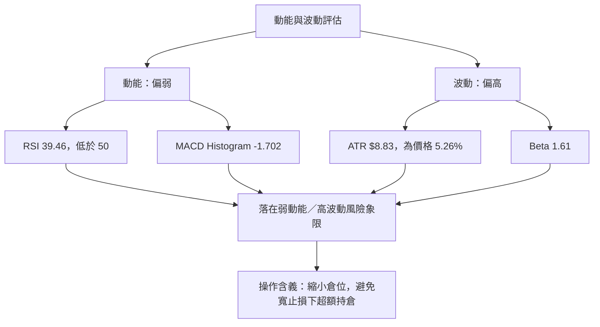
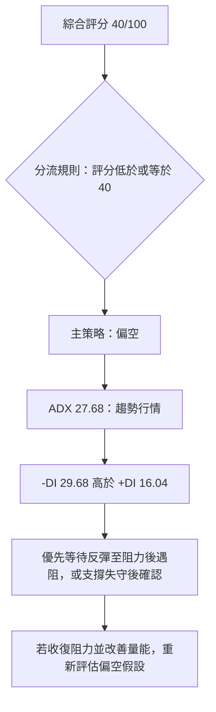
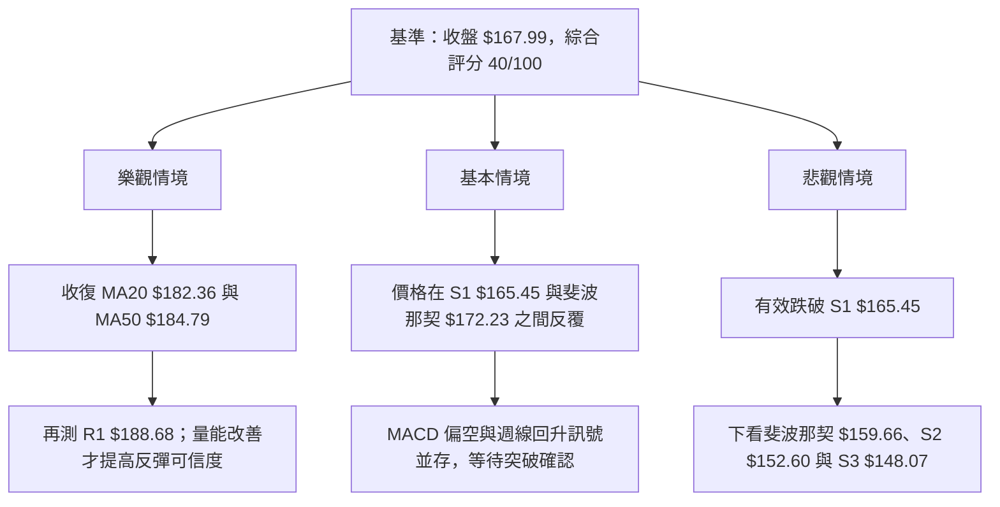

# PLTR 技術分析報告

> **報告日期**：2026-11-14 ｜ **語言**：繁體中文 ｜ **數據來源**：使用者提供之 Yahoo Finance 技術數據  
> **當前價格**：**$167.99**（2026-11-13 收盤價）  
> **技術面總評**：🔴 **偏空，趨勢中的反彈尚未確認反轉**  
> **綜合評分**：**40/100**（六項子評分算術平均）  
> **主要判讀依據**：ADX 27.68 顯示趨勢強度達趨勢行情門檻；-DI 高於 +DI；收盤低於 MA20、MA50，MACD 柱狀圖為負，OBV 低於其均線。價格仍在 MA200 之上，長期結構並未完全轉空。

---

## 目錄

| 章節 | 內容 |
|------|------|
| 1. 技術面概覽 | 訊號儀表板、核心指標、評分卡 |
| 2. 趨勢分析 | 多時框趨勢、長中短期走勢 |
| 3. 圖表形態分析 | 形態識別、K線組合、目標價 |
| 4. 支撐與阻力 | 關鍵價位、斐波那契回調 |
| 5. 技術指標深度解讀 | MA、RSI、MACD、布林通道、成交量 |
| 6. 動能與波動率 | 動能評估、ATR、Beta |
| 7. 多時框架總結 | 時框架評分矩陣 |
| 8. 交易策略建議 | 空頭主策略、風險報酬比 |
| 9. 風險提示與監控 | 監控指標、風險場景 |
| 報告總結 | 主要結論與策略摘要 |

---

## 1. 技術面概覽

### 🎯 技術訊號儀表板

下列訊號是技術指標的方向性分類；分類不代表訊號彼此獨立，也不應簡單解讀為投票模型。



**訊號整合：**偏空訊號主要來自趨勢、均線、MACD 與量能；中性部分來自 RSI 尚未超賣，以及價格仍高於 MA200。週線最近一週收盤反彈，屬於短線回升訊號，但目前不足以抵銷較強的中期空方結構。

### 📊 核心指標速覽表

| 指標類別 | 指標名稱 | 當前數值 | 訊號 | 解讀 |
|----------|----------|----------:|:---:|------|
| 價格 | 當前收盤價 | **$167.99** | 🔴 | 收盤價低於 MA20、MA50，與近期高點有明顯距離 |
| 區間 | 52 週高／低 | $212.94／$106.37 | 🟡 | 位於 52 週區間 57.8% 位置；距 52 週高點約 21.1% |
| 均線 | MA20 | $182.36 | 🔴 | 價格低於 MA20，短線趨勢偏弱 |
| 均線 | MA50 | $184.79 | 🔴 | 價格低於 MA50，中期仍有均線壓力 |
| 均線 | MA200 | $153.72 | 🟢 | 價格高於 MA200，長期均線尚未失守 |
| 動能 | RSI(14) | 39.46 | 🟡 | 中性偏弱，尚未達 RSI 30 的常見超賣界線 |
| 動能 | MACD 線／訊號線 | -6.266／-4.564 | 🔴 | MACD 線低於訊號線，均位於零軸下方 |
| 動能 | MACD 柱狀圖 | -1.702 | 🔴 | 空方動能仍占優勢 |
| 趨勢 | ADX(14) | 27.68 | 🔴 | 趨勢強度超過 25；方向由 -DI 主導 |
| 波動 | ATR(14) | $8.83 | 🔴 | ATR 為價格的 5.26%，日常波幅較大 |
| 量能 | 最新成交量／20 日均量 | 15,169,600／24,607,265 | 🔴 | 量比 0.62 倍，反彈量能未見明顯放大 |
| 量能 | OBV 趨勢 | OBV < MA | 🔴 | 資料指向量能疲弱，尚未確認價格反彈 |

### 🏆 技術評分卡

子項評分採 **1–10 分**，顯示時轉換為百分制；綜合分數等於六項子評分的算術平均，再四捨五入至整數。此分數是技術狀態摘要，不是成功機率。

```text
╔══════════════════════════════════════════════════════════════╗
║                 技術評分卡 — PLTR (2026-11-14)              ║
╠══════════════════════════════════════════════════════════════╣
║ 趨勢強度      ████░░░░░░░░░░░░░░░░  40/100  🔴            ║
║ 動能指標      ███░░░░░░░░░░░░░░░░░  30/100  🔴            ║
║ 支撐穩定度    ██████░░░░░░░░░░░░░░  60/100  🟡            ║
║ 成交量配合    ███░░░░░░░░░░░░░░░░░  30/100  🔴            ║
║ 形態完整度    ████░░░░░░░░░░░░░░░░  40/100  🟡            ║
║ 均線排列      ████░░░░░░░░░░░░░░░░  40/100  🔴            ║
╠══════════════════════════════════════════════════════════════╣
║ 綜合評分      ████░░░░░░░░░░░░░░░░  40/100  🔴 偏空       ║
║ 計算： (40 + 30 + 60 + 30 + 40 + 40) ÷ 6 = 40             ║
╚══════════════════════════════════════════════════════════════╝
```

| 子評分 | 分數 | 評分依據 |
|--------|-----:|----------|
| 趨勢強度 | 40/100 | ADX 27.68 為趨勢行情；-DI 29.68 高於 +DI 16.04，方向偏空 |
| 動能指標 | 30/100 | RSI 39.46 偏弱；MACD 線與柱狀圖均偏空；Stoch K 低於 D |
| 支撐穩定度 | 60/100 | S1 $165.45 接近現價，且價格仍高於 MA200；但下方尚有 S2、S3 支撐層級 |
| 成交量配合 | 30/100 | 最新成交量僅為 20 日均量 0.62 倍，OBV 低於均線 |
| 形態完整度 | 40/100 | 週線近期有明顯回落與反彈，但資料不足以確認高信心度的傳統反轉形態 |
| 均線排列 | 40/100 | 收盤低於 MA20、MA50，但高於 MA200，屬混合排列 |

**儀表板解讀：**40/100 落在偏空策略分流區間。此結論不等於「價格必然下跌」；策略上應優先等待空方確認或反彈遇阻，不宜僅因評分偏空便在支撐上方追空。

---

## 2. 趨勢分析

### 🌐 多時框趨勢分析



### 📈 長期趨勢 — 12 個月走勢圖

下圖採用 **2025-12 至 2026-11 的 12 個月收盤價**，圖中價位為提供的月收盤資料，不代表月內最高或最低價。

```text
PLTR 月線收盤走勢圖（2025-12 至 2026-11；每格為約略位置）

價格
$200 ┤                 ●
$190 ┤             ●       ● ●
$180 ┤ ●                       ●
$170 ┤                             ●                 ●
$160 ┤             ●                   ●
$150 ┤     ● ●           ●
$140 ┤         ● ●
$130 ┤
$120 ┤                     ●
     └──────────────────────────────────────────────────────────
       12月  01月  02月  03月  04月  05月  06月  07月  08月  09月  10月  11月
       177.75 146.59 137.19 146.28 139.11 156.54 116.67 123.06 186.38 187.05 184.11 167.99

月收盤高點：$187.05（2026-09）
月收盤低點：$116.67（2026-06）
最新月收盤：$167.99（2026-11-13）
```

> 上圖的月收盤低點與高點是所提供 12 個月月收盤序列中的極值；52 週高低另以資料提供的 $212.94／$106.37 為準，兩者不可混為一談。

### 走勢階段與價格變化

| 階段 | 起點與終點 | 變化 | 技術特徵 |
|------|------------|------:|----------|
| 2025-12 至 2026-03 | $177.75 → $146.28 | 約 -17.7% | 月收盤走弱，回落後在 2026-03 出現月收盤回升 |
| 2026-03 至 2026-06 | $146.28 → $116.67 | 約 -20.2% | 延續回落，2026-06 為所列 12 個月最低月收盤 |
| 2026-06 至 2026-09 | $116.67 → $187.05 | 約 +60.4% | 強勢反彈，2026-08、2026-09 月收盤升至 $186 以上 |
| 2026-09 至 2026-11 | $187.05 → $167.99 | 約 -10.2% | 近期由高位回落，月收盤尚未回到高位區 |
| 2025-12 至 2026-11 | $177.75 → $167.99 | 約 -5.5% | 期間高低波動顯著，端點比較略低於 2025-12 |

**長期結構判讀：**月度收盤序列顯示先跌、再強力反彈、後回落的高波動結構。收盤 $167.99 仍高於 MA200 $153.72，但已低於 MA20 $182.36 與 MA50 $184.79。故長期均線背景尚未完全轉空；中短期趨勢則明顯偏弱。

### 📊 中期趨勢（週線分析）

近 20 週收盤資料顯示，2026-07 至 2026-07-31 收盤在 $122.92–$132.38 區域波動，2026-08-07 收至 $172.01，期間週收盤大幅跳升；其後週收盤一度到達 $209.05，接著回落至 $160.38，最新週收盤回升至 $167.99。

```text
週線價格結構示意（非比例尺；價位均為提供的週收盤）

$209.05                         ● 2026-10-09
                                 ╲
$196.75                           ● 2026-10-23
$189.67                    ●       ╲
$184.11                          ●
$174.33               ●
$167.23                ●       ●─────────────● $167.99
$160.38                                      ● 2026-11-06
$132.38   ●
$122.92      ●
          7月            8月          9月       10月       11月
```

**週線解讀：**

- 週收盤從 $209.05 下滑至 $160.38，跌勢期間週 MACD 柱狀圖曾擴大至 -5.026。
- 2026-11-13 週收盤回升至 $167.99，週 RSI 由 31.2 回升至 39.5，屬於短週期修復。
- 最新週 MACD 柱狀圖仍為 -1.702，仍在零下且為負值；反彈尚未獲 MACD 確認為趨勢反轉。
- 週量從 2026-11-06 的 199,640,400 降至 2026-11-13 的 87,192,600。後一週收高，但週成交量較前週低，反彈量能確認不足。

### ⚡ 趨勢強度評估（ADX 解讀）



| ADX 區間 | 常見解讀 | PLTR 狀態 |
|----------|----------|-----------|
| 低於 20 | 趨勢弱或盤整傾向 | 不符合 |
| 20–25 | 趨勢形成或過渡 | 不符合 |
| 高於 25 | 趨勢較明確，仍需方向指標判斷多空 | **符合，ADX 27.68** |
| +DI 高於 -DI | 方向偏多 | **不符合** |
| -DI 高於 +DI | 方向偏空 | **符合，29.68 > 16.04** |

**多時框收斂：**ADX 大於 25，因此依規則以週線及中長期均線方向為主。週線回落、MA50 位於收盤上方、-DI 領先，構成中期偏空主訊號；日線反彈只作為進場時機參考。MA200 支撐使長期訊號仍非全面看空，但不改變中期方向判斷。

---

## 3. 圖表形態分析

### 🔍 形態識別系統

只使用已提供的月收盤、週收盤與指標判斷。資料並未提供完整逐日 OHLC 歷史，無法以完整幾何結構確認大型頭肩、雙頂或三角形；因此不把局部價格波動誇大為高信心形態。



| 形態／結構 | 信心度 | 判斷依據 | 完成度 | 目標價 |
|------|------:|------|------|------|
| 頭肩頂／頭肩底 | 低於 50% | 提供資料不足以確認頸線、左右肩及完整波段結構 | 不判定 | N/A（數據未提供；不推算） |
| 雙頂／雙底 | 低於 50% | 無足夠日線 OHLC 歷史確認兩個等高或等低反轉點 | 不判定 | N/A（數據未提供；不推算） |
| 旗形／三角形 | 低於 50% | 不能以目前樣本確認收斂邊界、旗桿與突破位置 | 不判定 | N/A（數據未提供；不推算） |
| 指標型弱勢結構 | 70% | 收盤低於 MA20、MA50；MACD 線低於訊號線、柱狀圖為 -1.702；OBV 低於均線 | 延續中，尚未反轉確認 | 不設定形態目標價 |
| 短線反彈結構 | 55% | 週收盤由 $160.38 回升至 $167.99，但週 MACD 柱狀圖仍為負，週量亦低於前週 | 初步修復，未確認 | 不設定形態目標價 |

> 信心度是對該結構判讀的主觀信心，不是走勢發生機率。傳統幾何形態若未能由資料充分支持，目標價不予推算。

### 🕯️ 重要 K 線形態分析

下表僅引用「近 10 根日 K」及「近 8 根週 K」提供的開、高、低、收。形態名稱以四價結構為依據；無足夠證據時採描述性判讀，不強行標記為教科書形態。

| 日期（日 K／週 K） | 開 | 高 | 低 | 收 | K 線形態／結構 | 解讀 | 訊號 |
|------|------:|------:|------:|------:|------|------|:---:|
| 2026-11-02（日） | 186.52 | 187.55 | 178.13 | 178.34 | 長實體黑 K | 收盤接近日低，當日賣壓明顯 | 🔴 |
| 2026-11-03（日） | 168.18 | 176.54 | 165.25 | 175.40 | 長實體紅 K | 收盤大幅高於開盤，屬回升日 | 🟢 |
| 2026-11-04（日） | 164.95 | 177.43 | 164.60 | 171.70 | 紅 K、下影較短 | 收盤高於開盤，盤中低點接近開盤 | 🟡 |
| 2026-11-05（日） | 166.71 | 167.25 | 152.60 | 154.99 | 長實體黑 K | 大幅收低，且觸及週線提供的低位區 | 🔴 |
| 2026-11-06（日） | 158.68 | 163.97 | 157.24 | 160.38 | 小實體紅 K | 前一日急跌後回升，但實體相對有限 | 🟡 |
| 2026-11-09（日） | 161.27 | 170.83 | 161.00 | 169.20 | 長實體紅 K | 收盤高於開盤，反彈有延續 | 🟢 |
| 2026-11-10（日） | 168.21 | 170.00 | 164.00 | 168.82 | 小實體紅 K | 開收相近，短線方向性較弱 | 🟡 |
| 2026-11-11（日） | 173.59 | 175.41 | 170.80 | 172.40 | 黑 K | 收盤低於開盤，反彈遇壓 | 🔴 |
| 2026-11-12（日） | 170.20 | 173.05 | 168.25 | 171.58 | 紅 K | 收盤略高於開盤，實體小 | 🟡 |
| 2026-11-13（日） | 171.74 | 172.28 | 164.75 | 167.99 | 黑 K、下影存在 | 收盤低於開盤，盤中低於收盤；尚非可靠反轉形態 | 🔴 |
| 2026-10-09（週 K） | 189.45 | 209.58 | 187.63 | 209.05 | 強勢紅 K | 大幅收高，對應近週線波段高收盤 | 🟢 |
| 2026-10-16（週 K） | 208.90 | 212.94 | 184.45 | 186.03 | 長實體黑 K | 高點後顯著回落，顯示高位賣壓 | 🔴 |
| 2026-10-23（週 K） | 186.99 | 202.63 | 186.15 | 196.75 | 紅 K | 反彈收高，但未收復前一週跌幅 | 🟡 |
| 2026-10-30（週 K） | 197.90 | 201.83 | 180.81 | 184.11 | 黑 K | 收盤回落，反彈後再次承壓 | 🔴 |
| 2026-11-06（週 K） | 186.52 | 187.55 | 152.60 | 160.38 | 大幅黑 K、長下影 | 波幅很大，收盤仍低於開盤；低點後有部分回收 | 🔴 |
| 2026-11-13（週 K） | 161.27 | 175.41 | 161.00 | 167.99 | 紅 K、上影存在 | 收盤高於開盤，低位回升；上方仍有賣壓 | 🟡 |

### 📉 ASCII 走勢形態示意圖

```text
近週線收盤與回落／反彈結構（僅示意週收盤，不代表完整 OHLC）

$212.94  52 週高點 ─────────────────────────────────────
$209.05  10/09  ●
                  ╲
$196.75  10/23       ●
$189.67  09/25  ●       ╲
$184.11  10/30           ●
$167.23  09/11       ●          ● 11/13 $167.99
$160.38  11/06                      ●───↗
$152.60  週內低位（同時為 S2）──────────────────────────
```

圖示顯示由 $209.05 收盤區回落至 $160.38，再回升至 $167.99；目前只能稱為**下跌後反彈**，沒有足夠證據宣稱雙底、頭肩底或反轉突破。

### 🎯 形態目標價計算

- **傳統形態目標價：**目前未確認任何高信心度頭肩、雙頂／底、三角形或旗形，故不套用「頸線 ± 形態高度」公式。
- **允許使用的觀察層級：**第 4 章列出的 OHLCV 關鍵價位與已提供斐波那契位。
- **形態推算價：**N/A（數據未提供可確認之傳統形態，不作形態高度推算）。
- **策略中的目標價：**只取已列出的支撐或斐波那契價位，不以形態目標替代。

---

## 4. 支撐與阻力

### 🗺️ 關鍵價位分布圖

下列阻力、支撐及斐波那契價位均直接引用提供的「關鍵價位」區塊；此圖只標出已提供價位，不新增自行估算的水平。

```text
PLTR 價位結構分布圖（2026-11-13 收盤 $167.99）

$212.94 ║ 52 週高點／斐波那契 0.0%
$198.88 ║████████████████████████║ R3 阻力
$194.68 ║██████████████████████  ║ R2 阻力
$188.68 ║████████████████████████║ R1 阻力
$187.79 ║ 斐波那契 23.6%
$184.79 ║ MA50（均線參考，不作 OHLCV 阻力聚類）
$182.36 ║ 布林中軌／MA20
$172.23 ║ 斐波那契 38.2%
$167.99 ╠════════════════════════╣ ◄ 當前收盤價
$165.45 ║▓▓▓▓▓▓▓▓▓▓▓▓▓▓▓▓▓       ║ S1 支撐
$159.66 ║ 斐波那契 50.0%
$153.72 ║ MA200（均線參考）
$152.78 ║ 布林下軌
$152.60 ║████████████████████████║ S2 支撐
$148.07 ║████████████████████     ║ S3 支撐
$147.08 ║ 斐波那契 61.8%
$129.18 ║ 斐波那契 78.6%
$106.37 ║ 52 週低點／斐波那契 100.0%
```

> MA、布林通道與支撐阻力聚類是不同類型的參考值。圖中並列以便觀察，不代表它們具有相同的計算方式或同等支撐／阻力效力。

### 🚧 阻力位分析表

| 阻力級別 | 價位 | 形成原因 | 突破難度 | 重要性 |
|----------|------:|----------|----------|--------|
| R1 | **$188.68** | 提供資料中的近一年波段高點聚類阻力 | 中高；需觀察能否有效收復 | 重要近端阻力 |
| R2 | **$194.68** | 近一年波段高點聚類 | 高於 R1，可能成為反彈延伸時的賣壓區 | 次級重要阻力 |
| R3 | **$198.88** | 近一年波段高點聚類 | 高；若未先站上 R1、R2，測試 R3 的技術確認有限 | 上方主要阻力 |

**阻力與均線整合：**

- MA20 $182.36 與 MA50 $184.79 高於現價，代表收復上述均線之前，反彈會面對均線壓力。
- MA20、MA50 並非本報告的 OHLCV 聚類阻力；正式阻力位仍以 R1–R3 為準。
- 價格需先收復較近的均線區，再談是否有能力進一步挑戰 $188.68、$194.68 與 $198.88。

### 🛡️ 支撐位分析表

| 支撐級別 | 價位 | 形成原因 | 守住機率評估 | 重要性 |
|----------|------:|----------|---------------|--------|
| S1 | **$165.45** | 近一年波段低點聚類；距現價約 1.51% | 中等；接近現價但趨勢仍偏空 | 近端觀察支撐 |
| S2 | **$152.60** | 近一年波段低點聚類；同時也是近週線低點資料中的低位 | 中等偏重要；與布林下軌 $152.78 接近，但兩者計算方式不同 | 重要支撐 |
| S3 | **$148.07** | 近一年波段低點聚類；接近但不等於斐波那契 $147.08 | 中等；若 S2 失守，為下一個聚類支撐 | 下方重要支撐 |

> 「守住機率評估」是定性評估，不是以統計模型計算的勝率。現有數據不足以為各價位提供精確的守住機率。

### 📐 斐波那契回調位分析

以下數值直接引用提供資料，不重新計算：

| 回調位 | 價位 | 相對於現價 $167.99 的位置 |
|--------|------:|---------------------------|
| 0.0%（52 週高點） | $212.94 | 高於現價 |
| 23.6% | $187.79 | 高於現價 |
| 38.2% | $172.23 | 高於現價 |
| 50.0% | $159.66 | 低於現價 |
| 61.8% | $147.08 | 低於現價 |
| 78.6% | $129.18 | 低於現價 |
| 100.0%（52 週低點） | $106.37 | 低於現價 |

**現價位置：**$167.99 位於 38.2% 回調位 **$172.23** 與 50.0% 回調位 **$159.66** 之間。

**解讀：**

- 若價格反彈，$172.23 是上方已提供的斐波那契參考位，且仍低於 MA20 $182.36。
- 若 S1 $165.45 失守，市場可能進一步測試下方的 $159.66；其後的觀察位為 S2 $152.60。
- $152.60 與布林下軌 $152.78 價位接近，可能形成技術上的支撐關注區，但不應將兩個不同來源的數值當成同一價位。

---

## 5. 技術指標深度解讀

### 🎛️ 指標訊號總覽



### 📈 移動平均線排列分析

| 均線 | 數值 | 收盤價相對位置 | 訊號 |
|------|------:|----------------|:---:|
| MA20 | $182.36 | 收盤低於 MA20 $14.37 | 🔴 |
| MA50 | $184.79 | 收盤低於 MA50 $16.80 | 🔴 |
| MA200 | $153.72 | 收盤高於 MA200 $14.27 | 🟢 |
| MA5 | $170.00 | 收盤低於 MA5 $2.01 | 🔴 |
| MA10 | $169.08 | 收盤低於 MA10 $1.09 | 🔴 |
| MA60 | $183.93 | 收盤低於 MA60 $15.94 | 🔴 |
| MA120 | $161.38 | 收盤高於 MA120 $6.61 | 🟢 |
| MA240 | $157.79 | 收盤高於 MA240 $10.20 | 🟢 |



**均線走勢補充：**

- MA20、MA50、MA60 的近期變化為下行，與收盤低於這些均線相互確認。
- MA120、MA240 仍高於較早期水準，且現價仍在其上方，代表長期結構尚有較長週期的支撐基礎。
- 均線排列被資料標記為「混合排列」，不適合描述為完整多頭排列或完整空頭排列。

### 📉 RSI(14) 分析

```text
RSI(14) 強度尺（0–100）

0       20       30              50              70       80      100
|--------|--------|---------------|---------------|--------|--------|
                 超賣參考區       中性區          超買參考區
                         ▲
                       39.46
                       ▓▓▓▓░░░░░░░░░░░░░░░░  39.46 / 100
```

- **當前 RSI：39.46。** 位於 30–70 的常用中性區間，但低於中點，反映動能偏弱。
- **超賣判讀：** 尚未跌破 30，不能因 RSI 偏低就直接推論底部已形成。
- **週 RSI 變化：** 2026-11-06 為 31.2，2026-11-13 回升至 39.5，顯示週線動能有所修復；但仍未恢復至中性區中段。
- **背離結論：** 提供資料明確標記「無明顯背離」，其比較方法為近 20 根 K 棒首尾的價格與 RSI 方向。故本報告判定 **未見明確 RSI 頂背離或底背離**；不以其他週期資料推翻該結論。

### 📊 MACD(12/26/9) 訊號解讀

| MACD 項目 | 數值 | 解讀 |
|-----------|------:|------|
| MACD 線 | -6.266 | 位於零軸下方 |
| Signal 線 | -4.564 | 高於 MACD 線 |
| Histogram | -1.702 | 負值，空方柱狀圖 |
| 交叉關係 | MACD < Signal | 偏空排列 |



**MACD 背離判斷：**

- 所提供的即時快照沒有明確標示 MACD 背離。
- 近 20 週資料顯示，週 MACD 柱狀圖近期曾由 -5.026 回升至 -1.702；這代表負向動能有所收斂，但仍在零下。
- 因缺乏與同一週期價格波段逐點配對的完整 MACD 線歷史，本報告不宣稱存在頂背離或底背離。**明確結論：資料不足以確認 MACD 背離；目前可確認的是 MACD 結構偏空、負柱縮短。**

### 📦 布林通道分析

```text
布林通道位置示意（價位按提供數據；非比例尺）

$211.93 ─────────────── 布林上軌
                         │
$182.36 ─────────────── 布林中軌／MA20
                         │
                         │   現價 $167.99
                         │   BB %B = 0.26
$152.78 ─────────────── 布林下軌
```

- **BB %B = 0.26：** 現價位於通道下半部，但未到下軌；表示價格較靠近通道下緣，不等於已產生反轉訊號。
- **中軌 $182.36：** 與 MA20 相同。現價低於中軌，短線反彈需先觀察能否向中軌修復。
- **下軌 $152.78：** 是布林通道參考，不等同於 S2 $152.60；兩者位置接近，但來源不同。
- **帶寬背景：** 上下軌間距為 $59.15，相當於中軌的約 32.4%。通道寬度顯示價格活動範圍大；但沒有前期帶寬序列，不能斷言布林帶正在收斂或擴張。
- **與趨勢指標整合：** ADX 大於 25 且 -DI 領先，因此不把布林下軌直接當成區間行情的買進訊號。

### 💹 成交量分析（量價配合度）

| 量能指標 | 數值 | 判讀 |
|----------|------:|------|
| 最新日成交量 | 15,169,600 | 低於 20 日均量與 50 日均量 |
| 20 日均量 | 24,607,265 | 最新量為其 0.62 倍 |
| 50 日均量 | 24,172,732 | 最新量亦低於此均量 |
| OBV 趨勢 | OBV < MA | 量能疲弱，未確認反彈 |
| 最新週成交量 | 87,192,600 | 低於前週 199,640,400 |

**量價結論：**

1. 日線最新成交量只有 20 日均量的 0.62 倍，反映當日交易活躍度偏低。
2. 最新週收盤高於前週，但週成交量由 199,640,400 降至 87,192,600。這種價格回升而週量下降的組合，對反彈的確認力有限。
3. OBV 低於其均線，與 MACD 偏空訊號一致。
4. 現有資料沒有提供逐日 OBV 數列，因此不進一步宣稱 OBV 出現特定日期的背離；可確定的只有「OBV < MA，量能疲弱」。

---

## 6. 動能與波動率

### ⚡ 動能評估四象限

| 象限 | 動能 | 波動 | 典型狀態 | PLTR 判定 |
|------|------|------|----------|-----------|
| Q1 | 強 | 低 | 動能清楚、波動受控 | — |
| Q2 | 弱 | 低 | 緩慢走弱或等待方向 | — |
| Q3 | 強 | 高 | 強趨勢、高波動 | — |
| Q4 | 弱 | 高 | 弱動能且價格振幅大 | **✓ 目前較接近此象限** |



**動能綜合評估：**RSI 由週線低位回升，表示賣壓有所緩解；但 RSI 仍低於 50，MACD 柱狀圖仍為負，且成交量未確認，因而把目前狀態定義為「弱勢中的反彈」，而非已確認的多頭動能重啟。

### 📊 ATR 波動率分析

- **ATR(14)：$8.83**
- **ATR／現價：5.26%**
- **含義：**以近 14 個交易日的真實波幅口徑衡量，單日正常波動參考約為現價的 5.26%。這不是對下一個交易日高低價的預測。
- **止損距離：**策略止損應以結構價位及預先設定的單筆風險為準；不應只用固定小幅百分比，否則可能受到正常波動干擾。
- **風險換算示例：**若用 ATR 作為部位風控參考，單位風險金額可用「持倉股數 × 止損距離」計算；ATR 不足以單獨決定進場價、目標價或止損價。
- **策略取捨：**ATR 偏高而動能偏弱，宜降低名目倉位，而不是在維持大部位的同時放寬止損。

### 📐 Beta 與市場相關性

- **Beta：1.61。**歷史敏感度指標高於 1，通常代表相對市場的價格波動較大；不表示每次市場變動都會按固定比例傳導。
- **相關性限制：**Beta 不等同於相關係數，且資料未提供 PLTR 對 S&P 500 或 Nasdaq 的實際相關係數、回歸區間或市場走勢序列。
- **操作含義：**若市場風險偏好轉弱，PLTR 的高 Beta 可能放大組合波動；但單靠 Beta 無法推導其與指數的短期方向。
- **其他風險參考：**Short ratio 2.5、Short % float 2.6% 為市場資料快照，不能單獨視為軋空訊號或方向確認。

---

## 7. 多時框架總結

### 📋 時框架評分表

以下是本報告的方向性評估，不是另行計算的統計勝率；**全報告唯一綜合評分仍為第 1 章的 40/100。**

| 時框架 | 趨勢方向 | 動能 | 均線／結構 | 形態 | 綜合判讀 | 建議 |
|--------|----------|------|------------|------|----------|------|
| 日線 | 🔴 偏空 | 🔴 RSI 39.46、MACD 負值 | 收盤低於 MA20、MA50 | 反彈未確認 | 偏空 | 以反彈遇阻或跌破確認作為觀察條件 |
| 週線 | 🔴 偏空、最新週有反彈 | 🔴 週 MACD 柱仍負；RSI 回升 | 週收盤自 $160.38 回升至 $167.99 | 無高信心傳統反轉形態 | 偏空，短線修復 | 等待更強的價格與量能確認 |
| 月線／長週期 | 🟡 高波動修正 | 🟡 月收盤由高位回落 | 現價高於 MA200 $153.72 | 不能以月收盤資料確認形態 | 長線結構未完全轉空 | 觀察 MA200 與下方支撐的維持情況 |

### 🔲 綜合訊號矩陣

| 訊號維度 | 日線 | 週線 | 長週期 | 一致性 |
|----------|------|------|--------|--------|
| 價格相對 MA20／MA50 | 🔴 低於 | 週線回落背景偏弱 | N/A（未提供對應月均線數值） | 偏空 |
| 價格相對 MA200 | 🟢 高於 | 週線仍未完全破壞長期參考 | 🟢 長期均線仍有支撐 | 長期與短中期分歧 |
| RSI | 🟡 39.46 | 🟡 最近週值回升至 39.5 | N/A（數據未提供） | 弱勢中修復 |
| MACD | 🔴 線低於訊號線、柱負 | 🔴 最近週柱仍負 | N/A（數據未提供） | 偏空 |
| 成交量／OBV | 🔴 量比 0.62、OBV < MA | 🔴 最新週量低於前週 | N/A（數據未提供） | 未確認反彈 |
| 趨勢強度 | ADX 27.68 | 方向性由 -DI 領先 | N/A（數據未提供） | 依規則以中期偏空為主 |

### ⚖️ 多時框收斂結論

1. **行情性質：**ADX 27.68，大於 25，判定為趨勢行情，而不是依布林上下軌進行純區間交易。
2. **主導時框：**依趨勢行情規則，以週線及中長期均線方向為主；日線僅負責尋找較好的交易時機。
3. **方向收斂：**週線由 $209.05 回落至 $160.38，最新週僅回升至 $167.99；-DI 高於 +DI，且價格低於 MA20、MA50。這些中期訊號偏空。
4. **多空衝突：**價格高於 MA200，代表長期背景未完全轉空；然而，這不足以推翻中期趨勢偏空結論。
5. **唯一方向性結論：****偏空。**與第 1 章 40/100 綜合評分及第 8 章主策略一致；採「反彈遇阻或破位確認後偏空」而非在支撐附近無條件追空。

---

## 8. 交易策略建議

### 🗺️ 策略決策流程圖



### 🧭 策略路由

**當前主策略方向 = 偏空（依評分 40/100）。**

策略分流依六項子評分平均結果，落在 **≤40** 的偏空區。因價格距離下方 S1 $165.45 不遠，並非理想的無條件追空位置；下列策略採條件觸發，並以已提供的阻力、支撐及斐波那契位設定價位。這些是技術情境，不是確定性預測。

### 🎯 價格情境階梯

| 觸發條件 | 下一觀察位 | 後續延伸 | 情境含義 |
|----------|-----------:|---------:|----------|
| 反彈至 R1 **$188.68** 並遇阻 | R2 **$194.68** 為止損參考 | 下方先看斐波那契 **$172.23**，再看 **$159.66** | 反彈遇阻，偏空策略條件成立 |
| 價格未突破 R1、仍處於支撐與阻力之間 | S1 **$165.45** | 價格區間觀察，不預設已突破 | 等待方向確認，不在區間中央重倉 |
| 日線有效跌破 S1 **$165.45** | 斐波那契 **$159.66** | S2 **$152.60**，再觀察 S3 **$148.07** | 中期轉弱延續；需防止支撐附近急速反抽 |
| 收復 MA20 $182.36、MA50 $184.79，並改善量能 | R1 **$188.68** | R2 **$194.68**、R3 **$198.88** | 空頭假設減弱，需重新評估 |

> MA20／MA50 是均線觀察值，不屬於上述 OHLCV 阻力聚類；交易目標仍採用表中列出的支撐、阻力或斐波那契數值。

### 📊 情境機率分佈

以下為依目前指標狀態作出的**主觀情境權重**，不是回測勝率，亦非由量化模型估計。

| 情境 | 機率估計 | 主要依據 |
|------|---------:|----------|
| 繼續上行／反彈 | 20% | 最新週收盤自 $160.38 回升至 $167.99，週 RSI 回升；但 MACD 柱仍負、成交量未確認 |
| 區間震盪 | 25% | 現價接近 S1 $165.45，位於斐波那契 $159.66 與 $172.23 之間；但 ADX 大於 25，不以盤整為主情境 |
| 回落／再探支撐 | 55% | ADX 27.68、-DI 領先、收盤低於 MA20／MA50、MACD 偏空、OBV 低於均線 |

**總和：100%。**偏空情境權重最高，但仍需以價格觸發條件執行，不能把情境權重等同確定結果。

### 🟢 主策略詳情（偏空方向）

下列做空風險報酬比依使用者指定公式，以相同一列的進場、止損及目標價計算：

> **做空風險報酬比 =（進場價 − 目標價）÷（止損價 − 進場價）**

| 策略要素 | 策略 A：反彈遇阻（優先） | 策略 B：S1 破位確認 |
|----------|-------------------------|---------------------|
| 方向 | 做空 | 做空 |
| 進場條件 | 價格反彈至 R1，並出現遇阻或收低確認；未確認前不預掛無條件空單 | 日線收盤有效跌破 S1 後，等待破位確認再進場 |
| 進場價格 | **$188.68** | **$165.45** |
| 止損價格 | **$194.68**（R2） | **$172.23**（38.2% 回調位） |
| 目標價 T1 | **$172.23** | **$159.66** |
| 目標價 T2 | **$159.66** | **$152.60** |
| 風險報酬比（以 T1 計） | **1 : 2.74** | **1 : 0.85** |
| 風險報酬比（以 T2 計） | **1 : 4.84** | **1 : 1.90** |
| 計算驗證 | 風險 $194.68 − $188.68 = $6.00；T1 獲利 $188.68 − $172.23 = $16.45；16.45 ÷ 6.00 = 2.74 | 風險 $172.23 − $165.45 = $6.78；T1 獲利 $165.45 − $159.66 = $5.79；5.79 ÷ 6.78 = 0.85 |
| 成功機率估計 | 55% | 45% |
| 建議倉位 | 依帳戶風險模型計算；未確認遇阻前為 0 | 依帳戶風險模型計算；未確認破位前為 0 |

> 風險報酬比只呈現價差關係，不包含滑價、手續費、隔夜跳空或借券成本；兩個策略的成功機率是主觀情境估計，不是歷史回測結果。策略 B 的 T1 報酬風險比低於 1，若只以 T1 出場，風險報酬特性較弱，應避免忽略交易成本及執行條件。

### 部位管理框架

由於 ATR 為現價的 5.26%，且 Beta 為 1.61，部位應先由「可承受損失」反推，而不是先決定股數：

```text
最大持倉股數
= 可承受的單筆帳戶損失金額 ÷ 每股進場至止損價差
```

- 單筆交易的帳戶風險上限應由投資人自身風險預算決定；本報告不假設帳戶規模。
- 若止損距離擴大，股數應相應減少。
- 若使用期權或槓桿產品，應另行計入波動率、期限與槓桿風險。
- 價格尚未到達策略進場條件時，倉位應維持在未觸發狀態；不因「偏空評分」而在現價直接追單。

### 🔴 反向風險觸發點（對沖提示）

- 價格重新站上 MA20 $182.36 及 MA50 $184.79，且成交量及 OBV 同步改善：偏空結構需重新檢視。
- 若價格突破 R1 $188.68，反彈遇阻策略失效風險增加；若進一步到達 R2 $194.68，應依原策略止損規則處理。
- RSI 回升但 MACD 柱仍負，單一 RSI 改善不足以確認多頭反轉；觀察是否同時伴隨價格收復均線與量能提升。
- 以上是偏空策略的風控提示，不構成另一套完整多頭策略。

### ⭐ 整體訊號強度評星

```text
做多訊號強度：★★☆☆☆  (2/5)  — 週線反彈、仍高於 MA200，但量能與 MACD 未確認
做空訊號強度：★★★☆☆  (3/5)  — ADX 趨勢有效、-DI 領先、短中期均線與 MACD 偏空
整體可信度：  ★★★☆☆  (3/5)  — 指標方向大致偏空，但現價鄰近 S1，仍需觸發確認
```

---

## 9. 風險提示與監控

### ✅ 關鍵監控指標 Checklist

```text
╔══════════════════════════════════════════════════════════════╗
║             PLTR 技術面監控清單 — 2026-11-14                 ║
╠══════════════════════════════════════════════════════════════╣
║ □ 收盤是否守住 S1 $165.45？                                 ║
║ □ 若失守，是否向 $159.66 或 S2 $152.60 延伸？               ║
║ □ 週收盤是否持續高於 $167.99，並改善反彈結構？              ║
║ □ 收盤是否重新站上 MA20 $182.36？                           ║
║ □ 收盤是否重新站上 MA50 $184.79？                           ║
║ □ ADX 是否維持高於 25？若是，趨勢行情框架仍適用。           ║
║ □ -DI 是否仍高於 +DI？方向性是否依然偏空？                  ║
║ □ MACD 柱狀圖是否由負值轉正，或持續收斂？                   ║
║ □ RSI 是否由 39.46 回升並確認站回中性區？                   ║
║ □ OBV 是否仍低於其均線？反彈是否獲得量能確認？              ║
║ □ 近期成交量是否回到 20 日均量 24,607,265 之上？            ║
║ □ ATR 是否仍高於現價的 5.26% 參考水準？                     ║
╚══════════════════════════════════════════════════════════════╝
```

### ⚠️ 風險場景分析



### 風險場景說明

| 場景 | 觸發／觀察位 | 技術解讀 | 風控應對 |
|------|--------------|----------|----------|
| 樂觀 | 收復 MA20 $182.36、MA50 $184.79；其後觀察 R1 $188.68 | 可能代表短中期壓力減輕；若量價同步改善，偏空假設需要重估 | 不應在反彈確認後仍機械式增加空單；按策略止損規則管理 |
| 基本 | 價格在 $165.45 與 $172.23 之間震盪 | 支撐與反彈修復交錯；方向訊號不足以支持區間中央追單 | 等待價格觸及預先定義的條件，不在中間區域擴大倉位 |
| 悲觀 | 有效跌破 S1 $165.45 | 中期弱勢延續，依次觀察 $159.66、$152.60、$148.07 | 逐級評估是否接近目標；留意支撐位附近急速反抽與滑價 |

### 🛡️ 風險管理重要提醒

1. **趨勢不等於直線走勢：**ADX 27.68 表示趨勢強度達門檻，不保證價格連續下跌，也不排除急速反彈。
2. **現價鄰近 S1：**在 $167.99 附近直接追空，與等待反彈遇阻相比，風險報酬結構可能較差；策略必須按觸發條件執行。
3. **高波動風險：**ATR 為 $8.83、約占價格 5.26%；過窄止損易被正常波動觸發，過寬止損則應以較小部位補償。
4. **成交量確認不足：**最新成交量低於 20 日均量，且 OBV 低於均線；若價格反彈但量能仍弱，反彈確認度有限，但也不代表價格必然回落。
5. **支撐位不是保證底部：**S1、S2、S3 是由 OHLCV 波段低點聚類而來的參考層級，失守或守穩都需要以後續收盤與量價確認。
6. **避免重複計算風險：**個股空單、指數空單或高 Beta 科技股可能同時暴露於相近的市場風險因子，應檢查整體組合淨曝險。
7. **跳空與執行風險：**實際成交價可能因跳空、流動性、滑價或交易時段而偏離預設值；止損單也不保證按指定價成交。
8. **策略失效須重新評估：**若價格收復 MA20、MA50 並突破 R1，偏空判斷的依據會減弱；不應以既有方向觀點忽略新訊號。

---

## 📋 報告總結

```text
╔══════════════════════════════════════════════════════════════╗
║                 PLTR 技術分析報告總結                       ║
╠══════════════════════════════════════════════════════════════╣
║ 報告日期：2026-11-14                                         ║
║ 當前價格：$167.99（2026-11-13 收盤）                        ║
║ 分析評級：🔴 偏空；綜合評分 40/100                          ║
╠══════════════════════════════════════════════════════════════╣
║ 長期趨勢：🟡 現價仍高於 MA200 $153.72，長期尚未全面轉空     ║
║ 中期趨勢：🔴 ADX 27.68，-DI 高於 +DI，週線回落後僅初步反彈  ║
║ 短期趨勢：🔴 收盤低於 MA20、MA50，MACD 柱狀圖為負           ║
║ 關鍵支撐：S1 $165.45；其後觀察 S2 $152.60、S3 $148.07       ║
║ 關鍵阻力：R1 $188.68；其後為 R2 $194.68、R3 $198.88         ║
║ 技術目標：採用已提供的支撐、阻力與斐波那契價位；不另行推算 ║
╠══════════════════════════════════════════════════════════════╣
║ 最優策略組合：                                                 ║
║ 1. 🥇 優先：等待反彈至 R1 $188.68 遇阻後，按條件評估偏空    ║
║ 2. 🥈 次選：日線有效跌破 S1 $165.45 後，等待確認再評估空單  ║
║ 3. 🥉 保守：等待收復 MA20／MA50 或支撐失守，避免區間中追單 ║
╚══════════════════════════════════════════════════════════════╝
```

**最終結論：**PLTR 目前的中期技術結構偏空，但長週期仍高於 MA200；最近週線雖有反彈，MACD、OBV 與成交量尚未確認趨勢反轉。依 ADX 大於 25 的趨勢行情規則，以週線及中長期方向為主，故唯一方向性結論為**偏空**。實際執行以反彈遇阻或支撐失守確認為前提，並嚴格控制部位與單筆風險。

---

> ⚠️ **免責聲明**：本報告依據所提供之技術數據與歷史價格資料撰寫，屬技術分析研究內容，不構成投資建議、交易邀約或獲利保證。技術指標具有滯後性，支撐、阻力與策略價位不保證有效；投資與交易可能導致本金損失。請依個人風險承受能力獨立判斷。

---

*報告生成時間：2026-11-14 ｜ 數據來源：使用者提供之 Yahoo Finance 資料 ｜ 分析框架：多時框技術分析*