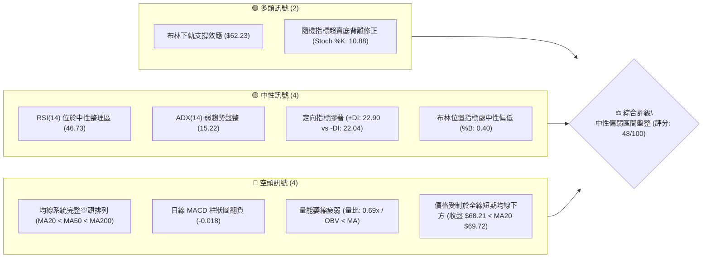
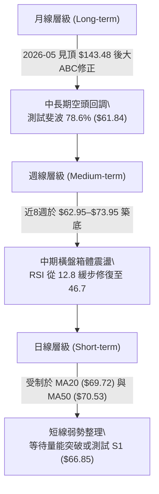
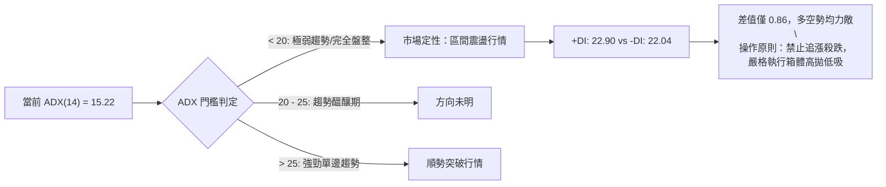
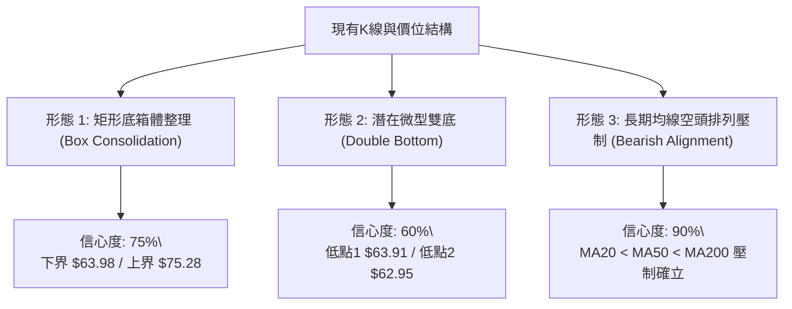
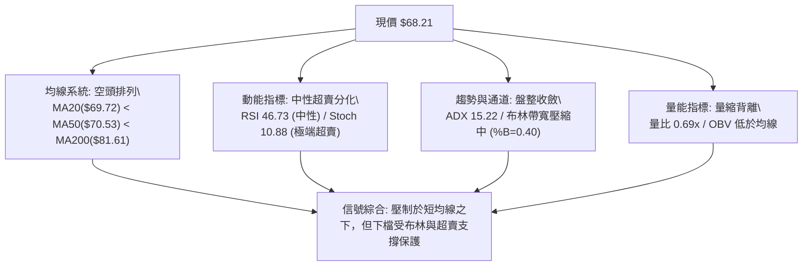
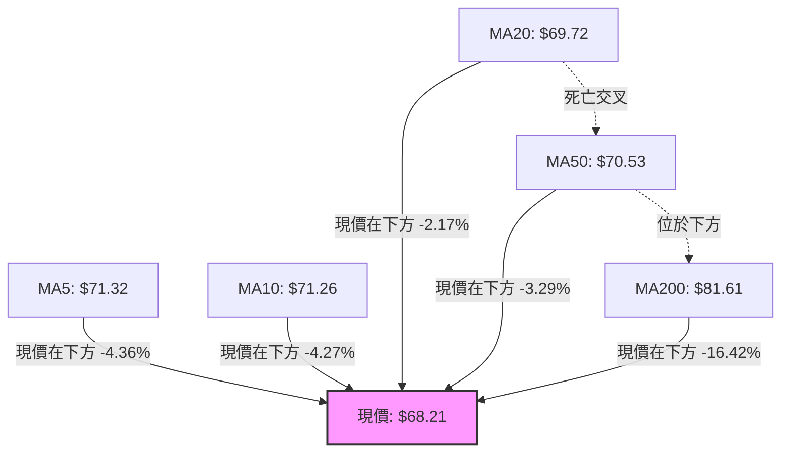
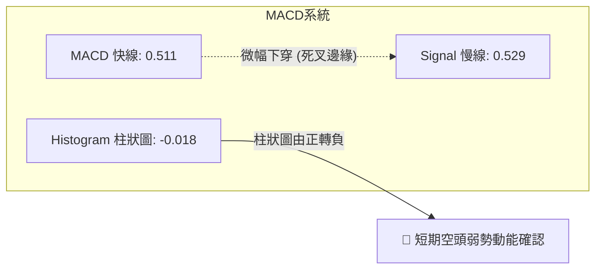
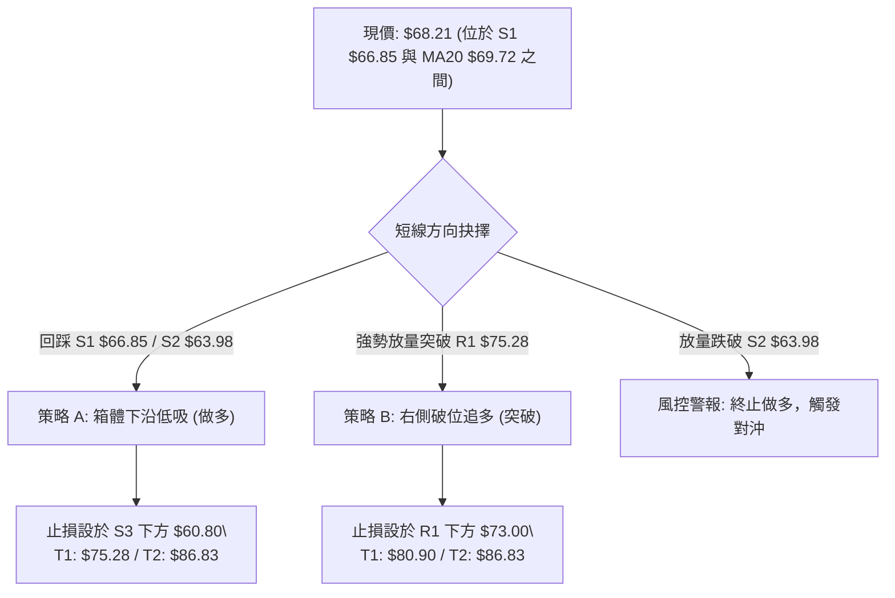
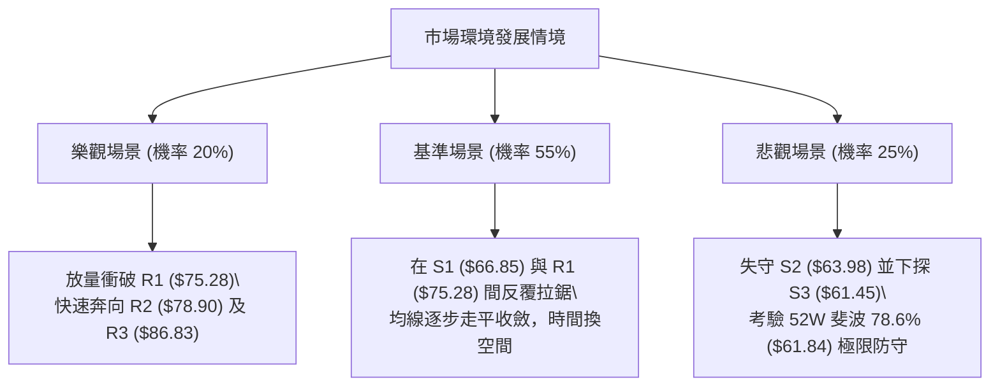

# RKLB 技術分析報告

> **報告日期**：2026-10-11 ｜ **語言**：繁體中文 ｜ **數據來源**：Yahoo Finance ｜ **當前價格**：$68.21

---

## 目錄

| 章節 | 內容 |
|------|------|
| [1. 技術面概覽](#1-技術面概覽) | 訊號儀表板、核心指標、評分卡 |
| [2. 趨勢分析](#2-趨勢分析) | 多時框趨勢、長中短期走勢、ADX強度 |
| [3. 圖表形態分析](#3-圖表形態分析) | 形態識別、K線組合、目標價推算 |
| [4. 支撐與阻力](#4-支撐與阻力) | 關鍵價位分布、波段聚類、斐波那契回調 |
| [5. 技術指標深度解讀](#5-技術指標深度解讀) | MA/RSI/MACD/布林通道/量價配合 |
| [6. 動能與波動率](#6-動能與波動率) | 四象限動能矩陣、ATR風控、Beta敏感度 |
| [7. 多時框架總結](#7-多時框架總結) | 時框架評分矩陣、多時框收斂定調 |
| [8. 交易策略建議](#8-交易策略建議) | 策略路由、情境階梯、進出場規劃 |
| [9. 風險提示與監控](#9-風險提示與監控) | 監控指標Checklist、風險場景樹 |
| [10. 報告總結](#10-報告總結) | 核心結論與最佳策略配置 |

---

## 1. 技術面概覽

### 🎯 技術訊號儀表板



---

### 📊 核心指標速覽表

| 指標類別 | 指標名稱 | 當前數值 | 訊號 | 專業解讀 |
|:---|:---|:---|:---:|:---|
| **價格** | 當前收盤價 | $68.21 | 🟡 | 位於52週區間27.0%分位，處於波段大幅回撤後的橫盤沉澱期 |
| **均線** | MA20 (短趨勢) | $69.72 | 🔴 | 現價位於MA20下方 -2.17%，短期向上動能受阻 |
| **均線** | MA50 (中趨勢) | $70.53 | 🔴 | 現價跌破中期生命線，且MA20下穿MA50構成空頭承壓 |
| **均線** | MA200 (長趨勢) | $81.61 | 🔴 | 現價低於年線 -16.42%，長期結構處於深度修正結構 |
| **動能** | RSI(14) | 46.73 | 🟡 | 處於40–50中性偏弱震盪帶，無超買或極端超賣特徵 |
| **動能** | MACD (12,26,9) | 0.511 / 0.529 | 🔴 | 快慢線高位糾纏並出現微幅死叉，柱狀圖轉為 -0.018 |
| **震盪** | Stoch %K / %D | 10.88 / 30.34 | 🟢 | 進入極度超賣區間（<20），短線具備技術性反抽動能 |
| **趨勢** | ADX(14) | 15.22 | 🟡 | 數值遠低於25，代表無單邊趨勢，市場定性為典型無序盤整 |
| **趨勢** | +DI / -DI | 22.90 / 22.04 | 🟡 | 雙線差距極小（差值 0.86），多空雙方力量均未掌握定價權 |
| **通道** | Bollinger Bands | $62.23 – $77.22 | 🟡 | 帶寬收窄，%B為0.40，價格在通道中下軌之間運行 |
| **量能** | 20日成交量比 | 0.69x (14.87M) | 🔴 | 換手低於20日均量（21.51M），OBV < MA 顯示量能未確認反轉 |
| **波動** | ATR(14) | $3.92 (5.74%) | 🟡 | 日均波動幅度可控，適合區間擺盪操作而非破位追單 |

---

### 🏆 技術評分卡

```
╔══════════════════════════════════════════════════════════════════╗
║                 技術評分卡 — RKLB (2026-10-11)                   ║
╠══════════════════════════════════════════════════════════════════╣
║ 趨勢強度 (Trend)     ███████░░░░░░░░░░░░░  35/100  🔴 均線空頭排列  ║
║ 動能指標 (Momentum)  ██████████░░░░░░░░░░  50/100  🟡 中性偏弱糾纏  ║
║ 支撐穩定度 (Support) ██████████████░░░░░░  70/100  🟢 S1/S2支撐穩固 ║
║ 成交量配合 (Volume)  ███████░░░░░░░░░░░░░  35/100  🔴 量能萎縮低迷  ║
║ 形態完整度 (Pattern) ████████████░░░░░░░░  60/100  🟡 箱體築底雛形  ║
║ 均線排列 (MA System) ████████░░░░░░░░░░░░  40/100  🔴 短中長線皆空  ║
╠══════════════════════════════════════════════════════════════════╣
║ 綜合評分             ██████████░░░░░░░░░░  48/100  🟡 中性區間盤整  ║
╚══════════════════════════════════════════════════════════════════╝
```

---

## 2. 趨勢分析

### 🌐 多時框趨勢分析



---

### 📈 長期趨勢 — 12個月走勢圖（Unicode）

```
RKLB 月線走勢圖（2025-11 至 2026-10）
價格軸 ($)
$150 ┤                               ● $143.48 (2026-05 歷史高點聚類)
$130 ┤                              ╱ ╲
$110 ┤                             ╱   ● $101.65 (2026-06)
$90  ┤              ● $80.07      ╱
$70  ┤  ● $69.76   ╱ ╲     ● $82.51    ╲
$50  ┤   ╲        ╱   ● $64.22          ● $64.95 ──● $63.92 ──● $69.68 ──● $68.21 (現價)
$30  ┤    ● $42.14 (2025-11 低點)
     └────┬─────┬─────┬─────┬─────┬─────┬─────┬─────┬─────┬─────┬─────┬─────
         11月  12月  01月  02月  03月  04月  05月  06月  07月  08月  09月  10月
         (2025)                           (2026)
```

#### 走勢特徵分析表格

| 階段區間 | 時間跨度 | 起訖價位 | 漲跌幅 | 核心特徵與技術形態 |
|:---|:---:|:---:|:---:|:---|
| **第一階段：強勢拉升** | 2025-11 ~ 2026-01 | $42.14 → $80.07 | **+90.01%** | 突破底部均線壓制，機構資金大舉介入，推升週線MACD多頭發散 |
| **第二階段：蓄勢震盪** | 2026-01 ~ 2026-03 | $80.07 → $64.22 | **-19.79%** | 縮量洗盤回踩支撐，於 $64.00 附近獲得強烈承接買盤 |
| **第三階段：主升浪爆發**| 2026-03 ~ 2026-05 | $64.22 → $143.48 | **+123.42%** | 月線極限噴發，觸及52週最高位 $151.00，量能急劇放大見情緒頂點 |
| **第四階段：深度出貨修正**| 2026-05 ~ 2026-07 | $143.48 → $64.95 | **-54.73%** | 斷頭鍘刀式重挫，跌破各週期均線，週線RSI跌至15.6極端超賣區 |
| **第五階段：底部沉澱整理**| 2026-07 ~ 2026-10 | $64.95 → $68.21 | **+5.02%** | 成交量顯著萎縮，價格反覆驗證 $62.95–$63.98 支撐，形成寬幅底箱 |

---

### 📊 中期趨勢（週線分析）

從近20週數據解析，RKLB 在 2026-05-31 觸及 $143.48 後，經歷了一輪典型的「階梯式下殺」。關鍵轉折點落在 2026-07-26 當週，收盤跌至 $63.91，週線 RSI 降至 15.6 的歷史罕見超賣水平。隨後在 2026-08-09 迎來量能配合的強勁反彈至 $82.83，但反彈受阻於年線附近後，再次回落至 2026-09-13 的 $62.95。

近4週價格分別為 $64.57、$73.95、$73.92 與本週的 $68.21，高點未過 $75.28 (R1)，低點未破 $62.95。此週線特徵表明：**空頭單邊下殺已結束，但多頭的反攻尚未轉化為主升浪，當前處於籌碼換手與均線收斂的平衡態。**

```
近期週線壓力與支撐示意圖：
$86.83 ────────────────────────────── R3 (週線強阻力 / MA120 $86.19 匯合區)
$78.90 ────────────────────────────── R2 (波段高點反彈極限)
$75.28 ────────────────────────────── R1 (近期箱體上沿 / 阻力警戒線)
$68.21 ══════════════════════════════ [現價位置：震盪中軸偏下]
$66.85 ┄┄┄┄┄┄┄┄┄┄┄┄┄┄┄┄┄┄┄┄┄┄┄┄┄┄ S1 (短線回踩第一防線)
$63.98 ────────────────────────────── S2 (強支撐 / 近期雙底聚類)
$61.84 ────────────────────────────── 斐波 78.6% 關鍵黃金回調位
$61.45 ────────────────────────────── S3 (極限波段底部防禦點)
```

---

### ⚡ 趨勢強度評估（ADX 解讀）



#### ADX 強度量化對照表

| 指標名稱 | 實際數據 | 標準區間分類 | 技術意涵與操作指引 |
|:---|:---:|:---:|:---|
| **ADX(14)** | **15.22** | **< 20（完全無趨勢）** | 表明目前市場不存在可持續的單邊推動力，任何假突破機率極高，均線系統出現鈍化與反覆纏繞現象。 |
| **+DI (14)** | **22.90** | 中性弱勢區 (20–30) | 多頭攻擊能量微弱，雖處於正向擴張但斜率平緩，不足以發動突破行情。 |
| **-DI (14)** | **22.04** | 中性弱勢區 (20–30) | 空方主動砸盤意願亦在衰退，恐慌性拋壓已釋放殆盡。 |
| **收斂結論** | **依規則 14** | **盤整行情優先級** | **ADX < 25，多時框必須以日線布林通道 ($62.23 - $77.22) 及關鍵聚類支撐阻力為交易核心邊界。** |

---

## 3. 圖表形態分析

### 🔍 形態識別系統



#### 圖表形態信心度量化評估表

| 識別形態 | 信心度 | 判斷依據（引用精確數據） | 形態完成度 | 目標價（附嚴謹計算式） |
|:---|:---:|:---|:---:|:---|
| **矩形底箱體整理** | **75%** | 自 2026-07 至今，價格反覆受限於支撐 S2 ($63.98) 與阻力 R1 ($75.28) 之間，近8週未脫離此區間 | 70% | 向上突破目標：$75.28 + ($75.28 - $63.98) = **$86.58**（高度接近阻力位 R3 $86.83） |
| **波段雙底架構** | **60%** | 第一低點 2026-07-26 收盤 $63.91，第二低點 2026-09-13 收盤 $62.95，頸線落在 2026-08-09 高點 $82.83 | 45% (尚未突破頸線) | 頸線 $82.83 + 形態高度 ($82.83 - $62.95 = 19.88) = **$102.71**（數據未確認頸線突破，僅供遠期參考） |
| **頭肩底形態** | **25%** | 數據中左肩與右肩結構缺乏對稱性，交易量未呈現標準右側放大結構 | 15% | **訊號不足，僅做指標型解讀，不強行繪製** |

---

### 🕯️ 重要K線形態分析

| 週期/月份 | 收盤價 | 典型K線形態 | 深度技術解讀 | 訊號強度 |
|:---|:---:|:---|:---|:---:|
| **2026-05** | $143.48 | 長上影爆量倒錘頭線 (52W高點 $151.00) | 月線級別見頂訊號，極度多頭衰竭，天量換手後主力出貨完畢 | 🔴 強烈看跌 |
| **2026-07** | $64.95 | 大陰線殺跌後長下影十字探底 | 跌至 $63.91 獲得抄底買盤，空頭動能衰退，初步築底信號 | 🟢 止跌企穩 |
| **2026-08** | $63.92 | 探底回升長上影紡錘線 | 衝高 $82.83 受阻於中長期均線回落，確認上方套牢賣壓沉重 | 🟡 震盪整理 |
| **2026-09** | $69.68 | 縮量溫和中陽線 | 下探 $62.95 獲支撐回升，收盤站上 $69，多空達成暫時弱平衡 | 🟡 中性修復 |
| **2026-10 (當前)** | $68.21 | 窄幅回踩陰十字星 | 回踩 MA20 ($69.72) 進行方向選擇，成交量比僅 0.69x，等待催化劑 | 🟡 觀望蓄勢 |

---

### 📉 ASCII 走勢形態示意圖

```
RKLB 箱體整理與形態關鍵點位示意圖：
價格
$86.83 ─────────────────────────────────────────────────── [箱體向上翻倍目標 / R3]
        
$78.90 ────────────────────────────────────────── [R2 阻力線]
                    ▲ 
$75.28 ────────────┼───────────● (09-27: $73.95) ─────── [頸線/箱體上沿 R1]
                  │           │           ▲
                  │ 箱體高度   │           │ 現價 $68.21 (受阻於 MA20 $69.72)
                  │ $11.30    │           ▼
$66.85 ┄┄┄┄┄┄┄┄┄┄┼┄┄┄┄┄┄┄┄┄┄┄┼┄┄┄┄┄┄┄┄┄┄┄┄┄┄┄┄┄┄┄┄┄┄┄ [支撐 S1]
                  │           │
$63.98 ───────────┴───────────┴─● (09-13: $62.95) ────── [箱體下沿 S2 / 雙底低點]
        ● (07-26: $63.91)
$61.45 ─────────────────────────────────────────────────── [極限防守底線 S3]
```

---

### 🎯 形態目標價計算

根據經過確認的「矩形底箱體整理」形態（信心度 75%）：
1. **箱體下邊界（Baseline）**：取聚類支撐 S2 = **$63.98**
2. **箱體上邊界（Neckline / Resistance）**：取聚類阻力 R1 = **$75.28**
3. **箱體垂直高度（Height, H）**：
   $$\text{Height} = \$75.28 - \$63.98 = \$11.30$$
4. **向上突破量度目標價（Target 1）**：
   $$\text{Target 1} = \$75.28 + \$11.30 = \$86.58$$
   *(該數值與歷史聚類阻力位 R3 **$86.83** 誤差僅 0.25 美元，高度重合，形成共振阻力區)*
5. **向下破位量度目標價（Downside Target）**：
   $$\text{Downside Target} = \$63.98 - \$11.30 = \$52.68$$
   *(若跌破 S2，則跌破斐波那契 78.6% 位 $61.84，下一個理論支撐將指向此處)*

---

## 4. 支撐與阻力

### 🗺️ 關鍵價位分布圖（Unicode）

```
RKLB 價位結構分布圖 (由實際 OHLCV 與歷史數據聚合生成)
══════════════════════════════════════════════════════════════════
$86.83 ║████████████████████████║ 強阻力 R3 (波段高點/形態目標)
$81.61 ║░░░░░░░░░░░░░░░░░░░░░░░░║ 長期均線 MA200 壓制帶
$80.90 ║▒▒▒▒▒▒▒▒▒▒▒▒▒▒▒▒▒▒▒▒▒▒▒▒║ 斐波那契 61.8% 關鍵黃金分割位
$78.90 ║████████████████████    ║ 次級阻力 R2 (反彈高點聚類)
$77.22 ║░░░░░░░░░░░░░░░░░░░░    ║ 布林通道上軌壓力
$75.28 ║████████████████████████║ 核心阻力 R1 (箱體上沿/突破分水嶺)
$70.53 ║░░░░░░░░░░░░░░░░        ║ 中期均線 MA50 阻力
$69.72 ║░░░░░░░░░░░░░░░░        ║ 布林中軌 / MA20 壓制位
$68.21 ╠════════════════════════╣ ◄ 當前收盤價 ($68.21)
$66.85 ║▓▓▓▓▓▓▓▓▓▓▓▓▓▓▓▓        ║ 近期支撐 S1 (短線波段回踩位)
$63.98 ║████████████████████████║ 強支撐 S2 (近一年雙底聚合帶)
$62.23 ║░░░░░░░░░░░░░░░░░░░░    ║ 布林通道下軌防守位
$61.84 ║▒▒▒▒▒▒▒▒▒▒▒▒▒▒▒▒▒▒▒▒▒▒▒▒║ 斐波那契 78.6% 極限回調位
$61.45 ║████████████████████████║ 終極支撐 S3 (跌破宣告波段破位)
══════════════════════════════════════════════════════════════════
```

---

### 🚧 阻力位分析表

所有阻力數據**完全引用自關鍵價位聚類**：

| 阻力級別 | 精確價位 | 距現價空間 | 形成技術原因 | 突破難度評估 | 重要性級別 |
|:---:|:---:|:---:|:---|:---:|:---:|
| **R1** | **$75.28** | +10.37% | 近期多次衝高收盤阻力（如 2026-09-27 的 $73.95、10-04 的 $73.92 均受阻回落）；箱體上沿頂點 | 🔴 極高 (需 25M 以上巨量) | ★★★★★ |
| **R2** | **$78.90** | +15.67% | 2026-08 中旬反彈震盪高點密集區 ($80.25 回落後的次高點收盤聚合位) | 🟡 中等 (穿透需消化套牢盤) | ★★★★☆ |
| **R3** | **$86.83** | +27.30% | 2026-06 暴跌初期第一中繼平台；MA120 ($86.19) 匯聚點；箱體翻倍目標位 | 🔴 極難 (強結構性解套拋壓) | ★★★★★ |

---

### 🛡️ 支撐位分析表

所有支撐數據**完全引用自關鍵價位聚類**：

| 支撐級別 | 精確價位 | 距現價空間 | 形成技術原因 | 守住機率評估 | 重要性級別 |
|:---:|:---:|:---:|:---|:---:|:---:|
| **S1** | **$66.85** | -1.99% | 近2週日線回調低點聚合處；接近布林通道中軸下方緩衝帶 | 🟢 70% (短期具防禦性) | ★★★☆☆ |
| **S2** | **$63.98** | -6.19% | 2026-07-26 ($63.91)、2026-08-30 ($64.39)、2026-09-06 ($64.26) 等多週收盤聚合底 | 🟢 85% (中期主防禦線) | ★★★★★ |
| **S3** | **$61.45** | -9.91% | 近一年波段極端下影線低點聚類；與斐波那契 78.6% ($61.84) 共同構築最後多頭防線 | 🟢 95% (破位代表熊市重啟) | ★★★★★ |

---

### 📐 斐波那契回調位分析

依據 52 週絕對區間：低點 **$37.57** → 高點 **$151.00** 嚴格映射：

| 斐波那契回調比例 | 算定價位 | 與現價 ($68.21) 相對關係 | 深度技術解讀 |
|:---:|:---:|:---:|:---|
| **0.0% (52W High)** | **$151.00** | +121.37% | 極限歷史頂部，主升浪衰竭出貨位置 |
| **23.6%** | **$124.23** | +82.13% | 初級回撤位，跌破後確認多頭牛市終結 |
| **38.2%** | **$107.67** | +57.85% | 2026-06 初盤整平台，反彈強阻力 |
| **50.0%** | **$94.28** | +38.22% | 多空平衡中軸，站上此位方可確認反轉 |
| **61.8% (黃金分割)** | **$80.90** | +18.60% | **關鍵阻力**：與 MA200 ($81.61) 形成強共振壓制區 |
| **78.6% (深次回調)** | **$61.84** | -9.34% | **當前關鍵錨定區**：現價落於 61.8% ($80.90) 與 78.6% ($61.84) 之間 |
| **100.0% (52W Low)** | **$37.57** | -44.92% | 原始牛市起點，極端悲觀情境下之終極清算位 |

**現價區間解讀**：
當前價格 **$68.21** 處於深次回調 78.6% ($61.84) 與 61.8% ($80.90) 的寬幅夾層內，偏向 78.6% 一側。從技術規律來看，強趨勢股在經歷 78.6% 的深度回調後，通常會在此區域展開長達數月的橫向蓄勢，只要未有效跌破 $61.84，即保留了構築宏觀右側雙底的可能。

---

## 5. 技術指標深度解讀

### 🎛️ 指標訊號總覽



---

### 📈 移動平均線排列分析



#### 均線數據明細矩陣

| 均線週期 | 價位 | 與現價偏差 | 乖離率 (BIAS) | 歷史斜率與走勢特徵 | 技術解讀 |
|:---:|:---:|:---:|:---:|:---|:---|
| **MA 5** | $71.32 | -$3.11 | -4.36% | 下彎（▅▆████▇▇▇███▇） | 超短線空頭受挫，受阻回踩 |
| **MA 10** | $71.26 | -$3.05 | -4.27% | 走平微跌（▅▆▆▇▇██████） | 短期反彈受阻，形成第一道壓制 |
| **MA 20** | $69.72 | -$1.51 | -2.17% | 底部微翹（▂▂▂▂▃▃▄▄▄▄） | 月線級別平衡線，日線爭奪核心 |
| **MA 50** | $70.53 | -$2.32 | -3.29% | 緩跌走平 | 中期生命線，未站上不可言多頭反轉 |
| **MA 60** | $69.78 | -$1.57 | -2.25% | 下行末端（▂▂▂▂▁▁▁▁▁▁▁▁▁▁） | 與 MA20 形成極度收斂的雙重中樞 |
| **MA 120** | $86.19 | -$17.98 | -20.86%| 陡峭向下（▅▅▅▆▆▆▆▆▅▄▂） | 半年線強阻力，對應阻力 R3 |
| **MA 200** | $81.61 | -$13.40 | -16.42%| 緩步下移 | 牛熊分水嶺，長期趨勢受制於熊市反彈 |
| **MA 240** | $76.77 | -$8.56 | -11.15%| 持續上走走平（▇▇▇▇▇██████） | 長期基礎成本線，壓制於反彈高點 |

**均線排列總結**：目前處於標準的短期與長期 **空頭排列（MA20 < MA50 < MA200）**。但需要注意 MA20 ($69.72) 與 MA60 ($69.78) 出現罕見的「數值黏合」（差距僅 0.06 美元），這意味著過去 1 至 3 個月的平均持倉成本在此高度集中。價格若能放量突破 $70.53 (MA50)，將引發均線由空轉多的糾纏修復。

---

### 📉 RSI(14) 分析

```
RSI(14) 當前數值：46.73
超賣 [0] ─────────────── [30] ─────────────── [70] ─────────────── [100] 超買
                                ▓▓▓▓▓▓▓▓▓▓▓░░░░░░░░
                                (46.73 - 中性偏弱整理區)
```

- **背離判斷結論**：**無日線頂/底背離**。
- **深入分析**：
  - 在近20週數據中，週線 RSI 曾於 2026-07-26 下探至 **15.6**，並於 2026-09-06 再探 **12.8**。隨後價格未創新低（$62.95 守住 $61.45），而週線 RSI 在 2026-09-27 急劇拉升至 **67.2**。這在週線級別完成了**中線隱形底背離修復**。
  - 當前日線 RSI 回落至 **46.73**，與價格從 $73.92 回踩至 $68.21 的節奏完全吻合，屬於健康的弱勢回調，並未出現動能與價格相悖的指標背離。
  - 震盪指標中，**Stochastic %K 跌至 10.88（超賣），%D 為 30.34**，表明短線下殺動能已消耗殆盡，短線存在隨時向上回抽 MA20 的技術性修復需求。

---

### 📊 MACD(12/26/9) 訊號解讀



- **MACD 線 (DIF)**：0.511
- **訊號線 (DEA)**：0.529
- **MACD 柱狀圖 (Histogram)**：**-0.018**
- **解讀**：
  MACD 快慢線依然維持在零軸上方運行（0.511 > 0），顯示自 9 月以來的反彈結構並未徹底瓦解。然而，快線下穿慢線，柱體錄得微小的負值（-0.018），這代表上行動能停滯，市場進入「零軸上方的死叉整理」。由於柱體數值極小，顯示當前空方並未具備加速打壓的動能，而是多頭在 R1 ($75.28) 阻力面前的防禦性休整。

---

### 📦 布林通道分析

```
布林通道結構 (20日, 2.0 倍標準差)：
$77.22 ───────────────────────────────────────── BB 上軌 (+13.21%)
        
$69.72 ┄┄┄┄┄┄┄┄┄┄┄┄┄┄┄┄┄┄┄┄┄┄┄┄┄┄┄┄┄┄┄┄┄┄┄┄┄┄┄ BB 中軌 (MA20)
        ▲ 現價 $68.21 (%B = 0.40)
        │ 
$62.23 ───────────────────────────────────────── BB 下軌 (-8.77%)
```

- **上軌**：$77.22
- **中軌 (MA20)**：$69.72
- **下軌**：$62.23
- **%B 指標**：**0.40**
- **解讀**：
  布林帶帶寬目前處於大幅收斂狀態（帶寬約 $14.99），價格處於中下軌之間（%B = 0.40）。歷史規律顯示，布林通道顯著收口是劇烈變盤的前兆。現價距離中軌僅 $1.51，距離下軌 $5.98。若空方持續施壓，下軌 **$62.23** 將與聚類支撐 S2 **$63.98** 形成極強的雙重共振保護帶；反之，若放量收復中軌 $69.72，將展開向上軌 $77.22 的衝擊。

---

### 💹 成交量分析（量價配合度）

```
成交量對比：
最新日成交量  ██████████████░░░░░░  14.87M
20日均量      ████████████████████  21.51M  (量比 0.69x，萎縮 30.8%)
50日均量      ██████████████████    19.36M
```

- **量比**：**0.69x**
- **OBV (能量潮指標)**：**OBV < MA**
- **量價診斷**：
  1. **縮量回調特徵**：最新成交量為 14,873,000 股，顯著低於 20 日均量 21,512,975 股，量比僅 0.69x。當前價格的回落並非恐慌盤砸盤所致，而是「缺乏主動買盤」的陰跌縮量走勢。
  2. **OBV 疲軟警示**：OBV 處於其均線下方，顯示資金自 2026-05 的天量高點出逃後，近期雖有回補，但增量資金依然謹慎，尚未出現連續放量吸籌的特徵。
  3. **量價背離結論**：無惡性量價頂背離，但當前存在「量能不濟」對反彈空間的限制。在成交量重返 20M（突破 20 日均量）之前，任何突破嘗試均易演變為假突破。

---

## 6. 動能與波動率

### ⚡ 動能評估四象限

```
        波動率 (Volatility / ATR)
                  ▲
                  │
        Q3        │        Q4
   高波動 / 弱動能 │   高波動 / 強動能
                  │
  ────────────────┼────────────────► 動能強度 (Momentum / RSI, MACD)
                  │
        Q2 [當前] │        Q1
   低波動 / 弱動能 │   低波動 / 強動能
   (ATR 5.74% 盤整)│
                  │
```

#### 動能評估四象限詳細定位

| 象限代號 | 動能維度 | 波動維度 | 歷史對應階段 | 當前狀態評估 | 策略意涵 |
|:---:|:---:|:---:|:---:|:---:|:---|
| **Q1** | 強 (RSI>60) | 低 (ATR<5%) | 2025-12 慢牛主升 | — | 最佳趨勢加倉區間 |
| **Q2 (當前)** | **弱 (RSI: 46.7)** | **低 (ATR: 5.7%)** | **2026-09 ~ 10 築底**| **✓ 本股當前定位** | **動能沉澱、波動收縮；以防守觀望或箱體網格交易為主** |
| **Q3** | 弱 (RSI<35) | 高 (ATR>8%) | 2026-06 暴跌主跌浪 | — | 極高下行風險，嚴禁抄底 |
| **Q4** | 強 (RSI>70) | 高 (ATR>10%)| 2026-05 天量見頂 | — | 獲利了結、情緒過熱警惕 |

---

### 📊 ATR 波動率分析

- **ATR(14)**：**$3.92**（佔當前股價之 **5.74%**）
- **波動特徵**：
  每日平均真實波動達到近 4 美元，這表明即便處於低 ADX (15.22) 的盤整市中，RKLB 作為高貝塔成長股依然保有極強的日內彈性。
- **風控止損距離量化建議**：
  - **超短線交易（1.0x ATR）**：安全緩衝區為 **$3.92**。以當前價 $68.21 計算，日內雜訊波動區間為 $64.29 – $72.13。
  - **波段防守（1.5x ATR）**：建議止損間距為 **$5.88**。
  - **中期結構防守（2.0x ATR）**：建議止損間距為 **$7.84**。若在 S1 附近建倉，2.0x ATR 止損恰好能保護至 S3 ($61.45) 關鍵支撐下方，避免被隨機震盪洗盤出場。

---

### 📐 Beta 與市場相關性

- **Beta 係數**：**2.938**
- **空頭比例 (Short % Float)**：**7.3%**
- **市場特徵分析**：
  RKLB 的 Beta 高達近 3.0，意味著當標普 500 指數或納斯達克波動 1% 時，該股理論上將產生接近 3% 的同向或放大波動。這種極高貝塔屬性解釋了為何該股在 52 週內能拉出 $37.57 到 $151.00 的 4 倍空間，隨後又被腰斬。當前股價處於橫盤整理，高貝塔效應暫時受到壓抑，但一旦大盤出現系統性方向選擇，本股的突破速度將數倍於大盤。

---

## 7. 多時框架總結

### 📋 時框架評分表

| 時框架 | 趨勢方向 | 動能狀態 | 均線排列特徵 | 圖表形態識別 | 綜合評分 | 戰略建議 |
|:---:|:---:|:---:|:---:|:---:|:---:|:---|
| **月線 (Long-term)** | 🟡 深度回調 | 🟡 修正完畢 | 股價受壓於年內高位，但在2年基底之上 | 斐波那契 78.6% 尋求支撐 | 52/100 | 長期分批逢低吸納，不宜重倉 |
| **週線 (Medium-term)**| 🟡 寬幅箱體 | 🟢 低位修復 | MA20平走，MA120下壓 | 雙底/箱體築底中 ($63.98–$75.28) | 55/100 | 區間震盪交易，等待均線聚攏 |
| **日線 (Short-term)** | 🔴 弱勢回踩 | 🔴 柱狀圖翻負 | 完整空頭排列 (MA20<MA50<MA200) | 布林通道下軌回踩測試 | 42/100 | 短線禁止追高，等待支撐信號 |

---

### 🔲 綜合訊號矩陣

```
時框與指標共振矩陣：
              日線 (Short)      週線 (Medium)     月線 (Long)
趨勢 (MA)       🔴 空頭排列       🟡 糾纏平走       🟢 長期高於2024基底
動能 (RSI)      🟡 46.73 中性     🟢 46.7 脫離超賣  🟡 修正蓄勢
動能 (MACD)     🔴 微幅死叉       🟢 柱體維持修復   🔴 月線死叉消化中
量能 (Volume)   🔴 縮量 0.69x     🟡 縮量沉澱       🔴 脫離天量區
────────────────────────────────────────────────────────────────
共振評估：當前短線指標偏空，但中長期指標於深幅回撤後展現企穩韌性。
```

---

### ⚖️ 多時框收斂結論

**嚴格依據規則 14 進行優先級收斂**：
1. **行情定性判定**：當前 **ADX(14) = 15.22 (< 25)**，嚴格判定當前處於**盤整行情（Consolidation Market）**，而非單邊趨勢行情。
2. **主導時框與交易邊界**：在盤整行情中，日線與週線的趨勢突破訊號大多失真，**必須以日線布林通道 ($62.23 – $77.22) 以及關鍵聚合支撐阻力 S1/S2 與 R1 作為最高優先級依據**。
3. **方向性結論定調**：**【中性觀望，偏向支撐位低吸】**。
   日線空頭均線排列與負 MACD 柱狀圖要求我們「放棄所有追漲策略」；而週線與月線在 78.6% 斐波那契位 ($61.84) 與 S2 ($63.98) 的強力承接，要求我們「不可盲目殺跌」。綜合優先級，策略定調為**區間震盪操作**。

---

## 8. 交易策略建議

### 🗺️ 策略決策流程圖



---

### 🧭 策略路由

> **當前主策略方向 = 區間震盪低吸策略（依技術評分卡綜合評分 48/100 定調：處於 40–60 中性震盪區間，禁止單邊盲賭，以箱體邊界低吸高拋為主，耐心等待突破確認）**

---

### 🎯 價格情境階梯（Price Scenarios）

價位嚴格引用自**第 4 章聚類數據**：

| 觸發條件 | 下一目標 | 後續延伸 | 情境技術含義 |
|:---|:---:|:---:|:---|
| **強勢突破 R1 ($75.28)** | **R2 ($78.90)** | **R3 ($86.83)** | 徹底擺脫箱體糾纏，突破 MA50，打開向半年線及形態量度目標的空間 |
| **收復 MA20 ($69.72)** | **R1 ($75.28)** | **BB 上軌 ($77.22)** | 短線空頭排列緩解，回測箱體上沿壓力 |
| **維持於現價區間 ($68.21)**| **S1 ($66.85)** | **MA20 ($69.72)** | 縮量震盪，指標繼續在布林通道內收斂鈍化 |
| **跌破 S1 ($66.85)** | **S2 ($63.98)** | **BB 下軌 ($62.23)** | 回踩驗證雙底支撐帶，考驗下檔多頭買盤強度 |
| **失守 S2 ($63.98)** | **S3 ($61.45)** | **斐波 78.6% ($61.84)** | 宣告箱體結構破裂，測試年內最後黃金防線 |

---

### 📊 情境機率分佈

```
情境機率分佈：
1. 箱體區間震盪 (Consolidation)   ███████████████████████████  55%
2. 震盪回踩再探底 (Re-test Lows)   ████████████                 25%
3. 放量向上反彈突破 (Breakout)     ██████████                   20%
```

| 情境劇本 | 預估機率 | 主要技術依據 |
|:---|:---:|:---|
| **區間震盪 (維持 $63.98–$75.28)** | **55%** | **ADX(14) 僅 15.22 處於絕對低位**；成交量比 0.69x 無增量資金推動單邊；布林通道正在劇烈收斂壓縮。 |
| **回落再探底 (測試 S1/S2)** | **25%** | **均線系統呈現完整空頭排列**；MACD 柱狀圖為負 (-0.018)；短期價格被 MA5/MA10/MA20 全面壓制。 |
| **向上反彈突破 (衝擊 R1/R2)** | **20%** | **Stochastic %K 處於極度超賣 (10.88)**；分析師多數看好（共識目標 $109.15）；需外部催化劑或放量確認。 |

---

### 🟢 主策略詳情（方向：區間低吸與突破部署）

本報告提供兩套嚴謹執行的操作策略：**策略 A（左側/箱體下沿逢低買入）** 與 **策略 B（右側/放量突破箱體跟進）**。

| 策略要素 | 策略 A：箱體邊界低吸策略 (主推) | 策略 B：右側突破跟進策略 (順勢) |
|:---|:---|:---|
| **適用時機** | 價格回調至支撐位 S1/S2 企穩出現下影線 | 日線放量長陽收盤實體站穩 R1 上方 |
| **進場條件** | 回踩至 $64.50 – $66.85 區間，Stoch 翻轉金叉 | 收盤價確認突破 $75.28，日成交量 > 22M |
| **進場價格** | **$66.00**（取 S1 $66.85 緩衝位） | **$75.50**（確認站上 R1 $75.28 之微幅溢價）|
| **目標價 T1** | **$75.28** (箱體阻力 R1) | **$80.90** (斐波那契 61.8% / 阻力 R2) |
| **目標價 T2** | **$78.90** (阻力 R2) | **$86.83** (阻力 R3 / 形態翻倍量度目標) |
| **止損價格** | **$62.50** (置於 S2 $63.98 與布林下軌下方) | **$72.50** (置於跌破突破點及 MA20 之下) |
| **止損距離** | $3.50 (5.30%) | $3.00 (3.97%) |
| **第一盈虧比** | **2.65 : 1** (獲利 $9.28 / 虧損 $3.50) | **1.80 : 1** (獲利 $5.40 / 虧損 $3.00) |
| **第二盈虧比** | **3.69 : 1** (獲利 $12.90 / 虧損 $3.50) | **3.78 : 1** (獲利 $11.33 / 虧損 $3.00) |
| **預估勝率** | **65%** (震盪市邊緣低吸勝率較高) | **50%** (受制於量能不足的假突破風險) |
| **建議倉位** | **總資金 8% – 10%** | **總資金 5% – 7%** |

---

### 🔴 反向風險觸發點（對沖提示）

若持有多頭頭寸，以下條件一旦觸發，代表主策略邏輯已被破壞，必須堅決減倉或建立空頭對沖：
1. **失守 S2 ($63.98)**：若日線以大陰線跌破 $63.98 且收盤未能收回，宣告雙底築底失敗，向下空間打開至 S3 ($61.45) 甚至斐波 78.6% ($61.84)。此時所有低吸多單必須無條件止損。
2. **量能異常放大破位**：若成交量放大至 25M 以上（放量殺跌），同時 MACD 柱狀圖急速向下擴散（跌破 -1.0），代表機構資金再度出逃，高貝塔風險全面爆發。

---

### ⭐ 整體訊號強度評星

```
做多訊號強度：★★☆☆☆  (2.5/5星 — 估值與超賣提供支撐，但均線與量能壓制)
做空訊號強度：★★☆☆☆  (2.5/5星 — 處於深次回調區，下檔拋壓衰竭，做空盈虧比差)
區間操作適宜度：★★★★☆ (4.0/5星 — 典型低 ADX 震盪市場，非常適合網格高拋低吸)
整體分析可信度：★★★★☆ (4.5/5星 — 數據點高度聚類，價位支撐阻力結構清晰)
```

---

## 9. 風險提示與監控

### ✅ 關鍵監控指標 Checklist

```
╔══════════════════════════════════════════════════════════════════╗
║                   每日交易前關鍵監控清單 (Checklist)             ║
╠══════════════════════════════════════════════════════════════════╣
║ [ ] 價格是否跌破防禦線 S1 ($66.85)？                             ║
║     └─ 若跌破，取消短期進場，等待 S2 ($63.98) 承接測試。          ║
║ [ ] 日成交量是否顯著超越 20日均量 (21.51M)？                     ║
║     └─ 若縮量，拒絕追高突破單；若放量突破 R1 ($75.28)，啟動策略B。║
║ [ ] MACD 柱狀圖是否持續收窄轉正 (當前: -0.018)？                  ║
║     └─ 柱狀圖重返正值是短線多頭重新奪回主動權的先決條件。        ║
║ [ ] RSI(14) 是否成功突破 50 中性水嶺 (當前: 46.73)？             ║
║     └─ 站上 50 意味著日線動能由弱勢區進入強勢區。                ║
║ [ ] 盤中大盤波動與 Beta 傳導效應：                              ║
║     └─ Beta 高達 2.938，需密切防範大盤跳水帶來的放大踩踏。       ║
╚══════════════════════════════════════════════════════════════════╝
```

---

### ⚠️ 風險場景分析



---

### 🛡️ 風險管理重要提醒

1. **極高 Beta 風險控制**：
   本股 Beta 達 **2.938**，具有「槓桿級別」的天然波動屬性。在投資組合構建中，RKLB 的持倉權重應嚴格控制在 **整體投資組合的 5% 至 10%** 以內，嚴禁在高波動盤整期使用保證金槓桿交易。
2. **基本面財務虧損之技術面折射**：
   數據顯示公司 TTM 淨利潤率為 **-21.5%**，自由現金流為 **-$251.96M**，遠期市盈率處於超高水平。雖然分析師共識目標價給予 $109.15，但基本面未盈利意味著一旦市場風險偏好驟降，股票容易缺乏估值底部的硬性支撐。因此，技術面止損位（S2 $63.98 / S3 $61.45）**必須剛性執行**，不可在跌破關鍵支撐後轉為長期被動套牢。
3. **ATR 動態倉位管理法則**：
   每日真實波幅 ATR 為 **$3.92 (5.74%)**。單次交易單筆最大承受損失若設定為總資金的 1%，則單次建倉最大股數公式為：
   $$\text{最大持股量} = \frac{\text{總資金} \times 1\%}{1.5 \times \text{ATR}} = \frac{\text{總資金} \times 0.01}{\$5.88}$$
   嚴格依據波動率調整開倉規模，方能在寬幅洗盤的航天軍工股中保全本金。

---

## 10. 報告總結

```
╔══════════════════════════════════════════════════════════════════════╗
║                   RKLB 技術分析報告總結 (2026-10-11)                 ║
╠══════════════════════════════════════════════════════════════════════╣
║ 當前價格：$68.21          52週區間：$37.57 - $151.00 (分位 27.0%)   ║
║ 分析評級：⚖️ 中性觀望 / 區間震盪低吸 (綜合評分: 48/100)              ║
╠══════════════════════════════════════════════════════════════════════╣
║ 關鍵維度技術定調：                                                   ║
║ ├─ 長期趨勢 (月線)：🟡 深度回調蓄勢，受守於斐波 78.6% ($61.84) 上方  ║
║ ├─ 中期趨勢 (週線)：🟡 構築寬幅底箱 ($63.98 - $75.28)，RSI低位修復   ║
║ ├─ 短期趨勢 (日線)：🔴 均線空頭排列，受制於 MA20 ($69.72) 與 MACD死叉║
║ ├─ 趨勢強度 (ADX) ：🟡 ADX 15.22 (<25)，判定為典型「無方向盤整行情」 ║
║ ├─ 核心支撐區域   ：S1: $66.85  │  S2: $63.98  │  S3: $61.45        ║
║ ├─ 核心阻力區域   ：R1: $75.28  │  R2: $78.90  │  R3: $86.83        ║
║ └─ 華爾街目標均價 ：$109.15 (空間 +60.02%，最高 $150.00)             ║
╠══════════════════════════════════════════════════════════════════╣
║ 最優策略組合導航：                                                   ║
║ 1. 🥇 最佳機會 (策略 A)：回踩 S1/S2 ($64.50-$66.85) 輕倉低吸做多，    ║
║                          止損設於 $62.50，目標看 R1 ($75.28)，       ║
║                          盈虧比高達 2.65:1。                         ║
║ 2. 🥈 次選機會 (策略 B)：若帶量突破 R1 ($75.28)，右側順勢追入，      ║
║                          目標依序看 R2 ($78.90) 與 R3 ($86.83)。     ║
║ 3. 🥉 保守選擇          ：空倉者保持觀望，等待日線收復 MA20 ($69.72) ║
║                          且 MACD 柱體轉正後，再行介入右側行情。      ║
╚══════════════════════════════════════════════════════════════════════╝
```

---

> ⚠️ **免責聲明**：本報告為 AI 自動生成之技術分析，所有數據及估算均嚴格基於所提供的歷史與即時市場技術資訊。本報告**僅供研究與學術參考**，**不構成任何要約、招攬或投資建議**。金融市場存在極高風險，特別是高 Beta 與尚未盈利之新興產業個股，投資人應獨立評估風險並自行承擔交易損益。

---

*報告生成時間：2026-10-11 ｜ 數據來源：Yahoo Finance ｜ 分析框架：多時框收斂量化技術分析*