# RKLB 基本面深度分析報告

> **報告日期**：2026-10-12 ｜ **語言**：繁體中文 ｜ **數據來源**：Yahoo Finance ｜ **當前價格**：$68.21

---

## 目錄

| 章節 | 內容 |
|------|------|
| [1. 技術面概覽](#1-技術面概覽) | 訊號儀表板、核心指標、評分卡 |
| [2. 趨勢分析](#2-趨勢分析) | 多時框趨勢、長中短期走勢、ADX強弱 |
| [3. 圖表形態分析](#3-圖表形態分析) | 形態識別、K線組合、目標價推算 |
| [4. 支撐與阻力](#4-支撐與阻力) | 關鍵價位、斐波那契回調結構 |
| [5. 技術指標深度解讀](#5-技術指標深度解讀) | MA系統、RSI、MACD、布林通道、OBV |
| [6. 動能與波動率](#6-動能與波動率) | 動能象限、ATR波動度、Beta係數解讀 |
| [7. 多時框架總結](#7-多時框架總結) | 時框架評分矩陣與多時框收斂邏輯 |
| [8. 交易策略建議](#8-交易策略建議) | 策略路由、主策略、情境階梯與風控 |
| [9. 風險提示與監控](#9-風險提示與監控) | 監控指標Checklist、風險情境路徑 |

---

## 1. 技術面概覽

### 🎯 技術訊號儀表板

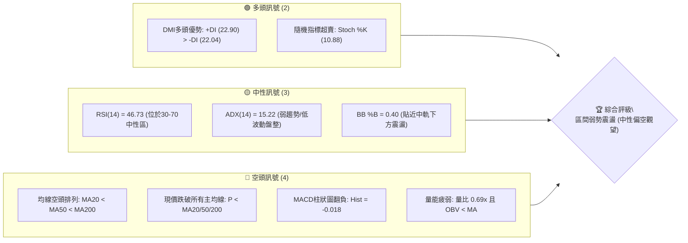

### 📊 核心指標速覽表

| 指標類別 | 指標名稱 | 當前數值 | 訊號 | 解讀 |
|:---|:---|:---:|:---:|:---|
| **價格** | 當前收盤價 | $68.21 | 🟡 | 位於52週區間27.0%分位，自歷史高點回撤後盤整 |
| **均線** | MA20 (短期) | $69.72 | 🔴 | 現價低於MA20 (-2.17%)，短期承壓 |
| **均線** | MA50 (中期) | $70.53 | 🔴 | 現價低於MA50 (-3.29%)，中期趨勢受阻 |
| **均線** | MA200 (長期)| $81.61 | 🔴 | 現價顯著低於MA200 (-16.42%)，長期架構偏空 |
| **均線系統** | 均線排列 | 空頭排列 | 🔴 | MA20($69.72) < MA50($70.53) < MA200($81.61) |
| **動能** | RSI(14) | 46.73 | 🟡 | 處於40–50中性偏弱震盪帶，無頂底背離 |
| **動能** | MACD(12,26,9)| 0.511 / 0.529 | 🔴 | DIF下穿DEA形成死叉，柱狀圖為 -0.018 |
| **超買超賣** | Stoch %K / %D | 10.88 / 30.34 | 🟢 | 進入極度超賣區，醞釀技術性反彈動能 |
| **趨勢強度** | ADX(14) | 15.22 | 🟡 | ADX < 25 表明無明確趨勢，處於無方向盤整期 |
| **通道指標** | 布林通道帶寬 | $62.23 – $77.22 | 🟡 | %B = 0.40，價格由中軌往區間下緣整理 |
| **波動度** | ATR(14) | $3.92 | 🟡 | 佔現價 5.74%，日均振幅溫和壓縮 |
| **成交量** | 20日量比 | 0.69x (OBV < MA)| 🔴 | 成交量 14.87M 遠低於均量 21.51M，量價動能不足 |

### 🏆 技術評分卡

```
╔══════════════════════════════════════════════════════════════════╗
║               技術評分卡 — RKLB (2026-10-12)                   ║
╠══════════════════════════════════════════════════════════════════╣
║ 趨勢強度 (Trend Strength)   █████░░░░░░░░░░░░░░░  28/100 🔴 弱勢 ║
║ 動能指標 (Momentum)        ████████░░░░░░░░░░░░  42/100 🟡 中性 ║
║ 支撐穩定度 (Support Base)   █████████████░░░░░░░  65/100 🟢 堅韌 ║
║ 成交量配合 (Volume Flow)    ██████░░░░░░░░░░░░░░  32/100 🔴 縮量 ║
║ 形態完整度 (Pattern Shape)  ██████████░░░░░░░░░░  52/100 🟡 構築 ║
║ 均線排列 (MA Alignment)    ████░░░░░░░░░░░░░░░░  20/100 🔴 空頭 ║
╠══════════════════════════════════════════════════════════════════╣
║ 綜合評分 (Overall Score)    ████████░░░░░░░░░░░░  40/100 🟡 觀望 ║
║ 綜合評級：區間震盪整理 (中性偏空 / 區間操作級別)               ║
╚══════════════════════════════════════════════════════════════════╝
```

---

## 2. 趨勢分析

### 🌐 多時框趨勢分析

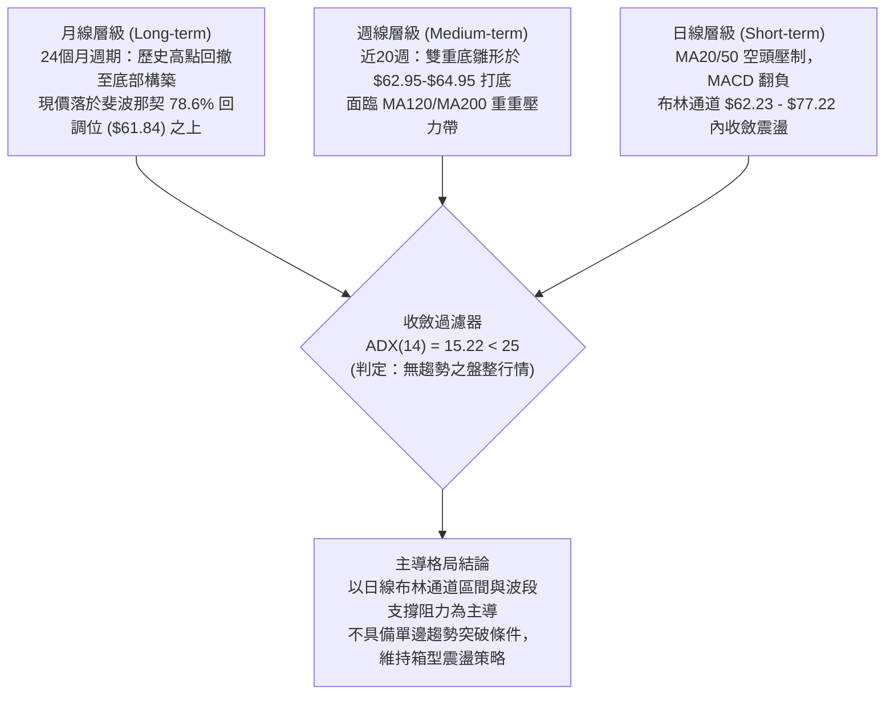

### 📈 長期趨勢 — 12個月走勢圖（Unicode）

依據 2025-11 至 2026-10 之月線收盤數據繪製：

```
RKLB 月線走勢圖（過去12個月歷史路徑）
價格軸 ($)
$150 ┤                                       
$140 ┤                                  ● $143.48 (2026-05 波段峰值)
$120 ┤                                 / \
$100 ┤                                /   ● $101.65 (2026-06)
$80  ┤               ● $80.07        /     \
$70  ┤        ● $69.76 \            ● $82.51\               ● $69.68
$60  ┤       /          ● $69.10   /         \  ● $64.95    /   ● $68.21(現價)
$50  ┤      /                 \   /           ● $63.92─────●
$40  ┤● $42.14                 ● $64.22
     └─────────────────────────────────────────────────────────────
      11   12   01   02   03   04   05   06   07   08   09   10  (月份)
     2025 ──────────────────────────► 2026
```

#### 走勢特徵分析表格

| 階段階段 | 時間跨度 | 起訖價位 | 漲跌幅 | 結構特徵與技術解讀 |
|:---|:---:|:---:|:---:|:---|
| **第一波拉升** | 2025-11 至 2026-01 | $42.14 → $80.07 | +90.01% | 脫離底部放量急攻，奠定中長期估值重塑基礎 |
| **強勢回檔整理** | 2026-01 至 2026-03 | $80.07 → $64.22 | -19.80% | 縮量健康回踩，守住 $64 支撐平台 |
| **主升浪噴出** | 2026-03 至 2026-05 | $64.22 → $143.48| +123.42%| 創歷史新高至 $151.00，動能耗竭出現極端擴張 |
| **深幅獲利回吐** | 2026-05 至 2026-07 | $143.48 → $64.95| -54.73% | 瀑布式流動性修正，下探至斐波那契78.6%回調位 |
| **底部築底盤整** | 2026-07 至 2026-10 | $64.95 → $68.21 | +5.02%  | 波動率收斂至 ATR $3.92，籌碼在 $63–$70 換手 |

### 📊 中期趨勢（週線分析）

從近20週數據觀察，價格在 2026-07-26 觸及收盤低點 $63.91 與 2026-09-13 觸及 $62.95，兩次探底後均獲得買盤支撐並彈回 $73.90 以上。然而，隨後未能克服上方 MA200 ($81.61) 壓力，再度拉回。

```
中期週線結構示意圖：
[阻力區]  R3 $86.83 ──────────────────────────────── (MA120 $86.19 疊加區)
          R2 $78.90 ──────────────────────────────── (近波段高點)
          R1 $75.28 ────────────▲─────────────────── (布林上軌 $77.22 壓制)
                                │
[現  價]  $68.21 ───────────────┼─────────────────── (MA20 $69.72 中軌附近)
                                │
[支撐區]  S1 $66.85 ────────────▼─────────────────── (近一年波段低點聚類)
          S2 $63.98 ════════════════════════════════ (雙重底第一頸線低位)
          S3 $61.45 ════════════════════════════════ (Fib 78.6% $61.84 防線)
```

### ⚡ 趨勢強度評估（ADX 解讀）

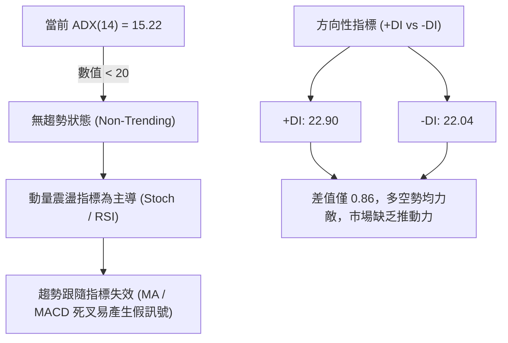

#### ADX 趨勢強度對照表

| 指標數值區間 | 當前數值 | 趨勢強度判定 | 交易策略導向 |
|:---:|:---:|:---:|:---|
| 0.00 – 19.99 | **15.22** | **極弱趨勢 / 盤整市場** 🟡 | **嚴禁追突破；採用箱體高拋低吸，關注通道邊界** |
| 20.00 – 24.99 | — | 趨勢萌芽 / 方向未明 | 縮小部位，等待動能確認 |
| 25.00 – 39.99 | — | 良好單邊趨勢形成 | 順勢操作，拉回均線進場 |
| 40.00 – 100.0 | — | 極強單邊 / 超買超賣 | 警惕耗竭缺口與趨勢末端反轉 |

---

## 3. 圖表形態分析

### 🔍 形態識別系統

在日線與週線時框下，價格自 2026-05 高點回調後，於 $63.00–$64.00 構築支撐平台，形成潛在雙重底（Double Bottom）形態；同時在日線週期中，布林通道帶寬收斂，呈現「布林收縮震盪箱體」。

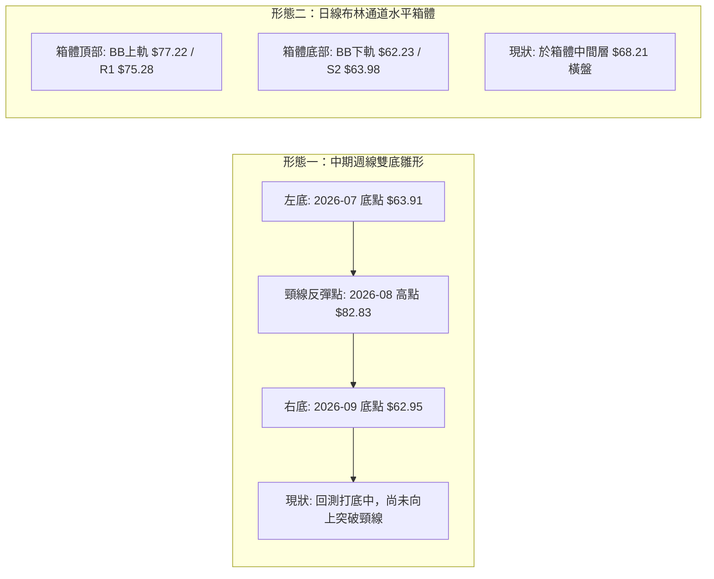

#### 形態識別與信心度評估表（依規則 15）

| 形態名稱 | 信心度 | 判斷依據（引用實際數據） | 完成度 | 目標價（附嚴謹計算式） |
|:---|:---:|:---|:---:|:---|
| **中期雙重底 (Double Bottom)** | **58%** | 兩次低點聚類於 S2 $63.98 與週線收盤 $62.95–$63.91，獲買盤托底；但現價尚未突破頸線 | 45% | **保守目標價：$86.83 (R3)**<br>形態理論高點 = 頸線 $82.83 + 形態高度($82.83 - $62.95 = $19.88) = $102.71；受制於MA200，先以波段聚類阻力 R3 $86.83 為首要目標 |
| **日線布林收縮箱體 (Rectangle Range)** | **72%** | ADX=15.22 確認盤整，價格收斂於布林帶寬 ($62.23–$77.22)，20日均線水平走平 | 80% | **區間上軌目標價：$75.28 (R1) / $77.22**<br>以布林通道上軌 $77.22 及密集阻力位 R1 $75.28 為上邊界 |
| **頭肩底形態 (Inverse H&S)** | **<30%** | **數據不足，僅做指標型解讀**：未見明確左肩與右肩對稱成交量分布，不符合標準幾何條件 | 0% | 不預設目標價（嚴禁通靈） |

### 🕯️ 重要K線形態分析

| 週/月份標記 | 收盤價 | K線與量能組合 | 技術意涵解讀 | 訊號方向 |
|:---|:---:|:---|:---|:---:|
| **2026-05** | $143.48 | 巨量天花板倒錘頭線（歷史高點 $151.00） | 成交量噴出至1.17億股，多頭動能極度耗竭 | 🔴 強烈空頭反轉 |
| **2026-07-26**| $63.91 | 長下影十字星，成交量 92.14M 萎縮 | 空頭拋壓衰竭，於 Fib 78.6% 回調位 $61.84 上方止跌 | 🟢 潛在落底訊號 |
| **2026-08-09**| $82.83 | 實體大陽線，週漲幅顯著，RSI 彈至 68.6 | 築底反彈確立第一波段反彈頂部（形成雙底頸線） | 🟢 多頭波段反彈 |
| **2026-09-13**| $62.95 | 二次探底錘頭線，週成交量 85.20M | 右底測試成功，未跌破前低 $61.45 (S3)，構成雙底右腳 | 🟢 支撐確認訊號 |
| **2026-10-11**| $68.21 | 連續兩週滯漲後的小陰線，成交量回落至 104.57M | 承壓於日線均線群，多空在 $68–$70 展開拉鋸 | 🟡 短線受壓整理 |

### 📉 ASCII 走勢形態示意圖

```
週線雙重底形態結構示意圖：
$85 ┤                   頸線峰值: $82.83 (2026-08-09)
    │                     ┌─────▲─────┐
$75 ┤                    ╱             ╲               阻力 R1 $75.28
    │                   ╱               ╲             ┌───────┐
$68 ┤──────────────────┼─────────────────┼────────────┼─● $68.21 (現價)
    │                 ╱                   ╲          ╱
$63 ┤  左底 $63.91 ──●                     ╲        ╱  右底 $62.95
$61 ┤ (2026-07-26)                          └──●───┘  (2026-09-13)
    └─────────────────────────────────────────────────────────────► 時間
     支撐防線: S2 $63.98 / S3 $61.45 (Fib 78.6% = $61.84)
```

### 🎯 形態目標價計算

根據雙重底測量法則與箱型震盪理論計算：
1. **中期雙重底向上突破確認（條件：收盤實體突破頸線 $82.83）**：
   - 形態底部低點：$62.95
   - 形態高度（H）= $82.83 - $62.95 = **$19.88**
   - 理論最小量度目標價 = $82.83 + $19.88 = **$102.71**
   - **實務折價目標階梯**：考量上方 MA120 ($86.19) 與歷史波段密集區，首要阻力錨定 **R3: $86.83**。
2. **短期布林箱體擺動目標價**：
   - 下軌支撐守穩：$62.23 / S2 $63.98
   - 箱體上限目標：布林上軌 **$77.22** 或密集群阻力 **R1: $75.28**。

---

## 4. 支撐與阻力

### 🗺️ 關鍵價位分布圖（Unicode）

```
RKLB 價位結構分布圖 (由實際歷史 OHLCV 聚類計算)
═══════════════════════════════════════════════════════════════════
$151.00 ║████████████████████████║ 52週歷史高點 (52W High / Fib 0.0%)
$124.23 ║████████████            ║ 斐波那契 23.6% 回調位
$107.67 ║████████████████        ║ 斐波那契 38.2% 回調位
$94.28  ║████████████████████    ║ 斐波那契 50.0% 中樞分水嶺
$86.83  ║████████████████████████║ 強阻力 R3 (MA120 $86.19 共振帶)
$80.90  ║████████████████████    ║ 斐波那契 61.8% 關鍵黃金分割位
$78.90  ║████████████████████    ║ 次級阻力 R2 (波段反彈次高點)
$75.28  ║████████████████████████║ 關鍵阻力 R1 (布林上軌附近密集壓力)
$68.21  ╠════════════════════════╣ ◄ 當前市價 (位於 S1 與 R1 之間)
$66.85  ║▓▓▓▓▓▓▓▓▓▓▓▓▓▓▓▓        ║ 近期第一支撐 S1 (-1.99%)
$63.98  ║████████████████████████║ 波段核心強支撐 S2 (雙底回測密集區)
$61.84  ║████████████████████    ║ 斐波那契 78.6% 深幅回調防線
$61.45  ║████████████████████████║ 波段極限防守支撐 S3 (-9.91%)
$37.57  ║████████████████████████║ 52週歷史低點 (52W Low / Fib 100.0%)
═══════════════════════════════════════════════════════════════════
```

### 🚧 阻力位分析表

價位精確引用波段高點聚類數據：

| 阻力級別 | 價位 | 與現價距離 | 形成原因與籌碼特徵 | 突破難度 | 重要性 |
|:---|:---:|:---:|:---|:---:|:---:|
| **R1** | **$75.28** | +10.37% | 近期反彈波段高點聚類，貼近日線布林通道上軌 ($77.22)，為短期箱頂 | 中等 🟡 | ★★★☆☆ |
| **R2** | **$78.90** | +15.67% | 2026年8月中旬整理平台下緣，逼近斐波那契61.8%回調位 ($80.90) | 偏高 🔴 | ★★★★☆ |
| **R3** | **$86.83** | +27.30% | 近一年密集套牢峰值區，且與 MA120 ($86.19) 形成共振強壓區 | 極高 🔴 | ★★★★★ |

### 🛡️ 支撐位分析表

價位精確引用波段低點聚類數據：

| 支撐級別 | 價位 | 與現價距離 | 形成原因與籌碼特徵 | 守住機率 | 重要性 |
|:---|:---:|:---:|:---|:---:|:---:|
| **S1** | **$66.85** | -1.99% | 近期波段震盪低點聚集，為日線短波防守第一道關卡 | 65% 🟢 | ★★★☆☆ |
| **S2** | **$63.98** | -6.19% | 雙重底形態雙腳聚類位（2026-07低點$63.91、08月低點$64.39），強買盤平台 | 82% 🟢 | ★★★★★ |
| **S3** | **$61.45** | -9.91% | 近一年絕對波段低點，下鄰斐波那契78.6% ($61.84)，為中期多頭底線 | 90% 🟢 | ★★★★★ |

### 📐 斐波那契回調位分析

依據 52 週波動區間：**波段低點 $37.57 → 波段高點 $151.00** 展開：

| 斐波那契比例 | 價位 | 當前相對位置與技術意義解讀 |
|:---:|:---:|:---|
| **0.0% (52W High)** | **$151.00** | 歷史峰值，動能耗竭與流動性頂點 |
| **23.6%** | **$124.23** | 早期回調支撐（已被跌破並轉為極遠期阻力） |
| **38.2%** | **$107.67** | 牛市健康回調位（失守後宣告進入深幅修正） |
| **50.0%** | **$94.28** | 多空力量絕對平衡中樞，心理大關 |
| **61.8%** | **$80.90** | 黃金分割強防線；失守後代表行情已轉為深度空頭修正 |
| **78.6%** | **$61.84** | **關鍵極限回調防守位**；現價落在 61.8% ($80.90) 與 78.6% ($61.84) 之間 |
| **100.0% (52W Low)**| **$37.57** | 週期起漲原點，極端悲觀情境底線 |

> **位置解讀**：現價 **$68.21** 正處於 **Fib 61.8% ($80.90)** 與 **Fib 78.6% ($61.84)** 的「深度修復沉澱區間」。由於回調深達 78.6% 附近，技術上宣告先前的垂直牛市結構已完全瓦解，目前處於大級別的沉澱築底週期，下檔 $61.84–$63.98 構成強力的複合支撐帶。

---

## 5. 技術指標深度解讀

### 🎛️ 指標訊號總覽

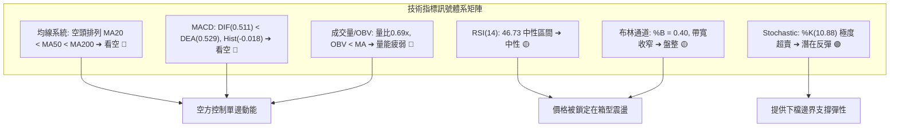

### 📈 移動平均線排列分析

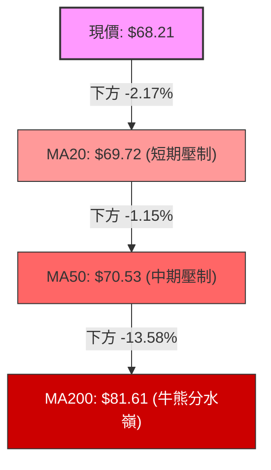

#### 移動平均線數據對照表

| 均線名稱 | 數值 | 價格相距 | 排列特徵 | 趨勢涵義 |
|:---|:---:|:---:|:---:|:---|
| **MA 5** | $71.32 | -4.36% | 下彎（扣抵高位） | 短線空方控盤，短期阻力 |
| **MA 10** | $71.26 | -4.27% | 下彎 | 壓抑反彈空間 |
| **MA 20** | $69.72 | -2.17% | 走平微下彎 | 布林中軌，短線多空分水嶺 |
| **MA 50** | $70.53 | -3.29% | 下彎 | 中期套牢籌碼密集區 |
| **MA 60** | $69.78 | -2.25% | 走平 | 與 MA20 黏合，形成 $69.70–$70.50 密集群壓力 |
| **MA 120** | $86.19 | -20.86%| 下降趨勢中 | 半年線強壓，貼近阻力 R3 ($86.83) |
| **MA 200** | $81.61 | -16.42%| 走平偏下 | 長期牛熊分界線，未收復前不言反轉 |
| **MA 240** | $76.77 | -11.15%| 緩步走平 | 與日線布林上軌 ($77.22) 共振 |

均線結構呈現嚴格的 **空頭排列 (MA20 < MA50 < MA200)**，且 MA5、MA10、MA20 均位於價格上方，反映短中期賣壓層層疊加。

### 📉 RSI(14) 分析

- **當前數值**：**46.73**
- **強度進度條**：
  ```
  超賣 [0] ░░░░░░░░░░░░░░ [30] ▓▓▓▓▓▓▓▓░░░░░░ [70] ░░░░░░░░░░░░░░ [100] 超買
  RSI(14) = 46.73 (位於 30-70 中性格局，偏向空方微弱優勢)
  ```
- **超買超賣狀態**：處於正常中性波動區間，無極端超買或超賣跡象。
- **背離分析判斷**：
  - **價格 vs RSI 走勢比對**：
    - 2026-07-26 低點：收盤 $63.91，RSI 為 15.6；
    - 2026-09-13 低點：收盤 $62.95，RSI 為 27.1。
    - **底背離檢驗**：在 9 月探底過程中，價格微幅跌破 7 月低點，但 RSI 低點顯著墊高（15.6 → 27.1），存在**中級底背離雛形**，該背離隨後推動價格反彈至 10 月初之 $73.92。
    - **當前狀態**：近期由 $73.92 拉回至 $68.21，RSI 由 69.1 快速降至 46.73，**當前無頂背離亦無即時底背離**，動能處於重新沉澱狀態。

### 📊 MACD(12/26/9) 訊號解讀

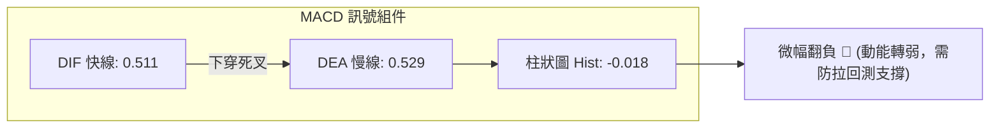

- **MACD 快慢線**：快線 DIF (0.511) 與慢線 DEA (0.529) 均處於零軸上方附近，但 DIF 已微幅向下交會 DEA，形成高位微弱死叉。
- **柱狀圖 (Histogram)**：數值由前兩週的正值區間收斂並翻負至 **-0.018**，顯示短線推升動能暫告一段落，空方取得短線控盤權。
- **背離結論**：週線級別 MACD 柱狀圖在 8 月高點達到 +2.940，而 10 月初反彈至 $73.92 時僅達 +0.857，呈現**反彈動能衰竭**，確認上檔阻力 R1 ($75.28) 沉重。

### 📦 布林通道分析

```
ASCII 布林通道位置示意圖 (日線週期)：
$77.22 ┬────────────────────────────────────────── 布林上軌 (Upper Band)
       │                                          (阻力 R1 $75.28 鄰近區)
$73.00 ┼
       │
$69.72 ┼───────────────────▲────────────────────── 布林中軌 (MA20)
       │                   │
$68.21 ┼                   ● 現價 (位於中軌與下軌間，%B = 0.40)
       │
$62.23 ┴────────────────────────────────────────── 布林下軌 (Lower Band)
                                                  (強支撐 S2 $63.98 守護區)
```

- **布林帶寬度 (Bandwidth)**：$(77.22 - 62.23) / 69.72 = 21.50\%$，呈現開口收斂後的橫向通道狀態。
- **%B 指標**：$\%B = (68.21 - 62.23) / (77.22 - 62.23) = 0.40$，價格落於中軌下方，反映微弱空方壓制。
- **軌道行為模式**：在 ADX 低於 25 的盤整格局下，布林通道邊界具備強烈均值回歸特性，下軌 **$62.23** 預期具備堅實買盤，上軌 **$77.22** 具備強力阻力。

### 💹 成交量分析（量價配合度）

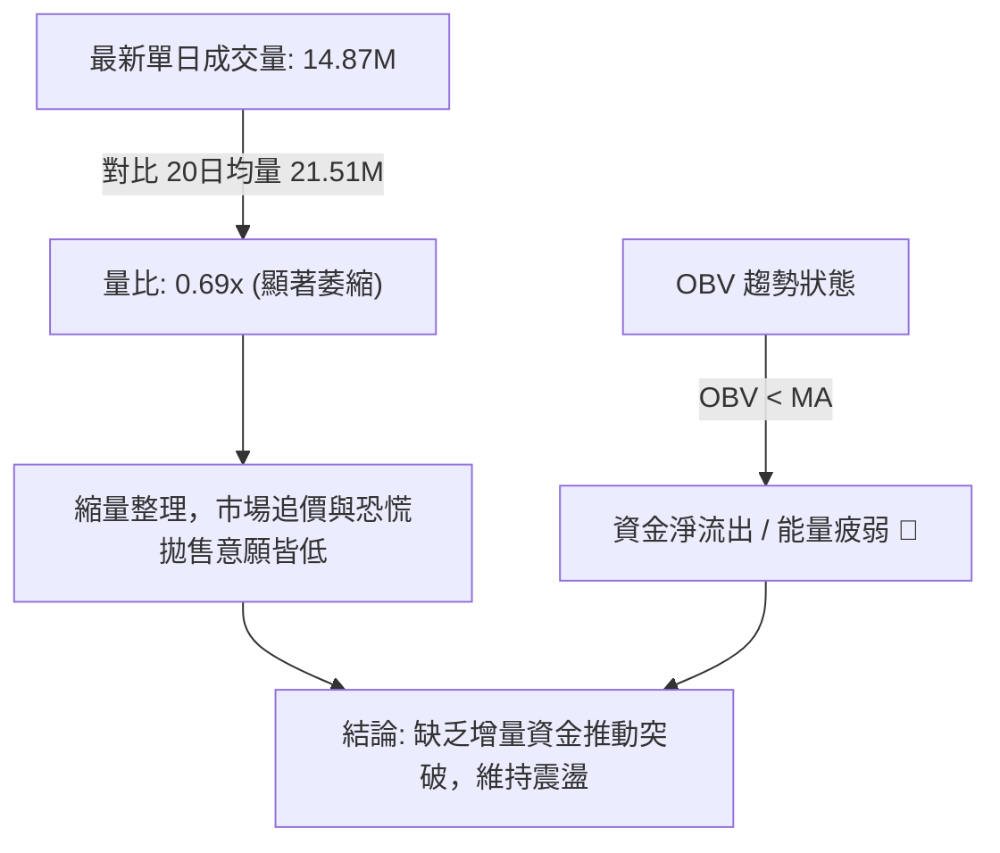

- **量比檢視**：最新成交量僅 14,873,000 股，僅為 20 日均量 (21,512,975 股) 的 **0.69倍**，顯示價格拉回過程並未引發恐慌性大量，屬於典型的「縮量回洗」。
- **OBV (能量潮指標)**：目前 OBV 處於其移動平均線下方，表明在 2026-05 歷史天量換手後，機構主力資金尚未展開顯著的主動回補，量能結構呈現存量博弈特徵。

---

## 6. 動能與波動率

### ⚡ 動能評估四象限

| 象限 | 動能強度 | 波動率水準 | 當前歸屬狀態 | 策略指導方針 |
|:---:|:---:|:---:|:---:|:---|
| **Q1 (強動能 / 低波動)** | 強 | 低 | — | 穩定突破趨勢，最適加碼 |
| **Q2 (弱動能 / 低波動)** | **弱** | **低** | **✓ [當前 RKLB 處於此區]** | **方向未明，維持區間低吸高拋或觀望** |
| **Q3 (強動能 / 高波動)** | 強 | 高 | — | 狂熱主升或主跌，嚴設停損 |
| **Q4 (弱動能 / 高波動)** | 弱 | 高 | — | 無序劇烈洗盤，避免進場 |

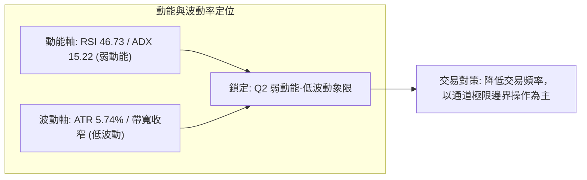

### 📊 ATR 波動率分析

- **ATR(14) 數值**：**$3.92**
- **波動佔比**：$3.92 / 68.21 =$ **5.74%**
- **波動特徵**：從歷史主升浪期間的每日劇烈振幅，回落至目前每日約 $3.92 的相對低波動狀態。
- **止損與部位建議**：
  - **短期擺動交易防守距離**：建議設定 $1.5 \times \text{ATR} = 1.5 \times \$3.92 =$ **$5.88**。
  - **極限洗盤容忍度**：$2.0 \times \text{ATR} = 2.0 \times \$3.92 =$ **$7.84**。
  - 進場操作時，止損距離不應小於 $4.00，以防盤中隨機噪音觸發出場。

### 📐 Beta 與市場相關性

- **Beta 係數**：**2.938**
- **解讀與影響**：
  - Beta 高達近 3.0，代表 RKLB 具備極強的高彈性科技/航太成長股特質，理論上對標普500指數波動的敏感度達近 3 倍。
  - 當大盤處於風險偏好（Risk-on）環境時，該股反彈爆發力極大；但在盤整低成交量環境下，高 Beta 反而凸顯出個股流動性折價時的陰跌特性，需高度關注宏觀市場情緒的連動。

---

## 7. 多時框架總結

### 📋 時框架評分表

| 時框架 | 趨勢方向 | 動能狀態 | 均線排列 | 圖表形態 | 綜合評分 | 操作建議 |
|:---|:---:|:---:|:---:|:---:|:---:|:---|
| **長期 (月線)** | 中性偏弱 🟡 | 弱勢修正中 | MA 處於高檔重塑 | 歷史回調至 Fib 78.6% 上方 | **45/100** | 長線分批建倉，不追高 |
| **中期 (週線)** | 區間震盪 🟡 | 中性沉澱 (RSI 46.7) | 壓制於 MA120/MA200 | 雙重底雛形打底中 | **48/100** | 守穩 $63.98 可逢低佈局 |
| **短期 (日線)** | 空頭壓制 🔴 | 短線超賣 (Stoch %K 10.8) | 空頭排列 (MA20<50<200) | 布林通道下軌震盪收斂 | **36/100** | 區間操作，等待回測低吸 |

### 🔲 綜合訊號矩陣

```
╔══════════════════════════════════════════════════════════════════╗
║               多時框架訊號收斂矩陣 (Multi-Timeframe Matrix)      ║
╠══════════════════════════════════════════════════════════════════╣
║ 維度項目       │ 短期 (日線)    │ 中期 (週線)    │ 長期 (月線)    ║
╠════════════════╪════════════════╪════════════════╪════════════════╣
║ 趨勢方向       │ 🔴 下跌壓制    │ 🟡 橫向盤整    │ 🟡 深度修復    ║
║ 動能 (MACD/RSI)│ 🔴 空叉/轉弱   │ 🟡 中性平緩    │ 🔴 動能耗竭後  ║
║ 均線系統       │ 🔴 空頭排列    │ 🔴 壓制於長均線│ 🟢 守於起漲位上║
║ 支撐/阻力關係  │ 🟡 逼近短支撐S1│ 🟢 守穩波段底S2│ 🟢 Fib 78.6%   ║
║ 成交量能       │ 🔴 量縮 (0.69x)│ 🟡 沉澱換手    │ 🔴 歷史天量後退║
╠════════════════╧════════════════╧════════════════╧════════════════╣
║ 一致性檢驗：短中期均無單邊趨勢，訊號高度聚焦於「箱型震盪打底」 ║
╚══════════════════════════════════════════════════════════════════╝
```

### ⚖️ 多時框收斂結論（依規則 14）

1. **趨勢/盤整行情判定**：
   - 當前 **ADX(14) = 15.22 遠低於 25**，依嚴格規則判定為**典型「盤整行情」**。
2. **主導時框優先級**：
   - 在盤整格局下，趨勢型均線（MA20/50/200空頭排列）的單邊看跌意義被大幅鈍化，極易產生破底翻或震盪假突破；**主導時框應以日線布林通道上下軌 ($62.23 – $77.22) 以及歷史密集波段支撐阻力 (S2 $63.98 / R1 $75.28) 為主要決策依據**。
3. **收斂方向性唯一結論**：
   - **中性偏空之區間震盪觀望（綜合評分 40/100）**。價格目前運行於箱體中偏下段，下有 S1/S2 密集支撐，上有均線及 R1 壓制。操作上**反對追空**（因面臨 S2 強底與 Stoch 極度超賣），亦**反對盲目右側追多**，唯一可行策略為在箱型邊界採取「高拋低吸之均值回歸策略」。

---

## 8. 交易策略建議

### 🗺️ 策略決策流程圖

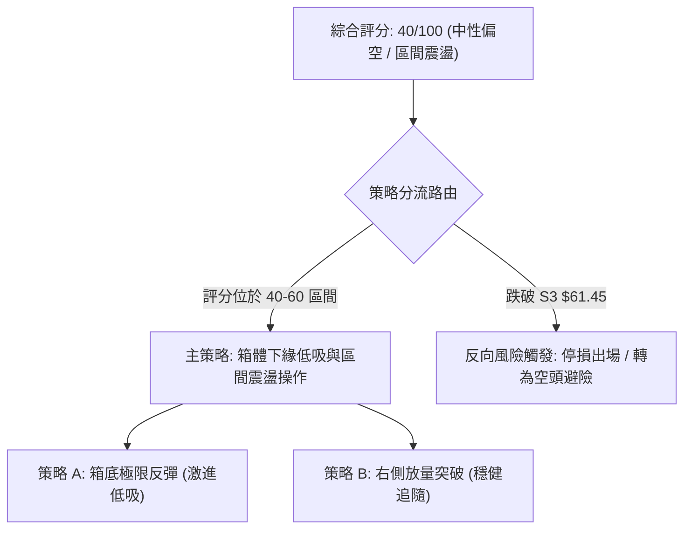

### 🧭 策略路由（依評分卡分流）

> **當前主策略方向 = 區間震盪箱體操作（依綜合評分 40/100，處於 40–60 中性震盪臨界帶，以布林通道與關鍵支撐阻力為主，等待邊界確認）**

### 🎯 價格情境階梯（Price Scenarios）

價位嚴格引用關鍵價位聚類與布林通道數值：

| 觸發條件 | 第一目標 (T1) | 第二目標 (T2) | 後續延伸 (T3) | 情境技術涵義 |
|:---|:---:|:---:|:---:|:---|
| **放量突破 R1 $75.28** | R2 $78.90 | R3 $86.83 | $94.28 (Fib 50%) | 短線走出震盪泥淖，挑戰半年線與長均線阻力 |
| **站穩現價區間 ($66.85–$69.72)**| BB中軌 $69.72 | R1 $75.28 | BB上軌 $77.22 | 區間內部均值回歸，多空處於拉鋸平衡 |
| **跌破 S1 $66.85** | S2 $63.98 | S3 $61.45 | Fib 78.6% $61.84 | 考驗雙重底右腳防線，進入極限低吸買區 |
| **有效跌破 S3 $61.45** | $50.00 整數關卡 | $37.57 (52W Low)| — | 中期雙底形態徹底破局，長期結構轉為崩跌 |

### 📊 情境機率分佈

| 情境劇本 | 機率 | 主要技術依據 |
|:---|:---:|:---|
| **區間震盪整理 (箱體波動)** | **55%** | **ADX=15.22** 鎖定盤整架構，布林帶寬收窄，成交量能萎縮至 0.69x，多空皆無力走出單邊 |
| **下探尋求支撐後反彈** | **30%** | 均線空頭壓制 (MA20/50 在上方)，MACD 柱狀圖翻負 (-0.018)，易受重力拉回測試 S2 **$63.98** |
| **向上單邊放量突破** | **15%** | 目前量能匱乏且 OBV < MA，在無重大利多催化下，直接衝破 R1/R2 密集群難度極高 |

### 🟢 主策略詳情

本策略專注於盤整市場的「下軌低吸」與「右側確認」：

| 策略要素 | 策略 A：箱底支撐低吸策略 (左側偏多) | 策略 B：突破均線回踩策略 (右側穩健) |
|:---|:---|:---|
| **交易邏輯** | 依託雙重底強支撐 S2 及 Stoch 超賣佈局反彈 | 等待價格收復短均線群並確認站穩進場 |
| **進場條件** | 價格拉回 S2 附近，且日線收長下影線或出現紅K | 收盤價實體突破 MA50 ($70.53) 並回測不破 |
| **進場價格** | **$64.50** (位於 S1 $66.85 與 S2 $63.98 之間) | **$70.80** (站上 MA50 $70.53 之後) |
| **目標價 T1** | **$69.72** (MA20 / 布林中軌) | **$75.28** (關鍵阻力 R1) |
| **目標價 T2** | **$75.28** (關鍵阻力 R1) | **$78.90** (阻力 R2) |
| **止損價格** | **$61.20** (跌破 S3 $61.45 與 Fib 78.6% $61.84)| **$66.50** (跌破 S1 $66.85 短線失效) |
| **風險額度 (R)**| 每股風險 $64.50 - $61.20 = $3.30 | 每股風險 $70.80 - $66.50 = $4.30 |
| **報酬額度 (T2)**| 每股報酬 $75.28 - $64.50 = $10.78 | 每股報酬 $78.90 - $70.80 = $8.10 |
| **風險報酬比** | **1 : 3.27** (卓越 🟢) | **1 : 1.88** (合格 🟡) |
| **預估勝率** | 55% | 45% |
| **建議倉位** | **8% – 10%** 總投資資本 | **5% – 7%** 總投資資本 |

### 🔴 反向風險觸發點（對沖與停損提示）

若發生下列情境，代表震盪格局遭到空方實質性向下擊穿，主策略必須全面終止：
1. **實體K線跌破 S3 $61.45 且伴隨放量**：跌破此價位意味著雙重底構築失敗，中期下行空間打開，所有多頭部位必須嚴格止損離場，或買入看跌期權對沖現貨。
2. **ADX 向上飆升突破 25 且 -DI 劇烈發散**：代表單邊空頭趨勢重新啟動，嚴禁任何左側摸底行為。

### ⭐ 整體訊號強度評星

```
╔══════════════════════════════════════════════════════════════════╗
║ 做多訊號強度：★★☆☆☆  (2.5/5星 — 僅限箱底低吸，缺乏單邊動能)     ║
║ 做空訊號強度：★★★☆☆  (3.0/5星 — 均線壓制，但下方支撐極強)     ║
║ 整體可信度：  ★★★☆☆  (3.5/5星 — 指標在低波動盤整期高度收斂)   ║
╚══════════════════════════════════════════════════════════════════╝
```

---

## 9. 風險提示與監控

### ✅ 關鍵監控指標 Checklist

```
╔══════════════════════════════════════════════════════════════════╗
║               每日盤後技術監控清單 (Monitoring Checklist)        ║
╠══════════════════════════════════════════════════════════════════╣
║ [ ] 1. 價格是否跌破 S1 ($66.85)？ 若失守，防守焦點下移至 S2    ║
║ [ ] 2. 價格是否測試 S2 ($63.98)？ 觀察成交量是否出現縮量止跌    ║
║ [ ] 3. 收盤價是否重新站上 MA20 ($69.72) 與 MA50 ($70.53)？      ║
║ [ ] 4. 日成交量是否顯著超越 20日均量 (21.51M)？ (突破必須帶量)  ║
║ [ ] 5. ADX(14) 是否由 15.22 向上抬升突破 20 大關？              ║
║ [ ] 6. MACD 柱狀圖是否由負轉正 (-0.018 ➔ >0)？                  ║
║ [ ] 7. Stoch %K 是否自超賣區 (<20) 向上金叉 %D 形成買訊？      ║
╚══════════════════════════════════════════════════════════════════╝
```

### ⚠️ 風險場景分析

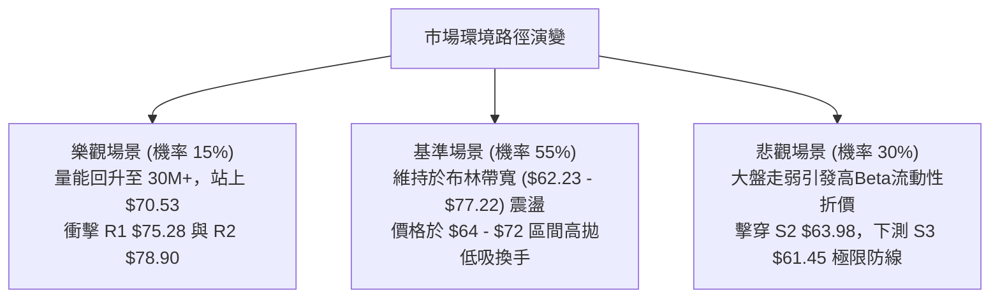

### 🛡️ 風險管理重要提醒

1. **高 Beta 波動懲罰機制**：
   - RKLB 的 Beta 值為 **2.938**，在大盤（如那斯達克）下跌 1% 時，該股平均波動達近 3%。在當前縮量盤整期，流動性深度較淺，切忌在盤中使用市價單追單，應以限價單佈局於支撐位。
2. **假突破（Bull Trap）防範**：
   - 由於目前上方存在 MA20 ($69.72)、MA50 ($70.53) 以及密集群 R1 ($75.28)，在量比小於 1.5 倍前的任何向上急拉，均極易形成「誘多假突破」，切勿在 $73–$75 追價。
3. **資金管理與風險限額**：
   - 單筆交易最大虧損額必須嚴格控制在總投資組合淨值的 **1.0%–1.5%** 之內。
   - 若採用策略 A，單股止損額約 $3.30，若總資產為 $100,000，單筆最大容許虧損 $1,000，則進場股數應嚴格限制在 $1,000 / 3.30 \approx 300$ 股（部位價值約 $19,350，即不超過 20% 資金上限）。

---

## 📋 報告總結

```
╔══════════════════════════════════════════════════════════════════╗
║                   RKLB 技術分析報告總結                          ║
╠══════════════════════════════════════════════════════════════════╣
║ 報告日期：2026-10-12                                             ║
║ 當前價格：$68.21                                                 ║
║ 分析評級：⚖️ 區間弱勢震盪 (中性偏空觀望，評分 40/100)            ║
╠══════════════════════════════════════════════════════════════════╣
║ 關鍵結論：                                                       ║
║ ├─ 長期趨勢：🟡 中性修復，守於斐波那契 78.6% ($61.84) 上方      ║
║ ├─ 中期趨勢：🟡 雙重底雛形打底，頸線阻力鎖定在 $82.83           ║
║ ├─ 短期趨勢：🔴 均線空頭壓制，布林通道中軌承壓，量能萎縮        ║
║ ├─ 核心支撐：S1 $66.85 ｜ S2 $63.98 (核心基石) ｜ S3 $61.45      ║
║ ├─ 核心阻力：R1 $75.28 ｜ R2 $78.90 ｜ R3 $86.83 (半年線強壓)    ║
║ └─ 華爾街目標：均價 $106.57 (最低 $64.00，最高 $150.00)          ║
╠══════════════════════════════════════════════════════════════════╣
║ 最優策略組合：                                                   ║
║ 1. 🥇 最佳機會：策略 A — 回踩 S2 $63.98–$64.50 逢低吸納，       ║
║                 停損設於 $61.20，博弈向布林中上軌均值回歸。      ║
║ 2. 🥈 次選機會：策略 B — 耐心等待收盤帶量突破 MA50 ($70.53) 後   ║
║                 右側順勢跟進，目標指向 R1 $75.28。               ║
║ 3. 🥉 保守選擇：場外觀望。待 ADX 回升至 25 以上確認單邊方向，   ║
║                 再行進場參與主升浪。                             ║
╚══════════════════════════════════════════════════════════════════╝
```

---

> ⚠️ **免責聲明**：本報告為 AI 自動生成之技術分析，所有數據及估算均基於提供的歷史價格資訊。本報告**僅供研究與學術參考**，**不構成任何投資建議**。投資有風險，入市需謹慎。

---

*報告生成時間：2026-10-12 ｜ 數據來源：Yahoo Finance ｜ 分析框架：多時框技術分析*