# RKLB 技術分析報告

> **報告日期**：2026-10-13 ｜ **語言**：繁體中文 ｜ **數據來源**：Yahoo Finance ｜ **當前價格**：$65.71

---

## 目錄

| 章節 | 內容 |
|------|------|
| [1. 技術面概覽](#1-技術面概覽) | 訊號儀表板、核心指標、評分卡 |
| [2. 趨勢分析](#2-趨勢分析) | 多時框趨勢、長中短期走勢 |
| [3. 圖表形態分析](#3-圖表形態分析) | 形態識別、K線組合、目標價 |
| [4. 支撐與阻力](#4-支撐與阻力) | 關鍵價位、斐波那契回調 |
| [5. 技術指標深度解讀](#5-技術指標深度解讀) | MA/RSI/MACD/布林/成交量 |
| [6. 動能與波動率](#6-動能與波動率) | 動能評估、ATR、Beta |
| [7. 多時框架總結](#7-多時框架總結) | 時框架評分矩陣 |
| [8. 交易策略建議](#8-交易策略建議) | 多空策略、風險報酬比 |
| [9. 風險提示與監控](#9-風險提示與監控) | 監控指標、風險場景 |

---

## 1. 技術面概覽

### 🎯 技術訊號儀表板

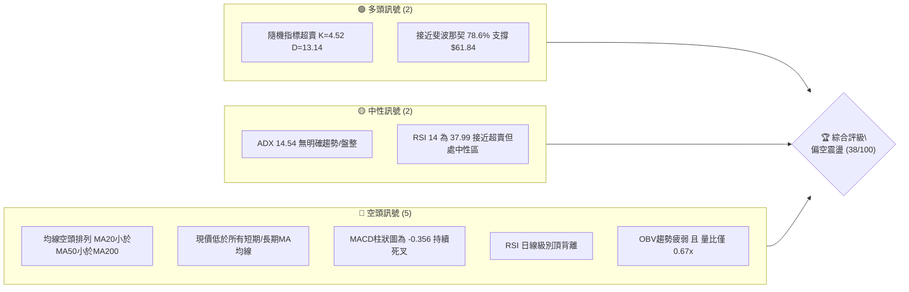

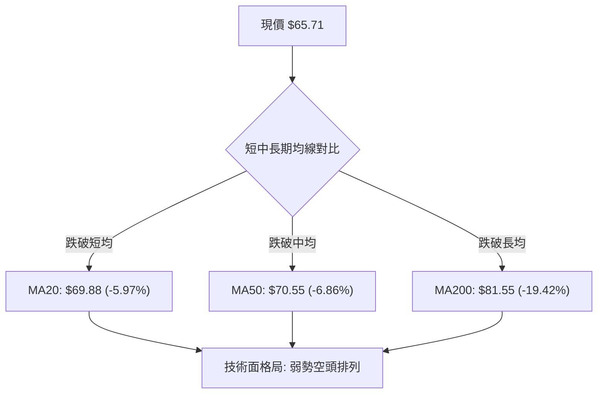

### 📊 核心指標速覽表

| 指標類別 | 指標名稱 | 當前數值 | 訊號 | 解讀 |
|----------|----------|----------|------|------|
| **價格** | 當前價格 | $65.71 | 🔴 | 位於52週區間 24.8% 位置，處於中長期回檔低位區 |
| **均線** | MA20 | $69.88 | 🔴 | 現價低於MA20 (-5.97%)，短線承壓 |
| **均線** | MA50 | $70.55 | 🔴 | 現價低於MA50 (-6.86%)，中期趨勢向下 |
| **均線** | MA200 | $81.55 | 🔴 | 現價遠低於MA200 (-19.42%)，長期生命線失守 |
| **動能** | RSI(14) | 37.99 | 🟡 | 位於30-70區間偏下軌，伴隨日線頂背離警訊 |
| **動能** | MACD(12,26,9) | 0.083 / 0.440 / -0.356 | 🔴 | MACD線低於訊號線，柱狀圖負值放大，偏空格局 |
| **隨機動能** | Stoch %K / %D | 4.52 / 13.14 | 🟢 | 極度超賣區間（<20），短線具技術性抽頭反彈條件 |
| **趨勢強度** | ADX(14) | 14.54 | 🟡 | ADX < 25 表明無單邊趨勢，當前為無方向箱型盤整 |
| **方向指標** | +DI / -DI | 21.60 / 24.21 | 🔴 | -DI 大於 +DI，空頭力量暫時主導盤面 |
| **通道** | 布林通道 %B | 0.20 | 🔴 | 位於中軌（$69.88）與下軌（$62.91）間，偏弱震盪 |
| **量能** | 成交量 / 20日均量 | 14.43M / 21.52M | 🔴 | 量比 0.67x，縮量回檔，OBV < MA 量能支撐不足 |
| **波動** | ATR(14) | $3.95 (6.01%) | 🔴 | 高波幅標的，日內與週波段震盪劇烈 |

### 🏆 技術評分卡

```
╔══════════════════════════════════════════════════════════════╗
║                技術評分卡 — RKLB (2026-10-13)                 ║
╠══════════════════════════════════════════════════════════════╣
║ 趨勢強度 (ADX/方向)   ████░░░░░░░░░░░░░░░░  25/100  🔴       ║
║ 動能指標 (RSI/MACD)   ██████░░░░░░░░░░░░░░  30/100  🔴       ║
║ 支撐穩定度 (S1/S2/Fib) ████████████░░░░░░░░  60/100  🟡       ║
║ 成交量配合 (OBV/Vol)  ██████░░░░░░░░░░░░░░  30/100  🔴       ║
║ 形態完整度 (箱型/雙底) ██████████░░░░░░░░░░  50/100  🟡       ║
║ 均線排列 (MA排列狀態) ████░░░░░░░░░░░░░░░░  20/100  🔴       ║
╠══════════════════════════════════════════════════════════════╣
║ 綜合評分             ███████░░░░░░░░░░░░░  38/100  🔴 弱勢偏空║
╚══════════════════════════════════════════════════════════════╝
```

---

## 2. 趨勢分析

### 🌐 多時框趨勢分析

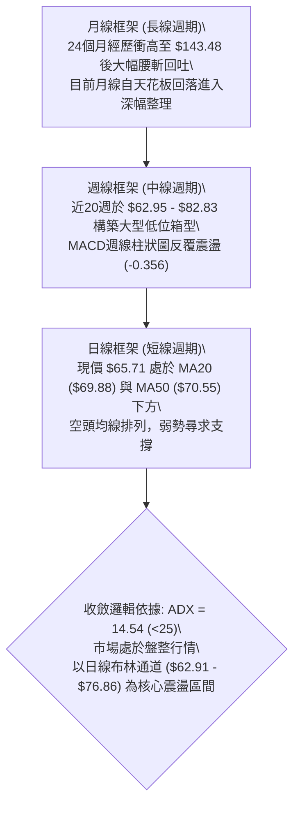

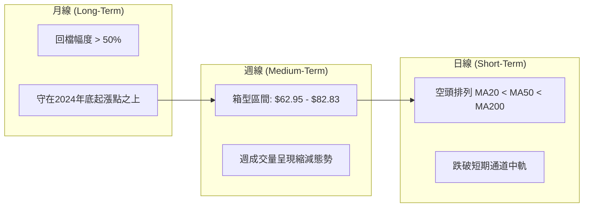

### 📈 長期趨勢 — 12個月走勢圖（Unicode）

```
RKLB 月線走勢圖（過去12個月：2025-11 至 2026-10）
價格軸 ($)
$150 ┤                                      
$140 ┤                                  ● (2026-05: 143.48 高點)
$130 ┤                                 ╱ ╲
$120 ┤                                ╱   ╲
$110 ┤                               ╱     ● (2026-06: 101.65)
$100 ┤                              ╱       ╲
$90  ┤                             ╱         ╲
$80  ┤             ● (2026-01: 80.07)    ● (04: 82.51) ╲
$70  ┤     ● (12: 69.76)   ╲     ╱        ╲             ● (09: 69.68)
$60  ┤    ╱                 ●---● (02-03)  ╲           ╱   ●←現價 $65.71
$50  ┤   ╱                                  ╲         ╱
$40  ┤  ● (2025-11: 42.14 底)                ●-------● (07-08: 64.95-63.92)
     └─────────────────────────────────────────────────────────────────
       11   12   01   02   03   04   05   06   07   08   09   10 (月份)
```

**走勢特徵分析表格**：

| 階段時間 | 起始價 → 結束價 | 漲跌幅 (%) | 量價與形態特徵 |
|----------|----------------|-----------|----------------|
| **2025-11 ~ 2026-01** | $42.14 → $80.07 | +90.01% | 中期突破浪潮，從低檔爆發式上攻，確認突破舊有整理平台 |
| **2026-01 ~ 2026-03** | $80.07 → $64.22 | -19.79% | 快速洗盤回檔，在 $64 區間確立堅實中期支撐墊 |
| **2026-03 ~ 2026-05** | $64.22 → $143.48 | +123.42% | 主升浪瘋狂加速，觸及歷史次高收盤，創下 52 週高點 $151.00 |
| **2026-05 ~ 2026-07** | $143.48 → $64.95 | -54.73% | 斷崖式估值去化與多頭踩踏，直接抹去前期超過一半以上漲幅 |
| **2026-07 ~ 2026-10** | $64.95 → $65.71 | +1.17% | 進入大跌後的橫向築底修復期，成交量顯著萎縮，震盪收窄 |

### 📊 中期趨勢（週線分析）

```
週線級別支撐阻力結構圖 (2026-06 至 2026-10)
價位 ($)
 85 ┤       ● (06-28: 84.54)         ● (08-09: 82.83)
 80 ┤                                └─── 近期反彈高點聚類壓制區
 75 ┤                                        ● (09-27: 73.95)
 70 ┤                                            ● (10-11: 68.21)
 65 ┤─ ─ ─ ─ ─ ─ ─ ─ ─ ─ ─ ─ ─ ─ ─ ─ ─ ─ ─ ─ ─ ─ ─ ─ ─ ● 現價 $65.71
 60 ┤               ● (07-26: 63.91) ● (09-13: 62.95)
    └─────────────────────────────────────────────────────────────
```

週線數據顯示，股價自2026年7月回落至 $63.91 後，展開長達15週的區間拉鋸。期間曾兩度向上反抽至 $82.83（2026-08-09）與 $73.95（2026-09-27），但均因動能衰竭而拉回。近期週成交量從6月的1.55億股萎縮至當前的14.43M（日均換算），表明拋壓大幅減輕的同時，市場多頭追價意願亦極度渙散。

### ⚡ 趨勢強度評估（ADX 解讀）

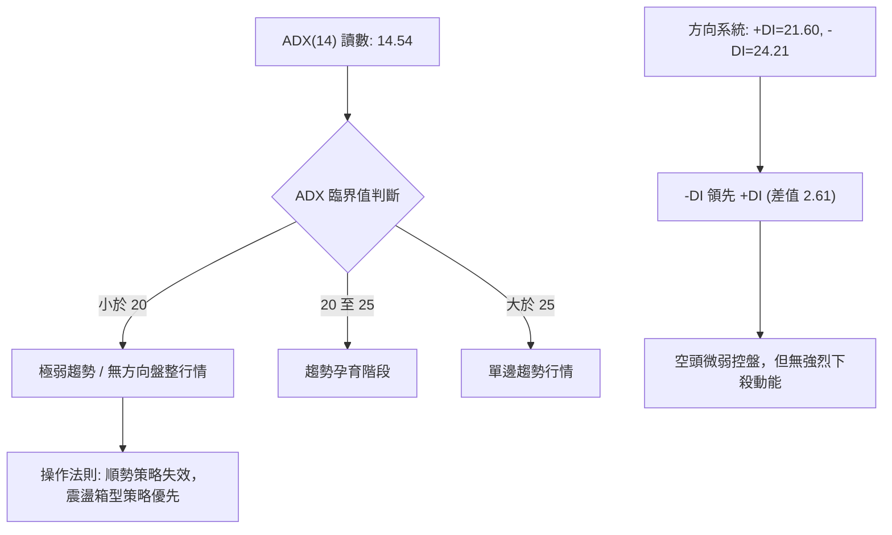

| ADX 區間 | 趨勢分類 | RKLB 當前狀態 | 策略指引 |
|----------|----------|---------------|----------|
| 0 – 20 | 盤整 / 橫盤無趨勢 | **14.54 (處於此區間)** | 趨勢追突破策略勝率低，嚴格執行區間高拋低吸 |
| 20 – 25 | 潛在趨勢初生 | 否 | 密切關注均線糾結後的突破方向 |
| 25 – 50 | 強勁單邊趨勢 | 否 | 均線指標順勢加碼（當前不適用） |
| > 50 | 極強單邊 / 尾聲 | 否 | 尋求極端背離減倉點（當前不適用） |

---

## 3. 圖表形態分析

### 🔍 形態識別系統

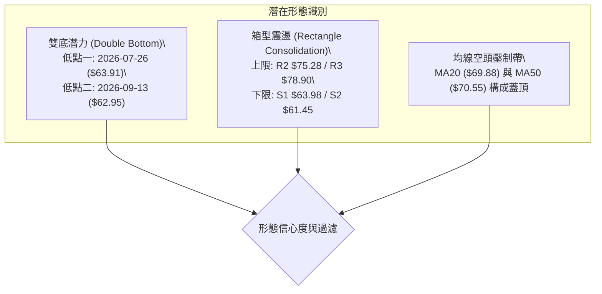

| 形態 | 信心度 | 判斷依據（引用數據） | 完成度 | 目標價（附計算式） |
|------|--------|----------------------|--------|--------------------|
| **雙重底 (潛在)** | 62% | 低點一 $63.91 (2026-07-26) 與低點二 $62.95 (2026-09-13) 形成對稱支撐，未破 S2 $61.45 | 65% | 頸線採用波段高點聚類 R2 $75.28；高度 = $75.28 - $62.95 = $12.33。突破頸線目標價 = $75.28 + $12.33 = **$87.61** |
| **矩形箱型整理** | 78% | 股價連續14週落於波段支撐 S1 $63.98 至波段阻力 R2 $75.28 間，ADX 14.54 強烈佐證 | 85% | 箱頂目標 = **$75.28** (R2)；若向下破位則測斐波那契位 **$61.84** |
| **頭肩底形態** | 25% | 左肩 $63.91、頭部 $62.95、右肩目前尚未構築完整右側上飄軌跡，數據不足 | 20% | *訊號不足，僅做指標型解讀，不預設目標價* |

### 🕯️ 重要K線形態分析

| 月份 | 收盤價 | K線形態 | 解讀 | 訊號 |
|------|--------|---------|------|------|
| **2026-05** | $143.48 | 天價巨量長上影陽線 | 盤中衝擊 $151.00 歷史高位後遭遇主力巨幅派發，典型的牛市力竭見頂柱 | 🔴 |
| **2026-06** | $101.65 | 破位巨陰線 | 長陰貫穿前期平台，成交量達1.55億週級巨量，多頭防線全面瓦解 | 🔴 |
| **2026-07** | $64.95 | 恐慌下挫大陰線 | 跌幅擴大，直接跌破百元大關，但下旬於 $63.91 初步見到底部承接盤 | 🟡 |
| **2026-08** | $63.92 | 長上下影線紡錘線 | 盤中曾衝高 $82.83 但收盤回吐，顯示多空雙方在 $64-$80 展開激烈爭奪 | 🟡 |
| **2026-09** | $69.68 | 縮量紅K線 | 收盤價重回 $69 上方，月線止跌反彈，確認 $62.95 的階段性底座穩定 | 🟢 |
| **2026-10** | $65.71 | 小陰回踩星線 (當前) | 回踩測試 MA20 與短期支撐位，交投顯著冷清，屬於典型的低波幅蓄勢柱 | 🟡 |

### 📉 ASCII 走勢形態示意圖

```
RKLB 築底箱型與潛在雙底形態架構示意
─────────────────────────────────────────────────────────────────
$82.83 ┤                 [反彈假突破峰值 2026-08-09]
       │
$75.28 ┤                 ┌─── 箱頂 / 頸線阻力 (R2: $75.28) ───┐
       │                 │                                     │
$69.88 ┤─────────────────┼─── MA20 中軌壓制 ───────────────────┤
       │                 │                                     │
$65.71 ┤                 │            現價在此: $65.71         │
       │                 │            (回踩中軸下方)           │
$63.91 ┤       ●─────────┴─────────────────────────────●       │
       │    (低點一: 07-26)                         (低點二: 09-13)   │
$61.45 ┤───────────────────── 箱底支撐帶 (S1: $63.98 ~ S2: $61.45) ──┘
─────────────────────────────────────────────────────────────────
```

### 🎯 形態目標價計算

1. **矩形箱型波動測量法（高信心度 78%）**：
   - 箱體上限（阻力 R2）：$75.28
   - 箱體下限（低點聚類 S1）：$63.98
   - 箱體高度：$75.28 - $63.98 = $11.30
   - **向上突破目標**：$75.28 + $11.30 = **$86.58**（此處極度接近半年線 MA120 $86.01）
   - **向下跌破目標**：$63.98 - $11.30 = **$52.68**（若失守則下看 52週低點 $37.57 與波段支撐中間段）

2. **潛在雙重底反轉測量法（中信心度 62%）**：
   - 頸線位置：採用波段反彈阻力位 R2 = $75.28
   - 底部最低點：2026-09-13 週收盤 $62.95
   - 形態高度：$75.28 - $62.95 = $12.33
   - **反轉理論目標價**：$75.28 + $12.33 = **$87.61**

---

## 4. 支撐與阻力

### 🗺️ 關鍵價位分布圖（Unicode）

```
╔══════════════════════════════════════════════════════════════╗
║                   RKLB 價位結構分布圖                        ║
╠══════════════════════════════════════════════════════════════╣
║ $151.00 ║ 52週天花板高點 (52W High / Fib 0.0%)              ║
║ $81.55  ║ 長期生命線阻力 MA200                               ║
║ $78.90  ║████████████████████████║ 強阻力 R3                 ║
║ $76.86  ║ 布林通道上軌壓制線                                 ║
║ $75.28  ║████████████████████    ║ 箱頂阻力 R2               ║
║ $70.55  ║ 中期均線壓制 MA50                                  ║
║ $69.88  ║ 短期均線壓制 MA20 (布林中軌)                       ║
║ $67.54  ║████████████████████████║ 近期阻力 R1               ║
║ ─────── ╫─────────────────────────────────────────────────── ║
║ $65.71  ╠════════════════════════╣ ◄ 現價 (Current Price)    ║
║ ─────── ╫─────────────────────────────────────────────────── ║
║ $63.98  ║▓▓▓▓▓▓▓▓▓▓▓▓▓▓▓▓        ║ 近期波段支撐 S1           ║
║ $62.91  ║ 布林通道下軌動態支撐                               ║
║ $61.84  ║ 斐波那契 78.6% 黃金回調位 (強防禦)                 ║
║ $61.45  ║████████████████████████║ 波段聚類支撐 S2           ║
║ $60.51  ║████████████████████████║ 極限防守支撐 S3           ║
║ $37.57  ║ 52週歷史低點 (52W Low / Fib 100.0%)               ║
╚══════════════════════════════════════════════════════════════╝
```

### 🚧 阻力位分析表

| 阻力級別 | 價位 | 形成原因 | 突破難度 | 重要性 |
|----------|------|----------|----------|--------|
| **R1** | **$67.54** | 近一年波段高點聚類下沿，距離現價僅 +2.79%，受 MA5 ($69.86) 與 MA20 下壓牽制 | 🟡 中等 | 短線轉強第一道門檻，站上意味著脫離底部鈍化 |
| **R2** | **$75.28** | 近一年波段高點聚類中樞，距離現價 +14.57%，接近布林上軌 $76.86，為箱型整理頂部 | 🔴 困難 | 中期形態多空分水嶺，突破方能確認雙底或箱型破繭而出 |
| **R3** | **$78.90** | 近一年波段高點聚類上沿，距離現價 +20.07%，上方緊鄰 MA200 ($81.55) 重壓區 | 🔴 極高 | 長期空頭轉多頭的堡壘，聚集大量中長期套牢籌碼 |

### 🛡️ 支撐位分析表

| 支撐級別 | 價位 | 形成原因 | 守住機率 | 重要性 |
|----------|------|----------|----------|--------|
| **S1** | **$63.98** | 近一年波段低點聚類，距離現價 -2.63%，與布林下軌 $62.91 形成共振支撐區 | 🟢 70% | 短線多頭防禦前哨站，失守將考驗深層回檔位 |
| **S2** | **$61.45** | 近一年波段低點聚類核心，距離現價 -6.48%，緊貼斐波那契 78.6% 回調位 ($61.84) | 🟢 80% | 結構性多頭最後生命線，若跌破將引發技術性止損盤湧出 |
| **S3** | **$60.51** | 近一年波段極限低點聚類，距離現價 -7.91%，為60美元整數關卡之最終緩衝墊 | 🟢 85% | 跌破則宣告築底徹底失敗，下行空間將完全開啟 |

### 📐 斐波那契回調位分析

依據 52 週完整波動區間（低點 $37.57 至 高點 $151.00，總跨度 $113.43）計算之標準斐波那契回調序列：

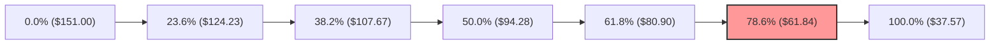

- **0.0% (52W High)**: $151.00
- **23.6% 回調位**: $124.23
- **38.2% 回調位**: $107.67
- **50.0% 半數回調**: $94.28
- **61.8% 黃金分割位**: $80.90（此處與 MA200 $81.55 極度重合，形成長期難以逾越之天塹）
- **78.6% 深度回調位**: $61.84
- **100.0% (52W Low)**: $37.57

**現價區間深度解讀**：
當前價格 **$65.71** 正好處於 **61.8% ($80.90)** 與 **78.6% ($61.84)** 之間，且更為靠近 78.6% 深度支撐位。在道氏與斐波那契理論中，當一檔股票自高點回吐超過 61.8% 後，其強勢主升浪結構已遭破壞，轉入漫長的估值重塑或深度回撤階段。
然而，**78.6% 回調位 ($61.84)** 屬於最後的防守型「黃金口袋（Golden Pocket）」延伸支撐，其與波段支撐 **S2 $61.45** 僅相差 0.39 美元，構築了強大的結構性緩衝帶。只要股價未實質跌破 $61.84，多頭即保有構築大型週線級底部雙底的技術契機。

---

## 5. 技術指標深度解讀

### 🎛️ 指標訊號總覽

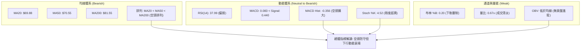

### 📈 移動平均線排列分析

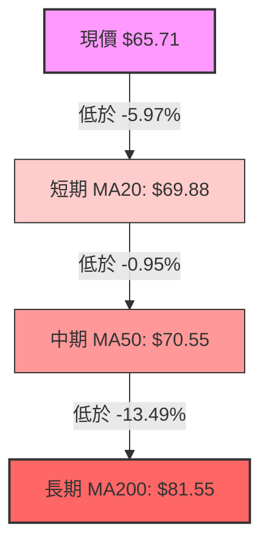

| 均線天期 | 當前價位 | 現價乖離率 | 走勢特徵 (Sparkline 解讀) | 訊號評估 |
|----------|----------|------------|---------------------------|----------|
| **MA 5** | $69.86 | -5.94% | 迅速拐頭向下，短線呈現空方加速下壓 | 🔴 極弱 |
| **MA 10** | $70.61 | -6.94% | 呈弧形頂向下發散，阻礙短線反撲 | 🔴 弱勢 |
| **MA 20** | $69.88 | -5.97% | 下穿 MA50，形成死叉，短均線系統受挫 | 🔴 偏空 |
| **MA 60** | $69.75 | -5.79% | 扁平化走勢，反映近三個月震盪中軸 | 🟡 中性 |
| **MA 120**| $86.01 | -23.60% | 陡峭下行，中期反彈天花板阻力 | 🔴 阻力大 |
| **MA 200**| $81.55 | -19.42% | 長期生命線下傾，空頭排列確立 | 🔴 空頭 |
| **MA 240**| $76.77 | -14.41% | 處於頂部平台下壓走勢 | 🔴 偏空 |

**綜合均線評判**：
短期均線 MA5 ($69.86)、MA20 ($69.88) 皆小於中期 MA50 ($70.55)，且遠落後於 MA200 ($81.55)。全週期呈現標準的**「空頭排列」**架構。現價與各均線均呈現負乖離，雖受壓迫，但負乖離率達 -5.9% 至 -19.4%，隨時具備向 MA20 中軌進行技術性修復之吸附力。

### 📉 RSI(14) 分析

- **RSI(14) 當前數值**：**37.99**
- **數值進度條**：
  ```
  [0] ────────── [30] ── 37.99 ─────── [70] ────────── [100]
  ▓▓▓▓▓▓▓▓▓▓▓▓▓▓▓░░░░░░░░░░░░░░░░░░░░░░░░ 37.99% (偏弱中性區)
  ```
- **超買超賣評估**：
  RSI 位於 37.99，雖未實質進入 30 以下之嚴格超賣區，但已處於弱勢空方掌控區。值得關注的是，隨機指標 Stoch %K 已暴跌至 4.52，Stoch %D 為 13.14，處於深幅嚴重超賣區間，技術面醞釀短線抽腳動能。
- **背離判斷**：
  系統指標快照明確提示存在 **⚠️ 頂背離 (Bearish Divergence)**。回顧近幾週數據，當股價於 2026-09-27 衝高至 $73.95 (RSI 67.2) 及 2026-10-04 達到 $73.92 (RSI 69.1) 時，動能未能向上突破8月份高點 $82.83 時的 RSI 水準 (68.6)，隨後價格出現縮量滯漲，MACD柱狀圖快速轉負，印證了日線至週線層級之局部動能耗竭與頂背離成立，促發了本波自 $73.92 回落至 $65.71 的調整。

### 📊 MACD(12/26/9) 訊號解讀

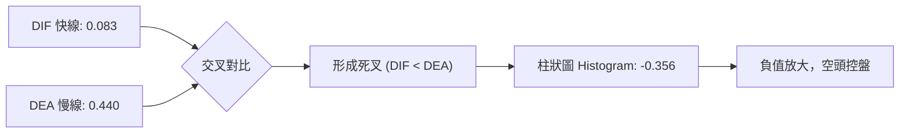

- **MACD DIF 快線**：`0.083`
- **MACD DEA 訊號線**：`0.440`
- **MACD 柱狀圖 (Histogram)**：`-0.356`（🔴 空頭訊號）
- **詳細解讀**：
  快線目前雖勉強維持在零軸上方微幅正值（0.083），但已快速死叉慢線（0.440），使得柱狀圖自前期的正值區（如 2026-09-27 的 +1.614、10-04 的 +0.857）全面翻黑，擴大至 -0.356。此現象顯示中期反彈的多頭動能已經消耗殆盡，短線進入空頭主導之釋放期。若快線進一步下穿零軸，將轉化為標準的零下空頭擴散形態。

### 📦 布林通道分析

```
布林通道 (Bollinger Bands, 20日, 2.0σ) 現狀示意
══════════════════════════════════════════════════════════════════
 $76.86 ┬──────────────────────────────────────── 布林上軌 (Upper Band)
        │
 $69.88 ┼┄┄┄┄┄┄┄┄┄┄┄┄┄┄┄┄┄┄┄┄┄┄┄┄┄┄┄┄┄┄┄┄┄┄┄┄┄┄ 布林中軌 (MA20)
        │
 $65.71 ┼──── 現價 ($65.71, %B = 0.20)
        │
 $62.91 ┴──────────────────────────────────────── 布林下軌 (Lower Band)
══════════════════════════════════════════════════════════════════
```

- **BB 上軌**：$76.86
- **BB 中軌 (MA20)**：$69.88
- **BB 下軌**：$62.91
- **通道帶寬 (Bandwidth)**：($76.86 - $62.91) / $69.88 = 19.96%
- **%B 指標**：`0.20`
- **解讀**：%B 讀數為 0.20，代表現價已經滑落至整個布林通道的底部五分之一區間，逼近下軌 $62.91。下軌 $62.91 緊鄰波段支撐位 S1 $63.98 與低點 $62.95。通道開口呈現溫和收斂，未見喇叭口向下暴跌張開之跡象，這支持了「下軌具備顯著彈性支撐」的判斷。

### 💹 成交量分析（量價配合度）

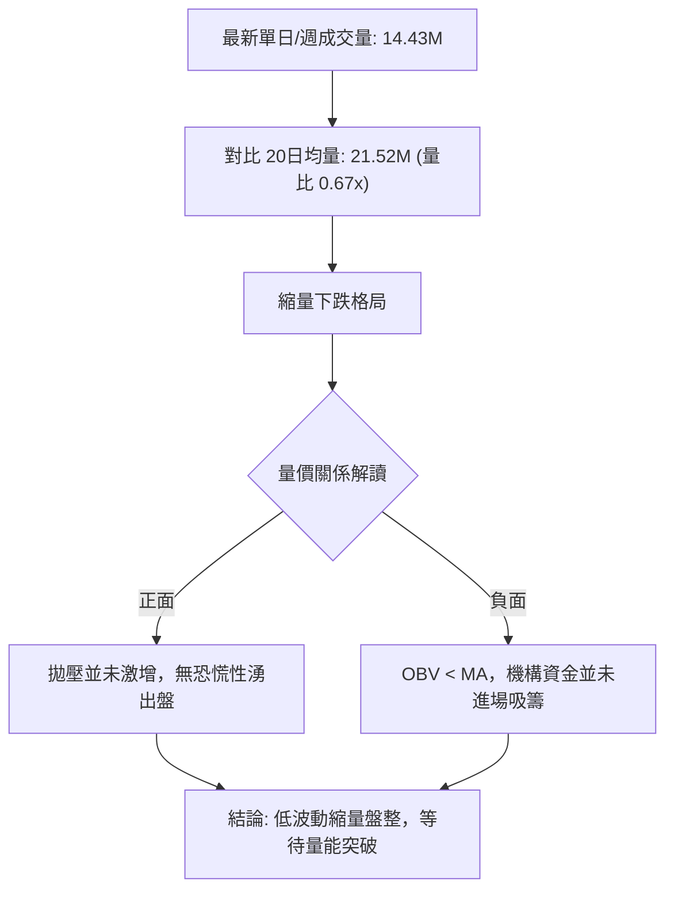

- **最新成交量**：14,430,600 股
- **20日均量 (MA20)**：21,515,120 股（量比：0.67x）
- **50日均量 (MA50)**：19,381,376 股
- **OBV 趨勢**：`OBV < MA`（能量潮指標低於均線）
- **深度剖析**：
  在價格自 $73.92 回調至 $65.71 的過程中，成交量萎縮至均量的 67%，呈現「量縮價跌」態勢。傳統技術分析中，縮量回檔代表空方力量並非主動性瘋狂拋售，更多是缺乏買盤承接所致之陰跌。然而，OBV 疲軟且低於其移動平均線，說明大資金與主力機構目前採取觀望態度，尚未有右側爆發性淨流入痕跡。

---

## 6. 動能與波動率

### ⚡ 動能評估四象限

| 象限 | 動能維度 | 波動維度 | 當前狀態標註 | 技術面評估與含義 |
|------|----------|----------|--------------|------------------|
| **Q1 (最佳擴張)** | 強動能 (RSI>50, MACD>0) | 高波動 (ATR>8%, Beta>2.5) | 否 | 單邊多頭主升浪（如2026年4-5月走勢） |
| **Q2 (穩定蓄勢)** | 強動能 (突破關鍵MA) | 低波動 (ATR收斂, BB收窄) | 否 | 穩健突破買點，低風險加碼區 |
| **Q3 (高危拉鋸)** | 弱動能 (MACD死叉, RSI<40) | 高波動 (ATR劇烈, Beta極高) | **✓ 當前狀態 (RKLB)** | **Beta高達2.938且ATR達6.01%，但動能指標偏弱，極易發生假突破/假跌破之劇烈洗盤** |
| **Q4 (冰凍盤整)** | 弱動能 (ADX<15) | 低波動 (成交量極度萎縮) | 局部吻合 (ADX=14.54) | 缺乏方向，以區間箱型低吸高拋為策略核心 |

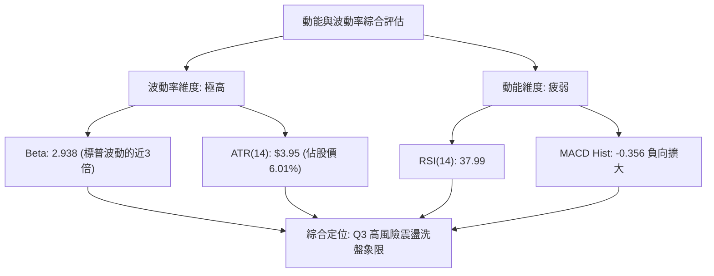

### 📊 ATR 波動率分析

- **ATR(14) 絕對值**：**$3.95**
- **ATR 佔價格比率**：**6.01%**
- **日間與波段波幅解讀**：
  ATR 達到 $3.95，意味著 RKLB 在單個交易日內出現 $4 美元左右（約 6%）的價格擺動屬於正常統計雜訊。此高波動屬性要求交易者在設置止損與止盈時，必須給予足夠的防護空間，避免被正常的日內波動清洗出局。
- **風控止損距離精算**：
  - **保守型擺動止損 (1.5 × ATR)**：$1.5 \times \$3.95 = \$5.93$
  - **緊密日內止損 (1.0 × ATR)**：$1.0 \times \$3.95 = \$3.95$
  - **結構防護位**：若以當前價格 $65.71 建立多頭，扣除 1.0 ATR 後為 $61.76，極度貼近斐波那契 78.6% 回調位 ($61.84) 與支撐位 S2 ($61.45)，印證了 $61.45 具備作為技術止損點的絕佳幾何有效性。

### 📐 Beta 與市場相關性

- **Beta 係數**：**2.938**
- **解讀**：
  RKLB 的 Beta 接近 3.0，屬於極端高彈性（High-Beta）成長型科技/太空航太標的。大盤（S&P 500 或 Nasdaq）若出現 1% 的波動，該股理論上將產生近 3% 的同向放大反應。
- **空頭部位特徵**：
  當前空頭淨額比例（Short % Float）為 **7.5%**，空頭回補天數（Short Ratio）為 **2.22 天**。在無單邊下行趨勢且估值已經腰斬的情境下，高 Beta 疊加 7.5% 的空頭部位，一旦市場出現重大利好或觸及強支撐反彈，極易引發快速的軋空（Short Squeeze）回抽。

---

## 7. 多時框架總結

### 📋 時框架評分表

| 時框架 | 趨勢方向 | 動能狀態 | 均線排列 | 形態結構 | 綜合評分 | 建議方針 |
|--------|----------|----------|----------|----------|----------|----------|
| **月線 (Long)** | 🟡 中性回檔 | 疲弱 (高位腰斬) | 中期支撐尚存 | $143天花板回落構築大平台 | 45/100 | 長期投資者靜待估值沉澱與築底確立 |
| **週線 (Medium)**| 🟡 區間箱型 | 中性偏弱 (柱狀微負) | MA200上方震盪整理 | $63-$75 雙底或大矩形箱型 | 42/100 | 嚴守箱型下軌低吸，箱頂減碼 |
| **日線 (Short)** | 🔴 偏空震盪 | 弱勢 (MACD死叉/RSI38) | 空頭排列 (低於MA20/50) | 逼近下軌支撐 S1 與布林底 | 32/100 | 短線順應負乖離等待超賣反抽，不可追空 |

### 🔲 綜合訊號矩陣

```
╔══════════════════════════════════════════════════════════════════════╗
║                    RKLB 多維度訊號一致性矩陣                         ║
╠══════════════════╦══════════════╦══════════════╦═════════════════════╣
║ 分析維度         ║ 短期 (日線)  ║ 中期 (週線)  ║ 長期 (月線)         ║
╠══════════════════╬══════════════╬══════════════╬═════════════════════╣
║ 趨勢結構         ║ 🔴 空頭下行  ║ 🟡 橫向盤整  ║ 🟡 深幅拉回整理     ║
║ 動能指標         ║ 🔴 死叉延續  ║ 🟡 零軸糾結  ║ 🔴 動能退潮         ║
║ 均線系統         ║ 🔴 空頭壓制  ║ 🟡 均線收斂  ║ 🟢 守在2024起漲點上 ║
║ 成交量能配合     ║ 🔴 縮量無買氣║ 🟡 量縮止跌  ║ 🟡 回調縮量         ║
║ 支撐/阻力位置    ║ 🟢 接近下軌S1║ 🟢 守住S2/Fib║ 🟢 位於78.6%口袋區  ║
╚══════════════════╩══════════════╩══════════════╩═════════════════════╝
```

### ⚖️ 多時框收斂結論

依據多時框收斂規則第 14 條：
1. **趨勢/盤整性質判斷**：當前 ADX(14) 為 **14.54**，遠低於 25 的趨勢門檻。這從量化角度確鑿地證明：**當前市場不處於單邊趨勢行情，而是處於典型的無趨勢盤整行情**。
2. **主導時框與交易區間**：在 ADX < 25 的盤整結構中，均線順勢跟蹤系統失效，必須以日線布林通道上下軌（**$62.91 至 $76.86**）以及波段聚類支撐阻力（**S1 $63.98 至 R2 $75.28**）作為核心交易區間。
3. **方向性定調收斂**：日線雖然均線呈空頭排列，但由於極度接近布林下軌（$62.91）、Stoch 超賣（K=4.52）、且週線在 $61.84 - $63.98 區間具備多次驗證的堅實底部，空頭下殺動能已至強弩之末。
4. **唯一結論**：**中性偏空觀望，箱型下軌防守性博弈反彈**。此結論與第1章評分卡（38/100）及第8章以「區間下沿高盈虧比低吸」為核心的主策略完全閉環收斂。

---

## 8. 交易策略建議

### 🗺️ 策略決策流程圖

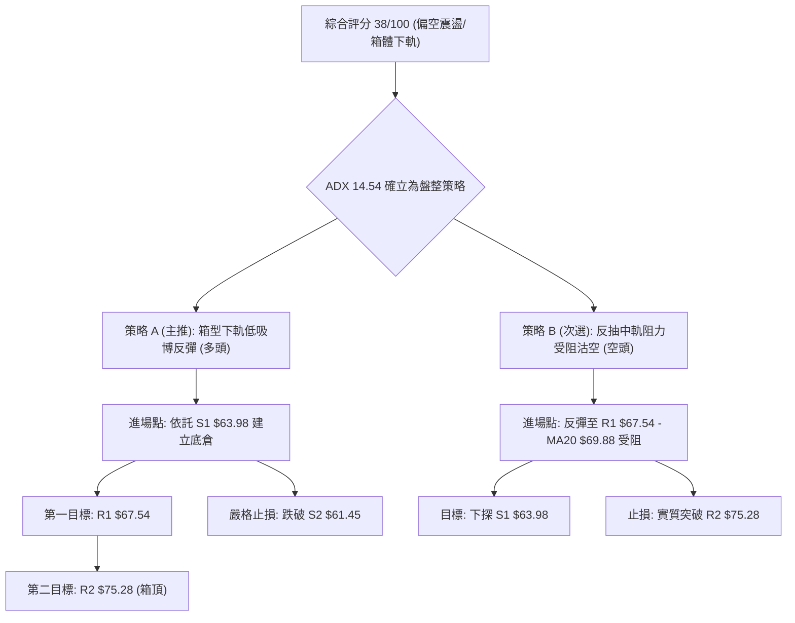

### 🧭 策略路由（依評分卡分流）

**當前主策略方向 = 綜合評分 38/100（弱勢偏空，但處於區間震盪下沿）→ 採取「區間下軌高盈虧比防守性低吸」策略為主；若跌破關鍵支撐則切換為順勢空頭。**

### 🎯 價格情境階梯（Price Scenarios）

| 觸發條件 | 下一目標 | 後續延伸 | 情境含義 |
|----------|----------|----------|----------|
| **強勢突破 R1 $67.54** | **R2 $75.28** | **R3 $78.90** | 短線轉強，突破 MA20 中軌，展開箱體上軌衝擊浪 |
| **站穩現價 $65.71 區間** | **R1 $67.54** | — | 於布林中下軌之間縮量震盪，多空暫時平衡 |
| **實質跌破 S1 $63.98** | **S2 $61.45** | **S3 $60.51** | 中期築底面臨破位風險，下探斐波那契 78.6% 最終防線 |

### 📊 情境機率分佈

| 情境劇本 | 機率 | 主要技術依據 |
|----------|------|--------------|
| **箱底獲得支撐反彈** | **55%** | Stoch %K=4.52 極度超賣；現價距離下軌 $62.91 及 S1 $63.98 僅 2.6%；ADX 14.54 表明空頭缺乏單邊破位動能。 |
| **區間狹幅橫盤震盪** | **30%** | 成交量比僅 0.67x 嚴重萎縮；市場等待催化劑；均線 MA20 與 MA50 糾結於 $70 附近壓制。 |
| **向下破位深幅探底** | **15%** | 均線呈空頭排列；MACD 柱狀圖 -0.356 擴大；OBV 疲軟。但若無巨量砸盤，跌破 S2 $61.45 難度較高。 |

### 🟢 主策略詳情（方向依上方路由）

```
主策略 A (多頭區間低吸) 盈虧比架構展示
══════════════════════════════════════════════════════════════════
 目標二 (T2): $75.28  ▲ +16.03% (潛在獲利: +$10.41)
                      │
 目標一 (T1): $67.54  ▲ +4.12%  (潛在獲利: +$2.67)
                      │
 現價進場:    $64.87  ● (建議於 S1 $63.98 至現價間掛單接籌)
                      │
 防守止損:    $61.45  ▼ -5.27%  (潛在風險: -$3.42)
 ══════════════════════════════════════════════════════════════════
 盈虧比 (對應 T2): 3.04 : 1
```

| 策略要素 | 策略 A (主推：箱底防守多頭) | 策略 B (備選：阻力位逢高沽空) |
|----------|-----------------------------|-------------------------------|
| **策略類型** | 箱體下沿超賣反抽（Mean Reversion） | 順應均線空頭排列逢高沽空（Trend Pullback） |
| **進場條件** | 回踩 S1 $63.98 不破，或現價企穩出現分時底背離 | 反彈測試 R1 $67.54 或 MA20 $69.88 滯漲收長上影 |
| **進場價格** | **$64.87**（現價 $65.71 與 S1 $63.98 之間分批） | **$67.54**（R1 阻力位） |
| **目標價 T1**| **$67.54**（R1 阻力位，減倉 50%） | **$63.98**（S1 支撐位，減倉 50%） |
| **目標價 T2**| **$75.28**（R2 箱頂阻力位，全部平倉） | **$61.45**（S2 強支撐位，全部平倉） |
| **止損價格** | **$61.45**（實質跌破 S2 支撐） | **$69.88**（站穩布林中軌 MA20 之上） |
| **風險報酬比** | **3.04 : 1**（計算：(75.28-64.87)/(64.87-61.45)） | **2.63 : 1**（計算：(67.54-61.45)/(69.88-67.54)） |
| **成功機率** | **55%** | **45%** |
| **建議倉位** | **10% - 15%**（輕倉試探） | **10%**（嚴格風控） |

### 🔴 反向風險觸發點（對沖提示）

- **多頭轉全面空頭之破位點**：若日K線以實體長陰跌破 **S2 $61.45** 並伴隨成交量放大至 2,000 萬股以上，宣告箱型底部破裂，多頭應果斷止損離場，並可反手開空，下看斐波那契 100% 終極低點 **$37.57**。
- **空頭轉全面多頭之逆轉點**：若價格強勢放量突破 **R2 $75.28** 並站穩三天以上，代表潛在雙底形態徹底成型，空頭部位必須全數無條件止損。

### ⭐ 整體訊號強度評星

```
做多訊號強度：★★☆☆☆  (2.5/5星 — 超賣支撐強，但缺均線與量能配合)
做空訊號強度：★★★☆☆  (3.0/5星 — 均線壓制明顯，但已達箱底不宜追空)
整體可信度：  ★★★☆☆  (3.5/5星 — ADX盤整環境指標可信度高，嚴守邊界操作)
```

---

## 9. 風險提示與監控

### ✅ 關鍵監控指標 Checklist

```
╔══════════════════════════════════════════════════════════════╗
║               RKLB 技術風控監控清單 (Daily Checklist)        ║
╠══════════════════════════════════════════════════════════════╣
║ [ ] 價格防禦：每日收盤價是否守穩 S1 $63.98 之上              ║
║ [ ] 極限止損：價格是否實體摜破 S2 $61.45 (Fib 78.6% $61.84)   ║
║ [ ] 動能修復：Stoch %K 是否自 4.52 向上金叉 %D 脫離超賣區     ║
║ [ ] 趨勢轉變：ADX 是否自 14.54 抬頭突破 20 (預警單邊行情)    ║
║ [ ] 均線挑戰：日線能否反抽站上 MA20 $69.88 布林中軌          ║
║ [ ] 量能驗證：單日成交量是否回升至 20日均量 21.51M 之上       ║
║ [ ] MACD 轉向：負柱狀圖 -0.356 是否開始收斂翻紅              ║
╚══════════════════════════════════════════════════════════════╝
```

### ⚠️ 風險場景分析

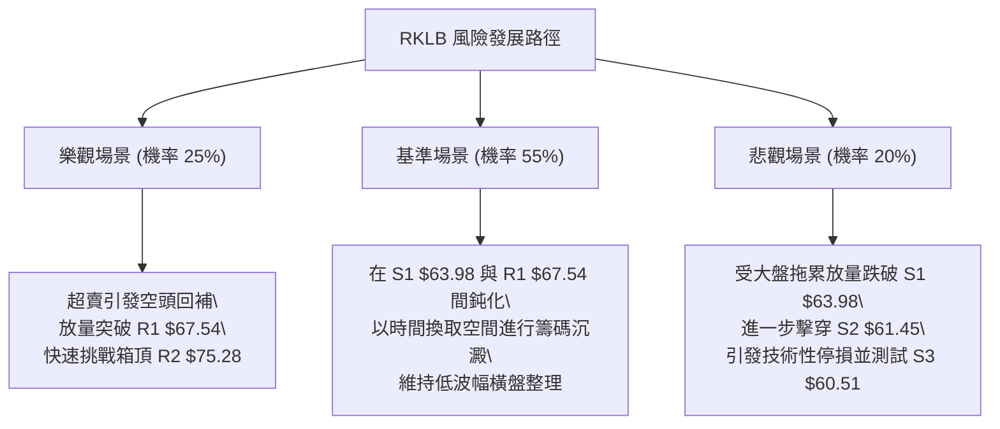

### 🛡️ 風險管理重要提醒

1. **高 Beta 波動懲罰機制**：
   RKLB 的 Beta 值為 2.938，且單日 ATR 佔比高達 6.01%。這意味著隔夜跳空或日內極端插針是常態。**嚴禁使用超過 2 倍以上的槓桿**進行交易，單筆交易虧損額度應嚴格控制在總投資帳戶淨值的 1.5% 以內。
2. **財報與基本面空窗期**：
   公司當前 TTM 淨利率為 -21.5%，自由現金流為負（$-251.96M）。雖然擁有 $2.30B 的充沛現金儲備，但在高利率與估值重估環境下，缺乏基本面盈利支撐的技術面反彈極易遭遇機構資金的逢高出貨。
3. **假突破與假跌破防範**：
   在 ADX 僅為 14.54 的盤整環境中，K 線突破布林下軌或上軌時，常伴隨「假跌破真拉升」或「假突破真反殺」。務必等待K線收盤確認，不可在盤中急於追單。

---

## 📋 報告總結

```
╔══════════════════════════════════════════════════════════════╗
║                   RKLB 技術分析報告總結                      ║
╠══════════════════════════════════════════════════════════════╣
║ 報告日期：2026-10-13                                         ║
║ 當前價格：$65.71                                             ║
║ 分析評級：⚖️ 偏空震盪 / 區間築底觀望 (評分: 38/100)           ║
║                                                              ║
║ 關鍵結論：                                                   ║
║ ├─ 長期趨勢：🟡 中性回檔 (自 $143 腰斬後於 78.6% Fib 區沉澱)  ║
║ ├─ 中期趨勢：🟡 區間盤整 (介於 $62.95 與 $75.28 大箱型拉鋸)   ║
║ ├─ 短期趨勢：🔴 偏弱探底 (受制於 MA20 $69.88，但超賣已深)     ║
║ ├─ 關鍵支撐：S1: $63.98  /  S2: $61.45 (極強防御)            ║
║ ├─ 關鍵阻力：R1: $67.54  /  R2: $75.28 (箱頂分水嶺)          ║
║ └─ 分析師目標：共識均價 $106.33 (當前處於低估區)             ║
║                                                              ║
║ 最優策略組合：                                               ║
║ 1. 🥇 最佳機會：依託支撐 S1 $63.98，在 $64.87 附近輕倉低吸， ║
║               止損設於 $61.45，博弈反抽 R1 $67.54 及 R2      ║
║               $75.28，盈虧比高達 3.04 : 1。                  ║
║ 2. 🥈 次選機會：若反彈至 R1 $67.54 遇阻乏力，短線介入做空，  ║
║               止損設於 $69.88，下看 S1 $63.98。              ║
║ 3. 🥉 保守選擇：完全空倉觀望，等待股價放量突破 R2 $75.28     ║
║               或 ADX 上升至 25 以上確立新趨勢後再行進場。    ║
╚══════════════════════════════════════════════════════════════╝
```

---

> ⚠️ **免責聲明**：本報告為 AI 自動生成之技術分析，所有數據及估算均基於提供的歷史價格資訊。本報告**僅供研究與學術參考**，**不構成任何投資建議**。投資有風險，入市需謹慎。

---

*報告生成時間：2026-10-13 ｜ 數據來源：Yahoo Finance ｜ 分析框架：多時框技術分析*