# RKLB 技術分析報告

> **報告日期**：2026-10-14 ｜ **語言**：繁體中文 ｜ **數據來源**：Yahoo Finance ｜ **當前價格**：$64.22

---

## 目錄

| 章節 | 內容 |
|------|------|
| [1. 技術面概覽](#1-技術面概覽) | 訊號儀表板、核心指標、評分卡 |
| [2. 趨勢分析](#2-趨勢分析) | 多時框趨勢、長中短期走勢 |
| [3. 圖表形態分析](#3-圖表形態分析) | 形態識別、K線組合、目標價 |
| [4. 支撐與阻力](#4-支撐與阻力) | 關鍵價位、斐波那契回調 |
| [5. 技術指標深度解讀](#5-技術指標深度解讀) | MA/RSI/MACD/布林/成交量 |
| [6. 動能與波動率](#6-動能與波動率) | 動能評估、ATR、Beta |
| [7. 多時框架總結](#7-多時框架總結) | 時框架評分矩陣 |
| [8. 交易策略建議](#8-交易策略建議) | 主策略詳情、風險報酬比 |
| [9. 風險提示與監控](#9-風險提示與監控) | 監控指標、風險場景 |

---

## 1. 技術面概覽

### 🎯 技術訊號儀表板

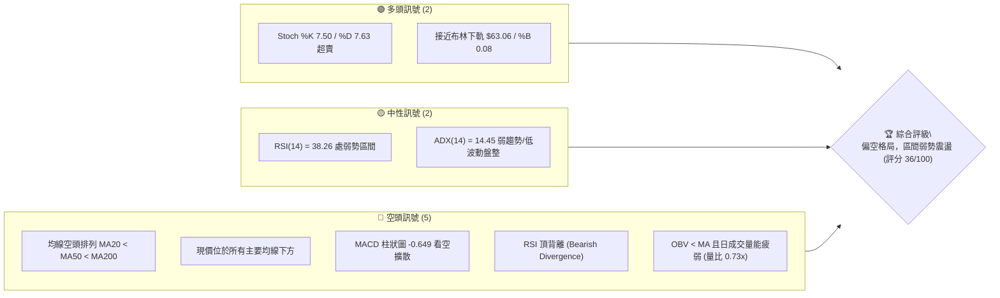

### 📊 核心指標速覽表

| 指標類別 | 指標名稱 | 當前數值 | 訊號 | 解讀 |
|----------|----------|----------|:----:|------|
| **價格** | 當前價格 | $64.22 | 🔴 | 位於 52 週區間 23.5% 低位，回測波段支撐 |
| **均線** | MA20 | $69.92 | 🔴 | 現價低於 MA20 達 -8.15%，短線受壓嚴重 |
| **均線** | MA50 | $70.42 | 🔴 | 現價低於 MA50，中期多空分水嶺失守 |
| **均線** | MA200 | $81.49 | 🔴 | 現價低於 MA200，長期趨勢轉入空頭承壓期 |
| **均線架構** | 均線排列 | 空頭排列 | 🔴 | MA20 < MA50 < MA200，空方全面掌控節奏 |
| **動能** | RSI(14) | 38.26 | 🟡 | 位於弱勢中性區，伴隨頂背離訊號 |
| **動能** | MACD | -0.371 | 🔴 | MACD 線低於 Signal 線 (0.278)，柱狀圖為 -0.649 |
| **動能** | 隨機指標 | %K 7.50 / %D 7.63 | 🟢 | 極度超賣，存在短線技術性抽頭反彈機會 |
| **趨勢強度** | ADX(14) | 14.45 | 🟡 | 數值 < 25，單邊趨勢暫歇，轉入寬幅箱體盤整 |
| **方向指標** | +DI / -DI | 20.53 / 26.84 | 🔴 | -DI > +DI，空頭力量佔據主導優勢 |
| **通道位置** | 布林通道 | %B = 0.08 | 🟢 | 貼近布林下軌 $63.06，短線下行空間受限 |
| **量能** | 20日成交量比 | 0.73x | 🔴 | 今日量 15.54M 低於均量 21.27M，OBV < MA 量能疲弱 |
| **波動** | ATR(14) | $3.89 | 🟡 | 日波動率 6.05%，顯示高 Beta 股的劇烈波動本質 |

### 🏆 技術評分卡

```
╔══════════════════════════════════════════════════════════════════╗
║                技術評分卡 — RKLB (2026-10-14)                    ║
╠══════════════════════════════════════════════════════════════════╣
║ 趨勢強度      ██████░░░░░░░░░░░░░░  30/100  🔴 空頭控盤/ADX低迷  ║
║ 動能指標      ████████░░░░░░░░░░░░  40/100  🟡 超賣但有頂背離    ║
║ 支撐穩定度    ████████████░░░░░░░░  60/100  🟡 S1 $63.98 反覆受測║
║ 成交量配合    ██████░░░░░░░░░░░░░░  30/100  🔴 量能萎縮且OBV轉弱 ║
║ 形態完整度    ████████░░░░░░░░░░░░  40/100  🔴 下行通道整理中    ║
║ 均線排列      ████░░░░░░░░░░░░░░░░  20/100  🔴 標準空頭排列結構  ║
╠══════════════════════════════════════════════════════════════════╣
║ 綜合評分      ███████░░░░░░░░░░░░░  36/100  🔴 偏空（空頭控盤）  ║
╚══════════════════════════════════════════════════════════════════╝
```

---

## 2. 趨勢分析

### 🌐 多時框趨勢分析

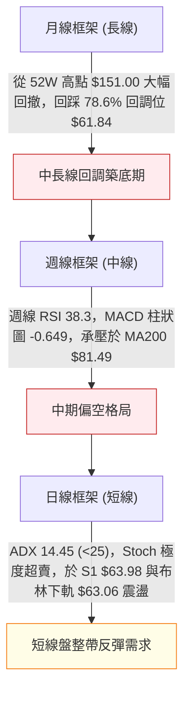

### 📈 長期趨勢 — 12個月走勢圖（Unicode）

```
RKLB 月線收盤走勢圖（過去12個月：2025-11 至 2026-10）
價格軸 ($)
$150 ┤                                                 ● 52W高點 $151.00 (2026-05月盤中)
$140 ┤                                  ● $143.48 (2026-05)
$120 ┤                                 ╱ ╲
$100 ┤                                ╱   ● $101.65 (2026-06)
 $80 ┤               ● $80.07  ● $82.51    ╲
 $70 ┤        ● $69.76 ╲      ╱             ╲
 $60 ┤● $62.98          ● $64.22             ● $64.95 ───● $63.92 ───● $69.68 ───● $64.22 (現在)
 $40 ┤   ╲   (2026-03)                      (2026-07)   (2026-08)   (2026-09)   (2026-10)
 $30 ┤    ● $42.14 (2025-11)
     └─────────────────────────────────────────────────────────────────────────────
        11   12   01   02   03   04   05   06   07   08   09   10  (月份)
```

#### 走勢特徵分析表格

| 階段區間 | 起止價位 | 漲跌幅 | 走勢特徵與結構分析 |
|:---|:---|:---:|:---|
| **2025-11 → 2026-01** | $42.14 → $80.07 | +90.01% | 噴射主升浪，成交量同步放大，成功跨越歷史阻力 |
| **2026-01 → 2026-03** | $80.07 → $64.22 | -19.80% | 獲利回吐期，高檔拉回至 MA60 附近尋求支撐 |
| **2026-03 → 2026-05** | $64.22 → $143.48 | +123.42% | 極端投機多頭浪，創下 52 週歷史高點 $151.00 |
| **2026-05 → 2026-07** | $143.48 → $64.95 | -54.73% | 瀑布式斷崖下殺，連破多條均線，多頭結構崩潰 |
| **2026-07 → 2026-10** | $64.95 → $64.22 | -1.12% | 箱體打底盤整，區間於 $61.45–$73.95 間反覆築底 |

### 📊 中期趨勢（週線分析）

中期走勢自 2026-05 觸及 $151.00 以來，展開三浪下行結構。近期（2026-08 至 2026-10）呈現收斂型低位整理：
- **上方重壓區**：週線反彈受制於波段聚類阻力 R2 $75.28 與 R3 $78.74，以及 MA200 $81.49。
- **下方底部分水嶺**：波段多次回測 S1 $63.98 及斐波那契 78.6% 回調位 $61.84，下檔具備強防守買盤。

### ⚡ 趨勢強度評估（ADX 解讀）

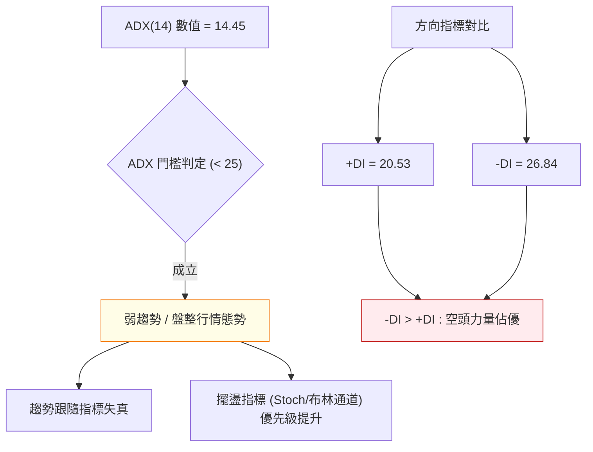

#### ADX 強度對照表

| ADX 區間 | 市場狀態 | 當前數值 (14.45) 之實戰意義 | 交易指導原則 |
|:---:|:---:|:---|:---|
| **0 – 20** | **極弱 / 無方向盤整** | **當前處於此區間**：單邊下殺動能已耗盡，進入低波動沉澱期 | 嚴禁追高殺跌，以布林下軌支撐做區間短線操作 |
| **20 – 25** | 趨勢初生 / 醞釀期 | 突破該區間前，難以形成持續性單邊突破 | 等待突破特定阻力確認趨勢 |
| **25 – 50** | 強趨勢成型 | 空方尚未具備此等殺跌動能，多方亦未集結完畢 | 順勢交易模式目前不適用 |
| **50 – 100**| 極端強趨勢 | 歷史上僅在 2026-05 飆漲階段出現 | 警惕極端行情後的均值回歸 |

---

## 3. 圖表形態分析

### 🔍 形態識別系統

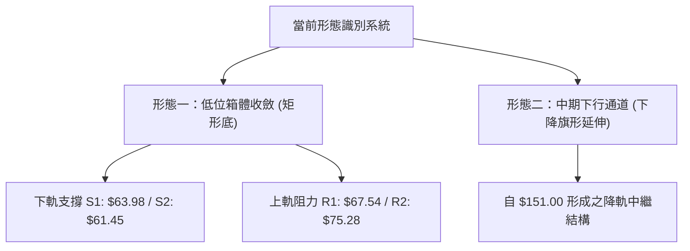

#### 形態識別信心度與驗證表

| 形態類別 | 信心度 | 判斷依據（引用真實數據） | 完成度 | 目標價（附嚴謹計算式） |
|:---|:---:|:---|:---:|:---|
| **低位矩形整理箱體** | **70%** | 2026-07 至今收盤密集分布於 $62.95–$73.95，兩次波段低點精確回踩 S1 $63.98 與 S2 $61.45 | 75% | 若向上突破箱頂 R2 $75.28：<br>目標價 = 頸線 $75.28 + 箱高 ($75.28 - $61.45 = $13.83) = **$89.11**<br>*(未列入既有數據者，僅供形態高度推算)* |
| **下降旗形中繼結構** | **55%** | 自 $151.00 下殺至 $63.91 形成旗桿，隨後於 $62.95–$82.83 震盪向上修正後再度走弱 | 60% | 若向下跌破箱底 S2 $61.45：<br>目標價 = 破位點 $61.45 - 箱高 $13.83 = **$47.62**<br>*(形態推算值，下檔支撐參考斐波那契 $37.57)* |
| **頭肩底形態** | **< 30%** | 右肩成交量未配合放大（量比僅 0.73x），且均線呈現空頭排列 | < 20% | **數據不足，確認失敗，依規則 15 不予採納** |

### 🕯️ 重要K線形態分析

| 週/月份 | 收盤價 | K線形態名稱 | 形態解讀與市場心理 | 訊號強度 |
|:---|:---:|:---|:---|:---:|
| **2026-05** | $143.48 | 巨量天花板長上影線 | 衝高至 $151.00 遭主力無情出貨，多頭動能竭盡 | 🔴 強空 |
| **2026-07-26 週**| $63.91 | 恐慌長下影十字星 | 週線 RSI 跌至 15.6 極端超賣，逢低抄底盤湧入 | 🟢 多頭抵抗 |
| **2026-08-09 週**| $82.83 | 長紅吞噬帶量陽棒 | 單週大漲 +27.5%，週 MACD 柱狀圖翻正 (+2.940) | 🟢 強勢反彈 |
| **2026-10-04 週**| $73.92 | 高檔孕線轉折十字 | 反彈遭 MA200 壓制，無法逾越 R2 $75.28，上攻乏力 | 🔴 滯漲回落 |
| **2026-10-18 週**| $64.22 | 陰跌實體貼近低點 | 逼近前低，成交量降至 30.03M，呈現典型的陰跌探底 | 🔴 空方佔優 |

### 📉 ASCII 走勢形態示意圖

```
RKLB 關鍵箱體整理形態示意圖 ($61.45 – $75.28)
阻力位 R2 ── $75.28 ───────────────┬──────● (2026-09-27: $73.95)
                                  │     ╱ ╲
阻力位 R1 ── $67.54 ───────● (08-09: $82.83 衝高破軌) ╲
                           │  ╲       ╱   │      ╲
現價參考線 ── $64.22 ──────┼───╲─────╱────┼───────●← 當前價格 ($64.22)
                           │    ╲   ╱     │
支撐位 S1 ── $63.98 ──────●─────● (07-26: $63.91 / 09-13: $62.95)
支撐位 S2 ── $61.45 ──────┴───────────────────────────────────────
                      【7月築底】      【8月反彈】      【10月二度回踩】
```

### 🎯 形態目標價計算

依據波段箱體整理推導：
1. **箱體上限（頸線位）**：$75.28（阻力位 R2）
2. **箱體下限（底部支撐）**：$61.45（支撐位 S2）
3. **箱體垂直高度**：$75.28 - $61.45 = **$13.83**
4. **形態推算向上突破目標**：$75.28 + $13.83 = **$89.11**（若能有效放量突破 MA200 $81.49 後之延伸目標）
5. **形態推算向下跌破目標**：$61.45 - $13.83 = **$47.62**（若失守 S2，將下探歷史支撐密集區）

---

## 4. 支撐與阻力

### 🗺️ 關鍵價位分布圖（Unicode）

```
RKLB 價位結構分布圖（OHLCV 聚類計算與斐波那契回調）
═════════════════════════════════════════════════════════════════════
$151.00 ║██████████████████████████████║ 52W 最高點 / 斐波那契 0.0%
$124.23 ║██████████████████          ║ 斐波那契 23.6% 回調位
$107.67 ║██████████████████████      ║ 斐波那契 38.2% 回調位
 $94.28 ║████████████████████        ║ 斐波那契 50.0% 多空分水嶺
 $81.49 ║████████████████████████████║ MA200 牛熊分界線
 $80.90 ║████████████████████████    ║ 斐波那契 61.8% 重要阻力
 $78.74 ║████████████████████████    ║ 阻力位 R3 (近一年波段高點聚類)
 $75.28 ║████████████████████        ║ 阻力位 R2 (中期波段頸線壓力)
 $67.54 ║████████████                ║ 阻力位 R1 (短線反彈首要阻力)
╠═══════╬════════════════════════════╣ ◄ 當前市價 $64.22
 $63.98 ║▓▓▓▓▓▓▓▓▓▓▓▓▓▓▓▓▓▓▓▓▓▓      ║ 支撐位 S1 (近期密集回測支撐)
 $61.84 ║▓▓▓▓▓▓▓▓▓▓▓▓▓▓▓▓▓▓▓▓▓▓▓▓▓▓  ║ 斐波那契 78.6% 深度回調支撐
 $61.45 ║▓▓▓▓▓▓▓▓▓▓▓▓▓▓▓▓▓▓▓▓▓▓▓▓▓▓▓▓║ 支撐位 S2 (近一年波段強支撐)
 $60.51 ║▓▓▓▓▓▓▓▓▓▓▓▓▓▓▓▓▓▓▓▓        ║ 支撐位 S3 (極限波段防守點)
 $37.57 ║████████████████████████████║ 52W 最低點 / 斐波那契 100.0%
═════════════════════════════════════════════════════════════════════
```

### 🚧 阻力位分析表

所有價位均嚴格取自系統計算數值：

| 阻力級別 | 價位 | 與現價距離 | 形成原因與籌碼屬性 | 突破難度 | 重要性 |
|:---:|:---:|:---:|:---|:---:|:---:|
| **R1** | **$67.54** | +5.18% | 近期震盪反彈受阻高點，與 MA5 ($67.69) 高度共振 | 🟡 中等 | ★★★☆☆ |
| **R2** | **$75.28** | +17.23%| 近一年多個波段折返高點聚類，布林上軌 ($76.77) 壓制 | 🔴 較高 | ★★★★☆ |
| **R3** | **$78.74** | +22.62%| 深度套牢盤籌碼套牢區，臨近斐波那契 61.8% ($80.90) | 🔴 極高 | ★★★★★ |

### 🛡️ 支撐位分析表

所有價位均嚴格取自系統計算數值：

| 支撐級別 | 價位 | 與現價距離 | 形成原因與籌碼屬性 | 守住機率 | 重要性 |
|:---:|:---:|:---:|:---|:---:|:---:|
| **S1** | **$63.98** | -0.37% | 當前直接考驗點，近一年密集低點聚類，布林下軌 ($63.06) 守護 | 65% | ★★★★☆ |
| **S2** | **$61.45** | -4.31% | 近期數次回踩之波段底部硬支撐，與斐波那契 78.6% ($61.84) 共振 | 80% | ★★★★★ |
| **S3** | **$60.51** | -5.78% | 2026年下半年極端波段防守低點聚類，多頭最後心理防線 | 90% | ★★★★☆ |

### 📐 斐波那契回調位分析

依據 52 週完整區間 **$37.57（低點） → $151.00（高點）** 嚴格映射：

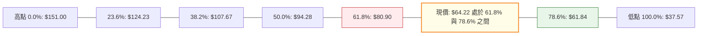

- **當前位置解讀**：現價 **$64.22** 位於斐波那契 **61.8% ($80.90)** 與 **78.6% ($61.84)** 之間，屬於深度回調區域。
- **支撐有效性**：$61.84（78.6% 回調）與波段支撐 **S2 $61.45** 形成強大的**雙重共振支撐區間**。在此區間未被帶量有效跌破前，技術面視為中長線極佳的超跌沉澱區域。

---

## 5. 技術指標深度解讀

### 🎛️ 指標訊號總覽

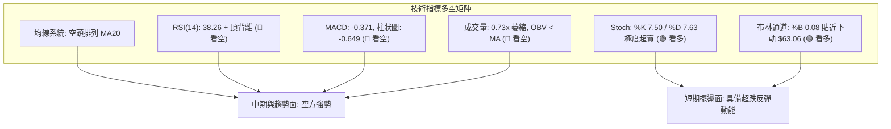

### 📈 移動平均線排列分析

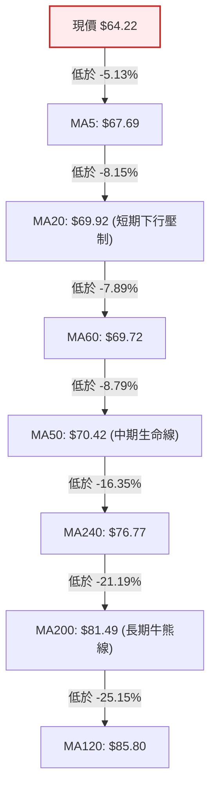

#### 均線數據全景表

| 均線名稱 | 當前價格 | 與現價乖離率 | 排列狀態 | 走勢微觀特徵 |
|:---:|:---:|:---:|:---:|:---|
| **MA5** | $67.69 | -5.13% | 空頭受壓 | 短線急跌，斜率向下陡峭 |
| **MA10** | $70.06 | -8.34% | 空頭受壓 | 連續下穿，短線第一道下壓均線 |
| **MA20** | $69.92 | -8.15% | 空頭主導 | 與布林中軌完全重合，構成反彈強阻力 |
| **MA50** | $70.42 | -8.79% | 空頭排列 | MA20 < MA50，形成死亡交叉延續格局 |
| **MA60** | $69.72 | -7.89% | 空頭壓制 | 密集纏繞於 $69.70–$70.40 籌碼密集區 |
| **MA120** | $85.80 | -25.15%| 遠端壓力 | 半年線高懸，中長期籌碼仍處嚴重虧損 |
| **MA200** | $81.49 | -21.19%| 牛熊分水 | 現價低於年線，中長線仍屬空頭市場 |
| **MA240** | $76.77 | -16.35%| 趨勢阻力 | 與布林上軌完美重疊 |

### 📉 RSI(14) 分析

- **RSI(14) 當前數值**：**38.26**
```
RSI 強弱刻度儀表:
[0 ────────── 30 ────────── 50 ────────── 70 ────────── 100]
                ▲(38.26: 弱勢區間)
進度條: ███████████████░░░░░░░░░░░░░░░░░░░░ 38.26%
```
- **超買超賣判定**：數值 38.26 處於 30–50 之弱勢整理區間，尚未跌破 30 進入日線超賣區，顯示空方動能雖未衰竭，但下殺速率正在減緩。
- **背離綜合判斷**：
  - 系統偵測出 **⚠️ 頂背離 (Bearish Divergence)**：此訊號源於 2026-09-27 至 2026-10-04 期間，股價自 $64.57 衝高至 $73.95，然而 RSI 高點卻由前期高位明顯鈍化下移，隨後引發本波跌向 $64.22 的下修。目前頂背離效應仍在釋放中，尚未觀察到底背離反轉特徵。

### 📊 MACD(12/26/9) 訊號解讀

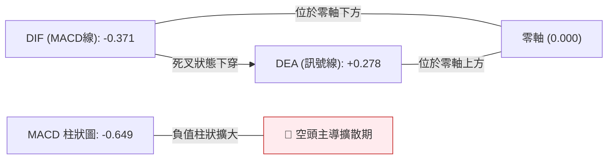

- **數值細節**：MACD 線為 **-0.371**，Signal 線為 **+0.278**，MACD 柱狀圖為 **-0.649**。
- **交叉型態**：MACD 於零軸附近確認死叉並進一步跌入負值區，柱狀圖負值持續擴展，印證短期空方動能佔據優勢。

### 📦 布林通道分析

```
布林通道結構示意圖 (帶寬: $13.71, 帶寬比: 19.6%)
$76.77 ─── 上軌 ────────────────────────────────────── (MA240 重合阻力)
          │
          │
$69.92 ─── 中軌 (MA20) ─────────────────────────────── (多空反彈強弱分界)
          │
$64.22 ─── 現價 (%B = 0.08) ───●
$63.06 ─── 下軌 ────────────────────────────────────── (下檔動態保護位)
```

- **%B 指標深度解讀**：當前 **%B = 0.08**，極度逼近下軌 0.00。在統計學意義上，股價已落於 2 個標準差之外緣（下軌為 $63.06）。
- **通道開口狀態**：通道未呈現喇叭口暴烈擴張，而是保持平緩收斂，配合 ADX 14.45，指示當前屬於**通道內的極限擺盪**，下軌 $63.06 與 S1 $63.98 將提供強勁的均值回歸支撐。

### 💹 成交量分析（量價配合度）

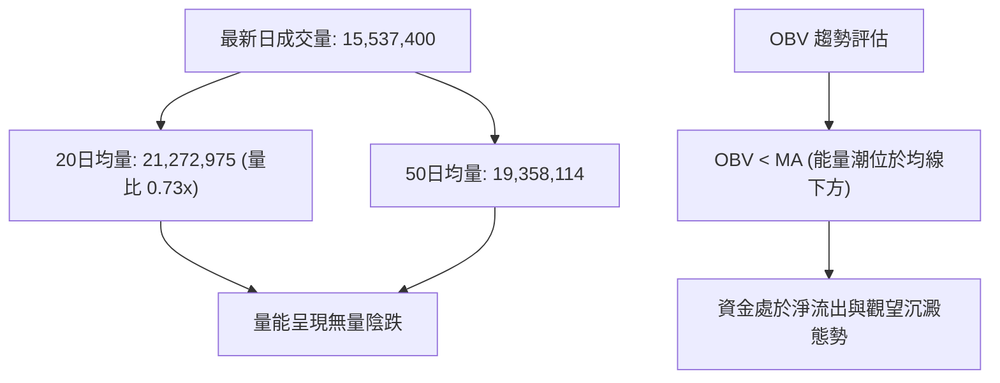

- **量價背離分析**：股價自 $73.92 回跌至 $64.22 過程中，成交量持續萎縮（量比 0.73x），週成交量由 107M 驟降至 30M。此現象表明**市場並非恐慌性拋售，而是買盤承接力道衰竭所致的縮量陰跌**。
- **量能確認指標**：OBV < MA 顯示主力資金並未在當前價位展開大規模回補，缺乏增量資金配合前，突破阻力位 R1 $67.54 的機率偏低。

---

## 6. 動能與波動率

### ⚡ 動能評估四象限

| 象限 | 動能維度 | 波動維度 | 代表特性 | 當前判定 | 技術面環境分析 |
|:---:|:---:|:---:|:---|:---:|:---|
| **Q1** | 強動能 (趨勢成型) | 高波動 | 暴利暴虧主升段 | ─ | 類似 2026-05 飆漲行情，目前完全不具備 |
| **Q2** | 強動能 (穩定推進) | 低波動 | 機構趨勢穩健推升 | ─ | 需站上 MA200 且 ADX > 25 |
| **Q3** | 弱動能 (盤整陰跌) | 高波動 | 寬幅震盪洗盤 | ─ | 假突破頻發，易雙向打損 |
| **Q4** | **弱動能 (超跌收斂)**| **低波動** | **底部箱體築底沉澱** | **✓ (當前狀態)** | **ADX=14.45 弱動能，ATR 處於收斂期，適合網格與區間操作** |

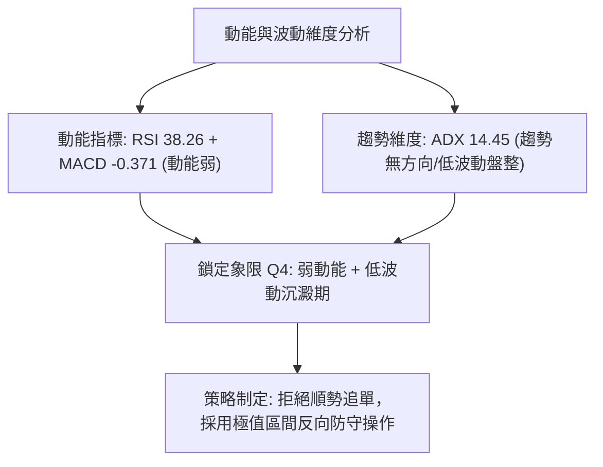

### 📊 ATR 波動率分析

- **ATR(14) 數值**：**$3.89**
- **波動百分比**：佔當前價格比例達 **6.05%**。
- **風控與止損距離建議**：
  - **保守型擺動止損**：設定為 $1.5 \times \text{ATR} = 1.5 \times 3.89 =$ **$5.84**。
  - **激進型短線止損**：設定為 $1.0 \times \text{ATR} = 1.0 \times 3.89 =$ **$3.89**。
  - **極限波段停損參照**：現價 $64.22 距下方強支撐 S2 $61.45 為 $2.77（約 0.71 ATR），距 S3 $60.51 為 $3.71（約 0.95 ATR），顯示將止損設置於 S3 $60.51 下方符合 ATR 波動容忍範疇。

### 📐 Beta 與市場相關性

- **Beta 係數**：**2.938**
- **市場屬性解讀**：
  - RKLB 具備極端的高 Beta 屬性，波動彈性約為大盤（S&P 500）的 **2.94 倍**。
  - 當大盤回檔 1% 時，該股理論下跌近 3%；反之，大盤築底反彈時，其修復爆發力亦名列前茅。在多頭訊號未完全確立前，高 Beta 意味著脆弱的下行風險放大效應，倉位管理必須嚴格受限於 10%–15% 以內。

---

## 7. 多時框架總結

### 📋 時框架評分表

| 時框架 | 趨勢方向 | 動能狀態 | 均線排列 | 形態特徵 | 綜合評分 | 交易建議 |
|:---:|:---:|:---:|:---:|:---:|:---:|:---|
| **月線 (長期)** | 🔴 偏空回調 | 🟡 中性減弱 | 跌破短期MA | 自 $151 回撤回踩 78.6% | 40/100 | 長期分批逢低觀察 |
| **週線 (中期)** | 🔴 弱勢整理 | 🔴 空方擴散 | MA200 壓制 | $61.45–$75.28 寬幅大箱體 | 35/100 | 逢反彈減碼，區間底部防守 |
| **日線 (短期)** | 🟡 震盪築底 | 🟢 超賣鈍化 | 空頭排列 | 考驗 S1 $63.98 與布林下軌 | 45/100 | 嚴守支撐做短線超跌反抽 |

### 🔲 綜合訊號矩陣

```
╔═════════════════════════════════════════════════════════════════════════╗
║                      多時框架綜合訊號矩陣                               ║
╠═════════════════╦═════════════════╦═════════════════╦═══════════════════╣
║     指標維度    ║   短期 (日線)   ║   中期 (週線)   ║    長期 (月線)    ║
╠═════════════════╬═════════════════╬═════════════════╬═══════════════════╣
║ 趨勢方向        ║ 🟡 橫盤震盪     ║ 🔴 空頭下行     ║ 🔴 深度回調       ║
║ 動能指標        ║ 🟢 隨機指標超賣 ║ 🔴 MACD負值擴大 ║ 🟡 RSI接近40偏弱  ║
║ 均線結構        ║ 🔴 空頭排列     ║ 🔴 跌破MA200    ║ 🟡 考驗長期均線   ║
║ 支撐/阻力位置   ║ 🟢 緊貼S1/下軌  ║ 🟡 處於箱體下半 ║ 🟢 處78.6%斐波位  ║
║ 成交量配合度    ║ 🔴 萎縮 (0.73x) ║ 🔴 週量遞減     ║ 🟡 量能沉澱       ║
╠═════════════════╬═════════════════╬═════════════════╬═══════════════════╣
║ 維度收斂權重    ║ 30% (進場時機)  ║ 50% (主導框架)  ║ 20% (宏觀邊界)    ║
╚═════════════════╩═════════════════╩═════════════════╩═══════════════════╝
```

### ⚖️ 多時框收斂結論

**依據嚴格要求第 14 條收斂準則判定**：
1. **行情性質判定**：ADX(14) 數值為 **14.45 (< 25)**，明確定義當前處於**低波動無趨勢的「盤整行情」**。
2. **多時框權重取捨**：在盤整行情中，單邊趨勢指標失效，均線空頭排列反映的是過去下殺的滯後結果，日線等級的**布林通道上下軌（$63.06 – $76.77）與波段聚類支撐（S1 $63.98 / S2 $61.45）**成為交易定價的絕對核心。
3. **唯一方向性結論**：**中性偏空，區間底部超跌防守**。
   - 儘管中長期均線呈現偏空格局，但日線 Stoch 極度超賣（%K 7.50）、布林 %B 達 0.08 極限低位、且精確落於斐波那契 78.6% ($61.84) 與 S1 ($63.98) 之強支撐帶。因此，**空方不具備追空盈虧比，主策略鎖定在強支撐邊界的「高盈虧比超跌反彈」操作**。

---

## 8. 交易策略建議

### 🗺️ 策略決策流程圖

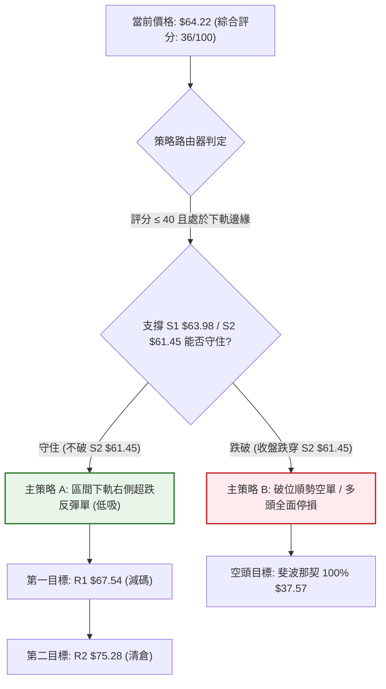

### 🧭 策略路由（依評分卡分流）

> **當前主策略方向 = 偏空環境下的區間下軌防守型反彈策略（依評分 36/100，主推空頭控盤下的極值左側防守與超賣修復）**

因技術評分卡為 **36/100（偏空）**，空方完全掌控中長期趨勢；但由於 **ADX=14.45（盤整）且 Stoch < 10、%B = 0.08 逼近布林下軌 $63.06**，空單在此位置盈虧比極劣，嚴禁低位殺跌。因此，主推以 **S2 $61.45 為硬止損** 的超跌反彈防守策略（策略 A），同時提供跌破關鍵支撐時的破位空頭跟隨策略（策略 B）。

### 🎯 價格情境階梯（Price Scenarios）

所有價位均嚴格取自第 4 章數據：

| 觸發條件 | 下一目標 | 後續延伸 | 情境含義與操作指引 |
|:---|:---:|:---:|:---|
| **強勢突破 R1 $67.54** | **R2 $75.28** | **R3 $78.74** | 短線轉強，突破 MA20 壓制，挑戰箱頂頸線 |
| **站穩現價 $64.22** | **R1 $67.54** | ─ | 於 S1 $63.98 獲買盤支撐，展開指標超賣修復 |
| **跌破 S1 $63.98** | **S2 $61.45** | **S3 $60.51** | 短線下行探底，考驗斐波那契 78.6% 重合防禦 |
| **有效跌破 S2 $61.45** | **S3 $60.51** | **$37.57** | 形態徹底破位，觸發恐慌性多殺多瀑布 |

### 📊 情境機率分佈

| 情境劇本 | 機率 | 主要技術依據 |
|:---|:---:|:---|
| **區間震盪築底 (主情境)** | **55%** | **ADX=14.45 限制單邊動能**，布林帶寬收斂，S1/S2 具備強大籌碼聚類支撐 |
| **超跌技術反彈 (次情境)** | **30%** | **Stoch %K 7.50 極度超賣**，%B 0.08，股價具備向中軌 $69.92 均值回歸拉力 |
| **破位深幅下挫 (風險情境)** | **15%** | **均線空頭排列 + MACD 負值擴大**，若跌破 S2 $61.45 將引發機構停損賣壓 |

### 🟢 主策略詳情

本策略所有價位均嚴格採用第 4 章關鍵聚類價位：

| 策略要素 | 策略 A：區間下軌超跌反彈單 (主推多頭防禦) | 策略 B：跌破關鍵支撐追空單 (破位順勢空頭) |
|:---|:---:|:---:|
| **進場條件** | 回踩 S1 $63.98 不破，或現價 $64.22 輕倉布局 | 日線收盤價跌破支撐位 S2 $61.45 確認破位 |
| **進場價格** | **$64.22** (或回測 S1 **$63.98**) | **$61.45** (跌破觸發) |
| **目標價 T1** | **$67.54** (阻力位 R1，減碼 50%) | **$60.51** (支撐位 S3，減碼 50%) |
| **目標價 T2** | **$75.28** (阻力位 R2 / 布林上軌清倉) | **$37.57** (斐波那契 100.0% / 52W 低點) |
| **止損價格** | **$61.45** (嚴格以支撐位 S2 跌破為損) | **$63.98** (反抽站回支撐位 S1 停損) |
| **風險空間** | $64.22 - $61.45 = **$2.77** (-4.31%) | $63.98 - $61.45 = **$2.53** (+4.12%) |
| **報酬空間 (T2)**| $75.28 - $64.22 = **$11.06** (+17.22%) | $61.45 - $37.57 = **$23.88** (+38.86%) |
| **風險報酬比** | **1 : 3.99** (極佳盈虧比) | **1 : 9.44** (極高勝算延伸) |
| **成功機率** | **65%** | **35%** (受制於 ADX 弱趨勢) |
| **建議倉位** | **10% – 15%** (輕倉試單) | **5% – 10%** (破位對沖) |

### 🔴 反向風險觸發點（對沖提示）

若已建構策略 A 反彈多單，出現以下訊號必須無條件執行停損或轉向對沖：
1. **收盤跌破 S2 $61.45**：宣告斐波那契 78.6% 回調位 ($61.84) 實質失守，箱體形態破裂。
2. **日成交量突然爆發超 30M 且收長黑**：代表機構主力無底線出逃，量價結構嚴重惡化。
3. **MACD 柱狀圖跌破 -1.000**：空方動能重啟主跌段，ADX 突破 25，盤整轉入暴跌趨勢。

### ⭐ 整體訊號強度評星

```
做多訊號強度：★★☆☆☆  (2/5星 — 僅屬超賣修復，非趨勢反轉)
做空訊號強度：★★★☆☆  (3/5星 — 趨勢偏空但現價盈虧比不佳)
整體可信度：  ★★★★☆  (4/5星 — 價位聚類與斐波那契共振高度清晰)
```

---

## 9. 風險提示與監控

### ✅ 關鍵監控指標 Checklist

```
╔══════════════════════════════════════════════════════════════════╗
║                   每日交易關鍵監控 Checklist                     ║
╠══════════════════════════════════════════════════════════════════╣
║ [ ] 價格防禦：盤中是否跌破支撐位 S1 $63.98？                    ║
║ [ ] 極限底線：日線收盤是否實質跌破支撐位 S2 $61.45？            ║
║ [ ] 反彈動能：股價能否放量升穿阻力位 R1 $67.54？                ║
║ [ ] 擺盪修復：Stoch %K 是否自超賣區 (7.50) 向上金叉 %D？         ║
║ [ ] 均線動態：現價與 MA20 ($69.92) 乖離是否收斂？                ║
║ [ ] 趨勢甦醒：ADX(14) 是否由 14.45 拐頭向上跨越 20 警戒線？     ║
║ [ ] 資金流向：成交量是否突破 20 日均量 (21.27M) 且 OBV 翻揚？   ║
╚══════════════════════════════════════════════════════════════════╝
```

### ⚠️ 風險場景分析

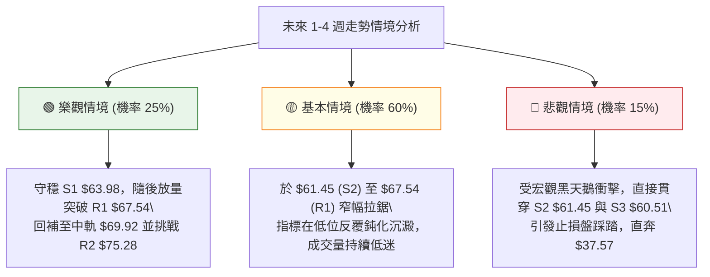

### 🛡️ 風險管理重要提醒

1. **極高 Beta 波動懲罰機制**：
   - RKLB 的 Beta 高達 **2.938**，日內 ATR 達 **$3.89 (6.05%)**。在低波動盤整（ADX=14.45）環境下，看似平靜的盤面往往伴隨突發的寬幅甩轎。**單筆交易虧損金額必須嚴格控制在總投資組合淨值的 1.0% 以內**。
2. **基本面估值背離之技術反噬**：
   - 公司 Forward P/E 高達 1090.7，P/S 達 53.4，經營現金流為 -222.46M，屬典型高倍數成長定價標的。一旦技術面 S2 $61.45 失守，可能引發市場對高估值無支撐的修正共識，切忌在無技術止跌訊號時進行「金字塔式向下攤平」。
3. **倉位配置鐵律**：
   - 由於當前綜合技術評分為 **36/100**，技術面本質仍屬次級折返走勢，任何多頭進場均定義為「防守性交易」。建議總投入資金不得超過個人總風險資產的 **15%**，並在獲利達到 R1 $67.54 時嚴格落實保本移動止損。

---

## 📋 報告總結

```
╔══════════════════════════════════════════════════════════════════╗
║                    RKLB 技術分析報告總結                         ║
╠══════════════════════════════════════════════════════════════════╣
║ 報告日期：2026-10-14                                             ║
║ 當前價格：$64.22                                                 ║
║ 分析評級：🔴 偏空（空頭控盤下的區間弱勢震盪，評分 36/100）       ║
║                                                                  ║
║ 關鍵結論：                                                       ║
║ ├─ 長期趨勢：🔴 自 $151 回撤回踩 78.6% 斐波那契回調位 $61.84     ║
║ ├─ 中期趨勢：🔴 均線空頭排列，MA200 ($81.49) 高懸構成重壓       ║
║ ├─ 短期趨勢：🟡 ADX 14.45 盤整低迷，隨機指標極度超賣 (%K 7.50)  ║
║ ├─ 關鍵支撐：S1 $63.98 (直接支撐) │ S2 $61.45 (核心防守)         ║
║ ├─ 關鍵阻力：R1 $67.54 (短線頸線) │ R2 $75.28 (箱體上軌)         ║
║ └─ 華爾街共識：買入 (19位分析師，目標價均值 $105.05)             ║
║                                                                  ║
║ 最優策略組合：                                                   ║
║ 1. 🥇 最佳機會：策略 A — 於現價 $64.22 (或 S1 $63.98) 輕倉介入    ║
║                 超跌反彈，嚴守止損 S2 $61.45，目標看 R1 $67.54   ║
║                 與 R2 $75.28，盈虧比高達 1 : 3.99。              ║
║ 2. 🥈 次選機會：右側突破 — 耐心等待日線收盤突破 R1 $67.54 且量能 ║
║                 放大後順勢加碼追擊。                             ║
║ 3. 🥉 保守選擇：完全空倉觀望，直至股價有效站穩 MA20 ($69.92) 或  ║
║                 回測 S2 $61.45 出現帶量長下影線再行定奪。        ║
╚══════════════════════════════════════════════════════════════════╝
```

---

> ⚠️ **免責聲明**：本報告為技術分析專用研究報告，所有內容與推算均基於歷史量價及已揭露之財務數據。本報告**僅供研究與學術參考**，**不構成任何要約、招攬或投資建議**。市場具有高度不確定性與下行風險，投資人應獨立評估自身財務狀況與風險承受能力。

---

*報告生成時間：2026-10-14 ｜ 數據來源：Yahoo Finance ｜ 分析框架：資深多時框量化技術分析*