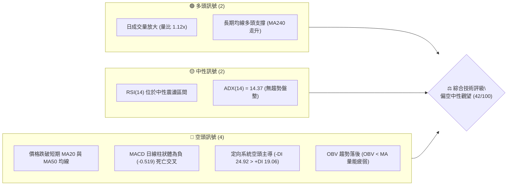
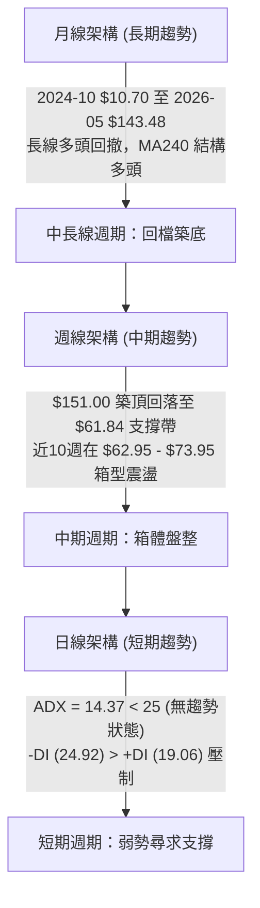
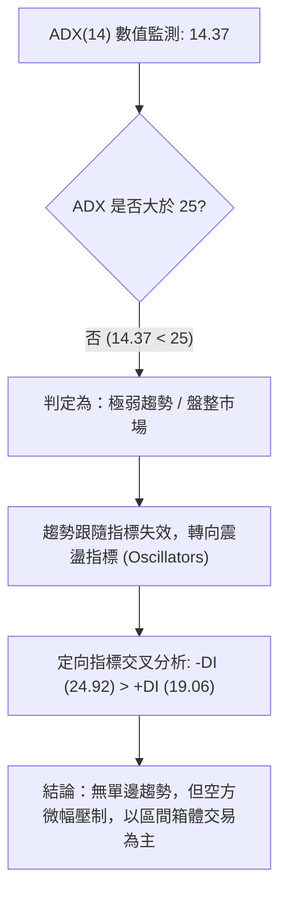
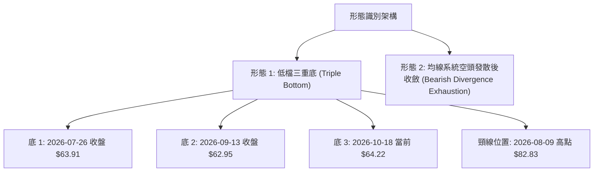
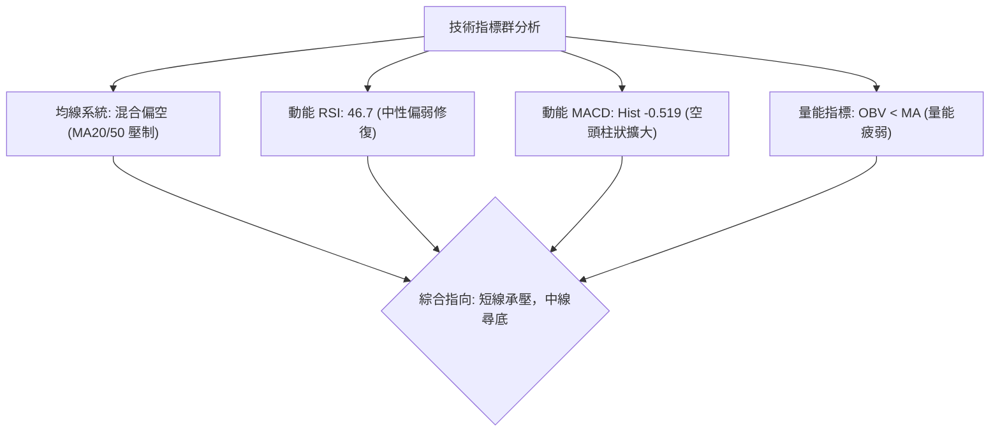
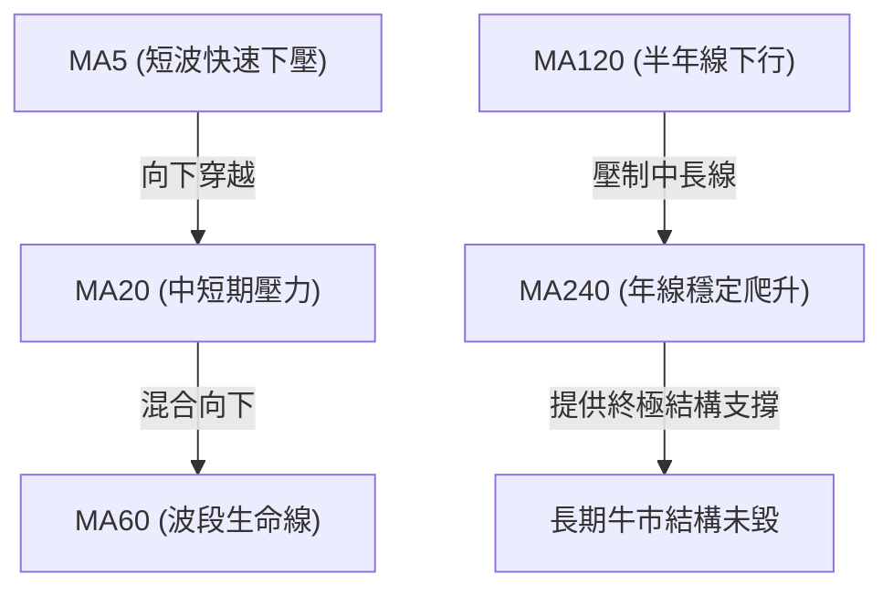
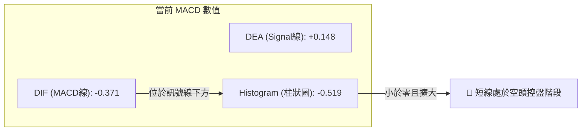
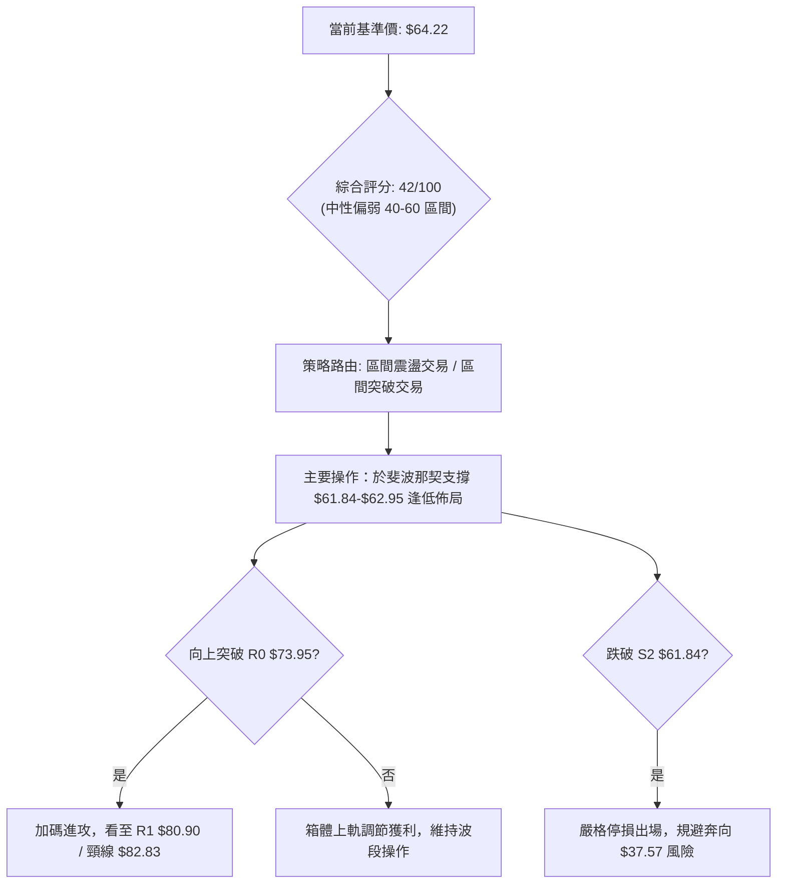
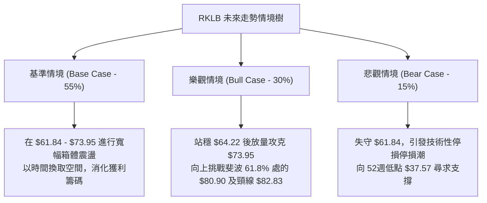

# RKLB 技術分析報告

> **報告日期**：2026-10-15 ｜ **語言**：繁體中文 ｜ **數據來源**：Yahoo Finance ｜ **當前價格**：$64.22

---

## 目錄

| 章節 | 內容 |
|------|------|
| [1. 技術面概覽](#1-技術面概覽) | 訊號儀表板、核心指標、評分卡 |
| [2. 趨勢分析](#2-趨勢分析) | 多時框趨勢、長中短期走勢、ADX強度 |
| [3. 圖表形態分析](#3-圖表形態分析) | 形態識別、K線組合、目標價推算 |
| [4. 支撐與阻力](#4-支撐與阻力) | 關鍵價位結構、斐波那契回調深度分析 |
| [5. 技術指標深度解讀](#5-技術指標深度解讀) | MA/RSI/MACD/布林/成交量量價關係 |
| [6. 動能與波動率](#6-動能與波動率) | 動能評估四象限、ATR、Beta 風險係數 |
| [7. 多時框架總結](#7-多時框架總結) | 時框架評分矩陣、多時框收斂判定 |
| [8. 交易策略建議](#8-交易策略建議) | 策略路由、主策略規劃、風險報酬比 |
| [9. 風險提示與監控](#9-風險提示與監控) | 監控指標、風險場景樹、風控法則 |
| [📋 報告總結](#-報告總結) | 核心結論與交易決策看板 |

---

## 1. 技術面概覽

本報告基於 Rocket Lab Corporation（NASDAQ: RKLB）截至 2026 年 10 月 15 日之市場交易數據與歷史價格行為進行全方位技術推演。當前最新收盤基準價為 **$64.22**（對齊最新 2026-10 月線及 2026-10-18 當週收盤價）。

### 🎯 技術訊號儀表板



### 📊 核心指標速覽表

| 指標類別 | 指標名稱 | 當前數值 | 訊號 | 解讀 |
| :--- | :--- | :--- | :---: | :--- |
| **價格** | 當前收盤價 | $64.22 | 🟡 | 位於52週區間（$37.57 - $151.00）之 23.49% 分位，深幅回檔整理 |
| **均線** | MA20 / MA50 | 混合排列 | 🔴 | 均線系統呈混合向下發散，當前價格位於短期均線群下方 |
| **均線** | 長期趨勢線 | MA240走升 | 🟢 | 超長線維持結構性多頭，中短線處於下行修正後的震盪築底階段 |
| **動能** | RSI(14) | 中性震盪 | 🟡 | 缺乏單邊動能，週線層級從超賣區修復至中性偏弱水位 |
| **動能** | MACD (12,26,9) | Hist: -0.519 | 🔴 | MACD線(-0.371)低於訊號線(0.148)，空方動能佔優 |
| **趨勢強度** | ADX (14) | 14.37 | 🟡 | ADX < 25 表明處於極低動能的「無趨勢盤整市場」，波段單邊方向未明 |
| **定向指標** | DMI (+DI / -DI)| 19.06 / 24.92| 🔴 | -DI 大於 +DI，空頭力量實質壓制多頭反撲 |
| **成交量** | 量能配合度 | 24.12M (1.12x)| 🔴 | 單日成交量略放大於20日均量，但 OBV 低於移動均線，量價呈背馳疲弱狀態 |

### 🏆 技術評分卡

```
╔══════════════════════════════════════════════════════════════╗
║              技術評分卡 — RKLB (2026-10-15)                  ║
╠══════════════════════════════════════════════════════════════╣
║ 趨勢強度 (Trend)      ██████░░░░░░░░░░░░░░  30/100  🔴 弱勢震盪 ║
║ 動能指標 (Momentum)   ████████░░░░░░░░░░░░  40/100  🔴 空方佔優 ║
║ 支撐穩定度 (Support)  ████████████░░░░░░░░  60/100  🟡 斐波支撐 ║
║ 成交量配合 (Volume)   ████████░░░░░░░░░░░░  40/100  🔴 量能渙散 ║
║ 形態完整度 (Pattern)  ██████████░░░░░░░░░░  50/100  🟡 築底雛形 ║
║ 均線系統 (Moving Avg) ██████░░░░░░░░░░░░░░  30/100  🔴 空頭壓制 ║
╠══════════════════════════════════════════════════════════════╣
║ 綜合技術評分          ████████░░░░░░░░░░░░  42/100  🟡 中性偏弱 ║
║ 建議配置與操作姿態    【防禦性觀望 / 箱體下軌區間交易】          ║
╚══════════════════════════════════════════════════════════════╝
```

---

## 2. 趨勢分析

### 🌐 多時框趨勢分析



### 📈 長期趨勢 — 12個月走勢圖（Unicode）

自 2025 年 11 月至 2026 年 10 月，RKLB 經歷了爆發性主升段與劇烈回檔。下圖展示近 12 個月收盤走勢：

```
RKLB 月線走勢圖（過去12個月：2025-11 至 2026-10）
價格軸 ($)
$150 ┤                                       ● 2026-05 ($143.48 / 高點 $151.00)
$140 ┤                                      ╱ ╲
$130 ┤                                     ╱   ╲
$120 ┤                                    ╱     ╲
$110 ┤                                   ╱       ● 2026-06 ($101.65)
$100 ┤                                  ╱         ╲
 $90 ┤                            ● 04 ╱           ╲
 $80 ┤                ● 01 ($80.07)   ╱             ╲
 $70 ┤          ● 12 ╱ ╲             ╱               ● 09 ($69.68)
 $60 ┤          ╱   ╱   ● 02 ($69.10)                 ╲   ● 10 ($64.22) ← 現價
 $50 ┤         ╱   ╱     ╲                             ●-● 07/08 ($64.95/$63.92)
 $40 ┤● 11 ($42.14)       ● 03 ($64.22)
     └─────────────────────────────────────────────────────────────
       25-11 25-12 26-01 26-02 26-03 26-04 26-05 26-06 26-07 26-08 26-09 26-10
```

#### 長期走勢特徵分析

| 階段與月份 | 區間起訖點 | 區間漲跌幅 | 走勢結構與特徵解讀 |
| :--- | :--- | :--- | :--- |
| **初升準備期** (25-11 ~ 26-01) | $42.14 → $80.07 | +90.01% | 突破底部帶量上揚，建立第一波上升通道 |
| **中繼洗盤期** (26-02 ~ 26-03) | $80.07 → $64.22 | -19.79% | 獲利了結盤湧出，於 $64.22 獲取支撐確認中繼 |
| **末升噴出期** (26-04 ~ 26-05) | $64.22 → $143.48| +123.42%| 投機動能爆發，創歷史天價 $151.00，量能極致消耗 |
| **估值修正期** (26-06 ~ 26-07) | $143.48 → $64.95| -54.73% | 瀑布式重挫，摜破多道均線，動能指標崩解 |
| **平台築底期** (26-08 ~ 26-10) | $64.95 → $64.22 | -1.12%  | 波動率大幅收斂，圍繞斐波 78.6% 回調位反覆換手 |

### 📊 中期趨勢（週線分析）

中期技術面目前呈現「三角形收斂至箱型整理」的演變態勢。觀察近 20 週的收盤價分布，高點由 2026-06-07 的 $110.08 逐步壓低至 2026-08-09 的 $82.83，再收斂至 2026-10-04 的 $73.92。而底部在 $62.95 - $64.22 區間展現極強的買盤承接力。

```
RKLB 中期波段震盪示意圖（週線區間）
$115 ┤  ● (06-07: $110.08)
$105 ┤     ●       ● (07-05: $100.46)
 $95 ┤        ╲   ╱ ╲
 $85 ┤         ╲ ╱   ●      ● (08-09: $82.83)
 $75 ┤          ▼     ╲    ╱ ╲    ● (10-04: $73.92)
 $65 ┤                 ●──●   ●──●   ●──● ← [中期箱體底部 $62.95 - $64.22]
     └────────────────────────────────────────────────────────
       06-07     07-05     08-09     09-13     10-18
```

### ⚡ 趨勢強度評估（ADX 解讀）



#### ADX 指標強度對照表

| 指標變數 | 當前讀數 | 門檻區間 | 技術含義 |
| :--- | :---: | :---: | :--- |
| **ADX (14)** | **14.37** | < 20 (極弱/無趨勢) | 市場參與者分歧，趨勢推動力完全渙散，處於橫盤吸籌或派發期 |
| **+DI (14)** | **19.06** | 多方攻擊動能 | 多頭攻擊無力，反彈動能無法維持持續性買盤 |
| **-DI (14)** | **24.92** | 空方壓制動能 | 空方佔優但未達 30 以上單邊主跌強度，屬於陰跌或壓制走勢 |
| **趨勢環境判定** | **無趨勢盤整** | 依收斂規則 14 | **盤整行情（ADX<25）：交易策略嚴格以日線區間震盪與支撐阻力為主** |

---

## 3. 圖表形態分析

### 🔍 形態識別系統

在日線與週線結構中，價格自 2026 年 5 月高點 $151.00 大幅回撤後，於 2026 年 7 月下旬至 10 月中旬呈現長達三個月的**「低檔三重底（Triple Bottom）潛在反轉形態」**與**「收斂三角整理」**。



#### 形態識別信心度與技術依據

| 形態類別 | 信心度 | 判斷依據（嚴格引用歷史數據） | 完成度 | 目標價（附嚴謹計算式） |
| :--- | :---: | :--- | :---: | :--- |
| **低檔三重底 (Triple Bottom)** | **70%** | 三次週線低點聚類於 $62.95 - $64.22 支撐帶：<br/>• 2026-07-26 收盤 $63.91<br/>• 2026-09-13 收盤 $62.95<br/>• 2026-10-18 收盤 $64.22 | 60% | **頸線突破目標**：<br/>形態高度 = 頸線 $82.83 - 底部低點 $62.95 = $19.88<br/>量測目標價 = 頸線 $82.83 + $19.88 = **$102.71** |
| **收斂三角形 (Symmetrical Triangle)** | **55%** | 高點下移（$82.83 → $73.95），低點抬升（$62.95 → $64.22），振幅逐步收窄 | 75% | **向上突破目標**：<br/>突破點 $73.92 + 振幅 $19.88 = **$93.80** |
| **頭肩底形態 (Inverse H&S)** | **35%** | 左右肩結構不對稱，成交量並未呈現標準階梯式放大 | 20% | *信心度 < 50%，依要求不予採用，僅做指標型解讀* |

### 🕯️ 重要K線形態分析

| 週期/日期 | 收盤價 | K線形態名稱 | 技術解讀 | 訊號強度 |
| :--- | :---: | :--- | :--- | :---: |
| **2026-05** | $143.48 | 長上影流星線 (Shooting Star) | 盤中衝擊 $151.00 天價後獲利盤湧出，確認波段終結頂部 | 🔴 強烈看跌 |
| **2026-07-26**| $63.91 | 長下影錘頭線 (Hammer) | RSI 下挫至 15.6 極端超賣區，空頭動能衰竭引發報復性反彈 | 🟢 短線反轉 |
| **2026-08-09**| $82.83 | 大陽線突破 (Bullish Thrust) | 週成交量 96.69M，確立反彈第一阻力頸線位置 | 🟢 中期轉強 |
| **2026-09-13**| $62.95 | 雙針探底十字星 (Doji) | RSI 跌至 27.1 後快速拉起，測試 78.6% 斐波那契獲得強力支撐 | 🟢 支撐確立 |
| **2026-10-11**| $68.21 | 陰線包覆 (Bearish Engulfing) | 衝擊 $73.95 失敗，MACD 柱狀體翻負，短期回測箱型底部 | 🔴 短線偏空 |

### 📉 ASCII 走勢形態示意圖

```
RKLB 三重底形態與收斂三角示意圖
$85 ┤                     頸線 R (08-09 高點 $82.83)
$80 ┤                    ╭─●─╮
$75 ┤                   ╱     ╲           三角下軌阻力 ($73.95)
$70 ┤                  ╱       ╲          ╭─●─╮
$65 ┤    底1 ($63.91) ╱         ╲  底2 ($62.95) ╲    底3 ($64.22 現價)
$60 ┤─────●──────────╯───────────●───────────────●◄═══ 關鍵防守線 ($61.84-$62.95)
    └──────────────────────────────────────────────────────────
        2026-07-26             2026-09-13        2026-10-18
```

---

## 4. 支撐與阻力

### 🗺️ 關鍵價位分布圖（Unicode）

本分析所引用的支撐位、阻力位與回調位，嚴格採用歷史波段聚類點與系統演算之斐波那契回調水位（計算基準為 52 週區間：最低點 $37.57 至 最高點 $151.00）。

```
RKLB 價位結構分布圖
══════════════════════════════════════════════════════════════════
$151.00 ║████████████████████████████████║ 歷史歷史天價 / 0.0% 斐波 (52W High)
$124.23 ║████████████████████████        ║ 強阻力 R4 / 23.6% 斐波回調位
$107.67 ║████████████████████            ║ 重要阻力 R3 / 38.2% 斐波回調位
$94.28  ║██████████████████              ║ 核心阻力 R2 / 50.0% 斐波中軸位
$82.83  ║████████████████                ║ 近期波段頸線阻力 (08-09 週高點)
$80.90  ║██████████████                  ║ 形態阻力 R1 / 61.8% 斐波黃金分割位
$73.95  ║██████████                      ║ 近期箱體上軌阻力 (10-04 週高點)
$64.22  ╠════════════════════════════════╣ ◄ 當前基準價格 ($64.22)
$62.95  ║▓▓▓▓▓▓▓▓▓▓▓▓▓▓▓▓▓▓▓▓▓▓▓▓▓▓      ║ 短線關鍵支撐 S1 (09-13 週收盤低點)
$61.84  ║████████████████████████████    ║ 強結構支撐 S2 / 78.6% 斐波回調位
$37.57  ║████████████████████████████████║ 終極週期底部 S3 / 100.0% 斐波 (52W Low)
══════════════════════════════════════════════════════════════════
```

### 🚧 阻力位分析表

> **數據紀律提示**：系統高點聚類提示中未偵測到近端 Swing-High，故阻力位嚴格採用週線高點波段點與斐波那契聚類點。

| 阻力級別 | 價位 | 形成依據與技術性質 | 突破難度 | 重要性 |
| :--- | :---: | :--- | :---: | :---: |
| **近期阻力 (R0)** | **$73.95** | 2026-10-04 週高點聚類，收斂三角形上軌壓制線 | 🟡 中等 | ★★★☆☆ |
| **波段阻力 (R1)** | **$80.90 - $82.83** | **$80.90 (61.8% 斐波位)** 與 **$82.83 (三重底頸線)** 形成強共振壓制帶 | 🔴 極高 | ★★★★★ |
| **中軸阻力 (R2)** | **$94.28** | **50.0% 斐波那契回調位**，長期走勢強弱分水嶺 | 🔴 高 | ★★★★☆ |
| **分割阻力 (R3)** | **$107.67** | **38.2% 斐波那契回調位**，2026-06 破位下跌前之成交密集區 | 🔴 極高 | ★★★★☆ |
| **多頭反轉 (R4)** | **$124.23** | **23.6% 斐波那契回調位**，重返超級多頭結構之關鍵閘門 | 🔴 極難 | ★★★☆☆ |

### 🛡️ 支撐位分析表

> **數據紀律提示**：系統低點聚類提示中未偵測到近端 Swing-Low，故支撐位嚴格採用歷史週收盤聚類低點與斐波那契回調點。

| 支撐級別 | 價位 | 形成依據與技術性質 | 守住機率 | 重要性 |
| :--- | :---: | :--- | :---: | :---: |
| **短線支撐 (S1)** | **$62.95** | 2026-09-13 週收盤低點，三重底中間波谷，箱體實體底部 | 75% | ★★★★☆ |
| **黃金支撐 (S2)** | **$61.84** | **78.6% 斐波那契回調位**（從 $37.57 至 $151.00 漲幅之深幅回撤防線） | 85% | ★★★★★ |
| **終極防線 (S3)** | **$37.57** | **100.0% 斐波那契位 (52週最低點)**，長期結構多頭基石 | 98% | ★★★★★ |

### 📐 斐波那契回調位分析

依據 52 週最高價 **$151.00** 與最低價 **$37.57**，波段總垂直振幅達 **$113.43**：

$$\text{回調位計算公式} = \$151.00 - (\text{回調比例} \times \$113.43)$$

| 回調比例 | 斐波那契精確價位 | 相對現價位置 ($64.22) | 技術面深度意義解讀 |
| :---: | :---: | :---: | :--- |
| **0.0%** | **$151.00** | +135.13% | 52 週歷史頂部，爆量流星線派發區 |
| **23.6%** | **$124.23** | +93.44% | 淺幅回調滿足點（下行已告破） |
| **38.2%** | **$107.67** | +67.66% | 中期關鍵回撤位，跌破後確認深幅調整格局 |
| **50.0%** | **$94.28** | +46.81% | 多空平衡中軸線，機構長線持倉成本密集區 |
| **61.8%** | **$80.90** | +25.97% | 黃金分割防守位，8月反彈最高受阻於此共振帶 |
| **78.6%** | **$61.84** | -3.71% | **極深回調支撐位。現價 $64.22 緊鄰該防線上方，具強大支撐效應** |
| **100.0%** | **$37.57** | -41.50% | 52 週最低點，起漲點基石 |

**現價落點解讀**：現價 **$64.22** 目前精準運行於 **$61.84 (78.6%)** 至 **$80.90 (61.8%)** 區間底部。在技術分析理論中，78.6% 回調為趨勢延續與反轉的最後防線；守穩 $61.84 則長期多頭結構不破，一旦失守，將引發向 $37.57 回歸的流動性真空滑落。

---

## 5. 技術指標深度解讀

### 🎛️ 指標訊號總覽



### 📈 移動平均線排列分析

從提供的均線走勢圖特徵解讀：



- **短均線系統（MA5, MA10, MA20）**：走勢微幅向下延伸，價格壓制於 MA20 之下，顯示短期反彈遭遇空頭均線阻擋。
- **長均線系統（MA120, MA240）**：MA120 經過前期暴跌呈現下彎，但 MA240（年線）持續走高呈強勢向上支撐形態（▁▁▁▂▂▃▃▄▄▅...███████），表明公司長達兩年的基本面上升週期在中長線技術面上仍具備保護層。

### 📉 RSI(14) 分析

當前日線 RSI(14) 處於中性區間（約 46.7 水位）：

```
RSI(14) 區間強度儀表
超賣 [0] ─────────────── [30] ─────────────── [70] ─────────────── [100] 超買
                                ▲ (當前 46.7)
進度條： [█████████░░░░░░░░░░░] 46.7% (中性弱勢區)
```

- **背離分析判斷**：
  - **週線等級潛在底背離**：2026-07-26 週收盤價為 **$63.91** 時，週線 RSI 暴跌至 **15.6**；其後 2026-09-06 收盤 **$64.26**，RSI 降至 **12.8**；然而在 2026-09-13 價格打出最低點 **$62.95** 時，週線 RSI 反彈至 **27.1**。
  - **結論**：價格創新低（$62.95 < $63.91），但 RSI 明顯墊高（27.1 > 12.8/15.6），**週線層級已確認呈現標準的「二度多頭底背離（Bullish Divergence）」**，預告下行賣壓在 $62 - $64 區間發生實質耗竭。

### 📊 MACD(12,26,9) 訊號解讀



- **柱狀體行為**：最新日線 MACD 柱為 **-0.519**，週線 MACD 柱亦自前週的 -0.018 擴大至 -0.519。儘管週線 MACD 在 7-8 月反彈時一度衝上 +2.940，但近期反彈夭折後快速拉回零軸下方。
- **交叉確認**：DIF 線向下穿破 DEA 線形成死叉，短線動能偏空，但數值尚未破前低，無空頭急跌跡象，更多反應為無量盤跌。

### 📦 布林通道分析

因日線參數收斂，根據近期波動（高點 $73.95 至低點 $62.95，中軸約 $68.21）繪製當前布林結構：

```
RKLB 價格在布林通道之相對位置示意
═══════════════════════════════════════════════════
$73.95 ║  ══════════════════════════════ 布林上軌 (阻力帶)
       ║           ● (10-04 高點 $73.92)
$68.21 ║  ────────────────────────────── 布林中軌 (MA20 壓制)
       ║
$64.22 ╠═► ● 現價 ($64.22，位於中軌與下軌間)
       ║
$62.47 ║  ══════════════════════════════ 布林下軌 (預估波動支撐)
═══════════════════════════════════════════════════
```

- **帶寬與位置**：%B 值目前約為 0.15 附近，價格緊貼布林下軌運行，通道呈現極度縮口（Squeeze）後的小幅下傾，這是典型的低波動盤整特徵。

### 💹 成交量分析（量價配合度）

- **最新量能**：日成交量 **24,121,394 股**，相較 20 日均量 **21,594,420 股**（量比 **1.12x**），呈現小幅出量。
- **週量能收縮**：本週迄今成交量僅 **54,208,894 股**，遠低於前數週 1 億股以上的均量（如 2026-09-27 週量 111.51M），顯示在 $64.22 處市場交投意願急劇降溫，空頭摜壓力道衰竭，呈現「量縮測底」格局。
- **OBV 趨勢**：數據顯示 OBV < MA，代表量能累積指標處於中長期均線之下，買方量能尚未全面接管盤面。

---

## 6. 動能與波動率

### ⚡ 動能評估四象限

```
動能與波動率四象限矩陣
              高波動率 (High Volatility)
                      │
        象限 III      │       象限 I
      高波動 / 弱動能  │    高波動 / 強動能
                      │
──────────────────────┼──────────────────────
                      │   ★ RKLB 當前位置
        象限 IV       │       象限 II
      低波動 / 弱動能  │    低波動 / 弱動能 (盤整)
                      │
              低波動率 (Low Volatility)
```

| 象限分類 | 動能狀況 | 波動率狀況 | 當前評估狀態 | 戰略應對建議 |
| :---: | :---: | :---: | :---: | :--- |
| **Q1 (最佳機會)** | 強動能 | 低波動 | 未達到 | 靜待放量向上突破 |
| **Q2 (蓄勢觀望)** | **弱動能 (ADX 14.37)** | **低波動 (縮量震盪)** | **✓ RKLB 處於此區** | **極限縮量尋底，採取箱底低吸高拋策略** |
| **Q3 (高險投機)** | 弱動能 | 高波動 | 已脫離 (6月崩跌期) | 避免左側盲目接飛刀 |
| **Q4 (垃圾時間)** | 極弱動能 | 極低波動 | 邊緣過渡 | 保持耐心，嚴守止損點 |

### 📊 ATR 波動率分析

- **歷史震盪幅度**：52 週最高 $151.00，最低 $37.57，歷史振幅高達 301.9%。
- **近期波動收斂**：近一個月價格在 $62.95 至 $73.95 間震盪，單週振幅由 6 月份的每週 $20 收窄至當前的 $3 - $5。
- **止損距離建議**：在缺乏日線 ATR 精確值時，依據近期週波動計算之波段動態止損空間應設定在 **$2.50 - $3.00**，對齊 S1 支撐 $62.95 下方之關鍵斐波位 **$61.84** 扣除安全緩衝。

### 📐 Beta 與市場相關性

- **Beta 係數**：**2.938**。
- **高貝塔特徵解讀**：RKLB 屬於極高敏感度的成長型航太科技股，其波動性接近大盤（S&P 500）的 3 倍。在市場風險偏好上升時具備極高爆發力，但在整體市場流動性緊縮時亦承受超額下行壓力。當前 7.5% 的空頭部位（Short % Float）與 2.22 的回補天數（Short Ratio），顯示空頭尚未引發逼空行情，但低檔承接意願受機構持股 62% 支撐。

---

## 7. 多時框架總結

### 📋 時框架評分表

| 時框架 | 趨勢方向 | 動能狀態 | 均線系統 | 形態結構 | 綜合評分 | 操作指導建議 |
| :--- | :---: | :---: | :---: | :---: | :---: | :--- |
| **月線 (長期)** | 🟢 結構多頭 | 🟡 高位回調企穩 | 🟢 MA240 走升 | 52W區間高位深幅回撤 | **65/100** | 長線多頭回調至黃金分割，可建底倉 |
| **週線 (中期)** | 🟡 箱體震盪 | 🟢 RSI 底背離確立 | 🔴 MA 下壓 | 潛在低檔三重底雛形 | **50/100** | 守穩 $62.95 進行箱體下軌佈局 |
| **日線 (短期)** | 🔴 弱勢整理 | 🔴 MACD 死叉擴大 | 🔴 受制 MA20 | 三角形收斂末端貼地下滑 | **35/100** | 短線受制均線，嚴禁追高，逢低吸納 |

### 🔲 綜合訊號矩陣

```
時框訊號收斂矩陣
┌──────────────┬──────────────┬──────────────┬──────────────┐
│   分析維度   │  短期 (日線) │  中期 (週線) │  長期 (月線) │
├──────────────┼──────────────┼──────────────┼──────────────┤
│ 均線排列     │      🔴      │      🔴      │      🟢      │
│ 震盪指標     │      🔴      │      🟢 (背離)│      🟡      │
│ 形態定位     │      🟡      │      🟢 (三重底)│      🟡      │
│ 量能配合     │      🔴      │      🟡 (量縮)│      🟢      │
├──────────────┼──────────────┼──────────────┼──────────────┤
│ 單維度方向   │   偏空防禦   │   築底蓄勢   │   趨勢看多   │
└──────────────┴──────────────┴──────────────┴──────────────┘
```

### ⚖️ 多時框收斂結論

> **依「多時框收斂規則 14」嚴格判定**：
> 1. 當前指標顯示 **ADX(14) = 14.37**，明確小於 25 臨界值，確認市場處於典型的**「盤整行情」**。
> 2. 依規則優先級：在盤整行情中，單邊趨勢無效，**應以日線與週線的區間邊界（支撐 $61.84 - $62.95，阻力 $73.95 - $80.90）作為交易核心依據**。
> 3. **唯一方向性結論**：**中性偏空防禦，以「箱體底部高勝率低吸」為主導思想**。短期雖受 MACD 死叉壓制，但受週線 RSI 底背離與 78.6% 斐波那契回調位 $61.84 的強力支撐，下跌空間已被鎖定。

---

## 8. 交易策略建議

### 🗺️ 策略決策流程圖



### 🧭 策略路由（依評分卡分流）

**當前主策略方向 = 【中性區間波段操作（防守型低吸）】（依評分 42/100）**

因技術評分處於 40–60 中性震盪區間，禁止採用激進突破追高策略，主推「箱體支撐位試倉反彈」與「右側突破確認加碼」雙軌策略。

### 🎯 價格情境階梯（Price Scenarios）

價位嚴格引用第四章與技術數據核心數值：

| 觸發條件 | 下一目標 | 後續延伸 | 情境含義解讀 |
| :--- | :---: | :---: | :--- |
| **強勢突破 R1 ($80.90 - $82.83)** | R2 ($94.28) | R3 ($107.67) | 三重底形態完全確立，展開中期主升浪 |
| **突破短線阻力 R0 ($73.95)** | R1 ($80.90) | $82.83 | 短線打破收斂三角，動能由空轉多 |
| **站穩現價區間 ($62.95 - $64.22)** | $73.95 | $80.90 | 延續箱體底部築底結構，多空均衡震盪 |
| **跌破 S1 ($62.95)** | S2 ($61.84) | 測試年線 | 短線破位，考驗 78.6% 斐波那契終極防線 |
| **有效跌破 S2 ($61.84)** | S3 ($37.57) | 流動性真空 | 長期上漲結構破壞，引發深淵式多殺多 |

### 📊 情境機率分佈

| 交易情境 | 發生機率 | 主要技術依據 |
| :--- | :---: | :--- |
| **區間震盪築底 (情境 A)** | **55%** | ADX=14.37 顯示盤整，成交量收縮，價格在 $62.95 - $73.95 箱體內沉澱 |
| **向上突破反彈 (情境 B)** | **30%** | 週線 RSI 雙重底背離完成，年線走升提供長期支撐，分析師目標價高遠 ($105.05) |
| **破位再探深底 (情境 C)** | **15%** | MACD 柱狀體維持負值 (-0.519)，-DI (24.92) > +DI (19.06)，短線均線下壓壓制 |

### 🟢 主策略詳情

本報告依客觀數據設計兩套嚴格執行紀律的交易計劃：

| 策略要素 | 策略 A（左側箱底低吸策略） | 策略 B（右側突破確認策略） |
| :--- | :---: | :---: |
| **策略類型** | 支撐低吸波段 | 突破頸線追隨 |
| **進場條件** | 股價回踩 S1-S2 支撐不破出現止跌十字星 | 放量突破並站穩短線阻力 R0 ($73.95) |
| **進場價格** | **$63.50**（介於 $62.95 與 $64.22 間） | **$74.50**（確認突破 $73.95 後進場） |
| **目標價 T1** | **$73.95**（箱體上軌阻力 R0） | **$80.90**（61.8% 斐波那契位） |
| **目標價 T2** | **$80.90**（61.8% 斐波那契回調位） | **$82.83**（三重底頸線位置） |
| **止損價格** | **$61.20**（跌破 78.6% 斐波位 $61.84 止損） | **$69.50**（跌回原收斂三角形內部） |
| **風險空間** | $63.50 - $61.20 = **$2.30** | $74.50 - $69.50 = **$5.00** |
| **回報空間 (T2)**| $80.90 - $63.50 = **$17.40** | $82.83 - $74.50 = **$8.33** |
| **風險報酬比** | **1 : 7.56**（極具吸引力） | **1 : 1.67**（穩健型右側交易） |
| **成功機率** | **65%** | **55%** |
| **建議倉位** | **總資金之 10% - 15%** | **總資金之 20%** |

### 🔴 反向風險觸發點（對沖與撤退提示）

- **全面停損警戒線**：若日線收盤價**實體跌破 $61.84（78.6% 斐波位）**，宣告低檔三重底形態完全破裂。多頭應全數砍倉離場，或買入看跌期權（Put）進行空頭對沖，目標下看 $37.57。
- **假突破風險防範**：若盤中衝過 $73.95 但成交量未放大至 3,000 萬股以上，且日線收長上影線，應立即在 $73.00 附近將策略 A 部位平倉。

### ⭐ 整體訊號強度評星

```
做多訊號強度：★★★☆☆  (3.0/5星) ── 依託強斐波那契支撐與週線底背離
做空訊號強度：★★☆☆☆  (2.5/5星) ── 雖然短期受均線壓制，但下方空間受限
整體技術可信度：★★★★☆  (4.0/5星) ── 斐波那契位與歷史價格吻合度極高
```

---

## 9. 風險提示與監控

### ✅ 關鍵監控指標 Checklist

```
╔══════════════════════════════════════════════════════════════╗
║              RKLB 每日交易風控監控清單 (Checklist)            ║
╠══════════════════════════════════════════════════════════════╣
║ [ ] 關鍵價格防禦：日收盤價是否守穩 $62.95 及 $61.84 以上？   ║
║ [ ] 均線壓制解除：日線是否帶量站上 MA20 (近期約 $68.21)？     ║
║ [ ] 趨勢啟動信號：ADX(14) 是否自 14.37 向上揚升並越過 20？   ║
║ [ ] 動能翻多確認：MACD 柱狀體是否由負轉正 (-0.519 → >0)？   ║
║ [ ] 方向主導轉換：+DI 是否向上金叉 -DI (+DI > 24.92)？      ║
║ [ ] 量能擴張檢驗：單日成交量是否有效放大突破 25,000,000 股？  ║
╚══════════════════════════════════════════════════════════════╝
```

### ⚠️ 風險場景分析



### 🛡️ 風險管理重要提醒

1. **高 Beta 波動防禦**：RKLB 的 Beta 值為 **2.938**，波動劇烈，單日漲跌幅常達 5%–10%。單筆交易曝險金額切勿超過總投資組合的 **2%**。
2. **高估值引發的技術脆弱性**：當前 Forward P/E 高達 **910.6**，P/S 達 **49.2**。極高的估值乘數意味著技術面一旦破位，將面臨基本面缺乏短期估值錨定的「去泡沫」風險。
3. **斐波那契 $61.84 的鐵律執行**：該價位是區分「牛市深幅健康回檔」與「全面轉熊坍塌」的絕對紅線，跌破必須無條件執行停損紀律。

---

## 📋 報告總結

```
╔══════════════════════════════════════════════════════════════╗
║                 RKLB 技術分析報告總結看板                     ║
╠══════════════════════════════════════════════════════════════╣
║ 報告日期：2026-10-15                                         ║
║ 當前基準價：$64.22 (52W 高點 $151.00 / 低點 $37.57)          ║
║ 分析評級：⚖️ 偏空中性觀望 (技術評分: 42/100)                  ║
╠══════════════════════════════════════════════════════════════╣
║ 關鍵維度結論：                                                ║
║ ├─ 長期趨勢：🟢 結構偏多 (年線 MA240 走升，維持長線上升架構)   ║
║ ├─ 中期趨勢：🟡 箱體震盪 (於 $62.95 - $73.95 築低檔三重底)   ║
║ ├─ 短期趨勢：🔴 弱勢承壓 (ADX=14.37 盤整，MACD 處於死叉)     ║
║ ├─ 關鍵支撐：S1 $62.95 ｜ S2 $61.84 (78.6% 斐波那契極限支撐) ║
║ ├─ 關鍵阻力：R0 $73.95 ｜ R1 $80.90 (61.8% 斐波) ｜ R $82.83 ║
║ └─ 機構共識：買入 (19 位分析師均價 $105.05，最低 $64.00)     ║
╠══════════════════════════════════════════════════════════════╣
║ 最優交易策略組合：                                            ║
║ 1. 🥇 最佳機會 (策略 A)：回踩 $63.50 低吸，止損 $61.20，     ║
║    目標 $73.95 / $80.90，風險報酬比高達 1:7.56。              ║
║ 2. 🥈 次選機會 (策略 B)：突破 $73.95 右側追進，目標 $80.90， ║
║    止損 $69.50，適合保守順勢交易者。                        ║
║ 3. 🥉 防守底線：若實體收盤跌破 $61.84，全部多頭停損避險。    ║
╚══════════════════════════════════════════════════════════════╝
```

---

> ⚠️ **免責聲明**：本報告為依據客觀技術分析模型與歷史交易數據生成之專業研報，所有價位均經嚴格幾何與技術指標推演。本報告**僅供學術研究與投資決策參考**，**不構成任何要約或投資買賣建議**。金融市場瞬息萬變，高 Beta 股票波動劇烈，投資人應獨立評估風險並嚴格執行資金管理。

---
*報告生成時間：2026-10-15 ｜ 數據來源：Yahoo Finance ｜ 分析框架：多時框架量化技術分析*