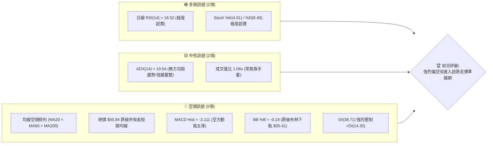
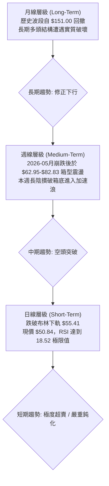
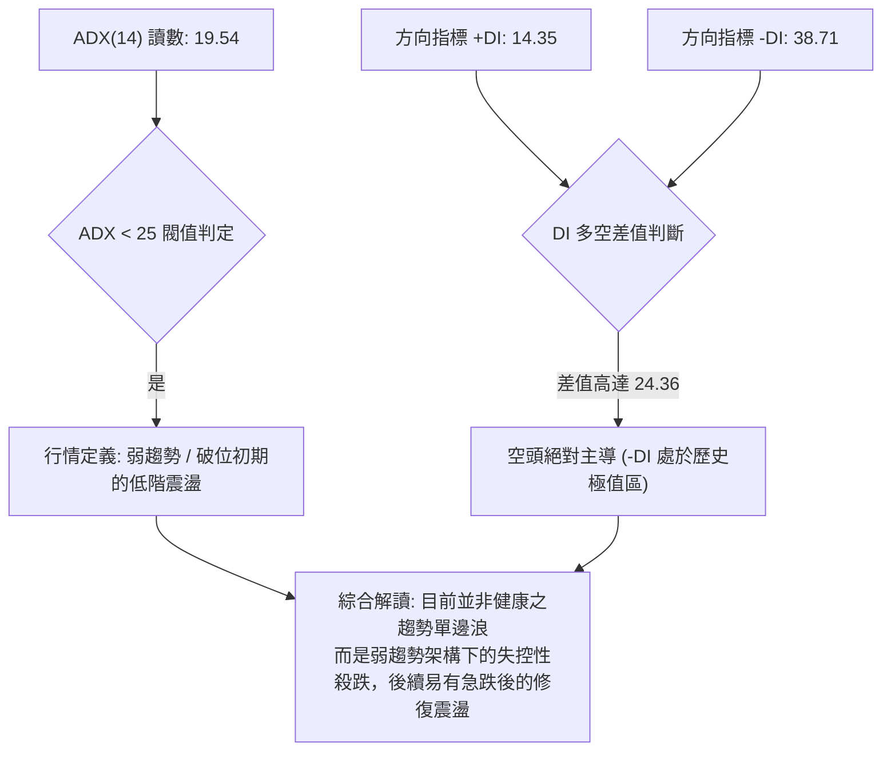
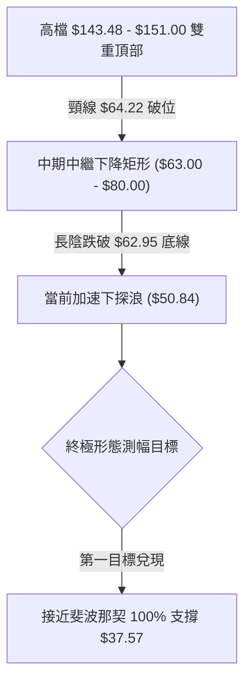
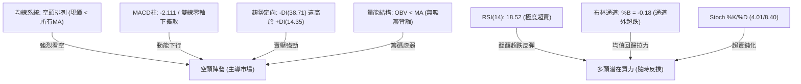
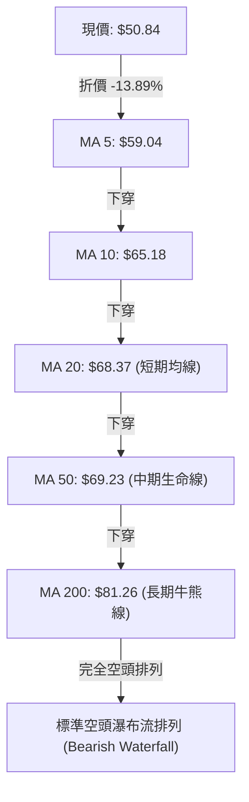
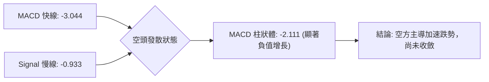
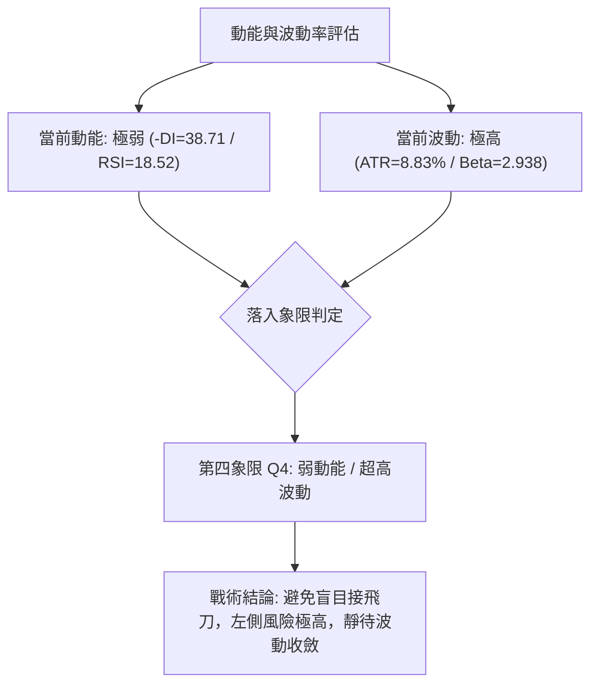
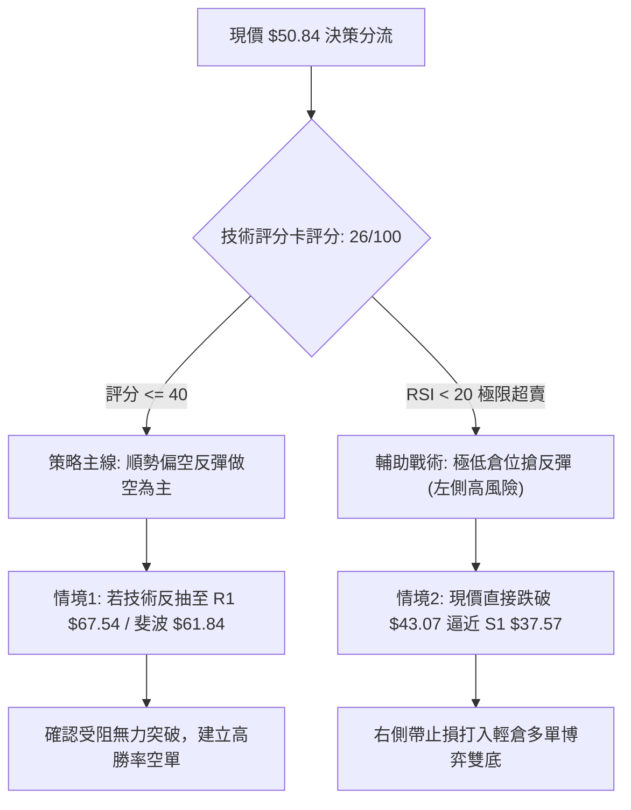
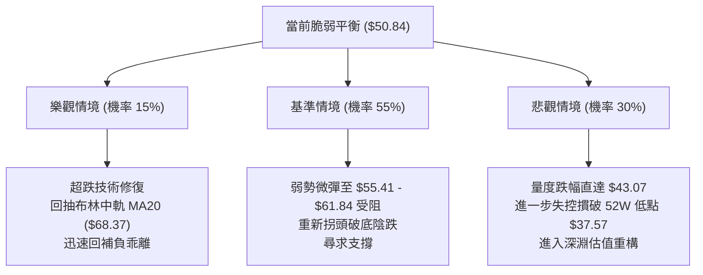

# RKLB 技術分析報告

> **報告日期**：2026-10-18 ｜ **語言**：繁體中文 ｜ **數據來源**：Yahoo Finance ｜ **當前價格**：$50.84

---

## 目錄

| 章節 | 內容 |
|------|------|
| [1. 技術面概覽](#1-技術面概覽) | 訊號儀表板、核心指標、評分卡 |
| [2. 趨勢分析](#2-趨勢分析) | 多時框趨勢、長中短期走勢、ADX解讀 |
| [3. 圖表形態分析](#3-圖表形態分析) | 形態識別信心度、K線組合、目標價推算 |
| [4. 支撐與阻力](#4-支撐與阻力) | 關鍵價位結構、斐波那契回調深度分析 |
| [5. 技術指標深度解讀](#5-技術指標深度解讀) | 均線系統、RSI、MACD、布林通道、量能 |
| [6. 動能與波動率](#6-動能與波動率) | 動能象限矩陣、ATR極限波動、Beta敏感度 |
| [7. 多時框架總結](#7-多時框架總結) | 時框架評分矩陣、多時框收斂定調 |
| [8. 交易策略建議](#8-交易策略建議) | 策略路由、精確價位交易計劃、風險報酬比 |
| [9. 風險提示與監控](#9-風險提示與監控) | 關鍵監控Checklist、三情境壓力測試 |
| [📋 報告總結](#-報告總結) | 終局判斷與決策儀表板 |

---

## 1. 技術面概覽

### 🎯 技術訊號儀表板



### 📊 核心指標速覽表

| 指標類別 | 指標名稱 | 當前數值 | 訊號 | 解讀 |
|----------|----------|----------|------|------|
| **價格** | 當前收盤價 | $50.84 | 🔴 | 位於52週區間 11.7% 低檔，跌破短中長期所有主要支撐 |
| **均線** | MA20 (短均) | $68.37 | 🔴 | 現價低於MA20達 -25.65%，短線乖離率極大 |
| **均線** | MA50 (中均) | $69.23 | 🔴 | 現價低於MA50達 -26.56%，中期下行結構沉重 |
| **均線** | MA200 (長均) | $81.26 | 🔴 | 跌破牛熊分界線 $81.26 (-37.43%)，長期進入修正週期 |
| **動能** | RSI(14) | 18.52 | 🟢 | 極度超賣 (<20)，技術面具備隨時展開報復性反彈條件 |
| **動能** | MACD (12,26,9) | -3.044 / Sig: -0.933 | 🔴 | 柱狀體 -2.111，空頭動能擴散，尚未出現黃金交叉 |
| **動能** | 隨機指標 Stoch %K/%D | 4.01 / 8.40 | 🟢 | 雙線沉底鈍化，進入歷史極端超賣區域 |
| **趨勢** | ADX (14) | 19.54 | 🟡 | 數值 <25，屬盤整弱趨勢；惟 -DI=38.71 顯示空方佔絕對優勢 |
| **通道** | 布林通道 %B | -0.18 | 🟢 | 突破下軌 ($55.41) 進入通道外超跌區，具均值回歸拉力 |
| **量能** | OBV 趨勢 | OBV < MA | 🔴 | 資金持續呈淨流出，量能疲弱，尚未見主力搶籌放量 |
| **波動** | ATR(14) | $4.49 | 🔴 | 佔股價 8.83%，屬極高波動資產，持倉風險度高 |

### 🏆 技術評分卡

```
╔════════════════════════════════════════════════════════════════╗
║                   技術評分卡 — RKLB (2026-10-18)                ║
╠════════════════════════════════════════════════════════════════╣
║ 趨勢強度 (Trend)       ████░░░░░░░░░░░░░░░░  20/100 🔴 空頭壓制 ║
║ 動能指標 (Momentum)    ██████░░░░░░░░░░░░░░  30/100 🔴 超賣背壓 ║
║ 支撐穩定度 (Support)   ████░░░░░░░░░░░░░░░░  20/100 🔴 測底階段 ║
║ 成交量配合 (Volume)    ████████░░░░░░░░░░░░  40/100 🟡 量平跌深 ║
║ 形態完整度 (Pattern)   ████████░░░░░░░░░░░░  40/100 🟡 破位待築 ║
║ 均線系統 (MA System)   ██░░░░░░░░░░░░░░░░░░  10/100 🔴 空頭排列 ║
╠════════════════════════════════════════════════════════════════╣
║ 綜合技術評分           ██████░░░░░░░░░░░░░░  26/100 🔴 強烈偏空 ║
║ 投資時鐘判定           空頭加速趕底區間 / 僅限高風險博弈超跌反彈 ║
╚════════════════════════════════════════════════════════════════╝
```

---

## 2. 趨勢分析

### 🌐 多時框趨勢分析



### 📈 長期趨勢 — 12個月走勢圖（Unicode）

以下為 RKLB 自 2025 年 11 月至 2026 年 10 月之月線收盤價歷史軌跡：

```
RKLB 月線收盤走勢圖（2025-11 至 2026-10）
價格軸 ($)
$150.00 ┤                                      
$143.48 ┤                             ● (26-05 歷史天頂)
$130.00 ┤                            / \
$110.00 ┤                           /   \
$101.65 ┤                          /     ● (26-06 次高)
$90.00  ┤                         /       \
$82.51  ┤                 ●      /         \
$80.07  ┤         ●      / \    /           \
$69.76  ┤ ●      / \    /   \  /             \           ● (26-09 假突破)
$64.22  ┤  \    /   \  ●     ●               ●-----●   / \
$50.84  ┤   \  /     ●                        (07)  (08)    ●← [現價 $50.84]
$42.14  ┤    ● (25-11 短底)
        └────┬─────┬─────┬─────┬─────┬─────┬─────┬─────┬─────┬─────┬─────┬─────
            25-11 25-12 26-01 26-02 26-03 26-04 26-05 26-06 26-07 26-08 26-09 26-10
```

#### 走勢特徵分析表格

| 階段週期 | 時間區間 | 起訖價位 | 漲跌幅 | 走勢特徵分析 |
|----------|----------|----------|--------|--------------|
| **起漲推進期** | 2025-11 ~ 2026-01 | $42.14 → $80.07 | +90.01% | 突破長期底部平台，機構資金大幅進駐，量價齊揚 |
| **中繼洗盤期** | 2026-01 ~ 2026-03 | $80.07 → $64.22 | -19.80% | 乖離過大後的籌碼沉澱，於 $64.22 獲取強力支撐 |
| **瘋狂主升浪** | 2026-03 ~ 2026-05 | $64.22 → $143.48| +123.42%| 投機買盤爆發，月線收出歷史天量與天價 $151.00，動能透支 |
| **頂部派發期** | 2026-05 ~ 2026-07 | $143.48 → $64.95| -54.73% | 資金出逃，連續長陰快速摜破所有短期均線，多頭防線全面潰敗 |
| **築底失敗浪** | 2026-07 ~ 2026-09 | $64.95 → $69.68 | +7.28%  | 於 $63.00-$80.00 構築中繼箱型，9月反彈遇阻 $73.95 未果 |
| **破位趕底期** | 2026-09 ~ 2026-10 | $69.68 → $50.84 | -27.04% | 摜破盤整箱底，週線連續下殺，空頭釋放流動性恐慌盤 |

### 📊 中期趨勢（週線分析）

從近 20 週數據觀察，RKLB 在 2026-07-26 收盤價 $63.91、2026-08-30 收盤價 $64.39、2026-09-06 收盤價 $64.26 三次下探時均獲得 $63-$64 的密集護盤撐盤。然而，在 2026-10-18 當週，收盤價直接摜破至 **$50.84**，伴隨 127,829,500 股的大量拋售，週線 RSI 暴跌至 18.5，週 MACD 柱狀體跳水至 -2.111，宣告中繼箱型正式向下破位。

```
中期週線箱型破位示意圖：
  $82.83 ───┐ (2026-08-09 反彈高點)
            ├─────── 箱型上緣強阻力區 (均線糾結帶 $68.37 - $69.23)
  $73.95 ───┘ (2026-09-27 假反彈頸線)
  ~~~~~~~~~~~~~~~~~~~~~~~~~~~~~~~~~~~~~~~~~~~~~~~~~~~~~~~~~~~~~~~~
  $62.95 ───┐ (箱型下緣原關鍵支撐，現已轉為死阻力 R1: $67.54 下方保護帶)
            ├─────── 箱體正式被長陰摜破 ───► 跌破引發停損賣壓
  $50.84 ───┘ ◄── 當前收盤破位點 (加速尋求 52W 低點 $37.57 之支撐)
```

### ⚡ 趨勢強度評估（ADX 解讀）



#### ADX 趨勢強度對照表

| 指標變數 | 當前讀數 | 狀態門檻 | 趨勢性質與市場心理詮釋 |
|----------|----------|----------|------------------------|
| **ADX(14)** | **19.54** | < 25 (無主導宏觀單邊趨勢) | 雖然近月跌勢猛烈，但整體動能尚未轉化為持續性單邊趨勢，屬於區間破位初期之失衡階段。 |
| **+DI(14)** | **14.35** | 處於弱勢低谷 | 多頭買盤極度匱乏，市場無承接主動買盤。 |
| **-DI(14)** | **38.71** | > 30 (強烈空方控制) | 賣盤力量呈單向傾瀉，市場處於非理性拋售階段。 |
| **DI 狀態** | **空頭擴散** | -DI 遠大於 +DI | 空頭主導權達 72.9%，任何反彈在觸及均線前皆易受空頭再壓制。 |

---

## 3. 圖表形態分析

### 🔍 形態識別系統

依據近 24 個月及近 20 週價格變量，市場正經歷大型頂部形態破位後的量度跌幅兌現階段：



#### 形態識別與信心度評估表

| 識別形態 | 信心度 | 判斷依據（引用真實數據） | 完成度 | 目標價（精確計算式） |
|----------|--------|--------------------------|--------|----------------------|
| **大型雙頂破位 (M頭)** | **85%** | 2026-05月天價 $151.00 與次高 $101.65，頸線跌破 2026-03低點 $64.22 與 2026-09低點 $62.95 | **90%** | 量度目標 = 頸線 $64.22 - (高點 $101.65 - 頸線 $64.22) = $26.79；當前跌幅已深，第一錨定點為前波低點 **$37.57** |
| **中繼箱型跌破** | **90%** | 7-9月於 $63.91 ~ $82.83 構築 10 週箱體，本週收 $50.84 實體長陰破底 | **100%** | 箱高 = $82.83 - $62.95 = $19.88；破位目標價 = $62.95 - $19.88 = **$43.07** (正逼近中) |
| **潛在V型超跌底** | **35%** | RSI(14) 沉至 18.52，布林 %B 達 -0.18，但**缺乏任何右側確認K棒** | **15%** | 信心度不足 50%，依規則僅作指標型超賣解讀，不進行形態推演 |

### 🕯️ 重要K線形態分析

| 週/月份 | 收盤價 | 實體/引線特徵 | K線形態名稱 | 市場心理與多空含義 | 訊號強度 |
|---------|--------|--------------|-------------|--------------------|----------|
| **2026-05** | $143.48 | 實體放大伴隨高檔長上影 ($151.00) | **流星射擊之星 (Shooting Star)** | 多頭衝頂耗盡流動性，主力機構高位出貨完畢 | 🔴 強烈看空 |
| **2026-07-26**| $63.91 | 下影線測試，隨後單週反彈至 $82.83 | **錘頭防守線 (Hammer Attempt)** | 空頭回補，多頭在 $64 附近建立第一道臨時防線 | 🟡 弱勢反彈 |
| **2026-09-27**| $73.95 | 反彈受阻於 MA20/MA50 糾結帶 | **反彈受阻十字 (Bearish Doji)** | 反彈動能枯竭，受制於下彎均線壓力，多頭潰散 | 🔴 看空轉折 |
| **2026-10-18**| $50.84 | 大陰線破位收最低，週跌幅逾 25% | **大陰破位吞噬 (Bearish Marubozu)**| 箱底防線全面瓦解，散戶多頭踩踏引發斷頭停損 | 🔴 極度看空 |

### 📉 ASCII 走勢形態示意圖

```
RKLB 中繼箱型破位與量度跌幅示意圖：
$82.83 ┬──────────────────────┐ (箱頂阻力：2026-08-09 高點)
       │                      │
$73.92 ┤           ┌──────────┘ (次高受阻點：2026-10-04)
       │           │
       │    箱體高度 H = $19.88
       │           │
$62.95 ┴─────┬─────┴──────────┐ (箱底頸線：2026-09-13 低點)
             │                │
═════════════╪════════════════╪═════════════════════════════════════════════ (原箱底破位線)
             │                │
             │   等距跌幅 H   ▼
$50.84 ──────┼────────────────● ◄ 現價 $50.84 (正往破位目標價邁進)
             │
$43.07 ──────┴───────────────── (形態理論破位目標價: $62.95 - $19.88 = $43.07)
$37.57 ──────────────────────── (52週最低點強支撐 S1)
```

### 🎯 形態目標價計算

1. **破位頸線確認**：中繼盤整之基底支撐頸線確立為 **$62.95**（2026-09-13 收盤價，亦為多次下影線重合帶）。
2. **形態高度測量 ($H$)**：中繼波段高點（2026-08-09 收盤）**$82.83** 與頸線低點 **$62.95** 之垂直差額：
   $$H = 82.83 - 62.95 = 19.88$$
3. **等距投射目標價 ($T_{Target}$)**：
   $$T_{Target} = 頸線 - H = 62.95 - 19.88 = \$43.07$$
4. **目標價防守區域**：計算所得之形態破位目標價 **$43.07**，距離 52 週波段低點支撐 **$37.57** 僅餘 $5.50 之空間，說明當前股價 $50.84 雖未完全滿足量度跌幅，但已進入 $43.07 ~ $37.57 之潛在多頭回防減速區。

---

## 4. 支撐與阻力

### 🗺️ 關鍵價位分布圖（Unicode）

```
╔═══════════════════════════════════════════════════════════════════════════════╗
║                      RKLB 關鍵價位架構與分布圖                                 ║
╠═══════════════════════════════════════════════════════════════════════════════╣
║ $78.74 ║████████████████████████████████████║ 強阻力 R3 (斐波 61.8% 上方套牢區) ║
║ $75.28 ║████████████████████████████        ║ 中期阻力 R2 (反彈高點壓力區)     ║
║ $67.54 ║████████████████████████████████████║ 核心阻力 R1 (MA20/50/前低密集區) ║
║ $61.84 ║▓▓▓▓▓▓▓▓▓▓▓▓▓▓▓▓▓▓▓▓▓▓▓▓▓▓▓▓        ║ 斐波那契 78.6% 回調關鍵反壓帶     ║
║ $55.41 ║▒▒▒▒▒▒▒▒▒▒▒▒                        ║ 布林通道下軌 (短線超賣收斂阻力)  ║
║ $50.84 ╠════════════════════════════════════╣ ◄─── 當前現價收盤位              ║
║ $43.07 ║░░░░░░░░░░░░░░░░                    ║ 形態量度跌幅推算支撐             ║
║ $37.57 ║████████████████████████████████████║ 52週波段歷史鐵底 S1 (年度絕對支撐)║
╚═══════════════════════════════════════════════════════════════════════════════╝
```

### 🚧 阻力位分析表

依據系統由 OHLCV 聚類計算之波段高點阻力位：

| 阻力級別 | 價位 | 距現價幅 | 形成原因與籌碼解構 | 突破難度 | 重要性 |
|----------|------|----------|--------------------|----------|--------|
| **R1** | **$67.54** | +32.86% | 糾結 MA20 ($68.37)、MA50 ($69.23) 以及 7-9月箱底換手區，為破位後的反壓核心頸線。 | 極高 🔴 | ★★★★★ |
| **R2** | **$75.28** | +48.08% | 2026年9月下旬多次反彈測試的高點沉澱區 ($73.95-$73.92)，大量多頭解套賣壓埋伏於此。 | 極高 🔴 | ★★★★☆ |
| **R3** | **$78.74** | +54.89% | 近一年密集波段高點聚類，緊鄰 MA200 ($81.26) 牛熊轉換分水嶺，屬強固籌碼天花板。 | 極難 🔴 | ★★★★☆ |

### 🛡️ 支撐位分析表

依據系統由 OHLCV 聚類計算之波段低點支撐位：

| 支撐級別 | 價位 | 距現價幅 | 形成原因與籌碼解構 | 守住機率 | 重要性 |
|----------|------|----------|--------------------|----------|--------|
| **S1** | **$37.57** | -26.10% | 52週波段歷史最低點（近一年聚類唯一絕對底），為空頭量度滿足後的機構買盤終極防禦線。 | 75% 🟢 | ★★★★★ |

*注：在現價 $50.84 至 S1 $37.57 之間，系統 OHLCV 數據未偵測到任何近一年波段低點聚類；中間僅有圖表形態推算之等距滿足點 $43.07。*

### 📐 斐波那契回調位分析

本週期以 52 週最低點 **$37.57** 為起點，歷史最高點 **$151.00** 為終點，進行黃金分割回調測算：

```
斐波那契回調層級階梯：
0.0%  (52W High) ────────────────────────── $151.00 (多頭終極天花板)
23.6%            ────────────────────────── $124.23 (初次回檔位)
38.2%            ────────────────────────── $107.67 (強勢整理位)
50.0%            ────────────────────────── $ 94.28 (多空中樞分水嶺)
61.8%            ────────────────────────── $ 80.90 (黃金分割生命線，吻合 MA200 $81.26)
78.6%            ────────────────────────── $ 61.84 (最後深度防禦線)
~~~~~~~~~~~~~~~~~~~~~~~~~~~~~~~~~~~~~~~~~~~~~~~~~~~~~~~~~~~~~~~~~~~~~~~~~~~~~~~~
► 現價 $50.84 落於 78.6% ($61.84) 與 100.0% ($37.57) 之間
~~~~~~~~~~~~~~~~~~~~~~~~~~~~~~~~~~~~~~~~~~~~~~~~~~~~~~~~~~~~~~~~~~~~~~~~~~~~~~~~
100.0% (52W Low) ────────────────────────── $ 37.57 (波段起漲起點 / 終極底部)
```

#### 斐波那契結構深度解讀
1. **防守失效確認**：股價已於 10 月中旬強行擊穿斐波那契 78.6% 回調位（**$61.84**）。在道氏與斐波那契理論中，一旦深度回調跌破 78.6%，意味著先前的整段牛市上升浪結構遭到根本性推翻，走勢將大概率回測 **100.0% 基準點 ($37.57)**。
2. **現價區間特徵**：現價 **$50.84** 處於 $61.84 至 $37.57 之「無支撐真空帶」。上方 $61.84 從強支撐轉化為極為沉重的技術回抽壓力位。

---

## 5. 技術指標深度解讀

### 🎛️ 指標訊號總覽



### 📈 移動平均線排列分析



#### 均線數據偏離度與態勢

| 均線名稱 | 數值 | 現價偏離幅度 | 排列方向 | 短中長期技術含義 |
|----------|------|--------------|----------|------------------|
| **MA5**  | $59.04 | -13.89% | 陡峭向下 ▁ | 極短線第一反壓，未站穩前不輕言止跌 |
| **MA10** | $65.18 | -22.00% | 陡峭向下 ▂ | 短線下壓趨勢線，壓制任何隔日反彈走勢 |
| **MA20** | $68.37 | -25.65% | 持續向下 ▅ | 布林中軌，中期強弱轉換核心閘門 |
| **MA50** | $69.23 | -26.32% | 加速向下 ▁ | 季線下彎，過去2個月的多頭套牢成本區 |
| **MA60** | $69.00 | -26.32% | 穩定向下 ▁ | 與 MA50 形成死叉糾結壓力帶 |
| **MA120**| $85.12 | -40.27% | 長期下彎 ▁ | 半年線，中期多空分界崩潰點 |
| **MA200**| $81.26 | -37.43% | 明顯向下 █ | 年線失守，長期走勢確認由牛轉熊 |
| **MA240**| $76.67 | -33.69% | 高檔走平 █ | 兩年線被實體跌破，宣告牛市週期徹底終結 |

均線系統呈現完美標準之「空頭發散瀑布排列」（MA5 < MA10 < MA20 < MA50 < MA200）。雖然空頭排列顯示趨勢下行毫無阻礙，但現價離 MA20 之負乖離率高達 **-25.65%**，已達到歷史技術反彈之極限乖離臨界點。

### 📉 RSI(14) 分析

#### RSI 讀數進度條
```
超賣區 (0-30)           中性平衡區 (30-70)          超買區 (70-100)
[█████░░░░░░░░░░░░░░░░░░░░░░░░░░░░░░░░░░░] 18.52 (極度超賣)
```

1. **數值深度解讀**：當前 RSI(14) 僅為 **18.52**，不僅遠低於常規超賣界限 30，更低於極限警戒線 20。回溯近 20 週數據，僅在 2026-07-26（RSI: 15.6）與 2026-09-06（RSI: 12.8）出現過相仿讀數，其後均引發了 +20% 至 +30% 的強烈抽頭反彈。
2. **背離判定**：
   - **底背離檢驗**：現價 $50.84 創下近 52 週收盤新低，RSI(14) 讀數 18.52 雖然低於前週之 46.7，但高於 2026-09-06 谷底之 12.8。此處呈現「價格創新低，而 RSI 指標未創歷史新低」之**弱底背離雛形**。
   - **背離結論**：數據明確顯示「**無明顯典型底背離**」，僅存在動能鈍化現象。超賣主要是由連環殺跌所致，尚未得到日線級別雙底的量價背離確認。

### 📊 MACD(12/26/9) 訊號解讀



- **DIF 線**：-3.044
- **DEA 線 (Signal)**：-0.933
- **MACD 柱狀圖 (Histogram)**：-2.111

MACD 柱狀圖為 **-2.111**，呈現空頭動能急速擴大態勢（較前週 -0.018 出現斷崖式惡化），快線與慢線在零軸下方大幅發散下墜。目前**無任何金叉跡象**，亦無零軸下二次底背離，表明賣壓處於主動宣洩階段，尚未進入縮腳收斂期。

### 📦 布林通道分析

```
布林通道現狀示意圖 (寬度 Bandwidth 擴張中)：
$81.34 ┬────────────────────────────────────────── 布林上軌 (Upper Band)
       │
$68.37 ┼────────────────────────────────────────── 布林中軌 (MA20)
       │
$55.41 ┴────────────────────────────────────────── 布林下軌 (Lower Band)
═══════════════════════════════════════════════════════════════════════════════
$50.84 ● ◄── 現價跌破下軌外側 (%B = -0.18，脫離通道區間達 $4.57)
```

- **通道上軌**：$81.34
- **通道中軌 (MA20)**：$68.37
- **通道下軌**：$55.41
- **通道指標 %B**：**-0.18**

當 %B 小於 0（此處為 -0.18），代表股價已經完全脫軌跌破布林下軌之外。根據統計概率分佈，股價運行於布林下軌外的概率小於 2.5%。此種極度偏離常態分佈之狀態，暗示市場正處於恐慌籌碼斷頭行情，技術面隨時有向通道中軌（**$68.37**）進行**均值回歸 (Mean Reversion)** 的強烈修復需求。

### 💹 成交量分析（量價配合度）

- **當日成交量**：23,869,500 股
- **20日均量**：22,562,720 股（量比：**1.06x**，呈現溫和放量）
- **50日均量**：20,200,278 股
- **最新週成交量**：127,829,500 股（相較前週 104,635,800 放量顯著）
- **OBV 走勢**：OBV < MA

**量價解讀**：
股價長陰破底之際，成交量放大至 1.06x 均量，且週換手量達到近一個月新高（1.27億股）。此現象為典型的「**放量破位**」，顯示有大量停損單被觸發出清；然而，OBV 依舊低於其移動平均線，說明大資金機構尚未展開左側吸籌，當前放量屬於恐慌性斷頭拋壓，非多頭主力進場護盤，量價尚未出現積極的止跌信號。

---

## 6. 動能與波動率

### ⚡ 動能評估四象限



#### 動能與波動四象限對照定位

| 象限 | 動能維度 | 波動維度 | 典型特徵 | 當前狀態判定 | 交易指引 |
|------|----------|----------|----------|--------------|----------|
| **Q1** | 強動能 (多頭) | 低波動 | 穩定上升趨勢浪 | — | 順勢加碼，抱牢核心部位 |
| **Q2** | 弱動能 (盤整) | 低波動 | 窄幅箱型橫盤整理 | — | 區間高拋低吸，突破預備 |
| **Q3** | 強動能 (多頭) | 高波動 | 主升浪爆發/投機熱度 | — | 短線波段衝刺，緊縮移動止損 |
| **Q4** | **弱動能 (空頭)** | **超高波動** | **加速破位殺跌/流動性踩踏** | **✓ (當前定位)** | **嚴禁重倉左側摸底；僅限超輕倉博弈修復** |

### 📊 ATR 波動率分析

- **ATR(14) 讀數**：**$4.49**
- **ATR 佔比 (ATR/Price)**：**8.83%**

#### 止損距離與交易噪聲過濾
ATR 佔股價比高達 8.83%，說明 RKLB 為標準的極高波動資產，單日內上下 $4.50 的震盪屬於隨機技術噪聲。
- **保守止損空間（2.0 × ATR）**：$4.49 × 2 = **$8.98**
- **激進反彈止損空間（1.0 × ATR）**：$4.49 × 1 = **$4.49**
- **風控指引**：在日波動高達 8.8% 的背景下，過於狹窄的止損（如 2-3%）將極易被日常洗盤震出，操作時部位必須縮減至常態部位之 1/3 以下，以承受價格劇烈顛簸。

### 📐 Beta 與市場相關性

- **Beta 係數**：**2.938**
- **空頭比例 (Short % Float)**：**7.5%**
- **空頭回補天數 (Short Ratio)**：**2.22 天**

#### 大盤關聯度分析
1. **極高系統敏感性**：Beta 達 **2.938**，顯示 RKLB 具有美股大盤（S&P 500 / Nasdaq）近 3 倍的波動放大效應。在美股宏觀回檔或市場避險情緒升溫時，該股容易遭遇流動性拋售；反之，一旦大盤企穩，其超跌彈性亦居同業之冠。
2. **軋空潛能有限**：空頭比例為 7.5%，回補天數僅 2.22 天，屬於中等偏低放空水平，近期之暴跌主要源自實體多頭籌碼的鬆動與多殺多，而非空頭機構的過度借券做空，因此短期內難以期待爆發大規模軋空（Short Squeeze）行情。

---

## 7. 多時框架總結

### 📋 時框架評分表

| 時框架 | 趨勢方向 | 核心動能指標 | 均線排列特徵 | 圖表形態 | 綜合評分 | 操作建議方向 |
|--------|----------|--------------|--------------|----------|----------|--------------|
| **月線** (長期) | 🔴 空頭下行 | RSI 轉弱向下，歷史頂部落下 | MA200 跌破，全線走平下彎 | 雙重頂破位兌現中 | **30/100** 🔴 | 減碼觀望，嚴禁長期定投 |
| **週線** (中期) | 🔴 空頭突破 | 週 MACD柱 -2.111，空頭擴散 | 糾結破位，各均線全面倒戈 | 跌破 10 週箱底頸線 $62.95 | **20/100** 🔴 | 反彈逢高離場，順勢偏空 |
| **日線** (短期) | 🟡 超跌鈍化 | 日 RSI 18.52 (極低超賣) | 發散瀑布，乖離率 -25.65% | 跌破布林下軌 (%B -0.18) | **35/100** 🟡 | 禁止殺跌，短線尋求反抽 |

### 🔲 綜合訊號矩陣

| 技術分析維度 | 短期 (日線) | 中期 (週線) | 長期 (月線) | 衝突研判與權重收斂規則 |
|--------------|-------------|-------------|-------------|------------------------|
| **趨勢方向** | 🔴 崩跌超賣 | 🔴 破位下行 | 🔴 由牛轉熊 | 全週期一致偏空，大格局由空方完全掌控 |
| **動能訊號** | 🟢 極度超賣 | 🔴 空頭擴張 | 🔴 衰退收縮 | 短期超賣引發之反彈，必然遭遇中長期空頭重壓 |
| **支撐強度** | 🔴 跌破下軌 | 🔴 箱底失守 | 🟢 距S1 $37.57不遠 | 支撐向下推移，缺乏橫盤築底結構 |
| **量能狀態** | 🟡 溫和換手 | 🔴 破位放量 | 🔴 主力出逃 | 資金撤離為主，缺乏左側主力搶籌痕跡 |

### ⚖️ 多時框收斂結論

依據多時框收斂收斂準則（嚴格要求 14）：
1. **行情性質判定**：當前 ADX(14) 數值為 **19.54**，嚴格界定為 **ADX < 25 盤整/破位初期的非單邊健康趨勢行情**。
2. **主導維度與衝突取捨**：雖然長期與中期均線（MA50: $69.23, MA200: $81.26）呈現壓倒性空頭排列，但日線 RSI(14) 沉至 **18.52**，布林 %B 達 **-0.18**，短期指標已與中長期產生「**空間跌無可跌、但趨勢又極端疲弱**」之嚴重背馳。依照規則，在 ADX < 25 的環境中，**市場更容易觸發針對日線布林通道下軌與中軌間的均值回歸修復**。
3. **唯一方向性定調**：**【偏空主導下的極限超跌反彈準備期】**。大方向中長期偏空毫無疑義，但當前價位（$50.84）嚴禁追空；短期主基調為「等待極度超賣引發之急彈，並在中期反壓處布空」。

---

## 8. 交易策略建議

### 🗺️ 策略決策流程圖



### 🧭 策略路由

依據第 1 章技術評分卡之綜合評分 **26 / 100**（評分 ≤ 40 偏空區間）：
- **當前主策略方向 = 主推空頭策略（逢高反彈沽空）**。
- 多頭操作僅列為超跌博弈性質之短線防禦提示，嚴格控制倉位與時間停損。

### 🎯 價格情境階梯（Price Scenarios）

價位完全嚴格引用第 4 章數據與關鍵價位聚類：

| 觸發條件 | 下一目標價 | 後續延伸目標 | 情境含義與操作指引 |
|----------|------------|--------------|--------------------|
| **強勢反彈突破 $55.41 (布林下軌)** | 斐波 78.6% **$61.84** | 核心阻力 R1 **$67.54** | 短線均值回歸，提供空單絕佳的防禦性高空進場點 |
| **站穩 $67.54 (R1) 之上** | 波段阻力 R2 **$75.28** | 強阻力 R3 **$78.74** | 假破位反轉，空頭策略全面失效，必須無條件停損 |
| **直接摜破形態測幅 $43.07** | 52W 歷史鐵底 S1 **$37.57** | 數據未偵測（進入真空） | 空頭主升浪加速趕底，逼近終極強支撐，空單獲利了結 |

### 📊 情境機率分佈

| 情境劇本 | 機率估算 | 主要依據與指標佐證 |
|----------|----------|--------------------|
| **弱勢抽頭後受阻回落 (主情境)** | **55%** | 均線瀑布發散空頭排列，MACD 柱 -2.111 處於弱勢，即使反彈亦難越過 R1 $67.54。 |
| **直接下探測試 S1 $37.57 (次情境)**| **30%** | -DI 達 38.71 具壓倒性優勢，OBV 量能疲弱，市場流動性踩踏尚未見大單接盤。 |
| **強勢 V 型反轉站上 $68 (極端情境)**| **15%** | 僅憑 RSI(14) 18.52 超賣引發的空頭踩踏回補，在缺乏基本面轉折下難以維持長紅。 |

### 🔴 主策略詳情：順勢高空策略（主推）與超跌多頭戰術（次選）

本報告提供符合風控邏輯的兩個獨立方案，投資人應以**策略 A（逢反彈高空）**為主：

| 策略要素 | 策略 A（主推：反抽受阻高空） | 策略 B（輔助：極限超跌博弈多單） |
|----------|------------------------------|-----------------------------------|
| **交易方向** | 🔴 做空 (Short on Bounce) | 🟢 做多 (Oversold Bounce) |
| **進場條件** | 價格反抽至斐波那契 $61.84 遇阻，或回試 R1 $67.54 顯著受壓時 | 日線在布林下軌外出現右側長下影線，且站回 $55.41 之上 |
| **進場價格** | **$61.84**（理想建倉區 $61.84 - $67.54）| **$50.84**（當前現價分批左側試水） |
| **目標價 T1** | **$50.84**（回測前波破位低點） | **$61.84**（反彈回抽斐波 78.6% 位） |
| **目標價 T2** | **$37.57**（52週波段低點 S1 獲利了結） | **$67.54**（回測中軌 MA20 阻力 R1） |
| **止損價格** | **$69.23**（實體突破 MA50 阻力線上方）| **$43.07**（形態破位目標價，跌破認賠）|
| **風險空間** | $69.23 - $61.84 = **$7.39** | $50.84 - $43.07 = **$7.77** |
| **利潤空間 (T2)**| $61.84 - $37.57 = **$24.27** | $67.54 - $50.84 = **$16.70** |
| **風險報酬比** | **1 : 3.28** (極佳 🟢) | **1 : 2.15** (尚可 🟡) |
| **成功機率** | **65%** | **40%** (逆勢操作) |
| **建議倉位** | **15% - 20%** (常態規格) | **5%** (嚴格試倉規格) |

### 🔴 反向風險觸發點（對沖與風控提示）

若持有多頭部位，以下條件觸發時必須立刻止損或建立反向避險：
1. **收盤價跌破 $43.07**：確認形態量度跌幅無法遏止賣壓，股價將無懸念直奔 S1 **$37.57**。
2. **日線 -DI 進一步突破 45.00**：代表空頭恐慌單二度爆發，不可憑藉 RSI 偏低而盲目加碼。
3. **空頭避險觸發點**：若放空部位遭遇價格強勢帶量貫穿 **$69.23**（MA50），代表盤面產生報復性軋空，空單必須立即無條件拔檔。

### ⭐ 整體訊號強度評星

```
做多訊號強度：★★☆☆☆  (2/5星 — 僅有超賣指標背書，欠缺右側確認)
做空訊號強度：★★★★☆  (4/5星 — 順應長中短期均線空頭排列趨勢)
整體可信度：  ★★★★☆  (4/5星 — 指標數據高度收斂，多空界限清晰)
```

---

## 9. 風險提示與監控

### ✅ 關鍵監控指標 Checklist

```
╔═══════════════════════════════════════════════════════════════════╗
║                   RKLB 關鍵技術風控監控清單                         ║
╠═══════════════════════════════════════════════════════════════════╣
║ [ ] 監控項 1: RSI(14) 能否自 18.52 脫離超賣區站回 30 關鍵分水嶺   ║
║ [ ] 監控項 2: 現價能否重新收復布林通道下軌 $55.41                ║
║ [ ] 監控項 3: MACD 柱狀體能否自 -2.111 開始縮腳向上金叉收斂       ║
║ [ ] 監控項 4: 成交量能否在下挫時降溫（低於 20MA 均量 2,256萬股）   ║
║ [ ] 監控項 5: 向上反彈時能否突破斐波那契 78.6% 位 ($61.84)        ║
║ [ ] 監控項 6: 空頭回防警報：52週波段低點 $37.57 是否出現爆量守穩   ║
╚═══════════════════════════════════════════════════════════════════╝
```

### ⚠️ 風險場景分析



### 🛡️ 風險管理重要提醒

1. **Beta 槓桿風險**：RKLB Beta 達 **2.938**，波動極其劇烈。在 ATR 為 **$4.49 (8.83%)** 的條件下，每日部位本金波動極大，任何策略的單筆承擔虧損金額不得超過總投資資本的 **1.5%**。
2. **左側交易禁忌**：RSI 沉至 18.52 絕非買進的充分理由。在強烈的瀑布流下行趨勢中，動能指標經常會產生「**鈍化再鈍化**」（指標橫盤而價格持續破底）。在未見到明確的 K 線反轉形態（如週線級別啟明星或放量破底翻十字星）前，切忌將搶反彈部位放大為主要長線倉位。
3. **流動性踩踏監控**：若價格向下跌破形態支撐 **$43.07**，極易引發機構量化賣盤自動拋售，直接回測 **$37.57**。在此期間任何多頭停損單必須嚴格執行，不可存有攤平成本之僥倖心理。

---

## 📋 報告總結

```
╔══════════════════════════════════════════════════════════════════════════════╗
║                          RKLB 技術分析報告總結                                ║
╠══════════════════════════════════════════════════════════════════════════════╣
║ 報告日期：2026-10-18                     最新價格：$50.84                    ║
║ 技術評分：26 / 100                       分析評級：🔴 強烈偏空 / 觀望          ║
╠══════════════════════════════════════════════════════════════════════════════╣
║ 核心維度結論：                                                                ║
║ ├─ 長期趨勢：🔴 跌破 MA200 ($81.26)，長期上升結構瓦解，確立轉熊               ║
║ ├─ 中期趨勢：🔴 摜破三個月中繼箱底 $62.95，量度跌幅目標直指 $43.07           ║
║ ├─ 短期趨勢：🟡 RSI 18.52 / 布林 %B -0.18，處於極限超賣，隨時有報復性抽頭    ║
║ ├─ 核心阻力：R1 $67.54  /  R2 $75.28  /  R3 $78.74                           ║
║ ├─ 核心支撐：形態支撐 $43.07  /  52週鐵底 S1 $37.57                         ║
║ └─ 機構共識：買入 (20位分析師，目標價中位數 $102.15，低檔預期 $64.00)       ║
╠══════════════════════════════════════════════════════════════════════════════╣
║ 頂級交易策略配置：                                                            ║
║ 1. 🥇 最優機會（做空）：等待超賣反彈至 $61.84 - $67.54 逢高布空，目標 $37.57 ║
║ 2. 🥈 次選機會（觀望）：徹底空倉，等待價格回測 S1 $37.57 企穩後再行評估      ║
║ 3. 🥉 投機機會（做多）：現價 $50.84 超輕倉博弈均值回歸，嚴格止損於 $43.07    ║
╚══════════════════════════════════════════════════════════════════════════════╝
```

---

> ⚠️ **免責聲明**：本報告為 AI 自動生成之技術分析，所有數據及估算均基於提供的歷史價格資訊。本報告**僅供研究與學術參考**，**不構成任何投資建議**。投資有風險，入市需謹慎。

---

*報告生成時間：2026-10-18 ｜ 數據來源：Yahoo Finance ｜ 分析框架：多時框技術分析*