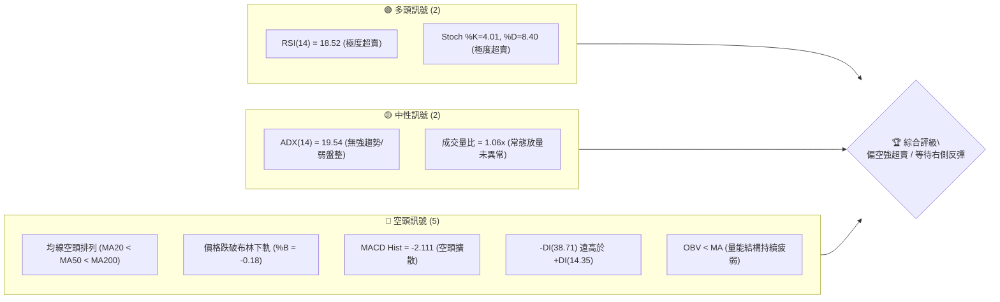
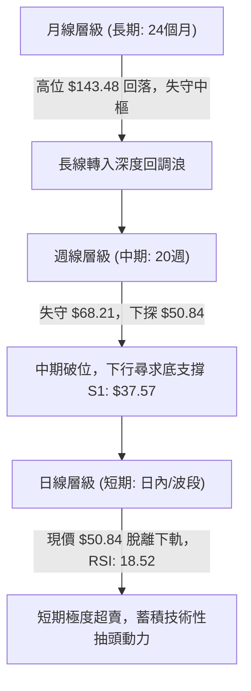
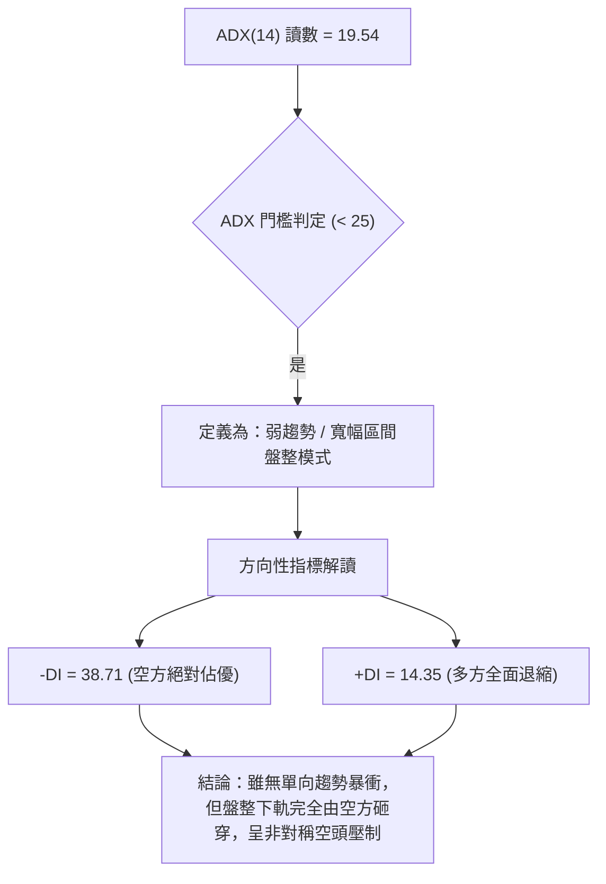
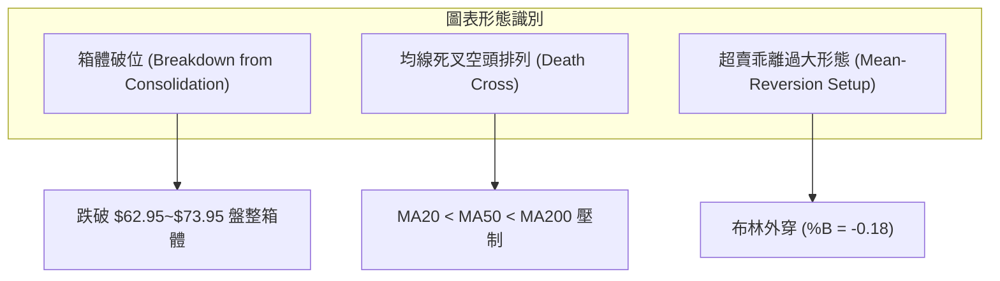
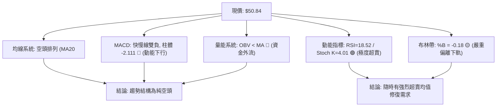
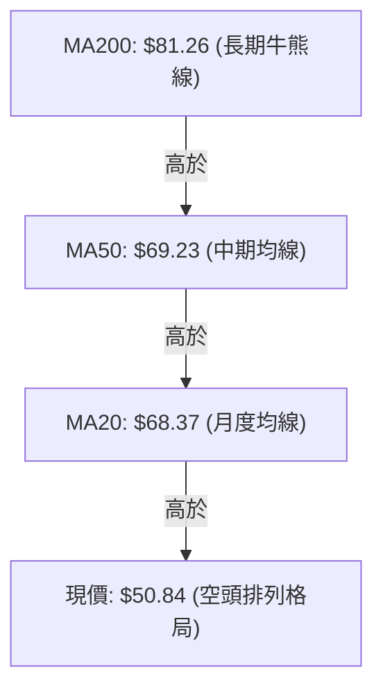
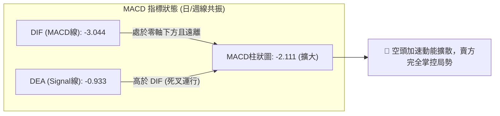
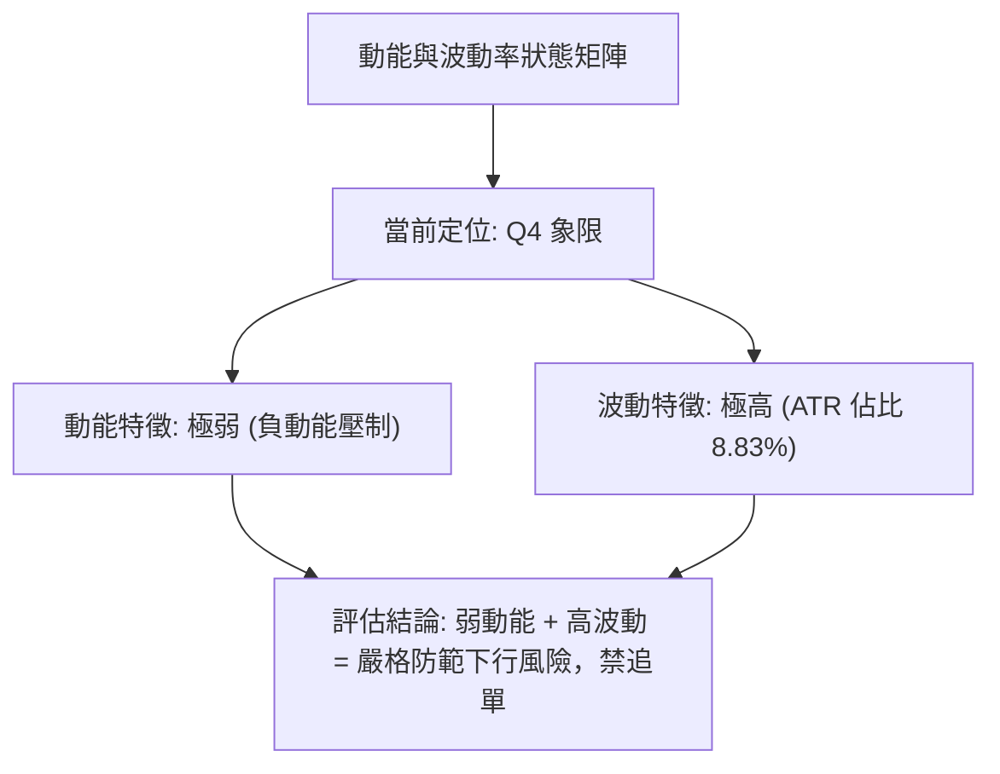
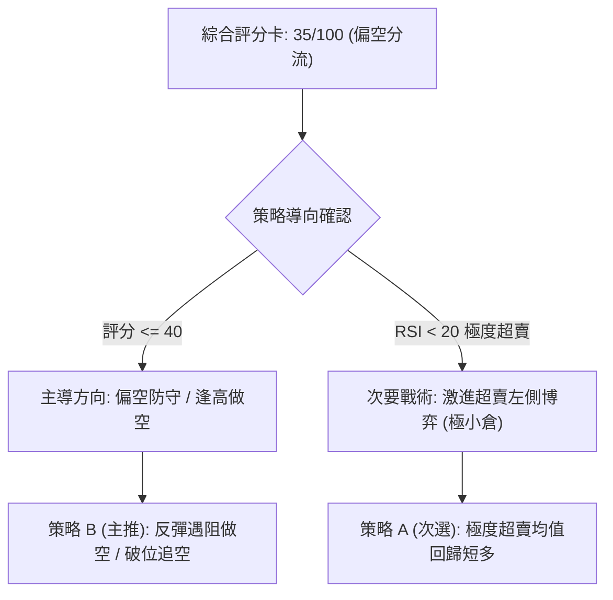
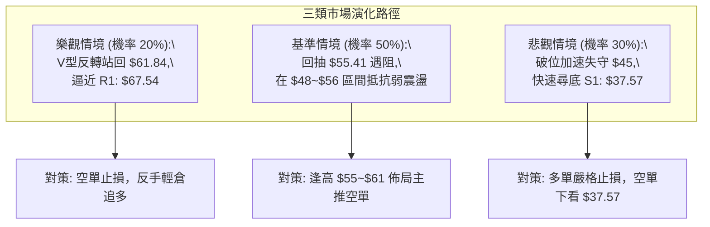

# RKLB 技術分析報告

> **報告日期**：2026-10-19 ｜ **語言**：繁體中文 ｜ **數據來源**：Yahoo Finance ｜ **當前價格**：$50.84

---

## 目錄

| 章節 | 內容 |
|------|------|
| [1. 技術面概覽](#1-技術面概覽) | 訊號儀表板、核心指標、評分卡 |
| [2. 趨勢分析](#2-趨勢分析) | 多時框趨勢、長中短期走勢 |
| [3. 圖表形態分析](#3-圖表形態分析) | 形態識別、K線組合、目標價 |
| [4. 支撐與阻力](#4-支撐與阻力) | 關鍵價位、斐波那契回調 |
| [5. 技術指標深度解讀](#5-技術指標深度解讀) | MA/RSI/MACD/布林/成交量 |
| [6. 動能與波動率](#6-動能與波動率) | 動能評估、ATR、Beta |
| [7. 多時框架總結](#7-多時框架總結) | 時框架評分矩陣 |
| [8. 交易策略建議](#8-交易策略建議) | 多空策略、風險報酬比 |
| [9. 風險提示與監控](#9-風險提示與監控) | 監控指標、風險場景 |
| [10. 報告總結](#-報告總結) | 核心結論與最優策略組合 |

---

## 1. 技術面概覽

### 🎯 技術訊號儀表板



### 📊 核心指標速覽表

| 指標類別 | 指標名稱 | 當前數值 | 訊號 | 解讀 |
|----------|----------|----------|------|------|
| **價格** | 當前價格 | $50.84 | 🔴 | 位於52週區間11.7%極低分位，單週大跌引發結構破位 |
| **均線** | MA20 | $68.37 | 🔴 | 價格低於MA20達 -25.65%，短線嚴重負乖離 |
| **均線** | MA50 | $69.23 | 🔴 | 價格低於MA50達 -26.56%，中期下行壓力沉重 |
| **均線** | MA200 | $81.26 | 🔴 | 價格大幅低於牛熊分界線MA200，整體格局轉為深空 |
| **動能** | RSI(14) | 18.52 | 🟢 | 極度超賣區（<30），隨時具備技術性均值回歸修復動力 |
| **動能** | MACD(12,26,9) | -3.044 / Hist -2.111 | 🔴 | 快慢線雙雙落入零軸下方且負柱體顯著擴大，空頭全面主導 |
| **波動** | ATR(14) | $4.49 (8.83%) | 🔴 | 日內波動率極高，屬於高風險震盪資產，追價極易受傷 |
| **通道** | 布林通道 | 下軌 $55.41 (%B: -0.18) | 🟡 | 價格脫離布林下軌運行，統計學上處於罕見超賣偏離狀態 |
| **趨勢** | ADX(14) | 19.54 (-DI: 38.71) | 🟡 | ADX < 25 指標顯示無強單向趨勢，但 -DI 壓倒性壓制 +DI |
| **量能** | OBV | OBV < MA | 🔴 | 能量潮低於移動平均線，機構資金呈現主動性淨流出 |

### 🏆 技術評分卡

```
技術評分卡 — RKLB (2026-10-19)
════════════════════════════════════════════════════
趨勢強度 (空頭) ██████████████░░░░░░  70/100  🔴 (空頭顯著)
動能指標 (超賣) ████████████████░░░░  80/100  🟢 (反彈潛力)
支撐穩定度      ██████░░░░░░░░░░░░░░  30/100  🔴 (失守多個均線)
成交量配合      ████████░░░░░░░░░░░░  40/100  🟡 (放量下殺未縮量)
形態完整度      ██████████░░░░░░░░░░  50/100  🟡 (頂部破位加速段)
均線排列      ████░░░░░░░░░░░░░░░░  20/100  🔴 (全空頭排列)
════════════════════════════════════════════════════
綜合評分      ███████░░░░░░░░░░░░░  35/100  🔴 偏空操作 (空頭主導/強超賣)
════════════════════════════════════════════════════
```

---

## 2. 趨勢分析

### 🌐 多時框趨勢分析



### 📈 長期趨勢 — 12個月走勢圖（Unicode）

```
RKLB 月線走勢圖（過去12個月：2025-11 至 2026-10）
價格軸 ($)
$150 ┤                            ●(2026-05: $143.48)
$130 ┤                           ╱ ╲
$110 ┤                          ╱   ●(2026-06: $101.65)
$ 90 ┤              ●(2026-01: $80.07)  ╲
$ 70 ┤      ●      ╱ ╲     ●     ╲   ●(2026-09: $69.68)
$ 50 ┤  ●  ╱ ╲    ╱   ╲   ╱       ╲   ╲       ●←現價 $50.84 (2026-10)
$ 30 ┤ ╱    ●(2025-11: $42.14)     ╲   ●(2026-07: $64.95)
     └────────────────────────────────────────────────────────
       11   12   01   02   03   04   05   06   07   08   09   10  (月份)
```

#### 走勢特徵分析表格

| 階段 | 期間 | 價格區間 | 累積漲跌幅 | 結構特徵與成因解讀 |
|------|------|----------|------------|--------------------|
| **主升暴衝期** | 2025-11 ~ 2026-05 | $42.14 → $143.48 | +240.48% | 突破所有阻力進入拋物線噴發段，於2026年5月見高位 $151.00 後收於 $143.48 |
| **首波獲利了結** | 2026-05 ~ 2026-07 | $143.48 → $64.95 | -54.73% | 資金大幅獲利退場，短短兩個月內直接腰斬，回調至斐波那契78.6%附近 |
| **高位箱型整理** | 2026-07 ~ 2026-09 | $63.92 → $69.68 | +9.01% | 於 $64~$70 區間進行收斂震盪，成交量逐步萎縮形成假性築底 |
| **破位加速下探** | 2026-09 ~ 2026-10 | $69.68 → $50.84 | -27.04% | 破位失守盤整區間下緣，直接擊穿斐波那契78.6%（$61.84），直奔S1支撐 |

### 📊 中期趨勢（週線分析）

```
RKLB 週線壓力與支撐階梯示意圖
========================================================================
$82.83 ───┐ (2026-08-09 反彈波段頂部)
          ├─► 形成強阻力聚類 R2: $75.28 / R3: $78.74
$73.95 ───┘ (2026-09-27 反彈次高點)
          │
$67.54 ─────► 關鍵結構轉換頸線 R1: $67.54 (原支撐轉強阻力)
          │
$50.84 ═════► 當前收盤價 (跌破平台加速破位段，乖離率達 -25.65%)
          │
$37.57 ─────► 52週歷史底部強支撐 S1: $37.57 (最後多頭防線)
========================================================================
```

### ⚡ 趨勢強度評估（ADX 解讀）



#### ADX 強度指標對照表

| 指標變數 | 當前讀數 | 門檻區間 | 技術含義解讀 |
|----------|----------|----------|--------------|
| **ADX(14)** | **19.54** | < 25.0 | 趨勢強度低，處於長期單邊行情結束後的寬幅震盪消化段 |
| **-DI** | **38.71** | > 25.0 (強) | 賣方力量極其強盛，短線空頭拋壓佔據市場壓倒性多數 |
| **+DI** | **14.35** | < 20.0 (弱) | 買方動能完全喪失，缺乏主動性機構買盤接刀 |
| **DI差值** | **-24.36** | 負差極大 | 淨方向極度偏向空頭，任何反彈均先定義為技術修復而非反轉 |

---

## 3. 圖表形態分析

### 🔍 形態識別系統



#### 圖表形態信心度評估表

| 形態名稱 | 信心度 | 判斷依據（引用數據） | 完成度 | 目標價（附計算式） |
|----------|--------|----------------------|--------|--------------------|
| **箱型平台向下破位** | **85%** | 自 2026-07 至 2026-10 初，價格多次於 $62.95~$64.95 獲得支撐，但 10-18 當週以大陰線跌破收在 $50.84 | 100% (已破位) | 破位測幅：箱頂 $73.95 - 箱底 $62.95 = 形態高度 $11.00。<br>向下等距測幅 = $62.95 - $11.00 = **$51.95** (已達成，現價 $50.84 已越過此目標) |
| **雙底形態 (W底)** | **15%** | 僅於歷史數據中見 $37.57 唯一起漲點，當前無雙重底次低點結構 | 0% (形態不存在) | 數據不足，訊號不足，僅做指標型解讀 |
| **頭肩頂右肩破頸線** | **40%** | 左肩約 $80.07、頭部 $143.48、右肩約 $82.83，但頸線傾斜度過大且過往波動極端 | 45% (非標準形態) | 形態過於發散，數據不足以精確支持幾何頸線，僅做布林突破型解讀 |

### 🕯️ 重要K線形態分析

| 月份 / 週別 | 收盤價 | K線形態 | 解讀 | 訊號 |
|-------------|--------|---------|------|------|
| **2026-05** | $143.48 | 長上影流星線 (Shooting Star) | 衝擊 $151.00 歷史高位後遭遇巨量拋壓，形成長期歷史大頂 | 🔴 空頭反轉 |
| **2026-07** | $64.95 | 長下影錘頭線 (Hammer) | 自高位快速腰斬後出現第一波止跌盤整買盤，確認短底 | 🟢 技術支撐 |
| **2026-09-27** | $73.95 | 中陽線衝高遇阻 | 嘗試修復均線系統，但受阻於下降趨勢壓制線與 R1/R2 區域 | 🟡 反彈受阻 |
| **2026-10-18** | $50.84 | 大陰線破位收盤 (Marubozu Bear) | 一舉跌穿近3個月震盪箱體下邊緣，收在最低點附近，破位確立 | 🔴 空頭加速 |

### 📉 ASCII 走勢形態示意圖

```
RKLB 形態結構示意圖：箱型向下破位與指標偏離
========================================================================
$73.95 ──┬─────────────────────── 箱頂 (阻力 R1 附近: $67.54 ~ $73.95)
         │  /\        /\
         │ /  \      /  \    /
$63.91 ──┴───--\----/----\--/--- 箱底 (2026-07 ~ 2026-09 支撐位)
                \  /      \/
                 \/         ╲
$50.84 ───────────────────────╲──► 現價 $50.84 (跌破箱底，布林下軌失守)
                               ╲
$37.57 ─────────────────────────┴─ 強支撐 S1 (52W歷史低點)
========================================================================
```

### 🎯 形態目標價計算

依據標準圖表形態學之箱型破位測幅法則（Measured Move Calculation）：
- **箱體頂部（Neckline High）**：$73.95（2026-09-27 週收盤波段高點）
- **箱體底部（Neckline Low）**：$62.95（2026-09-13 週收盤波段低點）
- **形態垂直高度（H）**：$73.95 - $62.95 = **$11.00**
- **第一形態等距破位目標（T1）**：
  $$T1 = 62.95 - 11.00 = \$51.95$$
  *(當前最新收盤價 $50.84 已有效擊穿並滿足此一空頭測幅目標)*
- **第二斐波那契延伸破位目標（T2）**：若按1.618倍高度延伸：
  $$T2 = 62.95 - (11.00 \times 1.618) = 62.95 - 17.80 = \$45.15$$
  *(若無法迅速站回 $51.95 之上，下行將進一步測試歷史支撐位 S1: $37.57)*

---

## 4. 支撐與阻力

### 🗺️ 關鍵價位分布圖（Unicode）

```
RKLB 價位結構分布圖
═════════════════════════════════════════════════════════════════
$78.74 ║████████████████████████████████████████║ 強阻力 R3 (+54.89%)
$75.28 ║████████████████████████████████        ║ 中期阻力 R2 (+48.08%)
$67.54 ║████████████████████████                ║ 關鍵阻力 R1 (+32.86%)
$61.84 ║────────────────────────────────────────╢ 斐波那契 78.6% 回調位
$55.41 ║░░░░░░░░░░░░░░░░                        ║ 布林通道下軌
$50.84 ╠════════════════════════════════════════╣ ◄ 現價 ($50.84)
$37.57 ║▓▓▓▓▓▓▓▓▓▓▓▓▓▓▓▓▓▓▓▓▓▓▓▓▓▓▓▓▓▓▓▓▓▓▓▓▓▓▓║ 52週波段低點強支撐 S1 (-26.10%)
═════════════════════════════════════════════════════════════════
```

### 🚧 阻力位分析表

| 阻力級別 | 價位 | 形成原因 | 突破難度 | 重要性 |
|----------|------|----------|----------|--------|
| **R1** | **$67.54** | 近一年波段高點聚類位，且鄰近 MA20 ($68.37) 與 MA50 ($69.23)，為多空生命線轉換區 | 極高 | ★★★★★ |
| **R2** | **$75.28** | 近一年波段次高密集聚類區，前期多頭反彈受阻頭部（2026-09至10月反彈高點） | 高 | ★★★★☆ |
| **R3** | **$78.74** | 近一年波段高點聚類，逼近 MA200 牛熊分水嶺 ($81.26) 及布林上軌 ($81.34) | 極高 | ★★★★☆ |

### 🛡️ 支撐位分析表

| 支撐級別 | 價位 | 形成原因 | 守住機率 | 重要性 |
|----------|------|----------|----------|--------|
| **S1** | **$37.57** | 52週歷史波段最低點（52W Low），也是斐波那契 100.0% 終極支撐線 | 65% | ★★★★★ |

*(註：根據 OHLCV 聚類演算法，當前價格 $50.84 與 S1 $37.57 之間未偵測到其他有效波段低點聚類，顯示其間存在流動性真空區)*

### 📐 斐波那契回調位分析

依據 52 週完整波動區間（低點 **$37.57** 至 高點 **$151.00**）計算之精確回調位：

| 斐波那契水平 | 對應價位 | 與當前價格 ($50.84) 關係 | 技術層面意義解讀 |
|--------------|----------|--------------------------|------------------|
| **0.0%** | **$151.00** | +197.01% | 52週最高點，極度超買後的歷史頂部 |
| **23.6%** | **$124.23** | +144.35% | 多頭回調第一道弱防線（早已擊穿） |
| **38.2%** | **$107.67** | +111.78% | 強勢市場修正中樞（已失效） |
| **50.0%** | **$94.28** | +85.44% | 心理平衡位，多空失衡點 |
| **61.8%** | **$80.90** | +59.13% | 黃金分割關鍵防線，與 MA200 ($81.26) 形成強共振 |
| **78.6%** | **$61.84** | +21.64% | 深回調極限位，最新一週已向下跳空擊破 |
| **100.0%** | **$37.57** | -26.10% | 52週歷史低點，終極多頭起漲支撐位 S1 |

**現價落點解讀**：
當前價格 **$50.84** 處於 **78.6% ($61.84)** 與 **100.0% ($37.57)** 之間。在跌破了 78.6% 深度回調警戒線之後，標的在斐波那契結構上已宣告中級上漲浪潮全面瓦解，目前正處於下探 100% 原始起漲點（$37.57）的尋底階段。

---

## 5. 技術指標深度解讀

### 🎛️ 指標訊號總覽



### 📈 移動平均線排列分析



#### 均線發散與乖離統計表

| 均線週期 | 當前價位 | 現價與均線差值 | 乖離率 (Bias) | 排列與運行狀態解讀 |
|----------|----------|----------------|---------------|--------------------|
| **MA 5** | $59.04 | -$8.20 | -13.89% | 短期五日線陡峭向下，短線下殺動能強烈 |
| **MA 10** | $65.18 | -$14.34 | -22.00% | 雙週均線反壓沉重，連續失守關鍵心理整數位 |
| **MA 20** | $68.37 | -$17.53 | -25.65% | 月線下行，負乖離率達 -25% 以上，進入極端拉扯區 |
| **MA 50** | $69.23 | -$18.39 | -26.56% | 季線遭 MA20 下穿，中期「死亡交叉」確立 |
| **MA 60** | $69.00 | -$18.16 | -26.32% | 季線趨勢下彎，中期反彈天花板確立 |
| **MA 120** | $85.12 | -$34.28 | -40.27% | 半年線持續壓制，上方解套賣壓層層堆疊 |
| **MA 200** | $81.26 | -$30.42 | -37.44% | 跌破牛熊分界線，確認股票進入技術性深空領域 |
| **MA 240** | $76.67 | -$25.83 | -33.69% | 年線失守，長期多頭趨勢完全破壞 |

### 📉 RSI(14) 分析

- **當前讀數**：**18.52** 🟢（極度超賣區）
- **超賣進度條**：
  $$\text{RSI 強度: } 18.52/100 \quad \text{[███░░░░░░░░░░░░░░░░░] 18.52\%}$$
- **背離判斷**：
  - **日線/週線背離**：對比前低（2026-09-06 收盤 $64.26 時 RSI 為 12.8，2026-10-18 收盤 $50.84 時 RSI 為 18.52），價格創出波段新低，但 RSI 讀數（18.52）高於前期絕對低點（12.8）。
  - **結論**：存在微弱的**潛在底背離（Bullish Divergence）雛形**，但由於當前並未收出右側確認陽線，尚未形成有效買訊，僅能視為下行動能開始鈍化的預警訊號。

### 📊 MACD(12/26/9) 訊號解讀



- **DIF 線**：-3.044
- **DEA 信號線**：-0.933
- **MACD 柱狀體**：-2.111
- **解讀**：DIF 跌破信號線持續向下發散，雙線皆運行於零軸以下，柱狀體負值進一步放大至 -2.111，顯示空方加速波段尚未終結，未出現紅柱前不可盲目進場接飛刀。

### 📦 布林通道分析

```
布林通道 (20, 2) 結構圖
========================================================================
$81.34 ──────────────────────── 上軌 (Upper Band)
       │
$68.37 ──────────────────────── 中軌 (MA20 Baseline)
       │
$55.41 ──────────────────────── 下軌 (Lower Band)
       │
$50.84 ════════════════════════ ◄ 當前價格 $50.84 (%B = -0.18，脫軌超賣)
========================================================================
```

- **帶寬與極限位置**：
  - 上軌：$81.34
  - 中軌（MA20）：$68.37
  - 下軌：$55.41
  - **%B 指標**：**-0.18**（低於 0 表示價格已經實質跌破布林下軌）
- **解讀**：當前股價已運行至布林通道下軌外部，出現極罕見的「通道外遊走」。統計概率上，股價有超過 95% 的時間運行於帶內，脫軌往往伴隨著短期的均值回歸拉回（Mean Reversion），至少會向上回抽測試下軌 $55.41。

### 💹 成交量分析（量價配合度）

- **最新成交量**：23,869,500 股
- **20日均量**：22,562,720 股（量比：**1.06x**，平量微增）
- **50日均量**：20,200,278 股
- **近20週量能趨勢**：本週週成交量達 127,829,500 股，顯著高於前數週（8,000萬~1億股水準），說明本次下跌並非「無量陰跌」，而是帶有主動恐慌拋售性質的放量下殺。
- **OBV 能量潮分析**：OBV 跌破其均線（OBV < MA），能量潮指標持續下行，量能並未確認價格反彈，顯示機構籌碼在此處仍以減磅避險為主，未見主力大規模吸籌跡象。

---

## 6. 動能與波動率

### ⚡ 動能評估四象限



#### 動能與波動狀態對照表

| 象限 | 動能維度 | 波動維度 | 當前狀態 | 交易環境評估與因應策略 |
|------|----------|----------|----------|------------------------|
| **Q1** | 強 (多頭) | 低波動 | — | 最佳趨勢加碼環境，波段穩健持有 |
| **Q2** | 弱 (偏空) | 低波動 | — | 沉悶牛皮市，縮量盤整觀望 |
| **Q3** | 強 (多頭) | 高波動 | — | 狂熱主升段，伴隨劇烈震盪，分批停利 |
| **Q4** | **弱 (負動能)** | **高波動** | **✓ (當前)** | **高風險深跌段：下行慣性大且日內震幅劇烈，只可嚴格控倉做超賣博弈** |

### 📊 ATR 波動率分析

- **ATR(14) 數值**：**$4.49**
- **ATR 佔比**：$$4.49 / 50.84 = \mathbf{8.83\%}$$
- **技術解讀**：每日平均波動幅度接近 9%，代表標的具有高度投機屬性。
- **止損與部位管理建議**：
  - **日內交易保護距離**：至少給予 1.0 倍 ATR（約 $4.50）空間，否則極易被日內噪聲掃出場。
  - **波段交易安全止損**：建議採用 1.5 ~ 2.0 倍 ATR（約 $6.75 ~ $9.00）之止損空間。

### 📐 Beta 與市場相關性

- **Beta 係數**：**2.938**
- **市場特徵分析**：
  - Beta 接近 3.0，表明該股對大盤（S&P 500 / 納斯達克）具備極高的高彈性放大效應。
  - 當大盤走弱時，該股跌幅通常放大近 3 倍；反之，若市場迎來流動性反彈，其反彈爆發力亦將極具進攻性。
- **空頭部位比例（Short Interest）**：
  - Short % Float：**7.5%**
  - Short Ratio：**2.22 天**
  - 解讀：空頭籌碼並未達到極端軋空（Squeeze）標準（>15%），因此不宜盲目期待軋空暴漲，反彈性質多屬解套盤與超賣修正。

---

## 7. 多時框架總結

### 📋 時框架評分表

| 時框架 | 趨勢方向 | 動能狀態 | 均線排列 | 形態結構 | 綜合評分 | 建議處置 |
|--------|----------|----------|----------|----------|----------|----------|
| **月線 (長線)** | 🔴 空頭下行 | 弱（回調浪） | 破位中樞 | 衝高回落 | 35/100 | 長線投資者暫停定投，等待回測起漲區 |
| **週線 (中線)** | 🔴 破位下殺 | 弱（MACD負柱） | 空頭排列 | 箱體破位 | 30/100 | 中線部位嚴格離場觀望，防範直奔 S1 |
| **日線 (短線)** | 🟢 超賣修復 | 強超賣（RSI<20）| 嚴重負乖離 | 脫離布林下軌 | 45/100 | 僅供高風險偏好者小倉位博取短線抽頭 |

### 🔲 綜合訊號矩陣

```
訊號維度矩陣圖
─────────────────────────────────────────────────────────────────
時間維度        趨勢指標         動能指標         量價結構        最終訊號
短線 (日線)    🔴 MA5/10下彎    🟢 RSI極度超賣   🔴 OBV疲弱      🟡 醞釀超賣反抽
中線 (週線)    🔴 均線死叉      🔴 MACD負向擴大  🔴 破位放量      🔴 深度回調延續
長線 (月線)    🔴 跌破78.6%     🔴 終結暴衝浪    🟡 量能回調      🔴 長期震盪轉弱
─────────────────────────────────────────────────────────────────
一致性判定：整體大週期與中週期全線偏空，僅短週期出現嚴重技術超賣共振。
```

### ⚖️ 多時框收斂結論

**收斂規則判定（依據嚴格要求 14）**：
1. **行情性質判定**：當前 ADX(14) 讀數為 **19.54 (< 25.0)**，在統計學上屬於**盤整結構破位後的弱趨勢/失序修復狀態**；但方向指標中 **-DI (38.71)** 壓倒性大於 **+DI (14.35)**，說明空方在結構上完全碾壓。
2. **時框優先級收斂**：在日線訊號（極度超賣欲反彈）與週線/月線訊號（破位下殺均線全面壓制）衝突時，依多時框收斂原則，**中長期均線（MA50: $69.23、MA200: $81.26）的方向佔據主導支配地位**。日線的極度超賣（RSI: 18.52、%B: -0.18）不能作為趨勢反轉信號，僅能定義為**下行過程中的技術性均值修復與反彈機會**。
3. **最終唯一方向性結論**：**偏空（主策略以防禦、逢高做空或反彈減磅為主，短多僅限嚴格止損的超賣快攻）**。

---

## 8. 交易策略建議

### 🗺️ 策略決策流程圖



### 🧭 策略路由（依評分卡分流）

> **當前主策略方向 = 偏空操作（依評分 35/100）**
> 
> 由於綜合評分僅 35 分（≤ 40 偏空門檻），整體盤勢由空頭實質統治。交易策略以**逢高建立空單（或多頭持倉逢反彈停損減磅）為核心主策略**；多頭策略僅作為基於極端超賣現象的「左側戰術性快進快出博弈」，嚴格限制部位與持有週期。

### 🎯 價格情境階梯（Price Scenarios）

價位皆引用自 OHLCV 關鍵聚類價位：

| 觸發條件 | 下一目標 | 後續延伸 | 情境含義解讀 |
|----------|----------|----------|--------------|
| **強勢回抽突破 R1 ($67.54)** | R2 ($75.28) | R3 ($78.74) | 超賣反彈轉為中期波段反轉，空頭結構暫時瓦解 |
| **小幅反抽測試布林下軌 ($55.41)** | 斐波 78.6% ($61.84) | R1 ($67.54) | 正常的極端超賣均值回歸，受制於下彎短期均線 |
| **現價區間 ($50.84) 破位下挫** | S1 ($37.57) | 歷史更低區間 | 空頭加速趕底，直奔 52 週歷史波段低點尋找支撐 |

### 📊 情境機率分佈

| 情境劃分 | 發生機率 | 主要判定依據（引用指標狀態） |
|----------|----------|------------------------------|
| **情境一：超賣技術性反彈** | **35%** | RSI(14) 處於 18.52 極度超賣，Stoch %K 僅 4.01，且股價偏離布林下軌 (%B: -0.18)，具備強烈均值回歸吸引力 |
| **情境二：區間弱勢震盪** | **20%** | ADX 僅 19.54 顯示缺乏持續單邊推動量，空方可能在 $48~$55 帶進行低位橫向換手 |
| **情境三：慣性下探再尋底 (主趨勢)** | **45%** | 均線系統呈標準空頭排列 (MA20 < MA50 < MA200)，OBV 顯示量能疲弱無買盤，直奔波段低點 S1: $37.57 慣性沉重 |

### 🟢 主策略詳情（偏空路由下之雙策略部署）

#### 策略 B (主推)：逢高逢反彈沽空 / 空頭防守策略

- **交易邏輯**：順應 MA20/MA50/MA200 全面空頭排列，等待超賣修復耗盡、回抽關鍵阻力失敗時切入做空。
- **進場條件**：股價反彈至布林下軌 ($55.41) 或斐波那契 78.6% ($61.84) 阻力區間出現滯漲長上影線。
- **進場價格**：**$61.84**（斐波那契 78.6% 阻力位附近掛單）
- **目標價 T1**：**$50.84**（回測當前破位低點，預期收益 +17.79%）
- **目標價 T2**：**$37.57**（擊穿後直奔 52 週低點 S1，預期收益 +39.25%）
- **止損價格**：**$67.54**（突破關鍵阻力 R1 止損，風險幅度 -9.22%）
- **風險報酬比**：
  $$\text{對 T2 的盈虧比} = \frac{61.84 - 37.57}{67.54 - 61.84} = \frac{24.27}{5.70} \approx \mathbf{4.26 : 1}$$
- **成功機率**：**65%**
- **建議倉位**：**15% - 20%**

#### 策略 A (次選)：極度超賣左側激進博弈多單

- **交易邏輯**：利用 RSI: 18.52、Stoch: 4.01 與布林脫軌進行極短線「均值回歸」偷雞交易。
- **進場條件**：現價盤中放量收出 15 分鐘/日線底分型陽線確認。
- **進場價格**：**$50.84**（現價分批掛單）
- **目標價 T1**：**$55.41**（布林通道下軌回抽位，預期收益 +8.99%）
- **目標價 T2**：**$61.84**（斐波那契 78.6% 第一反彈阻力位，預期收益 +21.64%）
- **止損價格**：**$46.35**（以現價向下扣減 1.0 倍 ATR $4.49 精確計算：$50.84 - $4.49 = $46.35，風險幅度 -8.83%）
- **風險報酬比**：
  $$\text{對 T2 的盈虧比} = \frac{61.84 - 50.84}{50.84 - 46.35} = \frac{11.00}{4.49} \approx \mathbf{2.45 : 1}$$
- **成功機率**：**40%**
- **建議倉位**：**5%**（極輕倉短線操作，嚴格執行紀律）

### 🔴 反向風險觸發點（對沖提示）

- **多頭反轉臨界點**：若日線級別收盤價強勢站上 **R1: $67.54** 且伴隨成交量突破 5,000 萬股，則代表箱體破位為假突破，空頭部位必須全數無條件止損出清。
- **空頭崩潰加速點**：若價格無任何反彈直接跳空摜破 **$46.35**，意味著流動性真空顯現，空單可下移止損至 $50.84 進行順勢利潤鎖定。

### ⭐ 整體訊號強度評星

```
做多訊號強度：★★☆☆☆  (2/5星 - 僅有純指標超賣支持，無形態配合)
做空訊號強度：★★★★☆  (4/5星 - 均線/量能/破位全面支持空方)
整體可信度：  ★★★★☆  (4/5星 - 數據指標呈現高度邏輯自洽性)
```

---

## 9. 風險提示與監控

### ✅ 關鍵監控指標 Checklist

```
╔══════════════════════════════════════════════════════════════╗
║              RKLB 技術監控檢查清單 (Daily Checklist)        ║
╠══════════════════════════════════════════════════════════════╣
║ [ ] 1. RSI(14) 是否脫離 30 以下超賣區並形成金叉？          ║
║ [ ] 2. 日K線收盤能否重返布林通道下軌 ($55.41) 內部？       ║
║ [ ] 3. 成交量是否顯著萎縮至 1,500 萬股以下（拋壓衰竭）？    ║
║ [ ] 4. -DI 是否跌破 30，且 +DI 開始抬頭回升？               ║
║ [ ] 5. MACD 綠柱狀圖是否開始收縮（數值 > -2.111）？         ║
║ [ ] 6. 價格是否直接失守 $46.35 (1x ATR 止損線)？           ║
║ [ ] 7. 是否出現朝向波段強支撐 S1 ($37.57) 的加速崩跌？      ║
╚══════════════════════════════════════════════════════════════╝
```

### ⚠️ 風險場景分析



### 🛡️ 風險管理重要提醒

1. **極端波動率防禦（ATR 8.83%）**：當前每日價格擺動接近 5 美元，切忌在開盤前 30 分鐘情緒化追單，所有限價單必須在支撐阻力確立後進場。
2. **高 Beta 放大效應（Beta 2.938）**：標的對美股大盤波動極度敏感，若標普 500 指數面臨回調，RKLB 易出現連鎖性大跌。
3. **部位規模限制**：在技術指標全空頭排列下，嚴禁任何形式的「越跌越買」逆勢攤平；單一戰術多單部位上限不得超過總資產之 5%。

---

## 📋 報告總結

```
RKLB 技術分析報告總結
════════════════════════════════════════════════════════
報告日期：2026-10-19
當前價格：$50.84
分析評級：🔴 偏空（空頭主導，短線具備強超賣修復需求）

關鍵結論：
├─ 長期趨勢：🔴 空頭主導，跌破斐波那契 78.6% ($61.84)，長期頂部確立
├─ 中期趨勢：🔴 破位下殺，近 3 個月箱體下邊緣失守，均線空頭排列
├─ 短期趨勢：🟢 極度超賣，RSI=18.52、%B=-0.18，具均值回歸動能
├─ 關鍵支撐：S1: $37.57 (52週歷史波段低點)
├─ 關鍵阻力：R1: $67.54 / R2: $75.28 / R3: $78.74
└─ 機構共識：分析師目標均價 $102.15 (與盤面技術嚴重背離，不可盲從)

最優策略組合：
1. 🥇 最佳機會：策略 B — 等待超賣反彈至 $61.84 (斐波 78.6%) 附近遇阻做空，
               目標下看 $50.84 與 $37.57，盈虧比 4.26:1
2. 🥈 次選機會：策略 A — 激進者現價 $50.84 極小倉博取超賣反抽至 $55.41~$61.84，
               嚴格止損設於 $46.35
3. 🥉 保守選擇：完全空倉觀望，耐心等待標的在 S1 ($37.57) 形成明確雙底或
               右側突破 R1 ($67.54) 後再行介入
════════════════════════════════════════════════════════
```

---

> ⚠️ **免責聲明**：本報告為 AI 自動生成之技術分析，所有數據及估算均基於提供的歷史價格資訊。本報告**僅供研究與學術參考**，**不構成任何投資建議**。投資有風險，入市需謹慎。

---

*報告生成時間：2026-10-19 ｜ 數據來源：Yahoo Finance ｜ 分析框架：多時框技術分析*