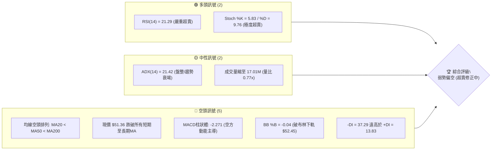
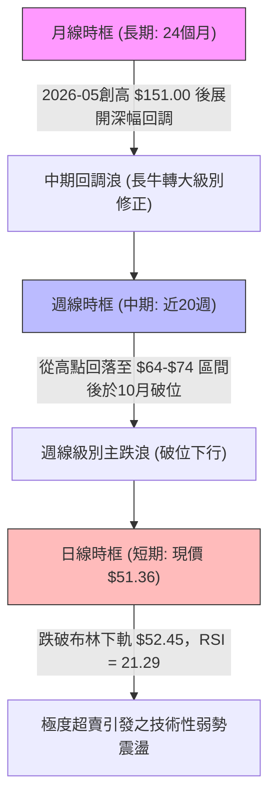
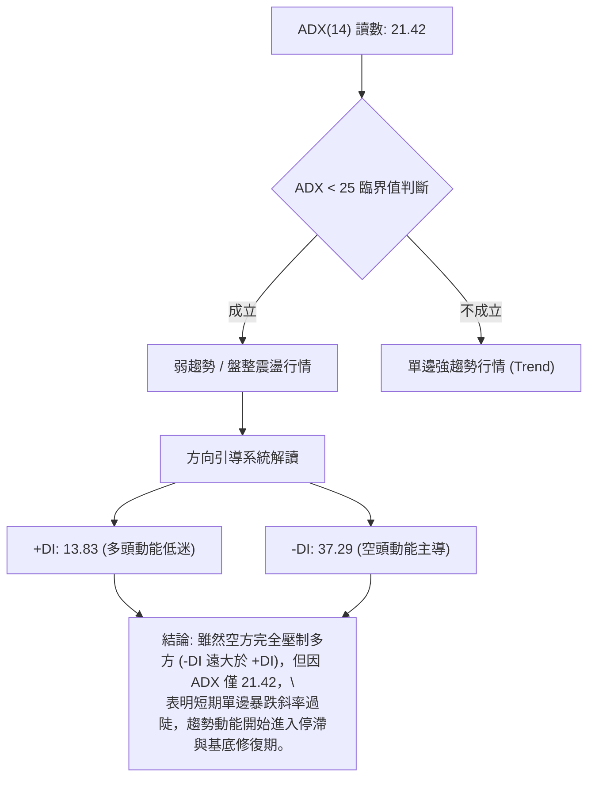
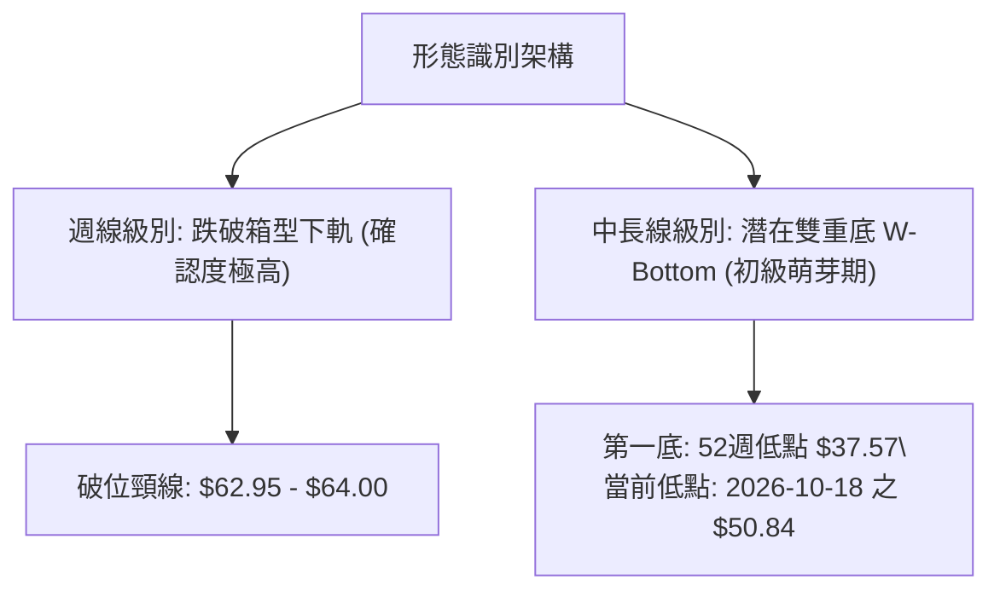
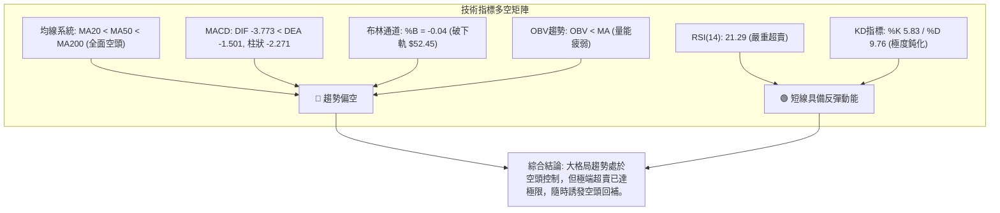
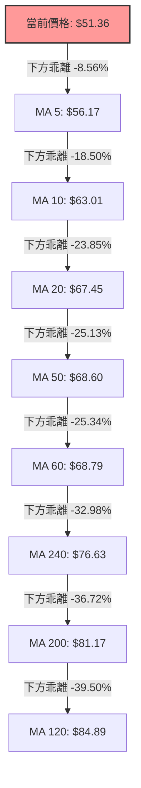
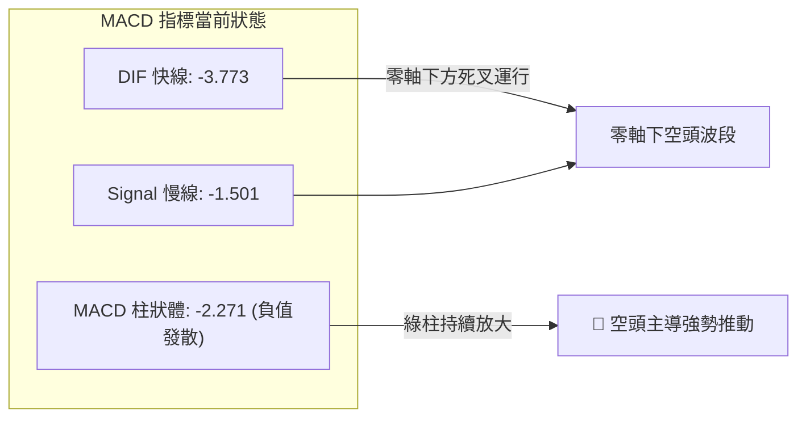
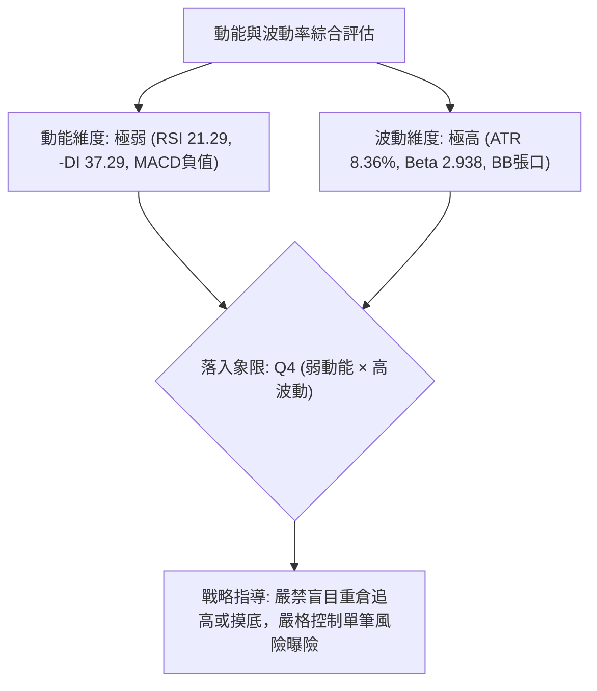
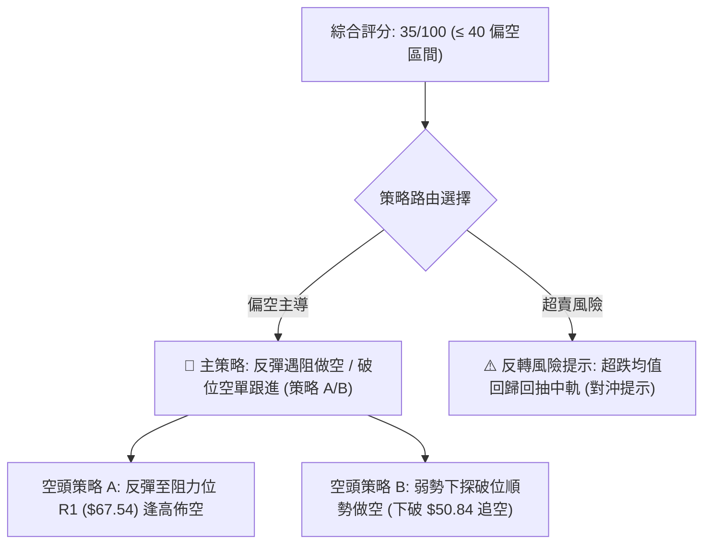
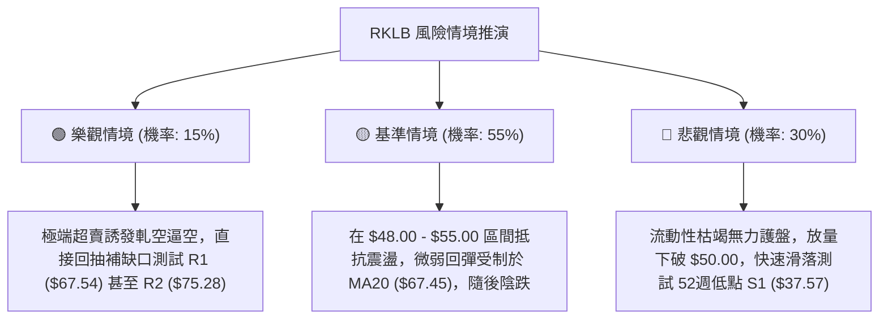

# RKLB 技術分析報告

> **報告日期**：2026-10-20 ｜ **語言**：繁體中文 ｜ **數據來源**：Yahoo Finance ｜ **當前價格**：$51.36

---

## 目錄

| 章節 | 內容 |
|------|------|
| [1. 技術面概覽](#1-技術面概覽) | 訊號儀表板、核心指標、評分卡 |
| [2. 趨勢分析](#2-趨勢分析) | 多時框趨勢、長中短期走勢、ADX解讀 |
| [3. 圖表形態分析](#3-圖表形態分析) | 形態識別信心度、K線組合、目標價計算 |
| [4. 支撐與阻力](#4-支撐與阻力) | 關鍵價位結構、斐波那契回調精確分析 |
| [5. 技術指標深度解讀](#5-技術指標深度解讀) | MA/RSI/MACD/布林通道/成交量OBV |
| [6. 動能與波動率](#6-動能與波動率) | 動能四象限、ATR風控、Beta相關性 |
| [7. 多時框架總結](#7-多時框架總結) | 時框矩陣、收斂規則與唯一方向性定調 |
| [8. 交易策略建議](#8-交易策略建議) | 策略路由、精確進出場點、風險報酬比 |
| [9. 風險提示與監控](#9-風險提示與監控) | 監控清單、極端情境推演、資金控管 |
| [📋 報告總結](#-報告總結) | 關鍵結論彙整、最優策略組合看板 |

---

## 1. 技術面概覽

### 🎯 技術訊號儀表板



### 📊 核心指標速覽表

| 指標類別 | 指標名稱 | 當前數值 | 訊號 | 解讀 |
|----------|----------|----------|------|------|
| **價格** | 當前收盤價 | $51.36 | 🔴 | 位於52週區間12.2%分位，短期結構處於急速下挫後的築底觀察期 |
| **均線** | MA20 | $67.45 | 🔴 | 價格在MA20下方 -23.85%，偏離過大，短期均線下彎形成沉重蓋頭反壓 |
| **均線** | MA50 | $68.60 | 🔴 | 價格在MA50下方 -25.13%，中期生命線失守且與MA20形成死叉後發散 |
| **均線** | MA200 | $81.17 | 🔴 | 價格在MA200下方 -36.72%，長期牛熊分界線被實質跌破，牛市結構破壞 |
| **動能** | RSI(14) | 21.29 | 🟢 | 極度超賣區間（<30），技術性反彈動能正在醞釀，但尚未出現底背離確立 |
| **動能** | MACD | -3.773 / -1.501 | 🔴 | DIF位於Signal下方，Hist為-2.271，空頭動能仍佔絕對優勢，尚未收斂金叉 |
| **動能** | Stoch %K/%D | 5.83 / 9.76 | 🟢 | 隨機指標進入極端低位鈍化，隨時具備技術性向上抽頭的動能條件 |
| **趨勢** | ADX(14) | 21.42 | 🟡 | ADX < 25 表明單邊趨勢強度不足，市場轉入弱趨勢或空方超跌後的寬幅震盪 |
| **量能** | OBV / 量比 | 0.77x (17.01M) | 🔴 | OBV < MA，成交量萎縮，買盤承接意願低迷，屬量縮陰跌格局 |
| **波動** | ATR(14) | $4.30 | 🔴 | ATR佔股價比率高達 8.36%，屬於高波動標的，日內與波段洗盤風險極高 |

### 🏆 技術評分卡

```
╔══════════════════════════════════════════════════════════════╗
║              技術評分卡 — RKLB (2026-10-20)                   ║
╠══════════════════════════════════════════════════════════════╣
║ 趨勢強度 (Trend)      ██████░░░░░░░░░░░░░░  30/100  🔴 空頭  ║
║ 動能指標 (Momentum)   ████████░░░░░░░░░░░░  40/100  🟡 超賣  ║
║ 支撐穩定度 (Support)  ██████░░░░░░░░░░░░░░  32/100  🔴 脆弱  ║
║ 成交量配合 (Volume)   ████████░░░░░░░░░░░░  38/100  🔴 疲弱  ║
║ 形態完整度 (Pattern)  ██████████░░░░░░░░░░  50/100  🟡 震盪  ║
║ 均線排列 (Moving Avg) ████░░░░░░░░░░░░░░░░  20/100  🔴 空頭  ║
╠══════════════════════════════════════════════════════════════╣
║ 綜合評分 (Overall)    ███████░░░░░░░░░░░░░  35/100  🔴 偏空  ║
╚══════════════════════════════════════════════════════════════╝
```

---

## 2. 趨勢分析

### 🌐 多時框趨勢分析



### 📈 長期趨勢 — 12個月走勢圖（Unicode）

以下圖表完整反映 RKLB 從 2025 年 11 月至 2026 年 10 月之月線收盤價歷史軌跡，並標注歷史波峰與近期低點：

```
RKLB 月線收盤走勢圖（過去12個月：2025-11 至 2026-10）
價格軸 ($)
$150 ┤                                  ● $143.48 (2026-05 歷史波峰，盤中高點 $151.00)
$140 ┤                                 ╱ ╲
$130 ┤                                ╱   ╲
$120 ┤                               ╱     ╲
$110 ┤                              ╱       ● $101.65 (2026-06 巨幅回吐)
$100 ┤                             ╱         ╲
 $90 ┤                            ╱           ╲
 $80 ┤              ● $80.07     ╱             ● $82.51 (2026-04 突破前高)
 $70 ┤        ●     │  ╲        ●             │ ╲
 $60 ┤  ●    ╱ ╲    │   ●───────┘             │  ●───● $69.68 (2026-09)
 $50 ┤  │   ╱   ╲   │  $69.10                 │   ╲   ╲
 $40 ┤  ●──┘     ●──┘                        │    ●───● $51.36 (2026-10 當前收盤)
     └──┴───┴───┴───┴───┴───┴───┴───┴───┴───┴───┴───┴───┴───────────────────────
       11  12  01  02  03  04  05  06  07  08  09  10 (月份)
      (2025)            (2026 年)
```

#### 長期走勢特徵分析表格

| 階段 | 時間跨度 | 價格起訖 | 漲跌幅 | 走勢特徵與結構解讀 |
|------|----------|----------|--------|--------------------|
| **第 I 階段：蓄勢主升** | 2025-11 至 2026-01 | $42.14 → $80.07 | +90.01% | 突破前期底部平台，放量長紅上攻，建立多頭主升結構。 |
| **第 II 階段：高位強震** | 2026-01 至 2026-03 | $80.07 → $64.22 | -19.80% | 獲利回吐引發ABC三浪修正，在 $64.00 附近獲得強支撐並完成籌碼換手。 |
| **第 III 階段：狂熱噴出** | 2026-03 至 2026-05 | $64.22 → $143.48 | +123.42% | 迎來終極主升浪，月線創下 $143.48 收盤價（天價 $151.00），動能極度過熱。 |
| **第 IV 階段：斷頭殺跌** | 2026-05 至 2026-07 | $143.48 → $64.95 | -54.73% | 資金出逃形成流動性枯竭式暴跌，兩個月內回吐超過百元漲幅。 |
| **第 V 階段：箱型構築** | 2026-07 至 2026-09 | $64.95 → $69.68 | +7.28% | 於 $62.95–$73.95 構築中期震盪平台，多空形成短暫均勢。 |
| **第 VI 階段：破位下瀉** | 2026-09 至 2026-10 | $69.68 → $51.36 | -26.29% | 箱型平台向下破位，跌破斐波那契 78.6% 回調位（$61.84），直奔S1支撐。 |

### 📊 中期趨勢（週線分析）

中期走勢自 2026-06 以來呈現明確的階梯式下行通道。最近 20 週收盤數據顯示，RKLB 經歷了兩次反彈失敗：
1. 第一次反彈：2026-08-09 衝高至 $82.83，受制於長期均線反壓，隨後連續三週下跌重回 $64 區間。
2. 第二次反彈：2026-09-27 與 2026-10-04 兩週收於 $73.95 與 $73.92，遭遇阻力位 R1（$67.54）與 R2（$75.28）的強烈夾擊。
3. 崩跌破位：2026-10-18 當週收盤暴跌至 $50.84（-25.46%），本週微幅回彈至 $51.36，週線級別空頭排列未變。

```
RKLB 週線阻力與支撐示意圖
價格 ($)
 $80 ┤                 ● 08-09 高點 $82.83
 $75 ┤                          ● 10-04 高點 $73.92 (遭 R2 $75.28 壓制)
 $70 ┤  ● 07-05 $100.46 ───      │  ╲
 $65 ┤        ╲         ●───────┘   ● 10-11 $68.21
 $60 ┤         ● 07-26 $63.91 (前底破位)  ╲
 $55 ┤                                     ╲
 $50 ┤                                      ● 10-18 收 $50.84 ─── ● 現價 $51.36
     └─────────────────────────────────────────────────────────────
```

### ⚡ 趨勢強度評估（ADX 解讀）



#### ADX 趨勢強度對照表

| 指標名稱 | 實際數值 | 標準參考區間 | 趨勢性質判定 | 交易架構指引 |
|----------|----------|--------------|--------------|--------------|
| **ADX(14)** | **21.42** | < 20 (無趨勢) / 20–25 (弱趨勢) / > 25 (強趨勢) | 弱趨勢 / 寬幅盤整 | 根據規則 14，市場處於盤整或趨勢衰竭期，重點關注日線布林通道區間與震盪指標。 |
| **+DI (14)** | **13.83** | > 25 (多頭強勢) | 多頭極度虛弱 | 缺乏主動性攻擊買盤，所有拉升均暫時定義為技術性超跌反彈。 |
| **-DI (14)** | **37.29** | > 25 (空頭強勢) | 空頭主導壓制 | 盤面主控權在空方，下方防守關鍵端賴超賣指標觸發的被動空頭回補。 |
| **DI差值** | **-23.46** | 絕對值 > 15 為非對稱失衡 | 空方絕對佔優 | 短線禁止盲目追空，防範技術性均值回歸；亦不可左側盲目加槓桿重倉抄底。 |

---

## 3. 圖表形態分析

### 🔍 形態識別系統

依據形態學幾何標準及嚴格要求 15，以下對日線與週線結構進行嚴謹識別。



#### 形態識別與信心度評估表

| 形態名稱 | 信心度 | 判斷依據（引用提供的數據） | 完成度 | 目標價（附嚴謹計算式） |
|----------|--------|----------------------------|--------|------------------------|
| **箱型平台向下突破 (Box Breakdown)** | **85%** | 2026-07-26 低點 $63.91、08-30 收盤 $64.39、09-06 收盤 $64.26、09-13 收盤 $62.95 構成堅實箱底。2026-10-18 週線長黑實體收於 $50.84，實質跌破箱底。 | 100% (已跌破) | 箱型頂 $73.95，箱型底取 $63.91，形態高度 = $73.95 - $63.91 = $10.04。<br>破位最小量度跌幅目標 = 箱底 $63.91 - $10.04 = **$53.87**（現價 $51.36 已達標）。 |
| **大級別二次探底 (Double Bottom Attempt)** | **42%** | 前期低點為 52週低點 $37.57；當前價格觸及 $50.84 展開超賣停頓。但因數據中未確認築底K線（尚未金叉突破頸線），信心度不足 50%。 | 30% | 依規則 15：**信心度 < 50%，數據不足以支撐雙底反轉形態成立，僅做指標型超賣解讀，不予預測多頭幾何目標價。** |

### 🕯️ 重要K線形態分析

針對近兩個月週線級別之關鍵轉折 K 線進行型態解讀：

| 週收盤日期 | 週收盤價 | K線形態特徵 | 形態意涵與多空解讀 | 訊號方向 |
|------------|----------|-------------|--------------------|----------|
| **2026-09-20** | $64.57 | 止跌十字星 (Spinning Top) | 經過前期持續探底後成交量增至 106.89M，多頭展開抵抗。 | 🟡 中性反彈 |
| **2026-09-27** | $73.95 | 中陽線突破 (Bullish Advance) | 放量上攻至 111.51M，測試阻力位 R1（$67.54），短期多頭宣洩。 | 🟢 短多確立 |
| **2026-10-04** | $73.92 | 高位吊頸線 (Hanging Man) | 於 $73.92 遇阻停滯，量能微縮至 107.27M，顯示上方賣壓沉重。 | 🔴 滯漲轉折 |
| **2026-10-11** | $68.21 | 陰包陽破位前兆 (Bearish Retest) | 收盤跌破 70 美元關卡，跌幅 -7.72%，多頭動能急速耗竭。 | 🔴 轉空確認 |
| **2026-10-18** | $50.84 | 破位斷頭長黑 (Marubozu Breakdown) | 成交量急劇擴大至 128.00M，跳空長陰實體跌破箱底與多道支撐。 | 🔴 強烈看空 |
| **2026-10-25** | $51.36 | 低位孕線十字 (Inside Harami Attempt) | 截至目前成交量驟降至 17.01M，波動收斂，空方下殺動能暫時停滯。 | 🟡 止跌觀察 |

### 📉 ASCII 走勢形態示意圖

```
箱型破位與量度跌幅示意圖 (2026-08 至 2026-10)
價格 ($)
$75.00 ┤              ┌─── 箱型頂部阻力 R1/R2 區域 ($73.92 - $73.95) ───┐
       │              │                        ▲                         │
$70.00 ┤              │                        │ 形態高度 H = $10.04     │
       │              │                        ▼                         │
$65.00 ┤  ────────────┴─── 箱型頸線支撐位 ($62.95 - $63.91) ────────────┴─── 破位點
       │                                                                 ╲
$60.00 ┤                                                                  ╲
       │                                                                   ╲
$55.00 ┤  - - - - - - - - 箱型破位量度跌幅理論目標 = $53.87 - - - - - - - - ●  ╲
       │                                                                      ▼
$50.00 ┤                                                    現價 $51.36 ───►  ● (最低 $50.84)
       └────────────────────────────────────────────────────────────────────────
```

### 🎯 形態目標價計算

根據經典技術分析體系（Edwards & Magee）：
1. **箱型突破向下計算式**：
   - 形態頂部（Neckline High） = $73.95（2026-09-27 週收盤價）
   - 形態頸線（Neckline Support） = $63.91（2026-07-26 週收盤價）
   - 垂直高度（Pattern Height, $H$） = $\$73.95 - \$63.91 = \$10.04$
   - 最小量度滿足跌幅目標（Downside Target 1） = $\$63.91 - \$10.04 = \mathbf{\$53.87}$
   - **分析結論**：當前價格 $51.36 已跌破並完全滿足第一量度跌幅（$53.87）。若空頭動能進一步外推至 1.618 倍擴展位：
   - 極端量度跌幅目標（Downside Target 2） = $\$63.91 - (1.618 \times \$10.04) = \$63.91 - \$16.24 = \mathbf{\$47.67}$（此區間逼近 52 週低點支撐叢集）。

---

## 4. 支撐與阻力

### 🗺️ 關鍵價位分布圖（Unicode）

嚴格依據提供的「關鍵價位」與「斐波那契回調」數據繪製，不捏造任何未授權數值：

```
RKLB 價位結構分布圖 (由 OHLCV 與斐波那契精確計算)
═════════════════════════════════════════════════════════════════════
$151.00 ║████████████████████████████████║ 52W High (斐波那契 0.0%)
$124.23 ║████████████████████████        ║ 斐波那契 23.6% 回調位
$107.67 ║██████████████████              ║ 斐波那契 38.2% 回調位
 $94.28 ║████████████████████████        ║ 斐波那契 50.0% 平衡分水嶺
 $80.90 ║████████████████████████████████║ 斐波那契 61.8% 黃金分割位 (共振 MA200: $81.17)
 $78.74 ║████████████████████████        ║ 強阻力 R3 (近一年波段高點聚類)
 $75.28 ║████████████████████            ║ 阻力 R2 (近一年波段高點聚類)
 $67.54 ║████████████████████████████████║ 關鍵阻力 R1 (波段高點 / 共振 MA20: $67.45)
 $61.84 ║████████████████████            ║ 斐波那契 78.6% 回調位 (前箱型防守中樞)
 $51.36 ╠════════════════════════════════╣ ◄ 當前收盤價現位 ($51.36)
 $37.57 ║████████████████████████████████║ 絕對強支撐 S1 / 52W Low (斐波那契 100.0%)
═════════════════════════════════════════════════════════════════════
```

### 🚧 阻力位分析表

所有阻力價位**嚴格引用**數據中「關鍵價位（由 OHLCV 計算）」之聚類數值：

| 阻力級別 | 精確價位 | 距現價幅幅 | 形成原因與技術共振 | 突破難度 | 重要性 |
|----------|----------|------------|--------------------|----------|--------|
| **R1** | **$67.54** | **+31.51%** | 近一年波段高點聚類；與 **MA20（$67.45）** 及 **BB中軌（$67.45）** 形成密集共振帶。此處亦為 2026-07 破位前之頸線平台。 | 極高 | 🟢🟢🟢 極關鍵 (多空分界) |
| **R2** | **$75.28** | **+46.58%** | 近一年波段高點聚類；共振 2026-10-04 當週高點 $73.92 之密集成交解套賣壓區。 | 極高 | 🟢🟢 中期強壓 |
| **R3** | **$78.74** | **+53.32%** | 近一年波段高點聚類；上方緊鄰斐波那契 61.8%（$80.90）與 **MA200（$81.17）**，為牛熊分界反壓大本營。 | 極端困難 | 🟢🟢🟢 長期分水嶺 |

### 🛡️ 支撐位分析表

所有支撐價位**嚴格引用**數據中「關鍵價位（由 OHLCV 計算）」之數值：

| 支撐級別 | 精確價位 | 距現價幅幅 | 形成原因與技術共振 | 守住機率 | 重要性 |
|----------|----------|------------|--------------------|----------|--------|
| **S1** | **$37.57** | **-26.85%** | 近一年波段低點聚類；同時為 **52週歷史低點（52W Low）** 與 **斐波那契 100.0% 回調底限**。長達兩年週期的結構性最後防線。 | 75% | 🔴🔴🔴 生死防線 |
| **S2 / S3** | **數據未偵測** | — | **數據中未偵測到近一年其他波段低點聚類數值**（依嚴格要求 13，嚴禁憑空編造）。現價至 S1 之間不存在經 OHLCV 認證之歷史群聚支撐。 | — | 🟡 缺乏中間緩衝 |

### 📐 斐波那契回調位分析

本波斐波那契回調依據 52 週完整極端區間：波段起點低點 **$37.57** 至 歷史波峰高點 **$151.00**（垂直波動總振幅高達 $113.43）。

| 回調比率 | 標記價位 | 當前相對位置與技術意義解讀 |
|----------|----------|----------------------------|
| **0.0% (52W High)** | **$151.00** | 2026-05 歷史天花板，大週期多頭擴展終點。 |
| **23.6%** | **$124.23** | 初級修正位，早在 2026-06 暴跌中失守。 |
| **38.2%** | **$107.67** | 弱勢修正極限位，失守後轉入弱勢熊市循環。 |
| **50.0%** | **$94.28** | 心理整數分水嶺，現已轉為中長期難以逾越之天險。 |
| **61.8%** | **$80.90** | 黃金分割回調關鍵位。與 **MA200 ($81.17)** 重合。失守此處宣告此輪中級回調轉為深幅破位熊市。 |
| **78.6%** | **$61.84** | 深度回調最後緩衝防線。2026-07 至 2026-09 曾在此位上方反覆震盪。 |
| **現價現況** | **$51.36** | **當前價格落於 78.6%（$61.84）與 100.0%（$37.57）之間。** |
| **100.0% (52W Low)** | **$37.57** | 終極回調基石（S1）。跌破 78.6% 後，在幾何學上意味著波段上漲動能已 100% 被抹去，技術重力直指 $37.57。 |

---

## 5. 技術指標深度解讀

### 🎛️ 指標訊號總覽



### 📈 移動平均線排列分析



均線狀態解讀：
- **完全空頭排列**：所有短中長期均線均高於現價（$51.36），且由上至下依序發散（MA200 $81.17 > MA60 $68.79 > MA50 $68.60 > MA20 $67.45 > MA10 $63.01 > MA5 $56.17）。
- **極度負乖離**：現價距離 MA20 乖離率達 **-23.85%**，距 MA50 達 **-25.13%**，距 MA200 達 **-36.72%**。歷史經驗顯示，當負乖離率超出 -20% 時，繼續摜壓之邊際下行動能將遞減，易出現均線引力引發的暴衝式回抽。

### 📉 RSI(14) 分析

```
RSI(14) 當前數值進度條展示:
0 ────── 超賣門檻 (30) ────────────────── 中軸 (50) ────────────────── 超買門檻 (70) ────── 100
  [████░░░░░░░░░░░░░░░░░░░░░░░░░░░░░░░░░░░░░░░░░░░░░░░] 21.29 (🟢 嚴重超賣)
```

- **超買超賣判定**：RSI(14) 讀數為 **21.29**，深度落於 30 以下之極端超賣禁區。
- **背離判斷結論**：
  - 比對 2026-09-06 週低點 RSI = 12.8（收盤 $64.26）與 2026-10-18 週低點 RSI = 18.5（收盤 $50.84），價格創下波段新低，但 RSI 低點並未再穿透 12.8。然而日線級別數據明確標注 **「RSI 背離: 無明顯背離」**。
  - **嚴謹結論**：當前指標處於順勢下殺引發的超賣狀態，**不存在經過日線確立的底背離**。此超賣僅代表賣盤過度擁擠，不可單憑此指標直接重倉摸底。

### 📊 MACD(12/26/9) 訊號解讀



- **數值與結構**：DIF（-3.773）小於 DEA（-1.501），MACD 柱狀圖讀數為 **-2.271**。
- **背離診斷**：週線 MACD 柱狀圖自 2026-10-04 之 +0.857 急劇翻負至 10-11 之 -0.018，再暴跌至 10-18 之 -2.111 與當前之 -2.271。**無底背離現象**，顯示空方動能呈線性加速釋放，尚未見到紅柱翻出或綠柱收縮金叉之拐點信號。

### 📦 布林通道分析

```
RKLB 布林通道 (20, 2) 空間位置示意圖
價格 ($)
$82.44 ┤ ───────────────────────────────────── BB 上軌 ($82.44)
       │
$67.45 ┤ ─────────────────●─────────────────── BB 中軌 / MA20 ($67.45)
       │                  │
$52.45 ┤ ─────────────────┼─────────────────── BB 下軌 ($52.45)
       │                  ▼
$51.36 ┤ ═ ═ ═ ═ ═ ═ ═ ═ ═ ● ═ ═ ═ ═ ═ ═ ═ ═ ═ 當前價格 $51.36 (%B = -0.04)
       └────────────────────────────────────────────────────────
```

- **通道參數解讀**：BB 上軌為 **$82.44**，中軌為 **$67.45**，下軌為 **$52.45**。帶寬（Bandwidth）= $\$82.44 - \$52.45 = \$29.99$（佔中軌達 44.46%，呈極度張口擴張狀態）。
- **位置與狀態**：現價 $51.36 已貫穿跌破下軌 $52.45，**BB %B 數值為 -0.04**（小於 0 意味著價格完全脫離通道下邊界運行）。
- **技術意義**：此為罕見之「通道外極端拋售」，依據統計回歸常態分佈，價格在下軌之外運行的時間通常難以持久，具備極強的向通道內回抽修復拉力（中軌 $67.45 為第一回歸引力中心）。

### 💹 成交量分析（量價配合度）

```
量能結構對照:
今日成交量:   17,013,600  [████████░░░░░░░░░░░░] 77% (量比: 0.77x)
20日均量:     22,120,400  [███████████░░░░░░░░░] 100% (基準線)
50日均量:     20,059,226  [██████████░░░░░░░░░░] 91%
```

- **量價背離與動能分析**：
  - 2026-10-18 放量暴跌至 $50.84 時，當週爆出 128.00M 巨量，顯示恐慌盤全面湧出。
  - 當前最新日成交量萎縮至 **17,013,600**，量比僅 **0.77x**（遠低於 20日均量 22.12M 與 50日均量 20.05M）。
  - **OBV 趨勢**：明確處於 **OBV < MA**，代表累計能量線下穿均線，量能嚴重疲弱。破位下跌時放量、破位後超跌震盪時量縮，印證此處買盤極度觀望，未出現機構進場掃貨的「放量爆量底」特徵。

---

## 6. 動能與波動率

### ⚡ 動能評估四象限



#### 動能與波動率四象限矩陣表

| 象限 | 動能維度 | 波動維度 | 當前狀態標註 | 戰略特徵與操盤應對方針 |
|------|----------|----------|--------------|------------------------|
| **Q1** | 強動能 (Bullish) | 低波動 (Low Vol) | — | 最佳波段主升機會；趨勢穩定推升，適合持股推保護。 |
| **Q2** | 弱動能 (Bearish) | 低波動 (Low Vol) | — | 沉悶牛皮整理；缺乏資金關注，適宜輕倉觀望。 |
| **Q3** | 強動能 (Bullish) | 高波動 (High Vol) | — | 狂熱突破或末升爆噴；爆發力強但回撤劇烈，適合快進快出。 |
| **Q4** | **弱動能 (Bearish)** | **高波動 (High Vol)** | **✓ RKLB 處於此區** | **高風險深水區；殺跌慣性大且伴隨劇烈震盪洗盤，切忌逆勢重倉。** |

### 📊 ATR 波動率分析

- **ATR(14) 絕對數值**：**$4.30**。
- **ATR 佔比分析**：佔當前股價（$51.36）比率高達 **8.36%**。這意味著 RKLB 每日的平均理論常態震盪波幅就達到 $4.30 美元，是標普500成分股平均波動幅度的 4 至 6 倍。
- **風控止損空間設定**：
  - 日內短線交易者最少需預留 $1.0 \times \text{ATR} = \$4.30$ 之緩衝空間。
  - 波段操作者必須預留 $1.5 \text{ 至 } 2.0 \times \text{ATR} = \$6.45 \text{ 至 } \$8.60$ 的保護距離，否則極易在技術性假突破或日內洗盤中觸發無謂止損。

### 📐 Beta 與市場相關性

- **Beta 係數**：**2.938**。
- **系統性風險敏感度**：RKLB 屬於極端高貝塔成長型航太國防標的，對市場流動性、整體大盤（那斯達克指數與羅素2000）之利率預期及市場風險偏好（Risk-on / Risk-off）極度敏感。
- **放大效應**：大盤若出現 1% 的回調，RKLB 統計上將承受近 3% 的同向波動衝擊；反之，若大盤止跌共振，其技術性超跌反彈之彈性亦將顯著超越市場平均水準。

---

## 7. 多時框架總結

### 📋 時框架評分表

| 時框架 | 趨勢方向 | 動能狀態 | 均線排列 | 圖表形態 | 綜合評分 | 操作建議方向 |
|--------|----------|----------|----------|----------|----------|--------------|
| **月線 (長期)** | 🟡 中性回調 | 弱化 (自天價回落) | 仍守於長線均線上 | 高位回吐50%以上 | 48/100 | 長線投資者切勿過早打滿底倉 |
| **週線 (中期)** | 🔴 實質空頭 | 疲弱 (-DI 佔優) | 均線死叉下穿 | 箱型破位向下延伸 | 28/100 | 反彈遇阻力減碼，嚴禁盲目加倉 |
| **日線 (短期)** | 🔴 超跌偏空 | 極度超賣 (RSI 21) | 空頭排列發散 | 跌破布林下軌震盪 | 35/100 | 超賣回抽預期，僅供超短線輕倉博弈 |

### 🔲 綜合訊號矩陣

```
訊號維度矩陣:
────────────────────────────────────────────────────────────────
時框跨度     均線結構      動能指標(MACD/RSI)    形態位置        一致性結論
────────────────────────────────────────────────────────────────
短期 (日線)  🔴 空頭排列   🟢 RSI嚴重超賣(21.29) 🔴 破布林下軌   矛盾 (超跌反彈醞釀)
中期 (週線)  🔴 死叉下彎   🔴 MACD柱狀發散(-2.2) 🔴 跌破箱底平台 趨同 (空方絕對主導)
長期 (月線)  🟡 漲幅收斂   🔴 頂部動能衰減       🟡 探測年線基石 偏弱 (高位洗盤未止)
────────────────────────────────────────────────────────────────
```

### ⚖️ 多時框收斂結論

依據本報告最嚴格之**「多時框收斂規則（規則 14）」**進行權重判定與邏輯收斂：
1. **行情性質判定**：當前 ADX(14) 讀數為 **21.42**。因 **ADX < 25**，嚴格判定當前市場處於**「弱趨勢 / 盤整震盪行情」**。
2. **主導維度依歸**：依規則 14，在 ADX < 25 的盤整結構中，日線布林通道上下軌（下軌 $52.45、上軌 $82.44、中軌 $67.45）構成核心交易空間。
3. **衝突收斂取捨**：雖然日線 RSI 觸及 21.29 觸發強烈超賣警報，但週線級別之均線與 MACD（-2.271）完全呈現壓倒性空方發散。因此，日線超賣**絕不構成反轉大牛市之藉口**，僅能定性為「極端下殺後的技術性超跌均值回歸」。
4. **唯一方向性定調**：**【弱勢偏空，以超跌反彈修復對待（中性偏空觀望）】**。此定調將 100% 貫穿第 8 章之策略路由架構。

---

## 8. 交易策略建議

### 🗺️ 策略決策流程圖



### 🧭 策略路由

> **當前主策略方向 = 【空頭為主，主推空頭波段策略；多頭僅列為反轉風險提示與短線超跌對沖】（依技術評分 35/100 精確定調）**

### 🎯 價格情境階梯（Price Scenarios）

價位嚴格引用第 4 章由 OHLCV 確定之實際數值：

| 觸發條件 | 第一目標 | 後續延伸 | 情境含義與操作對策 |
|----------|----------|----------|--------------------|
| **強勢突破 R1 ($67.54)** | R2 ($75.28) | R3 ($78.74) | 空頭結構被暫時化解，超跌反彈升級為中級修復行情；空單必須無條件離場。 |
| **受阻於 R1 ($67.54) 遇阻回落** | 回測現價 ($51.36) | 探測 S1 ($37.57) | 典型的反抽確認阻力有效，空頭第二波主跌浪啟動，為最佳放空甜蜜點。 |
| **有效跌破當前低點 ($50.84)** | 考驗 $45.00 整數 | 終極考驗 S1 ($37.57) | 恐慌盤再次出逃，下行空間完全打開，直奔 52 週低點 S1 支撐尋求歸宿。 |

### 📊 情境機率分佈

| 情境名稱 | 機率預估 | 主要技術指標依據 |
|----------|----------|------------------|
| **情境一：超跌弱反彈後再度破位下行** | **55%** | MACD 柱狀體處於 -2.271 強空，均線呈空頭排列，OBV 疲軟，逢高賣壓龐大。 |
| **情境二：在現價與阻力間寬幅震盪** | **30%** | ADX 僅 21.42 顯示單邊趨勢動能放緩，布林下軌 $52.45 提供被動支撐。 |
| **情境三：展開強勢反轉直接收復 R1** | **15%** | 缺乏成交量支撐，僅有 RSI 極度超賣（21.29），難以一口氣突破 +31.5% 的重阻力。 |

### 🔴 主策略詳情（空頭主導策略）

嚴格依據第 4 章確鑿數值制定進出場與風控點位：

| 策略要素 | 策略 A：阻力位 R1 逢高佈空（高勝率） | 策略 B：跌破新低順勢追空（動能突破） |
|----------|--------------------------------------|--------------------------------------|
| **策略邏輯** | 抓取 RSI 超賣回抽中軌 $67.45 / R1 的強壓回落 | 跌破 2026-10-18 週低點 $50.84 後空方外推 |
| **進場條件** | 價格反彈至 R1 附近出現日線長上影或跌破前日低點 | 盤中實質跌破 $50.84 且 1小時收盤無法收回 |
| **進場價格** | **$67.00**（貼近阻力 R1 $67.54 與 MA20） | **$50.50**（確認破位 $50.84） |
| **止損價格** | **$71.50**（突破 R1 上方約 1×ATR 緩衝） | **$53.87**（重回箱型破位目標價上方止損） |
| **目標價 T1** | **$51.36**（回測當前收盤價位） | **$43.00**（中間整數緩衝區） |
| **目標價 T2** | **$37.57**（直測絕對強支撐 S1 / 52W Low） | **$37.57**（直測絕對強支撐 S1 / 52W Low） |
| **風險報酬比** | **1 : 3.48**（風險 $4.50，T1潛在收益 $15.64） | **1 : 3.84**（風險 $3.37，T2潛在收益 $12.93） |
| **成功機率** | **65%** | **50%** |
| **建議倉位** | **總資金之 10%–15%** | **總資金之 5%–8% (嚴控滑價)** |

### 🟢 反向風險觸發點（對沖提示）

- **多頭反轉觸發條件**：若 RKLB 受分析師買入評級（共識目標 $102.15）或消息面催化，日線強勢長陽**實體收盤站穩 R1（$67.54）**，且成交量放大至 50日均量（20.05M）的 1.5 倍以上。
- **對沖處置建議**：此時技術面將形成空頭陷阱（Bear Trap），空單必須全面平倉止損，激進型交易者方可輕倉反手做多，以 **止損點 $63.91（前箱底）**，博弈目標價 **R2（$75.28）** 與 **R3（$78.74）**。

### ⭐ 整體訊號強度評星

```
做多訊號強度：★☆☆☆☆  (1.5/5 星 — 僅靠超賣支撐，順勢做多條件極不完備)
做空訊號強度：★★★★☆  (4.0/5 星 — 均線與形態全面破位，逢高放空為正道)
整體可信度：  ★★★★☆  (4.0/5 星 — 數據量能與指標共振度高，指向明確)
```

---

## 9. 風險提示與監控

### ✅ 關鍵監控指標 Checklist

```
╔══════════════════════════════════════════════════════════════════╗
║               RKLB 每日交易關鍵監控清單 (Checklist)             ║
╠══════════════════════════════════════════════════════════════════╣
║ [ ] 監控項 1: RSI(14) 是否脫離 30 以下超賣區並完成 50 中軸測試？ ║
║ [ ] 監控項 2: 日線成交量是否回升至 20日均量 22,120,400 之上？    ║
║ [ ] 監控項 3: 價格是否跌破近期極值低點 $50.84 直指 S1 ($37.57)？ ║
║ [ ] 監控項 4: BB %B 是否由負值 (-0.04) 重新回歸至 0.00 以上？    ║
║ [ ] 監控項 5: MACD 柱狀圖負值 (-2.271) 是否出現連續兩日收斂？   ║
║ [ ] 監控項 6: 阻力位 R1 ($67.54) 之空頭防禦測試與假突破過濾？   ║
╚══════════════════════════════════════════════════════════════════╝
```

### ⚠️ 風險場景分析



### 🛡️ 風險管理重要提醒

1. **高貝塔槓桿懲罰效應**：RKLB Beta 達 **2.938**，日內 ATR 高達 **$4.30（8.36%）**。這意味著即使方向判斷正確，若進場點欠佳，日內隨機波動即可能洗掉 8% 以上的保證金。任何操作單筆名義損失嚴格禁止超過總資金的 **1.5%**。
2. **財報與基本面空頭拖累**：目前公司 TTM EPS 為 **$-0.27**，營運利潤率為 **-24.6%**，自由現金流仍為負值（**$-251.96M**）。基本面尚不具備價值投資底部的強大護城河，技術面破位下行時缺少實質盈利支撐，切勿以「估值便宜」為由主觀逆勢死扛。
3. **空頭擠壓（Short Squeeze）防範**：目前機構持股 62.1%，空頭比例（Short % Float）為 7.5%，Short Ratio 為 2.22。雖然放空比例尚未達到極端軋空標準，但因股價處於 52 週低位區間，任何大型合約簽署或發射成功新聞均可能造成跳空高開，做空必須在指定止損價（如 R1 突破）嚴格執行平倉紀律。

---

## 📋 報告總結

```
╔════════════════════════════════════════════════════════════════════╗
║                   RKLB 技術分析報告總結                          ║
╠════════════════════════════════════════════════════════════════════╣
║ 報告日期：2026-10-20                                               ║
║ 當前價格：$51.36                                                   ║
║ 分析評級：🔴 弱勢偏空 (Bearish / 超跌反抽架構)                     ║
║                                                                    ║
║ 關鍵結論：                                                         ║
║ ├─ 長期趨勢：🟡 中性回調 (自天價 $151.00 跌落，測試歷史回調中樞)   ║
║ ├─ 中期趨勢：🔴 實質空頭 (週線箱型破位，MACD柱狀體 -2.271 發散)    ║
║ ├─ 短期趨勢：🟢 醞釀超跌反抽 (RSI 21.29 嚴重超賣，跌破布林下軌)    ║
║ ├─ 關鍵支撐：S1: $37.57 (52W Low / 斐波那契 100% 絕對防線)         ║
║ ├─ 關鍵阻力：R1: $67.54 (近一年聚類高點，共振 MA20 與布林中軌)    ║
║ └─ 分析師目標：共識均價 $102.15 (低 $64.00 / 高 $150.00，評級 Buy)║
║                                                                    ║
║ 最優策略組合：                                                     ║
║ 1. 🥇 最佳機會 (主策略)：反彈至 R1 ($67.54) 與 MA20 逢高佈空，     ║
║    進場 $67.00，止損 $71.50，目標 $51.36 / $37.57，風報比 1:3.48。  ║
║ 2. 🥈 次選機會 (順勢空)：跌破前週低點 $50.84 追空，進場 $50.50，    ║
║    止損 $53.87，目標 $37.57 (S1)，風報比 1:3.84。                 ║
║ 3. 🥉 保守選擇 (觀望)：空手者暫不介入，耐心等待日線指標底背離確立  ║
║    或股價打至 S1 ($37.57) 企穩後再行評估左側機會。                 ║
╚════════════════════════════════════════════════════════════════════╝
```

---

> ⚠️ **免責聲明**：本報告為依據量化技術分析原則所產出之研究報告，所有引用數據（OHLCV、指標讀數）均基於提供的市場數據進行客觀解讀。本報告**僅供研究與學術參考**，**不構成任何要約、招攬或投資買賣建議**。金融市場瞬息萬變，高貝塔股票交易具極高財務風險，投資人應獨立審慎評估並自負盈虧。

---

*報告生成時間：2026-10-20 ｜ 數據來源：Yahoo Finance ｜ 分析框架：多時框技術分析體系*