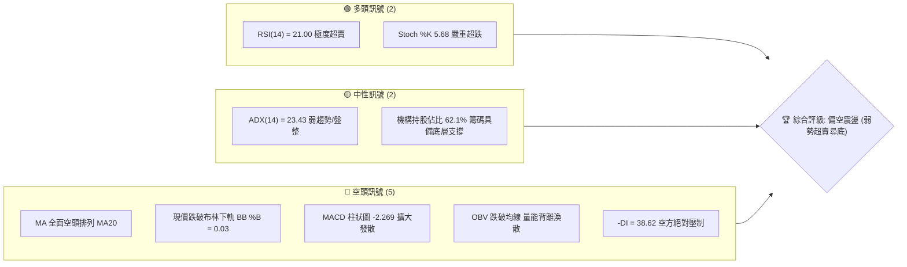
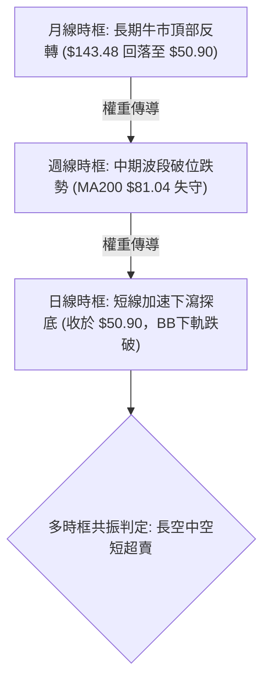
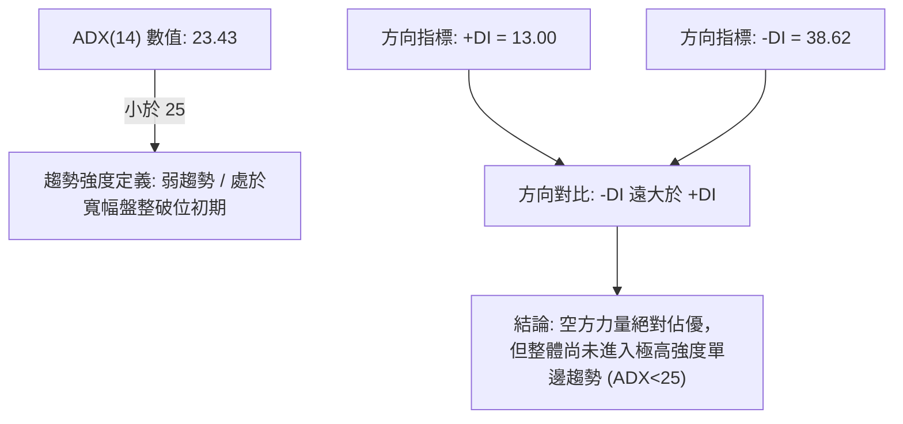
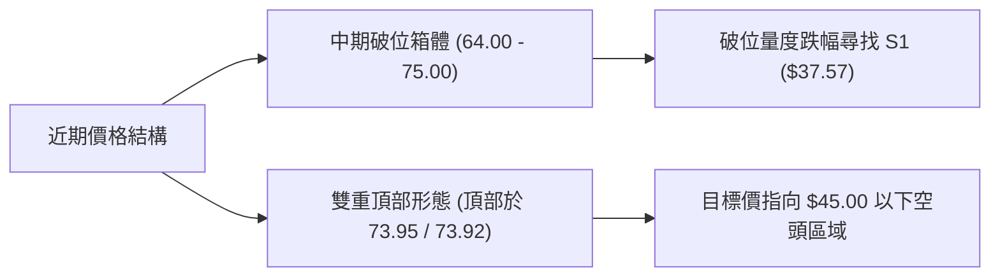
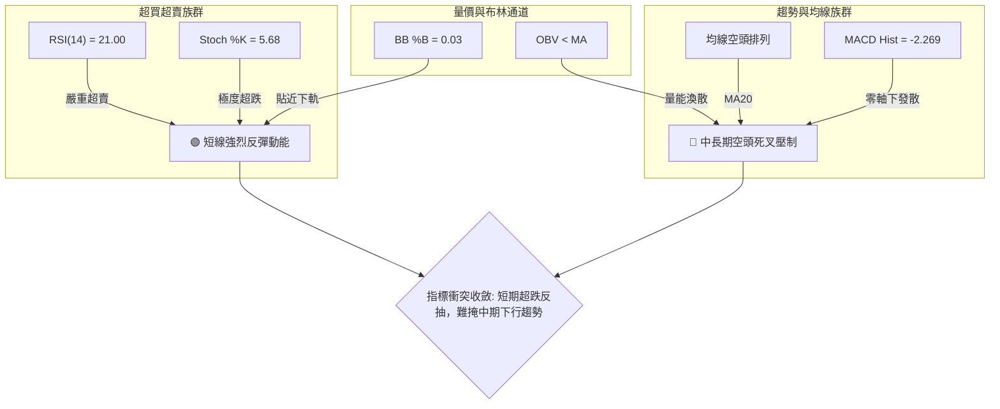
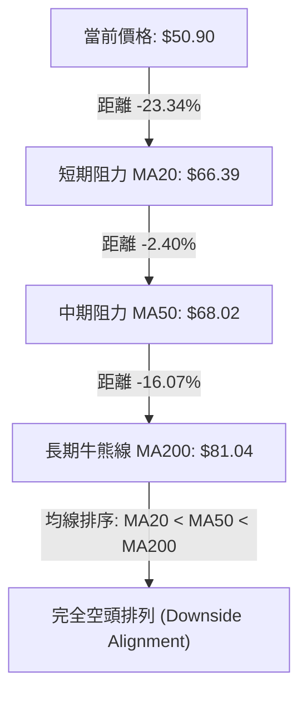
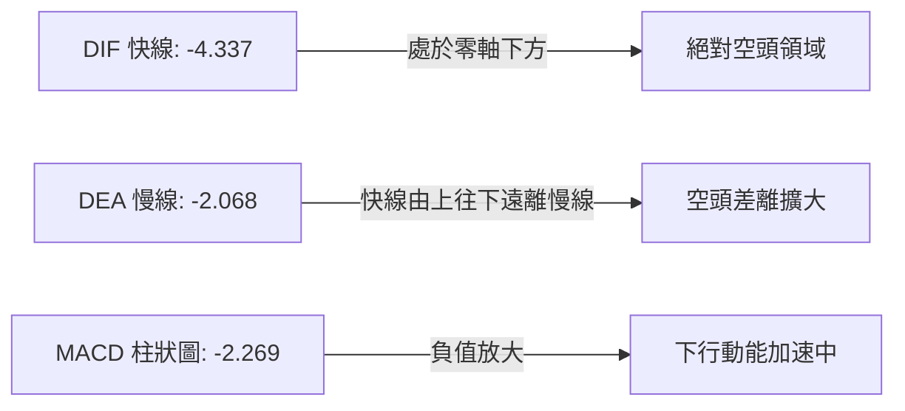
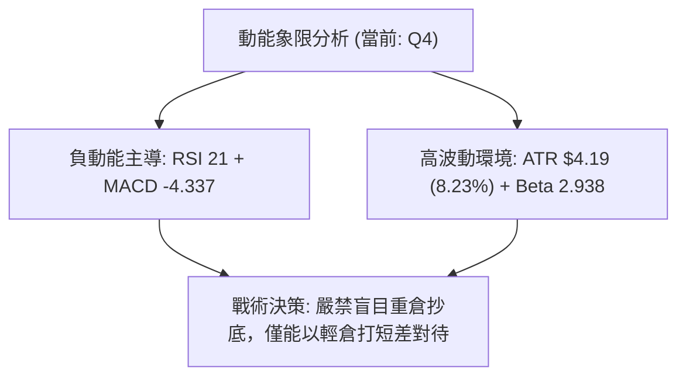
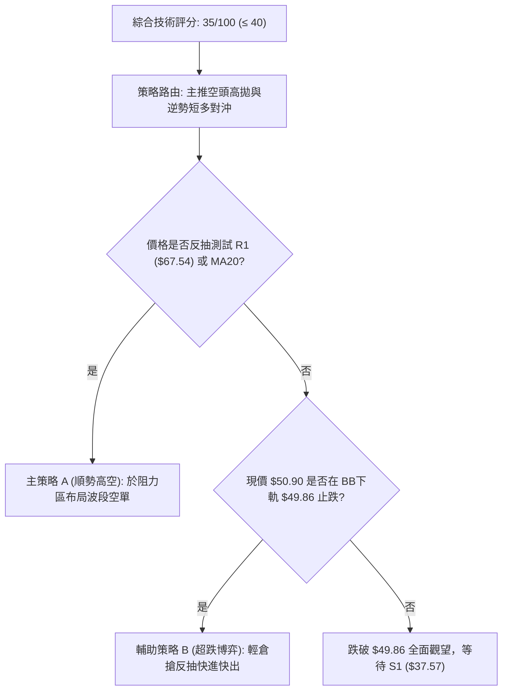
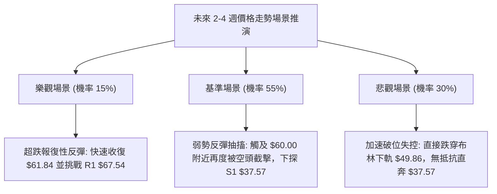

# RKLB 技術分析報告

> **報告日期**：2026-10-21 ｜ **語言**：繁體中文 ｜ **數據來源**：Yahoo Finance ｜ **當前價格**：$50.90

---

## 目錄

| 章節 | 內容 |
|------|------|
| [1. 技術面概覽](#1-技術面概覽) | 訊號儀表板、核心指標、評分卡 |
| [2. 趨勢分析](#2-趨勢分析) | 多時框趨勢、長中短期走勢、12個月 ASCII 走勢圖 |
| [3. 圖表形態分析](#3-圖表形態分析) | 形態識別、信心度評估、K線組合、目標價計算 |
| [4. 支撐與阻力](#4-支撐與阻力) | 關鍵價位分布圖、波段聚類阻力、斐波那契回調 |
| [5. 技術指標深度解讀](#5-技術指標深度解讀) | 均線空頭排列、RSI 極端超賣、MACD 柱狀擴大、布林破軌 |
| [6. 動能與波動率](#6-動能與波動率) | 動能四象限、ATR 止損設定、高 Beta 風險定價 |
| [7. 多時框架總結](#7-多時框架總結) | 時框矩陣、ADX 盤整收斂、單一主導方向確認 |
| [8. 交易策略建議](#8-交易策略建議) | 策略路由、價格階梯、超賣反彈 vs 空頭主導策略 |
| [9. 風險提示與監控](#9-風險提示與監控) | 監控 Checklist、三種情境樹、風控與資金管理 |

---

## 1. 技術面概覽

### 🎯 技術訊號儀表板



### 📊 核心指標速覽表

| 指標類別 | 指標名稱 | 當前數值 | 訊號 | 解讀 |
|----------|----------|----------|------|------|
| **價格** | 當前價格 | $50.90 | 🔴 | 位於 52 週區間 11.8% 低檔，短線暴跌後受制於所有均線 |
| **均線** | MA20 | $66.39 | 🔴 | 價格低於 MA20 達 -23.34%，中期下行斜率陡峭 |
| **均線** | MA50 | $68.02 | 🔴 | 價格低於 MA50 達 -25.72%，季線反壓極為沉重 |
| **均線** | MA200 | $81.04 | 🔴 | 價格低於 MA200 達 -37.19%，長線多空分水嶺徹底失守 |
| **動能** | RSI(14) | 21.00 | 🟢 | 跌破 30 進一步下探至極限超賣區，具備技術性反彈動能 |
| **動能** | MACD (12,26,9) | -4.337 / Hist: -2.269 | 🔴 | 快慢線零軸下方死叉發散，動能柱加速擴大，空頭全面主導 |
| **波動** | ATR(14) | $4.19 | 🔴 | 佔股價高達 8.23%，單日波動極劇烈，下行洗盤風險大 |

### 🏆 技術評分卡

```
╔══════════════════════════════════════════════════════════════════╗
║                技術評分卡 — RKLB (2026-10-21)                    ║
╠══════════════════════════════════════════════════════════════════╣
║ 趨勢強度 (ADX=23.43)    ██████░░░░░░░░░░░░░░  30/100  🔴 弱勢空頭 ║
║ 動能指標 (RSI/MACD)     ████████░░░░░░░░░░░░  40/100  🟡 極端超賣 ║
║ 支撐穩定度 (離S1較遠)   ██████░░░░░░░░░░░░░░  30/100  🔴 支撐真空 ║
║ 成交量配合 (OBV疲弱)    ████████░░░░░░░░░░░░  38/100  🔴 買盤匱乏 ║
║ 形態完整度 (破位下行)   ██████░░░░░░░░░░░░░░  32/100  🔴 箱體下破 ║
║ 均線排列 (完全空頭)     ████░░░░░░░░░░░░░░░░  20/100  🔴 空頭發散 ║
╠══════════════════════════════════════════════════════════════════╣
║ 綜合評分                ███████░░░░░░░░░░░░░  35/100  🔴 強烈偏空 ║
╚══════════════════════════════════════════════════════════════════╝
```

---

## 2. 趨勢分析

### 🌐 多時框趨勢分析



### 📈 長期趨勢 — 12個月走勢圖（Unicode）

```
RKLB 月線收盤走勢圖（過去12個月：2025-11 至 2026-10）
價格軸 ($)
$150 ┤                                      
$140 ┤                                  ● (2026-05 $143.48 頂部)
$130 ┤                                 ╱ ╲
$120 ┤                                ╱   ╲
$110 ┤                               ╱     ╲
$100 ┤                              ╱       ● (2026-06 $101.65)
 $90 ┤                             ╱         ╲
 $80 ┤             ● (2026-01 $80.07)  ●(04 $82.51)╲
 $70 ┤         ●(12 $69.76)   ╲   ╱             ╲   ● (2026-09 $69.68)
 $60 ┤        ╱                ●─● (02-03 $64)   ●─● ╲
 $50 ┤       ╱                                        ●←現價 $50.90
 $40 ┤● (2025-11 $42.14)
     └────────────────────────────────────────────────────────────
      11  12  01  02  03  04  05  06  07  08  09  10 (月份)
```

**歷史走勢特徵分析表格**：

| 時期區間 | 走勢特徵 | 價格變化 | 累計漲跌幅 | 結構性技術意義 |
|----------|----------|----------|------------|----------------|
| **2025-11 ~ 2026-01** | 初階主升段推升 | $42.14 → $80.07 | +90.01% | 突破長期底部阻力，成交量急遽放大 |
| **2026-02 ~ 2026-03** | 平台整理洗盤 | $80.07 → $64.22 | -19.80% | 構築中繼平台，回踩 MA50 支撐有效 |
| **2026-04 ~ 2026-05** | 主升浪狂飆見頂 | $64.22 → $143.48 | +123.42% | 極端投機多頭行情，創出 52 週高點 $151.00 |
| **2026-06 ~ 2026-08** | 第一階段去槓桿暴跌 | $143.48 → $63.92 | -55.45% | 高位巨量套牢，技術形態呈現斷崖式崩跌 |
| **2026-09 ~ 2026-10** | 弱勢反彈夭折與破位 | $69.68 → $50.90 | -26.95% | 反彈未能突破 R1 ($67.54)，隨即長黑破位 |

### 📊 中期趨勢（週線分析）

```
週線級別價格壓力與支撐階梯示意圖
[上軌阻力帶]   ────────────────────── $82.93 (布林上軌 / 斐波 61.8% $80.90)
               ────────────────────── $78.74 (波段阻力 R3)
[中樞阻力帶]   ────────────────────── $75.28 (波段阻力 R2)
               ────────────────────── $67.54 (近端關鍵阻力 R1 / MA20 $66.39)
               ────────────────────── $61.84 (斐波 78.6% 回調位)
[現價位置]     ====================== $50.90 (當前位置，逼近下軌 $49.86)
[遠端支撐帶]   ────────────────────── $37.57 (52週低點 S1 / 斐波 100.0%)
```

中期週線在 2026-09-27 至 2026-10-04 連續兩週於 $73.95 築雙頂受阻，未能越過 R2 ($75.28)。隨後在 10 月中旬連續三週收出放量陰線，由 $73.92 暴瀉至 $50.90，跌破 MA20 ($66.39) 與 MA60 ($68.52)，空頭趨勢在週線級別具備連續性。

### ⚡ 趨勢強度評估（ADX 解讀）



| 指標變數 | 當前讀數 | 門檻區間 | 強度狀態 | 技術意涵 |
|----------|----------|----------|----------|----------|
| **ADX (14)** | 23.43 | < 25.0 | 弱趨勢/震盪 | 雖跌勢迅猛，但因前期處於 $64~$74 震盪，ADX 尚未完全揚升 |
| **+DI (14)** | 13.00 | < 20.0 | 買盤極弱 | 多頭動能匱乏，無力發動有效攻擊 |
| **-DI (14)** | 38.62 | > 35.0 | 空頭強烈 | 空方動能主導盤面，下行推動力主要由空頭單向拋壓造成 |

---

## 3. 圖表形態分析

### 🔍 形態識別系統



**形態信心度與目標價評估表**：

| 形態類別 | 信心度 | 判斷依據（引用數據） | 完成度 | 目標價（附計算式） |
|----------|--------|----------------------|--------|--------------------|
| **雙重頂部 (M頭)** | 75% | 2026-09-27 收 $73.95 與 2026-10-04 收 $73.92 形成對稱高點，頸線為 2026-09-13 低點 $62.95 | 100% (已跌破頸線) | **$51.98**<br>計算式：頸線 $62.95 - (頭部高點 $73.92 - 頸線 $62.95) = $51.98 (現價 $50.90 已達成此目標) |
| **矩形箱體破位** | 70% | 2026-07 至 2026-09 長達 3 個月於 $63.91 ~ $75.28 區間震盪，2026-10-18 收 $50.84 實體長黑跌破 | 90% | **$52.54**<br>計算式：下軌 $63.91 - (上軌 $75.28 - 下軌 $63.91) = $52.54 (目前亦已觸及跌幅滿足位) |
| **頭肩頂形態** | 40% | 雖可將 52W 高點 $151.00 視為大頭部，但歷史跨度過長、右肩不對稱 | 35% | 訊號不足，僅做指標型解讀，不強制計算長期幾何目標 |

### 🕯️ 重要K線形態分析

| 週/月份 | 收盤價 | K線形態 | 解讀 | 訊號 |
|---------|--------|---------|------|------|
| **2026-05** | $143.48 | 長上影射擊之星 (高點 $151.00) | 在主升段末端爆量衝高回落，主力機構高位派發籌碼 | 🔴 強烈見頂 |
| **2026-09-27** | $73.95 | 高位對稱雙頂陽線 | 觸及阻力位 R2 ($75.28) 前動能竭盡，成交量未能放大確認 | 🟡 上攻乏力 |
| **2026-10-18** | $50.84 | 大陰線無抵抗下破 | 週跌幅超過 25%，一舉摜破所有短期均線與箱體下軌，空方宣洩 | 🔴 破位加速 |
| **2026-10-25** | $50.90 | 帶微小下影線低檔十字星 | 連續大跌後跌勢放緩，空方力道減弱，出現潛在低檔抵抗 | 🟢 止跌初階 |

### 📉 ASCII 走勢形態示意圖

```
雙頂結構與箱體破位幾何形態示意圖
      頂1 ($73.95)      頂2 ($73.92)
         ┌───┐             ┌───┐
         │   │             │   │
─────────┘   └─────────────┘   └────────── 阻力線 R2 ($75.28)
                       │
                       ▼
────────────────────────────────────────── 頸線位 / 箱體下軌 ($62.95 - $63.91)
                       │  破位巨陰跌幅
                       │
                       ▼
========================================== 當前價格 $50.90 (形態量度滿足區)
                       │
                       ▼
────────────────────────────────────────── 下方終極支撐 S1 ($37.57)
```

### 🎯 形態目標價計算

根據經典技術分析量度跌幅規則：
1. **雙頂形態量度跌幅**：高點取兩頂均值約 $73.94，頸線取波段低點 $62.95。
   - 形態高度 $H = \$73.94 - \$62.95 = \$10.99$
   - 最低量度目標價 $Target_1 = \$62.95 - \$10.99 = \$51.96$
   - **檢驗**：當前價格 $50.90 已完全跌透此量度目標，短線形態賣壓已獲第一波滿足。
2. **延伸下行波段風險**：若價格無法於一週內重返 $52.00 之上，依據更大級別中繼旗形形態推估，下一個目標為數據中明確定義之支撐位 S1 **$37.57**。

---

## 4. 支撐與阻力

### 🗺️ 關鍵價位分布圖（Unicode）

```
RKLB 價位結構分布圖（嚴格依據 OHLCV 計算數值）
══════════════════════════════════════════════════════════════════
$151.00 ║████████████████████████████████║ 52W 最高點 / 斐波 0.0%
$124.23 ║██████████████████████          ║ 斐波 23.6% 回調位
$107.67 ║████████████████████████        ║ 斐波 38.2% 回調位
$ 94.28 ║██████████████████████████      ║ 斐波 50.0% 多空分水嶺
$ 80.90 ║████████████████████████████    ║ 斐波 61.8% / MA200 ($81.04)
$ 78.74 ║████████████████████            ║ 強阻力 R3
$ 75.28 ║████████████████████████        ║ 阻力 R2 (中期波段雙頂)
$ 67.54 ║████████████████████████████████║ 關鍵阻力 R1 (MA20 $66.39 匯聚)
$ 61.84 ║████████████████                ║ 斐波 78.6% 回調位
$ 50.90 ╠════════════════════════════════╣ ◄ 當前市價 ($50.90) / BB下軌 $49.86
$ 37.57 ║████████████████████████████████║ 核心支撐 S1 (52W 最低點 / 斐波 100%)
══════════════════════════════════════════════════════════════════
```

### 🚧 阻力位分析表

| 阻力級別 | 價位 | 形成原因 | 突破難度 | 重要性 |
|----------|------|----------|----------|--------|
| **R1** | $67.54 | 近一年波段高點聚類、MA20 ($66.39) 與 MA50 ($68.02) 密集均線反壓區 | 極高 | ★★★★★<br>多頭短線反轉生命線 |
| **R2** | $75.28 | 2026-09 至 2026-10 雙頂高點密集成交區，前期套牢賣壓帶 | 極高 | ★★★★☆<br>中期波段多空轉換點 |
| **R3** | $78.74 | 波段反彈極限高點聚類，接近 MA200 ($81.04) 及斐波 61.8% ($80.90) | 極難突破 | ★★★★☆<br>長線牛熊分水防線 |

### 🛡️ 支撐位分析表

| 支撐級別 | 價位 | 形成原因 | 守住機率 | 重要性 |
|----------|------|----------|----------|--------|
| **現價支撐** | $49.86 | 布林通道下軌極限，BB %B = 0.03 處於嚴重超賣反彈位 | 55% | ★★★☆☆<br>短線超跌反抽參考 |
| **S1** | $37.57 | 近一年波段最低點聚類、52 週低點 (52W Low)、斐波那契 100% 終極支撐 | 75% | ★★★★★<br>長期基本面底線 |
| **S2 / S3**| — | *數據中未偵測到介於 $37.57 至現價間之聚類低點* | — | 支撐真空狀態 |

### 📐 斐波那契回調位分析

依據 52 週完整循環（波段低點 $37.57 至 52 週高點 $151.00，總跨度 $113.43）：
- **0.0% (52W High)**: $151.00
- **23.6%**: $124.23
- **38.2%**: $107.67
- **50.0%**: $94.28
- **61.8%**: $80.90（此處與 MA200 $81.04 高度重合，構成黃金共振阻力）
- **78.6%**: $61.84
- **100.0% (52W Low)**: $37.57

**位置解讀**：
當前價格 **$50.90** 落在 **78.6% ($61.84)** 與 **100.0% ($37.57)** 之間。在技術分析架構中，一旦跌破 78.6% 的「最後回調防線」，意味著自 $37.57 展開的多頭行情結構已遭 100% 破壞，行情極大機率朝向 100.0% 回調位 $37.57 尋求完整回撤測試。

---

## 5. 技術指標深度解讀

### 🎛️ 指標訊號總覽



### 📈 移動平均線排列分析



**均線狀態明細表**：

| 均線名稱 | 數值 | 與現價差距 | 乖離率 | 斜率與走向解讀 |
|----------|------|------------|--------|----------------|
| **MA5** | $53.51 | -$2.61 | -4.87% | 短天期陡峭下墜，空頭急先鋒 |
| **MA10** | $60.60 | -$9.70 | -16.01% | 快速下壓，短線反彈首道心理關卡 |
| **MA20** | $66.39 | -$15.49 | -23.34% | 月線下行，負乖離超過 -20%，醞釀超跌反抽 |
| **MA50** | $68.02 | -$17.12 | -25.17% | 季線空頭主導，反彈至此預期遭空頭二次截擊 |
| **MA200** | $81.04 | -$30.14 | -37.19% | 年線失守，宣告中長期多頭格局終結 |

### 📉 RSI(14) 分析

```
RSI(14) 當前讀數: 21.00
[0] ───────────●──────────────── [30] ──────────────────── [70] ─────────── [100]
                ▲
                └── 超賣區 (Oversold Range: 21.00)
進度條: ████░░░░░░░░░░░░░░░░ 21.00%
```

- **背離分析判斷**：
  - **日線背離判定**：無明顯背離。2026-10-18 股價跌至 $50.84，RSI 跌至 18.5；2026-10-25 股價收 $50.90，RSI 報 21.00。價格與指標同步處於歷史極低水準，**不存在標準之底背離結構**。
  - **結論**：RSI 處於 21.00 鈍化超賣狀態，顯示空方宣洩猛烈，隨時有均值回歸的技術性脈衝反彈，但在無背離支撐下，反彈多為「死貓跳（Dead Cat Bounce）」。

### 📊 MACD(12/26/9) 訊號解讀



- **數值解析**：MACD 主線 -4.337 遠在訊號線 -2.068 之下，柱狀圖（Histogram）進一步擴大至 **-2.269**。
- **背離分析判斷**：週線與日線 MACD 柱狀圖均呈連續負值遞增，未出現柱狀圖收斂或價格創新低而柱狀圖抬高的情況。**背離結論：無底背離**，動能空頭趨勢強烈確立。

### 📦 布林通道分析

```
布林通道 (20, 2) 結構圖
$82.93 ─────────────────────────────────── 上軌 (Upper Band)
                          
$66.39 ─────────────────────────────────── 中軌 (MA20 Baseline)
                          
$49.86 ───────────────────┬─────────────── 下軌 (Lower Band)
$50.90                    ● ◄ 當前價格 (BB %B = 0.03)
```

- **通道帶寬**：上軌 $82.93 與下軌 $49.86 之帶寬達 $33.07，寬度顯著擴大，顯示波動率正處於擴張爆發期。
- **極端位置**：%B 當前僅為 **0.03**，股價緊貼下軌 $49.86 邊緣運行。歷史統計中，%B 低於 0.05 往往代表價格處於統計學 2 個標準差以外之極端水準，短線下行空間受限，具備技術性修復需求。

### 💹 成交量分析（量價配合度）

- **量比與均量對比**：
  - 最新成交量：16,802,400 股
  - 20 日均量：21,861,255 股（量比：**0.77x**）
  - 50 日均量：19,716,244 股
- **OBV 趨勢解讀**：OBV 指標持續位於其均線下方，且呈現陡峭向下傾斜。儘管當日成交量萎縮至 0.77x，但「價跌量縮」並未伴隨承接盤介入，反倒印證「買盤真空（Buyer Exhaustion）」。週成交量自峰值 1.55 億股回落至當週僅 3,387 萬股，量能完全潰散，無法確認任何反轉多頭架構。

---

## 6. 動能與波動率

### ⚡ 動能評估四象限

| 象限 | 動能維度 (Momentum) | 波動維度 (Volatility) | RKLB 當前坐標判定 | 戰術意涵 |
|------|---------------------|-----------------------|-------------------|----------|
| **第一象限 (Q1)** | 強多頭動能 | 低波動穩步推升 | 否 | 最佳趨勢多頭抱牢點 |
| **第二象限 (Q2)** | 弱動能 (盤整) | 低波動沉寂 | 否 | 蓄勢觀望期 |
| **第三象限 (Q3)** | 強動能 (單邊) | 高波動擴張 | 否 | 順勢爆發操作期 |
| **第四象限 (Q4)** | **極弱/負向動能** | **極高波動擴張** | **✓ 當前落點 (Q4)** | **風險最高區，空方主導的高危下行** |



### 📊 ATR 波動率分析

- **ATR(14) 絕對值**：**$4.19**
- **波動佔比**：$4.19 / $50.90 = **8.23%**
- **止損距離建議**：
  - **極短線交易（1.0 × ATR）**：建議風控緩衝距現價至少 **$4.19**。
  - **波段交易（2.0 × ATR）**：建議風控緩衝距現價為 **$8.38**，以避免高 Beta 特性導致的日常日內洗盤出場。

### 📐 Beta 與市場相關性

- **Beta 係數**：**2.938**
- **特徵解讀**：RKLB 屬於極端高彈性（High-Beta）個股。當標普 500 指數波動 1% 時，該股理論上將產生近 3% 的同向或倍數放大震盪。在當前弱勢市場背景下，極高的 Beta 加劇了多頭拋售潮時的流動性踩踏。

---

## 7. 多時框架總結

### 📋 時框架評分表

| 時框架 | 趨勢方向 | 動能狀態 | 均線排列 | 圖表形態 | 綜合評分 | 戰術建議 |
|--------|----------|----------|----------|----------|----------|----------|
| **月線 (長期)** | 🔴 頂部崩跌 | 弱勢下行 | 跌破短期均線 | 自 $143.48 大頂回落 | 30/100 | 長期籌碼套牢，中長期資金離場 |
| **週線 (中期)** | 🔴 明確空頭 | MACD 零軸下發散 | MA200 宣告失守 | 雙頂與箱體向下破位 | 25/100 | 反彈皆為空頭賣點，不可逆勢做多 |
| **日線 (短期)** | 🟡 超賣鈍化 | RSI 21 極度超賣 | 完全空頭排列 | 觸及布林下軌 $49.86 | 45/100 | 短線有技術反抽需求，適合快進快出 |

### 🔲 綜合訊號矩陣

| 維度 | 短期（日線） | 中期（週線） | 長期（月線） | 一致性研判 |
|------|--------------|--------------|--------------|------------|
| **均線方向** | 🔴 陡峭向下 | 🔴 空頭排列 | 🟡 初步轉弱 | 空方壓倒性一致 |
| **動能方向** | 🟢 超賣衰竭 | 🔴 空頭加速 | 🔴 動能下行 | 長中空與短線超跌衝突 |
| **量能支撐** | 🔴 縮量無承接 | 🔴 放量破位後衰減 | 🔴 OBV 走弱 | 買方整體處於棄守狀態 |

### ⚖️ 多時框收斂結論

依據多時框收斂規則：
1. **趨勢/盤整判定**：當前 ADX(14) 為 **23.43**（小於 25），嚴格定義為「非典型單邊強趨勢，處於大幅度震盪破位後的盤整下修期」。
2. **優先級收斂原則**：由於 ADX < 25，交易邏輯應以**日線布林通道（上軌 $82.93 / 中軌 $66.39 / 下軌 $49.86）**之區間極值為主要依託。
3. **單一方向性結論**：**【強烈偏空震盪，嚴防跌破下軌加速探底】**。
   - 儘管日線指標（RSI 21.00、BB %B 0.03）發出強烈超賣訊號，但週線與月線之均線阻力（MA20 $66.39、MA200 $81.04）構成絕對空頭天花板。日線超賣僅能視為「空頭行情中的逆勢技術反抽」，絕非趨勢反轉。整體戰略必須維持**偏空防守**思維。

---

## 8. 交易策略建議

### 🗺️ 策略決策流程圖



### 🧭 策略路由

> **當前主策略方向 = 【逢反彈順勢做空（Bearish Continuation），輔以極輕倉極端超賣反抽操作】（依評分 35/100 判定）**

### 🎯 價格情境階梯（Price Scenarios）

價位嚴格引用第 4 章關鍵聚類價位：

| 觸發條件 | 下一目標 | 後續延伸 | 情境含義 |
|----------|----------|----------|----------|
| **強勢突破 R1 $67.54** | R2 $75.28 | R3 $78.74 | 空頭結構遭到破壞，短線轉為強勢反彈 |
| **弱勢反抽 MA20 $66.39** | R1 $67.54 | 回落測試 $50.90 | 典型均線受阻回踩，空頭主導延續 |
| **跌破布林下軌 $49.86** | 斐波 100% / S1 $37.57 | 無支撐真空下探 | 加速崩跌尋求 52 週最低點支撐 |

### 📊 情境機率分佈

| 情境劇本 | 發生機率 | 主要技術依據 |
|----------|----------|--------------|
| **弱勢反彈後再次破位下探** | **55%** | MACD 柱狀圖 -2.269 擴大發散，均線全面空頭，-DI 高達 38.62 |
| **在 $49.86 ~ $61.84 區間震盪築底** | **30%** | ADX 23.43 顯示趨勢動能放緩，布林下軌具備技術收斂需求 |
| **強勢反轉直接收復 R1 ($67.54)** | **15%** | 僅靠 RSI 21.00 超賣驅動，缺乏成交量配合與基本面催化 |

### 🟢 主策略詳情（依據 35/100 評分主導空方與超跌修正）

#### 策略 A（主力推薦）：逢反彈測試阻力受阻建立波段空單

- **進場條件**：股價反抽至斐波 78.6% 回調位 $61.84 至 MA20 ($66.39) 遇阻，日線出現長上影線或黑 K 吞噬。
- **進場價格**：**$64.00**（於阻力帶前分批建立）
- **目標價 T1**：**$50.90**（當前低點支撐，預期獲利 +20.47%）
- **目標價 T2**：**$37.57**（核心支撐位 S1，預期獲利 +41.30%）
- **止損價格**：**$68.50**（明確突破 R1 $67.54 及 MA50 $68.02 上方）
- **風險報酬比**：$ (64.00 - 37.57) / (68.50 - 64.00) = 26.43 / 4.50 = **5.87 : 1**
- **成功機率**：**65%**
- **建議倉位**：**15% - 20%**

#### 策略 B（激進次選）：基於 BB 下軌與 RSI 21 之超賣反抽超短線多單

- **進場條件**：現價 $50.90 守住布林下軌 $49.86 不破，分時圖出現成交量放大陽線。
- **進場價格**：**$50.90**
- **目標價 T1**：**$60.60**（MA10 反壓線，預期獲利 +19.06%）
- **目標價 T2**：**$66.39**（MA20 基準線，預期獲利 +30.43%）
- **止損價格**：**$48.50**（跌破布林下軌 $49.86 逾 2.5% 嚴格止損）
- **風險報酬比**：$ (60.60 - 50.90) / (50.90 - 48.50) = 9.70 / 2.40 = **4.04 : 1**
- **成功機率**：**40%**（高風險逆勢單）
- **建議倉位**：**5%（嚴格輕倉快進快出）**

### 🔴 反向風險觸發點（對沖提示）

- **多頭反轉警訊**：若日線級別以實體長陽線收盤站上 **R1 $67.54**，且伴隨成交量突破 2,500 萬股，代表雙頂破位形態被多頭強力扭轉，空頭主策略必須無條件止損出局並轉入觀望。

### ⭐ 整體訊號強度評星

```
做多訊號強度：★★☆☆☆  (2/5星 - 僅有極端超賣支撐)
做空訊號強度：★★★★☆  (4/5星 - 均線、量能、中長期結構全線看空)
整體可信度：  ★★★★☆  (4/5星 - 多時框數據吻合度高)
```

---

## 9. 風險提示與監控

### ✅ 關鍵監控指標 Checklist

```
╔══════════════════════════════════════════════════════════════════╗
║                     關鍵技術監控 CHECKLIST                       ║
╠══════════════════════════════════════════════════════════════════╣
║ [ ] 布林通道下軌防守：每日監控 $49.86 是否跌破收盤失守            ║
║ [ ] RSI(14) 回升驗證：觀察 RSI 是否自 21.00 向上穿越 30 超賣界線 ║
║ [ ] MACD 柱狀體變化：觀察 Histogram 能否由 -2.269 開始收斂向上   ║
║ [ ] 均線動態反壓：監控反彈遭遇 MA10 ($60.60) 與 MA20 ($66.39) 壓制║
║ [ ] 成交量能放大：單日成交量是否回升至 2,186 萬股 (20MA) 以上   ║
║ [ ] 下方支撐測試：警惕價格下探 52W 低點 S1 ($37.57) 之潛在風險   ║
╚══════════════════════════════════════════════════════════════════╝
```

### ⚠️ 風險場景分析



### 🛡️ 風險管理重要提醒

1. **高 Beta 波動性懲罰**：RKLB Beta 高達 **2.938**，配合每日 ATR **$4.19**（佔股價 8.23%），意味著任何日內技術雜訊都可能引發 5%~10% 的巨幅震盪。普通投資者切忌以全倉或高槓桿方式介入。
2. **基本面現金流掣肘**：雖然公司擁有 $2.30B 現金，但營業現金流仍處於 **-$222.46M**、自由現金流 **-$251.96M** 的虧損狀態。在技術面空頭格局下，估值溢價（P/S > 40）隨時可能面臨進一步去泡沫化修正。
3. **倉位管理硬性準則**：在股價重新站上 MA50 ($68.02) 之前，多頭部位總持倉上限不得超過總投資組合的 **5%**；波段空頭部位亦應嚴格將止損設定於 R1 ($67.54) 之上，單筆交易最大虧損嚴格限制在總資本的 **1.5%** 範圍內。

---

## 📋 報告總結

```
╔══════════════════════════════════════════════════════════════════╗
║                     RKLB 技術分析報告總結                        ║
╠══════════════════════════════════════════════════════════════════╣
║ 報告日期：2026-10-21                                            ║
║ 當前價格：$50.90                                                ║
║ 分析評級：🔴 偏空震盪（弱勢探底，短線嚴重超賣）                 ║
║                                                                  ║
║ 關鍵結論：                                                       ║
║ ├─ 長期趨勢：🔴 頂部巨量反轉，MA200 ($81.04) 徹底失守           ║
║ ├─ 中期趨勢：🔴 箱體下破，量度跌幅指向下探 S1 ($37.57)           ║
║ ├─ 短期趨勢：🟢 局部觸發極端超賣 (RSI 21.00 / BB %B 0.03)        ║
║ ├─ 關鍵支撐：S1: $37.57 (52W 最低點) / 布林下軌: $49.86         ║
║ ├─ 關鍵阻力：R1: $67.54 / R2: $75.28 / R3: $78.74                ║
║ └─ 分析師目標：均價 $102.15 (機構目標嚴重滯後於當前破位現實)     ║
║                                                                  ║
║ 最優策略組合：                                                   ║
║ 1. 🥇 最佳機會：等待反抽 $61.84 - $66.39 阻力區，佈局順勢空單    ║
║ 2. 🥈 次選機會：現價 $50.90 依託布林下軌極輕倉搶短線反抽至 $60   ║
║ 3. 🥉 保守選擇：徹底空倉觀望，耐心等待價格測試 S1 $37.57 企穩訊號║
╚══════════════════════════════════════════════════════════════════╝
```

---

> ⚠️ **免責聲明**：本報告為技術分析研究，所有數據及估算均基於市場歷史價格與量化指標。本報告**僅供研究與學術參考**，**不構成任何形式的投資建議**。金融市場具有高度風險，投資人應獨立評估並自負盈虧。

---

*報告生成時間：2026-10-21 ｜ 數據來源：Yahoo Finance ｜ 分析框架：多時框技術分析*