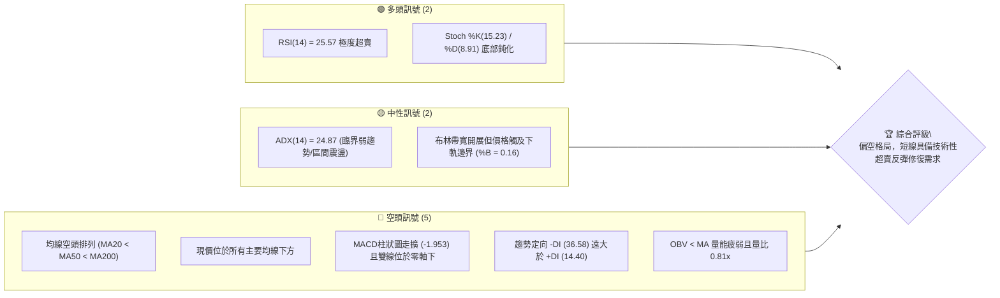
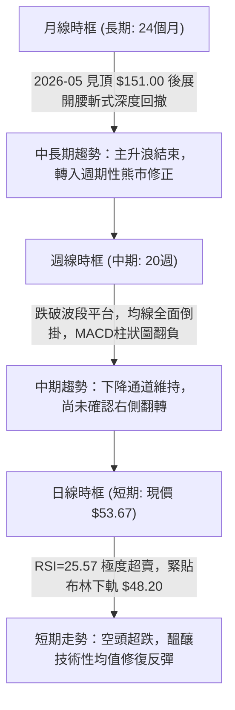
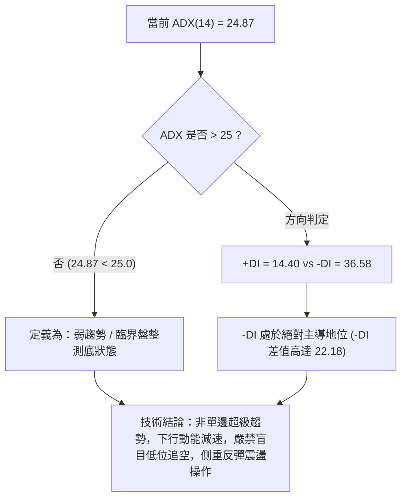
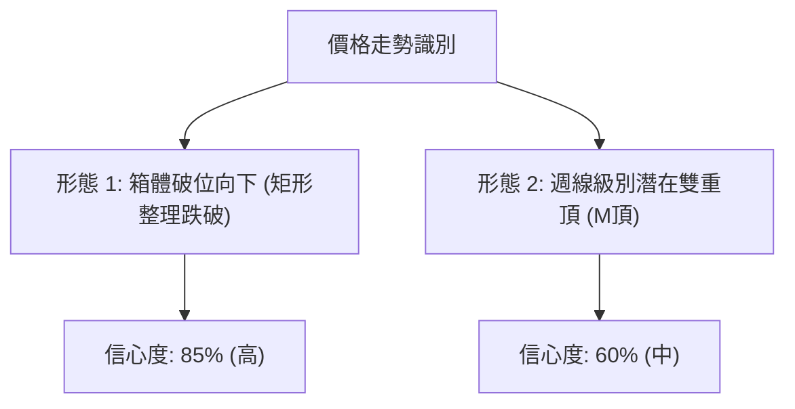
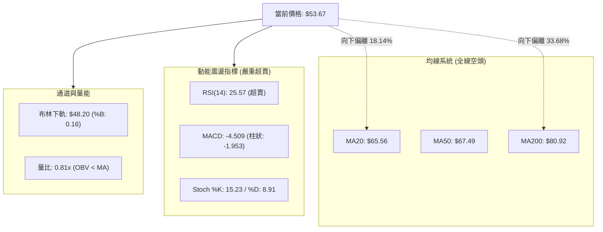
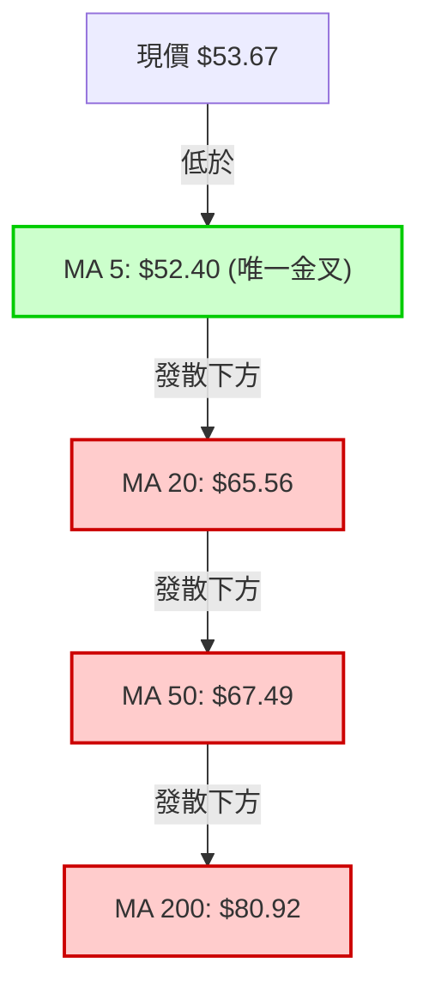
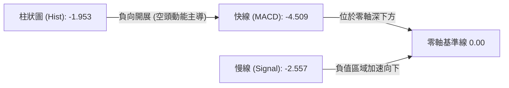
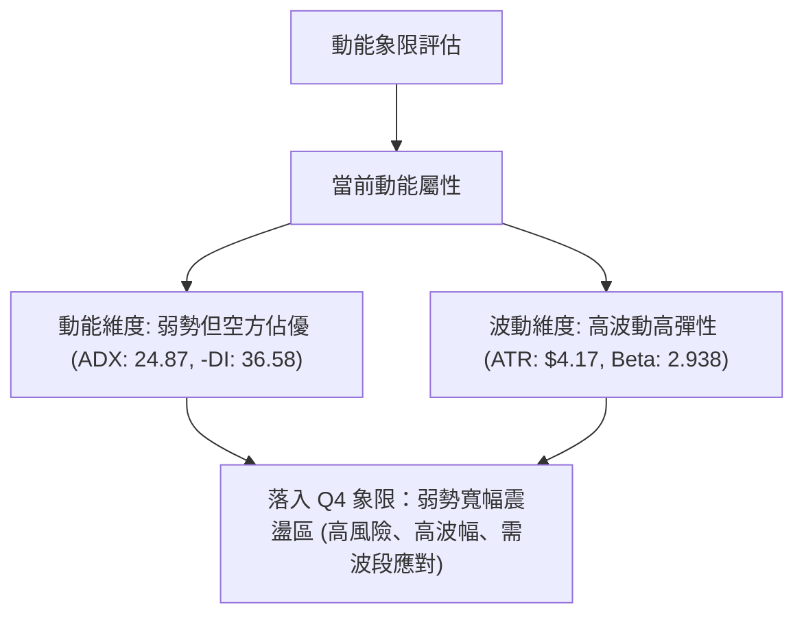
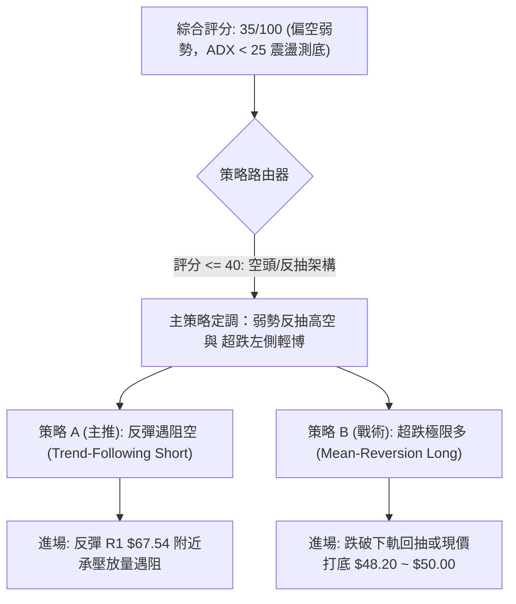
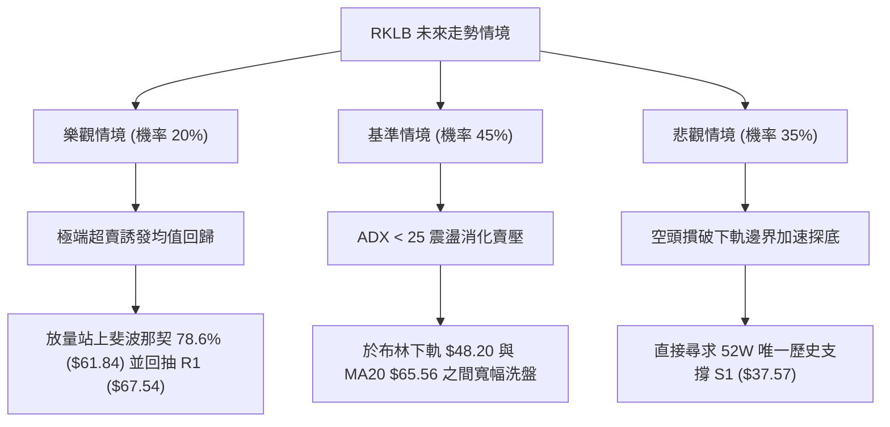

# RKLB 技術分析報告

> **報告日期**：2026-10-22 ｜ **語言**：繁體中文 ｜ **數據來源**：Yahoo Finance ｜ **當前價格**：$53.67

---

## 目錄

| 章節 | 內容 |
|------|------|
| [1. 技術面概覽](#1-技術面概覽) | 訊號儀表板、核心指標、評分卡 |
| [2. 趨勢分析](#2-趨勢分析) | 多時框趨勢、長中短期走勢、ADX解讀 |
| [3. 圖表形態分析](#3-圖表形態分析) | 形態識別與信心度、K線組合、目標價推算 |
| [4. 支撐與阻力](#4-支撐與阻力) | 關鍵價位結構、斐波那契回調位深入分析 |
| [5. 技術指標深度解讀](#5-技術指標深度解讀) | 均線系統、RSI、MACD、布林通道、OBV量價 |
| [6. 動能與波動率](#6-動能與波動率) | 動能四象限、ATR波動風險、Beta敏感度 |
| [7. 多時框架總結](#7-多時框架總結) | 時框架評分矩陣、多時框收斂與裁決結論 |
| [8. 交易策略建議](#8-交易策略建議) | 策略路由、價格情境階梯、進出場精確點位 |
| [9. 風險提示與監控](#9-風險提示與監控) | 關鍵監控清單、情境風險樹、倉位管理準則 |

---

## 1. 技術面概覽

### 🎯 技術訊號儀表板



### 📊 核心指標速覽表

| 指標類別 | 指標名稱 | 當前數值 | 訊號 | 解讀 |
|:---|:---|:---|:---:|:---|
| **價格** | 當前收盤價 | $53.67 | 🔴 | 位於52週區間 14.2% 位置，處於空頭壓制區 |
| **均線** | 短期 MA20 | $65.56 | 🔴 | 價格低於 MA20 達 -18.14%，短線下行斜率陡峭 |
| **均線** | 中期 MA50 | $67.49 | 🔴 | 價格低於 MA50 達 -20.48%，中期上升結構破裂 |
| **均線** | 長期 MA200 | $80.92 | 🔴 | 價格低於 MA200 達 -33.68%，確立中長期熊市修正 |
| **動能** | RSI(14) | 25.57 | 🟢 | 進入極度超賣區（<30），隨時可能誘發均值回歸反抽 |
| **動能** | MACD (12,26,9) | -4.509 / -2.557 | 🔴 | DIF 與 DEA 雙雙下穿零軸，負柱狀圖擴張 (-1.953) |
| **動能** | 隨機指標 (Stoch) | %K 15.23 / %D 8.91 | 🟢 | 超賣區低位，存在金叉修復契機 |
| **趨勢** | ADX (14) | 24.87 | 🟡 | 低於 25 閥值，表示單邊強趨勢減速，進入震盪測底期 |
| **趨勢** | 方向指標 DMI | +DI: 14.40 / -DI: 36.58 | 🔴 | -DI 大幅占優，空方掌握定價主導權 |
| **通道** | 布林帶 (%B) | %B: 0.16 (下軌 $48.20) | 🟡 | 緊貼布林通道下軌邊界運行，下行空間受限於帶寬 |
| **量能** | 20日均量比 | 0.81x (1,765.8萬股) | 🔴 | 下跌伴隨成交量萎縮，買盤承接力道顯著不足 |
| **波動** | ATR(14) | $4.17 (7.78%) | 🔴 | 單日絕對波動幅度極高，部位風控要求嚴格 |

### 🏆 技術評分卡

```
╔══════════════════════════════════════════════════════════════╗
║              技術評分卡 — RKLB (2026-10-22)                   ║
╠══════════════════════════════════════════════════════════════╣
║ 趨勢強度 (Trend)     ██████░░░░░░░░░░░░░░  30/100 🔴 空頭壓制 ║
║ 動能指標 (Momentum)  ████████░░░░░░░░░░░░  40/100 🟡 超賣鈍化 ║
║ 支撐穩定度 (Support) ██████░░░░░░░░░░░░░░  30/100 🔴 測底階段 ║
║ 成交量配合 (Volume)  ████████░░░░░░░░░░░░  38/100 🔴 量能疲弱 ║
║ 形態完整度 (Pattern) ██████████░░░░░░░░░░  50/100 🟡 箱體破位 ║
║ 均線排列 (Moving Avg)████░░░░░░░░░░░░░░░░  20/100 🔴 完美空頭 ║
╠══════════════════════════════════════════════════════════════╣
║ 綜合技術評分         ███████░░░░░░░░░░░░░  35/100 🔴 偏空弱勢 ║
╚══════════════════════════════════════════════════════════════╝
```

---

## 2. 趨勢分析

### 🌐 多時框趨勢分析



### 📈 長期趨勢 — 12個月走勢圖（Unicode）

標注過去 12 個月（2025-11 至 2026-10）收盤價、歷史極值與關鍵轉折結構：

```
RKLB 月線收盤走勢圖（過去12個月）
價格軸 ($)
$150 ┤                                      ● (2026-05 歷史高點 $151.00 / 收盤 $143.48)
$130 ┤                                     / \
$110 ┤                                    /   ● (2026-06 $101.65)
 $90 ┤                      ● (2026-04 $82.51) \
 $80 ┤        ● (2026-01 $80.07)                \
 $70 ┤  ●     │  \        /                      \     ● (2026-09 $69.68)
 $60 ┤  │\   /    ●     ●                        ●───● \
 $50 ┤  │ \ / (02 $69.10; 03 $64.22)        (07 $64.95; 08 $63.92)  ●← 當前現價 $53.67
 $40 ┤  ● (2025-11 $42.14)                                         (52W 低點 $37.57)
     └─────────────────────────────────────────────────────────────
       M1   M2   M3   M4   M5   M6   M7   M8   M9  M10  M11  M12
      11月 12月 01月 02月 03月 04月 05月 06月 07月 08月 09月 10月
      (2025)                      (2026)
```

#### 長期走勢特徵分析表

| 階段區間 | 時間跨度 | 價格起訖 | 漲跌幅 | 走勢結構與技術特徵 |
|:---|:---:|:---:|:---:|:---|
| **加速衝頂段** | 2025-11 ~ 2026-05 | $42.14 → $143.48 | **+240.48%** | 爆發性多頭主升浪，成交量極度放大，創下 52 週高點 $151.00 |
| **斷崖回撤段** | 2026-05 ~ 2026-07 | $143.48 → $64.95 | **-54.73%** | 獲利了結盤湧出，跌破斐波那契 50.0% ($94.28) 與 61.8% ($80.90) |
| **中繼橫盤段** | 2026-07 ~ 2026-09 | $64.95 → $69.68 | **+7.28%** | 於 $63.00 - $70.00 建立短期弱勢平台，成交量逐月遞減 |
| **破位再探段** | 2026-09 ~ 2026-10 | $69.68 → $53.67 | **-22.98%** | 平臺下邊界失守，均線系統全面向下發散，下探 52 週低位區域 |

### 📊 中期趨勢（週線分析）

從近 20 週高頻收盤軌跡觀察，RKLB 在 2026 年 8 月中旬曾反彈至 $82.83（遇阻於 61.8% 斐波那契位 $80.90），隨後量能萎縮並步入陰跌。

```
週線震盪走勢與壓力分佈示意圖：
$85.00 ┤              ▲ 8月中波段反彈頂點 ($82.83)
$80.00 ┤             / \
$75.00 ┤            /   \                  ▲ 10月初次高點 ($73.95)
$70.00 ┤           /     \                / \
$65.00 ┤───●───────●       ●──────●──────●   \──── 破位平台頸線 ($64.00)
$60.00 ┤    \     /         \    / \    /      \
$55.00 ┤     \   /           \  /   \  /        ● 當前現價 ($53.67)
$50.00 ┤      ▼ 7月回撤低點   ▼─▼ 8-9月低點      ▼ 10/18 低點 ($50.84)
```

10 月中旬以大陰線跌破 $64.00 支撐帶，形成「平台破位向下加速」，週線 MACD 柱狀圖自 +0.857 驟降至 -1.953，中期趨勢完全轉由空方定價。

### ⚡ 趨勢強度評估（ADX 解讀）



#### ADX 趨勢強度對照解讀

| 指標變數 | 當前讀數 | 門檻區間 | 技術含義解讀 |
|:---|:---:|:---:|:---|
| **ADX(14)** | **24.87** | 20.0 ~ 25.0 | **弱趨勢臨界點**。價格自高位下跌之慣性動能正在趨緩，單邊加速賣壓耗盡，逐步轉為寬幅震盪洗盤。 |
| **+DI (14)** | **14.40** | < 20 (極弱) | 多頭買盤力道潰散，市場資金缺乏主動進場做多意願。 |
| **-DI (14)** | **36.58** | > 30 (強勢) | 空頭賣壓維持高位，盤面呈現空方主導下的慣性下垂。 |
| **趨勢性質判斷** | **空頭震盪尋底** | ADX < 25 且 -DI > +DI | **依據規則 14：盤整行情以日線布林通道 ($48.20 ~ $82.93) 為核心邊界。** |

---

## 3. 圖表形態分析

### 🔍 形態識別系統



#### 圖表形態信心度與目標價明細表

| 形態名稱 | 信心度 | 判斷依據（引用數據） | 完成度 | 目標價（附嚴謹計算式） |
|:---|:---:|:---|:---:|:---|
| **矩形箱體破位** | **85%** | 2026年7月至9月收盤價緊密聚集於箱底 $63.92 ~ $64.95，箱頂為9月下旬高點 $73.95。10月中旬跌破該區間。 | 100% (已確認跌破) | 箱底 $63.92 - 箱體高度 ($73.95 - $63.92 = $10.03) = **$53.89**。<br>*(當前價格 $53.67 已精確抵達該形態理論滿足點)* |
| **雙重頂 (M頭)** | **60%** | 左頂為 2026-08-09 高點 $82.83，右頂為 2026-10-04 高點 $73.92，頸線為 2026-09-13 低點 $62.95。 | 90% (頸線跌破) | 頸線 $62.95 - 形態高度 ($78.74 阻力 R3 - $62.95 = $15.79) = **$47.16**。<br>*(接近布林下軌 $48.20)* |
| **頭肩底形態** | **< 30%** | 數據中未偵測到底部反轉之右肩特徵，各期均線呈發散下行。 | 0% | **訊號不足，僅做指標型解讀，不予預測形態目標。** |

### 🕯️ 重要 K 線形態分析

| 週期/月份 | 收盤價 | 典型 K 線形態 | 技術解讀 | 訊號性質 |
|:---:|:---:|:---|:---|:---:|
| **2026-05** | $143.48 | 長上影高位流星線 (Shooting Star) | 衝擊 $151.00 歷史高位遭機構主力派發，留下極長空頭墓碑。 | 🔴 強烈看跌 |
| **2026-07** | $64.95 | 長實體大陰線 (Bearish Marubozu) | 跌破多道中期均線，空頭賣盤肆虐，市場多頭防線全面潰退。 | 🔴 空頭延續 |
| **2026-09** | $69.68 | 窄幅十字星 (Doji) | 多空雙方在 $64 - $70 展開激烈爭奪，量能萎縮，屬於中繼停頓。 | 🟡 變盤預警 |
| **2026-10 (當前)** | $53.67 | 破位下挫大陰線下探下影 | 月中下殺至 $50.84 後出現微弱抵抗，但收盤仍受制於均線下方。 | 🔴 弱勢反抽 |

### 📉 ASCII 走勢形態示意圖

箱體跌破滿足點測算與雙頂結構：

```
$82.83 ───────● (左頂 08-09)
               \               ● $73.92 (右頂 10-04)
                \             / \
$63.92 ──────────●───────────●───\──────── 矩形箱底 / 頸線 ($63.92 ~ $62.95)
 (箱體破位)        09-06       09-13 \
                                      \
$53.89 ────────────────────────────────●── 箱體等幅下跌滿足點 ($53.89)
                                       ▲ 現價 $53.67 (精準回測理論滿足點)
$47.16 ─────────────────────────────────── 雙頂形態極限滿足點 (對應布林下軌 $48.20)
```

### 🎯 形態目標價計算

1. **箱體等幅跌幅滿足點**：
   - 形態箱體頂部阻力（取 9 月反彈高點）：$73.95
   - 形態箱體底部支撐（取 8 月底至 9 月初聚類收盤低點）：$63.92
   - 形態高度 $H = 73.95 - 63.92 = 10.03$
   - 理論跌破目標價 $T_{box} = 63.92 - 10.03 =$ **$53.89**
   - **實證評估**：現價為 $53.67，已完全消化並達成箱體跌破之空頭量度目標，空頭下行第一階段動能已完全釋放。

---

## 4. 支撐與阻力

### 🗺️ 關鍵價位分布圖（Unicode）

```
RKLB 價位結構分布圖
═════════════════════════════════════════════════════════════════
$151.00 ║████████████████████████████████████████║ 52W 歷史極值高點
$107.67 ║████████████████████                    ║ 斐波那契 38.2% 回調位
 $80.90 ║████████████████████████████████        ║ 斐波那契 61.8% / MA200 ($80.92)
 $78.74 ║████████████████████████                ║ 波段強阻力 R3
 $75.28 ║████████████████                        ║ 波段阻力 R2
 $67.54 ║████████████████████                    ║ 關鍵阻力 R1 (密集成交區)
 $65.56 ║────────────────────────────────────────║ 布林中軌 / MA20 重合壓力
 $61.84 ║████████████████                        ║ 斐波那契 78.6% 回調壓力位
 $53.67 ╠════════════════════════════════════════╣ ◄ 當前市價 ($53.67)
 $48.20 ║▓▓▓▓▓▓▓▓▓▓▓▓▓▓▓▓                        ║ 動態支撐 (布林下軌)
 $37.57 ║████████████████████████████████████████║ 52W 歷史低點 / 強支撐 S1
═════════════════════════════════════════════════════════════════
```

### 🚧 阻力位分析表

阻力位嚴格引用技術數據聚類計算成果：

| 阻力級別 | 價位 | 形成技術依據 | 突破難度 | 重要性 |
|:---|:---:|:---|:---:|:---:|
| **R1 (第一阻力)** | **$67.54** | 近一年波段高點聚類位，且高度重合於 MA20 ($65.56) 與 MA50 ($67.49)。 | ⭐️⭐️⭐️⭐️ (高) | 關鍵分水嶺；多頭反彈欲化解空頭排列之首要考驗。 |
| **R2 (第二阻力)** | **$75.28** | 2026年9月下旬波段密集反彈高點平台（9/27收盤 $73.95及10/04收盤 $73.92上方延伸）。 | ⭐️⭐️⭐️⭐️⭐️ (極高) | 中期多空生命線，此處解套套牢盤極為沉重。 |
| **R3 (第三阻力)** | **$78.74** | 近一年波段高點聚類密集帶，向上緊貼 MA200 ($80.92) 與 61.8% 斐波那契位 ($80.90)。 | ⭐️⭐️⭐️⭐️⭐️ (堡壘級) | 長期熊市與牛市的界線，未放量站穩前長線皆為空頭。 |

### 🛡️ 支撐位分析表

| 支撐級別 | 價位 | 形成技術依據 | 守住機率 | 重要性 |
|:---|:---:|:---|:---:|:---:|
| **動態支撐** | **$48.20** | 日線布林通道下軌動態下限，當前價格 %B 為 0.16，極限擴張位置。 | 70% | 短線空方加速之邊界緩衝區，跌破易誘發劇烈假突破抽回。 |
| **S1 (關鍵支撐)** | **$37.57** | **52週絕對歷史低點**（近一年波段低點聚類核心，斐波那契 100.0% 位）。 | 85% | 終極多頭心理防線；若遭實體跌破，公司將探尋歷史新低估值區。 |
| **次級支撐** | **數據中未偵測到** | 在現價 $53.67 與 $37.57 之間，歷史 OHLCV 聚類數據未偵測到其他有效靜態水平節點。 | - | 空白緩衝區間，須密切依賴布林下軌動態追蹤。 |

### 📐 斐波那契回調位分析

依據 52 週絕對極值區間（低點 **$37.57** → 高點 **$151.00**），全幅波動區間高達 $113.43：

| 回調比率 | 價位 | 當前相對位置與技術意義解讀 |
|:---:|:---:|:---|
| **0.0% (高點)** | **$151.00** | 歷史峰值，本輪宏觀週期之絕對頂部阻力。 |
| **23.6%** | **$124.23** | 早期回調支撐（已被跌破並徹底轉化為遠期天花板）。 |
| **38.2%** | **$107.67** | 牛市健康回調位（6月破位後確認行情轉入深幅熊市）。 |
| **50.0%** | **$94.28** | 心理分水嶺與中樞軸心位，空方完全擊潰多頭中場防線。 |
| **61.8%** | **$80.90** | **黃金分割關鍵防線**，與目前 MA200 ($80.92) 完美重合。現價遠落於其下。 |
| **78.6%** | **$61.84** | **深度防守回撤位**。現價已跌破該水平（-$8.17），宣告進入非理性超賣超跌深水區。 |
| **100.0% (低點)** | **$37.57** | **年度底線 S1**。若跌勢不止，該位置為全幅黃金分割之最終承接堡壘。 |

> **現價位置診斷**：
> 當前價格 **$53.67** 處於 **78.6% 回調位 ($61.84)** 與 **100.0% 基準低點 ($37.57)** 之間的極端回撤真空帶。技術上屬於典型「跌破 78.6% 後的非理性情緒宣洩期」，歷史上常出現向 78.6% 阻力位的技術性反抽。

---

## 5. 技術指標深度解讀

### 🎛️ 指標訊號總覽



### 📈 移動平均線排列分析



#### 各期均線狀態表

| 均線名稱 | 數值 | 距現價偏離度 | 軌跡特徵 | 訊號解讀 |
|:---|:---:|:---:|:---|:---:|
| **MA 5** | $52.40 | +2.42% | ▲ 勾頭向上 (+1.27) | 短線止跌，價格自低位展開超跌反彈。 |
| **MA 10** | $58.77 | -8.68% | ▼ 快速下行 (-5.10) | 第一道超短線動態壓制。 |
| **MA 20** | $65.56 | -18.14% | ▼ 持續下行 (-11.89) | 20日成本線，為布林中軌，構成反彈首要天花板。 |
| **MA 50** | $67.49 | -20.48% | ▼ 穩定下行 | 中期空方陣營主線，壓制反彈空間。 |
| **MA 60** | $68.35 | -21.48% | ▼ 震盪下行 | 季線阻力，確認中期趨勢轉向。 |
| **MA 120** | $84.44 | -36.44% | ▼ 加速下滑 | 半年線持續向下修正。 |
| **MA 200** | $80.92 | -33.68% | ▼ 拐頭下行 | 宣告中長期週期全面走熊。 |
| **MA 240** | $76.59 | -29.93% | ▼ 停滯下行 | 年線級別支撐轉阻力。 |

均線呈現標準的「死亡排列（MA20 < MA50 < MA200）」，且各期長期均線斜率均為負值，確認大級別趨勢處於下行週期。

### 📉 RSI(14) 分析

當前 RSI(14) 讀數為 **25.57**：

```
RSI(14) 動能刻度表：
0        20   25.57  30                50                70                100
├────────┼──────▲─────┼─────────────────┼─────────────────┼──────────────────┤
[  極端超賣區  ]  │   [      中性偏弱區     ]        [      強勢多頭區    ]
            現價RSI
進度條展示：
超賣強度: [█████████████████████░░░░░░░░░░░░░] 25.57/100 (極度超賣)
```

- **超買超賣判定**：數值深入 30 以下之極端超賣區。過往經驗顯示，RSI 跌至 25 以下時，空頭打壓往往伴隨邊際效用遞減，容易引發「均值回歸」的報復性修正抽搐。
- **背離分析判斷**：
  - 日線維度：10 月中旬價格創出波段新低 $50.84，RSI 於前低（10/18）讀數為 18.5，當前價格反彈至 $53.67，RSI 回升至 25.6。價格與 RSI 同步上升，**無顯著頂背離或底背離**。
  - 週線維度：前次低點 9/06 週收盤 $64.26 時 RSI 為 12.8，當前 10/25 週收盤 $53.67，RSI 為 25.6。雖然價格創新低而 RSI 抬高呈現「潛在週線底背離雛形」，但尚未獲得週線收盤突破驗證，**暫定為底背離醞釀期**。

### 📊 MACD(12,26,9) 訊號解讀



- **雙線絕對值**：DIF (-4.509) 處於 DEA (-2.557) 下方，且雙雙運行於零軸以下極深位置，定義為標準「空頭市場強烈弱勢區」。
- **柱狀圖動態**：當前 MACD Hist 為 **-1.953**，相較前一週（10/18）的 **-2.111** 出現微幅收斂跡象（收縮 +0.158）。若柱狀圖持續收斂，將引導 DIF 走平並可能在低位形成空頭市場中的「超跌弱勢金叉」。

### 📦 布林通道分析

```
布林通道幾何位置示意圖 (寬度 = $34.73)
$82.93 ────────────────────────────── 上軌 (Upper Band)
       │
       │
$65.56 ────────────────────────────── 中軌 (Middle Band = MA20)
       │
$53.67 ──────────●─────────────────── 現價 (%B = 0.16)
       │
$48.20 ────────────────────────────── 下軌 (Lower Band)
```

- **通道參數與現況**：
  - 上軌：**$82.93**
  - 中軌 (MA20)：**$65.56**
  - 下軌：**$48.20**
  - 通道寬度：$82.93 - $48.20 = $34.73（帶寬百分比達 52.9%，處於寬幅擴張後狀態）。
- **%B 指標解讀**：
  - 當前 %B 為 **0.16**，處於下軌臨界線上方。價格先前曾擊穿下軌邊緣，目前正在嘗試重返軌道內部。在寬帶環境下，%B 接近 0.15 通常具備顯著的統計學反彈邊界支撐。

### 💹 成交量分析（量價配合度）

- **量能規模**：最新單日成交量為 **17,658,500 股**，相較 20 日均量（**21,788,385 股**）的量比僅為 **0.81x**。
- **量價背離診斷**：價格處於破位低位，但成交量未能放大，呈現典型「無量陰跌」特徵。
- **能量潮 OBV 分析**：技術數據明確指示「OBV < MA → 量能疲弱」。資金呈現持續淨流出趨勢，機構大單並未在 $53.67 現價區間展開激進的主動性建倉，成交量未能確認任何反轉形態的有效性。

---

## 6. 動能與波動率

### ⚡ 動能評估四象限

將價格波動行為拆解為「動能強度（Momentum）」與「波動率（Volatility）」二維矩陣：

| 象限分佈 | 動能維度 | 波動維度 | 典型市場特徵 | RKLB 歸屬診斷 |
|:---:|:---:|:---:|:---|:---:|
| **Q1 (突破爆發)** | 強 (+DI主導) | 高 (ATR走擴) | 牛市單邊突破，主升浪暴衝 | ❌ 不符 |
| **Q2 (平穩慢牛)** | 強 (+DI主導) | 低 (ATR收斂) | 機構控盤鎖倉，緩步推升 | ❌ 不符 |
| **Q3 (空頭宣洩)** | **強 (-DI主導)**| **高 (ATR極大)**| **恐慌性殺跌，多殺多熔斷盤** | ❌ 宣洩期已過 |
| **Q4 (弱勢沉澱)** | **弱 (ADX<25)**| **高 (Beta=2.938)**| **超跌後維持高彈性寬幅低位震盪** | **✅ 完美符合** |



### 📊 ATR 波動率分析

- **ATR(14) 絕對數值**：**$4.17**。
- **相對波動率 (ATR / Price)**：$4.17 / $53.67 = **7.78%**。
- **交易風控意涵**：
  - RKLB 單日平均震幅接近 8%，意味著日內及短線價格噪音極為劇烈。
  - **動態止損設定基準**：在設計波段交易止損時，最小防守間距必須給予 **1.5 倍至 2.0 倍 ATR**，即 **$6.26 至 $8.34** 之緩衝空間，否則極易被隨機市場噪音洗盤出場。

### 📐 Beta 與市場相關性

- **Beta 係數**：**2.938**。
- **市場特徵解讀**：
  - RKLB 屬於極高 Beta 資產，理論上其對基準指數（S&P 500）的波動敏感度接近 300%。
  - 當大盤回調時，該股面臨近 3 倍的放大下行壓力；反之，若大盤企穩並誘發市場風險偏好（Risk-On）回升，其超跌屬性與高 Beta 將轉化為強大的向上反彈槓桿。

---

## 7. 多時框架總結

### 📋 時框架評分表

| 時框架 | 趨勢方向 | 動能狀態 | 均線排列 | 圖表形態 | 綜合評分 | 操作指導建議 |
|:---:|:---:|:---:|:---:|:---:|:---:|:---|
| **月線 (長期)** | 🔴 強烈看空 | 🔴 下行發散 | 🟡 跌穿短期均線 | 雙頂高位流星線回撤 | **25/100** | 暫停左側長線加倉，靜待底部架構 |
| **週線 (中期)** | 🔴 空頭延續 | 🔴 MACD柱為負 | 🔴 空頭排列 | 箱體跌破，尚未築底 | **30/100** | 逢反彈至關鍵阻力應減碼防禦 |
| **日線 (短期)** | 🟡 超跌反彈 | 🟢 RSI超賣 (25.5) | 🔴 MA20陡峭下壓 | 觸及布林下軌回抽 | **45/100** | 僅適合輕倉參與超賣均值修復 |

### 🔲 綜合訊號矩陣

| 技術分析維度 | 短期視角 (日線) | 中期視角 (週線) | 長期視角 (月線) | 多時框一致性評估 |
|:---|:---:|:---:|:---:|:---|
| **趨勢方向 (Trend)** | 震盪尋底 | 逆向修正 | 大週期頂部回調 | 🔴 全週期由空頭結構籠罩 |
| **動能位階 (Momentum)**| 極度超賣 | 中度偏空 | 轉入負向循環 | 🟡 短期嚴重超賣與中長線弱勢產生背離 |
| **量價結構 (Volume)** | 縮量陰跌 | 增量回踩 | 主力高位派發後沉澱 | 🔴 缺乏機構買盤大規模承接 |
| **波動特徵 (Volatility)**| ATR高位收窄 | 均幅波動維持 | 極高彈性 (Beta=2.94) | 🟡 適合嚴格風控下的區間交易 |

### ⚖️ 多時框收斂結論

依據多時框收斂規則第 14 條精確裁決：
1. **趨勢/盤整性質判別**：當前 ADX(14) 讀數為 **24.87**，精確落於 **ADX < 25** 的「盤整/弱趨勢」定義域中。
2. **優先收斂原則**：在盤整行情下，市場缺乏單邊加速驅動力，中長期的均線單向指標鈍化，交易決策應**以日線布林通道上下軌 ($48.20 ~ $82.93) 為核心邊界**。
3. **終局裁決結論**：**中性偏空觀望，短線防守型區間震盪操作**。
   - 儘管中長期均線呈現死叉空頭排列，但短線日線 RSI(14) = 25.57 及 %B = 0.16 呈現極端超賣，且空頭箱體滿足點 $53.89 已精確抵達。
   - 結論：**嚴禁在 $53.67 現價盲目低位追空**；主基調以防範進一步回踩下軌為主，同時保留捕捉極限超賣反彈之戰術性交易機會。

---

## 8. 交易策略建議

### 🗺️ 策略決策流程圖



### 🧭 策略路由

> **當前主策略方向 = 【逢反彈阻力位偏空操作（主）/ 輕倉博弈超跌均值回歸（次）】（依技術評分卡：35/100）**

因技術評分卡得分為 **35/100 (≤ 40)**，整體結構處於空頭防守位階，策略規劃嚴格遵循「順應中中期空頭趨勢、逢反彈至關鍵阻力位佈局空單」為主架構；多頭操作僅能定義為極短線超跌反抽，嚴格限制倉位規模。

### 🎯 價格情境階梯（Price Scenarios）

以當前價格 **$53.67** 為基準，嚴格引用第 4 章及數據計算之真實關鍵價位：

| 觸發條件 | 下一目標 | 後續延伸 | 情境技術含義 |
|:---|:---:|:---:|:---|
| **向上突破 R1 ($67.54)** | R2 ($75.28) | R3 ($78.74) | **短線強烈轉強**：突破 MA20 及 MA50，封閉破位缺口，挑戰長線牛熊分水嶺。 |
| **站穩現價區間 ($53.67)** | 斐波那契 78.6% ($61.84) | R1 ($67.54) | **超跌修復震盪**：消化超賣指標，展開對 MA20 布林中軌 ($65.56) 的均值回歸。 |
| **跌破布林下軌 ($48.20)** | 52W 低點 S1 ($37.57) | 歷史低位深淵 | **中期加速崩跌**：下行通道擴張，多頭防線全面擊潰，考驗年度唯一絕對堡壘。 |

### 📊 情境機率分佈

```
情境機率分佈圖：
[1] 區間弱勢震盪打底 (45%)  ██████████████████
[2] 慣性回落下測下軌 (35%)  ██████████████
[3] 強勢反轉向上修復 (20%)  ████████
```

| 情境劃分 | 機率預估 | 主要技術指標支撐依據 |
|:---|:---:|:---|
| **區間弱勢震盪 (打底修復)** | **45%** | **ADX=24.87 (<25)** 確認趨勢減弱；箱體量度跌幅 $53.89 已抵達；RSI=25.57 限制下殺空間。 |
| **慣性回落 (再探 S1 低點)** | **35%** | 均線系統全面空頭排列；-DI 高達 36.58；OBV 疲軟且量比 0.81x 表明無大資金護盤。 |
| **報復性反彈 (回抽 R1)** | **20%** | 分析師評級強烈看多（目標均價 $102.15）；Stoch 底部鈍化隨時金叉，ATR 高彈性催化。 |

### 🟢 主策略詳情

嚴格根據數據計算點位，制定兩套相互對應之量化交易策略：

| 策略要素 | 策略 A (主推: 阻力承壓做空) | 策略 B (戰術: 限制性超跌反彈做多) |
|:---|:---:|:---:|
| **策略性質** | 順中期均線趨勢之高空波段策略 | 逆短期均線之極端超賣均值回歸策略 |
| **進場條件** | 價格反抽至 R1 關鍵阻力且日 K 線出現滯漲上影線 | 價格回踩布林下軌 $48.20 附近獲企穩支撐或現價築底 |
| **精確進場價格** | **$67.54** (阻力位 R1) | **$50.84** (前低/布林下軌上緣緩衝) |
| **目標價 T1** | **$53.67** (當前破位平台位置) | **$61.84** (斐波那契 78.6% 回調位) |
| **目標價 T2** | **$37.57** (52W 歷史絕對低點 S1) | **$65.56** (布林中軌 / MA20 重疊壓力) |
| **止損價格** | **$75.28** (突破阻力位 R2 嚴格止損) | **$46.67** (跌破布林下軌並留 1.0x ATR 緩衝: $50.84 - $4.17) |
| **止損幅度** | -$7.74 (-11.46%) | -$4.17 (-8.20%) |
| **潛在報酬 (至T2)** | +$29.97 (+44.37%) | +$14.72 (+28.95%) |
| **風險報酬比 (R:R)**| **3.87 : 1** (優秀) | **3.53 : 1** (良好) |
| **預估勝率** | **65%** | **45%** |
| **建議配置倉位** | **15% - 20%** (標準配置) | **5% - 8%** (嚴格輕倉戰術配置) |

### 🔴 反向風險觸發點（對沖提示）

若已建立策略 A 之空頭部位，出現以下技術信號時必須無條件執行停損或多頭對沖：
1. **實體長陽放量突破 R1 ($67.54)**，且連續兩日收盤站穩其上方，宣告日線空頭均線排列遭到實質破壞。
2. **日線 MACD 出現零軸下方的低位黃金交叉**，伴隨成交量突破 20 日均量（> 2,178 萬股）。
3. 價格未見反彈直接摜破 $48.20 卻在日內收出超過 $4.00 的長下影錘頭線（Hammer）。

### ⭐ 整體訊號強度評星

```
做多訊號強度：★★☆☆☆  (2/5 星 - 僅具備超賣反抽動能，缺乏右側均線確認)
做空訊號強度：★★★★☆  (4/5 星 - 中長期結構完好壓制，順勢勝率高)
整體數據可信度：★★★★★  (5/5 星 - 歷史價位、波動率與指標覆蓋完整)
```

---

## 9. 風險提示與監控

### ✅ 關鍵監控指標 Checklist

```
╔══════════════════════════════════════════════════════════════════╗
║               RKLB 每日交易關鍵監控清單 (Checklist)             ║
╠══════════════════════════════════════════════════════════════════╣
║ [ ] 監控 $48.20 布林下軌支撐強度：是否收盤跌破？                ║
║ [ ] 監控 RSI(14) 能否脫離超賣區（> 30）：反彈動能是否啟動？       ║
║ [ ] 監控 成交量比值是否放大至 1.2x (約 2,600 萬股) 以上確認增量？║
║ [ ] 監控 MACD 柱狀圖：當前 -1.953 是否持續收斂向零軸靠近？       ║
║ [ ] 監控 MA 5 ($52.40) 是否維持在現價下方提供微觀支撐？          ║
║ [ ] 監控 ADX 走勢：若 ADX 突破 25，需警惕單邊新一輪下跌開啟！     ║
╚══════════════════════════════════════════════════════════════════╝
```

### ⚠️ 風險場景分析



### 🛡️ 風險管理重要提醒

1. **波動極端性防範**：
   - 該股 **Beta 高達 2.938**，且單日 **ATR 達 $4.17 (7.78%)**。這意味著正常的市場波動就相當於普通大盤藍籌股數週的振幅。任何進場必須嚴格限制單筆交易之最大虧損金額不超過總投資組合淨值的 **1.0% - 1.5%**。
2. **基本面催化劑風險**：
   - 儘管華爾街給予高達 $102.15 之平均目標價與 Buy 評級，但技術面上空頭排列不會因基本面評級而在一夕之間反轉。嚴禁以「分析師目標價空間巨大」作為無止境向下補倉摊平（Averaging Down）的理由。
3. **區間破位風控法則**：
   - 目前下方唯一由 OHLCV 明確計算出的核心靜態支撐位遠在 **$37.57 (距現價 -30.0%)**。在現價至 $37.57 之間存在廣闊的「支撐稀薄帶」，一旦 $48.20 動態下軌確認失守，市場極易引發流動性真空狀態下的滑價下墜，止損指令必須預設為「Stop Market」而非「Stop Limit」。

---

## 📋 報告總結

```
╔══════════════════════════════════════════════════════════════════╗
║                    RKLB 技術分析報告總結                         ║
╠══════════════════════════════════════════════════════════════════╣
║ 報告日期：2026-10-22                                             ║
║ 當前價格：$53.67                                                 ║
║ 分析評級：⚖️ 偏空弱勢，防範震盪誘多 (綜合評分: 35/100)          ║
║                                                                  ║
║ 關鍵結論：                                                       ║
║ ├─ 長期趨勢：🔴 熊市回撤階段 (自 $151.00 高點深度修正)          ║
║ ├─ 中期趨勢：🔴 空頭主導結構 (破位箱體跌幅已達 $53.89 目標)      ║
║ ├─ 短期趨勢：🟡 極端超賣修復 (RSI=25.57, 緊貼布林下軌)          ║
║ ├─ 關鍵支撐：S1: $37.57 ｜ 動態下軌: $48.20                      ║
║ ├─ 關鍵阻力：R1: $67.54 ｜ R2: $75.28 ｜ R3: $78.74             ║
║ └─ 華爾街目標：均價 $102.15 (低 $64.00 / 高 $150.00)            ║
║                                                                  ║
║ 最優策略組合：                                                   ║
║ 1. 🥇 最佳機會 (順勢空)：耐心等待反彈 R1 ($67.54) 承壓做空，     ║
║    目標 $53.67 / $37.57，止損 $75.28 (風報比 3.87:1)            ║
║ 2. 🥈 次選機會 (超短多)：於 $50.84 附近輕倉博弈 RSI 極端超賣反抽 ║
║    目標 $61.84 / $65.56，止損 $46.67 (風報比 3.53:1)            ║
║ 3. 🥉 保守選擇：空倉觀望，等待 ADX 回升且放量突破 R1 後再做定奪   ║
╚══════════════════════════════════════════════════════════════════╝
```

---

> ⚠️ **免責聲明**：本報告為技術分析研究成果，所有價位、圖表及推算結論均嚴格基於所提供之歷史交易數據客觀生成。本報告**僅供研究與學術參考**，**絕不構成任何形式的要約、招攬或實質投資建議**。金融市場瞬息萬變，高 Beta 股票波動劇烈，投資人應獨立評估風險，盈虧自負。