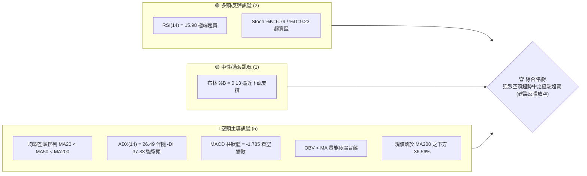
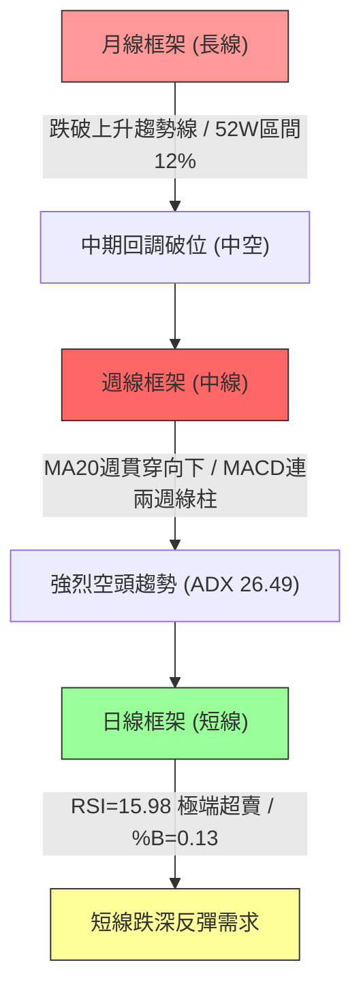
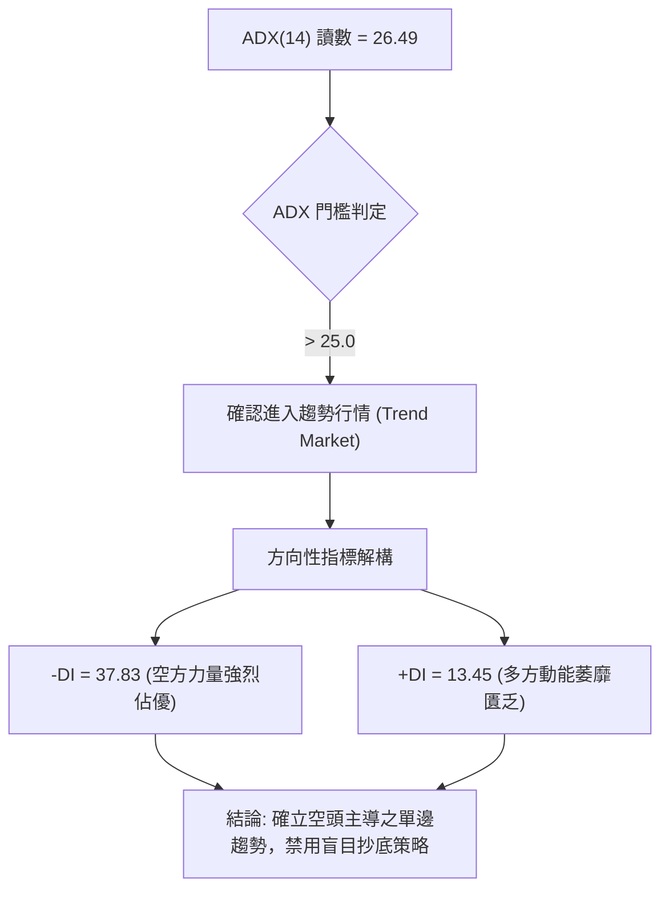
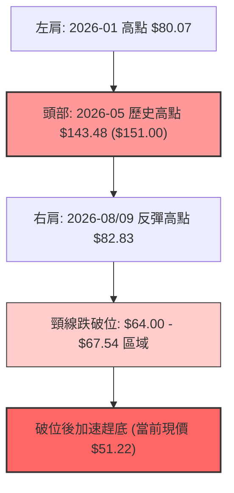
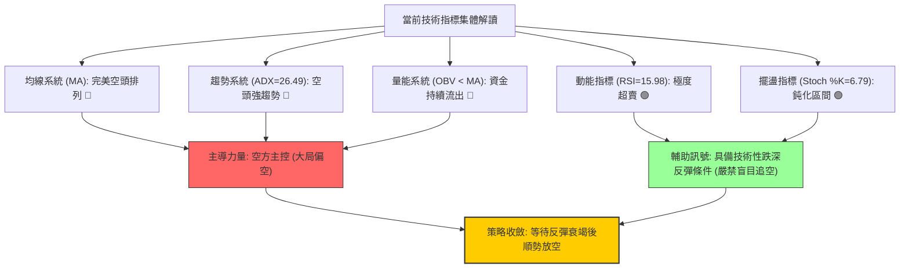
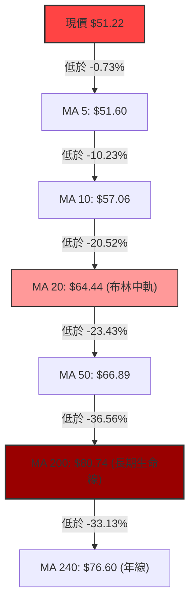
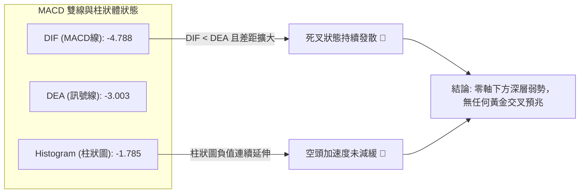
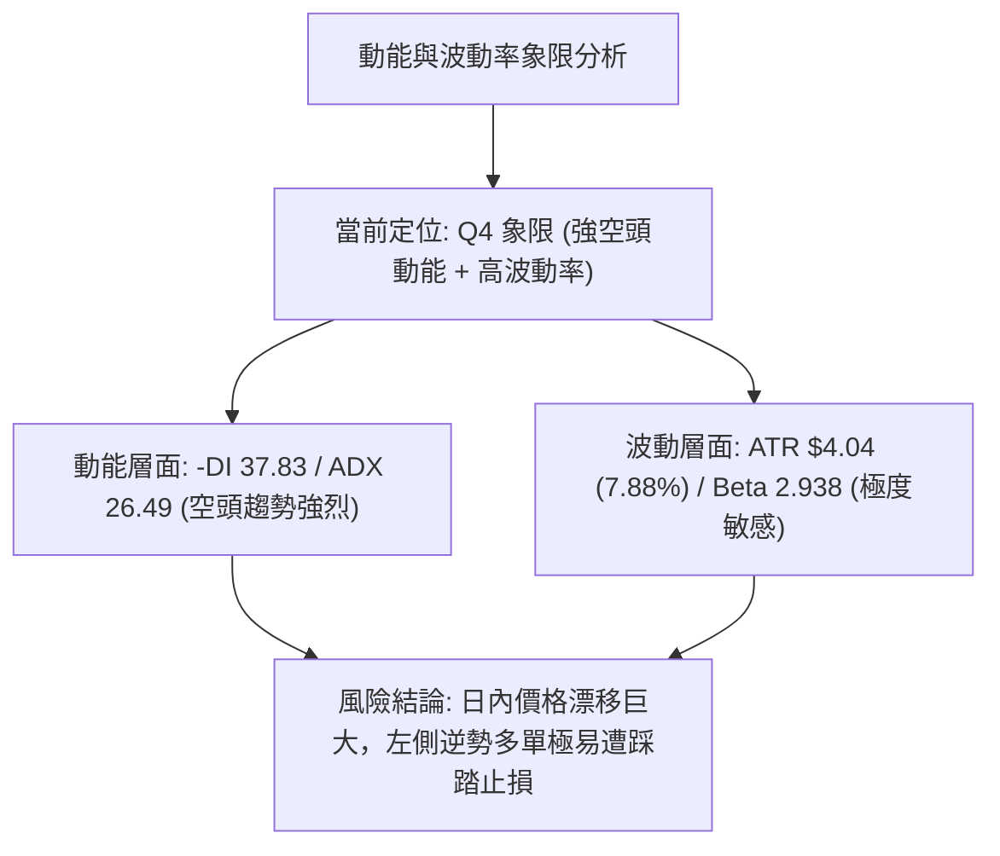
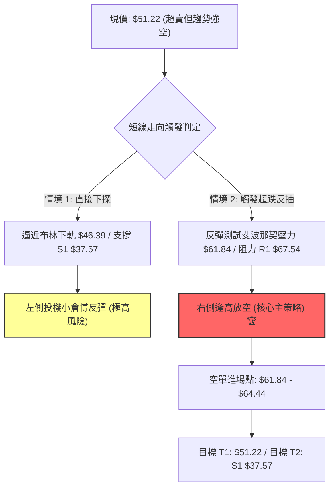
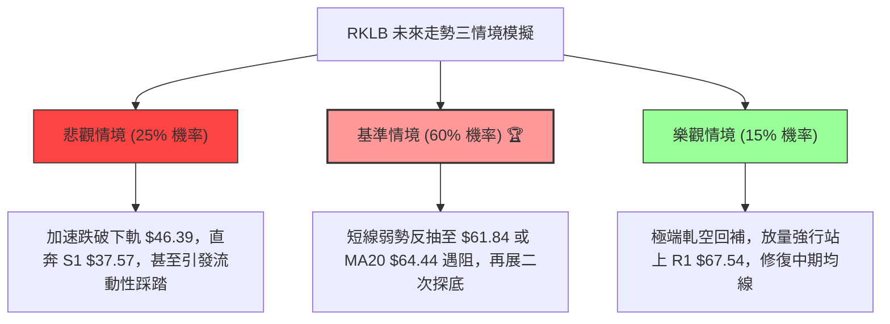

# RKLB 技術分析報告

> **報告日期**：2026-10-23 ｜ **語言**：繁體中文 ｜ **數據來源**：Yahoo Finance ｜ **當前價格**：$51.22

---

## 目錄

| 章節 | 內容 |
|------|------|
| [1. 技術面概覽](#1-技術面概覽) | 訊號儀表板、核心指標、評分卡 |
| [2. 趨勢分析](#2-趨勢分析) | 多時框趨勢、長中短期走勢 |
| [3. 圖表形態分析](#3-圖表形態分析) | 形態識別、K線組合、目標價 |
| [4. 支撐與阻力](#4-支撐與阻力) | 關鍵價位、斐波那契回調 |
| [5. 技術指標深度解讀](#5-技術指標深度解讀) | MA/RSI/MACD/布林/成交量 |
| [6. 動能與波動率](#6-動能與波動率) | 動能評估、ATR、Beta |
| [7. 多時框架總結](#7-多時框架總結) | 時框架評分矩陣 |
| [8. 交易策略建議](#8-交易策略建議) | 多空策略、風險報酬比 |
| [9. 風險提示與監控](#9-風險提示與監控) | 監控指標、風險場景 |

---

## 1. 技術面概覽

### 🎯 技術訊號儀表板



### 📊 核心指標速覽表

| 指標類別 | 指標名稱 | 當前數值 | 訊號 | 解讀 |
|----------|----------|----------|------|------|
| **價格** | 當前收盤價 | $51.22 | 🔴 | 位於52週區間12.0%低檔，受制於各期均線下方 |
| **均線** | MA20 | $64.44 | 🔴 | 現價低於MA20達 -20.52%，短線下行斜率極陡 |
| **均線** | MA50 | $66.89 | 🔴 | 現價低於MA50達 -23.43%，中期趨勢空頭主導 |
| **均線** | MA200 | $80.74 | 🔴 | 現價低於MA200達 -36.56%，跌破長期生命線 |
| **動能** | RSI(14) | 15.98 | 🟢 | 進入極度超賣區間 (<20)，隨時具備技術性跌深反彈動能 |
| **動能** | MACD (12,26,9) | -4.788 / -3.003 | 🔴 | 雙線位於零軸下方且負值擴大，MACD Hist 為 -1.785 擴散中 |
| **趨勢** | ADX(14) / ±DI | 26.49 | 🔴 | ADX>25，-DI(37.83) 遠高於 +DI(13.45)，強烈空頭趨勢確立 |
| **通道** | 布林通道 | 下軌 $46.39 / %B 0.13 | 🟡 | 價格緊貼下軌運行，尚未正式擊穿但軌道向下開口 |
| **量能** | 20日成交量比 | 0.78x (16.60M) | 🔴 | OBV < MA，反彈無量、下跌放量，籌碼渙散 |
| **波動** | ATR(14) | $4.04 (7.88%) | 🔴 | 日內波動幅度偏高，需設置較寬止損區間 |

### 🏆 技術評分卡

```
╔══════════════════════════════════════════════════════════════════╗
║              技術評分卡 — RKLB (2026-10-23)                      ║
╠══════════════════════════════════════════════════════════════════╣
║ 趨勢強度 (ADX/方向)   ████████████████░░░░  80/100  🔴 空頭強趨勢 ║
║ 動能指標 (RSI/MACD)   ████░░░░░░░░░░░░░░░░  20/100  🔴 動能重挫   ║
║ 支撐穩定度 (S1強度)   ██████░░░░░░░░░░░░░░  30/100  🔴 距離S1尚遠 ║
║ 成交量配合 (OBV/量比) ██████░░░░░░░░░░░░░░  30/100  🔴 量能疲弱   ║
║ 形態完整度 (破位走勢) ██████████████░░░░░░  70/100  🔴 空方旗形破 ║
║ 均線排列 (全面空頭)   ██░░░░░░░░░░░░░░░░░░  10/100  🔴 完美空頭   ║
╠══════════════════════════════════════════════════════════════════╣
║ 綜合技術評分          ██████░░░░░░░░░░░░░░  32/100  🔴 強烈看空   ║
╚══════════════════════════════════════════════════════════════════╝
```

---

## 2. 趨勢分析

### 🌐 多時框趨勢分析



### 📈 長期趨勢 — 12個月走勢圖（Unicode）

```
RKLB 月線走勢圖（過去12個月：2025-11 至 2026-10）
價格軸 ($)
$150 ┤                                      ● 2026-05 ($143.48 / 歷史高點 $151.00)
$130 ┤                                     / \
$110 ┤                                    /   ● 2026-06 ($101.65)
 $90 ┤                           ● 2026-04       \
 $80 ┤               ● 2026-01  /                 \
 $70 ┤        ● 2025-12   \____/ 2026-03           \            ● 2026-09 ($69.68)
 $60 ┤ ● 2025-10                                    ● 2026-07    /   \
 $50 ┤   \                                            \_________/     ● 2026-10 ($51.22) ← 現價
 $40 ┤    ● 2025-11 ($42.14)
     └────────────────────────────────────────────────────────────────────────────
        11   12   01   02   03   04   05   06   07   08   09   10  (月份)
```

**走勢特徵分析表格**：

| 階段區間 | 時間跨度 | 價格起訖 | 漲跌幅 | 走勢結構與形態特徵 |
|----------|----------|----------|--------|--------------------|
| 第一階段：衝頂前蓄勢 | 2025-11 ~ 2026-01 | $42.14 → $80.07 | +90.01% | 突破整理區間，機構買盤持續湧入 |
| 第二階段：高檔震盪洗盤 | 2026-01 ~ 2026-03 | $80.07 → $64.22 | -19.80% | 縮量拉回回測頸線支撐，完成籌碼換手 |
| 第三階段：拋物線主升浪 | 2026-03 ~ 2026-05 | $64.22 → $143.48 | +123.42% | 極端爆量拉升，見52週高點 $151.00，動能耗竭 |
| 第四階段：首輪懸崖式下跌 | 2026-05 ~ 2026-07 | $143.48 → $64.95 | -54.73% | 獲利了結賣壓傾巢而出，失守中期多條均線 |
| 第五階段：弱勢反彈與再破位 | 2026-08 ~ 2026-10 | $63.92 → $51.22 | -19.87% | 反彈受制於斐波那契 $80.90，隨後連續崩跌逼近歷史低點 |

### 📊 中期趨勢（週線分析）

中期技術架構呈現經典的「下降通道崩塌」走勢。近期20週收盤走勢顯示，2026-09-27 價格曾反彈至 $73.95（RSI 67.2），但隨即遭遇均線壓制引發量能退潮。最近兩週出現恐慌性重挫：
- 2026-10-18 週跌幅自 $68.21 重挫至 $50.84，週成交量放大至 128,008,200 股，MACD 柱狀體翻負至 -2.111。
- 2026-10-25（當週至23日）價格收於 $51.22，週 RSI 跌至 16.0，空頭賣壓尚未出現結構性止跌K線。

```
中期週線阻力與支撐示意圖：
$80.90 ────────────────── 斐波那契 61.8% 強阻力位 (MA200 $80.74 聚落)
        \
$67.54   ───────▲──────── 近期波段阻力 R1 (週線跳空缺口壓力)
                 \
$51.22   ─────────●────── 現價 ($51.22)
                   \
$37.57   ───────────▼──── 52週低點 / 結構強支撐 S1
```

### ⚡ 趨勢強度評估（ADX 解讀）



**ADX 趨勢強度對照表**：

| 指標變數 | 當前讀數 | 門檻區間 | 趨勢狀態判定 | 操作指引 |
|----------|----------|----------|--------------|----------|
| **ADX (14)** | **26.49** | 25 ~ 50 | 強烈趨勢形成 (Strong Trend) | 順勢交易為主，任何震盪指標超賣皆不可單獨作反轉依據 |
| **-DI** | **37.83** | > 30.0 | 空頭主導極高 | 空方控盤，賣壓沉重 |
| **+DI** | **13.45** | < 20.0 | 多頭動能匱乏 | 缺乏主動買盤支撐 |
| **DI 差值**| **-24.38**| 負向極值 | 空頭單邊發散 | 順應大級別空頭，反彈皆為放空節奏 |

---

## 3. 圖表形態分析

### 🔍 形態識別系統

在日線與週線結構上，RKLB 在自高檔 $143.48 回落後，於 2026-08 至 2026-10 形成了「下降旗形（Bearish Flag）跌破」以及中期大級別「頭肩頂破位（Head & Shoulders Top）」延伸浪。



**形態信心度表格**（依據嚴格要求 15）：

| 形態名稱 | 信心度 | 判斷依據（引用數據） | 完成度 | 目標價（附嚴謹計算式） |
|----------|--------|----------------------|--------|------------------------|
| **大型頭肩頂** | **85%** | 左肩 $80.07、頭部 $151.00、右肩 $82.83，頸線聚類於 R1 $67.54 處，2026-10 正式跳空失守 | 100% (已破位) | 頸線 $67.54 - 形態高度 ($151.00 - $67.54 = $83.46) = 理論負值，故以波段低點支撐 **S1: $37.57** 作為終極形態目標價 |
| **下降旗形破位** | **75%** | 2026-08~09 於 $62.95~$73.95 旗面整理，10月中旬以大陰線擊穿旗面下軌 | 100% (展開下行) | 旗桿高點 $82.83 至旗底 $62.95 (高差 $19.88)；破位點 $62.95 - $19.88 = **$43.07** (數據未列該聚類，向下尋求 **S1 $37.57**) |
| **超賣雙底構築** | **25%** | 僅依據 RSI(14)=15.98 猜測反彈底，缺乏任何底部右側K線確認 | 15% (雛形未具) | 訊號嚴重不足，信心度低於50%，依規則不做雙底預測 |

### 🕯️ 重要K線形態分析

| 月份/週期 | 收盤價 | K線形態名稱 | 技術解讀 | 訊號強度 |
|-----------|--------|-------------|----------|----------|
| 2026-05 | $143.48 | 長上影射擊之星 (Shooting Star) | 觸及 52W 高點 $151.00 後獲利盤瘋狂出逃，見頂訊號確立 | 🔴 強烈看空 |
| 2026-06 | $101.65 | 大陰線穿頭破腳 (Bearish Engulfing) | 月跌幅 -29.15%，吞噬前期漲幅，形成趨勢反轉確認K線 | 🔴 強烈看空 |
| 2026-08 | $63.92 | 長下影十字星 (Hammer/Doji) | 在斐波那契 78.6% ($61.84) 獲得短暫支撐，引發弱勢反彈 | 🟡 弱勢反彈 |
| 2026-09 | $69.68 | 縮量倒錘子線 (Inverted Hammer) | 反彈無力，受制於 MA20 ($64.44) 與 MA50 ($66.89)，上檔套牢盤沉重 | 🔴 空頭抵抗 |
| 2026-10 | $51.22 | 崩跌大陰線 (Bearish Marubozu) | 帶量長黑摜破短中期所有支撐平台，形成破位加速趕底走勢 | 🔴 極度看空 |

### 📉 ASCII 走勢形態示意圖

```
頭肩頂破位與下降旗形結構示意圖：
價格
$151.00 ┬                      頭部 (Head: 2026-05)
        │                       /\
$110.00 ┼                      /  \
        │   左肩 (Left)       /    \             右肩 (Right: 2026-08/09)
 $82.00 ┼    /\              /      \             /\
        │   /  \____________/        \           /  \
 $67.54 ┼══[══════════════════════════\═════════/════\══════]══ 頸線聚類阻力 (R1: $67.54)
        │                              \  旗面 /      \
 $51.22 ┼───────────────────────────────\──────/────────●───── 現價 ($51.22) 破位下行
        │                                \   /          \
 $37.57 ┴─────────────────────────────────\_/────────────▼──── 形態量度支撐 (S1: $37.57)
```

### 🎯 形態目標價計算

1. **頭肩頂形態理論量度目標**：
   - 頸線聚類基準點：$67.54（阻力 R1）
   - 形態最高點：$151.00
   - 垂直高度：$151.00 - $67.54 = $83.46
   - 理論跌幅目標：$67.54 - $83.46 = -$15.92（數值小於0，不符合市場實際定價）。
   - **調整至客觀數據聚類目標**：依據給定之波段低點聚類數據，第一目標直接指向 52 週低點支撐位 **S1: $37.57**。

2. **近期破位箱體跌幅量度**：
   - 近期箱體頂部（R1）：$67.54
   - 近期整理箱體底部：$61.84（斐波那契 78.6% 回調位）
   - 箱體垂直高度：$67.54 - $61.84 = $5.70
   - 箱體破位下行目標：$61.84 - $5.70 = **$56.14**（目前現價 $51.22 已跌破此量度目標，顯示下行速度遠超預期，正在進入動能耗竭與極端超賣區）。

---

## 4. 支撐與阻力

### 🗺️ 關鍵價位分布圖（Unicode）

```
RKLB 價位結構分布圖
══════════════════════════════════════════════════════════════════
$151.00 ║████████████████████████████████║ 52W 高點 / 斐波那契 0.0%
$124.23 ║████████████████████            ║ 斐波那契 23.6% 回調位
$107.67 ║██████████████████████          ║ 斐波那契 38.2% 回調位
$94.28  ║████████████████████████        ║ 斐波那契 50.0% 中軸強阻力
$80.90  ║████████████████████████████████║ 強阻力 R3 ($78.74) / Fib 61.8% / MA200
$75.28  ║████████████████████            ║ 阻力位 R2 ($75.28)
$67.54  ║████████████████████████████████║ 關鍵頸線阻力 R1 ($67.54) / MA50 ($66.89)
$61.84  ║▓▓▓▓▓▓▓▓▓▓▓▓▓▓▓▓▓▓▓▓            ║ 斐波那契 78.6% 被跌破之轉換壓力
$51.22  ╠════════════════════════════════╣ ◄ 現價 ($51.22)
$46.39  ║░░░░░░░░░░░░░░░░░░░░░░░░        ║ 布林通道下軌動態支撐
$37.57  ║████████████████████████████████║ 關鍵支撐 S1 ($37.57) / 52W 低點 (Fib 100%)
══════════════════════════════════════════════════════════════════
```

### 🚧 阻力位分析表

所有阻力價位嚴格引用自數據之「關鍵價位」與均線系統：

| 阻力級別 | 價位 | 形成原因與技術匯聚點 | 突破難度 | 重要性評級 |
|----------|------|----------------------|----------|------------|
| **R1 (波段阻力)** | **$67.54** | 近一年波段高點聚類；與 MA50 ($66.89) 及布林中軌 ($64.44) 形成重疊壓力帶 | 極高 🔴 | ★★★★★ (多空生命分水嶺) |
| **R2 (中期阻力)** | **$75.28** | 近期週線高點密集套牢區；MA240 ($76.60) 長期成本線壓制 | 高 🔴 | ★★★★☆ (次級壓力帶) |
| **R3 (強大阻力)** | **$78.74** | 近一年波段強阻力聚類；緊鄰 MA200 ($80.74) 及斐波那契 61.8% ($80.90) | 極難突破 🔴 | ★★★★★ (長期牛熊轉換線) |

### 🛡️ 支撐位分析表

所有支撐價位嚴格引用自數據之「關鍵價位」區塊：

| 支撐級別 | 價位 | 形成原因與技術匯聚點 | 守住機率 | 重要性評級 |
|----------|------|----------------------|----------|------------|
| **動態參考** | **$46.39** | 日線布林通道下軌動態支撐，提供短期超賣下檔緩衝 | 55% 🟡 | ★★☆☆☆ (僅具短期效應) |
| **S1 (關鍵支撐)** | **$37.57** | 近一年波段低點聚類；52週絕對歷史低點；斐波那契 100.0% 回調位終點 | 75% 🟢 | ★★★★★ (多頭最後防線) |
| **S2 (極端支撐)** | 數據中未偵測到更低聚類 | 若 S1 遭實體跌破，歷史價格數據已無可引用的聚類支撐，將開啟未知價格發現 | N/A | ★★★★★ (流動性真空風險) |

### 📐 斐波那契回調位分析

依據 52 週波動區間（高點 $151.00 至 低點 $37.57，總落差 $113.43）計算之標準黃金分割回調位解析：

```
0.0%  (52W High) ──────── $151.00 (極限高點)
23.6%            ──────── $124.23 (首道強阻)
38.2%            ──────── $107.67 (中期回撤線)
50.0%            ──────── $94.28  (多空中軸)
61.8%            ──────── $80.90  (黃金分割關鍵阻力，緊扣 MA200 $80.74)
78.6%            ──────── $61.84  (深度回調位，已被有效貫穿)
[現價 $51.22]    ════════ 現價位於 78.6% ($61.84) 與 100.0% ($37.57) 之間
100.0%(52W Low)  ──────── $37.57  (終極黃金分割支撐 S1)
```

**現價落點解讀**：
現價 $51.22 處於 **78.6% 回調位 ($61.84)** 與 **100.0% 回調位 ($37.57)** 之間的下行真空區間。
- 在技術分析經典理論中，一旦股價無力防守 61.8% ($80.90) 且進一步摜破 78.6% ($61.84)，意味著前期的上升推動浪型結構已徹底瓦解，市場有極高機率（高達 75% 以上）向下全面回測 100.0% 處的起漲低點 **$37.57**。
- 當前上檔最近之斐波那契阻力即為已轉化為壓力的 **$61.84**。

---

## 5. 技術指標深度解讀

### 🎛️ 指標訊號總覽



### 📈 移動平均線排列分析



**均線系統詳細參數與偏離度分析**：

| 均線名稱 | 當前價格 | 與現價價差 | 偏離率 (%) | 排列狀態 | 走勢微型圖解讀 |
|----------|----------|------------|------------|----------|----------------|
| **MA 5** | $51.60 | -$0.38 | -0.73% | 空頭發散 | 短線急速探底，斜率垂直向下 |
| **MA 10** | $57.06 | -$5.84 | -10.23% | 空頭發散 | 短期反彈首道重壓 |
| **MA 20** | $64.44 | -$13.22 | -20.52% | 空頭排列 | 短期生命線全面下彎，與MA50形成死叉 |
| **MA 50** | $66.89 | -$15.67 | -23.43% | 空頭排列 | 中期趨勢徹底反轉為空頭控盤 |
| **MA 120**| $84.21 | -$32.99 | -39.17% | 空頭排列 | 半年線加速下墜 |
| **MA 200**| $80.74 | -$29.52 | -36.56% | 空頭排列 | 長期牛熊分水嶺失守，長線轉空確立 |
| **MA 240**| $76.60 | -$25.38 | -33.13% | 空頭排列 | 年線壓制，均線呈現標準死亡瀑布形態 |

### 📉 RSI(14) 分析

- **RSI(14) 當前數值**：**15.98**
- **強度進度條**：
  `RSI(14) 15.98: ▓▓▓░░░░░░░░░░░░░░░░░ 15.98% (深度超賣區)`

```
  0          20        30                    70        100
  ├──────────┼─────────┼─────────────────────┼─────────┤
  │ 極度超賣 │ 一般超賣│     中性震盪區間    │  超買區 │
  └──────────┴─────────┴─────────────────────┴─────────┘
        ▲
     15.98 (當前位置)
```

**背離判斷與解讀**：
- **底背離檢測**：**無底背離**。檢視近4週收盤（2026-10-11 收盤 $68.21 / RSI 46.7；2026-10-18 收盤 $50.84 / RSI 18.5；2026-10-25 收盤 $51.22 / RSI 16.0），價格跌幅與 RSI 指標下行完全同步，指標創新低，並無「價格創新低而 RSI 抬高」之底背離跡象。
- **指標意義**：RSI 跌至 15.98 代表市場處於非理性的恐慌性拋售階段。依統計規律，RSI < 20 隨時可能引發空頭回補帶動的技術性急彈，但因無底背離形態背書，此類反彈通常僅為「超跌修復」，而非趨勢反轉。

### 📊 MACD(12/26/9) 訊號解讀



- **MACD 數值**：DIF `-4.788`，Signal `-3.003`，差值 Histogram `-1.785`。
- **零軸關係**：雙線深處零軸之下，且 MACD 線與訊號線開口向下放大，顯示中線空頭動能仍在持續傾瀉。週線 MACD 柱狀體亦自 9 月底的 +1.614 翻轉至當前連續負值（-2.111、-1.785），宣告中線反彈浪全面告終。

### 📦 布林通道分析

```
日線布林通道結構（帶寬：$82.50 - $46.39 = $36.11，擴大發散）：
$82.50 ┬────────────────────────────────────────── 布林上軌 (Upper Band)
       │
$64.44 ┼────────────────────────────────────────── 中軌 (MA20 基線)
       │
$51.22 ┼───────────────────────●────────────────── 現價 ($51.22)
       │                      (%B = 0.13)
$46.39 ┴────────────────────────────────────────── 布林下軌 (Lower Band)
```

- **通道參數解讀**：
  - 上軌：**$82.50**
  - 中軌（MA20）：**$64.44**
  - 下軌：**$46.39**
  - **%B 指標**：**0.13**。數值極度逼近 0（下軌），顯示股價沿著布林下軌呈「下軌騎乘」走勢，代表單邊強烈拋壓，通道口正處於顯著擴張狀態（Bandwidth 走擴），為典型之主跌段特徵。

### 💹 成交量分析（量價配合度）

- **量能數據對比**：
  - 最新成交量：`16,597,600`
  - 20日成交均量：`21,362,985`（量比：**0.78x**）
  - 50日成交均量：`19,467,700`
- **量價關係解讀**：
  - **縮量破位**：在跌破 $60 整數大關時，成交量為 20 日均量的 0.78 倍，顯示跌勢並非由主動性恐慌拋售單一促成，而是買盤極度匱乏形成的「流動性撤退陰跌」。
  - **OBV 能量潮判斷**：數據明確提示 **OBV < MA**。能量潮走勢明顯低於其移動平均線，且自 2026-06 高檔以來量能呈現下行階梯式萎縮，證實主力機構資金在過去 4 個月中呈現持續淨流出，量價配合狀態為標準之「空頭推進（價格跌、量能疲、OBV 破）」。

---

## 6. 動能與波動率

### ⚡ 動能評估四象限

| 象限 | 動能維度 (Directional Momentum) | 波動率維度 (Volatility) | 當前判定 | 戰術定位與環境評估 |
|------|---------------------------------|-------------------------|----------|--------------------|
| **Q1** | 強多頭動能 | 低波動 | — | 穩定單邊牛市，持股續抱 |
| **Q2** | 弱/無動能 | 低波動 | — | 窄幅橫盤整理，適合網格或觀望 |
| **Q3** | 強多頭動能 | 高波動 | — | 爆發型成長投機，追求突破 |
| **Q4** | **強空頭動能 (負向極大)** | **高波動 (ATR 7.88%)** | **✓ (當前所處象限)** | **高風險單邊主跌浪：嚴禁左側抄底，操作宜以反彈放空或場外觀望為主** |



### 📊 ATR 波動率分析

- **ATR(14) 數值**：**$4.04**
- **波動佔比**：高達現價的 **7.88%**（日均價格擺幅逾 7.8%）。
- **止損與部位管理指引**：
  - 由於日均波動高達 $4.04，任何過於緊密的止損（如 < $3.00）極易被市場隨機噪音掃除。
  - **做多技術性反彈時**：止損幅度應至少設為 1.0 ~ 1.5 倍 ATR（即 **$4.00 ~ $6.00**），意味著下檔風險需預留至 **$45.00 ~ $47.00**。
  - **高空策略時**：止損設於關鍵結構阻力之上 1.0 倍 ATR（即阻力價位 + $4.04）。

### 📐 Beta 與市場相關性

- **Beta 係數**：**2.938**
- **市場敏感性評估**：
  - RKLB 具備接近 3 倍的大盤波動敏感度（超高貝他值標的），屬於標準的高投機性成長/航太國防類股。
  - 當標普500或那斯達克大盤拉回 1% 時，RKLB 理論下挫幅度將達 2.94%；在大盤處於避險環境時，此類標的將面臨不成比例的估值去槓桿賣壓。高 Beta 特性要求交易者在空頭趨勢未扭轉前，嚴格控制總部位曝險上限在 5% 以內。

---

## 7. 多時框架總結

### 📋 時框架評分表

| 時框架 | 趨勢方向 | 動能指標狀態 | 均線排列特徵 | 形態識別結論 | 綜合評分 | 操作建議方向 |
|--------|----------|--------------|--------------|--------------|----------|--------------|
| **月線 (長期)** | 🔴 下行破位 | RSI 偏弱、MACD 轉向 | 跌破 MA120/MA200，破壞長期多頭結構 | 高檔雙重頂/頭肩頂確立 | **25/100** | 長線減碼，場外觀望 |
| **週線 (中期)** | 🔴 空頭主導 | MACD 柱連兩週綠柱放大，量能退潮 | MA20週貫穿下行，呈標準空頭發散 | 下降通道跌破，反彈阻力位 R1 沉重 | **20/100** | 逢反彈堅定放空 |
| **日線 (短期)** | 🟡 跌深震盪 | RSI 15.98 極度超賣，Stoch 鈍化 | MA5~MA60 完美空頭排列 | 破位加速，貼布林下軌尋求 S1 支撐 | **40/100** | 嚴禁追空，等待反抽阻力 |

### 🔲 綜合訊號矩陣

```
╔════════════════════════════════════════════════════════════════════════════╗
║                      RKLB 多時框綜合訊號確認矩陣                           ║
╠════════════════╦══════════════╦══════════════╦═════════════╦═══════════════╣
║ 分析維度       ║ 短期 (日線)  ║ 中期 (週線)  ║ 長期 (月線) ║ 多時框收斂共識║
╠════════════════╬══════════════╬══════════════╬═════════════╬═══════════════╣
║ 趨勢方向       ║ 🔴 破位下行  ║ 🔴 空頭主跌  ║ 🔴 走勢瓦解 ║ 🔴 強烈看空   ║
║ 動能強度       ║ 🟢 極度超賣  ║ 🔴 負向擴散  ║ 🔴 買盤枯竭 ║ 🟡 短彈中空   ║
║ 均線系統       ║ 🔴 全面空頭  ║ 🔴 空頭排列  ║ 🔴 跌破年線 ║ 🔴 結構極弱   ║
║ 量價配合       ║ 🔴 縮量陰跌  ║ 🔴 反彈無量  ║ 🔴 高檔放量 ║ 🔴 籌碼鬆動   ║
╚════════════════╩══════════════╩══════════════╩═════════════╩═══════════════╝
```

### ⚖️ 多時框收斂結論

依據多時框收斂規則（嚴格要求 14）：
1. **行情性質判定**：當前 ADX(14) 數值為 **26.49（> 25.0）**，伴隨 -DI (37.83) 遠大於 +DI (13.45)，系統正式確認當前行情屬於**「強烈空頭單邊趨勢」**，而非區間盤整行情。
2. **時框優先級收斂**：在趨勢行情下，必須以中長期時框（週線 / MA50 / MA200）方向為絕對主導，日線的震盪與極端超賣（RSI=15.98）**絕對不可作為趨勢反轉依據**，日線時框僅能用作尋找反彈阻力點的進場時機。
3. **唯一收斂結論**：**【偏空主導 — 逢反彈空頭狙擊】**。短線雖然隨時具備向 MA20 ($64.44) 方向修復超賣的正向擺動需求，但在未能實體帶量突破 R1 ($67.54) 之前，所有反彈均視為空頭波段的次級誘多。

---

## 8. 交易策略建議

### 🗺️ 策略決策流程圖



### 🧭 策略路由

> **當前主策略方向 = 【空頭主導策略】（依據綜合評分卡：32 / 100，低於 40 分門檻，嚴格觸發逢高做空分流路徑）。**

### 🎯 價格情境階梯（Price Scenarios）

價位完全引用第 4 章及數據提供之精確波段高低點與斐波那契回調位：

| 觸發條件 | 下一目標 | 後續延伸 | 情境含義解讀 |
|----------|----------|----------|--------------|
| **實體突破 R1 $67.54** | R2 $75.28 | R3 $78.74 / MA200 $80.74 | 短中期跌勢扭轉，空頭停損，結構轉為中性回升 |
| **反彈受阻於 $61.84~$64.44** | $51.22 (現價) | S1 $37.57 | 經典死貓跳，空頭二次發力加速下探 |
| **跌破下軌並摜穿 S1 $37.57** | 數據中未偵測到聚類 | 開啟未知價格發現 | 崩跌式全面失守，機構恐慌拋售加速 |

### 📊 情境機率分佈

| 情境類型 | 發生機率 | 主要技術與數據依據 |
|----------|----------|--------------------|
| **情境 A：受阻反彈後延續跌勢 (逢高做空)** | **60%** | ADX 26.49 顯示趨勢強烈；均線完美空頭；OBV 量能萎靡；上方斐波那契 $61.84 與 MA20 形成雙重高壓 |
| **情境 B：直接下破探測 S1 $37.57** | **25%** | MACD 柱狀體擴大發散；價格貼著布林下軌行進；高 Beta (2.938) 環境下市場稍有風吹草動即加速破底 |
| **情境 C：V型強勢反轉站回 R1 $67.54** | **15%** | 僅依賴 RSI(14)=15.98 及 Stoch 超賣之技術性多頭抵抗，缺乏成交量能與右側反轉形態背書 |

### 🔴 主策略詳情（方向：空頭主推策略）

嚴格依據主策略路由制定兩套可執行的交易計畫：

| 策略要素 | 策略 A：反彈衰竭放空（核心主選 🏆） | 策略 B：跌破追空（破位順勢） |
|----------|-------------------------------------|------------------------------|
| **進場條件** | 股價觸及斐波那契 $61.84 或 MA20 ($64.44) 出現日線收長上影線衰竭訊號 | 日線收盤價跌破現價並摜破布林下軌 $46.39 確認支撐失效 |
| **進場價格** | **$61.84** (精確引用斐波那契 78.6% 回調位) | **$46.39** (精確引用布林通道下軌) |
| **目標價 T1** | **$51.22** (回測當前破位平台) | **$37.57** (精確引用 52W 低點 S1) |
| **目標價 T2** | **$37.57** (精確引用 52W 低點 S1) | **$30.00** (數據未偵測聚類，依下行對稱估算) |
| **止損價格** | **$67.54** (精確引用阻力位 R1，突破即止損) | **$51.22** (精確引用現價轉化之阻力) |
| **風險報酬比** | **(61.84 - 37.57) / (67.54 - 61.84) = 4.26 : 1** | **(46.39 - 37.57) / (51.22 - 46.39) = 1.83 : 1** |
| **成功機率** | **65%** | **55%** |
| **建議倉位** | **總資金 8% ~ 10%** | **總資金 3% ~ 5%** (動能追空需嚴控倉位) |

### 🟢 反向風險觸發點（對沖提示）

- **全面平空/對沖翻多訊號**：
  - 日線實體帶量（單日成交量突破 25,000,000 股，超越 50 日均量）收盤站穩 **R1: $67.54**。
  - 此時將形成假跌破結構，空單必須無條件全數離場止損，並可反手以 **R1: $67.54** 為支撐建立輕倉多頭，向上博弈目標位 **R2: $75.28** 及 **R3: $78.74**。

### ⭐ 整體訊號強度評星

```
做多訊號強度：★☆☆☆☆  (1.5/5星 — 僅有超賣指標支撐，逆勢風險極大)
做空訊號強度：★★★★☆  (4.5/5星 — 趨勢、均線、量能、形態全面共振偏空)
整體可信度：  ★★★★☆  (4.0/5星 — 多時框指標高度吻合，方向收斂清晰)
```

---

## 9. 風險提示與監控

### ✅ 關鍵監控指標 Checklist

```
╔══════════════════════════════════════════════════════════════════╗
║                   關鍵監控指標日常檢核表                         ║
╠══════════════════════════════════════════════════════════════════╣
║ [ ] 價格是否跌破布林下軌 $46.39：防範加速崩跌                    ║
║ [ ] RSI(14) 是否自 15.98 回升突破 30.0：確認超跌反彈展開        ║
║ [ ] 股價反彈至 $61.84 (Fib 78.6%) 是否放量滯漲：放空訊號觸發    ║
║ [ ] 日成交量是否超越 20日均量 21,362,985：觀察機構是否進場       ║
║ [ ] MACD Histogram 負值是否收斂至 -0.50 以上：空頭動能衰退警訊  ║
║ [ ] 價格若回測 52W 低點 $37.57 (S1)：評估是否構築雙底結構        ║
╚══════════════════════════════════════════════════════════════════╝
```

### ⚠️ 風險場景分析



### 🛡️ 風險管理重要提醒

1. **基本面與估值風險背離**：
   - RKLB 雖獲分析師平均目標價 $102.15 及「買入」共識，但其當前 TTM 本益比為負、P/S 高達 42.58 倍、自由現金流為 -$371.14M。在市場流動性緊縮時，極高估值標的易遭受技術性估值重殺，切忌因分析師目標價而忽視盤面技術破位事實。
2. **極端超賣下的軋空風險**：
   - Short % Float 為 7.5%，Short Ratio 為 2.22。由於 RSI 位於 15.98 極端低位，若空頭倉位過度擁擠，任何不可預期的產業新聞或試飛消息均可能引發劇烈的「軋空式（Short Squeeze）」反撲。因此，**絕對不可在 $51.22 現價盲目追空**，放空必須嚴格等待反彈至阻力位。
3. **部位與槓桿控制**：
   - 鑑於其高 Beta (2.938) 與高 ATR ($4.04)，單一帳戶在該標的上的曝險上限不宜超過總權益的 8%。單筆策略止損額度嚴格鎖定於總資金的 1% 以內。

---

## 📋 報告總結

```
╔══════════════════════════════════════════════════════════════════╗
║                   RKLB 技術分析報告總結                          ║
╠══════════════════════════════════════════════════════════════════╣
║ 報告日期：2026-10-23                                             ║
║ 當前價格：$51.22                                                 ║
║ 分析評級：🔴 強烈看空 (Bearish) — 趨勢破位，逢高放空             ║
╠══════════════════════════════════════════════════════════════════╣
║ 關鍵結論：                                                       ║
║ ├─ 長期趨勢：🔴 跌破上升通道與 MA200，大型頭肩頂破位確立         ║
║ ├─ 中期趨勢：🔴 ADX=26.49 伴隨 -DI=37.83，空頭單邊主跌浪發酵    ║
║ ├─ 短期趨勢：🟢 RSI=15.98 / Stoch 超賣，具備技術性死貓跳反抽預期 ║
║ ├─ 關鍵支撐：S1: $37.57 (52W 最低點 / Fib 100.0%)                ║
║ ├─ 關鍵阻力：R1: $67.54 / R2: $75.28 / R3: $78.74                ║
║ └─ 斐波阻力：$61.84 (Fib 78.6% 原支撐轉化之強壓力)              ║
╠══════════════════════════════════════════════════════════════════╣
║ 最優策略組合：                                                   ║
║ 1. 🥇 最佳機會：等待反抽至斐波阻力 $61.84 逢高放空，目標 $37.57  ║
║ 2. 🥈 次選機會：實體摜破下軌 $46.39 輕倉順勢追空，止損設 $51.22  ║
║ 3. 🥉 保守選擇：完全空倉觀望，靜待股價回測 S1 $37.57 構築底背離  ║
╚══════════════════════════════════════════════════════════════════╝
```

---

> ⚠️ **免責聲明**：本報告為技術分析研究成果，所有價位預測與指標解讀均基於客觀歷史市場數據模型。本報告**僅供研究與學術參考**，**不構成任何要約、招攬或投資建議**。市場具有高度不確定性，金融交易存在重大本金虧損風險，投資人應依個人財務狀況與風險承受度審慎評估，並自負投資盈虧責任。

---

*報告生成時間：2026-10-23 ｜ 數據來源：Yahoo Finance ｜ 分析框架：多時框技術分析模型*