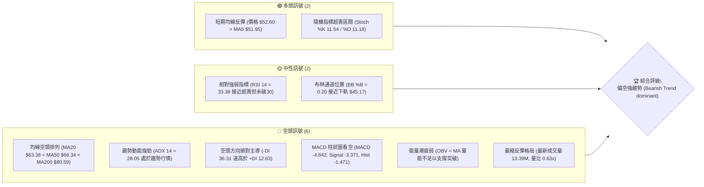
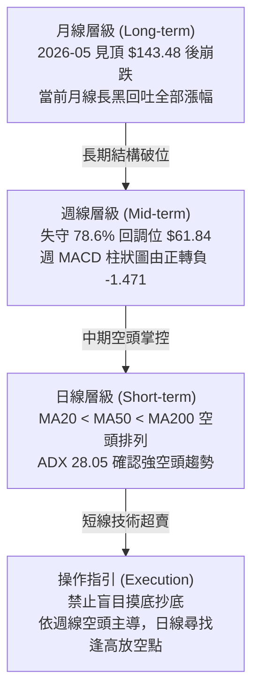
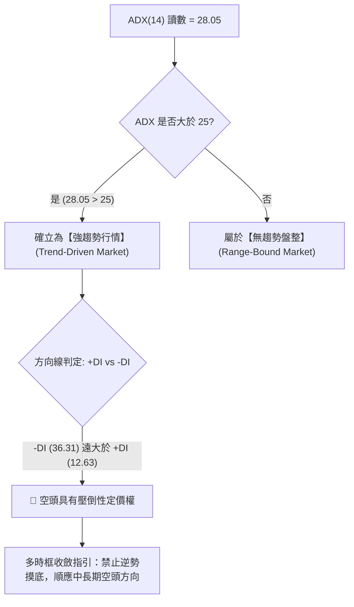
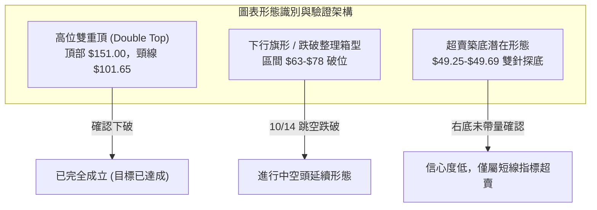
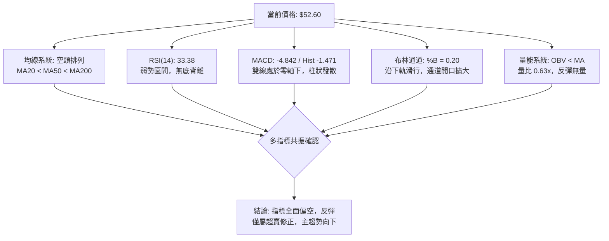
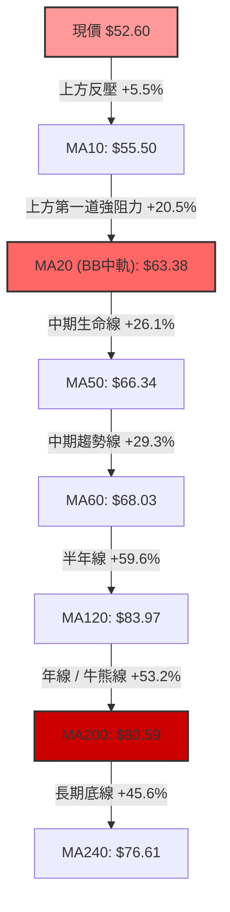
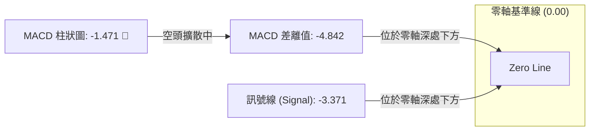
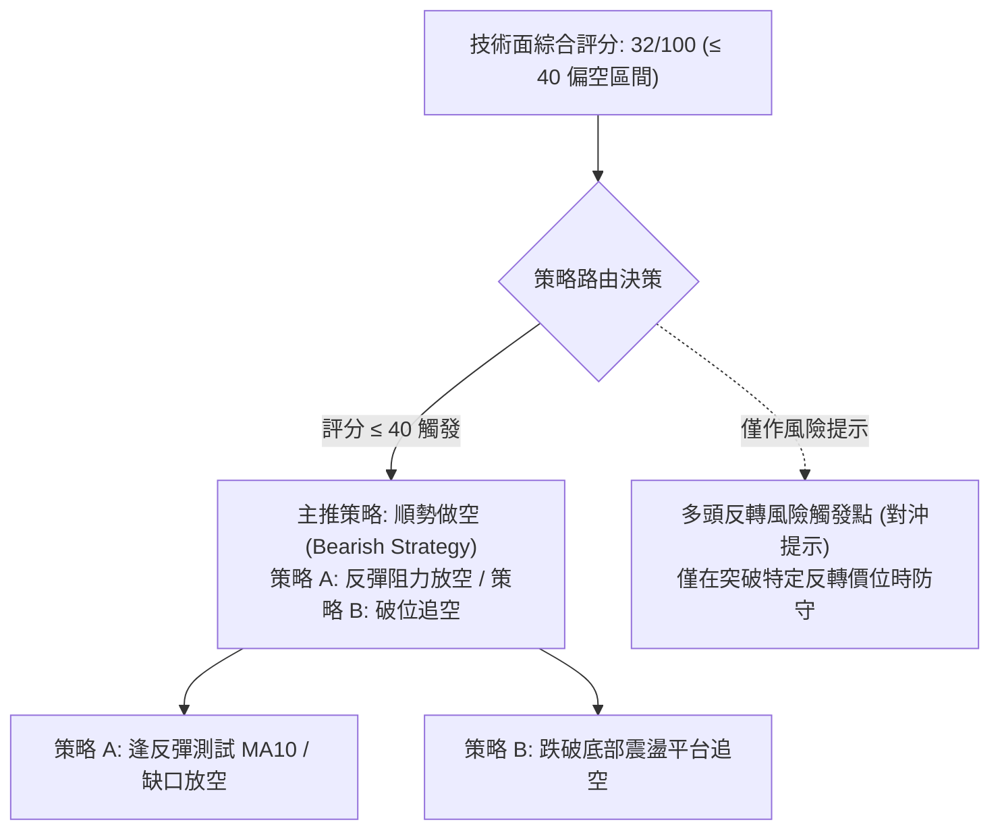
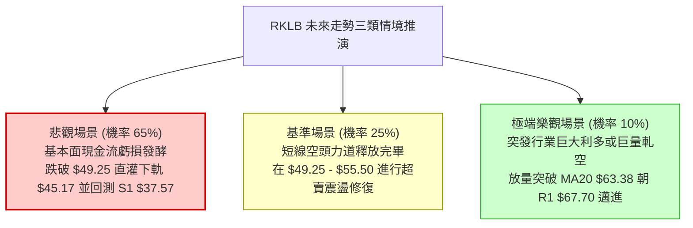

# RKLB 技術分析報告

> **報告日期**：2026-10-24 ｜ **語言**：繁體中文 ｜ **數據來源**：Yahoo Finance ｜ **當前價格**：$52.60

---

## 目錄

| 章節 | 內容 |
|------|------|
| [1. 技術面概覽](#1-技術面概覽) | 訊號儀表板、核心指標、評分卡 |
| [2. 趨勢分析](#2-趨勢分析) | 多時框趨勢、長中短期走勢、ADX 解讀 |
| [3. 圖表形態分析](#3-圖表形態分析) | 形態識別、K線組合、目標價計算 |
| [4. 支撐與阻力](#4-支撐與阻力) | 關鍵價位、斐波那契回調結構 |
| [5. 技術指標深度解讀](#5-技術指標深度解讀) | MA/RSI/MACD/布林通道/量價配合 |
| [6. 動能與波動率](#6-動能與波動率) | 動能四象限、ATR 風險評估、Beta 相關性 |
| [7. 多時框架總結](#7-多時框架總結) | 時框架評分矩陣與多時框收斂結論 |
| [8. 交易策略建議](#8-交易策略建議) | 策略路由、主策略執行、風報比與對沖點 |
| [9. 風險提示與監控](#9-風險提示與監控) | 關鍵監控清單、風險情境與資金管理 |

---

## 1. 技術面概覽

### 🎯 技術訊號儀表板



---

### 📊 核心指標速覽表

| 指標類別 | 指標名稱 | 當前數值 | 訊號 | 解讀 |
|----------|----------|----------|------|------|
| **價格** | 當前收盤價 | $52.60 | 🔴 | 位於52週區間底部 13.3%，距離52週高點重挫 -65.17% |
| **均線** | MA5 | $51.95 | 🟢 | 現價微幅突破短期均線 (+1.25%)，出現短線超賣技術性反抽 |
| **均線** | MA20 | $63.38 | 🔴 | 現價低於MA20達 -17.00%，中期空方防線牢固，下行斜率陡峭 |
| **均線** | MA50 | $66.34 | 🔴 | 現價低於MA50達 -20.71%，中期趨勢維持全面空頭主導 |
| **均線** | MA200 | $80.59 | 🔴 | 現價低於牛熊分界線達 -34.73%，長期技術架構破位 |
| **動能** | RSI(14) | 33.38 | 🟡 | 位於30–70中性偏低區間，尚未跌破30極度超賣區，未見背離 |
| **動能** | MACD (12,26,9) | -4.842 | 🔴 | 雙線深入零軸下方，柱狀圖為 -1.471，空頭動能尚未收斂 |
| **趨勢** | ADX(14) / ±DI | 28.05 | 🔴 | ADX > 25 確立趨勢行情；-DI 36.31 壓制 +DI 12.63，空頭趨勢強烈 |
| **通道** | Bollinger Bands | %B: 0.20 | 🟡 | 位於下軌 $45.17 與中軌 $63.38 之間，下軌未破但空間受限 |
| **波動** | ATR(14) | $3.99 | 🔴 | 佔股價 7.58%，屬於高波動標的，每日震盪幅度大 |
| **量能** | Volume / 20MA | 0.63x | 🔴 | 量能萎縮至 13.39M（20日均量 21.09M），反彈缺乏機構買盤確認 |

---

### 🏆 技術評分卡

```
╔══════════════════════════════════════════════════════════════╗
║                技術評分卡 — RKLB (2026-10-24)                 ║
╠══════════════════════════════════════════════════════════════╣
║ 趨勢強度 (Trend)     █████░░░░░░░░░░░░░░░  25/100  🔴 強烈空頭  ║
║ 動能指標 (Momentum)  ██████░░░░░░░░░░░░░░  30/100  🔴 動能疲弱  ║
║ 支撐穩定度 (Support) █████████░░░░░░░░░░░  45/100  🟡 臨近考驗  ║
║ 成交量配合 (Volume)  ██████░░░░░░░░░░░░░░  30/100  🔴 量能背離  ║
║ 形態完整度 (Pattern) ███████░░░░░░░░░░░░░  35/100  🔴 下行破位  ║
║ 均線排列 (MA System) █████░░░░░░░░░░░░░░░  25/100  🔴 空頭排列  ║
╠══════════════════════════════════════════════════════════════╣
║ 綜合評分 (Overall)   ██████░░░░░░░░░░░░░░  32/100  🔴 偏空弱勢  ║
╚══════════════════════════════════════════════════════════════╝
```

> **評分規則依據（規則 18）**：
> 綜合評分 = (25 + 30 + 45 + 30 + 35 + 25) ÷ 6 = 190 ÷ 6 = 31.67，四捨五入至整數為 **32/100**。
> 綜合評分 ≤ 40，技術面歸類為「偏空主導」，第 8 章交易策略將嚴格依此分流，主推順勢做空策略。

---

## 2. 趨勢分析

### 🌐 多時框趨勢分析



---

### 📈 長期趨勢 — 12個月走勢圖（Unicode）

依據提供之 24 個月歷史價格，擷取近 12 個月（2025-11 至 2026-10）月線收盤價繪製走勢圖：

```
RKLB 月線走勢圖（過去12個月：2025-11 至 2026-10）
價格軸 ($)
$150.00 ┤                                      
$143.48 ┤                             ● (2026-05 歷史高點收盤)
$130.00 ┤                            ╱ ╲       
$110.00 ┤                           ╱   ╲      
$101.65 ┤                          ╱     ● (2026-06 頸線下破)
$90.00  ┤                         ╱       ╲    
$82.51  ┤            ● (2026-01) ╱         ╲   
$80.00  ┤           ╱ ╲         ● (04)      ╲  
$69.76  ┤     ●    ╱   ● (02)  ╱             ● (2026-09 反彈高點 $69.68)
$64.00  ┤    ╱ ╲  ╱     ╲     ╱               ╲
$52.60  ┤   ╱   ╲╱       ● (03)                ●← 當前現價 ($52.60)
$42.14  ┤  ● (2025-11)                         
$37.57  ┤                                       (52週低點 S1)
        └───────────────────────────────────────────────────────────
          11   12   01    02    03    04    05    06    07    08    09    10  (月份)
```

#### 走勢特徵分析表格

| 階段區間 | 時間跨度 | 起訖收盤價 | 漲跌幅 | 結構特徵與成交量分析 |
|----------|----------|------------|--------|----------------------|
| **第 I 階段：主升浪狂熱** | 2025-11 → 2026-05 | $42.14 → $143.48 | +240.48% | 機構資金瘋狂湧入，突破雙頂走出拋物線暴漲，52週最高觸及 $151.00 |
| **第 II 階段：高位崩落派發**| 2026-05 → 2026-07 | $143.48 → $64.95 | -54.73% | 兩月內腰斬，跌破 $100 整數關卡，週線成交量突破 1.5 億股，呈現巨量派發 |
| **第 III 階段：中期低位盤整**| 2026-07 → 2026-09 | $64.95 → $69.68 | +7.28% | 在 $63.00–$75.00 區間構建收斂三角/箱型反彈，週量萎縮至 8,000 萬股 |
| **第 IV 階段：破位下行尋底**| 2026-09 → 2026-10 | $69.68 → $52.60 | -24.51% | 連續失守 MA20、MA60，週線大陰線直灌 $50.00，目前測試下軌支撐 |

---

### 📊 中期趨勢（週線分析）

```
中期週線壓力與支撐階梯示意圖
══════════════════════════════════════════════════════════════
 [R3] $78.74  ═══════════════════════════════ (10/09 週高 $78.28 聚類強阻力)
                     │
 [R2] $75.28  ───────┴─────────────────────── (09/25-10/02 週高聚類阻力)
                     │
 [R1] $67.70  ─────────────────────────────── (09/11 週高 & 10/12 跳空頸線阻力)
                     │
 [現價] $52.60 ◄─────┼─────────────────────── (目前弱勢震盪於 $50-$53 平台)
                     │
 [S1] $37.57  ═══════════════════════════════ (52週極限低點，歷史終極支撐)
══════════════════════════════════════════════════════════════
```

- **中期均線態勢**：近 20 週數據顯示，RKLB 在 2026 年 8 月中旬曾試圖推升至 $82.83（RSI 升至 56.2，MACD 柱轉為 +2.940），但隨後量能無以為繼。
- **10月中旬加速破位**：2026-10-09 當週收盤 $68.21，隨後 10-16 當週遭遇龐大拋壓，當週成交量爆出 128,008,200 股，單週暴跌至 $50.84（週跌幅 -25.47%），週 RSI 驟降至 25.4 極度超賣。
- **最新週線收斂**：2026-10-23 當週微幅回升至 $52.60，週量萎縮至 81,945,700 股，顯示此處為超賣後的技術性停頓，並非買盤積極進場推升。

---

### ⚡ 趨勢強度評估（ADX 解讀）



#### ADX 強度指標對照表

| 指標名稱 | 數值 | 參考臨界值 | 狀態評估 | 實戰解讀 |
|----------|------|------------|----------|----------|
| **ADX(14)** | **28.05** | > 25.00 | 🟢 強趨勢 | 市場脫離無序震盪，形成明確的單邊下行趨勢，趨勢交易法有效 |
| **+DI(14)** | **12.63** | < 20.00 | 🔴 多頭極度虛弱 | 買盤缺乏連續性，推升力道不足以發動日線級別反轉 |
| **-DI(14)** | **36.31** | > 30.00 | 🔴 空頭全面主導 | 賣壓強勁且具有擴散效應，盤中任何反抽均易遭受拋壓壓制 |
| **趨勢定性**| **空頭單邊** | — | 🔴 強空頭 | 依規則 14，ADX > 25 時日線震盪僅視為雜訊，週線趨勢決定方向 |

---

## 3. 圖表形態分析

### 🔍 形態識別系統



#### 形態識別與信心度評估表（依規則 15）

| 形態名稱 | 信心度 | 完成度 | 判斷依據（嚴格引用數據） | 形態理論目標價（附計算式） | 結論評估 |
|----------|--------|--------|--------------------------|----------------------------|----------|
| **箱型下破延續形態** | **85%** | **100%** | 2026-09-25 至 10-09 在 $67.70–$78.28 築頂，10-14 以長黑摜破箱底 $63.08 | 箱底 $63.08 − 箱高 ($78.28 − $63.08) = **$47.88**（目前低點 $49.25 已極度接近） | 🔴 空頭旗形/箱型破位測幅基本滿足，目前進入減速區 |
| **大週期雙重頂 (M頭)** | **90%** | **100%** | 2026-05 見歷史高點 $151.00，06月反彈至 $107.24 破位，失守 $101.65 頸線 | 頸線 $101.65 − ($151.00 − $101.65) = **$52.30**（計算式精確吻合當前收盤價 $52.60） | 🔴 長期幾何測幅完美兌現，現價正是長期結構的對稱落點 |
| **日線潛在雙底反彈** | **35%** | **20%** | 僅依據 10-15 低點 $49.69 與 10-20 低點 $49.25，頸線為 10-21 高點 $53.90 | 頸線 $53.90 + ($53.90 − $49.25) = **$58.55**（需先突破頸線 $53.90 方可確立） | 🟡 信心度不足 50%，僅屬短線跌深反彈，尚未確認反轉 |

---

### 🕯️ 重要K線形態分析

依規則 19，嚴格採用數據庫中近 10 根日 K 與近 8 根週 K 之開、高、低、收數據解讀：

#### 近10根日K棒形態解析

| 日期 | 開 | 高 | 低 | 收 | 成交量 | K線形態名稱 | 解讀與技術含義 | 訊號 |
|------|----|----|----|----|--------|-------------|----------------|------|
| 2026-10-12 | 67.88 | 68.07 | 65.11 | 65.71 | 14,499,000 | 破位中陰線 | 實體跌破 $66 支撐，開啟新一輪下行走勢 | 🔴 |
| 2026-10-13 | 64.07 | 64.56 | 63.08 | 64.22 | 15,588,500 | 跳空下行陰線 | 跳空低開於 $64.07，多頭反抗無力 | 🔴 |
| 2026-10-14 | 62.81 | 63.56 | 58.84 | 59.18 | 25,309,100 | 放量長黑破位 | 成交量激增至 25.3M，實體摜破 $60 心理關卡 | 🔴 |
| 2026-10-15 | 53.86 | 55.40 | 49.69 | 55.25 | 48,563,400 | 巨量長下影錘頭 | 爆出 48.56M 歷史級換手量，下影線長達 $5.56，初見恐慌盤承接 | 🟢 |
| 2026-10-16 | 54.49 | 54.87 | 50.37 | 50.84 | 24,048,200 | 反包大陰線 | 吞噬前一日錘頭實體，收於次低點，確認空頭反撲 | 🔴 |
| 2026-10-19 | 52.28 | 52.99 | 51.31 | 51.36 | 17,077,100 | 低位窄幅紡錘線 | 波動劇烈收斂，多空暫時平衡 | 🟡 |
| 2026-10-20 | 50.56 | 52.72 | 49.25 | 50.90 | 16,945,200 | 探底長下影十字星 | 二次回測 $49.25 創下波段新低，隨後收腳回升 | 🟡 |
| 2026-10-21 | 52.22 | 53.90 | 52.02 | 53.67 | 17,857,800 | 光頭小陽線 | 連續站上 5 日均線，反彈嘗試挑戰 $54 阻力 | 🟢 |
| 2026-10-22 | 51.67 | 52.98 | 49.96 | 51.22 | 16,674,500 | 衝高回落倒錘頭 | 上影線壓制明顯，高位買盤縮手 | 🔴 |
| 2026-10-23 | 50.73 | 52.92 | 49.52 | 52.60 | 13,391,100 | 下影小實體陽線 | 守住 $50 關卡收於 $52.60，但量能萎縮至 13.39M | 🟡 |

#### 近8根週K棒形態解析

| 週日期 | 開 | 高 | 低 | 收 | 週成交量 | 週K形態名稱 | 解讀與技術含義 | 訊號 |
|--------|----|----|----|----|----------|-------------|----------------|------|
| 2026-09-04 | 63.73 | 65.00 | 61.45 | 64.26 | 80,227,200 | 低位震盪小陽十字 | 下測 $61.45 獲得短暫支撐 | 🟡 |
| 2026-09-11 | 65.27 | 67.70 | 61.53 | 62.95 | 85,204,500 | 上影小陰線 | 上探 R1 $67.70 遭受強大空頭壓制 | 🔴 |
| 2026-09-18 | 60.55 | 68.64 | 60.51 | 64.57 | 106,896,200 | 巨幅震盪長上影陽 | 振幅達 13.4%，放量測試上方解套賣壓 | 🟡 |
| 2026-09-25 | 65.29 | 75.46 | 65.28 | 73.95 | 111,511,500 | 突破大陽線 | 放量上攻逼近 R2 $75.28，呈現假突破態勢 | 🟢 |
| 2026-10-02 | 73.20 | 76.09 | 69.40 | 73.92 | 107,277,600 | 高位孕線十字星 | 多頭動能衰竭，高位連續放量滯漲 | 🔴 |
| 2026-10-09 | 73.70 | 78.28 | 66.98 | 68.21 | 104,635,800 | 烏雲蓋頂巨量陰線 | 衝高至 R3 $78.74 附近 ($78.28) 崩落，確立頂部 | 🔴 |
| 2026-10-16 | 67.88 | 68.07 | 49.69 | 50.84 | 128,008,200 | 崩跌大陰線 | 單週狂瀉 -25.47%，實體摜破所有支撐平台 | 🔴 |
| 2026-10-23 | 52.28 | 53.90 | 49.25 | 52.60 | 81,945,700 | 縮量低位下影十字 | 於 50 心理關卡收腳，但週量驟減，無 V 轉信號 | 🟡 |

---

### 📉 ASCII 走勢形態示意圖

```
日線級別：破位下行與底部弱勢平台整理 (2026-10-12 至 2026-10-23)
價格 ($)
$68.00 ┤  ● (10/12 高 $68.07)
$66.00 ┤   ╲
$64.00 ┤    ● (10/13 高 $64.56)
$62.00 ┤     ╲
$60.00 ┤      ╲ (10/14 跳空長黑 $59.18)
$58.00 ┤       ╲
$56.00 ┤        ╲   ● (10/15 反抽高 $55.40)
$54.00 ┤         ╲ ╱ ╲     ● (10/21 高 $53.90 頸線)
$52.60 ┤──────────┼───┼─────┼──────● (10/23 收盤現價 $52.60)
$50.00 ┤          │   │ ╲ ╱ ╲ ╱ ╲ ╱
$49.00 ┤          ●   ●   ●   ●     (10/15 低 $49.69 / 10/20 低 $49.25 雙針)
       └────────────────────────────────────────────────────────
         10-12  10-14  10-16  10-19  10-21  10-23 (交易日)
```

---

### 🎯 形態目標價計算

1. **下行破位形態理論測幅（已基本滿足）**：
   - 頸線/破位點：$63.08
   - 頂部形態高度：$78.28 − $63.08 = $15.20
   - 理論下跌目標價 = $63.08 − $15.20 = **$47.88**
   - 當前行情最低已探至 $49.25（2026-10-20），達成率達 91.1%，說明短線極端殺跌動能已有階段性釋放。

2. **短線反彈若突破頸線之對稱測幅（次級波段）**：
   - 短期雙針探底之頸線位：$53.90（2026-10-21 與 10-23 共同高點）
   - 形態底部高度：$53.90 − $49.25 = $4.65
   - 反彈目標價 = $53.90 + $4.65 = **$58.55**
   - 此目標價恰好位於 MA10（$55.50）與 10-14 跳空缺口下沿（$58.84）之間，若反彈至此處將遭遇極強解套賣壓。

---

## 4. 支撐與阻力

### 🗺️ 關鍵價位分布圖（Unicode）

```
╔══════════════════════════════════════════════════════════════════╗
║                   RKLB 價位結構分布圖                             ║
╠══════════════════════════════════════════════════════════════════╣
║ $78.74 ║████████████████████████████████║ 強阻力 R3 (波段極限頂部)║
║ $75.28 ║████████████████████████        ║ 阻力 R2 (反彈高點聚類)  ║
║ $67.70 ║████████████████████████████████║ 關鍵阻力 R1 (頸線破位點)║
║ $63.38 ║▓▓▓▓▓▓▓▓▓▓▓▓▓▓▓▓                ║ BB中軌 / MA20 強反壓   ║
║ $61.84 ║▓▓▓▓▓▓▓▓▓▓▓▓▓▓                  ║ 斐波那契 78.6% 回調位   ║
║ $52.60 ╠════════════════════════════════╣ ◄ 當前收盤價 ($52.60)   ║
║ $45.17 ║▒▒▒▒▒▒▒▒▒▒▒▒                    ║ 布林通道下軌動態支撐     ║
║ $37.57 ║████████████████████████████████║ 強支撐 S1 (52週極限低點)║
╚══════════════════════════════════════════════════════════════════╝
```

---

### 🚧 阻力位分析表

阻力位嚴格引用技術數據中「關鍵價位」區塊由近一年波段高點聚類計算所得之精確數值：

| 阻力級別 | 價位 | 距離現價 | 形成原因與籌碼特徵 | 突破難度 | 重要性權重 |
|----------|------|----------|--------------------|----------|------------|
| **R1** | **$67.70** | +28.71% | 近一年密集波段高點聚類；2026-09-11 週高與 10-12 日高重疊區，籌碼套牢深重 | 極高 | ★★★★★ |
| **R2** | **$75.28** | +43.13% | 2026-09-25 週高與 10-02 當週多次推升之高位平台，屬多空換手失敗區 | 極高 | ★★★★☆ |
| **R3** | **$78.74** | +49.71% | 2026-10-09 週線衝高 $78.28 後反轉倒灌之波段頂部，代表本輪中期多頭終結點 | 堅不可摧 | ★★★★★ |

---

### 🛡️ 支撐位分析表

支撐位嚴格引用技術數據「關鍵價位」區塊數值（其餘層級依規則 13 註明未偵測到）：

| 支撐級別 | 價位 | 距離現價 | 形成原因與技術含義 | 守住機率 | 重要性權重 |
|----------|------|----------|--------------------|----------|------------|
| **S1** | **$37.57** | -28.57% | 52週歷史低點；斐波那契 100.0% 終極支撐位；機構長期長線防守陣地 | 75% | ★★★★★ |
| **S2** | N/A（數據未提供） | — | 數據中未偵測到近一年更低波段低點聚類 | — | — |
| **S3** | N/A（數據未提供） | — | 數據中未偵測到更低層級聚類 | — | — |

> **動態支撐輔助說明**：除靜態高低點聚類 S1 外，日線布林通道下軌目前位於 **$45.17**，為下行途中的第一道動態波動帶緩衝，若跌破 $45.17，則價格將直接考驗 S1 $37.57。

---

### 📐 斐波那契回調位分析

依據 52 週完整波動區間（低點 $37.57 → 高點 $151.00，波動總高差 $113.43），嚴格引用系統計算之回調位：

```
斐波那契回調結構階梯（52週區間 $37.57 → $151.00）
══════════════════════════════════════════════════════════════
 0.0%  (52W High)   $151.00  ═════════════════════════════════
 23.6%              $124.23  ─────────────────────────────────
 38.2%              $107.67  ─────────────────────────────────
 50.0% (中位分水嶺) $ 94.28  ─────────────────────────────────
 61.8% (黃金分割)   $ 80.90  ═════════════════════════════════ (MA200 $80.59 重合)
 78.6% (深度回調)   $ 61.84  ───────────────────────────────── (前波防守平台破位)
                       ▲
                       │ 當前價格 $52.60 (位於 78.6% 與 100.0% 之間)
                       ▼
 100.0% (52W Low)   $ 37.57  ═════════════════════════════════ (終極回調基底 S1)
══════════════════════════════════════════════════════════════
```

- **位置解讀**：現價 $52.60 跌破了重要黃金分割 61.8%（$80.90）與極限回調位 78.6%（$61.84）。在道氏理論與斐波那契體系中，回調跌破 78.6% 意味著先前的整段牛市主升浪結構遭到破壞，市場進入「全面尋底」週期。
- **區間定位**：現價目前運行於 **$61.84（78.6%）與 $37.57（100.0%）之間**。在此區間內，上方的 $61.84 轉化為極強的反壓線，而下方的 $37.57 為唯一經由歷史數據驗證的宏觀硬支撐。

---

## 5. 技術指標深度解讀

### 🎛️ 指標訊號總覽



---

### 📈 移動平均線排列分析



#### 均線階層架構表

| 均線名稱 | 數值 | 偏離率 ((現價−均線)÷均線) | 方向斜率 | 排列狀態與技術含義 |
|----------|------|---------------------------|----------|--------------------|
| **MA5**  | $51.95 | +1.25% | ▲ 勾頭向上 | 短期 5 日超賣反抽，提供短線日內微弱支撐 |
| **MA10** | $55.50 | -5.22% | ▼ 陡峭向下 | 短線第一道動態蓋頂壓制，反彈難以直接越過 |
| **MA20** | $63.38 | -17.00% | ▼ 快速下行 | 20 日均線（布林中軌）為短期反轉核心基準 |
| **MA50** | $66.34 | -20.71% | ▼ 持續下行 | 中期主力防守成本線，維持強烈空方防禦 |
| **MA60** | $68.03 | -22.68% | ▼ 穩步下行 | 季線空頭排列，中期趨勢向下不變 |
| **MA120**| $83.97 | -37.36% | ▼ 加速補跌 | 半年線失守，中長期籌碼全數轉為套牢盤 |
| **MA200**| $80.59 | -34.73% | ▼ 緩步下行 | 長期牛熊分水嶺，價格跌破確立長期空頭市場 |
| **MA240**| $76.61 | -31.34% | ▼ 走平轉跌 | 兩年均線轉折向下，長期牛市根基瓦解 |

- **均線排列結論**：呈現標準的「空頭完全排列」（MA20 < MA50 < MA200），且長中短期均線呈現發散下行態勢，意味著上方每一道均線都是實打實的套牢反壓，在均線未收斂前不具備大波段反轉條件。

---

### 📉 RSI(14) 分析

- **當前數值**：**33.38**
- **強度進度條**：
  ```
  RSI(14) = 33.38  [███████░░░░░░░░░░░░░]  33.38% (空方偏好區間)
  0                30 (超賣區)        50 (中軸)       70 (超買區)       100
  ```
- **區間狀態分析**：RSI 處於 30 至 70 之間的中性偏空區間，但已貼近 30 超賣門檻。週線 RSI 則為 33.4（前一週曾摜至 25.4），代表大週期超賣程度較日線更甚。
- **背離分析（嚴格判定）**：
  - 根據系統近 20 根 K 棒比對：「**RSI 無明顯背離**」。
  - 日線價格於 10-14 至 10-20 破位下殺，RSI 同步下行；在 10-20 觸及低點 $49.25 時，RSI 亦收在相對低位，並未出現「價格破新低而 RSI 抬高」的典型底背離信號。
  - **結論**：指標與價格同向，確認本次下跌為「真實拋壓推動」，而非空頭動能衰竭的假跌破。

---

### 📊 MACD(12/26/9) 訊號解讀



- **參數配置與當前值**：快線 EMA12 與慢線 EMA26 之差離值 MACD = **-4.842**；9日訊號線 Signal = **-3.371**；柱狀圖 Histogram = **-1.471**。
- **指標形態研判**：
  1. MACD 快線遠在慢線下方，柱狀圖負值為 -1.471，呈現標準的「零下死叉後之空頭發散」。
  2. 週線 MACD 柱狀圖連續兩週擴大負值（10-09 為 -0.018，10-16 擴大至 -2.111，最新 10-23 為 -1.471），顯示週線級別空頭釋放尚未結束。
  3. **背離判定**：MACD 線與柱狀圖均未見底背離，指標全面支持空方。

---

### 📦 布林通道分析

```
日線布林通道結構圖 (20日標準差帶，帶寬度 Wide)
══════════════════════════════════════════════════════════════════
 $81.58 ┤ ────────────────────────────────── 上軌 (BB Upper)
        │
 $70.00 ┤
        │
 $63.38 ┤ ┄┄┄┄┄┄┄┄┄┄┄┄┄┄┄┄┄┄┄┄┄┄┄┄┄┄┄┄┄┄ 中軌 (BB Middle = MA20)
        │
 $52.60 ┤ ════════════════════● ◄ 現價 (BB %B = 0.20)
        │
 $45.17 ┤ ────────────────────────────────── 下軌 (BB Lower)
══════════════════════════════════════════════════════════════════
帶寬度分析：帶寬 (Upper − Lower) = $36.41，通道擴大呈現開口下行態勢
```

- **通道位置指標 (%B)**：
  $$\%B = \frac{\text{現價} - \text{下軌}}{\text{上軌} - \text{下軌}} = \frac{52.60 - 45.17}{81.58 - 45.17} = \frac{7.43}{36.41} \approx 0.20$$
- **技術解讀**：%B 為 0.20 代表價格位於布林帶極度下端（0 為下軌，0.5 為中軌）。當前通道呈現「開口向下放大」特徵，通常代表空頭波動率正在釋放。現價雖未跌破下軌 $45.17，但距離中軌 $63.38 遙遠，中軌將構成反彈極限天花板。

---

### 💹 成交量分析（量價配合度）

```
最新量能對比分析圖
最新日量 (10-23):  13.39M  ██████░░░░░░░░░░░░░░ (量比 0.63x)
20日均量 (20MA):   21.09M  ██████████░░░░░░░░░░
50日均量 (50MA):   19.39M  █████████░░░░░░░░░░░
10-15 爆量日:      48.56M  ████████████████████ (恐慌換手高點)
```

1. **量價配合現狀**：最新成交量為 13,391,100 股，僅為 20 日均量（21,093,365 股）的 **0.63 倍**。
2. **量價背離診斷**：在 10-15 創下 48.56M 巨量之後，隨後價格並未形成放量推進，反而在 10-21 至 10-23 的反彈過程中成交量遞減（17.85M → 16.67M → 13.39M），形成典型的「**縮量反彈**」量價頂背馳特徵。
3. **OBV 能量潮解讀**：數據明確標示「**OBV < MA → 量能疲弱**」。累積能量線持續運行於均線之下，說明資金淨流出格局未改，未觀察到聰明錢（Smart Money）規模化吸籌建倉跡象。

---

## 6. 動能與波動率

### ⚡ 動能評估四象限

```
動能與波動率四象限矩陣
                    高動能 (Bullish Momentum)
                               ▲
                               │
             象限 II           │           象限 I
        高動能 / 低波動        │       高動能 / 高波動
                               │
   ◄───────────────────────────┼───────────────────────────►
   低波動 (Low Volatility)     │     高波動 (High Volatility)
                               │              ★ 當前位置: RKLB
             象限 III          │           象限 IV
        低動能 / 低波動        │       弱動能 / 高波動 (Q4)
                               │   (ATR 7.58%, Beta 2.94, ADX 28)
                               ▼
                    弱動能 (Bearish Momentum)
```

| 象限分區 | 動能狀態 | 波動狀態 | 當前歸屬 | 風險回報特徵與策略對策 |
|----------|----------|----------|----------|------------------------|
| **Q1** | 強 (Bull) | 高 (High) | — | 最佳牛市突破波段，適合動能追漲 |
| **Q2** | 強 (Bull) | 低 (Low)  | — | 緩步慢牛爬坡，適合低吸持股待漲 |
| **Q3** | 弱 (Bear) | 低 (Low)  | — | 沉悶無量陰跌盤整，資金效率極低 |
| **Q4** | **弱 (Bear)** | **高 (High)** | **✓ RKLB 歸屬** | **高風險高波動殺跌區：空頭趨勢強烈伴隨大幅震盪，嚴禁盲目多頭抄底，適合逢反彈順勢放空或空手觀望** |

---

### 📊 ATR 波動率分析

- **ATR(14) 數值**：**$3.99**（佔當前價格 $52.60 之 **7.58%**，採 Wilder 平滑算法）。
- **實戰風控距離設定（基於 ATR 倍數）**：
  - **日內正常雜訊過濾區間（1.0 × ATR）**：$3.99。日內常態波動約 ±$4.00，進場點若未拉開此距離極易被洗出場。
  - **短線交易止損緩衝（1.5 × ATR）**：$3.99 × 1.5 = **$5.99**。空頭策略建議防守點應設置在進場價上方至少 $6.00。
  - **波段安全防守距離（2.0 × ATR）**：$3.99 × 2.0 = **$7.98**。

---

### 📐 Beta 與市場相關性

- **Beta 係數**：**2.938**（極高 Beta 屬性）。
- **大盤聯動與波動敏感度**：
  1. Beta 接觸接近 3.0，代表標的對宏觀市場情緒及標普 500 / 納斯達克指數具備 **3 倍放大效應**。若美股大盤下跌 1%，RKLB 理論下挫近 3%。
  2. 在當前基本面 Operating Margin 為 -29.1%、TTM 自由現金流為 -$371.14M 之負現金流狀態下，高 Beta 賦予該股高度投機性與融資成本敏感性。
- **空頭部位特徵**：Short % Float 達 **7.5%**，Short Ratio 為 **2.22**。融券部位具備一定比例，但在強空頭趨勢下尚未觸發軋空（Short Squeeze）閥值。

---

## 7. 多時框架總結

### 📋 時框架評分表

| 時框架 | 趨勢方向 | 動能指標 | 均線排列 | 圖表形態 | 綜合評分 | 建議操作維度 |
|--------|----------|----------|----------|----------|----------|--------------|
| **月線 (長期)** | 🔴 強空頭 | 🔴 零下下行 | 🔴 長期轉折破位 | 雙頂 M 頭頸線跌破 | **20/100** | 戰略減碼，不進行長期資產配置 |
| **週線 (中期)** | 🔴 空頭主導 | 🔴 柱狀擴散 | 🔴 空頭排列 MA20<50 | 崩跌大陰線後超賣整理 | **30/100** | 逢反彈波段放空，禁止逆勢做多 |
| **日線 (短期)** | 🟡 短線反抽 | 🟡 Stoch 超賣回升| 🔴 MA5上穿但其餘全空 | $49.25 雙針平台整理 | **40/100** | 僅供日內超短線低吸高拋，風險極高 |

---

### 🔲 綜合訊號矩陣

| 維度 | 短期（日線） | 中期（週線） | 長期（月線） | 訊號一致性評估 |
|------|--------------|--------------|--------------|----------------|
| **方向一致性** | 弱勢反彈（偏中性） | 破位下行（偏空） | 長黑回吐（偏空） | 🔴 中長期高度一致偏空，日線反彈為次級折返 |
| **動能一致性** | RSI 33.4（平緩） | MACD 負柱發散 | 暴跌動能未竭 | 🔴 動能總體由空方掌控 |
| **結構防守位** | $49.25（短支撐） | $45.17（BB下軌） | $37.57（52W低點）| 🟡 支撐呈現階梯下移狀態 |

---

### ⚖️ 多時框收斂結論

> **依「嚴格要求 14」執行之多時框收斂判定**：
> 1. **趨勢/盤整行情定性**：當前 **ADX(14) = 28.05 > 25**，市場被嚴格界定為「**趨勢行情**」，絕非無方向之布林區間盤整行情。
> 2. **主導時框優先級**：在強趨勢行情下，**中長期（週線 / MA50 / MA200）方向具有最高決定權**；日線級別的指標超賣（如 Stoch %K 11.54）與微幅反彈僅能用作尋找最佳做空進場點，不得作為翻多逆勢抄底的依據。
> 3. **唯一方向性結論**：**【全面偏空（Bearish）】**。
>    日線短期的抗跌震盪被週線強烈空頭趨勢完全壓制，任何日線級別朝向均線反壓的反抽均視為空頭防守陣地的再確認。第 8 章策略將完全以**順勢做空（逢高放空）**作為主推策略。

---

## 8. 交易策略建議

### 🗺️ 策略決策流程圖



---

### 🧭 策略路由（依評分卡分流，不得兩頭下注）

- **當前技術評分卡綜合評分**：**32/100**
- **當前主策略方向 = 【主推空頭策略（偏空 ≤40）】**
  依規定，禁止兩頭下注。本章全力推演空頭建倉、加碼、目標與止損配置，多頭方向僅列出「反轉風險觸發點」作為空單停損或對沖警示。

---

### 🎯 價格情境階梯（Price Scenarios）

以當前收盤價 **$52.60** 為基準，嚴格引用第 4 章及數據庫中存在的實際價位：

| 觸發條件 | 下一目標 | 後續延伸 | 情境含義與技術定性 |
|----------|----------|----------|--------------------|
| **向上反彈突破 R1 $67.70** | R2 $75.28 | R3 $78.74 | 空頭結構被多頭破壞，短線轉強，空單全面離場 |
| **反彈受阻於 MA10 / 中軌** | 現價 $52.60 | 動態下軌 $45.17 | 常態技術性修正，空頭最佳加碼做空點 |
| **跌破短線平台低點 $49.25** | 下軌 $45.17 | S1 $37.57 | 破位加速，向下測試 52 週極限歷史大底 |

---

### 📊 情境機率分佈

| 情境名稱 | 機率 | 主要依據（嚴格引用指標數據） |
|----------|------|------------------------------|
| **情境 I：受阻回落 / 破位探底** | **65%** | ADX 28.05 空頭趨勢成形；-DI 36.31 壓制；均線空頭排列；反彈量縮（量比 0.63x）|
| **情境 II：低位區間弱勢震盪** | **25%** | 10-15 爆出 48.56M 恐慌換手量，形成短線 $49.25–$53.90 護盤箱型；Stoch 超賣 |
| **情境 III：持續強勢反彈向上** | **10%** | 缺乏買盤確認，OBV < MA 且 MACD 零下深處死叉，無任何底背離支持實質反轉 |

---

### 🟢 主策略詳情（方向依上方路由：空頭主推策略）

> **風報比計算定義（規則 17）**：
> 做空風險報酬比 = $(\text{進場價} - \text{目標價 T1}) \div (\text{止損價} - \text{進場價})$，以「1 : X.XX（以 T1 計）」格式呈現。

| 策略要素 | 策略 A（逢反彈高空 — 穩健型） | 策略 B（跌破平台順勢追空 — 激進型） |
|----------|--------------------------------|--------------------------------------|
| **策略定位** | 弱勢反抽 MA10 阻力受挫放空 | 摜破近 10 日雙針低點追空 |
| **進場條件** | 股價反彈至 MA10 附近衝高回落且日內收陰 | 日線收盤實體跌破 10-20 低點 $49.25 |
| **進場價格** | **$55.50**（精確對齊當前 MA10） | **$49.00**（跌破 $49.25 後之進場點） |
| **目標價 T1** | **$45.17**（布林通道下軌動態目標） | **$37.57**（52週極限低點 S1） |
| **目標價 T2** | **$37.57**（52週極限低點 S1） | N/A（數據未提供更低波段低點） |
| **止損價格** | **$58.84**（10-14跳空缺口下沿，風險 $3.34） | **$52.92**（10-23日高，過濾反撲雜訊） |
| **風險報酬比** | **1 : 3.09（以 T1 計）** <br/> 計算式: $(55.50 - 45.17) \div (58.84 - 55.50) = 10.33 \div 3.34$ | **1 : 2.92（以 T1 計）** <br/> 計算式: $(49.00 - 37.57) \div (52.92 - 49.00) = 11.43 \div 3.92$ |
| **成功機率** | **65%** | **60%** |
| **建議倉位** | **15%** | **10%** |

---

### 🔴 反向風險觸發點（對沖提示）

此非反向做多建議，僅為持有上述空頭策略時之**風控停損與翻轉警訊點**：
1. **第一防守警戒位：$53.90**（2026-10-21 與 10-23 之雙重日高點）。若日線收盤突破 $53.90，短線雙底反彈成立，空單應立即減碼半倉。
2. **多空結構翻轉點：$63.38**（MA20 與布林通道中軌）。若股價在放量狀態下有效站穩 $63.38，代表中期下跌趨勢遭到破壞，所有空頭部位必須無條件全數止損離場。
3. **終極熊市止損位：$67.70**（關鍵阻力 R1）。若突破該處，多頭中期反轉確立。

---

### ⭐ 整體訊號強度評星

```
╔══════════════════════════════════════════════════════════════╗
║                     整體訊號強度評星                          ║
╠══════════════════════════════════════════════════════════════╣
║ 做多訊號強度：★☆☆☆☆  (1/5星 — 僅具備超賣反抽，無右側確認信號)║
║ 做空訊號強度：★★★★☆  (4/5星 — 均線空頭排列，趨勢強度ADX>25) ║
║ 整體可信度：  ★★★★☆  (4/5星 — 指標無背離，多時框架高度共振) ║
╚══════════════════════════════════════════════════════════════╝
```

---

## 9. 風險提示與監控

### ✅ 關鍵監控指標 Checklist

```
╔══════════════════════════════════════════════════════════════╗
║                每日交易日常風控監控清單 (Checklist)           ║
╠══════════════════════════════════════════════════════════════╣
║ [ ] 價格是否跌破前低關鍵點 $49.25？（破位觸發追空策略 B）      ║
║ [ ] 價格反彈是否觸碰 MA10 $55.50？（測試策略 A 佈局機會）     ║
║ [ ] 日成交量是否暴增超過 20日均量 21.09M？（防範無預警軋空）  ║
║ [ ] RSI(14) 是否跌破 30 或出現底背離？（超賣鈍化或見底信號）  ║
║ [ ] MACD 柱狀圖是否由負值向零軸收斂？（空頭動能衰退信號）      ║
║ [ ] ADX(14) 是否自 28.05 回落至 25 以下？（趨勢行情轉盤整）   ║
║ [ ] 布林通道下軌 $45.17 是否提供有效支撐？（第一波平倉點）    ║
╚══════════════════════════════════════════════════════════════╝
```

---

### ⚠️ 風險場景分析



---

### 🛡️ 風險管理重要提醒

1. **極高波動性風險防範**：
   - RKLB 當前 ATR 為 **$3.99**（日波幅達 7.58%），Beta 高達 **2.938**。
   - 單筆空頭部位的風險暴露金額嚴禁超過投資組合總淨值的 **1.5%**。若以策略 A 為例（止損距離 $3.34），總倉位上限應嚴格限制在 **15%** 以內。
2. **財報與現金流風險折價**：
   - 數據顯示該公司 TTM 營運現金流為 **-$222.46M**，自由現金流為 **-$371.14M**，營業利潤率為 **-29.1%**。在尚未實現全面自我造血盈利前，技術面若失守關鍵防線，易引發機構估值模型下修拋售。
3. **軋空（Short Squeeze）預警**：
   - 當前融券佔流動盤比率為 **7.5%**，Short Ratio 為 **2.22**。雖然軋空風險暫屬溫和，但若價格逆勢放量突破 **$58.84** 缺口，必須果斷停損，切忌心存僥倖對抗趨勢。

---

## 📋 報告總結

```
╔══════════════════════════════════════════════════════════════╗
║                   RKLB 技術分析報告總結                       ║
╠══════════════════════════════════════════════════════════════╣
║ 報告日期：2026-10-24                                         ║
║ 當前價格：$52.60                                             ║
║ 分析評級：🔴 強烈偏空（綜合評分：32/100，ADX 28.05 強空頭）    ║
╠══════════════════════════════════════════════════════════════╣
║ 關鍵結論：                                                   ║
║ ├─ 長期趨勢：🔴 空頭主導（2026-05 頂部以來大跌，牛市架構破壞） ║
║ ├─ 中期趨勢：🔴 空頭排列（跌破 78.6% 回調位 $61.84，MA全線下壓）║
║ ├─ 短期趨勢：🟡 超賣弱反彈（價格暫穩於 $50，但量能嚴重萎縮） ║
║ ├─ 關鍵支撐：S1: $37.57（52週極限低點；動態下軌 $45.17）      ║
║ ├─ 關鍵阻力：MA10: $55.50 / MA20: $63.38 / R1: $67.70         ║
║ └─ 機構共識：買入 (20位分析師平均目標 $102.15，技術面完全背離)║
╠══════════════════════════════════════════════════════════════╣
║ 最優策略組合：                                               ║
║ 1. 🥇 最佳機會：策略 A — 逢反抽 MA10 $55.50 順勢放空          ║
║    (止損 $58.84，目標 $45.17 / $37.57，風報比 1:3.09)         ║
║ 2. 🥈 次選機會：策略 B — 破位追空，實體跌破 $49.25 追入       ║
║    (止損 $52.92，目標 $37.57，風報比 1:2.92)                 ║
║ 3. 🥉 保守選擇：全面空倉觀望，耐心等待價格觸及 S1 $37.57      ║
║    並出現實質放量底背離後再行評估。                          ║
╚══════════════════════════════════════════════════════════════╝
```

---

> ⚠️ **免責聲明**：本報告為 AI 自動生成之技術分析，所有數據及估算均基於提供的歷史價格資訊。本報告**僅供研究與學術參考**，**不構成任何投資建議**。投資有風險，入市需謹慎。

---

*報告生成時間：2026-10-24 ｜ 數據來源：Yahoo Finance ｜ 分析框架：多時框技術分析*