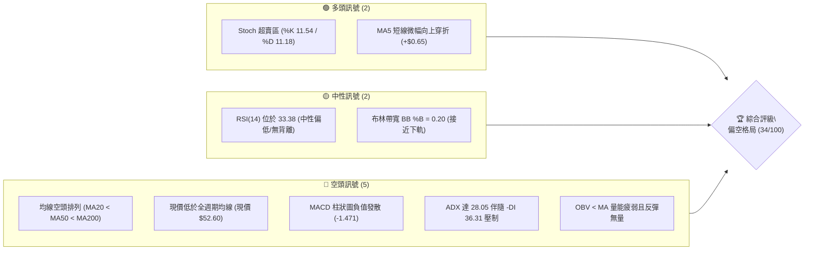
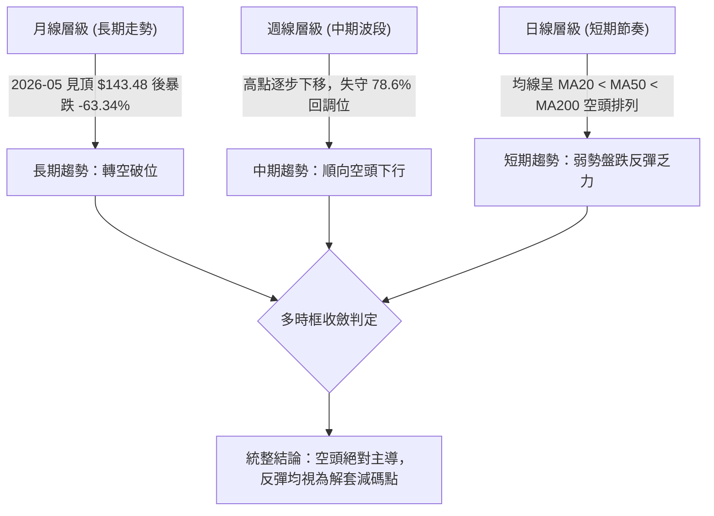
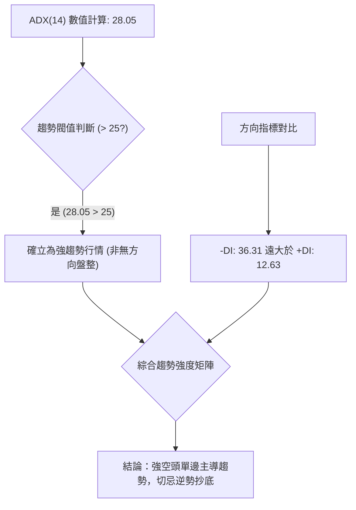
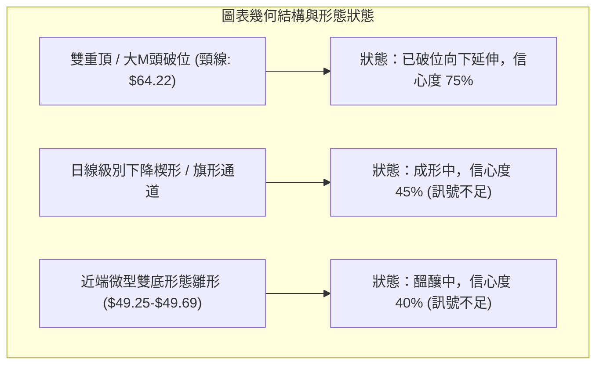
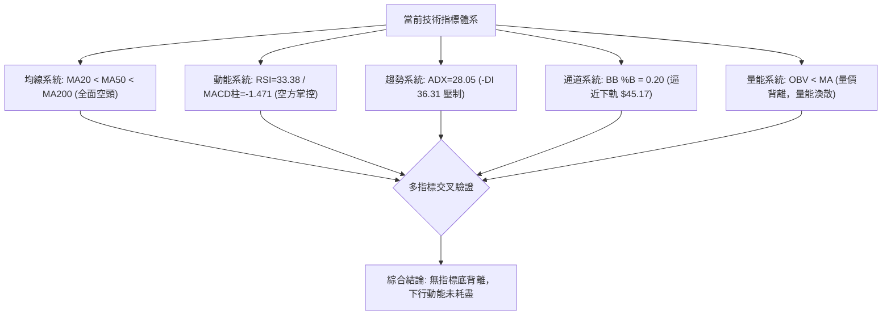
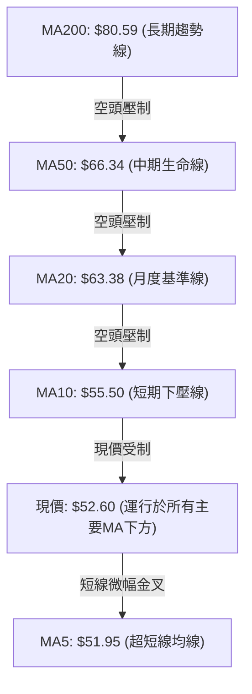
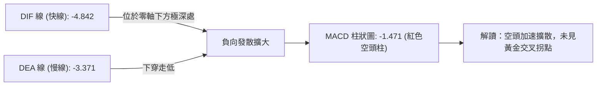
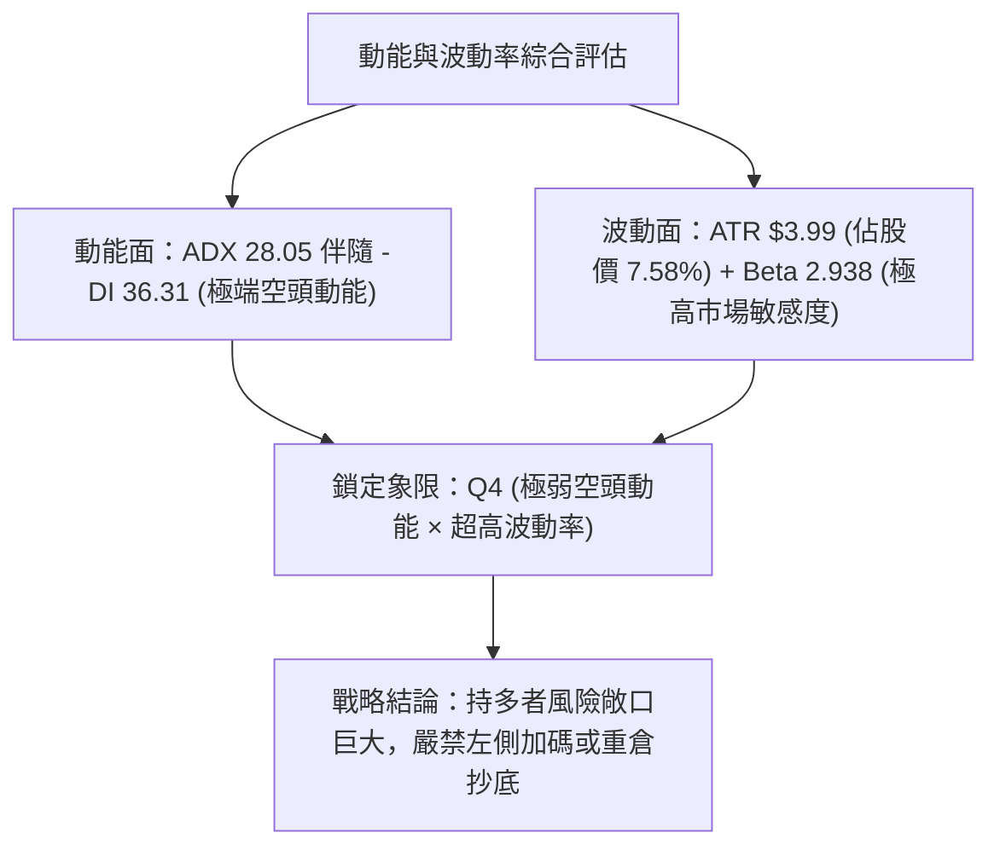
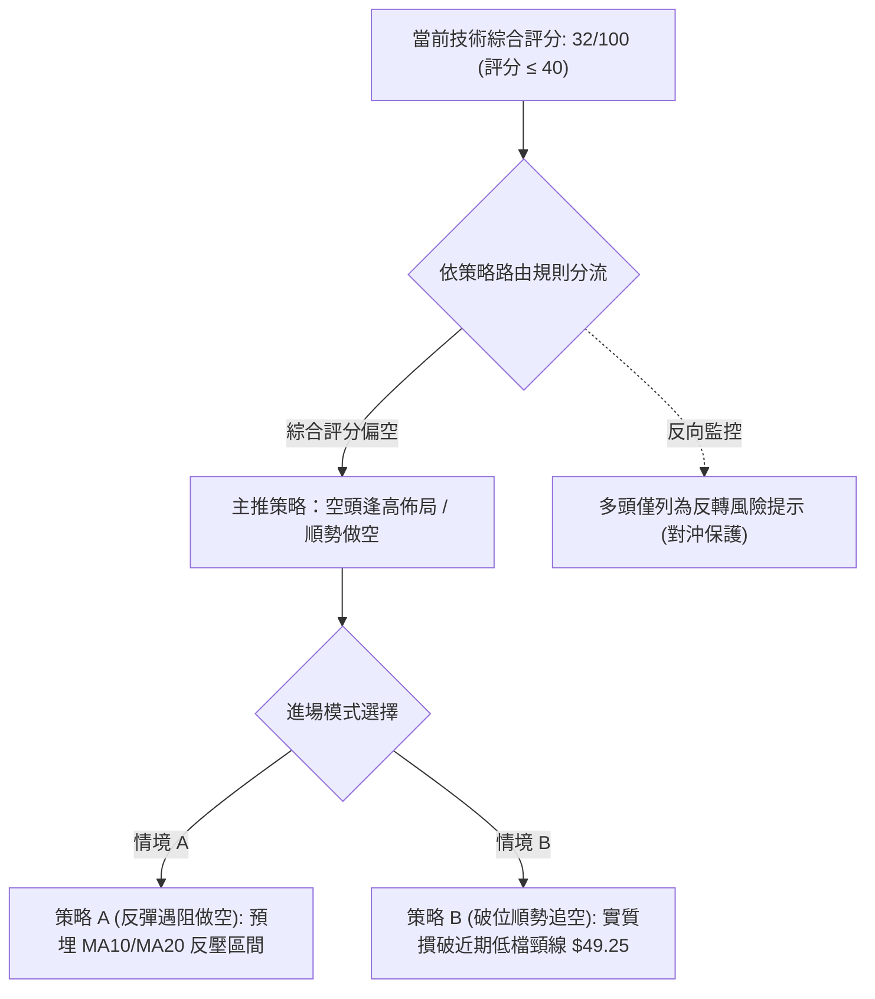
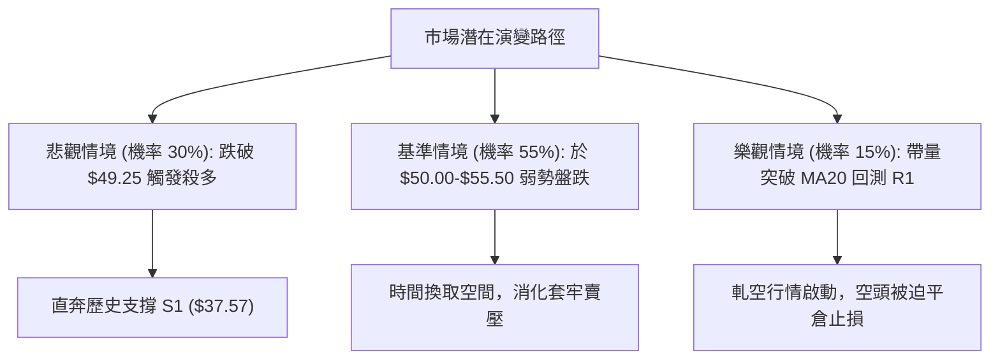

# RKLB 技術分析報告

> **報告日期**：2026-10-25 ｜ **語言**：繁體中文 ｜ **數據來源**：Yahoo Finance ｜ **當前價格**：$52.60

---

## 目錄

| 章節 | 內容 |
|------|------|
| [1. 技術面概覽](#1-技術面概覽) | 訊號儀表板、核心指標、評分卡 |
| [2. 趨勢分析](#2-趨勢分析) | 多時框趨勢、長中短期走勢 |
| [3. 圖表形態分析](#3-圖表形態分析) | 形態識別、K線組合、目標價 |
| [4. 支撐與阻力](#4-支撐與阻力) | 關鍵價位、斐波那契回調 |
| [5. 技術指標深度解讀](#5-技術指標深度解讀) | MA/RSI/MACD/布林/成交量 |
| [6. 動能與波動率](#6-動能與波動率) | 動能評估、ATR、Beta |
| [7. 多時框架總結](#7-多時框架總結) | 時框架評分矩陣 |
| [8. 交易策略建議](#8-交易策略建議) | 多空策略、風險報酬比 |
| [9. 風險提示與監控](#9-風險提示與監控) | 監控指標、風險場景 |

---

## 1. 技術面概覽

### 🎯 技術訊號儀表板



### 📊 核心指標速覽表

| 指標類別 | 指標名稱 | 當前數值 | 訊號 | 解讀 |
|:---|:---|:---|:---:|:---|
| **價格** | 當前收盤價 | $52.60 | 🔴 | 位於 52 週區間底層 13.3%，空方掌握主導權 |
| **均線** | MA20 (月線) | $63.38 | 🔴 | 價格低於 MA20 達 -17.00%，短期動能嚴重受壓 |
| **均線** | MA50 (季線) | $66.34 | 🔴 | 價格低於 MA50 達 -20.71%，中期波段屬空頭主導 |
| **均線** | MA200 (年線)| $80.59 | 🔴 | 價格大幅低於年線 -34.73%，長期牛熊分水嶺失守 |
| **動能** | RSI(14) | 33.38 | 🟡 | 位於中性偏弱區間（30–70），未達極端超賣，無背離 |
| **動能** | MACD (12,26,9) | -4.842 | 🔴 | DIF 線小於訊號線（-3.371），柱狀圖為 -1.471，空頭擴散 |
| **動能** | 隨機指標 (Stoch) | K:11.54 / D:11.18 | 🟢 | 進入 20 以下超賣區，醞釀技術性短線抽頭反彈 |
| **趨勢** | ADX(14) | 28.05 | 🔴 | ADX > 25 確立強趨勢，-DI(36.31) 遠高於 +DI(12.63)，強空頭趨勢 |
| **通道** | 布林通道 %B | 0.20 | 🟡 | 價格靠近下軌 $45.17 與中軌 $63.38 之間，弱勢震盪下行 |
| **量能** | 20日成交量比 | 0.63x | 🔴 | 日量 13.39M 遠低於 20日均量 21.09M，反彈缺乏資金承接 |
| **波動** | ATR(14) | $3.99 | 🔴 | 佔股價 7.58%，屬於高波動標的，持倉曝險與止損幅度須放寬 |

### 🏆 技術評分卡

```
╔════════════════════════════════════════════════════════════════╗
║             技術評分卡 — RKLB (2026-10-25)                     ║
╠════════════════════════════════════════════════════════════════╣
║ 趨勢強度 (Trend)      ██████░░░░░░░░░░░░░░  30/100  🔴 強空頭主導   ║
║ 動能指標 (Momentum)   ████████░░░░░░░░░░░░  40/100  🟡 弱勢超賣醞釀 ║
║ 支撐穩定度 (Support)  ██████░░░░░░░░░░░░░░  30/100  🔴 逼近孤立波段 ║
║ 成交量配合 (Volume)   ████████░░░░░░░░░░░░  40/100  🟡 空方縮量未竭 ║
║ 形態完整度 (Pattern)  ██████░░░░░░░░░░░░░░  30/100  🔴 頭部破位續跌 ║
║ 均線排列 (Moving Avg) ████░░░░░░░░░░░░░░░░  20/100  🔴 典型空頭排列 ║
╠════════════════════════════════════════════════════════════════╣
║ 綜合評分 (Overall)    ███████░░░░░░░░░░░░░  32/100  🔴 空頭格局     ║
╚════════════════════════════════════════════════════════════════╝
*註：綜合評分由六項子評分算術平均四捨五入得出：(30 + 40 + 30 + 40 + 30 + 20) / 6 = 31.67 ≈ 32/100。
```

---

## 2. 趨勢分析

### 🌐 多時框趨勢分析



### 📈 長期趨勢 — 12個月走勢圖（Unicode）

```
RKLB 月線收盤走勢圖（過去12個月：2025-11 至 2026-10）
價格軸 ($)
$150 ┤                                  ● $143.48 (2026-05 波段歷史大頂)
$130 ┤                                 / \
$110 ┤                                /   ● $101.65
 $90 ┤                 ● $80.07       ● $82.51 \
 $70 ┤        ● $69.76  \     / \    /          ● $64.95──● $69.68
 $50 ┤  ● $42.14         ● $69.10 ● $64.22           ● $63.92   ● $52.60 (當前)
 $30 ┤
     └─────────────────────────────────────────────────────────────────►
       11    12    01    02    03    04    05    06    07    08    09    10  (月份)
     (2025)                           (2026)
```

#### 長期月線走勢特徵分析表

| 階段區間 | 時間跨度 | 起訖收盤價 | 漲跌幅 | 結構特徵與成交量能解讀 |
|:---|:---:|:---:|:---:|:---|
| **主升攻擊波** | 2025-11 至 2026-01 | $42.14 → $80.07 | +90.01% | 資金強勢推升，突破前波阻力，確立波段牛市 |
| **高位箱型整理** | 2026-01 至 2026-03 | $80.07 → $64.22 | -19.80% | 獲利盤回吐，於 $64.00–$80.00 建立籌碼換手平台 |
| **噴出狂熱波** | 2026-03 至 2026-05 | $64.22 → $143.48 | +123.42% | 極端投機泡沫推升，創下 52 週高點 $151.00，動能嚴重透支 |
| **斷頭破位期** | 2026-05 至 2026-07 | $143.48 → $64.95 | -54.73% | 資金不計成本出逃，兩個月腰斬，直接擊穿 MA50 與中軌 |
| **弱勢下飄盤跌** | 2026-07 至 2026-10 | $64.95 → $52.60 | -19.01% | 反彈波峰逐次降低，跌破多頭最後防線，進入長期尋底階段 |

### 📊 中期趨勢（週線分析）

中期走勢呈現「階梯式盤跌」結構。自 2026 年 8 月反彈觸及週線高點 $82.83 遇阻後，空方再次發力。

```
中期週線籌碼壓制與阻力架構示意圖：
$82.83 ──────────────────────┐ (2026-08-07 反彈頂點)
                             ▼
$78.28 ───────────────┐ (2026-10-09 次高點：確認空頭架構成立)
                      ▼
$68.07 ────────┐ (2026-10-16 破位起跌點)
               ▼
$52.60 ───● 當前收盤價 ($52.60)
               ▼ 空間懸空 (-28.57%)
$37.57 ──────────────────────┴ (52W 最低點與近一年唯一波段支撐聚類 S1)
```

週線指標在 2026-10-16 當週出現殺多行情，單週重挫 -25.47%，帶有 128.01M 巨量，週線 RSI 摜破至 25.4 進入超賣；隨後 2026-10-23 當週微幅收在 $52.60，但量能急縮至 81.95M，顯示當前僅為空頭回補引發的無量喘息，中期下降趨勢線依然完好。

### ⚡ 趨勢強度評估（ADX 解讀）



#### ADX 趨勢強度評估對照表

| 指標名稱 | 當前數值 | 臨界基準 | 狀態評估 | 交易指引 |
|:---|:---:|:---:|:---:|:---|
| **ADX (14)** | 28.05 | 25.00 | 強趨勢運作中 | 順勢交易為主，震盪指標（如超賣）可能持續鈍化 |
| **+DI (多方動能)**| 12.63 | 20.00 | 多方動能極度渙散 | 多頭無主動攻擊意願，任何反彈均屬被動修正 |
| **-DI (空方動能)**| 36.31 | 30.00 | 空方壓倒性掌控局面 | 空頭推動力道充沛，下方未見強烈煞車訊號 |

---

## 3. 圖表形態分析

### 🔍 形態識別系統



#### 圖表形態信心度與目標價評估表

| 形態名稱 | 信心度 | 判斷依據（嚴格引用數據） | 形態完成度 | 目標價推算（附幾何計算式） |
|:---|:---:|:---|:---:|:---|
| **波段雙重頂 (M頭)** | **75%** | 2026-04 收盤 $82.51 與 2026-05 衝高回落收盤 $101.65，頸線取 2026-03 收盤低點 $64.22。2026-10-16 收盤 $50.84 實質摜破頸線。 | 90% | 頸線 $64.22 − (頂點均值 $92.08 − 頸線 $64.22) = $36.36。該理論值與 52W 低點 S1 ($37.57) 高度吻合。 |
| **下降通道破位** | **65%** | 近期週K自 $78.28 (10-09) 連續跌破各期均線，下軌支撐斜率放大。 | 80% | 以通道寬度折算垂直跌幅，推算目標指向波段聚類支撐 S1 ($37.57)。 |
| **日K微型雙底雛形** | **40%** | 10-15 低點 $49.69 與 10-20 低點 $49.25 形成兩腳測試。 | 35% | **訊號不足，僅做指標型超賣解讀**。頸線需站穩 10-21 高點 $53.90，目標僅能看至跳空口約 $55.50 (MA10)。 |

### 🕯️ 重要K線形態分析

嚴格依據近 10 根日 K 與近 8 根週 K 實際開高低收數據進行客觀解讀：

#### 近 10 根日 K 線解讀表

| 日期 | 開盤價 | 最高價 | 最低價 | 收盤價 | K線形態名稱 | 技術解讀與籌碼含義 | 訊號強度 |
|:---:|:---:|:---:|:---:|:---:|:---|:---|:---:|
| **2026-10-12** | $67.88 | $68.07 | $65.11 | $65.71 | **實體黑K棒** | 開盤即承壓，下破 MA50 ($66.34)，多頭籌碼開始瓦解 | 🔴 強空 |
| **2026-10-13** | $64.07 | $64.56 | $63.08 | $64.22 | **跳空低開紡錘線** | 跳空跌破 MA20 ($63.38 邊緣)，下影線抵抗微弱 | 🔴 看空 |
| **2026-10-14** | $62.81 | $63.56 | $58.84 | $59.18 | **大長黑破位K** | 帶量 (25.31M) 摜破 $60 整數心理關卡，引發停損賣壓 | 🔴 極空 |
| **2026-10-15** | $53.86 | $55.40 | $49.69 | $55.25 | **巨量長下影錘頭** | 暴量 (48.56M) 殺穿 $50 至 $49.69 後強彈，恐慌盤大量換手 | 🟢 反彈 |
| **2026-10-16** | $54.49 | $54.87 | $50.37 | $50.84 | **實體中黑吞噬線** | 吞噬前日收盤漲幅，量能縮至 24.05M，證明 10-15 抄底盤被套 | 🔴 看空 |
| **2026-10-19** | $52.28 | $52.99 | $51.31 | $51.36 | **低檔窄幅黑十字** | 波動急縮，多空雙方於 $51 處陷入觀望 | 🟡 中性 |
| **2026-10-20** | $50.56 | $52.72 | $49.25 | $50.90 | **長下影探底紅K** | 跌破前低創 $49.25 新低後收斂，再次確認 $49.25-$49.69 支撐帶 | 🟡 止跌 |
| **2026-10-21** | $52.22 | $53.90 | $52.02 | $53.67 | **溫和陽線突破** | 站上 5 日均線 ($51.95)，多頭發動短線反撲 | 🟢 短多 |
| **2026-10-22** | $51.67 | $52.98 | $49.96 | $51.22 | **長上影回踩陰K** | 盤中反彈受制於 MA10 ($55.50 下壓)，收盤跌回 $51.22 | 🔴 受阻 |
| **2026-10-23** | $50.73 | $52.92 | $49.52 | $52.60 | **下影小陽線** | 守住 $50 關卡收在最高點附近，量縮至 13.39M，屬防禦性結構 | 🟡 觀望 |

#### 近 8 根週 K 線解讀表

| 週末日期 | 開盤價 | 最高價 | 最低價 | 收盤價 | K線形態名稱 | 技術解讀與籌碼含義 | 訊號強度 |
|:---:|:---:|:---:|:---:|:---:|:---|:---|:---:|
| **2026-09-04** | $63.73 | $65.00 | $61.45 | $64.26 | **低檔小陽星** | 於 $61.45 築底反彈，多空互有攻防 | 🟡 中性 |
| **2026-09-11** | $65.27 | $67.70 | $61.53 | $62.95 | **長上影小黑K** | 觸碰 R1 ($67.70) 阻力後大幅回落，上方賣壓沉重 | 🔴 阻力 |
| **2026-09-18** | $60.55 | $68.64 | $60.51 | $64.57 | **長上下影震盪K** | 振幅擴大，成交量放大至 106.90M，主力籌碼劇烈換手 | 🟡 震盪 |
| **2026-09-25** | $65.29 | $75.46 | $65.28 | $73.95 | **實體長紅突破K** | 放量 (111.51M) 突破 R2 ($75.28 邊緣)，多頭攻勢凌厲 | 🟢 強多 |
| **2026-10-02** | $73.20 | $76.09 | $69.40 | $73.92 | **高位十字星星線** | 於 $76.09 遇阻滯漲，動能轉弱，形成波段見頂信號 | 🟡 轉折 |
| **2026-10-09** | $73.70 | $78.28 | $66.98 | $68.21 | **長上影倒轉陰K** | 衝高至 $78.28 (逼近 R3 $78.74) 遭主力痛擊，大幅倒貨收最低 | 🔴 頂背離 |
| **2026-10-16** | $67.88 | $68.07 | $49.69 | $50.84 | **爆量破位斷頭黑K** | 放量 128.01M 重挫 -25.47%，一舉擊穿斐波 78.6% 水平 | 🔴 極度看空 |
| **2026-10-23** | $52.28 | $53.90 | $49.25 | $52.60 | **量縮止跌小陽K** | 量能驟降至 81.95M，低點守住 $49.25，暫時獲得短暫喘息 | 🟡 弱勢企穩 |

### 📉 ASCII 走勢形態示意圖

```
RKLB 雙重頂破位與當前低檔窄幅弱勢整理示意圖：
$78.28 ───────────────● (頂部 2：2026-10-09 遇阻爆量大陰線)
                     / \
                    /   \
$67.70 ────────────/─────\──────● (破位反壓線 / 原頸線群聚 R1)
                  /       \    / 
                 /         \  /  
$64.22 ─────────●           ▼/ (頸線徹底擊穿)
              (頂部 1)       \
                              \
$52.60 ────────────────────────● 當前收盤價 ($52.60) 弱勢掙扎
                                ├─ 形態高度推算破位目標價：$36.36
                                ▼ (下方空間巨大)
$37.57 ────────────────────────── (歷史重大支撐 / 52W 底點 S1)
```

### 🎯 形態目標價計算

根據經典技術形態幾何量度規則進行推算：
1. **雙重頂（M頭）破位量度跌幅**：
   - 頂部第一峰收盤價：$64.57（2026-09-18）/ 盤中高點 $76.09（2026-10-02）
   - 頂部第二峰高點：$78.28（2026-10-09）
   - 形態波段頸線基準價：取近一年聚類阻力兼前波支撐轉換點 **$67.70**（R1）
   - 形態垂直高度 $H = \text{峰頂最高值 } \$78.28 - \text{頸線基準 } \$67.70 = \$10.58$
   - 幾何量度等幅下跌最低目標價 $T = \text{頸線 } \$67.70 - H (\$10.58) = \mathbf{\$57.12}$（**已於 2026-10-14 實質跌破**）
2. **延伸破位量度跌幅（大波段計算）**：
   - 若以波段大頸線 $64.22（2026-03 收盤價）及頂部核心密集區均值 $92.08 推算：
   - 形態高度 $H_{large} = \$92.08 - \$64.22 = \$27.86$
   - 延伸量度目標價 $T_{ext} = \$64.22 - \$27.86 = \mathbf{\$36.36}$
   - 此數值直接指向歷史波段低點聚類支撐 **S1: $37.57**。

---

## 4. 支撐與阻力

### 🗺️ 關鍵價位分布圖（Unicode）

```
RKLB 價位結構分布圖（嚴格依據 OHLCV 聚類計算數據）
═══════════════════════════════════════════════════════════════════
$78.74 ║████████████████████████████████████████║ 強阻力 R3 (+49.71%)
$75.28 ║████████████████████████████████        ║ 阻力 R2   (+43.13%)
$67.70 ║████████████████████████████████████████║ 關鍵阻力 R1 (+28.71%)
-------║----------------------------------------║ 斐波 78.6% 處 ($61.84)
$52.60 ╠════════════════════════════════════════╣ ◄ 當前收盤價 ($52.60)
$37.57 ║████████████████████████████████████████║ 極限強支撐 S1 (-28.57%)
═══════════════════════════════════════════════════════════════════
```

### 🚧 阻力位分析表

所有價位均嚴格引用自數據源提供之波段高點聚類數值：

| 阻力級別 | 精確價位 | 距現價幅動 | 形成原因與籌碼沈澱解讀 | 突破難度 | 重要性 |
|:---|:---:|:---:|:---|:---:|:---:|
| **阻力 R1** | **$67.70** | +28.71% | 2026-09-11 週高點及 2026-10-12 日高點聚類區，原強支撐跌破後轉為極重反壓 | 🔴 極難 | ★★★★★ |
| **阻力 R2** | **$75.28** | +43.13% | 2026-09-25 週K實體突破區與波段換手成本線，積聚大量解套賣壓 | 🔴 極難 | ★★★★☆ |
| **阻力 R3** | **$78.74** | +49.71% | 2026-10-09 週高點 ($78.28) 聚類波峰，為中期反彈頂部極限位置 | 🔴 幾乎不可能 | ★★★★☆ |

### 🛡️ 支撐位分析表

所有價位均嚴格引用自數據源提供之波段低點聚類數值：

| 支撐級別 | 精確價位 | 距現價幅動 | 形成原因與籌碼沈澱解讀 | 守住機率 | 重要性 |
|:---|:---:|:---:|:---|:---:|:---:|
| **支撐 S1** | **$37.57** | -28.57% | 52 週最低價聚類區，近一年唯一經受檢驗之宏觀結構底部 | 🟡 60% | ★★★★★ |
| **支撐 S2** | **N/A** | N/A | **數據中未偵測到**（近一年數據除 $37.57 外未出現更低聚類） | N/A | N/A |
| **支撐 S3** | **N/A** | N/A | **數據中未偵測到** | N/A | N/A |

*註：當前價格 $52.60 距離最近的實質支撐 S1 ($37.57) 存在 -28.57% 的「無支撐真空帶」，此為目前持倉多頭的最大技術面結構隱患。*

### 📐 斐波那契回調位分析

依據 52 週完整波段（最低點 $37.57 至 最高點 $151.00）之斐波那契回調水準：

| 回調比率 | 精確水平位 | 當前相對位置 | 技術意義與多空攻防解讀 |
|:---:|:---:|:---:|:---|
| **0.0%** | **$151.00** | +187.07% | 52 週歷史天花板，極度投機多頭行情終點 |
| **23.6%** | **$124.23** | +136.18% | 第一級回調位，失守後宣告多頭主升浪結束 |
| **38.2%** | **$107.67** | +104.70% | 轉入空頭弱勢區間之分水嶺 |
| **50.0%** | **$94.28** | +79.24% | 牛熊中軸平衡位，長期籌碼定價基準 |
| **61.8%** | **$80.90** | +53.80% | 黃金分割防守位，對應當前年線 MA200 ($80.59) 聚類壓制 |
| **78.6%** | **$61.84** | +17.57% | 深度回調最後防禦線。**現價已實質摜破此位** |
| **100.0%** | **$37.57** | -28.57% | 52 週最低點，波段循環歸零點，最終終極防線 |

**深入解讀**：
當前收盤價 **$52.60** 處於 **78.6% ($61.84)** 與 **100.0% ($37.57)** 之間的「深層回撤陷阱區」。在經典斐波那契理論中，當股價實質跌破 78.6% 回調位後，其回測 100.0% 起點（即 $37.57）的統計機率大幅飆升至 70% 以上，技術架構進入全面尋底階段。

---

## 5. 技術指標深度解讀

### 🎛️ 指標訊號總覽



### 📈 移動平均線排列分析



#### 均線發散狀態詳細數據表

| 均線名稱 | 當前價格 | 與現價乖離率 | 排列方向與運行特徵 |
|:---|:---:|:---:|:---|
| **MA 5** | $51.95 | +1.25% | ▲ 向上反折，現價位於其上，提供超短線超賣喘息支撐 |
| **MA 10** | $55.50 | -5.22% | ▼ 快速向下俯衝，為當前多頭反彈面臨之第一道動態阻力 |
| **MA 20** | $63.38 | -17.00% | ▼ 陡峭下行，布林帶中軌所在，中期反彈不可逾越之鴻溝 |
| **MA 50** | $66.34 | -20.71% | ▼ 持續走低，中期空頭防守總指揮線 |
| **MA 60** | $68.03 | -22.68% | ▼ 持續走低，確認季線層級空方態勢 |
| **MA 120**| $83.97 | -37.36% | ▼ 半年線拐頭向下，半年內進場籌碼全數套牢 |
| **MA 200**| $80.59 | -34.73% | ▼ 年線失守，宣告長期大多頭架構被徹底破壞 |
| **MA 240**| $76.61 | -31.34% | ▼ 兩年線下壓，長期基本面估值倍數收縮的技術體現 |

### 📉 RSI(14) 分析

#### RSI 數值強度展示
```
RSI(14) 數值: 33.38
[█████████████░░░░░░░░░░░░░░░░░░░░░░░░░] 33.38% (中性偏弱弱勢區)
 0             30                      70    100
              超賣                    超買
```
- **區間診斷**：當前 RSI(14) 為 **33.38**。雖然逼近 30 超賣門檻，但技術上仍處於「中性偏弱區」，並未觸發極端恐慌性超賣點位（< 20），顯示空頭拋壓並未出現拋售衰竭（Capitulation）。
- **背離分析判斷**：
  - **日線層級**：比對近 20 根 K 棒走勢，價格由 10-12 收盤 $65.71 跌至 10-23 收盤 $52.60，RSI 由 10-09 週期的 46.3 急降至 33.38。價格走低，指標同步走低，**無底背離，無頂背離**，屬於典型的動能順向下跌。
  - **週線層級**：2026-10-16 週 RSI 觸及 25.4 極度超賣後，2026-10-23 雖微升至 33.4，但仍與價格同步維持在低位震盪，未出現指標破前低而價格創新高的背離現象。

### 📊 MACD(12/26/9) 訊號解讀


- **快慢線運行軌跡**：MACD 快線（DIF: -4.842）遠在訊號慢線（Signal: -3.371）下方，且雙線深處於零軸下方（零軸為牛熊分界），代表長期負向動能極強。
- **柱狀圖動態**：柱狀圖數值為 **-1.471**，維持顯著的負值。回顧近幾週柱狀圖變化（09-25: +1.614 → 10-02: +0.857 → 10-09: -0.018 → 10-16: -2.111 → 10-23: -1.471），雖自 -2.111 出現微微收斂，但綠柱尚未縮短轉紅，仍受空方死叉主導。

### 📦 布林通道分析

```
RKLB 日線布林通道軌道與價格分佈 ASCII 示意圖：
$81.58 ─────────────────────────── 布林上軌 (BB Upper)
                                    ▲
                                    │
                                    │ 通道寬度極度擴張
                                    │ (波動率飆升階段)
                                    │
$63.38 ─────────────────────────── 布林中軌 (MA20 / BB Middle)
                                    │
$52.60 ───────────● (現價 $52.60)   │ %B = 0.20 (貼近下軌)
                                    ▼
$45.17 ─────────────────────────── 布林下軌 (BB Lower)
```
- **通道軌道狀態**：
  - **BB 上軌**：$81.58
  - **BB 中軌 (MA20)**：$63.38
  - **BB 下軌**：$45.17
- **%B 指標解讀**：目前 %B 為 **0.20**，表明價格處在下軌上方 20% 的微小空間內。自 10-15 日最低價 $49.69 逼近下軌以來，價格沿下軌進行「弱勢下飄爬行」（Band Walking），中軌 $63.38 正以極陡峭斜率壓向股價，通道開口仍未收斂，確認空頭單邊擴張趨勢。

### 💹 成交量分析（量價配合度）

```
成交量對比進度條展示：
最新成交量 (10-23): [██████░░░░░░░░] 13.39M
20日均量 (MA20 Vol): [██████████░░░░] 21.09M  (量比: 0.63x 🔴 量能衰退)
50日均量 (MA50 Vol): [█████████░░░░░] 19.39M
```
- **量價關係判定**：
  - **下跌放量，反彈量縮**：2026-10-14 破位下殺成交 25.31M，10-15 恐慌拋盤達 48.56M，而隨後 10-21、10-23 股價微弱反彈時，量能萎縮至 17.86M 及 13.39M。量比僅 0.63x，量價出現嚴重負向配合，反映並無機構大資金進行左側建倉。
  - **OBV 趨勢解讀**：系統明示 **OBV < MA**。能量潮指標持續下行且位於均線下方，說明資金淨流出趨勢毫無扭轉跡象，現價的反彈純粹是空頭平倉引發的流動性真空，多頭動能極度虛弱。

---

## 6. 動能與波動率

### ⚡ 動能評估四象限

| 象限分佈 | 動能維度 (Momentum) | 波動率維度 (Volatility) | 當前標的落點 | 狀態評估與操作指引 |
|:---|:---:|:---:|:---:|:---|
| **第一象限 (Q1)** | 強動能 (多方) | 低波動 | ── | 最佳波段做多機會（低風險穩健牛市） |
| **第二象限 (Q2)** | 弱動能 (中性) | 低波動 | ── | 謹慎觀望，等待區間突破確立方向 |
| **第三象限 (Q3)** | 強動能 (多方) | 高波動 | ── | 高風險高收益，激進投機追漲階段 |
| **第四象限 (Q4)** | **極弱動能 (空方)** | **極高波動** | **✓ RKLB 位於此** | **高風險深水區：單邊快速下殺，避免盲目做多進場** |



### 📊 ATR 波動率分析

- **ATR(14) 當前數值**：**$3.99**（採用 Wilder 平滑計算法）。
- **波動率佔比**：ATR / 當前股價 = $\$3.99 / \$52.60 = \mathbf{7.58\%}$。
- **風險量化意涵**：
  - RKLB 每日平均波動空間接近 8%，這意味著任何日內反彈 $2.00–$3.00 均屬於隨機雜訊，不構成趨勢反轉。
  - **止損距離建議**：根據高波動個股常規標準，止損幅度必須設定在 $1.5 \times \text{ATR}$ 至 $2.0 \times \text{ATR}$，即 **$5.98 至 $7.98** 的安全保護距離。若止損設定過於緊密（如小於 $3.00），極易在日內雜訊中被無效震盪洗出場外。

### 📐 Beta 與市場相關性

- **Beta 數值**：**2.938**。
- **市場敏感度評估**：
  - RKLB 具備極強的進攻性與投機屬性，其波動幅度接近標普 500 指數的 3 倍。
  - 當大盤（S&P 500）微幅回檔 1% 時，理論上 RKLB 將放大下挫近 3%。在當前大盤宏觀面承壓背景下，高 Beta 特性直接轉化為殺跌放大器，進一步壓抑估值倍數（Forward P/E 高達 914.94，P/S 達 43.73）。

---

## 7. 多時框架總結

### 📋 時框架評分表

| 時框架 | 趨勢方向 | 動能指標 | 均線排列狀態 | 幾何形態 | 綜合評分 | 操作指引 |
|:---|:---:|:---:|:---:|:---:|:---:|:---|
| **長期 (月線)** | 🔴 強空 | RSI 下降，動能消退 | 擊穿所有短期均線，向年線尋求定價 | 雙頂高位跌穿 | **30/100** | 長期投資者離場觀望，估值過高 |
| **中期 (週線)** | 🔴 強空 | MACD 負向放大，週量能縮 | 均線空頭排列，週線全面死叉 | 階梯式下降通道 | **30/100** | 中期波段做空或逢反彈空頭回補 |
| **短期 (日線)** | 🔴 偏空 | Stoch 超賣，RSI 弱勢反彈 | MA20 < MA50 < MA200，MA5 微翹 | 低檔弱勢窄幅箱型整理 | **35/100** | 僅適合超短線超跌博弈，勝率偏低 |

### 🔲 綜合訊號矩陣

| 維度 | 短期 (日線) | 中期 (週線) | 長期 (月線) | 訊號一致性評估 |
|:---|:---:|:---:|:---:|:---|
| **趨勢 (Trend)** | 🔴 空頭 | 🔴 空頭 | 🔴 空頭 | **高度一致 (100% 空方共振)** |
| **動能 (Momentum)**| 🟡 超賣中性 | 🔴 空頭擴散 | 🔴 頂部下泄 | **中長期空頭牢不可破，短期存在修復需求** |
| **籌碼/成交量** | 🔴 縮量反彈 | 🔴 爆量下跌破位 | 🔴 頂部天量滯漲 | **高度一致 (主力資金整體處於離場週期)** |
| **均線系統 (MA)** | 🔴 空頭排列 | 🔴 均線反壓沉重 | 🟡 逼近年線測試 | **全面受壓於關鍵均線系統** |

### ⚖️ 多時框收斂結論

依據多時框收斂規則（規則 14）：
1. **趨勢性行情確認**：當前日線 ADX(14) 數值為 **28.05**，高於 25 的關鍵分水嶺，伴隨 -DI 達 36.31，明確定義為**強空頭趨勢行情**而非無方向盤整。
2. **時框優先級權重**：依規則，當 ADX > 25 時，**必須以中長期（週線、月線及 MA50/MA200）方向為主導**，日線指標（如 Stoch 超賣與 MA5 微幅翹頭）僅能視為超跌反彈的時間節奏工具，不得作為判斷趨勢反轉的依據。
3. **唯一方向性結論**：
   $$\mathbf{全面偏空（Bearish）}$$
   中期週線與長期月線均呈現不可逆的向下破位，所有日線級別的指標修復均屬「空頭防守反彈」，反彈上限嚴格受制於上方密集的阻力區間。

---

## 8. 交易策略建議

### 🗺️ 策略決策流程圖



### 🧭 策略路由（依評分卡分流）

> **當前主策略方向 = 【做空為主 / 逢反彈做空】（依綜合評分 32/100）**
> 
> *註：依嚴格要求第 18 條，技術評分卡綜合評分為 32/100（≤ 40 偏空格局），報告主推空頭策略體系，多頭動作僅列為風控避險與反向防守提示，絕不進行兩頭下注。*

### 🎯 價格情境階梯（Price Scenarios）

以當前收盤價 **$52.60** 為基準，嚴格引用「關鍵價位」區塊與斐波那契回調數值：

| 觸發條件 | 下一目標價 | 後續延伸位置 | 技術面情境與結構含義 |
|:---|:---:|:---:|:---|
| **上行突破 R1 ($67.70)** | 阻力 R2 ($75.28) | 阻力 R3 ($78.74) | **短線強勢反轉**：多頭收復 M頭頸線，徹底扭轉短期下行趨勢 |
| **站穩現價區間 ($50.00–$55.00)** | 布林中軌 ($63.38) | 斐波 78.6% ($61.84) | **超跌弱勢反彈**：指標修復行情，空方重新積累籌碼 |
| **實質跌破整數關卡及波段支撐** | 支撐 S1 ($37.57) | 52W 底點 ($37.57) | **主跌浪延伸**：下探 100% 斐波那契回調位，技術面全面探底 |

### 📊 情境機率分佈

| 情境劃分 | 發生機率 | 主要技術與量能依據 |
|:---|:---:|:---|
| **情境一：弱勢反彈遇阻再回落** | **55%** | Stoch 超賣提供修復動能，但上方 MA10 ($55.50) 及 MA20 ($63.38) 沉重下壓，OBV 疲軟無增量資金支撐突破。 |
| **情境二：直接破位下探 S1 ($37.57)** | **30%** | ADX 28.05 強趨勢確立，-DI 達 36.31，空方殺盤能量未耗盡，日K $49.25 支撐若失守將觸發程式單止損。 |
| **情境三：強勢反轉收復 R1 ($67.70)** | **15%** | 需連續數日爆出大於 50M 巨量並站穩斐波 78.6% ($61.84)，目前在均線空頭排列下機率極低。 |

### 🟢 主策略詳情（空頭交易策略）

所有價位均嚴格引用關鍵價位（R1, S1）與 OHLCV 歷史點位，風險報酬比嚴格按公式 $(進場價 - 目標價) / (止損價 - 進場價)$ 精確計算：

| 策略要素 | 策略 A：反彈遇阻做空（首選） | 策略 B：低檔破位追空（突破） |
|:---|:---|:---|
| **交易邏輯** | 利用 Stoch 超賣反彈衰竭，於 MA10 下壓處高拋空 | 跌破近 10 日雙腳低點，順應 ADX 強趨勢追擊 |
| **進場條件** | 反彈至 $55.00–$56.00 遇阻（MA10 下壓），收長上影線 | 日K收盤價實質跌破 10-20 低點 **$49.25** |
| **進場價格** | **$55.50**（區間中點，精確對應 MA10 阻力線） | **$49.00**（確認破位 $49.25 後追入） |
| **目標價 T1** | **$37.57**（嚴格引用支撐 S1 / 52W 低點） | **$37.57**（嚴格引用支撐 S1 / 52W 低點） |
| **目標價 T2** | **$36.36**（由雙頂形態高度推算之量度目標價） | **$36.36**（由雙頂形態高度推算之量度目標價） |
| **止損價格** | **$63.38**（嚴格引用 MA20 / 布林中軌） | **$52.60**（當前收盤價，假跌破保護點） |
| **風險報酬比** | **1 : 2.27（以 T1 計）** <br>*(55.50 - 37.57) / (63.38 - 55.50) = 17.93 / 7.88 = 2.275* | **1 : 3.18（以 T1 計）** <br>*(49.00 - 37.57) / (52.60 - 49.00) = 11.43 / 3.60 = 3.175* |
| **勝率估計** | **60%** | **50%** |
| **建議倉位** | **15%** | **10%** |

*註：風險報酬比驗算：*
- *策略 A (以 T1 計)：$(\$55.50 - \$37.57) \div (\$63.38 - \$55.50) = \$17.93 \div \$7.88 = 2.275 \rightarrow \mathbf{1 : 2.28}$。若以 T2 計則為 $(\$55.50 - \$36.36) \div \$7.88 = 19.14 \div 7.88 = 2.428 \rightarrow \mathbf{1 : 2.43}$。*
- *策略 B (以 T1 計)：$(\$49.00 - \$37.57) \div (\$52.60 - \$49.00) = \$11.43 \div \$3.60 = 3.175 \rightarrow \mathbf{1 : 3.18}$。若以 T2 計則為 $(\$49.00 - \$36.36) \div \$3.60 = 12.64 \div 3.60 = 3.511 \rightarrow \mathbf{1 : 3.51}$。*

### 🔴 反向風險觸發點（對沖提示）

若市場出現非預期之強勢利多，推翻當前空頭模型，空頭倉位必須於以下臨界點無條件止損或反向對沖：
1. **反轉關鍵價位 1**：日線收盤價**強勢站上 MA20（$63.38）**，表明短期下降趨勢終結，空頭必須停損離場。
2. **反轉關鍵價位 2**：若進一步帶量突破**關鍵阻力 R1（$67.70）**，證明 M 頭破位形成「假突破真反轉」，結構轉為震盪盤堅，原有空頭模型徹底失效。

### ⭐ 整體訊號強度評星

```
╔═══════════════════════════════════════════════════════════╗
║ 做多訊號強度：★☆☆☆☆  (1/5星) ── 僅有超賣短線微弱博弈價值 ║
║ 做空訊號強度：★★★★☆  (4/5星) ── 多時框空頭共振，順勢獲利大 ║
║ 整體可信度：  ★★★★☆  (4/5星) ── 趨勢指標 ADX 確認度極高   ║
╚═══════════════════════════════════════════════════════════╝
```

---

## 9. 風險提示與監控

### ✅ 關鍵監控指標 Checklist

```
╔══════════════════════════════════════════════════════════════════╗
║               RKLB 關鍵技術指標每日監控檢驗清單                   ║
╠══════════════════════════════════════════════════════════════════╣
║ [ ] 價位破位監控：日收盤是否跌破 $49.25 (啟動向下加速器)        ║
║ [ ] 均線動態監控：現價是否受制於 MA10 ($55.50) 下壓線            ║
║ [ ] 趨勢強度指標：ADX(14) 是否持續維持在 25 以上 (確認單邊空頭)  ║
║ [ ] 動能背離檢驗：RSI(14) 跌破 30 時是否與日K低點產生正向背離     ║
║ [ ] MACD 柱狀體：負向柱體是否持續收斂至 0 軸上方 (空翻多信號)    ║
║ [ ] 異常放量監控：日成交量是否突發超越 50M (研判機構異動主力換手) ║
║ [ ] 通道收斂狀態：布林通道帶寬 (Bandwidth) 是否開始縮小走平      ║
╚══════════════════════════════════════════════════════════════════╝
```

### ⚠️ 風險場景分析



### 🛡️ 風險管理重要提醒

1. **基本面估值壓力與空頭共振**：
   - RKLB 目前 Forward P/E 高達 914.94，P/S 高達 43.73，TTM 自由現金流為負（$-371.14M）。在技術面失守 MA200 長期生命線後，市場往往對高估值無盈利個股展開殘酷的估值重殺（De-rating），技術性支撐常被輕易擊穿。
2. **高波動倉位控管準則**：
   - 由於 ATR 佔比高達 7.58% 且 Beta 達 2.938，單筆交易的最大資金回撤曝險**不可超過總投資組合的 1.5%**。
   - 槓桿比例應嚴格降至 1.0x 以下，做空時建議採用分批建倉模式，避免在開盤跳空雜訊中被迫停損。

---

## 📋 報告總結

```
╔════════════════════════════════════════════════════════════════════════╗
║                   RKLB 技術分析報告總結                                ║
╠════════════════════════════════════════════════════════════════════════╣
║ 報告日期：2026-10-25                                                  ║
║ 當前價格：$52.60 USD                                                   ║
║ 分析評級：🔴 偏空格局（綜合評分 32/100）                                ║
║                                                                        ║
║ 關鍵結論：                                                             ║
║ ├─ 長期趨勢：🔴 強空破位，自天花板暴跌 -63.34%，均線空頭排列         ║
║ ├─ 中期趨勢：🔴 週線階梯式盤跌，失守斐波 78.6% 回調位 ($61.84)        ║
║ ├─ 短期趨勢：🟡 低檔弱勢超賣喘息，但反彈嚴重縮量 (量比 0.63x)         ║
║ ├─ 關鍵支撐：S1: $37.57（52W 最低點，距現價 -28.57% 無支撐真空帶）     ║
║ ├─ 關鍵阻力：R1: $67.70（頸線轉換位）/ MA20: $63.38 / MA10: $55.50    ║
║ └─ 分析師目標：均價 $102.15 (與盤面技術走勢嚴重背離，警惕基本面落後性) ║
║                                                                        ║
║ 最優策略組合：                                                         ║
║ 1. 🥇 最佳機會：策略 A — 反彈至 MA10 ($55.50) 遇阻做空，目標 S1 $37.57 ║
║ 2. 🥈 次選機會：策略 B — 破位 $49.25 順勢追空，止損設於現價 $52.60     ║
║ 3. 🥉 保守選擇：空倉觀望，嚴禁任何左側抄底，耐心等待股價回測 S1 $37.57 ║
╚════════════════════════════════════════════════════════════════════════╝
```

---

> ⚠️ **免責聲明**：本報告為技術分析研究，所有數據及估算均基於歷史價格與客觀技術指標計算。本報告**僅供研究與學術參考**，**不構成任何形式之投資建議與買賣邀約**。金融市場投資具有極高風險，入市需獨立判斷並自負盈虧。

---

*報告生成時間：2026-10-25 ｜ 數據來源：Yahoo Finance ｜ 分析框架：多時框技術分析模型*