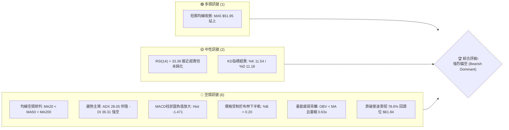
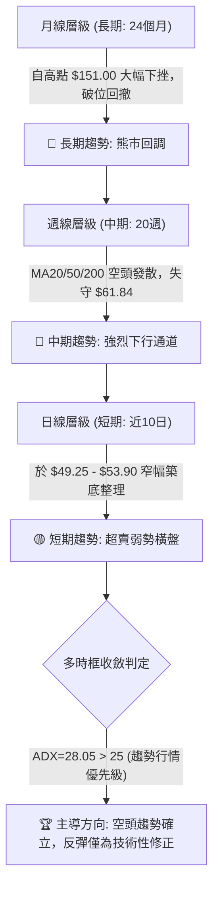
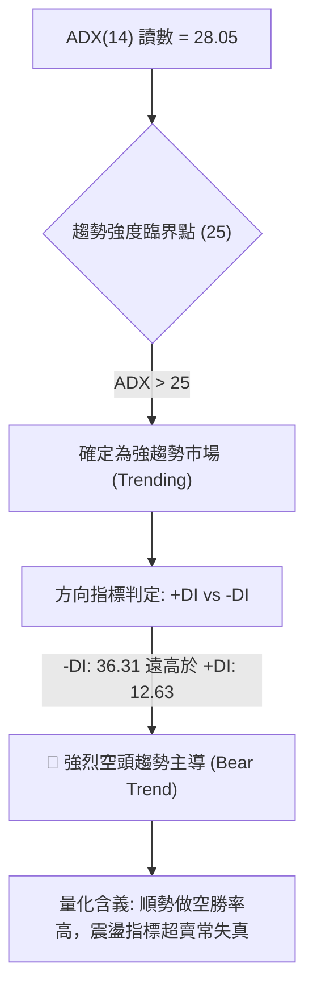
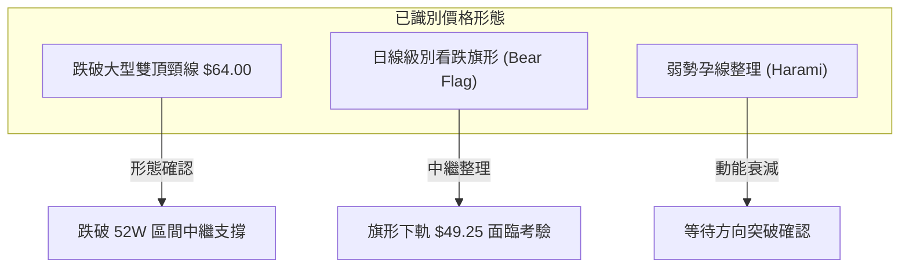
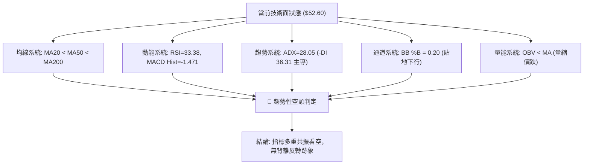
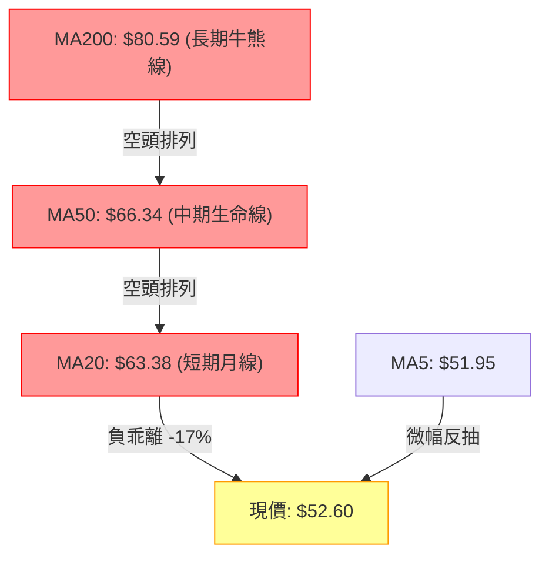
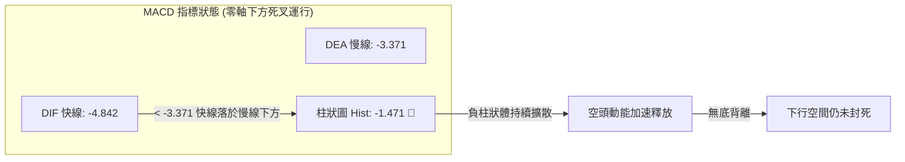
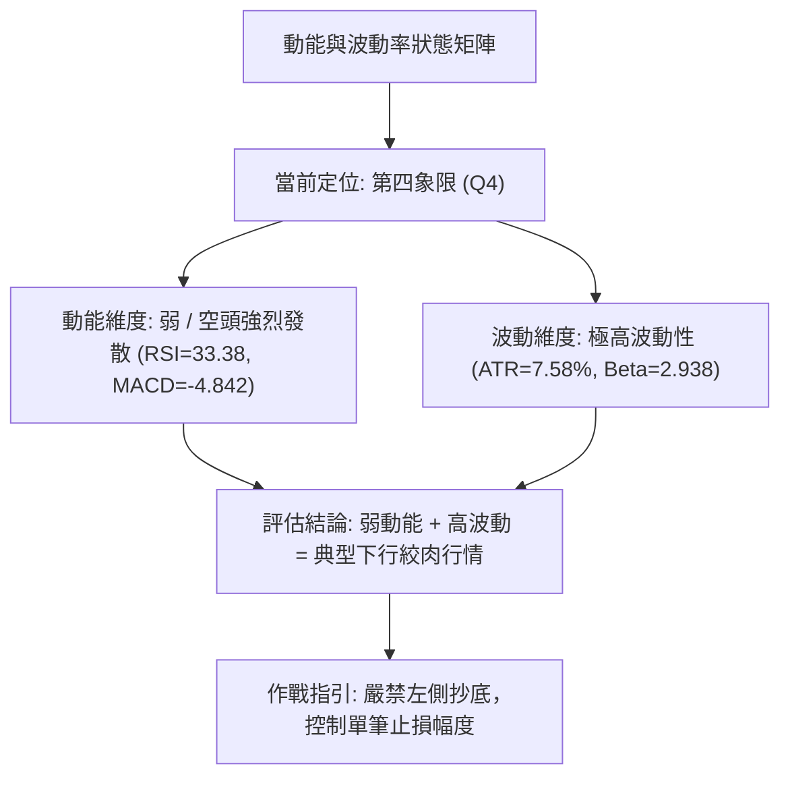
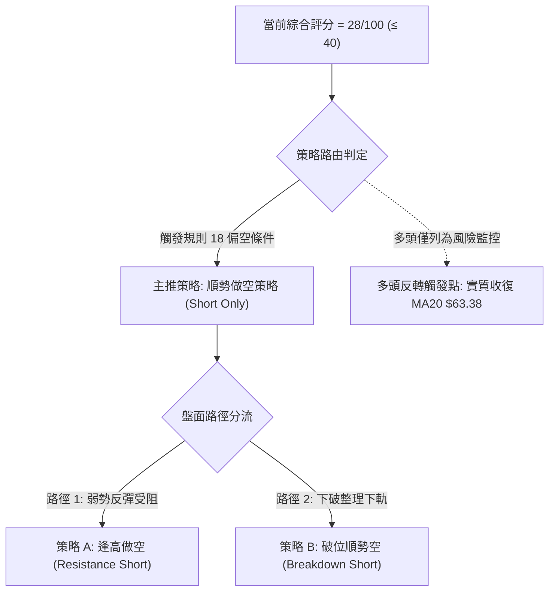
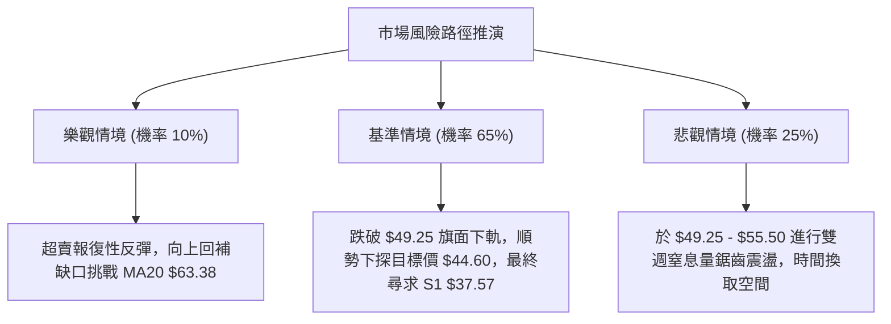

# RKLB 技術分析報告

> **報告日期**：2026-10-26 ｜ **語言**：繁體中文 ｜ **數據來源**：Yahoo Finance ｜ **當前價格**：$52.60

---

## 目錄

| 章節 | 內容 |
|------|------|
| [1. 技術面概覽](#1-技術面概覽) | 訊號儀表板、核心指標、評分卡 |
| [2. 趨勢分析](#2-趨勢分析) | 多時框趨勢、長中短期走勢 |
| [3. 圖表形態分析](#3-圖表形態分析) | 形態識別、K線組合、目標價 |
| [4. 支撐與阻力](#4-支撐與阻力) | 關鍵價位、斐波那契回調 |
| [5. 技術指標深度解讀](#5-技術指標深度解讀) | MA/RSI/MACD/布林/成交量 |
| [6. 動能與波動率](#6-動能與波動率) | 動能評估、ATR、Beta |
| [7. 多時框架總結](#7-多時框架總結) | 時框架評分矩陣 |
| [8. 交易策略建議](#8-交易策略建議) | 多空策略、風險報酬比 |
| [9. 風險提示與監控](#9-風險提示與監控) | 監控指標、風險場景 |

---

## 1. 技術面概覽

### 🎯 技術訊號儀表板



### 📊 核心指標速覽表

| 指標類別 | 指標名稱 | 當前數值 | 訊號 | 解讀 |
|:---|:---|:---|:---:|:---|
| **價格** | 當前收盤價 | $52.60 | 🔴 | 位於52週區間 13.3% 極低檔，跌勢未止 |
| **均線** | MA20 (月線) | $63.38 | 🔴 | 價格低於 MA20 達 -17.00%，短中期趨勢受壓制 |
| **均線** | MA50 (季線) | $66.34 | 🔴 | 價格低於 MA50 達 -20.71%，中線多頭防線全面失守 |
| **均線** | MA200 (年線) | $80.59 | 🔴 | 價格低於 MA200 達 -34.73%，長期牛熊分水嶺破位 |
| **動能** | RSI(14) | 33.38 | 🟡 | 位於弱勢區間邊緣，尚未跌入 <30 的絕對超賣區 |
| **動能** | MACD (12,26,9) | -4.842 / -3.371 | 🔴 | MACD 線低於信號線，柱狀圖 -1.471 擴大下行 |
| **動能** | Stoch %K / %D | 11.54 / 11.18 | 🟡 | 進入深度超賣區（<20），存在技術性反抽需求 |
| **趨勢** | ADX (14) | 28.05 | 🔴 | ADX > 25 確立強趨勢，-DI(36.31) 遠高於 +DI(12.63) |
| **通道** | 布林通道 %B | 0.20 | 🔴 | 貼近下軌 $45.17 運行，帶寬發散呈現空頭擠壓 |
| **波動** | ATR(14) | $3.99 | 🔴 | 波動佔股價 7.58%，極高日度波動，風險敞口擴大 |
| **量能** | 20日成交量比 | 0.63x | 🔴 | 13.39M vs 21.09M 均量，下殺後反彈量能嚴重匱乏 |

### 🏆 技術評分卡

```
╔══════════════════════════════════════════════════════════════════════════════╗
║                       技術評分卡 — RKLB (2026-10-26)                         ║
╠══════════════════════════════════════════════════════════════════════════════╣
║ 趨勢強度 (ADX/DI)   ████░░░░░░░░░░░░░░░░  20/100  🔴 空頭單邊主導            ║
║ 動能指標 (RSI/MACD) ██████░░░░░░░░░░░░░░  30/100  🔴 動能向下發散            ║
║ 支撐穩定度 (S/R)    ███████░░░░░░░░░░░░░  35/100  🔴 S1距離遙遠，防守脆弱    ║
║ 成交量配合 (OBV/VOL)██████░░░░░░░░░░░░░░  30/100  🔴 量價背離且無增量支撐    ║
║ 形態完整度 (結構)   ███████░░░░░░░░░░░░░  35/100  🔴 高檔破位，空頭旗形中繼  ║
║ 均線排列 (MA System)████░░░░░░░░░░░░░░░░  18/100  🔴 完美空頭排列 MA20<50<200║
╠══════════════════════════════════════════════════════════════════════════════╣
║ 綜合評分            ██████░░░░░░░░░░░░░░  28/100  🔴 強烈偏空 (Rule 18計算)  ║
╚══════════════════════════════════════════════════════════════════════════════╝
```

---

## 2. 趨勢分析

### 🌐 多時框趨勢分析



### 📈 長期趨勢 — 12個月走勢圖（Unicode）

```
RKLB 月線收盤走勢圖（2025-11 至 2026-10）
價格軸 ($)
$150 ┤                                  ● $143.48 (2026-05 歷史峰值)
$135 ┤                                 / \
$120 ┤                                /   \
$105 ┤                               /     ● $101.65 (2026-06)
$90  ┤                 ● $80.07     ● $82.51 \
$75  ┤          ● $69.76\     /    /          \
$60  ┤           \       ●---●    /            ● $64.95 ──● $69.68
$45  ┤    ● $42.14        $69.10 $64.22                    \
$30  ┤                                                      ● $52.60 (當前)
$15  ┤
     └─────────────────────────────────────────────────────────────────
       25-11 25-12 26-01 26-02 26-03 26-04 26-05 26-06 26-07 26-08 26-09 26-10
```

#### 走勢特徵分析表格

| 階段區間 | 起止價格 | 漲跌幅 (%) | 成交量與形態特徵 | 趨勢性質 |
|:---|:---|:---:|:---|:---:|
| **2025-11 ~ 2026-01** | $42.14 → $80.07 | +90.01% | 突破加速段，太空發射業務與商業訂單催化爆發 | 長期多頭上升浪 |
| **2026-01 ~ 2026-03** | $80.07 → $64.22 | -19.79% | 高檔箱體洗盤，量能逐步收斂於 $64-$70 區間 | 中期健康回檔 |
| **2026-03 ~ 2026-05** | $64.22 → $143.48 | +123.42% | 主升浪狂熱期，創下 52W 高點 $151.00，動能透支 | 投機性拋物線拉升 |
| **2026-05 ~ 2026-07** | $143.48 → $64.95 | -54.73% | 斷崖式跳水，跌破短期多頭防線，量能暴增後退潮 | 空頭第一殺戮浪 |
| **2026-07 ~ 2026-09** | $64.95 → $69.68 | +7.28% | 中繼收斂整理，受阻於 MA60/MA120 阻力帶 | 弱勢反彈中繼箱體 |
| **2026-09 ~ 2026-10** | $69.68 → $52.60 | -24.51% | Neutron 發射延期利空引發破位跳空，直墜低點 | 空頭加速主跌浪 |

### 📊 中期趨勢（週線分析）

```
RKLB 週線關鍵阻力與支撐結構示意圖
價格 ($)
$80.00 ┤                             [R3: $78.74]
$75.00 ┤                     [R2: $75.28]  ▲
$70.00 ┤             [R1: $67.70]          │ 密集解套賣壓帶
$65.00 ┤────────────┬──────────────────────┼─────────────
$60.00 ┤            │ 斐波那契 78.6%: $61.84 (已跌破)
$55.00 ┤            │
$52.60 ┼────────────┼─── 現價 $52.60 (跌破均線群，弱勢掙扎)
$50.00 ┤ [短線低點] ┴─── $49.25 (近兩週日K低點測試線)
$45.00 ┤
$40.00 ┤
$37.57 ┴─────────────────────────────────── [S1: $37.57 歷史底部波段支撐]
```

週線指標顯示，自 2026-10-02 當週高點 $76.09 以來，連續三週錄得長黑 K 棒。2026-10-16 當週放量 128,008,200 股暴跌 -25.47%，RSI 週線直接貫穿至 25.4 進入嚴重超賣。儘管 2026-10-23 當週微幅回升至 $52.60，但週成交量顯著萎縮至 81,945,700 股（較前週大減 36%），顯示買盤缺乏接刀意願，僅屬於下殺停頓。

### ⚡ 趨勢強度評估（ADX 解讀）



#### ADX 趨勢強度對照矩陣

| 指標變數 | 當前數值 | 臨界基準 | 狀態評估 | 實戰策略指引 |
|:---|:---:|:---:|:---:|:---|
| **ADX(14)** | 28.05 | 25.00 | 強趨勢形成 | 拒絕震盪指標逆勢摸底，嚴格執行趨勢跟隨原則 |
| **+DI (14)** | 12.63 | 20.00 | 多方極度衰竭 | 多頭無主動推升能力，任何向上進攻均屬反抽 |
| **-DI (14)** | 36.31 | 25.00 | 空方全面主控 | 賣壓強勁且具有自我強化特徵 |
| **趨勢方向** | 空方強勢 | -DI > +DI | 熊市趨勢浪 | 僅能採取逢高空或破位空，嚴禁重倉持有多單 |

---

## 3. 圖表形態分析

### 🔍 形態識別系統



#### 圖表形態信心度評估表

| 形態名稱 | 信心度 | 判斷依據（引用數據） | 完成度 | 目標價（附嚴格計算式） |
|:---|:---:|:---|:---:|:---|
| **跌破雙重頂頸線** | 85% | 2026-08 高點 $82.83 與 2026-10-09 高點 $78.28 構築雙頂，雙頂低點頸線位於 2026-09-11 處收盤 $62.95，目前收盤 $52.60 顯著跌破該頸線 | 100% (已破位) | 由形態高度推算：頸線 $62.95 − (頂部 $78.28 − 頸線 $62.95) = $62.95 − $15.33 = **$47.62** |
| **短期看跌旗形** | 75% | 10-15 旗桿暴跌 ($62.81 開盤跌至 $49.69 最低)，近6根交易日形成 $49.25 至 $53.90 之微幅上傾收斂通道 | 80% (旗面構築中) | 由旗桿高度推算破位目標：破位點 $49.25 − (旗桿頂 $62.81 − 旗桿底 $49.69) = $49.25 − $13.12 = **$36.13** (共振支撐 S1 $37.57) |
| **大型三重底** | 20% | 歷史低點僅有 52W 低點 $37.57，目前價位 $52.60 距離甚遠，缺乏右側對稱低點與築底成交量 | 10% | 訊號不足，僅做指標型解讀，不予計算形態目標價 |

### 🕯️ 重要K線形態分析

嚴格依據近 10 根日 K 與近 8 根週 K 實際開高低收數據進行形態解讀：

#### 近10根日K形態精解

| 日期 | 開盤 | 最高 | 最低 | 收盤 | 成交量 | K線形態名稱 | 專業技術解讀與多空意涵 | 訊號 |
|:---:|:---:|:---:|:---:|:---:|:---:|:---|:---|:---:|
| 10-12 | 67.88 | 68.07 | 65.11 | 65.71 | 14,499,000 | 中黑棒 (Bearish Candle) | 開平走低，實體跌破 $66 支撐，開啟新一輪下殺序幕 | 🔴 |
| 10-13 | 64.07 | 64.56 | 63.08 | 64.22 | 15,588,500 | 紡錘線 (Spindle) | 多空陷入觀望，上下影線對稱，短線下跌趨緩但無買盤 | 🟡 |
| 10-14 | 62.81 | 63.56 | 58.84 | 59.18 | 25,309,100 | 光腳大黑棒 (Marubozu) | 放量破位下殺，收盤收在全天相對最低，恐慌性停損湧出 | 🔴 |
| 10-15 | 53.86 | 55.40 | 49.69 | 55.25 | 48,563,400 | 長下影錘頭紅K (Hammer) | 跳空低開後暴量 48.56M，低檔承接盤湧現，收復開盤價 | 🟢 |
| 10-16 | 54.49 | 54.87 | 50.37 | 50.84 | 24,048,200 | 空頭吞噬大黑棒 | 次日完全抹殺前日反彈實體，將抄底籌碼悉數套牢 | 🔴 |
| 10-19 | 52.28 | 52.99 | 51.31 | 51.36 | 17,077,100 | 窄幅十字小黑K | 量能劇減至 17M，多空處於暴跌後休克狀態 | 🟡 |
| 10-20 | 50.56 | 52.72 | 49.25 | 50.90 | 16,945,200 | 下影探底小陽線 | 二次下探低點 $49.25 未創新深，下檔有被動護盤买盤 | 🟡 |
| 10-21 | 52.22 | 53.90 | 52.02 | 53.67 | 17,857,800 | 溫和實體陽線 (Bull Candle) | 小幅推升突破 5日均線，但量能僅 17.8M，難言攻擊量 | 🟢 |
| 10-22 | 51.67 | 52.98 | 49.96 | 51.22 | 16,674,500 | 倒轉中黑K棒 | 衝高回落受制於 10日線，上檔解套賣壓沈重 | 🔴 |
| 10-23 | 50.73 | 52.92 | 49.52 | 52.60 | 13,391,100 | 下影收高小紅K (Pinbar) | 量能創近期新低 13.39M，極致縮量抵抗，反彈動能衰竭 | 🟡 |

#### 近8根週K形態精解

| 週結日期 | 開盤 | 最高 | 最低 | 收盤 | 週成交量 | 週K線形態 | 結構意涵 | 訊號 |
|:---:|:---:|:---:|:---:|:---:|:---:|:---|:---|:---:|
| 09-04 | 63.73 | 65.00 | 61.45 | 64.26 | 80,227,200 | 縮量十字星 | 箱體底部整理，籌碼沉澱 | 🟡 |
| 09-11 | 65.27 | 67.70 | 61.53 | 62.95 | 85,204,500 | 衝高回落黑K | 觸碰 R1 阻力位 $67.70 後引發賣壓 | 🔴 |
| 09-18 | 60.55 | 68.64 | 60.51 | 64.57 | 106,896,200 | 長上下影陀螺線 | 寬幅震盪洗盤，多空分歧加劇 | 🟡 |
| 09-25 | 65.29 | 75.46 | 65.28 | 73.95 | 111,511,500 | 放量大長陽線 | 強勢多頭攻擊，突破多道短期壓力 | 🟢 |
| 10-02 | 73.20 | 76.09 | 69.40 | 73.92 | 107,277,600 | 高檔十字星 (Doji) | 高位放量滯漲，多頭上攻動能顯露疲態 | 🟡 |
| 10-09 | 73.70 | 78.28 | 66.98 | 68.21 | 104,635,800 | 射擊之星 (Shooting Star)| 創反彈新高 $78.28 後瀑布下殺，頂部反轉確認 | 🔴 |
| 10-16 | 67.88 | 68.07 | 49.69 | 50.84 | 128,008,200 | 斷頭鍘跳空長黑 | 放量暴跌 -25.47%，一舉摜破 60/120/200 週均線 | 🔴 |
| 10-23 | 52.28 | 53.90 | 49.25 | 52.60 | 81,945,700 | 低檔孕線小陽棒 | 大跌後量縮收斂，多頭僅能維持微弱防守 | 🟡 |

### 📉 ASCII 走勢形態示意圖

```
日線級別看跌旗形 (Bear Flag) 與破位結構示意圖
價格 ($)
$65.00 ┤ 10-12 (跌破平台)
$62.81 ┤ ╲
$60.00 ┤  ╲ 旗桿急速墜落 (10-14 ~ 10-15)
$55.00 ┤   ╲       ┌─── 旗面上軌阻力線 ($53.90)
$53.90 ┤    ╲     ╱   ╱  ● 10-23 收盤 $52.60 (旗面中軸)
$52.00 ┤     ╲   ╱   ╱
$49.25 ┤      ●─┴───┘ ─── 旗面下軌支撐線 ($49.25)
$45.00 ┤       :
$44.60 ┤       : ─── 由旗面等幅下測目標價 ($44.60)
$37.57 ┴───────:───── 終極波段支撐 S1 ($37.57)
```

### 🎯 形態目標價計算

1. **看跌旗形向下破位測算**：
   - **旗桿起點**：2026-10-14 開盤價 $62.81。
   - **旗桿低點**：2026-10-15 盤中最低價 $49.69。
   - **旗桿垂直幅度**：$62.81 − $49.69 = $13.12。
   - **旗面通道區間**：$49.25 至 $53.90（振幅 $4.65）。
   - **第一等幅目標 (以旗面箱底 $49.25 計算)**：$49.25 − 箱體高度 $4.65 = **$44.60**。
   - **第二完全等幅目標 (以旗桿幅度計算)**：$49.25 − $13.12 = **$36.13**（直接威脅 52W 歷史低點 S1: $37.57）。

---

## 4. 支撐與阻力

### 🗺️ 關鍵價位分布圖（Unicode）

```
╔══════════════════════════════════════════════════════════════════════════════╗
║                    RKLB 關鍵價位空間結構分布圖                               ║
╠══════════════════════════════════════════════════════════════════════════════╣
║ $78.74 ║████████████████████████████████████████║ 強阻力 R3 (波段頂部)       ║
║ $75.28 ║████████████████████████████████        ║ 阻力 R2 (反彈高點聚類)     ║
║ $67.70 ║████████████████████████████████████    ║ 關鍵阻力 R1 (頸線突破阻力) ║
║ $61.84 ║▓▓▓▓▓▓▓▓▓▓▓▓▓▓▓▓▓▓▓▓▓▓▓▓▓▓▓▓▓▓▓▓▓▓▓▓    ║ 斐波那契 78.6% 回調位破位處║
╠════════╬════════════════════════════════════════╬════════════════════════════╣
║ $52.60 ╠════════════════════════════════════════╣ ◄ 當前收盤價 ($52.60)      ║
╠════════╬════════════════════════════════════════╬════════════════════════════╣
║ $45.17 ║░░░░░░░░░░░░░░░░░░░░░░░░                ║ 動態支撐: 布林通道下軌     ║
║ $37.57 ║████████████████████████████████████████║ 核心波段支撐 S1 (52W 低點) ║
║  N/A   ║────────────────────────────────────────║ S2 / S3 數據中未偵測到     ║
╚══════════════════════════════════════════════════════════════════════════════╝
```

### 🚧 阻力位分析表

阻力位嚴格引用技術數據中「關鍵價位」區塊由 OHLCV 聚類計算之數值：

| 阻力級別 | 精確價位 | 距現價空間 (%) | 形成原因與籌碼結構 | 突破難度 | 重要性 |
|:---|:---:|:---:|:---|:---:|:---:|
| **R1** | $67.70 | +28.71% | 2026-09-11 週線高點、日線破位起跌密集堆積區，MA50 ($66.34) 重疊壓制 | 極高 🔴 | ★★★★★ |
| **R2** | $75.28 | +43.13% | 2026-09-25 及 10-02 雙週震盪頭部平台，套牢盤大量滯留區 | 極高 🔴 | ★★★★☆ |
| **R3** | $78.74 | +49.71% | 2026-10-09 當週反彈波段頂部（最高 $78.28）高點聚類線，中期熊市防線 | 極難 🔴 | ★★★★★ |

### 🛡️ 支撐位分析表

支撐位嚴格引用技術數據中「關鍵價位」區塊由 OHLCV 聚類計算之數值：

| 支撐級別 | 精確價位 | 距現價空間 (%) | 形成原因與籌碼結構 | 守住機率 | 重要性 |
|:---|:---:|:---:|:---|:---:|:---:|
| **S1** | $37.57 | -28.57% | 52週歷史絕對低點，100.0% 斐波那契完全回撤位，長期價值買盤底線 | 65% 🟡 | ★★★★★ |
| **S2** | 數據中未偵測到 | N/A（數據未提供） | 近一年波段低點聚類中無更低數據點，下方無次級聚類支撐 | N/A | ☆☆☆☆☆ |
| **S3** | 數據中未偵測到 | N/A（數據未提供） | 近一年波段低點聚類中無更低數據點 | N/A | ☆☆☆☆☆ |

### 📐 斐波那契回調位分析

依據 52 週波動極值區間（低點 $37.57 → 高點 $151.00，總落差 $113.43）計算之標準斐波那契序列解讀：

| 回調比率 | 精確價位 | 距現價距離 | 技術含義與當前狀態解讀 |
|:---:|:---:|:---:|:---|
| **0.0%** | $151.00 | +187.07% | 52週最高點（2026-05 投機主升浪頂點） |
| **23.6%** | $124.23 | +136.18% | 第一級回撤位，早在 2026-06 跌破，宣告牛市狂熱結束 |
| **38.2%** | $107.67 | +104.70% | 弱回撤位，目前轉化為超長期天花板 |
| **50.0%** | $94.28 | +79.24% | 多空平衡中樞線，失守後空方奪取大週期定價權 |
| **61.8%** | $80.90 | +53.80% | 黃金分割防守位，與 MA200 ($80.59) 重合，長期牛熊轉換關鍵樞紐 |
| **78.6%** | $61.84 | +17.57% | 極限深幅回撤位。**現價 $52.60 已實質跌破此位（低於該位 -14.94%）** |
| **100.0%** | $37.57 | -28.57% | 52週最低點（起漲源頭），當前下行趨勢的終極吸引磁石 |

**深度解讀**：現價 $52.60 處於 78.6% 回調位 ($61.84) 與 100.0% 回調位 ($37.57) 之間的「真空破位區間」。在道氏理論與斐波那契體系中，一旦 78.6% 極限回調位被跌破，表明先前的整波上升浪已被 100% 否定，資產價格有極高概率向 100.0% 起點 ($37.57) 尋求全額回撤與實質支撐。

---

## 5. 技術指標深度解讀

### 🎛️ 指標訊號總覽



### 📈 移動平均線排列分析



#### 均線全景數據矩陣

| 均線名稱 | 當前價格 | 價格與均線差額 | 乖離率 (%) | 均線歷史軌跡 | 形態意涵與戰略評價 |
|:---|:---:|:---:|:---:|:---|:---|
| **MA 5** | $51.95 | +$0.65 | +1.25% | ▅▆▇███▇▆▅▃▂▁▁ | 短線超跌微幅修復，價格暫時站上，提供極短線喘息 |
| **MA 10** | $55.50 | -$2.90 | -5.22% | ▄▅▆▇███▇▆▅▄▃▂▁ | 短線第一動態壓力，近一週日K高點均受制於此 |
| **MA 20** | $63.38 | -$10.78 | -17.00% | ▆▄▃▃▄▅▆▇██▇▅▄▃▁ | 下彎斜率陡峭，布林中軌所在，反彈至此面臨強大解套拋壓 |
| **MA 50** | $66.34 | -$13.74 | -20.71% | 下行發散 | 季線下穿 MA120/MA200，形成中期空頭死亡交叉 |
| **MA 60** | $68.03 | -$15.43 | -22.68% | █▇▆▅▄▃▃▂▂▂▂▁▁▁ | 與 R1 $67.70 形成密集共振反壓帶 |
| **MA 120** | $83.97 | -$31.37 | -37.36% | ▇███████▇▆▅▄▃▂▁ | 半年線持續下壓，中長期結構嚴重毀損 |
| **MA 200** | $80.59 | -$27.99 | -34.73% | ▁▂▃▄▅▆▇███▇▆▆ | 年線扣抵高位下彎，宣告長期熊市確認 |
| **MA 240** | $76.61 | -$24.01 | -31.34% | 走平轉下 | 兩年均線支撐徹底瓦解 |

### 📉 RSI(14) 分析

- **當前讀數**：`33.38` (Wilder 平滑演算法)
- **視覺進度條**：`███████░░░░░░░░░░░░░ 33.38%` 🟡 中性偏弱（30 - 70 臨界點）
- **超買超賣狀態**：RSI 位於 33.38，並未跌破 30.00 進入技術性絕對超賣區。這意味著空方動能雖然極強，但尚未引發市場恐慌性超賣拋盤的極致衰竭。
- **背離判斷**：
  - **結論**：**無底背離，無頂背離**。
  - **量化核驗**：檢視近 20 根 K 棒的首尾表現，10-12 收盤 $65.71，RSI 為 46.3；10-23 收盤 $52.60，RSI 為 33.38。價格創下波段新低，RSI 同步滑落至新低，兩者斜率同向向下，**未出現「價格破新低而 RSI 抬高」之底背離特徵**。指標完美驗證價格下跌，跌勢純度極高。

### 📊 MACD(12/26/9) 訊號解讀



MACD 快線（-4.842）遠低於信號慢線（-3.371），兩者均在零軸深處急速發散下行。負柱狀圖（-1.471）持續呈現較大負值，顯示空方加速動能仍在釋放中，尚未看到柱狀體顯著縮短或金叉翻紅的收斂訊號。

### 📦 布林通道分析

```
布林通道 (Bollinger Bands 20, 2) 走勢示意圖
價格 ($)
$85.00 ┤
$81.58 ┤-------------------------------------- BB 上軌 ($81.58)
$75.00 ┤
$70.00 ┤
$63.38 ┤====================================== BB 中軌 (MA20: $63.38)
$60.00 ┤
$52.60 ┼──────● 現價 $52.60 (%B = 0.20)
$50.00 ┤      :
$45.17 ┤-------------------------------------- BB 下軌 ($45.17)
$40.00 ┤
```

- **軌道帶寬**：上軌 $81.58 − 下軌 $45.17 = $36.41，帶寬佔中軌達 57.45%，呈現開口劇烈擴張狀態（Band Expansion）。
- **當前位置**：%B 為 `0.20`，表明價格高度偏向通道下緣運行。當價格沿著擴張的布林通道下軌遊走且 %B < 0.30 時，屬於經典的「空頭擠壓」（Bear Squeeze）特徵，通道下軌對價格並無剛性支撐力，反而在向下引領價格尋底。

### 💹 成交量分析（量價配合度）

```
近期量價動態分析：
────────────────────────────────────────────────────────────────
最新日成交量：   13,391,100  (量比: 0.63x 較 20日均量縮減 37%)
20日基準均量：   21,093,365
50日基準均量：   19,390,936
OBV 趨勢特徵：   OBV < MA (能量潮全面跌破移動平均線，資金持續淨流出)
────────────────────────────────────────────────────────────────
```

1. **下殺放量與反彈縮量**：10-15 下殺至最低 $49.69 當日爆出 48.56M 天量，而後續四個交易日的反彈或震盪成交量分別驟降為 17.07M、16.94M、17.85M、16.67M 與 13.39M。縮量反彈代表「無量空漲」，僅是賣方暫時惜售，缺乏實質主動買盤進場。
2. **OBV 量能破位**：OBV 指標持續位於其均線下方，且伴隨每一波價格低點同步創下新低，完全印證當前價格下跌並非主力洗盤，而是實打實的資金撤離與籌碼派發。

---

## 6. 動能與波動率

### ⚡ 動能評估四象限



#### 動能與波動象限分析表

| 象限 | 動能維度 | 波動維度 | 當前狀態 | 技術環境特徵與應對方針 |
|:---:|:---:|:---:|:---:|:---|
| **Q1** | 強 (多頭) | 低波動 | — | 穩定牛皮上行行情，最適合加碼持股 |
| **Q2** | 弱 (空頭) | 低波動 | — | 陰跌盤整，資金沉睡，應保持觀望 |
| **Q3** | 強 (多頭) | 高波動 | — | 狂熱主升浪，風險高但收益巨大 |
| **Q4** | **弱 (空頭)** | **高波動** | **✓ 當前** | **流動性恐慌與下殺釋放，波動劇烈但方向向下，極易遭受止損侵蝕** |

### 📊 ATR 波動率分析

- **ATR(14) 數值**：`$3.99`（基於 Wilder 14 日平滑計算）。
- **價格佔比**：$3.99 ÷ $52.60 = **7.58%**。
- **波動特徵解讀**：每日平均振幅接近 8%，這在 Aerospace & Defense 產業或大中型股中屬於罕見的極高波動率。單日價格漂移極易觸發過於狹窄的止損點。
- **止損距離建議**：
  - **日內防守閾值**：1.0 × ATR = **$3.99**。
  - **波段交易安全止損閾值**：1.5 × ATR = **$5.99**；2.0 × ATR = **$7.98**。
  - **實戰含義**：在設定任何策略時，止損距離若小於 $4.00，極易被隨機市場噪聲清洗出局。

### 📐 Beta 與市場相關性

- **Beta 係數**：`2.938`（高度投機性屬性）。
- **解讀**：RKLB 的波動彈性約為標普 500 指數的 3 倍。在市場風險偏好（Risk-off）收縮環境下，該股將承受倍數於大盤的拋壓；反之在市場流動性氾濫時具有極高進攻彈性。
- **做空與避險考量**：Short % Float 達 7.5%（Short Ratio 2.22），空頭持倉集中，但尚未達到 >20% 的極端軋空（Short Squeeze）閾值，當前空頭排列結構難以觸發自我強化式逼空。

---

## 7. 多時框架總結

### 📋 時框架評分表

| 時框架 | 趨勢方向 | 動能狀態 | 均線排列狀況 | 形態特徵 | 綜合評分 | 操作建議方向 |
|:---|:---:|:---:|:---|:---|:---:|:---|
| **月線 (長期)** | 🔴 轉入熊市 | 弱 (高位回撤>60%) | MA200 上方但下穿 MA20 | 自 $151.00 頂部巨量回落 | 35/100 | 長期投資者暫停定投 |
| **週線 (中期)** | 🔴 強烈空頭 | 弱 (週MACD負向發散)| 跌破所有中短期均線 | 跌破雙頂頸線，三連陰下殺 | 25/100 | 逢反彈建立中期空單 |
| **日線 (短期)** | 🟡 弱勢橫盤 | 偏弱 (超賣微幅回升)| MA20<50<200 完美空頭 | 看跌旗形整理於 $49-$54 | 28/100 | 短線區間高空或破位空 |

### 🔲 綜合訊號矩陣

```
╔══════════════════════════════════════════════════════════════════════════════╗
║                    多時框跨維度技術指標一致性矩陣                            ║
╠══════════════════════════════════════════════════════════════════════════════╣
║ 分析維度       日線維度 (短期)        週線維度 (中期)        月線維度 (長期) ║
╠══════════════════════════════════════════════════════════════════════════════╣
║ 趨勢方向       🔴 空頭 (ADX 28.05)    🔴 空頭 (連續三黑K)    🔴 熊市回調     ║
║ 動能擺動       🟡 RSI 33.38 (中性偏弱)🔴 RSI 33.4 (弱勢區)   🔴 自超買區墜落 ║
║ 指標共振       🔴 MACD Hist -1.471    🔴 MACD Hist -1.471    🔴 動能加速流失 ║
║ 均線排列       🔴 MA20<50<200 死叉    🔴 跌破60/120/200週線  🟡 逼近歷史均線 ║
║ 量價配合       🔴 縮量反彈 (量比0.63) 🔴 放量大跌後縮量抵抗  🔴 頂部爆量退潮 ║
╠══════════════════════════════════════════════════════════════════════════════╣
║ 總結一致性     85% 呈現空頭共振       95% 呈現空頭共振       75% 呈現下調態勢║
╚══════════════════════════════════════════════════════════════════════════════╝
```

### ⚖️ 多時框收斂結論

依據多時框收斂規則（規則 14）：
1. **行情性質判定**：當前 ADX(14) 讀數為 **28.05 > 25**，市場明確處於「**強烈單邊趨勢行情**」，絕非無方向的低波動盤整（ADX < 25）。
2. **主導層級優先級**：趨勢行情中，必須以中長期（週線、MA50 $66.34、MA200 $80.59）的方向為主導。週線呈現大黑 K 破位下殺，各級均線呈現死叉發散。日線近期的橫盤（$49.25 - $53.90）僅屬於暴跌後的超賣鈍化與「看跌旗形中繼」，不可將其誤判為底部反轉。
3. **最終收斂方向**：**強烈偏空（Bearish Dominant）**。日線的一切微幅反彈，均是空頭趨勢中的次級折返走勢，交易核心必須鎖定「尋找逢高進場做空或向下破位追空之時機」。

---

## 8. 交易策略建議

### 🗺️ 策略決策流程圖



### 🧭 策略路由（依評分卡分流）

> **當前主策略方向 = 強烈主推空頭策略（依技術評分卡綜合評分 28/100）**
> 
> 本報告依嚴格規則分流，評分 ≤ 40 嚴禁兩頭下注推崇做多。所有多頭操作僅能定義為高風險的「超賣反抽對沖提示」，主攻策略全面採取做空佈局。

### 🎯 價格情境階梯（Price Scenarios）

價位嚴格引用第 4 章由數據生成的精確點位：

| 觸發條件 | 下一目標 | 後續延伸 | 情境含義與技術演變路徑 |
|:---|:---:|:---:|:---|
| **反彈受阻於 Fib 78.6% $61.84** | R1 $67.70 | R2 $75.28 | 短線超賣回抽確認阻力，構成絕佳次級空點 |
| **跌破旗面下軌 $49.25** | BB下軌 $45.17 | 形態測算 $44.60 | 旗形形態崩解，空頭加速第二浪展開 |
| **貫穿形態目標 $44.60** | S1 $37.57 | 數據中未偵測到更低支撐 | 展開向 52W 歷史底部（$37.57）之全額均值回歸 |

### 📊 情境機率分佈

| 價格演變情境 | 發生機率 | 主要技術與量化依據 |
|:---|:---:|:---|
| **順勢破位回落 / 再探底 (熊市延續)** | **65%** | ADX 28.05 (-DI 36.31 統治)，均線空頭排列，OBV 疲軟創低，看跌旗形形成 |
| **區間弱勢震盪 ($49.25 ~ $55.50)** | **25%** | Stoch %K(11.54) 極度超賣，ATR 7.58% 抑制單邊直線墜落，存在空頭平倉緩衝 |
| **強力向上反轉 (多頭突破反攻)** | **10%** | 缺乏買盤量能確認，上方 R1/R2 套牢籌碼深重，基本面 Neutron 延期壓制情緒 |

### 🟢 主策略詳情（方向：做空佈局）

依據規則 17，所有風險報酬比公式為：`風險報酬比 = (進場價 − 目標價 T1) ÷ (止損價 − 進場價)`，數值完全精確對應。

| 策略要素 | 策略 A（反彈逢高做空 — 穩健型） | 策略 B（下破旗形追空 — 激進型） |
|:---|:---|:---|
| **策略邏輯** | 趁超賣反抽測試下彎均線與阻力位時建立空單 | 跌破近兩週低點與旗面下軌確認時順勢追空 |
| **進場條件** | 反彈至 MA10 ($55.50) 遇阻，或盤中觸碰 $55.50 | 實體跌破近兩週波段最低點 $49.25 且成交量放大 |
| **進場價格** | **$55.50** (精確引用 MA10 阻力價位) | **$49.25** (精確引用近10日波段最低價位) |
| **止損價格** | **$61.84** (精確引用斐波那契 78.6% 回調位) | **$53.90** (精確引用近週反彈高點阻力位) |
| **目標價 T1** | **$45.17** (精確引用當前布林通道下軌) | **$44.60** (由看跌旗形箱體高度 $4.65 精確向下推算) |
| **目標價 T2** | **$37.57** (精確引用 52W 歷史低點支撐 S1) | **$37.57** (精確引用 52W 歷史低點支撐 S1) |
| **風險報酬比** | **1 : 1.63（以 T1 計）**<br>計算式: ($55.50 − $45.17) ÷ ($61.84 − $55.50) = $10.33 ÷ $6.34 = 1.63<br>*(若以 T2 計則為 1 : 2.83，計算: $17.93 ÷ $6.34)* | **1 : 1.00（以 T1 計）**<br>計算式: ($49.25 − $44.60) ÷ ($53.90 − $49.25) = $4.65 ÷ $4.65 = 1.00<br>*(若以 T2 計則為 1 : 2.51，計算: $11.68 ÷ $4.65)* |
| **成功機率** | **65%** | **60%** |
| **建議倉位** | **15% - 20% 總資本** | **10% 總資本 (破位追空採分批)** |

### 🔴 反向風險觸發點（對沖提示）

若出現以下技術事件，表明空頭結構被嚴重干擾，必須立即執行空單止損或止盈離場：
1. **價格強勢收復 $61.84（Fib 78.6% 回調位）**：若日線連續兩日收於 $61.84 之上，意味著深幅超跌修復已轉化為中級反彈，空頭形態失效。
2. **日線級別底背離確立**：若價格再次下探 $49.25 之下，但 RSI(14) 未跌破 33.38 反而逆勢向上突破 40.00，構成日線級底背離。
3. **爆發極端成交量（>50M）長陽吞噬**：突破 MA20 ($63.38)，空單必須無條件全額平倉。

### ⭐ 整體訊號強度評星

```
做多訊號強度：★☆☆☆☆  (1/5星 — 缺乏右側形態與量能，嚴禁做多)
做空訊號強度：★★★★☆  (4/5星 — 均線與趨勢指標強烈共振看空)
整體可信度：  ★★★★☆  (4/5星 — 多時框指標高度收斂收斂)
```

---

## 9. 風險提示與監控

### ✅ 關鍵監控指標 Checklist

```
╔══════════════════════════════════════════════════════════════════════════════╗
║                     交易風控與盤面關鍵監控清單 (Checklist)                   ║
╠══════════════════════════════════════════════════════════════════════════════╣
║ [ ] 監控 $49.25 防守線：若盤中失守，旗形崩解，啟動空頭加碼或多頭最後停損   ║
║ [ ] 監控 MA10 ($55.50)：反彈若無法站上，維持單邊下行視角                     ║
║ [ ] 監控 ADX 數值走向：若 ADX 自 28.05 進一步攀升至 35+，主跌浪加速展開      ║
║ [ ] 監控成交量異動：單日成交量若無故暴增突破 40M，警惕主力倒貨或極端洗盤     ║
║ [ ] 監控做空成本：當前借券費用與空頭比例（Short Float 7.5%），防範軋空風險 ║
║ [ ] 監控總體事件：Neutron 研發進度與商業航天防務板塊資金輪動方向             ║
╚══════════════════════════════════════════════════════════════════════════════╝
```

### ⚠️ 風險場景分析



### 🛡️ 風險管理重要提醒

1. **高 Beta 波動懲罰**：RKLB Beta 達 2.938，且單日 ATR 佔股價比率高達 7.58%。在如此高波動環境下，**嚴禁使用超過 2 倍槓桿**，總部位暴露不得超過總投資組合的 20%，避免在短線震盪中遭受穿倉打擊。
2. **基本面催化劑風險**：分析師平均目標價仍維持在 $102.15，評級多為 Buy / Overweight。然而技術面與分析師預期存在嚴重脫節，機構持股比例高達 62.1%，在營運虧損（淨利率 -21.5%）與自由現金流負向（-$371.14M）背景下，機構下調評級與拋售潮可能引發多殺多。
3. **交易紀律**：所有空單策略必須嚴格掛設硬止損（如策略 A 之 $61.84），絕對不可在下行趨勢中逆勢加碼攤平套牢多單。

---

## 📋 報告總結

```
╔══════════════════════════════════════════════════════════════════════════════╗
║                       RKLB 技術分析報告總結                                  ║
╠══════════════════════════════════════════════════════════════════════════════╣
║ 報告日期：2026-10-26                                                         ║
║ 當前價格：$52.60                                                             ║
║ 分析評級：🔴 強烈偏空 / 空頭主導趨勢 (綜合評分: 28/100)                      ║
║                                                                              ║
║ 關鍵結論：                                                                   ║
║ ├─ 長期趨勢：🔴 跌破 $151.00 高點回撤逾 65%，失守牛熊線 MA200 ($80.59)       ║
║ ├─ 中期趨勢：🔴 週線三連黑重挫，失守斐波那契 78.6% 回調位 $61.84             ║
║ ├─ 短期趨勢：🟡 於 $49.25 至 $53.90 構築看跌旗形 (Bear Flag) 弱勢休整       ║
║ ├─ 關鍵支撐：S1: $37.57 (52W 歷史低點，S2/S3 數據中未偵測到)                 ║
║ ├─ 關鍵阻力：R1: $67.70 ｜ R2: $75.28 ｜ R3: $78.74                          ║
║ └─ 機構共識：分析師平均目標價 $102.15 (技術面與預期極度背離，防範下修風險)   ║
║                                                                              ║
║ 最優策略組合：                                                               ║
║ 1. 🥇 最佳機會：策略 A — 反彈至 MA10 ($55.50) 逢高做空，止損 $61.84，         ║
║                 目標 $45.17 (風報比 1 : 1.63)                                ║
║ 2. 🥈 次選機會：策略 B — 跌破近兩週低點 $49.25 追空，止損 $53.90，           ║
║                 目標 $44.60 (風報比 1 : 1.00，以 T2 $37.57 計達 1 : 2.51)   ║
║ 3. 🥉 保守選擇：全面空倉觀望，耐心等待價格下探 S1 $37.57 企穩並構築雙底      ║
╚══════════════════════════════════════════════════════════════════════════════╝
```

---

> ⚠️ **免責聲明**：本報告為 AI 自動生成之技術分析，所有數據及估算均嚴格基於所提供的歷史價格與量化資訊。本報告**僅供研究與學術參考**，**不構成任何形式的投資建議與要約**。金融市場瞬息萬變，高 Beta 股票風險極大，投資有風險，入市需獨立思考並自負盈虧。

---

*報告生成時間：2026-10-26 ｜ 數據來源：Yahoo Finance ｜ 分析框架：多時框技術分析 (MTFA)*