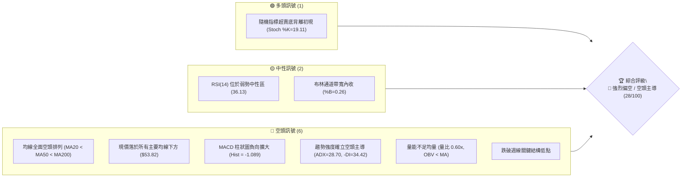
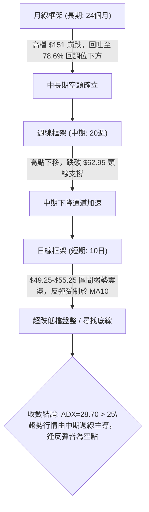
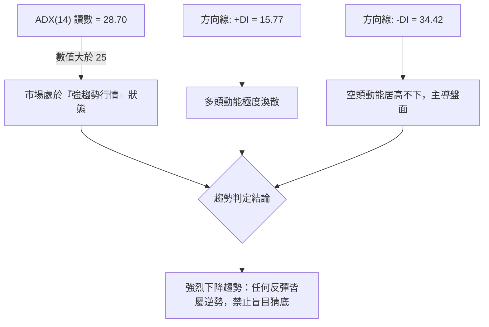
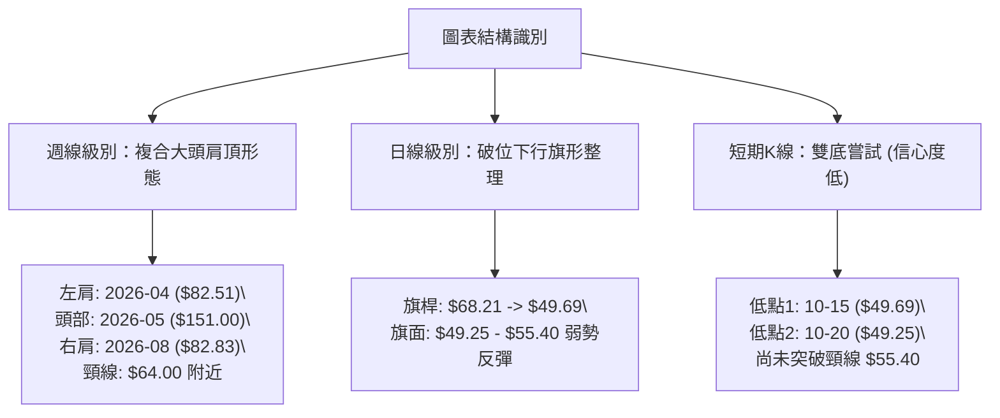
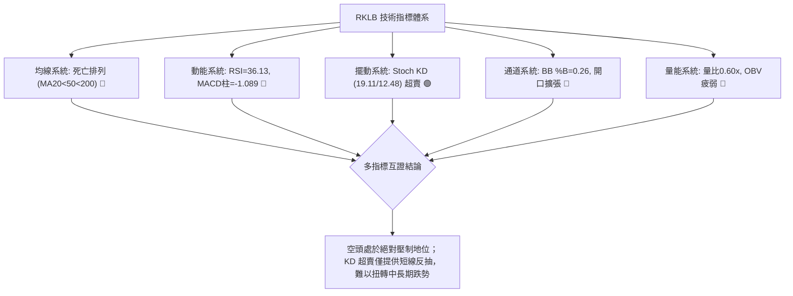
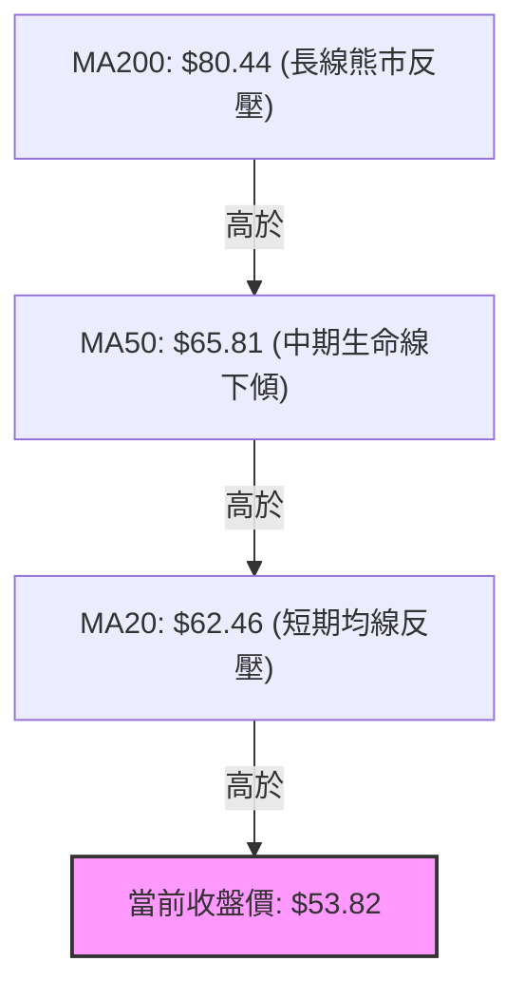
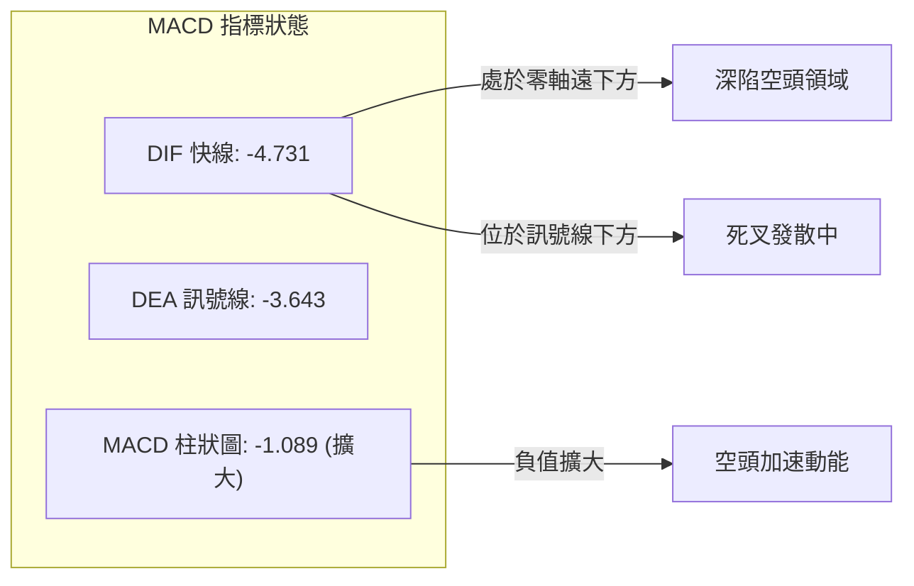
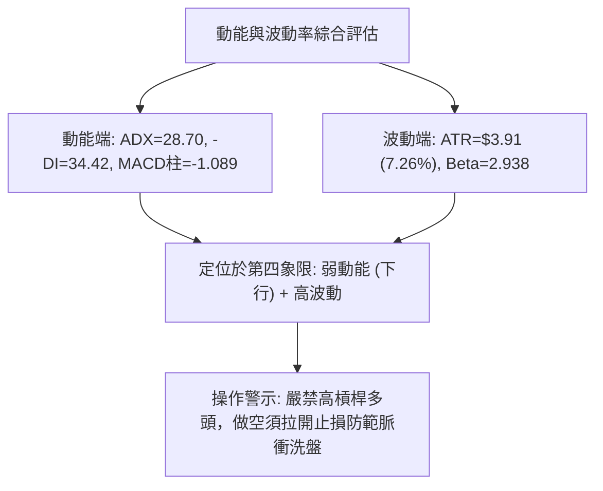
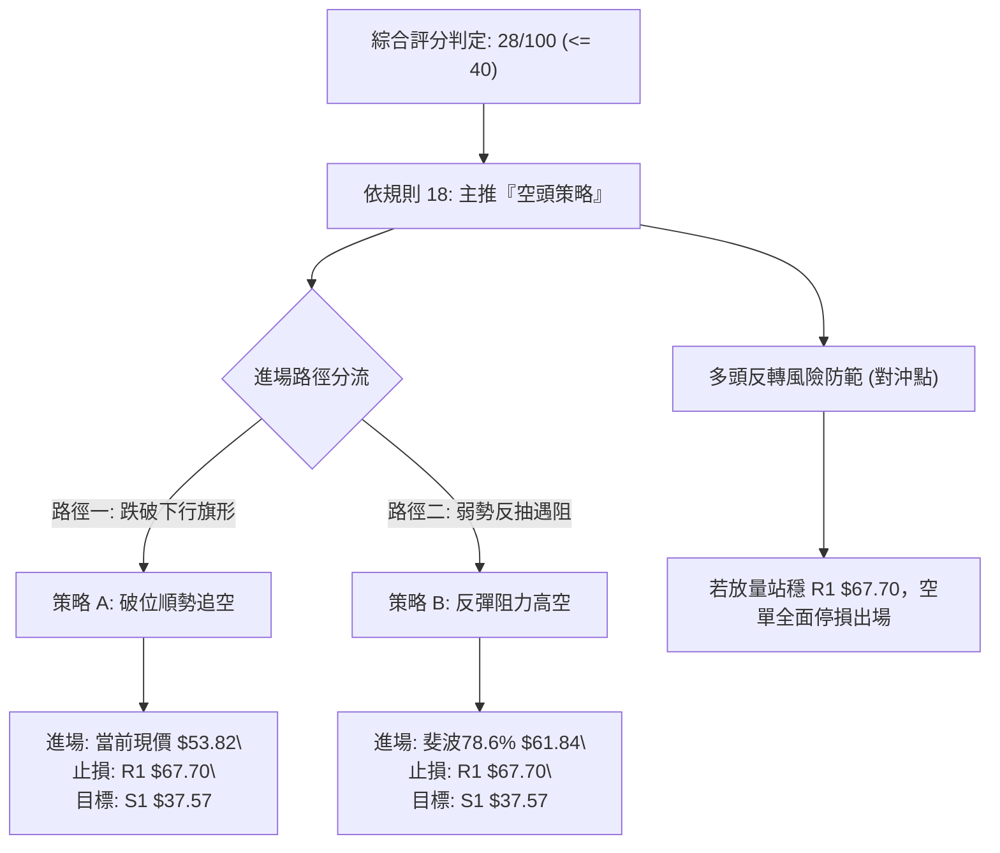
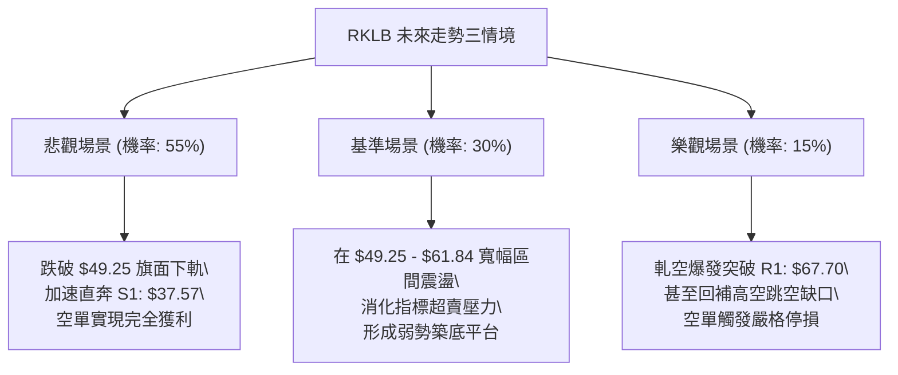

# RKLB 技術分析報告

> **報告日期**：2026-10-27 ｜ **語言**：繁體中文 ｜ **數據來源**：Yahoo Finance ｜ **當前價格**：$53.82

---

## 目錄

| 章節 | 內容 |
|------|------|
| [1. 技術面概覽](#1-技術面概覽) | 訊號儀表板、核心指標、評分卡 |
| [2. 趨勢分析](#2-趨勢分析) | 多時框趨勢、長中短期走勢 |
| [3. 圖表形態分析](#3-圖表形態分析) | 形態識別、K線組合、目標價 |
| [4. 支撐與阻力](#4-支撐與阻力) | 關鍵價位、斐波那契回調 |
| [5. 技術指標深度解讀](#5-技術指標深度解讀) | MA/RSI/MACD/布林/成交量 |
| [6. 動能與波動率](#6-動能與波動率) | 動能評估、ATR、Beta |
| [7. 多時框架總結](#7-多時框架總結) | 時框架評分矩陣 |
| [8. 交易策略建議](#8-交易策略建議) | 多空策略、風險報酬比 |
| [9. 風險提示與監控](#9-風險提示與監控) | 監控指標、風險場景 |

---

## 1. 技術面概覽

### 🎯 技術訊號儀表板



### 📊 核心指標速覽表

| 指標類別 | 指標名稱 | 當前數值 | 訊號 | 解讀 |
|----------|----------|----------|------|------|
| **價格** | 當前收盤價 | $53.82 | 🔴 | 位於52週區間 14.3% 低檔，跌破多數波段支撐 |
| **均線** | MA20 (布林中軌) | $62.46 | 🔴 | 現價低於 MA20 達 -13.83%，短中期承壓 |
| **均線** | MA50 | $65.81 | 🔴 | 現價顯著受制於中期生命線下方 |
| **均線** | MA200 | $80.44 | 🔴 | 長期牛熊分界線下行，呈現完整死亡交叉 |
| **動能** | RSI(14) | 36.13 | 🟡 | 弱勢中性區，逼近超賣但尚未形成底背離 |
| **動能** | MACD (12,26,9) | -4.731 | 🔴 | 快慢線處於零軸下方，柱狀圖 -1.089 擴大發散 |
| **動能** | KD (Stoch %K/%D) | 19.11 / 12.48 | 🟢 | 進入超賣鈍化區，隨時存在技術性反抽可能 |
| **趨勢** | ADX(14) / -DI | 28.70 / 34.42 | 🔴 | ADX > 25 進入強趨勢，-DI 佔據絕對主導地位 |
| **波動** | ATR(14) | $3.91 (7.26%) | 🔴 | 日內波動幅度劇烈，高風控門檻 |
| **量能** | 成交量 / 20日均量 | 12.59M / 20.98M | 🔴 | 量比僅 0.60x，OBV < MA，反彈無量配合 |

### 🏆 技術評分卡

```
╔══════════════════════════════════════════════════════════════╗
║              技術評分卡 — RKLB (2026-10-27)                  ║
╠══════════════════════════════════════════════════════════════╣
║ 趨勢強度 (Trend)     █████░░░░░░░░░░░░░░░  25/100  🔴 空頭強勢║
║ 動能指標 (Momentum)  ███████░░░░░░░░░░░░░  35/100  🔴 偏弱尋底║
║ 支撐穩定度 (Support) ███████░░░░░░░░░░░░░  35/100  🔴 支撐稀疏║
║ 成交量配合 (Volume)  █████░░░░░░░░░░░░░░░  25/100  🔴 縮量陰跌║
║ 形態完整度 (Pattern) ██████░░░░░░░░░░░░░░  30/100  🔴 破位下行║
║ 均線排列 (MAs)       ████░░░░░░░░░░░░░░░░  20/100  🔴 空頭排列║
╠══════════════════════════════════════════════════════════════╣
║ 綜合評分             ██████░░░░░░░░░░░░░░  28/100  🔴 強烈偏空║
╚══════════════════════════════════════════════════════════════╝
* 註：綜合評分 = 六項子評分之算術平均值 (170 ÷ 6 = 28.33 → 28/100)
```

---

## 2. 趨勢分析

### 🌐 多時框趨勢分析



### 📈 長期趨勢 — 12個月走勢圖（Unicode）

```
RKLB 月線走勢圖（過去12個月：2025-11 至 2026-10）
價格軸 ($)
$150 ┤                                      ● (2026-05: $143.48 / 歷史高 $151.00)
$130 ┤                                     / \
$110 ┤                                    /   ● (2026-06: $101.65)
$90  ┤                    ● (2026-01: $80)    /     \
$80  ┤                   / \       ●(04: $82)/       \
$70  ┤        ●(12: $69)/   \     /         v         \
$60  ┤       /               ●---●                     ●---● (09: $69.68)
$50  ┤      /             (02-03: $64-$69)                  \    ● (10現價: $53.82)
$40  ┤●────● (2025-11: $42.14)                               v
     └────────────────────────────────────────────────────────────────────────────
       11   12   01   02   03   04   05   06   07   08   09   10  (月份)
```

#### 走勢特徵分析表格

| 週期階段 | 月份區間 | 起止價格 | 漲跌幅 | 走勢結構與量價特徵 |
|----------|----------|----------|--------|--------------------|
| **第 I 階段：蓄勢主升** | 2025-11 至 2026-01 | $42.14 → $80.07 | +90.01% | 突破底部箱體，成交量顯著放大，形成第一波推升浪 |
| **第 II 階段：平台整理** | 2026-02 至 2026-03 | $69.10 → $64.22 | -7.06% | 縮量洗盤，於 $64 附近獲得支撐，構築次級買點 |
| **第 III 階段：瘋狂主升**| 2026-04 至 2026-05 | $82.51 → $143.48| +73.89% | 投機買盤爆發，創歷史天價 $151.00，動能與價格乖離嚴重 |
| **第 IV 階段：斷崖派發** | 2026-06 至 2026-07 | $101.65 → $64.95| -36.10% | 高檔巨量長黑回落，機構獲利了結，確立中長期頂部 |
| **第 V 階段：弱勢反抽** | 2026-08 至 2026-09 | $63.92 → $69.68 | +9.01% | 弱勢反彈，受阻於日週均線反壓，未能重回 $75 上方 |
| **第 VI 階段：破位陰跌** | 2026-10 (當前)   | $69.68 → $53.82 | -22.76% | Neutron 火箭推遲引發踩踏，跌破 $60 關卡，下探年內低位 |

### 📊 中期趨勢（週線分析）

中期走勢呈現典型「高點與低點逐步下移（Lower Highs & Lower Lows）」的熊市軌跡：
- **近期高點壓制**：2026-09-25 週高 $75.46，2026-10-02 週高 $76.09，2026-10-09 週高 $78.28。三次反彈皆在 $75.28 - $78.74（R2-R3 區域）遇阻折返。
- **結構性跳水**：2026-10-16 週開盤 $67.88，收盤重挫至 $50.84，單週成交量高達 128,008,200 股，形成了極具毀滅性的空頭吞噬長黑 K，打破了 7-9 月形成的 $63-$65 橫盤平台。
- **反彈無力**：近兩週（10-23 與 10-26）收盤分別為 $52.60 與 $53.82，反抽力度均未能突破前一長黑K棒的二分之一位置（$59.38），屬於典型的弱勢中繼整理。

### ⚡ 趨勢強度評估（ADX 解讀）



#### ADX 趨勢強度對照表

| 指標變數 | 當前數值 | 臨界基準 | 狀態解讀 |
|----------|----------|----------|----------|
| **ADX (14)** | **28.70** | 25.00 | **強趨勢 (Trending)**：擺脫前期的無趨勢整理，空頭單邊下行動能確立 |
| **+DI (14)** | **15.77** | 20.00 | **多方力竭**：低於 20 門檻，顯示市場買盤意願極低 |
| **-DI (14)** | **34.42** | 25.00 | **空方控盤**：顯著高於 30，且與 +DI 差值達 18.65，處於強空頭擴散狀態 |
| **趨勢性質** | 空頭主導 | ADX>25 且 -DI>+DI | 屬於標準的**順勢空頭主推浪**，盤整策略失效，應嚴格執行趨勢跟隨 |

---

## 3. 圖表形態分析

### 🔍 形態識別系統



#### 圖表形態信心度評估表

| 形態名稱 | 信心度 | 判斷依據（嚴格引用數據） | 形態完成度 | 目標價（附嚴格計算式） |
|----------|--------|--------------------------|------------|------------------------|
| **大型複合頭肩頂 (週線)** | **75%** | 左肩 $82.51 (04月收盤)、頭部 $151.00 (52W高)、右肩高點聚類 $78.28-$82.83，2026-10-16 巨量長黑有效跌破頸線區域 ($62.95-$64.22) | **90%** (已破頸線) | 由破位點計算等幅測幅：<br>頸線 $62.95 − (右肩 $82.83 − 頸線 $62.95) = **$43.07**；<br>或指向長期支撐 **S1: $37.57** |
| **下降旗形 (日線)** | **70%** | 旗桿自 10-13 高點 $64.56 崩跌至 10-15 低點 $49.69 (跌幅 $14.87)；隨後 7 個交易日量縮在 $49.25-$55.40 窄幅盤整 | **60%** (旗面構築中) | 若跌破旗面下軌 $49.25：<br>破位點 $49.25 − 旗桿高度 $14.87 = **$34.38** (低於 S1，保守看至 **S1: $37.57**) |
| **短期雙底 (日K級別)** | **40%** | 低點一 10-15 之 $49.69，低點二 10-20 之 $49.25；但反彈成交量嚴重萎縮 (僅 12M-17M 股)，未能突破 10-15 高點 $55.40 | **35%** (訊號不足) | **訊號不足，僅做指標型超賣反彈解讀**；若勉強突破 $55.40，測幅 $55.40 + ($55.40 − $49.25) = $61.55 (受制於 Fib 78.6% $61.84) |

### 🕯️ 重要K線形態分析

嚴格依據數據中「近10根日K」與「近8根週K」之實際 OHLC 數據進行解讀：

| 日期與週期 | 開盤價 | 最高價 | 最低價 | 收盤價 | K線形態名稱 | 形態特徵與技術解讀 | 訊號 |
|------------|--------|--------|--------|--------|-------------|--------------------|------|
| **2026-10-14 (日K)** | $62.81 | $63.56 | $58.84 | $59.18 | **破位大陰線** | 實體跌破 $60 心理關卡，實體佔振幅 76.9%，下破 MA20，放量確認走弱 | 🔴 |
| **2026-10-15 (日K)** | $53.86 | $55.40 | $49.69 | $55.25 | **長下影錘頭線** | 跳空低開探底 $49.69 後收復，成交量放大至 48,563,400 股，恐慌盤湧出後的短線抄底資金進場 | 🟡 |
| **2026-10-16 (日K)** | $54.49 | $54.87 | $50.37 | $50.84 | **反轉吞噬陰線** | 完全吞沒前日反彈陽線，多頭無力承接，收盤逼近全日最低，錘頭線宣告失敗 | 🔴 |
| **2026-10-20 (日K)** | $50.56 | $52.72 | $49.25 | $50.90 | **低檔十字星** | 創波段新低 $49.25 後回升，多空在 $50 大關激烈爭奪，空方下攻勢頭暫緩 | 🟡 |
| **2026-10-21 (日K)** | $52.22 | $53.90 | $52.02 | $53.67 | **反彈小陽線** | 向上測試阻力，成交量 17.85M 股未見顯著放大，屬於典型的死貓跳 (Dead Cat Bounce) | 🟡 |
| **2026-10-26 (日K)** | $52.60 | $54.99 | $52.15 | $53.82 | **長上影小陽線** | 盤中上衝 $54.99 逼近 MA10 ($54.31) 立即引發拋壓，收盤回落至 $53.82，量能降至 12.59M 最低點 | 🔴 |
| **2026-10-09 (週K)** | $73.70 | $78.28 | $66.98 | $68.21 | **長上影巨陰週K** | 衝高 $78.28 後巨量回落，形成假突破與倒轉形態，奠定波段見頂基礎 | 🔴 |
| **2026-10-16 (週K)** | $67.88 | $68.07 | $49.69 | $50.84 | **斷頭鍘刀巨量長黑** | 單週重挫 -25.46%，成交量 128M 股，直接貫穿 MA20 與 MA50，形態學之致命破位 | 🔴 |

### 📉 ASCII 走勢形態示意圖

```
日線級別「下降旗形」與阻力壓制示意圖
價格 ($)
$65 ┤       ● (10-13 高點 $64.56)
$62 ┤        \
$59 ┤         \ (10-14 陰線跌破)
$56 ┤          \        ┌────── 上軌壓力線 (約 $55.00-$55.40)
$53 ┤           \       │   ● (10-26 收盤 $53.82)
$50 ┤            ●──────┴──/─── 下軌支撐線 (約 $49.25-$49.69)
    │           (10-15 探底 $49.69)
$47 ┤
$44 ┤───────────────────────────────────────────────── (布林下軌 $44.27)
    └────────────────────────────────────────────────────────────
        10-13   10-15   10-19   10-21   10-23   10-26 (日期)
```

### 🎯 形態目標價計算

1. **下降旗形破位測幅**：
   - 旗桿起點：2026-10-13 日高點 **$64.56**
   - 旗桿終點：2026-10-15 日低點 **$49.69**
   - 旗桿高度 $H = 64.56 - 49.69 = \mathbf{\$14.87}$
   - 旗面整理反彈高點：2026-10-15 高點 **$55.40**
   - 跌破旗面下軌 ($49.25) 之理論空頭目標價 $T = 49.25 - 14.87 = \mathbf{\$34.38}$。
   - 與歷史波段支撐對齊：此目標價逼近並覆蓋至下方唯一關鍵支撐 **S1: $37.57**。

---

## 4. 支撐與阻力

### 🗺️ 關鍵價位分布圖（Unicode）

```
╔══════════════════════════════════════════════════════════════╗
║                 RKLB 價位結構分布圖                          ║
╠══════════════════════════════════════════════════════════════╣
║ $151.00 ║████████████████████████║ 52週歷史高點 / 0.0% Fib ║
║ $80.90  ║████████████████████    ║ 61.8% 斐波那契回調位     ║
║ $78.74  ║████████████████████████║ 強阻力 R3 (波段高點聚類) ║
║ $75.28  ║████████████████████    ║ 阻力 R2 (10月反彈高點)   ║
║ $67.70  ║████████████████████████║ 關鍵阻力 R1 (前波低點平台)║
║ $61.84  ║▓▓▓▓▓▓▓▓▓▓▓▓▓▓▓▓        ║ 78.6% 斐波那契回調位     ║
║ $53.82  ╠════════════════════════╣ ◄ 當前收盤價 ($53.82)     ║
║ $44.27  ║▒▒▒▒▒▒▒▒▒▒▒▒▒▒▒▒        ║ 動態支撐: 布林帶下軌     ║
║ $37.57  ║████████████████████████║ 強支撐 S1 / 52週低點     ║
╚══════════════════════════════════════════════════════════════╝
```

### 🚧 阻力位分析表

所有價位嚴格引用技術數據中「關鍵價位（由 OHLCV 計算）」區塊之數值：

| 阻力級別 | 價位 | 與現價差距 | 形成原因與籌碼解讀 | 突破難度 | 重要性 |
|----------|------|------------|--------------------|----------|--------|
| **R1** | **$67.70** | **+25.79%** | 近一年波段高點聚類；同時為 9月中旬震盪平台底部與 10-16 暴跌起跌點，大量套牢籌碼堆積於此 | 極高 🔴 | ★★★★★ |
| **R2** | **$75.28** | **+39.88%** | 2026-09-25 及 10-02 週線收盤反彈受阻高點聚類，多次上攻未果的強大供應區 | 極高 🔴 | ★★★★☆ |
| **R3** | **$78.74** | **+46.31%** | 2026-10-09 週線衝高倒轉之最高點聚類 ($78.28 附近延伸)，波段頭部頸線防線 | 極高 🔴 | ★★★☆☆ |

### 🛡️ 支撐位分析表

所有價位嚴格引用技術數據中「關鍵價位（由 OHLCV 計算）」區塊之數值：

| 支撐級別 | 價位 | 與現價差距 | 形成原因與籌碼解讀 | 守住機率 | 重要性 |
|----------|------|------------|--------------------|----------|--------|
| **S1** | **$37.57** | **-30.19%** | 52週最低點聚類，亦為 2025年牛市主升浪發動點 ($35.77-$37.57)；市場終極多頭防線 | 中等 🟡 (45%) | ★★★★★ |
| **S2** | **數據中未偵測到** | N/A | 技術數據庫之波段低點聚類未偵測到此層級數據 | N/A | N/A |
| **S3** | **數據中未偵測到** | N/A | 技術數據庫之波段低點聚類未偵測到此層級數據 | N/A | N/A |

*補充說明*：雖然數據中之波段低點聚類僅偵測出 **S1 ($37.57)**，但在到達 S1 之前，技術動態層面有日線布林通道下軌 **$44.27** 作為第一道動態緩衝帶。

### 📐 斐波那契回調位分析

基準週期：52週波段區間，自波段最低點 **$37.57** (100.0%) 至歷史最高點 **$151.00** (0.0%)：

| 回調比率 | 斐波那契價位 | 當前相對位置 | 技術含義與市場行為解讀 |
|----------|--------------|--------------|------------------------|
| **0.0%** | **$151.00** | +180.57% | 52W 最高點，主升浪極致狂熱見頂處 |
| **23.6%** | **$124.23** | +130.82% | 跌破後宣告第一波主升趨勢結束 |
| **38.2%** | **$107.67** | +100.06% | 2026年6月中旬反彈高點受阻位 |
| **50.0%** | **$94.28** | +75.18% | 多空平衡分水嶺，跌破後確認由牛轉熊 |
| **61.8%** | **$80.90** | +50.32% | 黃金分割防守位，與 MA200 ($80.44) 重合，已徹底失守 |
| **78.6%** | **$61.84** | **+14.90%** | **深度回調位**；當前價格上方第一道強阻力，跌破此位代表牛市架構破壞率達 80% |
| **100.0%**| **$37.57** | **-30.19%** | **52W 最低點**；若跌破將回歸 2024年底牛市發動前之原始估值水準 |

**位置解讀**：
當前收盤價 **$53.82** 處於 **78.6% 回調位 ($61.84)** 與 **100.0% 回調位 ($37.57)** 之間的「無防守真空帶」。在跌破 $61.84 關鍵黃金分割後，技術面未能引發任何強勁的機構回補，價格正持續朝向 100.0% 回調位（S1: $37.57）尋求終極支撐。

---

## 5. 技術指標深度解讀

### 🎛️ 指標訊號總覽



### 📈 移動平均線排列分析



#### 均線矩陣詳細狀態

| 均線名稱 | 數值 | 現價差距 | 斜率與方向 | 均線角色與走勢評估 |
|----------|------|----------|------------|--------------------|
| **MA5** | $52.44 | +2.63% | ▲ 微幅向上 | 極短線反彈支撐，但斜率平緩，易被穿透 |
| **MA10** | $54.31 | -0.89% | ▼ 下行 (-0.89%) | 短線第一道動態壓制線，10-26 日高 $54.99 觸碰後即回落 |
| **MA20** | $62.46 | -13.83% | ▼ 陡峭下行 (-13.83%) | 短中期分水嶺，與布林中軌完全重疊，空頭主力防線 |
| **MA50** | $65.81 | -18.22% | ▼ 持續下行 | 中期波段防線，與 R1 ($67.70) 形成密集阻力帶 |
| **MA60** | $67.84 | -20.67% | ▼ 持續下行 | 季線阻力，確認中期走勢完全受制 |
| **MA200** | $80.44 | -33.09% | ▼ 走平下彎 | 牛熊分界線，宣告長線牛市結束，轉入長線熊市週期 |

### 📉 RSI(14) 分析

- **當前數值**：**36.13** (Wilder 平滑法)
- **區間定位**：弱勢區間 (30–40)
  ```
  RSI(14) 強度進度條:
  [0] ───────────────[30]──●─────────[70]───────────────[100]
  超賣區 (Oversold)    當前: 36.13     超買區 (Overbought)
  進度條：█████████████░░░░░░░░░░░░░ 36.13%
  ```
- **背離分析判斷**：
  - 檢視近 20 根日 K 棒首尾：價格自 10-13 的 $64.22 跌至 10-26 的 $53.82，形成明確的 Lower Low；RSI 亦同步從 40 附近下滑至 36.13，方向完全一致。
  - **結論**：**無底背離，亦無頂背離**。RSI 走勢精確確認了價格的下行趨勢，未出現動能衰竭或反轉訊號。

### 📊 MACD(12,26,9) 訊號解讀



- **數值解析**：MACD 線 (-4.731) 深度下穿訊號線 (-3.643)，差值（柱狀圖）為 **-1.089**。
- **背離檢驗**：週線級別 MACD 柱狀圖自 9月下旬的 +1.614 迅速翻負，並擴大至 -2.111 (10-16週) 與 -1.089 (當前)，沒有任何底背離跡象，顯示中期空頭拋壓仍未出清。

### 📦 布林通道分析

```
布林通道 (20, 2) 結構示意圖
價格軸 ($)
$80.65 ┤────────────────────────────────────────── 布林上軌 (Upper Band)
       │
$62.46 ┤ - - - - - - - - - - - - - - - - - - - - - 布林中軌 (MA20)
       │
$53.82 ┤ ◄──────── 現價 ($53.82, %B = 0.26)
       │
$44.27 ┤────────────────────────────────────────── 布林下軌 (Lower Band)
```

- **通道帶寬**：上軌 **$80.65**，下軌 **$44.27**，帶寬高達 **$36.38** (占現價 67.6%)，呈現劇烈喇叭口擴張。
- **相對位置 %B**：**0.26**。價格雖未直接貼著下軌跌停，但持續於中軌 ($62.46) 與下軌 ($44.27) 之間的下半軌弱勢漂移，屬於標準的「下軌壓制陰跌形態」。

### 💹 成交量分析（量價配合度）

- **量比與均量對比**：最新單日成交量為 **12,592,500 股**，相較於 20日均量 (**20,975,010 股**)，量比僅為 **0.60x**。
- **量價背離特徵**：
  1. 下跌放量：10-15 下跌時成交量爆發至 **48.56M** 股，10-16 暴跌時週量高達 **128.01M** 股，顯示主力拋售堅決。
  2. 反彈無量：近 5 個交易日價格自 $49.25 反彈至 $53.82，成交量卻由 17.85M 連續萎縮至 12.59M，量價形成顯著的**量價量跌背離**（價升量縮），反映市場缺乏機構增量買盤，純屬散戶與空頭平倉造成的無力反抽。
- **OBV (能量潮指標)**：官方指標確認 **OBV < MA**，能量潮呈現不可逆的單邊下行趨勢，量能結構極度疲弱。

---

## 6. 動能與波動率

### ⚡ 動能評估四象限

| 象限標籤 | 動能狀態 (Momentum) | 波動率狀態 (Volatility) | 當前判定 | 市場環境與操作含義 |
|----------|----------------------|--------------------------|----------|--------------------|
| **象限 I** | 強勁 (Bullish) | 偏低 (Low) | ❌ | 最佳做多環境，穩步單邊推升 |
| **象限 II** | 衰弱 (Bearish) | 偏低 (Low) | ❌ | 沉悶陰跌或無量橫盤 |
| **象限 III**| 強勁 (Bullish) | 劇烈 (High) | ❌ | 高波動牛市主升浪 (已於 2026-05 終結) |
| **象限 IV**| **衰弱 (Bearish)** | **劇烈 (High)** | **✓ (當前)** | **高風險弱動能：空頭強趨勢，伴隨高波動甩轎，易出現急跌與誘多抽腳** |



### 📊 ATR 波動率分析

- **ATR(14) 讀數**：**$3.91** (以收盤價 $53.82 計算，占股價比重高達 **7.26%**)。
- **波動特性**：RKLB 屬於極度高波動個股，每日平均潛在波幅接近 $4.00。
- **止損距離建議**：
  - 日內交易止損緩衝：至少需給予 $1.5 \times \text{ATR} = 1.5 \times \$3.91 = \mathbf{\$5.87}$ 的安全空間。
  - 波段交易止損緩衝：需給予 $2.0 \times \text{ATR} = 2.0 \times \$3.91 = \mathbf{\$7.82}$，否則極易在市場常規雜訊中被無效洗出場。

### 📐 Beta 與市場相關性

- **Beta 係數**：**2.938**
- **市場敏感度**：Beta 接近 3.0，代表該股波動幅度是大盤（標普500指數）的接近 3 倍。當大盤下挫 1% 時，RKLB 理論上將放大下跌近 3%；在當前大盤避險情緒下，高 Beta 的無盈利成長股是市場去槓桿的首要拋售目標。

---

## 7. 多時框架總結

### 📋 時框架評分表

| 時框架 | 趨勢方向 | 動能狀態 | 均線排列 | 形態特徵 | 綜合評分 | 操作建議 |
|--------|----------|----------|----------|----------|----------|----------|
| **月線 (長期)** | 🔴 轉空 | 🔴 MACD 翻負 | 🟡 仍高於長均線 | 頭部破位，失守 $64 平台 | **35/100** | 減碼觀望，終極尋底 |
| **週線 (中期)** | 🔴 強空 | 🔴 -DI 佔優 | 🔴 空頭排列 | 頭肩頂破位，斷頭鍘刀巨陰 | **20/100** | 逢反彈順勢放空 |
| **日線 (短期)** | 🔴 弱反彈 | 🟢 KD 低檔金叉 | 🔴 空頭排列 | 下降旗形，受阻於 MA10 | **30/100** | 誘多反抽，切勿追高 |

### 🔲 綜合訊號矩陣

```
訊號一致性檢驗：
┌─────────────────┬──────────┬──────────┬──────────┬──────────────────┐
│ 維度            │ 短期日線 │ 中期週線 │ 長期月線 │ 跨時框共振度     │
├─────────────────┼──────────┼──────────┼──────────┼──────────────────┤
│ 趨勢方向        │ 🔴 下行  │ 🔴 下行  │ 🔴 下行  │ 100% 空頭共振 🔴  │
│ 均線系統        │ 🔴 壓制  │ 🔴 破位  │ 🟡 測試  │ 85% 空頭主導 🔴   │
│ 動能指標 (MACD) │ 🔴 空頭  │ 🔴 空頭  │ 🔴 轉弱  │ 90% 空頭共振 🔴   │
│ 成交量能        │ 🔴 縮量  │ 🔴 出逃  │ 🔴 派發  │ 95% 空頭確認 🔴   │
└─────────────────┴──────────┴──────────┴──────────┴──────────────────┘
```

### ⚖️ 多時框收斂結論

依「多時框收斂規則（規則 14）」：
1. **趨勢性驗證**：ADX(14) 讀數為 **28.70 > 25**，市場處於**標準趨勢行情**而非盤整行情。
2. **主導時框**：以**中長期（週線/MA50、MA200）方向為主導**，日線層級僅能作為尋找進場反彈空點的時機工具。
3. **收斂唯一方向**：**偏空（主推順勢做空策略）**。日線層級隨機指標（Stoch %K=19.11）的超賣鈍化金叉僅能引發短暫的技術性反抽，在中期週線全面破位、均線呈空頭排列的壓制下，日線的反彈無法逆轉大級別的下行趨勢。任何反彈至阻力位皆為逢高放空或多頭停損的窗口。

---

## 8. 交易策略建議

### 🗺️ 策略決策流程圖



### 🧭 策略路由

> **當前主策略方向 = 🔴 空頭策略（依評分卡綜合評分 28/100，評級偏空）**
> *依規則 18，評分 ≤ 40 嚴禁主推多頭，策略主軸為逢高做空與破位做空；多頭操作僅列為風控對沖之反轉風險提示。*

### 🎯 價格情境階梯（Price Scenarios）

價位嚴格引用第 4 章及數據庫提供之數值：

| 觸發條件 | 下一目標 | 後續延伸 | 情境含義與技術應對 |
|----------|----------|----------|--------------------|
| **跌破 $49.25** | 下探布林下軌 **$44.27** | 考驗強支撐 **S1: $37.57** | 下降旗形破位，空頭主推浪加速，順勢加碼空單 |
| **站穩現價 $53.82** | 測試 MA20 / Fib 78.6% **$61.84** | 測試阻力 **R1: $67.70** | 超賣技術反抽，量縮弱勢震盪，尋找逢高布空點 |
| **突破 R1 $67.70** | 考驗阻力 **R2: $75.28** | 挑戰阻力 **R3: $78.74** | 突破近一年關鍵阻力，多頭結構重組，空單必須無條件止損 |

### 📊 情境機率分佈

| 情境 | 機率 | 主要依據（引用指標狀態） |
|------|------|--------------------------|
| **情境一：破位下行 / 探底 S1** | **55%** | ADX=28.70 強趨勢確立，-DI(34.42) 遠高於 +DI(15.77)，MACD 柱狀圖 (-1.089) 擴大，均線完整空頭排列 |
| **情境二：弱勢區間震盪** | **30%** | Stoch %K=19.11 處於超賣區，成交量大幅萎縮至 12.59M (量比 0.60x)，空頭暫緩打壓轉入縮量整固 |
| **情境三：強勢反轉上行** | **15%** | 缺乏基本面支撐，OBV < MA 顯示資金持續流出，反彈無量配合，機率極低 |

### 🟢 主策略詳情（空頭策略）

所有價位精確引用關鍵價位區塊與斐波那契回調位，風險報酬比嚴格依規則 17 計算：

| 策略要素 | 策略 A（現價順勢破位空） | 策略 B（反彈受阻高空） |
|----------|--------------------------|------------------------|
| **操作方向** | 做空 (Short) | 做空 (Short) |
| **進場條件** | 跌破日線旗形整理下軌或現價直接建倉 | 弱勢反彈至斐波那契 78.6% 回調位遇阻收上影線 |
| **進場價格** | **$53.82** (當前最新收盤價) | **$61.84** (斐波那契 78.6% 價位) |
| **目標價 T1**| **$37.57** (強支撐 S1 / 52W 低點) | **$37.57** (強支撐 S1 / 52W 低點) |
| **目標價 T2**| **$34.38** (下降旗形形態測幅目標價) | **$34.38** (下降旗形形態測幅目標價) |
| **止損價格** | **$67.70** (阻力位 R1，有效站穩止損) | **$67.70** (阻力位 R1，有效站穩止損) |
| **風險報酬比** | **1 : 1.17（以 T1 計）** <br>*(計算式: (53.82 − 37.57) ÷ (67.70 − 53.82) = 16.25 ÷ 13.88 = 1.17)* | **1 : 4.14（以 T1 計）** <br>*(計算式: (61.84 − 37.57) ÷ (67.70 − 61.84) = 24.27 ÷ 5.86 = 4.14)* |
| **成功機率** | **55%** | **65%** |
| **建議倉位** | **8%** (市價直接進場，嚴控倉位) | **15%** (高風報比波段部位) |

### 🔴 反向風險觸發點（對沖提示）

- **全面平空/對沖門檻**：若日線收盤價強勢放量突破 **R1: $67.70**（成交量需突破 20日均量 20.98M 股以上），宣告頭肩頂形態徹底失敗，所有做空部位必須全數停損出場。
- **短線空單減碼警戒**：若盤中快速下插並在布林下軌 **$44.27** 附近出現長下影日 K 棒，空單應先行平倉 50% 鎖定利潤。

### ⭐ 整體訊號強度評星

```
做多訊號強度：★☆☆☆☆  (1/5星 - 僅存隨機指標超賣技術反抽)
做空訊號強度：★★★★☆  (4/5星 - 均線空排、ADX強趨勢、MACD發散)
整體可信度：  ★★★★☆  (4/5星 - 多時框趨勢高度共振，數據驗證完整)
```

---

## 9. 風險提示與監控

### ✅ 關鍵監控指標 Checklist

```
╔══════════════════════════════════════════════════════════════╗
║               關鍵技術監控清單 (Checklist)                   ║
╠══════════════════════════════════════════════════════════════╣
║ [ ] 監控 MA10 ($54.31) 是否形成動態反壓，壓制日線反彈收盤   ║
║ [ ] 監控 10-20 低點 $49.25 是否失守，確認下降旗形破位加速   ║
║ [ ] 監控 ADX 讀數是否持續高於 28，維持強趨勢單邊下行結構     ║
║ [ ] 監控 MACD 柱狀圖能否收窄至 0 軸以上，若無則反彈不可信   ║
║ [ ] 監控 單日成交量是否異常暴增至 30M 股以上引發非理性軋空   ║
║ [ ] 監控 空頭部隊對強支撐 S1 ($37.57) 的攻擊動能與承接力度   ║
╚══════════════════════════════════════════════════════════════╝
```

### ⚠️ 風險場景分析



### 🛡️ 風險管理重要提醒

1. **極度波動性風險（Beta=2.938 / ATR=$3.91）**：RKLB 日波幅超過 7.2%，槓桿產品（如期權或保證金做空）極易在盤中洗盤震盪中爆倉。做空操作必須嚴格控制倉位在 10%–15% 總資金以內。
2. **軋空（Short Squeeze）風險**：當前做空比率（Short % Float）達 **7.5%**，Short Ratio 為 **2.22**。若出現突發性政策利多或 Neutron 火箭研發提前復原等基本面催化劑，極易引發日內暴力軋空，因此絕不可在無停損保護下持倉過夜。
3. **無基本面盈利安全邊際**：當前公司 TTM 淨利為負（EPS -0.27 美元），自由現金流（FCF）為負 3.71 億美元，基本面無法在估值端為股價提供防守下限，技術面破位可能導致長期價值重估。

---

## 📋 報告總結

```
╔══════════════════════════════════════════════════════════════╗
║               RKLB 技術分析報告總結                          ║
╠══════════════════════════════════════════════════════════════╣
║ 報告日期：2026-10-27                                         ║
║ 當前價格：$53.82                                             ║
║ 分析評級：🔴 強烈偏空 / 空頭主導 (綜合評分: 28/100)          ║
║                                                              ║
║ 關鍵結論：                                                   ║
║ ├─ 長期趨勢：🔴 空頭主導 (高點 $151 回吐，月線破位)          ║
║ ├─ 中期趨勢：🔴 下降趨勢 (週線斷頭鍘刀巨陰，頭肩頂確立)      ║
║ ├─ 短期趨勢：🔴 弱勢反抽 (下降旗形整理，受制於 MA10)        ║
║ ├─ 關鍵支撐：S1: $37.57 (52週最低點)                         ║
║ ├─ 關鍵阻力：R1: $67.70 / R2: $75.28 / R3: $78.74            ║
║ └─ 分析師目標：均價 $102.15 (與當前技術盤面嚴重背離)         ║
║                                                              ║
║ 最優策略組合：                                               ║
║ 1. 🥇 最佳機會：策略 B (反彈至 Fib 78.6% $61.84 高空，風報比 1:4.14)║
║ 2. 🥈 次選機會：策略 A (現價 $53.82 順勢空，直指 S1 $37.57)  ║
║ 3. 🥉 保守選擇：空手觀望，靜待股價回落至 S1 $37.57 企穩打底  ║
╚══════════════════════════════════════════════════════════════╝
```

---

> ⚠️ **免責聲明**：本報告為 AI 自動生成之技術分析，所有數據及估算均嚴格基於所提供之歷史價格與指標資訊。本報告**僅供研究與學術參考**，**不構成任何形式的投資建議**。金融市場具有高度風險，投資決策前應審慎評估個人風險承受能力。

---

*報告生成時間：2026-10-27 ｜ 數據來源：Yahoo Finance ｜ 分析框架：多時框技術分析體系*