# RKLB 技術分析報告

> **報告日期**：2026-10-28 ｜ **語言**：繁體中文 ｜ **數據來源**：Yahoo Finance ｜ **當前價格**：$58.31

---

## 目錄

| 章節 | 內容 |
|------|------|
| [1. 技術面概覽](#1-技術面概覽) | 訊號儀表板、核心指標、評分卡 |
| [2. 趨勢分析](#2-趨勢分析) | 多時框趨勢、長中短期走勢 |
| [3. 圖表形態分析](#3-圖表形態分析) | 形態識別、K線組合、目標價 |
| [4. 支撐與阻力](#4-支撐與阻力) | 關鍵價位、斐波那契回調 |
| [5. 技術指標深度解讀](#5-技術指標深度解讀) | MA/RSI/MACD/布林/成交量 |
| [6. 動能與波動率](#6-動能與波動率) | 動能評估、ATR、Beta |
| [7. 多時框架總結](#7-多時框架總結) | 時框架評分矩陣 |
| [8. 交易策略建議](#8-交易策略建議) | 多空策略、風險報酬比 |
| [9. 風險提示與監控](#9-風險提示與監控) | 監控指標、風險場景 |

---

## 1. 技術面概覽

### 🎯 技術訊號儀表板

Rocket Lab Corporation（NASDAQ: RKLB）當前報價為 $58.31。整體技術架構處於中長期空頭回撤通道中的短線超跌反彈結構。ADX(14) 讀數達 27.92，顯示當前處於強趨勢主導環境；均線系統呈現 MA20 < MA50 < MA200 的標準空頭排列，且價格受制於下降均線群下方。

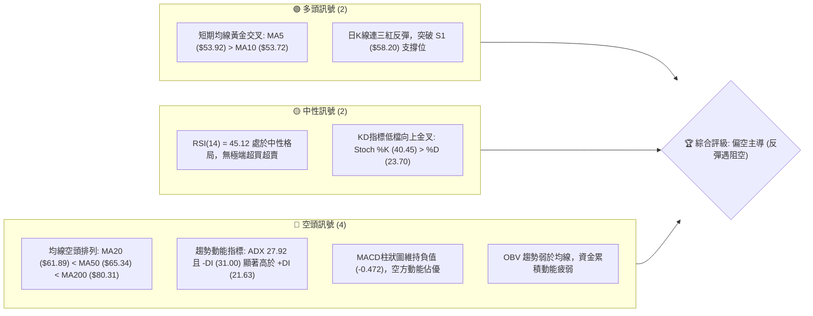

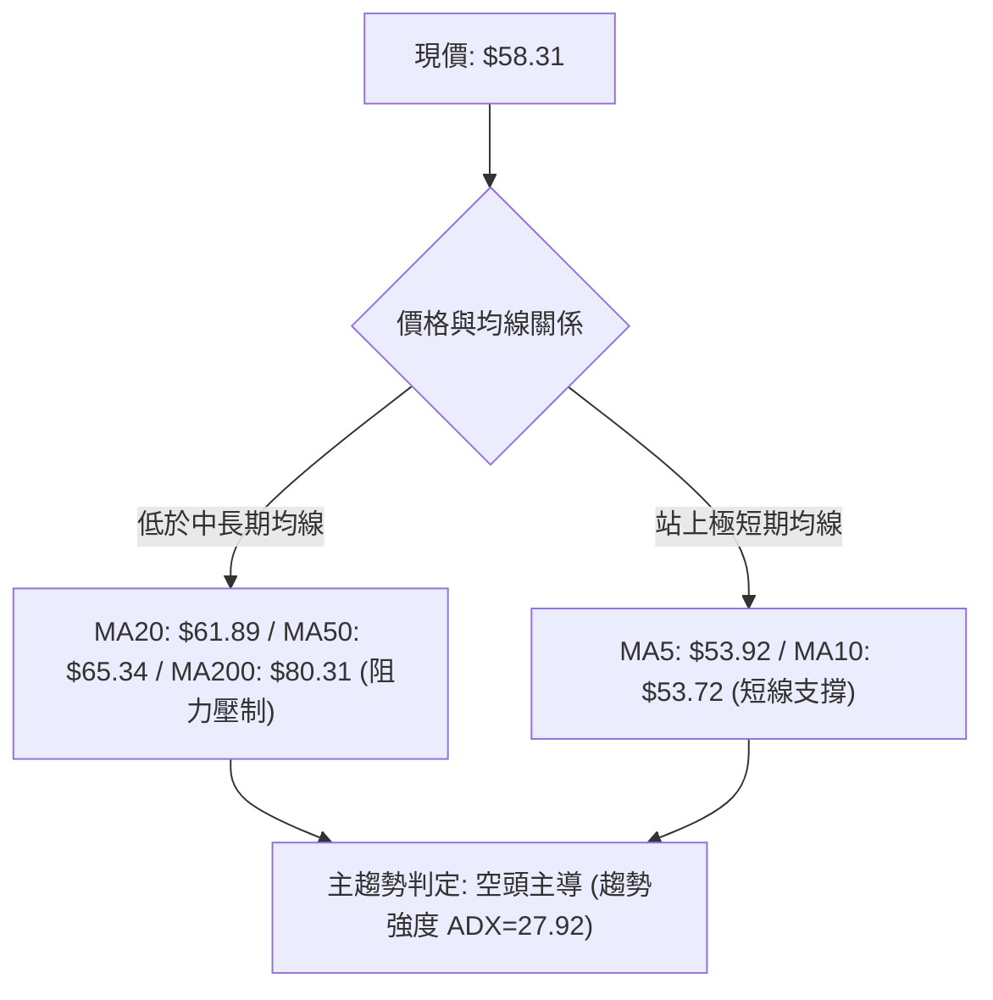

### 📊 核心指標速覽表

| 指標類別 | 指標名稱 | 當前數值 | 訊號 | 解讀 |
|----------|----------|----------|------|------|
| **價格** | 當前收盤價 | $58.31 | 🟡 | 位於52週區間 18.3% 水位，低檔反彈但仍處弱勢區 |
| **均線** | MA20 | $61.89 | 🔴 | 現價位於 MA20 下方 (-5.78%)，為第一道動態阻力 |
| **均線** | MA50 | $65.34 | 🔴 | 現價位於 MA50 下方 (-10.76%)，中期趨勢顯著偏空 |
| **均線** | MA200 | $80.31 | 🔴 | 遠在年線下方 (-27.39%)，長期多空分水嶺失守 |
| **動能** | RSI(14) | 45.12 | 🟡 | 中性區間 (30-70)，自超賣區回升，多空勢力處於拉鋸 |
| **動能** | MACD (12,26,9) | -4.233 / -3.761 | 🔴 | MACD 線低於信號線，柱狀圖 -0.472，空頭動能尚未翻正 |
| **趨勢** | ADX (14) | 27.92 | 🔴 | ADX > 25 確立趨勢行情；-DI (31.00) > +DI (21.63) 空頭佔優 |
| **通道** | 布林通道 %B | 0.40 | 🟡 | 位於中軌 ($61.89) 與下軌 ($43.94) 之間，正在向上測試中軌 |
| **量能** | 20日成交量比 | 1.01x | 🟡 | 最新量 21.25M 與 20 日均量 21.06M 相當，量能溫和未放量 |
| **波動** | ATR(14) | $4.03 | 🔴 | ATR 佔股價 6.91%，單日波動極劇烈，風控門檻需拉寬 |

### 🏆 技術評分卡

```
技術評分卡 — RKLB (2026-10-28)
════════════════════════════════════════════════════
趨勢強度      ███████░░░░░░░░░░░░░  35/100  🔴 空頭強勢
動能指標      ████████░░░░░░░░░░░░  42/100  🟡 中性偏弱
支撐穩定度    ██████████░░░░░░░░░░  48/100  🟡 局部築底
成交量配合    ███████░░░░░░░░░░░░░  38/100  🔴 量能匱乏
形態完整度    █████████░░░░░░░░░░░  45/100  🟡 反彈通道
均線排列      █████░░░░░░░░░░░░░░░  26/100  🔴 完全空頭
════════════════════════════════════════════════════
綜合評分      ███████░░░░░░░░░░░░░  39/100  🔴 偏空主導
════════════════════════════════════════════════════
評分說明：綜合評分由六項子評分算術平均所得 (35+42+48+38+45+26)/6 = 39.0，依規則四捨五入為 39/100，評級判定為「偏空主導 (Bearish Trend)」。
```

---

## 2. 趨勢分析

### 🌐 多時框趨勢分析

RKLB 呈現典型的多時框動能衝突：長期自 2026-05 歷史高點大幅下墜，中期週線處於下行修正浪，短期日線則自波段低點 $49.25 展開超跌技術性反彈。

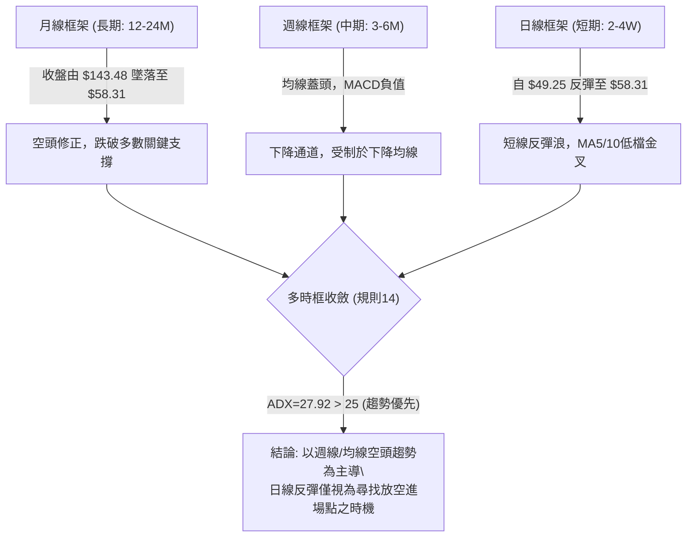

### 📈 長期趨勢 — 12個月走勢圖（Unicode）

以下為 RKLB 過去 12 個月（2025-11 至 2026-10）每月收盤價軌跡與關鍵轉折分析：

```
RKLB 月線走勢圖（過去12個月）
價格軸 ($)
$150 ┤                            ● (2026-05 歷史高點 $143.48，盤中最高 $151.00)
$140 ┤                           ╱ ╲
$120 ┤                          ╱   ╲
$100 ┤                         ╱     ● (2026-06 $101.65)
 $80 ┤               ●        ●       ╲
     ┤              ╱ ╲      ╱         ● (2026-07 $64.95)
 $60 ┤             ╱   ●    ●           ╲   ●(09 $69.68)
     ┤    ●       ●     ╲  ╱             ● ╱ ╲
 $40 ┤   ╱ ╲     ╱       ●                ●   ●← 當前現價 ($58.31)
     ┤  ●   ●───●
     └─────────────────────────────────────────────────────────────
       11   12   01   02   03   04   05   06   07   08   09   10
      2025 ───┼─────────────────── 2026 ─────────────────────────┘
```

#### 走勢特徵分析表格

| 階段區間 | 起止月份 | 收盤起止點 | 區間漲跌幅 | 形態與量價特徵 |
|----------|----------|------------|------------|----------------|
| **階段一：主升浪衝頂** | 2025-11 至 2026-05 | $42.14 → $143.48 | +240.48% | 資金瘋狂湧入， Neutron 題材推升，單月見頂至 52W 高點 $151.00 |
| **階段二：高位崩跌殺盤** | 2026-05 至 2026-07 | $143.48 → $64.95 | -54.73% | 斷崖式跳水，連續失守 $100 整數關卡與斐波那契 50.0% ($94.28) |
| **階段三：低檔箱型橫盤** | 2026-07 至 2026-09 | $64.95 → $69.68 | +7.28% | 圍繞 $64 - $70 橫向築平台，成交量逐月萎縮，動能進入整理 |
| **階段四：破位後弱勢反彈**| 2026-09 至 2026-10 | $69.68 → $58.31 | -16.32% | 跌破前低探至 $49.25（10-20日K低點），隨後展開弱勢技術反抽 |

### 📊 中期趨勢（週線分析）

從近 8 週收盤與量能結構觀察，週 K 線自 2026-10-02 當週高點 $76.09 崩跌，10-16 當週放量長黑（成交量 128.01M，低點探至 $49.69，收 $50.84），顯示恐慌盤大舉湧出；隨後兩週（10-23、10-27）量能顯著縮減（82.00M、33.92M），價格自低點拉回至 $58.31。

```
RKLB 週線壓力與支撐結構示意圖
─────────────────────────────────────────────────────────────────
[強阻力區]  R3: $78.74 ─────── 2026-10-09 週K高點聚類 ($78.28)
           R2: $75.28 ─────── 2026-09-25 週K高點聚類 ($75.46)
[關鍵頸線]  R1: $67.70 ─────── 2026-09-11 週K高點聚類 / MA60 ($67.64)
─────────────────────────────────────────────────────────────────
 ▲
 │ 弱勢反彈空間（目前動能極限）
 ▼
─────────────────────────────────────────────────────────────────
[現價位置]  當前: $58.31 ────── 逼近 S1 支撐位上方
[關鍵支撐]  S1: $58.20 ─────── 日K反彈波段樞軸 / 近一年低點聚類
           S2: $56.13 ─────── 次級波段回撤低點聚類
[波段底線]  S3: $49.25 ─────── 2026-10-20 日K波段最低點 / 恐慌下影線
─────────────────────────────────────────────────────────────────
```

### ⚡ 趨勢強度評估（ADX 解讀）

ADX(14) 讀數為 **27.92**，高於關鍵閾值 25.0，確認目前市場處於標準的「趨勢行情」而非無方向之無序盤整。在方向性指標中，-DI 為 31.00，+DI 為 21.63，-DI 明確壓制 +DI，證實主導此趨勢的力量依然為空方。

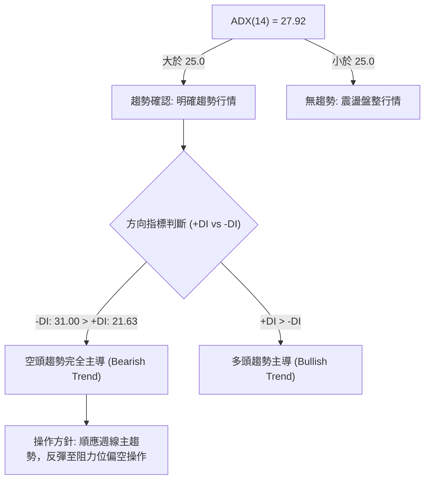

#### ADX 強度對照表

| ADX 數值區間 | 當前數值 | 當前狀態 | 趨勢性質 | 策略指導 |
|--------------|----------|----------|----------|----------|
| 0 – 20 | — | 否 | 弱趨勢 / 無方向 | 觀望或極短線區間操作 |
| 20 – 25 | — | 否 | 趨勢孕育期 | 突破邊緣，確認突破訊號 |
| **25 – 40** | **27.92** | **是 (符合)** | **強趨勢行情 (空頭佔優)** | **順勢交易，以高拋或反彈放空為主** |
| 40 – 60 | — | 否 | 極強趨勢 | 留意趨勢過度延伸之竭盡反轉 |
| > 60 | — | 否 | 極度投機泡沫或恐慌崩盤 | 逆向指標，準備大級別修正 |

---

## 3. 圖表形態分析

### 🔍 形態識別系統

在日線與週線結構中，價格自 2026-10-15 斷崖破位後，在 $49.25 至 $58.31 區間構築「短期超跌 V 型雙底雛形」，但中期整體仍深陷「下降楔形／破位箱型」之反彈結構。

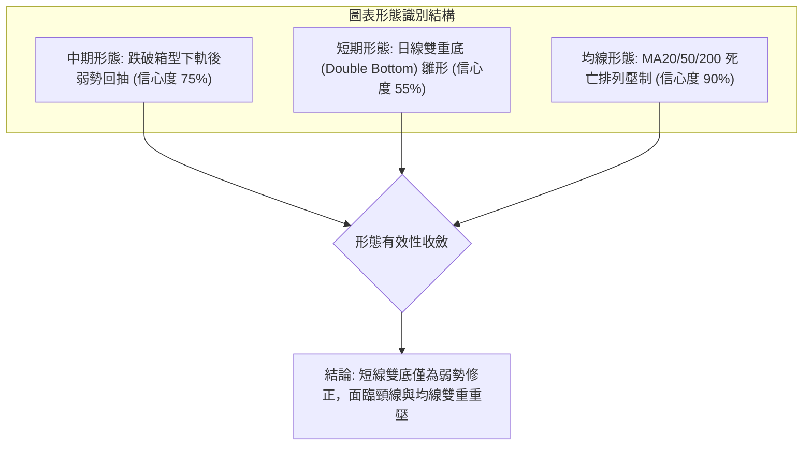

#### 形態識別與信心度評估表

| 形態類別 | 信心度 | 判斷依據（引用數據） | 完成度 | 目標價（附計算式） |
|----------|--------|----------------------|--------|--------------------|
| **下降箱型破位回抽** | 75% | 10-09 週收 $68.21 跌破前低，10-16 暴跌至 $50.84，目前反抽測試原箱底 | 85% | 形態破位量度跌幅：跌破原平台 $64.26 − ($78.74 − $64.26) = 未達，目前回抽受阻於 R1 ($67.70) |
| **短期雙底 (日線雛形)** | 55% | 第一次低點 10-15 的 $49.69，第二次低點 10-20 的 $49.25，頸線取 10-15 反彈高點 $55.40 | 70% | 頸線 $55.40 + 形態高度 ($55.40 − $49.25 = $6.15) = **$61.55**（高度接近 MA20 $61.89） |
| **長期均線空頭排列** | 90% | MA20 ($61.89) < MA50 ($65.34) < MA200 ($80.31)，價格全數在下方 | 100% | 下行空間受制於 S1 ($58.20)、S2 ($56.13) 與波段底 S3 ($49.25) |

### 🕯️ 重要K線形態分析

嚴格依據數據中「近 10 根日 K」與「近 8 根週 K」之開、高、低、收，進行精準 K 棒形態解構：

#### 近 10 根日 K 線形態解讀表

| 日期 | 開 | 高 | 低 | 收 | K線形態 | 解讀 | 訊號 |
|------|----|----|----|----|---------|------|------|
| 2026-10-14 | 62.81 | 63.56 | 58.84 | 59.18 | 中長陰線 | 跌破 $60 心理防線，收盤接近最低點，賣壓沉重 | 🔴 |
| 2026-10-15 | 53.86 | 55.40 | 49.69 | 55.25 | 帶長下影大陰爆量 | 成交量激增至 48.56M，下探 $49.69 後恐慌盤承接拉回 | 🟡 |
| 2026-10-16 | 54.49 | 54.87 | 50.37 | 50.84 | 續跌中黑線 | 反彈乏力，收在當日偏低位置，再度探底 | 🔴 |
| 2026-10-19 | 52.28 | 52.99 | 51.31 | 51.36 | 窄幅紡錘線 | 量縮至 17.08M，多空處於觀望僵局 | 🟡 |
| 2026-10-20 | 50.56 | 52.72 | 49.25 | 50.90 | 破底探針下影線 | 最低觸及波段底 S3 ($49.25) 後反彈，完成第二隻腳 | 🟢 |
| 2026-10-21 | 52.22 | 53.90 | 52.02 | 53.67 | 溫和實體紅K | 站上開盤價，多頭開始聚集反彈動能 | 🟢 |
| 2026-10-22 | 51.67 | 52.98 | 49.96 | 51.22 | 帶下影小黑回踩 | 回測 $50 整數防線未破，空頭打壓無功而返 | 🟡 |
| 2026-10-23 | 50.73 | 52.92 | 49.52 | 52.60 | 下影小陽線 | 連續測試低位有守，低點抬高，量能進一步萎縮 | 🟢 |
| 2026-10-26 | 52.60 | 54.99 | 52.15 | 53.82 | 連續推升小紅K | 突破 10-23 高點，形成短線上升階梯 | 🟢 |
| 2026-10-27 | 54.10 | 59.18 | 53.57 | 58.31 | 放量大實體陽線 | 成交量放大至 21.25M，大漲收復 S1 ($58.20)，多頭短線爆發 | 🟢 |

#### 近 8 根週 K 線形態解讀表

| 日期 | 開 | 高 | 低 | 收 | K線形態 | 解讀 | 訊號 |
|------|----|----|----|----|---------|------|------|
| 2026-09-11 | 65.27 | 67.70 | 61.53 | 62.95 | 高位回落黑K | 上影線受制於 R1 ($67.70)，多頭衝高受阻 | 🔴 |
| 2026-09-18 | 60.55 | 68.64 | 60.51 | 64.57 | 震盪反彈陽K | 守住 $60 關卡反彈，量能擴增至 106.90M | 🟡 |
| 2026-09-25 | 65.29 | 75.46 | 65.28 | 73.95 | 長紅實體突破 | 大漲突破多道阻力，觸及 R2 聚類位 $75.46 | 🟢 |
| 2026-10-02 | 73.20 | 76.09 | 69.40 | 73.92 | 高檔墓碑十字星 | 衝高 $76.09 後大幅回落，高檔滯漲賣壓湧現 | 🔴 |
| 2026-10-09 | 73.70 | 78.28 | 66.98 | 68.21 | 假突破長黑吞噬 | 衝至波段高點 $78.28 (逼近 R3 $78.74) 後重挫，確立波段見頂 | 🔴 |
| 2026-10-16 | 67.88 | 68.07 | 49.69 | 50.84 | 斷崖巨量大長黑 | 週量高達 128.01M，實體跌幅巨大，完全破位 | 🔴 |
| 2026-10-23 | 52.28 | 53.90 | 49.25 | 52.60 | 低檔長下影錘頭 | 觸及 S3 ($49.25) 後獲得強撐，呈現恐慌後的喘息 | 🟡 |
| 2026-10-27 | 52.60 | 59.18 | 52.15 | 58.31 | 轉折回升陽線 | 週初即拉出長陽，收復 $58.20 關鍵位置 | 🟢 |

### 📉 ASCII 走勢形態示意圖

```
RKLB 日線近期「雙底雛形與回抽受阻」走勢結構圖
價格
$68.00 ┤                     ● (10-14 開盤 $62.81 / 前阻力 $67.70)
$64.00 ┤                    ╱
$60.00 ┤                   ╱                     ● (10-27 高點 $59.18 / 現價 $58.31)
$56.00 ┤ (頸線 $55.40) ───● (10-15高)          ╱
$52.00 ┤                 ╲     ●─────────────● (10-21/26 底部抬高)
$48.00 ┤                  ● (10-15低 $49.69)  ● (10-20低 $49.25)
       └─────────────────────────────────────────────────────────────
        日期:    10-14   10-15   10-16  10-19 10-20 10-21 10-23 10-27
                 [下跌]  [左腳]  [盤整]       [右腳]     [突破頸線反彈]
```

### 🎯 形態目標價計算

根據近 10 根日 K 線構築之短期雙底結構，具體推導量度目標價：
- **形態底點 1 (左腳)**：2026-10-15 最低價 $49.69
- **形態底點 2 (右腳)**：2026-10-20 最低價 $49.25
- **雙底確認基準底**：取最低極值 $49.25
- **形態頸線位**：2026-10-15 反彈高點 $55.40（已於 2026-10-27 實體陽線以收盤價 $58.31 達成向上突破）
- **形態垂直高度**：頸線 $55.40 − 底部 $49.25 = **$6.15**
- **雙底等幅量度反彈目標價**：
  $$\text{目標價} = \text{頸線} + \text{形態高度} = 55.40 + 6.15 = \mathbf{\$61.55}$$
- **驗證與阻力共振**：此目標價 $61.55 與當前向下運行的 20 日均線 MA20 ($61.89) 及布林通道中軌 ($61.89) 形成強烈共振重合區間 ($61.55 – $61.89)。

---

## 4. 支撐與阻力

### 🗺️ 關鍵價位分布圖（Unicode）

依據 OHLCV 聚類計算與斐波那契回調結構，形成 RKLB 當前立體價格階梯：

```
RKLB 價位結構分布圖
══════════════════════════════════════════════════════════════════
$78.74 ║██████████████████████████████║ 強阻力 R3 (10-09週高點聚類)
$75.28 ║██████████████████████        ║ 次級阻力 R2 (09-25週高點聚類)
$67.70 ║██████████████████████████████║ 核心阻力 R1 (09-11週高點/MA60)
$61.89 ║──────────────────────────────║ 動態阻力 (MA20 / 布林中軌)
───────╫──────────────────────────────╫───────────────────────────
$58.31 ╠══════════════════════════════╣ ◄ 當前收盤價 ($58.31)
───────╫──────────────────────────────╫───────────────────────────
$58.20 ║▓▓▓▓▓▓▓▓▓▓▓▓▓▓▓▓▓▓▓▓▓▓▓▓▓▓▓▓▓▓║ 立即支撐 S1 (近一年波段低點聚類)
$56.13 ║████████████████████          ║ 關鍵支撐 S2 (次級波段低點聚類)
$49.25 ║██████████████████████████████║ 終極防線 S3 (10-20 日K最低點)
══════════════════════════════════════════════════════════════════
```

### 🚧 阻力位分析表

所有阻力價位完全嚴格引用數據源之「關鍵價位」與近一年波段高點聚類數值：

| 阻力級別 | 價位 | 與現價距離 | 形成原因與技術共振 | 突破難度 | 重要性 |
|----------|------|------------|--------------------|----------|--------|
| **阻力一 (R1)** | **$67.70** | +16.10% | 2026-09-11 週K高點聚類、MA60 ($67.64) 壓制區 | 🟡 中等偏高 | ★★★★☆ |
| **阻力二 (R2)** | **$75.28** | +29.11% | 2026-09-25 週K高點聚類 ($75.46) 密集籌碼套牢區 | 🔴 極高 | ★★★★☆ |
| **阻力三 (R3)** | **$78.74** | +35.05% | 2026-10-09 週K高點聚類 ($78.28)、布林通道上軌 ($79.83) 共振 | 🔴 難以逾越 | ★★★★★ |

### 🛡️ 支撐位分析表

所有支撐價位完全嚴格引用數據源之「關鍵價位」與近一年波段低點聚類數值：

| 支撐級別 | 價位 | 與現價距離 | 形成原因與技術共振 | 守住機率 | 重要性 |
|----------|------|------------|--------------------|----------|--------|
| **支撐一 (S1)** | **$58.20** | -0.19% | 近一年波段低點聚類，目前剛由阻力轉為短線支撐 | 🟡 50% | ★★★☆☆ |
| **支撐二 (S2)** | **$56.13** | -3.74% | 近一年次級波段低點聚類，雙底頸線 ($55.40) 上方緩衝區 | 🟢 65% | ★★★★☆ |
| **支撐三 (S3)** | **$49.25** | -15.54% | 2026-10-20 日K最低點，本次恐慌拋售之波段生命線 | 🟢 80% | ★★★★★ |

### 📐 斐波那契回調位分析

依據 52 週完整波動區間（高點 $151.00 至 低點 $37.57，總波動空間 $113.43），各黃金分割水平位如下：

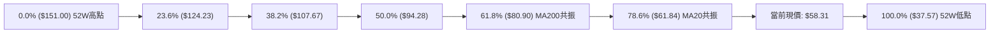

#### 斐波那契回調對照與解讀

| 斐波那契比例 | 計算價位 | 當前相對位置 | 技術意涵與結構解讀 |
|--------------|----------|--------------|--------------------|
| **0.0% (52W High)** | $151.00 | 現價下方 +158.96% | 歷史多頭泡沫頂部，極強套牢沉積區 |
| **23.6%** | $124.23 | 現價上方 +113.05% | 跌破後宣告主升浪完全結束 |
| **38.2%** | $107.67 | 現價上方 +84.65% | 長期強弱分水嶺 |
| **50.0%** | $94.28 | 現價上方 +61.69% | 中期心理平衡中軸 |
| **61.8%** | $80.90 | 現價上方 +38.74% | **黃金分割關鍵位**：與 MA200 ($80.31) 形成強大結構共振阻力 |
| **78.6%** | $61.84 | 現價上方 +6.05% | **深幅回撤防線**：與 MA20 ($61.89) 幾乎完全精準重合 |
| **100.0% (52W Low)**| $37.57 | 現價下方 -35.57% | 52 週最低點，終極宏觀底部防線 |

**核心解讀**：現價 $58.31 目前正處於 **78.6% 回調位 ($61.84)** 與 **100.0% 底部 ($37.57)** 之間的極深回撤盲區。78.6% 回調位 ($61.84) 與 20 日均線 ($61.89) 構成當前反彈的上方天花板；若無法有效放量收復 $61.84，股價將長期承壓並面臨再度朝 52W 低點 $37.57 尋求支撐之巨大風險。

---

## 5. 技術指標深度解讀

### 🎛️ 指標訊號總覽

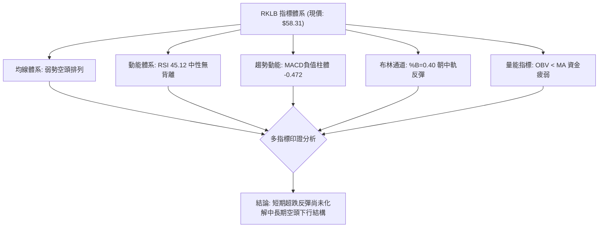

### 📈 移動平均線排列分析

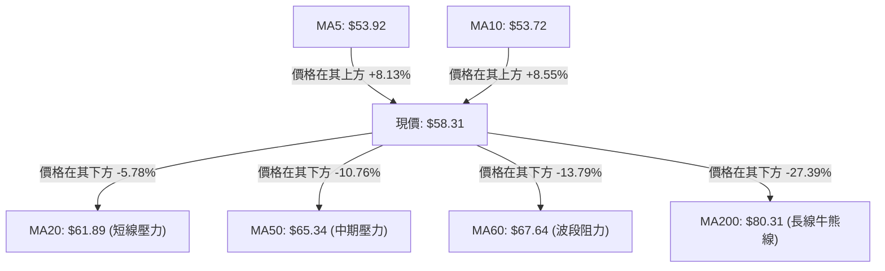

#### 移動平均線數據與排列解讀

| 均線名稱 | 當前價格 | 與現價乖離率 | 排列狀態 | 技術含義 |
|----------|----------|--------------|----------|----------|
| **MA5** | $53.92 | +8.13% | 向上發散 | 短線超跌急拉，提供日內動態支撐 |
| **MA10** | $53.72 | +8.55% | 向上發散 | 與 MA5 形成短天期黃金交叉 |
| **MA20** | $61.89 | -5.78% | 向下壓制 | 短期趨勢線，亦為布林中軌，首道考驗 |
| **MA50** | $65.34 | -10.76% | 向下傾斜 | 中期生命線，MA20 < MA50 維持死叉 |
| **MA60** | $67.64 | -13.79% | 陡峭向下 | 季線阻力，與阻力 R1 ($67.70) 重疊 |
| **MA120**| $83.55 | -30.21% | 向下傾斜 | 半年線持續走低 |
| **MA200**| $80.31 | -27.39% | 向下壓制 | 年線關鍵關卡，長期結構已走壞 |
| **MA240**| $76.64 | -23.92% | 向下拐頭 | 兩年均線下彎 |

**均線結構結論**：MA20 ($61.89) < MA50 ($65.34) < MA200 ($80.31)，構成典型的**空頭排列 (Bearish Alignment)**。雖然極短期的 MA5 與 MA10 發生向上金叉，但受制於上方層層疊疊的下降均線束，此反彈屬於均線負乖離過大所引發的技術性修正。

### 📉 RSI(14) 分析

當前 RSI(14) 數值為 **45.12**（Wilder 計算法）。

```
RSI(14) 強度儀表
0 ──────────── 30 ────────────────── 50 ──────────── 70 ─────────── 100
[   超賣區    ] [      空方佔優      │  多方佔優   ] [   超買區    ]
                ███████████████████░░ 45.12
```

- **區間診斷**：RSI 處於 45.12 的中性弱勢區間（30–50），說明價格已脫離 10-16 週線低點時的極度超賣狀態（週 RSI 曾跌至 25.4），但在未突破 50 中軸前，空方仍掌握中度定價權。
- **背離分析判斷**：
  - **日線背離判定**：檢視近 20 根 K 棒的首尾表現，10-15 低點 $49.69 與 10-20 低點 $49.25 價格微幅創新低，而 RSI 讀數自低位回溫，但依據系統判定規則「僅比較近20根K棒首尾之價格與RSI方向，顯示：**無明顯背離**」。
  - **結論**：動能並無顯著的多頭或空頭背離訊號，反彈僅為純粹的超賣動能回洗。

### 📊 MACD(12/26/9) 訊號解讀

- **MACD 快線**：-4.233
- **MACD 信號線 (Slow)**：-3.761
- **MACD 柱狀圖 (Histogram)**：**-0.472** 🔴

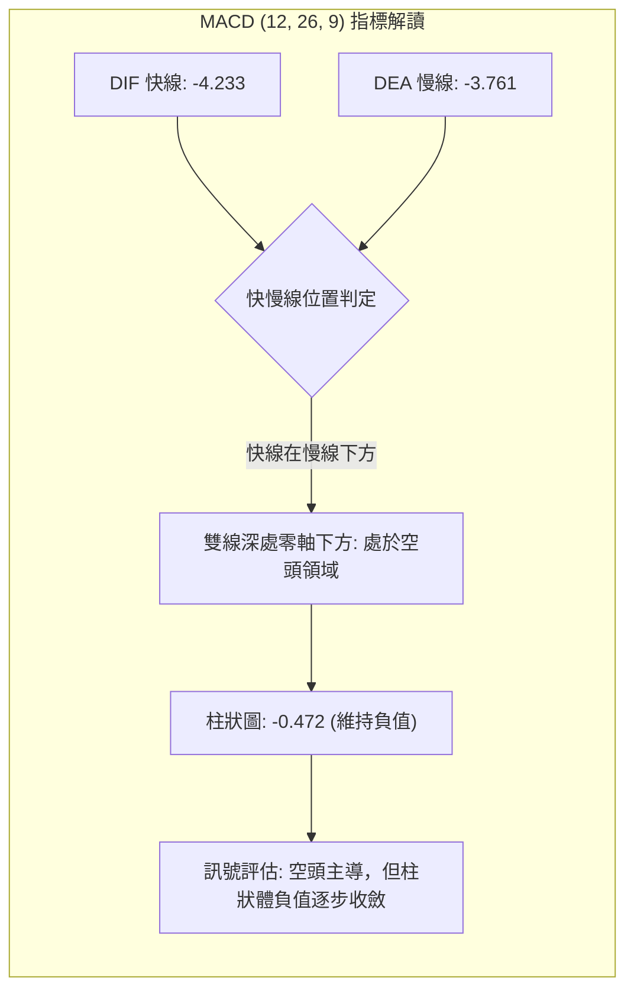

**解讀**：MACD 線與信號線均遠在零軸下方運行，柱狀圖雖由前期的深幅負值收斂至 -0.472，但未出現黃金交叉，空方動能依然實質主導格局。

### 📦 布林通道分析

布林參數取標準 (20, 2)，中軌為 MA20 ($61.89)。

```
布林通道 (Bollinger Bands) 價格相對位置圖
────────────────────────────────────────────────────────────────
$79.83 ┬────────────────────────────────────────── 布林上軌 (BB Upper)
       │
       │
$61.89 ┼────────────────────────────────────────── 布林中軌 (BB Mid / MA20)
       │               ▲ 反彈阻力位置 ($61.89)
$58.31 ┼── ● 現價 ($58.31, %B = 0.40)
       │
$43.94 ┴────────────────────────────────────────── 布林下軌 (BB Lower)
────────────────────────────────────────────────────────────────
```

- **通道帶寬與位置**：通道上下軌間距達 $35.89，顯示前期波動劇烈。當前 **%B 數值為 0.40**（0 代表下軌，0.5 代表中軌，1 代表上軌）。
- **走勢涵義**：價格自下軌反彈向上游弋，但仍位於中軌下方（%B < 0.5）。在中軌下彎的空頭背景下，布林中軌 $61.89 構成短期難以一次性有效突破的動態強壓。

### 💹 成交量分析（量價配合度）

- **最新成交量**：21,247,200 股
- **20 日均量**：21,057,065 股（量比：**1.01x**）
- **50 日均量**：19,430,118 股（量比：**1.09x**）
- **OBV (能量潮指標) 走勢**：**OBV < MA → 量能疲弱**

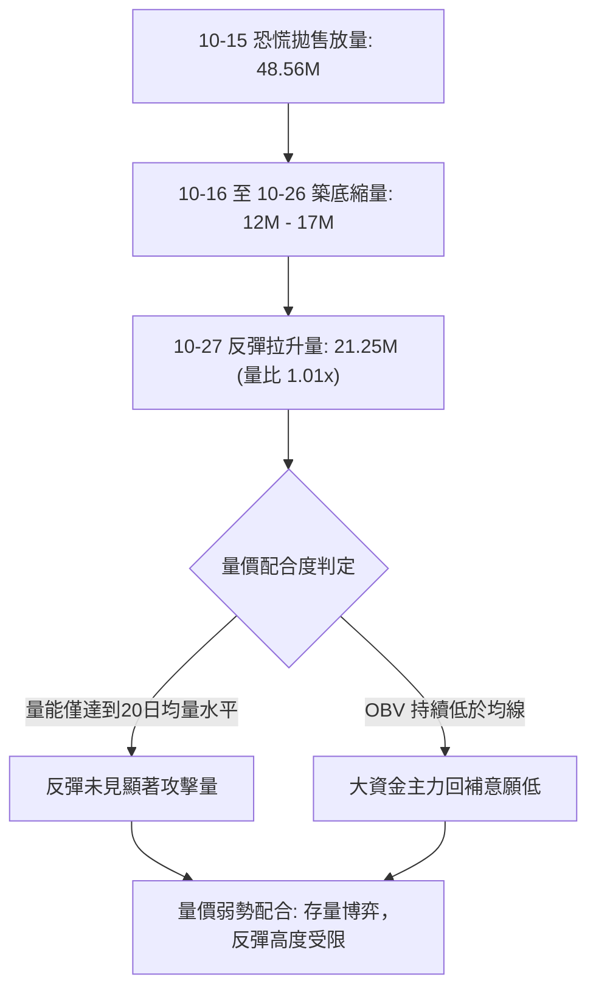

**結論**：在經歷 10-15 的爆量殺盤後，隨後的反彈雖然有放量（10-27 放量至 21.25M），但僅僅勉強越過 20 日均量線，未能呈現價漲量暴增的機構進場特徵。OBV 跌破其移動平均線，表明資金外流趨勢尚未扭轉。

---

## 6. 動能與波動率

### ⚡ 動能評估四象限

評估 RKLB 目前在技術動能強度（Momentum）與歷史波動率（Volatility）矩陣中的分布位置：

| 象限 | 動能強度 (RSI/MACD) | 波動率水準 (ATR/Beta) | 當前狀態 | 策略指導與評估 |
|------|---------------------|-----------------------|----------|----------------|
| **Q1 (最佳擴張)** | 強動能 (多頭) | 低波動 | — | 穩定多頭主升段，全力做多 |
| **Q2 (整理觀望)** | 弱動能 (中性) | 低波動 | — | 盤整蓄勢期，等待突破 |
| **Q3 (高風險多頭)** | 強動能 (多頭) | 高波動 | — | 主力拉升期，嚴格移動止盈 |
| **Q4 (空頭承壓)** | **弱動能 (空頭/偏弱)** | **高波動 (Beta 2.94)**| **✓ 當前所處** | **弱動能高波動：極易出現假突破與大幅洗盤，嚴禁追高，逢反彈阻力偏空** |

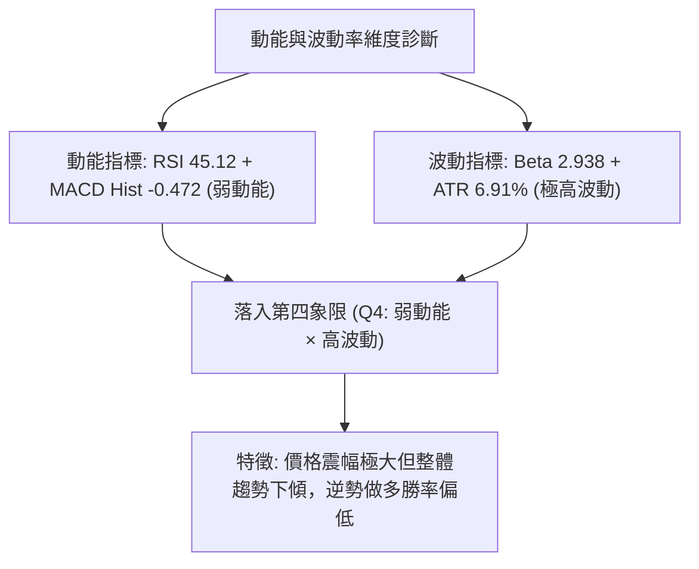

### 📊 ATR 波動率分析

- **ATR(14)**：**$4.03**（採 Wilder 平滑算法）
- **ATR 佔比**：佔當前股價 $58.31 的 **6.91%**

**風控應用與止損距離精算**：
1. **常規短線止損距離 (1.5 × ATR)**：$1.5 \times 4.03 = \mathbf{\$6.05}$（佔比約 10.37%）
2. **波段風控止損距離 (2.0 × ATR)**：$2.0 \times 4.03 = \mathbf{\$8.06}$（佔比約 13.82%）
3. **波動解讀**：每日平均波動空間超過 4 美元，任何低於 1.0 倍 ATR（$4.03）的極窄止損極易被市場噪聲掃出場。

### 📐 Beta 與市場相關性

- **Beta 係數**：**2.938**（高貝塔特性）
- **解讀**：RKLB 的波動敏感度是大盤（S&P 500）的近 3 倍。在市場風險偏好上升時具備爆發力，但在市場避險情緒升溫或加息壓制下，其回撤幅度將成倍放大。

---

## 7. 多時框架總結

### 📋 時框架評分表

| 時框架 | 趨勢方向 | 動能狀態 | 均線排列 | 圖表形態 | 綜合評分 | 交易建議 |
|--------|----------|----------|----------|----------|----------|----------|
| **長期 (月線)** | 🔴 強烈空頭 | RSI 下移，MACD 負向 | MA120/240 走低 | 衝頂破位殺跌 | **30/100** | 長期投資宜觀望，靜待估值修復 |
| **中期 (週線)** | 🔴 空頭主導 | MACD 負柱，ADX=27.92 | 空頭排列 | 下降通道 | **36/100** | 逢高放空，反彈至均線壓制區賣出 |
| **短期 (日線)** | 🟡 弱勢反彈 | RSI 45.12 低位金叉 | 短期均線微翹 | 雙底雛形反抽 | **48/100** | 短線僅適合高手博弈，嚴設止損 |
| **加權整體** | 🔴 偏空主導 | 空方佔優 | MA20/50/200空頭| 破位後弱勢回抽 | **39/100** | **逢反彈阻力位執行偏空策略** |

### 🔲 綜合訊號矩陣

```
時框訊號一致性檢驗陣列
────────────────────────────────────────────────────────────────
指標項目        短期 (日線)      中期 (週線)      長期 (月線)      多時框協同性
────────────────────────────────────────────────────────────────
趨勢方向        🟡 反彈修正      🔴 下降趨勢      🔴 破位重挫      🔴 矛盾 (逆主趨勢反彈)
均線系統        🟡 短多長空      🔴 空頭排列      🔴 均線失守      🔴 均線反壓沉重
動能指標        🟡 中性低位金叉  🔴 空頭動能      🔴 深度回調      🔴 動能未達反轉共振
量能結構        🟡 溫和微放      🔴 巨量長黑套牢  🔴 高檔量竭      🔴 缺乏機構買盤推升
────────────────────────────────────────────────────────────────
```

### ⚖️ 多時框收斂結論

依據本報告**嚴格要求 14（多時框收斂規則）**進行最終定性裁決：
1. **趨勢/盤整環境判斷**：ADX(14) 讀數為 **27.92 > 25.0**，確認當前屬於標準的**趨勢行情**而非震盪無方向市場。
2. **主導時框優先級**：在趨勢行情下，必須以**中長期（週線 / MA50 / MA200）方向為主導**，日線級別的指標金叉與小雙底形態僅能用來尋找反彈高點之賣出時機。
3. **方向性唯一結論**：**偏空主導 (Bearish Dominant)**。日線反彈無法推翻週線空頭主趨勢，策略重點在於監控上方阻力區 R1 ($67.70) 及 MA20 ($61.89) 的受阻確認信號。此結論與第 1 章技術評分卡（39/100）保持完全一致。

---

## 8. 交易策略建議

### 🗺️ 策略決策流程圖

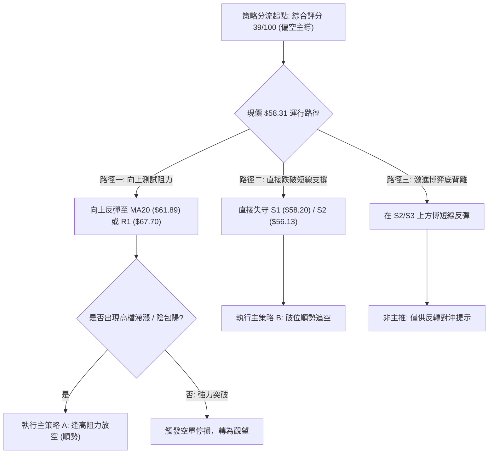

### 🧭 策略路由（依評分卡分流）

**當前主策略方向 = 偏空做空（依評分 39/100，低於 40 分標準偏空門檻）**

依據規則，評分偏空（≤40）必須**主推空頭策略**，多頭僅列為反轉風險觸發點與風控對沖提示。

### 🎯 價格情境階梯（Price Scenarios）

價位完全嚴格引用數據源之實際聚類數值：

| 觸發條件 | 下一目標 | 後續延伸 | 情境含義 |
|----------|----------|----------|----------|
| **反彈受阻於 R1 ($67.70)** | 回測 S1 ($58.20) | 跌向 S2 ($56.13) | 短線反彈竭盡，順應中長期空頭趨勢重新探底 |
| **跌破 S1 ($58.20)** | 下測 S2 ($56.13) | 貫破探向 S3 ($49.25) | 短線雙底雛形破產，下行空間重新打開 |
| **強勢突破 R1 ($67.70)** | 上探 R2 ($75.28) | 衝擊 R3 ($78.74) | 中期空頭格局受挑戰，空頭全面停損離場 |

### 📊 情境機率分佈

| 情境 | 機率 | 主要依據 |
|------|------|----------|
| **反彈遇阻回落 / 順勢探底** | **60%** | 均線空頭排列 (MA20<50<200)、ADX=27.92 且 -DI 主導、OBV 疲軟低於均線 |
| **區間震盪整理** | **25%** | 布林帶寬較大，S1 ($58.20) 與 MA20 ($61.89) 之間可能反覆拉鋸洗盤 |
| **強勢反轉向上突破** | **15%** | 缺乏大級別量能支持，且週線長黑套牢盤沉重，直接反轉機率極低 |

### 🔴 主策略詳情（空頭主導策略）

嚴格依據規則 17 計算風險報酬比：做空風險報酬比 = (進場價 − 目標價 T1) ÷ (止損價 − 進場價)。

| 策略要素 | 策略 A（反彈遇阻做空 — 核心順勢） | 策略 B（支撐破位做空 — 動態突破） |
|----------|-----------------------------------|-----------------------------------|
| **策略邏輯** | 股價反彈至 MA20 與斐波那契 78.6% 重合阻力區遇阻回落放空 | 跌破波段支撐 S2 ($56.13) 確認日線雙底反彈失敗，順勢追空 |
| **進場條件** | 觸及阻力區出現日K帶長上影線或陰吞噬確立滯漲 | 日K收盤價實體跌破 $56.13 支撐位 |
| **進場價格** | **$61.89**（MA20 與斐波那契 78.6% 回調位） | **$56.13**（跌破 S2 支撐位進場） |
| **目標價 T1**| **$56.13**（S2 次級波段支撐位） | **$49.25**（S3 波段前低最低點） |
| **目標價 T2**| **$49.25**（S3 近期波段底點） | **$37.57**（52W Low 宏觀最低點） |
| **止損價格** | **$64.77**（上方約 0.7 倍 ATR，避開假突破） | **$58.20**（回到 S1 支撐上方即止損） |
| **風險報酬比**| **1 : 2.00（以 T1 計）** <br>*(計算式: (61.89-56.13)/(64.77-61.89) = 5.76 / 2.88 = 2.00)*<br>[1 : 4.39 (以 T2 計)] | **1 : 3.32（以 T1 計）** <br>*(計算式: (56.13-49.25)/(58.20-56.13) = 6.88 / 2.07 = 3.32)*<br>[1 : 8.97 (以 T2 計)] |
| **成功機率** | **65%** | **60%** |
| **建議倉位** | **15%**（基礎波段倉位） | **10%**（動態追隨倉位） |

### 🟢 反向風險觸發點（對沖與止損提示）

若市場出現以下情況，主推之空頭策略將被推翻，空單必須立即無條件嚴格止損：
1. **價位警訊**：日 K 線實體收盤價突破 **R1 ($67.70)**，意味著短線突破季線與 09-11 週高點，技術架構轉向中期雙底突破。
2. **指標警訊**：MACD 出現零軸下方的強勢黃金交叉，且柱狀圖翻正擴大超過 +0.500。
3. **量能警訊**：單日成交量突破 4,000 萬股（達 20 日均量 2 倍以上）且收實體長陽線。

### ⭐ 整體訊號強度評星

```
做多訊號強度：★★☆☆☆  (2/5星 — 僅屬超跌反抽，上方均線壓制重重)
做空訊號強度：★★★★☆  (4/5星 — 均線與ADX空頭共振，反彈放空勝率高)
整體可信度：  ★★★★☆  (4/5星 — 多時框指標高度收斂，空頭方向明確)
```

---

## 9. 風險提示與監控

### ✅ 關鍵監控指標 Checklist

```
╔══════════════════════════════════════════════════════════════╗
║               每日盤後關鍵技術指標監控清單                   ║
╠══════════════════════════════════════════════════════════════╣
║ [ ] 價格是否跌破 S1 ($58.20) 或觸碰 S2 ($56.13) 關鍵支撐     ║
║ [ ] 價格向上測試 MA20 ($61.89) 是否出現放量滯漲之長上影線   ║
║ [ ] RSI(14) 是否在 50 中軸線受阻拐頭向下                     ║
║ [ ] MACD 柱狀圖是否持續處於負值區 (當前 -0.472)              ║
║ [ ] ADX(14) 是否持續維持在 25.0 之上且 -DI 壓制 +DI          ║
║ [ ] 成交量是否異常放大至 40M 以上 (機構資金異動信號)         ║
╚══════════════════════════════════════════════════════════════╝
```

### ⚠️ 風險場景分析

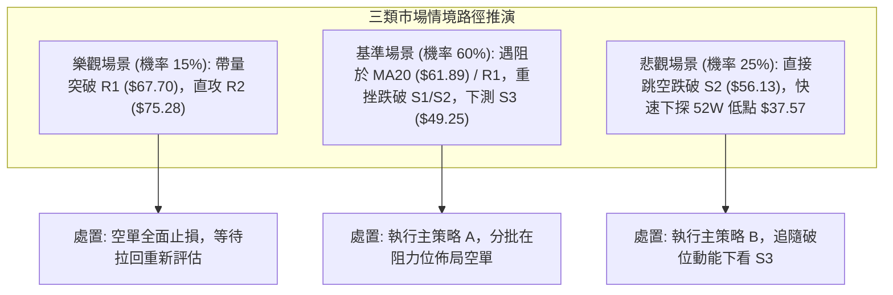

### 🛡️ 風險管理重要提醒

1. **高貝塔劇烈波動風險**：RKLB 的 Beta 達到 2.938，ATR 佔比高達 6.91%，單日振幅極大。交易者切勿使用高倍槓桿，單筆交易虧損額度必須嚴格控制在總投資本金的 **1.5% - 2.0%** 範圍內。
2. **跳空缺口風險**：航空航天題材常受火箭發射成敗、合約公佈或宏觀政策劇烈影響，容易產生隔夜跳空。建議倉位配置不宜超過總帳戶的 **25%**。
3. **嚴守止損紀律**：主策略進場後，若觸及預設止損價位（策略 A: $64.77，策略 B: $58.20），必須果斷平倉，切忌抱有「抗單至回本」之僥倖心態。

---

## 📋 報告總結

```
RKLB 技術分析報告總結
════════════════════════════════════════════════════════
報告日期：2026-10-28
當前價格：$58.31
分析評級：🔴 偏空主導 (反彈遇阻做空，綜合評分 39/100)

關鍵結論：
├─ 長期趨勢：🔴 空頭主導，距 52W 高點 $151.00 回撤逾 60%
├─ 中期趨勢：🔴 週線下降通道，均線 MA20<MA50<MA200 完全空頭排列
├─ 短期趨勢：🟡 自 $49.25 超跌反彈，正向上挑戰 MA20 ($61.89)
├─ 關鍵支撐：S1: $58.20 ｜ S2: $56.13 ｜ S3: $49.25
├─ 關鍵阻力：R1: $67.70 ｜ R2: $75.28 ｜ R3: $78.74
└─ 分析師目標：均價 $102.15 (最低 $64.00 / 最高 $150.00)

最優策略組合：
1. 🥇 最佳機會：策略 A — 反彈至 MA20 ($61.89) 遇阻放空，
              目標 T1: $56.13、T2: $49.25，風報比 1 : 2.00
2. 🥈 次選機會：策略 B — 跌破 S2 ($56.13) 追空，
              目標 T1: $49.25、T2: $37.57，風報比 1 : 3.32
3. 🥉 保守選擇：空手觀望，靜待股價回測 S3 ($49.25) 能否構築實質雙底
════════════════════════════════════════════════════════
```

---

> ⚠️ **免責聲明**：本報告為 AI 自動生成之技術分析，所有數據及估算均基於提供的歷史價格資訊。本報告**僅供研究與學術參考**，**不構成任何投資建議**。投資有風險，入市需謹慎。

---

*報告生成時間：2026-10-28 ｜ 數據來源：Yahoo Finance ｜ 分析框架：多時框技術分析*