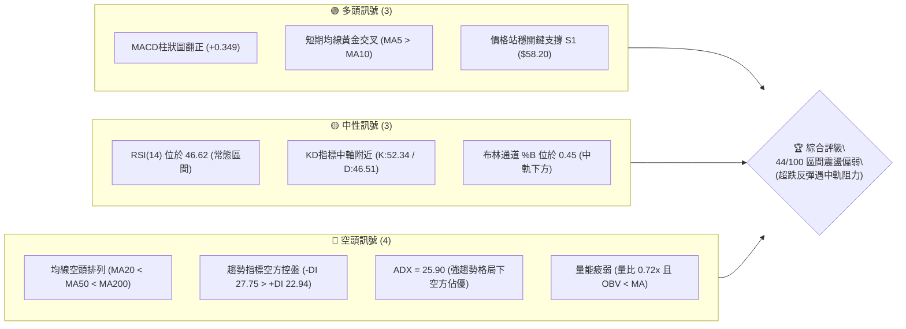
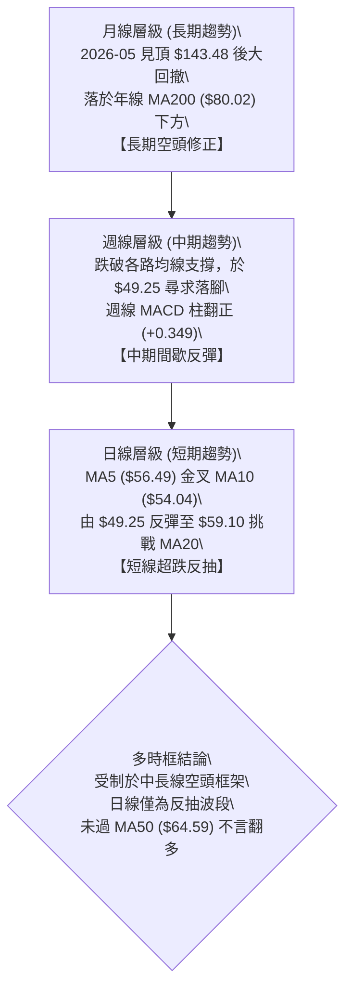
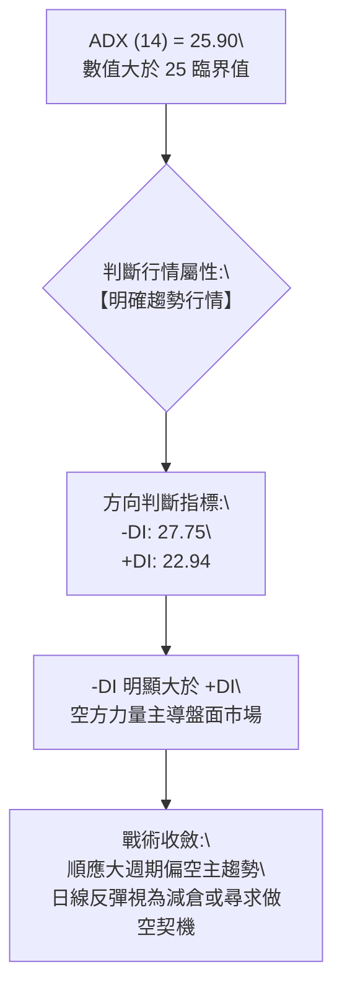
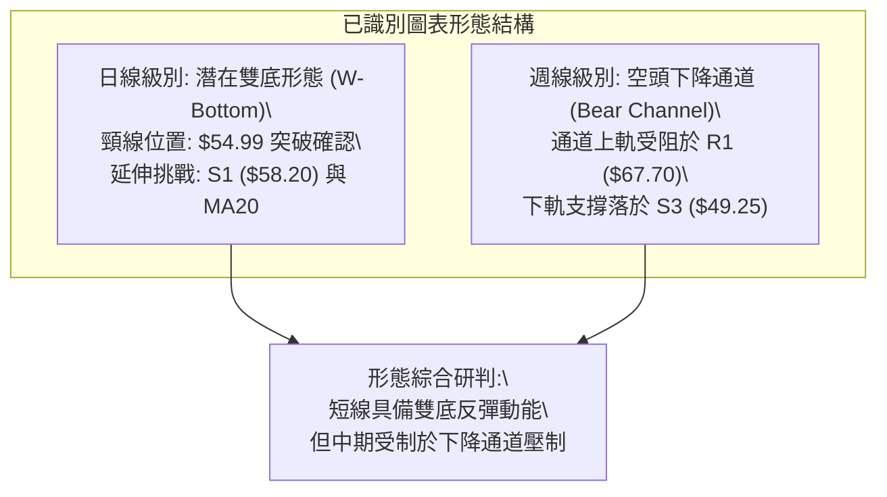
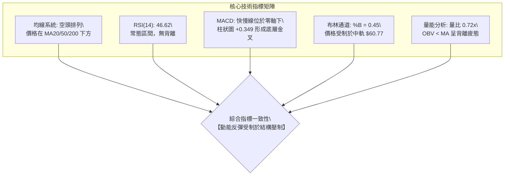
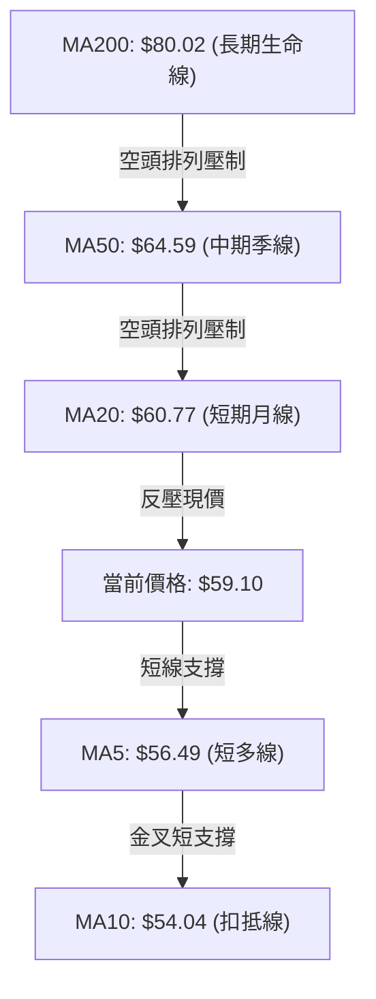
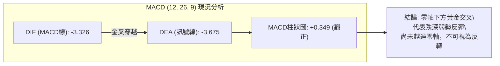
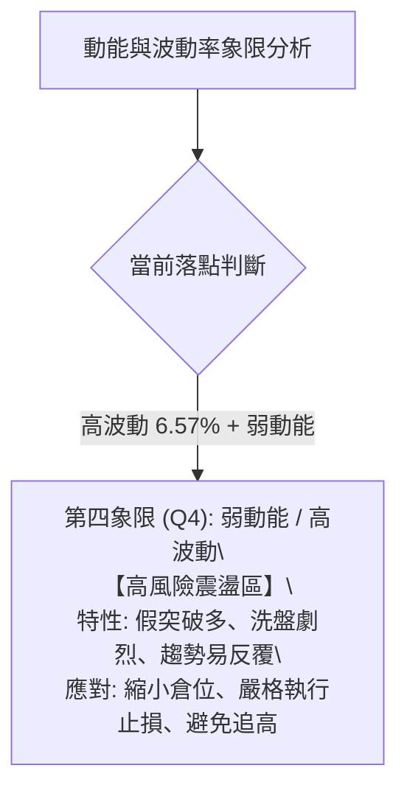
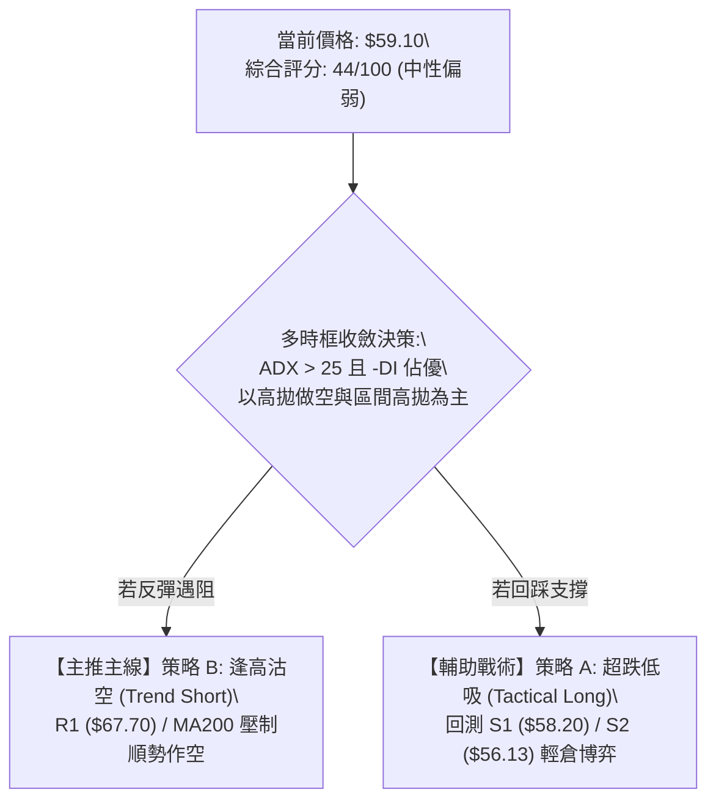
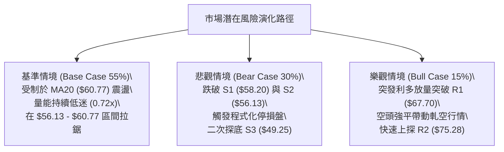

# RKLB 技術分析報告

> **報告日期**：2026-10-30 ｜ **語言**：繁體中文 ｜ **數據來源**：Yahoo Finance ｜ **當前價格**：$59.10 USD

---

## 目錄

| 章節 | 內容 |
|------|------|
| [1. 技術面概覽](#1-技術面概覽) | 訊號儀表板、核心指標、評分卡 |
| [2. 趨勢分析](#2-趨勢分析) | 多時框趨勢、長中短期走勢 |
| [3. 圖表形態分析](#3-圖表形態分析) | 形態識別、K線組合、目標價 |
| [4. 支撐與阻力](#4-支撐與阻力) | 關鍵價位、斐波那契回調 |
| [5. 技術指標深度解讀](#5-技術指標深度解讀) | MA/RSI/MACD/布林/成交量 |
| [6. 動能與波動率](#6-動能與波動率) | 動能評估、ATR、Beta |
| [7. 多時框架總結](#7-多時框架總結) | 時框架評分矩陣 |
| [8. 交易策略建議](#8-交易策略建議) | 多空策略、風險報酬比 |
| [9. 風險提示與監控](#9-風險提示與監控) | 監控指標、風險場景 |
| [10. 報告總結](#10-報告總結) | 關鍵結論與決策總結 |

---

## 1. 技術面概覽

### 🎯 技術訊號儀表板



### 📊 核心指標速覽表

| 指標類別 | 指標名稱 | 當前數值 | 訊號 | 解讀 |
|:---|:---|:---|:---:|:---|
| **價格** | 當前收盤價 | $59.10 | 🟡 | 位於52週區間19.0%，自低檔$49.25反彈但受制於MA20 |
| **均線** | MA20 (月線) | $60.77 | 🔴 | 價格在MA20下方（-2.74%），為短線第一道動態阻力 |
| **均線** | MA50 (季線) | $64.59 | 🔴 | 價格在MA50下方（-8.50%），中期趨勢偏空壓制 |
| **均線** | MA200 (年線) | $80.02 | 🔴 | 價格遠在MA200下方（-26.14%），長期結構處於空頭調整 |
| **動能** | RSI(14) | 46.62 | 🟡 | 脫離超賣區回升至中性區間，未見頂底背離訊號 |
| **動能** | MACD (12,26,9) | 柱狀圖 +0.349 | 🟢 | 零軸下方出現金叉，柱狀圖轉正，動能呈修復反彈 |
| **動能** | KD (9,3,3) | K:52.34 / D:46.51 | 🟢 | K值穿越D值於中軸微幅擴散，短線動能修復中 |
| **趨勢** | ADX(14) / DMI | ADX: 25.90 | 🔴 | ADX > 25 確立趨勢行情；-DI (27.75) > +DI (22.94) 顯示空頭主導 |
| **通道** | 布林通道帶寬 | $43.66 - $77.87 | 🟡 | %B 為 0.45，價格逼近中軌 $60.77，面臨軌道回測考驗 |
| **波動** | ATR(14) | $3.88 | 🔴 | 日波幅佔股價 6.57%，屬高波動標的，風控需保留較大緩衝 |
| **成交量** | 20日量比 | 0.72x | 🔴 | 當日成交量14.41M低於20日均量20.12M，OBV < MA 呈量價背離 |

### 🏆 技術評分卡

```
╔════════════════════════════════════════════════════════════════════╗
║                   技術評分卡 — RKLB (2026-10-30)                   ║
╠════════════════════════════════════════════════════════════════════╣
║  評估維度      進度條與得分                      狀態評級          ║
╟────────────────────────────────────────────────────────────────────╢
║  趨勢強度      ████████░░░░░░░░░░░░  38/100      🔴 空頭主導強趨勢 ║
║  動能指標      ██████████░░░░░░░░░░  52/100      🟡 底層金叉弱修復 ║
║  支撐穩定度    ████████████░░░░░░░░  58/100      🟡 S1/S3築雙底支撐║
║  成交量配合    ███████░░░░░░░░░░░░░  36/100      🔴 量能萎縮未跟進 ║
║  形態完整度    ██████████░░░░░░░░░░  48/100      🟡 短底成型受制頸 ║
║  均線排列      ██████░░░░░░░░░░░░░░  32/100      🔴 完整空頭均線陣 ║
╠════════════════════════════════════════════════════════════════════╣
║  綜合評分      █████████░░░░░░░░░░░  44/100      🟡 區間震盪偏弱   ║
║  (綜合評分 = 上述六項之算術平均數：264 ÷ 6 = 44)                   ║
╚════════════════════════════════════════════════════════════════════╝
```

---

## 2. 趨勢分析

### 🌐 多時框趨勢分析



### 📈 長期趨勢 — 12個月走勢圖（Unicode）

```
RKLB 月線歷史走勢圖（2025-11 至 2026-10）
價格軸 ($)
$150 ┤                                  ● 52W High $151.00 (2026-05: $143.48)
$130 ┤                                 ╱ ╲
$110 ┤                                ╱   ╲   ● (2026-06: $101.65)
 $90 ┤                 ● (2026-01: $80.07)  ╲ ╱
 $70 ┤        ●       ╱ ╲        ● (04:$82.51)● (2026-09: $69.68)
 $50 ┤●──────╱─╲─────╱───╲──────╱─────────────╲─────● 現價 $59.10 (2026-10)
 $30 ┤ (11:$42.14)  ● (03: $64.22)            ╲   ╱
 $10 ┤                                         ● 52W Low $37.57 (區間底)
     └┬──────┬──────┬──────┬──────┬──────┬──────┬──────┬──────┬──────┬──────┬──────┬──────
     11月   12月   01月   02月   03月   04月   05月   06月   07月   08月   09月   10月
     (2025)                                   (2026)
```

#### 走勢特徵分析表格

| 時間階段 | 起訖區間 | 價格區間 | 累積漲跌幅 | 結構特徵與成交量型態 |
|:---|:---|:---|:---:|:---|
| **主升驅動段** | 2025-11 至 2026-01 | $42.14 → $80.07 | +90.01% | 突破長期平台，中大型機構建倉推升，多頭結構紮實 |
| **高位箱型整理** | 2026-01 至 2026-04 | $80.07 → $82.51 | +3.05% | 於 $64.22 至 $82.51 區間洗盤，均線呈多頭收斂狀態 |
| **狂熱噴出主升** | 2026-04 至 2026-05 | $82.51 → $143.48 | +73.89% | 歷史天量拉抬創下 52W 高點 $151.00，動能與價格呈現極度拋物線 |
| **崩跌出貨波段** | 2026-05 至 2026-07 | $143.48 → $64.95 | -54.73% | 瀑布式下殺連續擊穿 MA20、MA50，融資斷頭與停損盤湧現 |
| **低位築底反抽** | 2026-07 至 2026-10 | $64.95 → $59.10 | -9.01% | 歷經二次下探測試波段低點 $49.25，目前在 $50.00-$60.00 弱勢盤整 |

### 📊 中期趨勢（週線分析）

```
RKLB 週線壓力與支撐架構圖
═══════════════════════════════════════════════════════════════
$80.90 ──────────────────────────────────────── 斐波那契 61.8% 強阻力區
$78.74 ════════════════════════════════════════ 週線波段高點阻力 R3
$75.28 ════════════════════════════════════════ 週線頸線阻力 R2
$67.70 ════════════════════════════════════════ 9月反彈高點聚類 R1
$61.84 ┄┄┄┄┄┄┄┄┄┄┄┄┄┄┄┄┄┄┄┄┄┄┄┄┄┄┄┄┄┄┄┄┄┄┄┄┄┄ 斐波那契 78.6% 回調位
$60.77 ---------------------------------------- 日線 MA20 / 布林中軌
$59.10 ◄■■■■■■■■ 當前收盤價 ($59.10)
$58.20 ════════════════════════════════════════ 近期平台重疊支撐 S1
$56.13 ════════════════════════════════════════ 10月下影線支撐 S2
$49.25 ════════════════════════════════════════ 10-20/10-23 雙底低點 S3
═══════════════════════════════════════════════════════════════
```

中期週線在 2026-10-16 該週爆出 128,008,200 股的天量長黑下殺至最低 $49.69（收 $50.84），隨後在 10-23 該週創下低點 $49.25 後止跌。最新一週（10-29）收出帶長上影線的中陽線（收 $59.10），週成交量銳減至 60,826,600 股。週線雖然暫時在 S3 ($49.25) 獲得支撐，但量能嚴重萎縮，說明反彈主要由空頭回補驅動，而非買盤主力主動攻擊。

### ⚡ 趨勢強度評估（ADX 解讀）



#### ADX 強度指標對照分析

| 指標名稱 | 當前讀數 | 門檻區間 | 行情特徵判定 | 交易策略意涵 |
|:---|:---:|:---:|:---|:---|
| **ADX (14)** | **25.90** | > 25.0 | 確立進入趨勢盤（非無序橫盤震盪） | 嚴禁逆大勢盲目重倉追多，操作以順勢或高拋低吸為主 |
| **+DI (14)** | **22.94** | 參考線 | 多方多頭動能微幅增溫但仍居下風 | 多頭攻擊續航力不足，易在均線反壓處遇阻回落 |
| **-DI (14)** | **27.75** | 參考線 | 空方賣壓依然佔據優勢主導權 | 當 -DI 高於 +DI 且 ADX 爬升，顯示空頭控制局勢 |

---

## 3. 圖表形態分析

### 🔍 形態識別系統



#### 形態判斷依據與信心度評估

| 形態名稱 | 信心度 | 判斷依據（嚴格引用 OHLCV 數據） | 完成度 | 目標價（附嚴謹計算式） |
|:---|:---:|:---|:---:|:---|
| **日線雙重底 (W底)** | 62% | 第一次波段低點於 2026-10-20 出現（低點 $49.25），第二次回踩於 2026-10-23（低點 $49.52），兩者精確座落於 S3 ($49.25) 支撐；10-27 大陽線帶量突破波段局部高點 $54.99。 | 85% | 頸線 $54.99 + 形態高度 ($54.99 - $49.25 = $5.74) = **$60.73**（剛好貼合 MA20 $60.77） |
| **中期下降通道** | 78% | 週線波段高點聚類不斷降低（09-25 高點 $75.46、10-09 高點 $78.28、10-16 高點 $68.07），波段低點下移（10-09 低點 $66.98 至 10-23 低點 $49.25）。 | 90% | 通道下軌測量目標已在 S3 ($49.25) 達成；反彈通道上限測量為 R1 **$67.70** |

### 🕯️ 重要K線形態分析

嚴格依據提供的「近10根日K」與「近8根週K」實際數據進行分析：

#### 近10根日K線形態分析

| 日期（日K） | 開盤價 | 最高價 | 最低價 | 收盤價 | 成交量 | K線形態名稱 | 技術解讀 | 訊號強度 |
|:---|:---:|:---:|:---:|:---:|:---:|:---|:---|:---:|
| 2026-10-16 | $54.49 | $54.87 | $50.37 | $50.84 | 24,048,200 | 大陰線破位 | 實體跌破 $52，恐慌性放量殺跌，確立探底走勢 | 🔴 |
| 2026-10-19 | $52.28 | $52.99 | $51.31 | $51.36 | 17,077,100 | 低位孕線 | 實體包孕於前一日大陰線內，殺跌力道減緩 | 🟡 |
| 2026-10-20 | $50.56 | $52.72 | $49.25 | $50.90 | 16,945,200 | 長下影錘頭十字 | 探測波段低點 $49.25 (S3) 後強力回抽，多頭首度抵抗 | 🟢 |
| 2026-10-21 | $52.22 | $53.90 | $52.02 | $53.67 | 17,857,800 | 溫和實體陽線 | 站上開盤價，形成底背離反抽初段，量能溫和 | 🟢 |
| 2026-10-22 | $51.67 | $52.98 | $49.96 | $51.22 | 16,674,500 | 假陰十字星 | 二次回測 $50 關卡（最低 $49.96），確認底端買盤 | 🟡 |
| 2026-10-23 | $50.73 | $52.92 | $49.52 | $52.60 | 13,443,900 | 低位長下影陽線 | 回踩 $49.52 未破前低，確立雙底左腳與右腳結構 | 🟢 |
| 2026-10-26 | $52.60 | $54.99 | $52.15 | $53.82 | 12,671,100 | 窄幅整理陽線 | 縮量蓄勢，測試前高頸線 $54.99 壓力 | 🟡 |
| 2026-10-27 | $54.10 | $59.18 | $53.57 | $58.31 | 21,341,400 | 放量突破大陽線 | 實體高達 $4.21，突破頸線帶量拉升，奠定短多主導 | 🟢 |
| 2026-10-28 | $58.49 | $59.30 | $56.94 | $58.60 | 12,404,100 | 高位高浪十字星 | 出現 $2.36 震盪上下影線，成交量驟減，買盤追價謹慎 | 🟡 |
| 2026-10-29 | $57.76 | $61.13 | $57.63 | $59.10 | 14,410,000 | 衝高受阻流星陽線 | 盤中衝高至 $61.13 遭遇 MA20 拋壓，收長上影線 | 🟡 |

#### 近8根週K線形態分析

| 週末日期（週K） | 開盤價 | 最高價 | 最低價 | 收盤價 | 週成交量 | K線形態名稱 | 技術解讀 | 訊號強度 |
|:---|:---:|:---:|:---:|:---:|:---:|:---|:---|:---:|
| 2026-09-11 | $65.27 | $67.70 | $61.53 | $62.95 | 85,204,500 | 衝高回落小陰線 | 最高觸及 R1 ($67.70) 形成明顯波段阻力聚類 | 🔴 |
| 2026-09-18 | $60.55 | $68.64 | $60.51 | $64.57 | 106,896,200 | 下影中陽線 | 下探 $60.51 獲得支撐回彈，短線多空拉鋸 | 🟡 |
| 2026-09-25 | $65.29 | $75.46 | $65.28 | $73.95 | 111,511,500 | 多頭突破大陽線 | 放量上攻突破 $70 關卡，創波段次高 $75.46 | 🟢 |
| 2026-10-02 | $73.20 | $76.09 | $69.40 | $73.92 | 107,277,600 | 高位陀螺頂陰星 | 高位滯漲，多頭攻擊受阻於 R2 ($75.28) 區域 | 🟡 |
| 2026-10-09 | $73.70 | $78.28 | $66.98 | $68.21 | 104,635,800 | 破位帶長上影長陰 | 衝擊 R3 ($78.74) 未果遭遇主力反手殺跌，形態反轉 | 🔴 |
| 2026-10-16 | $67.88 | $68.07 | $49.69 | $50.84 | 128,008,200 | 崩跌大陰線 | 爆量擊穿多道防線，週跌幅逾 25%，空頭宣洩極致 | 🔴 |
| 2026-10-23 | $52.28 | $53.90 | $49.25 | $52.60 | 81,998,500 | 低檔長下影十字陽 | 探底 $49.25 (S3) 獲得支撐，成交量縮減呈現止跌 | 🟢 |
| 2026-10-29 | $52.60 | $61.13 | $52.15 | $59.10 | 60,826,600 | 縮量反彈倒錘陽線 | 週線收盤站上 S1 ($58.20)，但受制於上影線壓制 | 🟡 |

### 📉 ASCII 走勢形態示意圖

```
日線雙底 (W-Bottom) 結構演繹圖
價格
$61.13 ┤                              ▲ 10-29 衝高受阻回落
$60.77 ┤┄┄┄┄┄┄┄┄┄┄┄┄┄┄┄┄┄┄┄┄┄┄┄┄┄┄┄┄┼┄┄ MA20 / 目標價 $60.73
$59.10 ┤                            ● 現價 $59.10 (收盤)
$58.20 ┤═══════════════════════════●══ 頸線突破確認區 S1
$54.99 ┤                  ╭───●───╯ (10-26/27 頸線高點)
$52.00 ┤        ●        │
$50.84 ┤       ╱ ╲      ╱
$49.25 ┤──────●───╲────●────────────── 雙底支撐線 S3 ($49.25)
       │    10-20    10-23
       │    (左腳)   (右腳)
       └────────────────────────────────
```

### 🎯 形態目標價計算

1. **短線雙底等幅測距目標**：
   - 雙底低點聚類基點：$49.25（2026-10-20 低點與 S3 重合）
   - 雙底形態頸線確認點：$54.99（2026-10-26 日K最高價）
   - 形態垂直高度 $H = \text{頸線} - \text{低點} = \$54.99 - \$49.25 = \$5.74$
   - **等幅測量第一目標價** $= \text{頸線} + H = \$54.99 + \$5.74 = \mathbf{\$60.73}$
   - *驗證說明*：該計算值精準指向當前 MA20 均線位置（$60.77），2026-10-29 盤中最高觸及 $61.13 後回落至 $59.10，顯示該目標已初步滿足，短線面臨獲利了結壓制。

---

## 4. 支撐與阻力

### 🗺️ 關鍵價位分布圖（Unicode）

```
RKLB 價位結構分布圖（嚴格依據 OHLCV 聚類計算）
═══════════════════════════════════════════════════════════════════════════
$78.74 ║████████████████████████████████████████║ 強阻力 R3 (10-09 波段高點)
$75.28 ║██████████████████████████████          ║ 阻力 R2 (09-25 波段高點)
$67.70 ║████████████████████████████████████████║ 關鍵阻力 R1 (09-11 波段高點)
$61.84 ╟┈┈┈┈┈┈┈┈┈┈┈┈┈┈┈┈┈┈┈┈┈┈┈┈┈┈┈┈┈┈┈┈┈┈┈┈┈┈┈┈╢ 斐波那契 78.6% 回調關鍵位
$60.77 ╟────────────────────────────────────────╢ 日線 MA20 (月線動態反壓)
$59.10 ╠════════════════════════════════════════╣ ◄ 當前收盤價 ($59.10)
$58.20 ║▓▓▓▓▓▓▓▓▓▓▓▓▓▓▓▓▓▓▓▓▓▓▓▓▓▓▓▓▓▓▓▓        ║ 近期支撐 S1 (多空爭奪樞紐)
$56.13 ║▓▓▓▓▓▓▓▓▓▓▓▓▓▓▓▓▓▓▓▓                    ║ 支撐 S2 (波段回調低點聚類)
$49.25 ║████████████████████████████████████████║ 強支撐 S3 (10-20/10-23 雙底)
═══════════════════════════════════════════════════════════════════════════
```

### 🚧 阻力位分析表

所有價位均嚴格取自數據提供的波段高點聚類數值：

| 阻力級別 | 精確價位 | 距現價空間 | 形成原因與歷史依據 | 突破難度評級 | 技術重要性 |
|:---|:---:|:---:|:---|:---:|:---:|
| **阻力 R1** | **$67.70** | +14.55% | 2026-09-11 週K波段高點，且鄰近 60日均線 MA60 ($67.11)，屬於中期反彈密集套牢解套區。 | 🔴 極高 | ★★★★★ |
| **阻力 R2** | **$75.28** | +27.39% | 2026-09-25 週K波段高點（$75.46 聚類），為前波向上試探失敗的次高點頸線。 | 🔴 高 | ★★★★☆ |
| **阻力 R3** | **$78.74** | +33.24% | 2026-10-09 週K衝高 $78.28 形成的歷史強阻力聚類，緊鄰年線 MA200 ($80.02)。 | 🔴 極難 | ★★★★★ |

### 🛡️ 支撐位分析表

所有價位均嚴格取自數據提供的波段低點聚類數值：

| 支撐級別 | 精確價位 | 距現價空間 | 形成原因與歷史依據 | 守住機率評估 | 技術重要性 |
|:---|:---:|:---:|:---|:---:|:---:|
| **支撐 S1** | **$58.20** | -1.52% | 近一年波段低點聚類密集成交帶，10-27 大陽線實體收盤突破點（$58.31），轉化為支撐。 | 🟡 65% | ★★★★☆ |
| **支撐 S2** | **$56.13** | -5.02% | 近一年波段低點聚類點，接近 MA5 ($56.49) 短期生命線，為強弱分水嶺。 | 🟢 75% | ★★★☆☆ |
| **支撐 S3** | **$49.25** | -16.67% | 2026-10-20 與 2026-10-23 兩次日K最低價聚類，為中期雙底防線與波段牛熊底線。 | 🟢 85% | ★★★★★ |

### 📐 斐波那契回調位分析

依據 52 週完整波動區間（低點 **$37.57** 至 高點 **$151.00**）計算之斐波那契回調水準：

| 回調比例 | 斐波那契價位 | 當前相對位置 | 技術意義解讀 |
|:---|:---:|:---:|:---|
| **0.0%** (52W High) | **$151.00** | +155.50% | 歷史牛市頂部，長期極限壓力位 |
| **23.6%** | **$124.23** | +110.20% | 強勢回檔分水嶺（已遠遠失守） |
| **38.2%** | **$107.67** | +82.18% | 弱勢修正極限位（已確認破位） |
| **50.0%** | **$94.28** | +59.53% | 多空平衡中軸線（牛熊分水嶺） |
| **61.8%** | **$80.90** | +36.89% | 黃金分割強防禦位，與年線 MA200 ($80.02) 重疊，為長期空頭反轉核心關卡 |
| **78.6%** | **$61.84** | +4.64% | 深度回調防守關卡，當前價格上方第一道主要斐波那契強阻力 |
| **100.0%** (52W Low) | **$37.57** | -36.43% | 52週循環起漲點與終極強支撐 |

**斐波那契結構深度解讀**：
當前收盤價 **$59.10** 精準落於 **78.6% ($61.84)** 與 **100.0% ($37.57)** 之間的極深回調區間。這表明 RKLB 自 2026-05 見頂以來的回撤幅度已經抹平了過去一年牛市漲幅的 78.6% 以上。
雖然跌破 61.8% ($80.90) 宣告長期多頭架構被破壞，但股價在逼近 78.6% ($61.84) 時展現出強烈的反彈意願，並在 $49.25 (S3) 展開修復。當前上方最迫切的壓制正是 78.6% 回調位 **$61.84** 與 MA20 **$60.77** 所構成的雙重共振阻力帶。若無法帶量有效收復 $61.84，則技術面難以排除二次下探回測 100% 水平 ($37.57) 的長期風險。

---

## 5. 技術指標深度解讀

### 🎛️ 指標訊號總覽



### 📈 移動平均線排列分析



#### 移動平均線明細監控表

| 均線週期 | 數值 | 現價偏離度 | 走勢特徵 (Sparkline) | 方向與狀態解讀 |
|:---|:---:|:---:|:---:|:---|
| **MA 5** | $56.49 | +4.63% | ▅▆▇▇▇███████████▇▇▆▅▃▂▁▁▁▁▁▁▂▂ | ▲ 短線反彈支撐，帶動短多反抽 |
| **MA 10** | $54.04 | +9.36% | ▅▅▅▆▆▇▇▇██████████▇▆▅▅▃▃▂▁▁▁▁▁ | ▲ 與 MA5 形成黃金交叉，提供回踩防守 |
| **MA 20** | $60.77 | -2.74% | ▄▄▄▄▅▅▅▆▆▆▇▇▇███████▇▆▅▅▄▃▂▁▁▁ | ▼ 布林中軌，短線第一阻力壓制 |
| **MA 50** | $64.59 | -8.50% | N/A（數據未提供歷史線） | ▼ 中期下行壓力線，反彈重要阻力 |
| **MA 60** | $67.11 | -11.94% | ███▇▇▆▆▅▅▅▄▄▄▄▄▄▄▄▄▃▃▃▂▂▂▂▁▁▁▁ | ▼ 與 R1 ($67.70) 形成雙重反壓 |
| **MA 120**| $82.99 | -28.79% | ▇███████████████▇▇▆▆▅▅▄▄▃▃▂▂▁▁ | ▼ 半年線重度套牢區，下壓角度陡峭 |
| **MA 200**| $80.02 | -26.14% | N/A（數據未提供歷史線） | ▼ 牛熊分水嶺，宣告長期空頭架構 |
| **MA 240**| $76.74 | -22.98% | ▁▁▂▃▃▄▅▅▅▅▆▆▇██████▇▇▆▅▅▅▅▅▆▇█ | ▼ 長期年線走平下彎，反轉需長時間修復 |

*均線排列判定*：**典型空頭排列（MA20 < MA50 < MA200）**。雖然短期 MA5 金叉 MA10 形成助漲，但中長期均線（MA20、MA50、MA60、MA120、MA200）全數位於現價上方並呈空頭下壓形態，這意味著任何反彈都會迅速遭遇層層解套賣壓。

### 📉 RSI(14) 分析

```
RSI(14) 狀態進度條：46.62
[超賣 0] ────────── [30] ─────[46.62]───── [70] ────────── [超買 100]
進度顯示：█████████░░░░░░░░░░░ (46.62% - 中性偏弱區)
```

- **區間評估**：RSI(14) 當前值為 **46.62**，自 2026-10-16 的極端超賣值 25.40 快速回升，目前進入 30–70 的常態中性區。多頭動能獲得修復，但尚未跨越 50 多空分界線，說明市場仍由空方掌握心理定價權。
- **背離診斷**：對比近 20 根 K 棒首尾價格與 RSI 走勢，價格自波段低點 $49.25 向上修復至 $59.10，RSI 同步自低點抬升至 46.62，**未出現頂背離或底背離**現象（數據確認：無明顯背離）。這表明當前反彈純屬跌深後的合理技術性修正，非指標超前異動。

### 📊 MACD(12,26,9) 訊號解讀



- **數值結構**：DIF (-3.326) 向上穿越 DEA (-3.675)，MACD 柱狀圖讀數為 **+0.349**（🟢 看多）。
- **技術解讀**：MACD 在負值深處出現金叉並擴張紅柱，確認日線層級動能回暖。然而，由於雙線均在遠低於零軸的負值區域運行，根據量化交易法則，**零軸下方的金叉定義為「次級反彈金叉」**，極易在觸及零軸反壓時夭折，後續需提防快慢線貼合零軸時形成二次「死叉」。

### 📦 布林通道分析

```
RKLB 布林通道 (20, 2) 結構示意圖
價格軸 ($)
$77.87 ┬──────────────────────────────────────── 上軌 (通道頂部阻力)
       │
$60.77 ┼┄┄┄┄┄┄┄┄┄┄┄┄┄┄┄┄┄┄┄┄┄┄┄┄┄┄┄┄┄┄┄┄┄┄┄┄┄┄ 中軌 (MA20 / 現階段強壓)
$59.10 ┼◄─── 現價 ($59.10, %B = 0.45)
       │
$43.66 ┴──────────────────────────────────────── 下軌 (極端超賣支撐)
```

- **通道參數**：布林上軌 **$77.87**，中軌 (MA20) **$60.77**，下軌 **$43.66**。
- **%B 指標解讀**：當前 %B 讀數為 **0.45**，位於中軌（0.50）下方不遠處。
- **通道軌跡研判**：帶寬目前處於擴張後的初步收斂階段。現價自下軌支撐區反彈後，今日盤中最高觸及 $61.13，已實質觸碰中軌 $60.77，但收盤被壓回至 $59.10，顯示**布林中軌的反壓效應極為顯著**。若未能帶量突破中軌，價格將在 $43.66 至 $60.77 的下半軌道進行弱勢震盪。

### 💹 成交量分析（量價配合度）

- **量比與均量狀況**：最新交易日成交量為 **14,410,000** 股，而 20 日均量為 **20,115,420** 股，**量比僅為 0.72x**。成交量顯著低於 20 日與 50 日均量（19,331,650 股）。
- **量價配合診斷**：股價在 10-27 出現 21.34M 的放量上攻後，近兩日（10-28 的 12.40M、10-29 的 14.41M）呈現**「價漲量縮」**的量價背離形態。追價買盤在逼近 $60.00 關卡時明顯意願不足。
- **OBV 能量潮解讀**：數據明確標示「OBV < MA → 量能疲弱」。能量潮線持續在均線下方運行，代表資金流向仍呈現主力資金逢高減碼、被動防守的特徵，缺乏增量資金主動鎖倉。

---

## 6. 動能與波動率

### ⚡ 動能評估四象限



#### 動能與波動率矩陣評估表

| 象限標籤 | 動能強度 | 波動率狀態 | 當前落點狀態 | 交易策略建議 |
|:---:|:---:|:---:|:---:|:---|
| **Q1** | 強動能 (Bullish) | 低波動 (Low Vol) | — | 穩定多頭主升段，加碼持倉 |
| **Q2** | 弱動能 (Bearish) | 低波動 (Low Vol) | — | 窄幅橫盤陰跌，觀望不介入 |
| **Q3** | 強動能 (Bullish) | 高波動 (High Vol) | — | 狂熱噴出階段，移動止盈保護 |
| **Q4** | **弱動能 (ADX空頭)** | **高波動 (ATR 6.57%)** | **✓ 當前落點** | **避開右側追高，僅限關鍵支撐輕倉博弈** |

### 📊 ATR 波動率分析

- **ATR(14) 核心數值**：**$3.88**（以 Wilder 平滑法計算）。
- **相對價格波動率**：佔當前股價 $59.10 的 **6.57%**。
- **動態止損與進出場距離指引**：
  - *常態日波動區間*：單日內預期波動範圍達 $\pm \$3.88$（即當日合理震盪區間為 $55.22 至 $62.98）。
  - *技術止損緩衝距離*：
    - **1.0 × ATR** = **$3.88**（極限日內交易止損）
    - **1.5 × ATR** = **$5.82**（波段持倉安全止損緩衝）
    - **2.0 × ATR** = **$7.76**（中長線防假突破寬幅止損）

### 📐 Beta 與市場相關性

- **Beta 係數**：**2.938**（極高 Beta 屬性）。
- **市場敏感度評估**：
  - RKLB 對標普 500 指數與科技航太板塊的波動敏感度接近大盤的 **3 倍**。
  - 當大盤回調 1% 時，RKLB 理論上將放大下跌近 2.94%；反之大盤反彈時亦具備強烈彈性。
  - 當前 Beta 近 3.0 的環境下，嚴禁使用高槓桿，必須控制單一標的曝險部位，防範市場系統性回調引發的流動性衝擊。

---

## 7. 多時框架總結

### 📋 時框架評分表

| 時框架 | 趨勢方向 | 動能狀態 | 均線排列 | 形態特徵 | 綜合評分 | 戰術建議 |
|:---|:---:|:---:|:---:|:---:|:---:|:---|
| **日線 (短期)** | 🟢 弱勢反彈 | MACD金叉 / RSI 46.62 | MA5 > MA10 但受制 MA20 | $49.25 雙底反彈至頸線 | **55/100** | 逢低博反彈，逼近 MA20 減碼 |
| **週線 (中期)** | 🔴 下行通道 | -DI 佔優 / 柱狀圖剛翻正 | MA20 下穿各均線破位 | 倒錘子線受制 R1 ($67.70) | **38/100** | 中期下降通道，反彈遇阻做空 |
| **月線 (長期)** | 🔴 空頭修正 | 歷史高點大幅回撤 60% | 價格遠低於 MA200 ($80.02) | 斐波那契 78.6% 深度修復 | **32/100** | 長期熊市重構，不宜長線鎖倉 |

### 🔲 綜合訊號矩陣

| 維度 | 短期（日線） | 中期（週線） | 長期（月線） | 一致性判斷 |
|:---|:---:|:---:|:---:|:---|
| **趨勢方向** | 偏多反抽 | 明確偏空 | 深度空頭修正 | ❌ 矛盾（長線壓制短線） |
| **動能方向** | 修復轉強 | 負向擴散趨緩 | 嚴重衰減 | 🟡 邊際改善但未翻多 |
| **量能狀態** | 縮量背離 | 爆量下殺後縮量 | 天量後持續失血 | 🔴 量能未見實質買盤進場 |
| **結構位置** | 逼近布林中軌 | 位於下降通道中軌 | 逼近 52W 低點 19% 處 | 🟡 處於超跌反彈脆弱區間 |

### ⚖️ 多時框收斂結論

依據多時框收斂優先級規則：
1. **行情屬性判定**：當前 **ADX(14) = 25.90 > 25**，且 **-DI (27.75) > +DI (22.94)**，技術面已被鎖定為**「空頭主導的趨勢行情」**。
2. **多時框權重取捨**：在趨勢行情中，必須以中長期（週線下降通道 / 日線 MA50 $64.59 與 MA200 $80.02 下行壓制）為主導方向。日線級別在 $49.25 (S3) 展開的雙底反抽，僅能定性為**大級別下行趨勢中的「次級折返波（反彈）」**，不可誤判為反轉。日線訊號僅用於精確定位高拋低吸的進出場時機。
3. **唯一收斂方向**：**【中性觀望偏空（等待反彈遇阻做空或區間下沿低吸）】**。綜合評分為 **44/100**，技術架構指示在布林中軌 $60.77 至阻力 R1 $67.70 區間將面臨巨大賣壓，主策略方向以**區間操作與逢高防禦性做空**為基準。

---

## 8. 交易策略建議

### 🗺️ 策略決策流程圖



### 🧭 策略路由（依評分卡分流）

> **當前主策略方向 = 區間操作偏空（綜合評分 44/100，落於 40–60 中性區間，以布林通道與關鍵阻力為主，等待突破確認）**
> 
> 因評分 44/100 偏向中性偏弱，主策略採用「雙向精確佈局」：以順應中長期空頭趨勢的**「阻力位逢高沽空（策略 B）」**為主軸，搭配短線在關鍵支撐的**「短線區間博弈反彈（策略 A）」**。

### 🎯 價格情境階梯（Price Scenarios）

所有價位均嚴格引用第 4 章「關鍵價位」與「斐波那契」計算值：

| 觸發條件 | 下一目標 | 後續延伸 | 情境技術含義與因應措施 |
|:---|:---:|:---:|:---|
| **向上突破 R1 $67.70** | 阻力 R2 $75.28 | 阻力 R3 $78.74 | **短線強烈轉強**：突破 60日均線壓制，空頭回補將推動股價挑戰年線 MA200 ($80.02)。 |
| **受阻於 MA20 / 站穩 S1 $58.20** | 阻力 R1 $67.70 | 支撐 S2 $56.13 | **區間震盪整理**：在 $56.13 至 $60.77 構築箱型，多空拉鋸等待成交量放大確認。 |
| **有效跌破 S1 $58.20** | 支撐 S2 $56.13 | 支撐 S3 $49.25 | **中期破位轉弱**：短線反彈動能衰竭，空頭趨勢重啟，將回測雙底低點 $49.25。 |

### 📊 情境機率分佈

| 情境編號 | 情境名稱 | 機率預估 | 主要技術指標依據 |
|:---:|:---|:---:|:---|
| **情境 1** | **區間震盪後遇阻回落** | **55%** | ADX 25.90 且 -DI 佔優，MA20 ($60.77) 與斐波 78.6% ($61.84) 壓制，量比僅 0.72x 乏力。 |
| **情境 2** | **延續超跌反彈挑戰 R1** | **30%** | MACD 柱狀圖翻正 (+0.349)，日線 KD 偏多交叉，短底頸線突破後的慣性上衝。 |
| **情境 3** | **直接破位重測前低 S3** | **15%** | OBV 量能未配合，若系統性風險加劇（Beta 2.94），極易誘發空方直接擊穿 S1/S2。 |

### 🟢 主策略詳情

嚴格依據規則 17 計算風險報酬比：$\text{風險報酬比} = \frac{\text{目標價 T1} - \text{進場價}}{\text{進場價} - \text{止損價}}$（做空時方向相反）。

| 策略要素 | 策略 A：支撐位超跌做多（波段博弈） | 策略 B：阻力位順勢做空（主線空頭） |
|:---|:---|:---|
| **策略類型** | 逆大勢短線反抽（左側偏右） | 順應中長空頭主趨勢（右側高拋） |
| **進場條件** | 股價回踩支撐 S1 不破，收出下影線確認 | 股價反彈至阻力 R1 附近受阻，出長上影線 |
| **進場價格** | **$58.20**（支撐位 S1 處進場） | **$67.70**（阻力位 R1 處進場） |
| **止損價格** | **$56.13**（跌破支撐位 S2 嚴格止損） | **$75.28**（突破阻力位 R2 嚴格止損） |
| **目標價 T1** | **$67.70**（關鍵阻力位 R1） | **$58.20**（關鍵支撐位 S1） |
| **目標價 T2** | **$75.28**（阻力位 R2） | **$49.25**（雙底強支撐 S3） |
| **風險報酬比 (T1)** | **1 : 4.59（以 T1 計）**<br>計算式：$(67.70 - 58.20) \div (58.20 - 56.13) = 9.50 \div 2.07 = 4.589$ | **1 : 1.25（以 T1 計）**<br>計算式：$(67.70 - 58.20) \div (75.28 - 67.70) = 9.50 \div 7.58 = 1.253$ |
| **風險報酬比 (T2)** | **1 : 8.25（以 T2 計）**<br>計算式：$(75.28 - 58.20) \div 2.07 = 17.08 \div 2.07 = 8.251$ | **1 : 2.43（以 T2 計）**<br>計算式：$(67.70 - 49.25) \div 7.58 = 18.45 \div 7.58 = 2.434$ |
| **模型預估成功率** | 45% | 65% |
| **建議持倉上限** | **5%** 總資產（嚴格輕倉） | **10%** 總資產（常規波段倉） |

### 🔴 反向風險觸發點（對沖提示）

- **推翻做空策略的關鍵觸發條件**：
  若日線連續 2 個交易日**帶量實體收盤站穩 R1 ($67.70)**，同時成交量擴大至 20 日均量以上（>20.12M 股），且 MACD 快慢線成功升破零軸，代表中級空頭下降趨勢遭到破壞，所有做空部位必須無條件立即停損離場，並啟動多頭追蹤策略。
- **推翻做多策略的關鍵觸發條件**：
  若日線**收盤跌破 S1 ($58.20)** 並進一步跌破 **S2 ($56.13)**，宣告短線雙底反彈徹底失敗，所有多頭試單應立刻停損，防範價格向 S3 ($49.25) 甚至 52W 低點 $37.57 暴跌的流動性風險。

### ⭐ 整體訊號強度評星

```
做多訊號強度：★★☆☆☆  (2/5星 - 短線超跌有反彈，但受阻於強均線與空頭排列)
做空訊號強度：★★★★☆  (4/5星 - 中長線趨勢偏空，ADX強勢，量能疲弱支援高拋)
整體可信度：  ★★★☆☆  (3/5星 - 盤面處於中軌博弈敏感帶，波動度高達6.57%)
```

---

## 9. 風險提示與監控

### ✅ 關鍵監控指標 Checklist

```
╔════════════════════════════════════════════════════════════════════╗
║                   每日交易風控核心監控清單 (Checklist)             ║
╠════════════════════════════════════════════════════════════════════╣
║ [ ] 價格收盤是否跌破關鍵支撐 S1 ($58.20) 或 S2 ($56.13)            ║
║ [ ] 盤中上攻是否能放量站穩 MA20 ($60.77) 與 斐波那契 78.6% ($61.84) ║
║ [ ] 成交量是否放大超過 20日均量 (20,115,420 股) 完成量價確認      ║
║ [ ] 日線 MACD 柱狀圖是否持續擴張（當前 +0.349），警惕再次翻黑     ║
║ [ ] RSI(14) 能否有效突破 50 中軸（當前 46.62）                     ║
║ [ ] ADX(14) 是否持續高於 25 且 -DI 維持對 +DI 的壓制              ║
║ [ ] 每日波幅是否異常超過 ATR ($3.88)，警惕高 Beta (2.938) 突發洗盤 ║
╚════════════════════════════════════════════════════════════════════╝
```

### ⚠️ 風險場景分析



### 🛡️ 風險管理重要提醒

1. **極端波動率防禦（ATR = $3.88 / 6.57%）**：
   RKLB 的單日標準波動高達 6.57%，屬於極度活躍的個股。在盤中極易出現 $2–$3 的無序噪音震盪。進場交易時，止損位必須遠離密集交投區至少 1.5 倍 ATR 緩衝，否則極易被洗盤出場。
2. **Beta 放大效應控管（Beta = 2.938）**：
   在整體大盤或太空航太板塊出現波動時，該股跌幅往往是市場的 3 倍。投資者應嚴格將單筆交易的最大資金虧損控制在投資組合總資產的 **1.0%–1.5%** 之內。
3. **重大項目執行風險**：
   新聞面提示 Neutron 火箭研發進度延期以及競爭對手衛星部署，引發分析師調降公允價值，基本面存在執行風險。基本面估值偏高（EV/Revenue 達 43.16x，遠期本益比 1028x），缺乏強固的價值投資底層支撐，一旦技術支撐破位，下行空間極大。

---

## 10. 報告總結

```
╔════════════════════════════════════════════════════════════════════╗
║                      RKLB 技術分析總結評估報告                     ║
╠════════════════════════════════════════════════════════════════════╣
║  報告日期：2026-10-30           當前價格：$59.10 USD               ║
║  綜合評級：44/100 🟡 (區間震盪偏弱 / 熊市次級反彈)                ║
╟────────────────────────────────────────────────────────────────────╢
║  趨勢核心結論：                                                    ║
║  ├─ 長期趨勢：🔴 空頭修正 (價格遠低於 MA200 $80.02 及 52W 高點)    ║
║  ├─ 中期趨勢：🔴 下降通道 (受制於週線反壓與 R1 $67.70)            ║
║  ├─ 短期趨勢：🟢 弱勢反彈 ($49.25 築雙底反彈，考驗 MA20 $60.77)   ║
║  ├─ 關鍵支撐：S1 $58.20 ｜ S2 $56.13 ｜ S3 $49.25                  ║
║  ├─ 關鍵阻力：R1 $67.70 ｜ R2 $75.28 ｜ R3 $78.74                  ║
║  └─ 華爾街目標價：平均 $102.15 (最低 $64.00 ｜ 最高 $150.00)       ║
╟────────────────────────────────────────────────────────────────────╢
║  最優策略配置：                                                    ║
║  1. 🥇 最佳機會（主線順勢）：                                     ║
║     耐心等待股價反彈至阻力位 R1 ($67.70) 附近遇阻，以 $75.28 (R2)  ║
║     為止損建立波段空單，第一目標下看 S1 ($58.20)。                 ║
║  2. 🥈 次選機會（短線博弈）：                                     ║
║     現價回測 S1 ($58.20) 時以小倉位建立短多，止損設於 S2 ($56.13) ║
║     目標上看 R1 ($67.70)，博取 1 : 4.59 的風險報酬比。             ║
║  3. 🥉 保守選擇（風控第一）：                                     ║
║     在股價未有效放量突破 MA50 ($64.59) 或跌破 $49.25 前，維持     ║
║     空倉觀望，避開 6.57% ATR 帶來的高震盪洗盤風險。                ║
╚════════════════════════════════════════════════════════════════════╝
```

---

> ⚠️ **免責聲明**：本報告為依據量化技術指標與歷史行情數據自動生成之專業研究報告，所有內容、數值及策略推算僅供學術交流與技術面研討參考，**絕不構成任何個人化的投資建議、邀約或操作依據**。金融市場具有極高風險，投資人應獨立評估自身財務狀況與風險承受能力，並自負盈虧責任。

---

*報告生成時間：2026-10-30 ｜ 數據來源：Yahoo Finance ｜ 分析架構：多時框架技術分析模型 (MTFA)*