# RKLB 技術分析報告

> **報告日期**：2026-11-01 ｜ **語言**：繁體中文 ｜ **數據來源**：Yahoo Finance ｜ **當前價格**：$54.73

---

## 目錄

| 章節 | 內容 |
|------|------|
| [1. 技術面概覽](#1-技術面概覽) | 訊號儀表板、核心指標、評分卡 |
| [2. 趨勢分析](#2-趨勢分析) | 多時框趨勢、長中短期走勢 |
| [3. 圖表形態分析](#3-圖表形態分析) | 形態識別、K線組合、目標價 |
| [4. 支撐與阻力](#4-支撐與阻力) | 關鍵價位、斐波那契回調 |
| [5. 技術指標深度解讀](#5-技術指標深度解讀) | MA/RSI/MACD/布林/成交量 |
| [6. 動能與波動率](#6-動能與波動率) | 動能評估、ATR、Beta |
| [7. 多時框架總結](#7-多時框架總結) | 時框架評分矩陣 |
| [8. 交易策略建議](#8-交易策略建議) | 多空策略、風險報酬比 |
| [9. 風險提示與監控](#9-風險提示與監控) | 監控指標、風險場景 |
| [📋 報告總結](#-報告總結) | 關鍵結論與最優組合 |

---

## 1. 技術面概覽

### 🎯 技術訊號儀表板

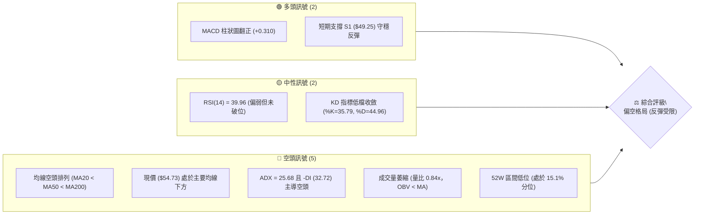

---

### 📊 核心指標速覽表

| 指標類別 | 指標名稱 | 當前數值 | 訊號 | 解讀 |
|:---|:---|:---|:---:|:---|
| **價格** | 當前收盤價 | $54.73 | 🔴 | 位於 52 週區間底部（15.1% 分位），中長期弱勢確立 |
| **均線** | 短期 MA20 | $59.81 | 🔴 | 現價低於 MA20 達 -8.49%，短線反彈面臨動態阻力 |
| **均線** | 中期 MA50 | $64.23 | 🔴 | 現價低於 MA50 達 -14.79%，中期波段趨勢向下走跌 |
| **均線** | 長期 MA200 | $79.84 | 🔴 | 現價低於 MA200 達 -31.45%，牛熊分界線遙遠，長性格局受壓 |
| **動能** | RSI(14) | 39.96 | 🟡 | 位於 30–70 中性偏弱區間，無極端超賣，短線動能溫和回升 |
| **動能** | MACD (12,26,9) | -3.288 / -3.598 | 🟢 | 快慢線處於零軸下方但 MACD 柱狀圖收斂翻正（+0.310） |
| **波動** | ATR(14) | $4.02 | 🔴 | ATR 佔股價高達 7.35%，單日波動劇烈，保證金與風控要求極高 |

---

### 🏆 技術評分卡

```
╔══════════════════════════════════════════════════════════════╗
║                技術評分卡 — RKLB (2026-11-01)                 ║
╠══════════════════════════════════════════════════════════════╣
║ 趨勢強度 (ADX & 方向)   ██████░░░░░░░░░░░░░░  28/100  🔴 空頭主導 ║
║ 動能指標 (RSI & MACD)   █████████░░░░░░░░░░░  46/100  🟡 弱勢反彈 ║
║ 支撐穩定度 (S1 支撐表現) ██████████░░░░░░░░░░  52/100  🟡 考驗支撐 ║
║ 成交量配合 (OBV & 均量) ██████░░░░░░░░░░░░░░  32/100  🔴 量能疲弱 ║
║ 形態完整度 (K線與幾何)  ████████░░░░░░░░░░░░  40/100  🟡 築底雛形 ║
║ 均線排列 (MA 結構分布)  ████░░░░░░░░░░░░░░░░  20/100  🔴 完全空頭 ║
╠══════════════════════════════════════════════════════════════╣
║ 綜合評分 (六項算術平均)  ███████░░░░░░░░░░░░░  36/100  🔴 偏空弱勢 ║
╚══════════════════════════════════════════════════════════════╝
```
> **評分計算**：(28 + 46 + 52 + 32 + 40 + 20) ÷ 6 = 36.33，四捨五入至整數為 **36/100**。

---

## 2. 趨勢分析

### 🌐 多時框趨勢分析

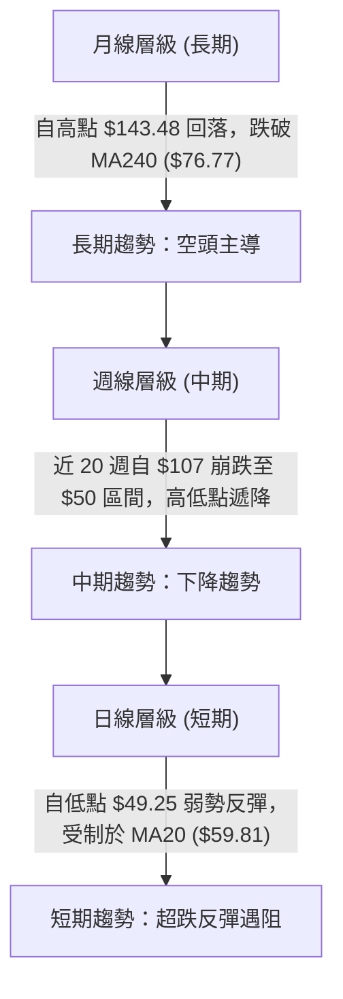

---

### 📈 長期趨勢 — 12個月走勢圖（Unicode）

依據過去 12 個月（2025-11 至 2026-10）每月收盤價繪製走勢軌跡：

```
RKLB 月線走勢圖（過去12個月：2025-11 至 2026-10）
價格軸 ($)
$150 ┤                                      
$140 ┤                                  ● $143.48 (2026-05 歷史高位)
$120 ┤                                 ╱ ╲
$100 ┤                                ╱   ● $101.65 (2026-06)
$80  ┤             ● $80.07          ● $82.51   ╲
$70  ┤       ● $69.76  ╲            ╱             ● $69.68 (2026-09)
$60  ┤        ╲         ● $69.10   ╱               ╲    ● $54.73 ◄ (現價)
$50  ┤         ╲              ╲   ╱                 ● $64.95 (2026-07)
$40  ┤   ● $42.14              ● $64.22
     └─────────────────────────────────────────────────────────────
        11   12   01    02    03   04   05   06   07   08   09   10  (月份)
```

#### 走勢特徵分析表格

| 階段 | 涵蓋月份 | 起訖價格 ($) | 區間漲跌幅 | 結構特徵與技術解讀 |
|:---|:---:|:---:|:---:|:---|
| **啟動突破期** | 2025-11 ~ 2026-01 | $42.14 → $80.07 | +90.01% | 放量突破長期底部，走出強勢單邊推升浪潮 |
| **平台整理期** | 2026-02 ~ 2026-03 | $69.10 → $64.22 | -7.06% | 高檔獲利回吐，於 $64 附近構築中期換手平台 |
| **拋物線拉升** | 2026-04 ~ 2026-05 | $82.51 → $143.48 | +73.89% | 主升浪急拉創下 $151.00 歷史天價，動能嚴重透支 |
| **頭部瓦解期** | 2026-06 ~ 2026-07 | $101.65 → $64.95 | -36.10% | 斷崖式回落，跌破多道短期均線，多頭形態全面破壞 |
| **低位抵抗期** | 2026-08 ~ 2026-10 | $63.92 → $54.73 | -14.38% | 嘗試反彈至 $69.68 受阻，十月再度重挫探至 $49.25 低點 |

---

### 📊 中期趨勢（週線分析）

從近 20 週收盤走勢觀察，自 2026-06-18（收盤 $107.24）以降，週線高點由 $100.46、$82.83、$73.95 逐波降低，低點由 $81.04、$63.91 貫穿至 2026-10-16 的 $50.84（當週低點 $49.69），確立了典型的**下降趨勢通道**。

```
中期週線結構示意圖
$85.00 ┤        ┌───┐ (08/07 高點 $82.83)
$75.00 ┤        │   │       ┌───┐ (09/25 高點 $73.95)
$65.00 ┤ ┌───┐  │   │ ┌───┐ │   │ ┌───┐
$55.00 ┤ │   │  │   │ │   │ │   │ │   │       ┌───┐
$45.00 ┤ │   └──┘   └─┘   └─┘   └─┘   └───┐   │   │ ◄ 現價 $54.73
$35.00 ┤                                   └───┘   └── S1 支撐 $49.25
       └────────────────────────────────────────────────────────
        07/24  08/07 08/28 09/25 10/09 10/16 10/23 10/30
```

---

### ⚡ 趨勢強度評估（ADX 解讀）

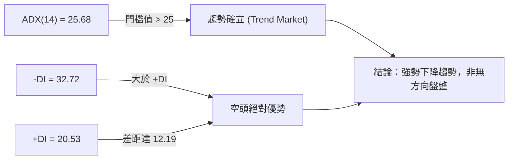

#### ADX 強度對照解析表

| 指標變數 | 當前讀數 | 門檻區間 | 趨勢狀態 | 操作意涵 |
|:---|:---:|:---:|:---:|:---|
| **ADX(14)** | 25.68 | > 25.00 | 強趨勢行進中 | 市場具備明確方向性，震盪指標（如超買超賣）容易鈍化 |
| **+DI (14)** | 20.53 | 多方動能 | 偏弱 | 買盤力道無法主導定價權，反彈難以持續 |
| **-DI (14)** | 32.72 | 空方動能 | 極強 | 空頭控盤力量強勁，任何反彈均面臨主動性拋壓 |
| **方向差離** | -12.19 | -DI 領先 | 負向擴散 | 依據多時框收斂原則，趨勢方向以週線及均線向下為主導 |

---

## 3. 圖表形態分析

### 🔍 形態識別系統

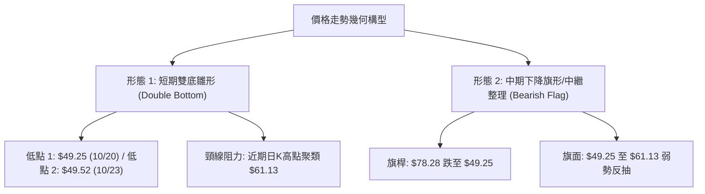

#### 形態識別與信心度評估表

| 形態類別 | 信心度 | 判斷依據（嚴格引用數據） | 完成度 | 形態目標價推算（附精確公式） |
|:---|:---:|:---|:---:|:---|
| **短期雙底雛形** | 55% | 日K於 2026-10-20 低點 $49.25 與 10-23 低點 $49.52 獲得支撐，兩次下探均未破 S1 ($49.25)。 | 60% | 頸線取 10-29 高點 $61.13。形態高度 = 61.13 − 49.25 = 11.88。向上突破目標 = 61.13 + 11.88 = **$73.01**（接近阻力位 R2 $75.28）。 |
| **中期下降旗形** | 68% | 週線於 10-09 至 10-16 連續大幅重挫（旗桿幅度達 $28.59），隨後在低檔縮量橫向反抽，均線呈現空頭壓制。 | 75% | 若跌破旗面下軌 S1 ($49.25)，等長旗桿跌幅 = 49.25 − (78.28 − 49.69) = 49.25 − 28.59 = **$20.66**（低於歷史低點，中途支撐為 S2 **$37.57**）。 |

---

### 🕯️ 重要 K 線形態分析

嚴格依據數據中「近 10 根日K」與「近 8 根週K」之開高低收進行逐一解讀：

#### 近 10 根日K形態精解

| 日期 | 開 | 高 | 低 | 收 | 成交量 | K線形態 | 技術解讀與多空訊號 |
|:---:|:---:|:---:|:---:|:---:|:---:|:---:|:---|
| 2026-10-19 | 52.28 | 52.99 | 51.31 | 51.36 | 17,077,100 | 小黑實體 | 跌勢中繼，空方小幅壓低，下測支撐 🔴 |
| 2026-10-20 | 50.56 | 52.72 | 49.25 | 50.90 | 16,945,200 | 下影線錘頭 | 盤中觸及關鍵 S1 支撐 $49.25 後強烈反彈 🟢 |
| 2026-10-21 | 52.22 | 53.90 | 52.02 | 53.67 | 17,857,800 | 實體中陽線 | 確認 10-20 低檔承接，多頭短線反撲 🟢 |
| 2026-10-22 | 51.67 | 52.98 | 49.96 | 51.22 | 16,674,500 | 陰線包覆 | 再次回測 $50 心理關卡，多方防守轉趨被動 🔴 |
| 2026-10-23 | 50.73 | 52.92 | 49.52 | 52.60 | 13,443,900 | 帶長下影陽線 | 次低點 $49.52 形成二次防守，量縮惜售 🟢 |
| 2026-10-26 | 52.60 | 54.99 | 52.15 | 53.82 | 12,671,100 | 溫和小陽線 | 底部逐漸墊高，延續反彈節奏 🟢 |
| 2026-10-27 | 54.10 | 59.18 | 53.57 | 58.31 | 21,341,400 | 放量長大陽線 | 放量突破短期均線，多頭動能大舉爆發 🟢 |
| 2026-10-28 | 58.49 | 59.30 | 56.94 | 58.60 | 12,404,100 | 高檔十字星 | 逼近 MA20 ($59.81) 遭遇強烈拋壓，多空僵持 🟡 |
| 2026-10-29 | 57.76 | 61.13 | 57.63 | 59.10 | 14,625,800 | 上影線陽線 | 衝高 $61.13 遇阻回落，形成短線波段假突破 🟡 |
| 2026-10-30 | 55.71 | 57.55 | 53.19 | 54.73 | 16,492,600 | 實體黑中陰 | 跳空低開低走，完全吞噬前兩日漲幅，反彈夭折 🔴 |

#### 近 8 根週K形態精解

| 日期 | 開 | 高 | 低 | 收 | 成交量 | K線形態 | 週線格局解讀 |
|:---:|:---:|:---:|:---:|:---:|:---:|:---:|:---|
| 2026-09-11 | 65.27 | 67.70 | 61.53 | 62.95 | 85,204,500 | 下跌長陰 | 承壓 R1 ($67.70)，空頭續跌 🔴 |
| 2026-09-18 | 60.55 | 68.64 | 60.51 | 64.57 | 106,896,200 | 長上影十字 | 衝高回落，高檔套牢賣壓沉重 🟡 |
| 2026-09-25 | 65.29 | 75.46 | 65.28 | 73.95 | 111,511,500 | 大陽線 | 強勢反彈測試 R2 ($75.28) 阻力 🟢 |
| 2026-10-02 | 73.20 | 76.09 | 69.40 | 73.92 | 107,277,600 | 高檔震盪星 | 於 R2 下方受阻，未能向上有效突破 🟡 |
| 2026-10-09 | 73.70 | 78.28 | 66.98 | 68.21 | 104,635,800 | 烏雲蓋頂陰線 | 衝刺 R3 ($78.74) 失敗，主力大舉出貨 🔴 |
| 2026-10-16 | 67.88 | 68.07 | 49.69 | 50.84 | 128,008,200 | 長黑斷頭鍘 | 放量摜破所有中短均線，恐慌盤湧出 🔴 |
| 2026-10-23 | 52.28 | 53.90 | 49.25 | 52.60 | 81,998,500 | 縮量探底陽十字 | 探底 S1 ($49.25) 初步止跌 🟢 |
| 2026-10-30 | 52.60 | 61.13 | 52.15 | 54.73 | 77,535,000 | 帶長上影倒狀陽 | 反彈至 $61.13 遇阻，收盤回落至 $54.73 🔴 |

---

### 📉 ASCII 走勢形態示意圖

```
日線雙底測試與頸線遇阻示意圖
$62.00 ┤                   ┌───┐ (10/29 高點 $61.13 假突破)
$60.00 ┤                   │   │    MA20 阻力 $59.81
$58.00 ┤             ┌───┐ │   │
$56.00 ┤             │   │ │   │    ┌───┐
$54.00 ┤       ┌───┐ │   │ │   └───┐│   │ ◄ 現價 $54.73
$52.00 ┤ ┌───┐ │   │ │   └─┘       │   │
$50.00 ┤ │   └─┘   └─┘             └───┘
$48.00 ┤ └───┴───────────────────────────── S1 強支撐 $49.25 (10/20 & 10/23 雙底)
       └───────────────────────────────────
         10/20 10/21 10/23 10/27 10/29 10/30
```

---

## 4. 支撐與阻力

### 🗺️ 關鍵價位分布圖（Unicode）

```
╔══════════════════════════════════════════════════════════════╗
║               RKLB 關鍵價位結構分布圖 (OHLCV)                ║
╠══════════════════════════════════════════════════════════════╣
║ $78.74 ║██████████████████████████████║ 強阻力 R3 (波段高點)  ║
║ $75.28 ║████████████████████████      ║ 次阻力 R2 (反彈高點)  ║
║ $67.70 ║████████████████████          ║ 關鍵阻力 R1 (頸線壓力) ║
║ $61.84 ║▓▓▓▓▓▓▓▓▓▓▓▓▓▓▓▓▓▓            ║ 斐波那契 78.6% 回調位 ║
║ $59.81 ║░░░░░░░░░░░░░░░░              ║ 布林中軌 / MA20       ║
║──────────────────────────────────────────────────────────────║
║ $54.73 ╠══════════════════════════════╣ ◄ 現價 (Current Close)║
║──────────────────────────────────────────────────────────────║
║ $49.25 ║▓▓▓▓▓▓▓▓▓▓▓▓▓▓▓▓              ║ 近期波段關鍵支撐 S1   ║
║ $43.69 ║░░░░░░░░                      ║ 布林通道下軌          ║
║ $37.57 ║██████████████████████████████║ 52週低點 / 終極支撐 S2║
╚══════════════════════════════════════════════════════════════╝
```

---

### 🚧 阻力位分析表

依據系統 OHLCV 聚類計算之阻力位分析如下：

| 阻力級別 | 價位 ($) | 距現價幅度 | 形成原因與籌碼屬性 | 突破難度 | 技術重要性 |
|:---|:---:|:---:|:---|:---:|:---:|
| **R1** | $67.70 | +23.70% | 2026-09-11 週K高點、前期平台成交密集區破位頸線 | 極高 | ★★★★☆ |
| **R2** | $75.28 | +37.56% | 2026-09-25 及 10-02 週K高點聚類，下降旗形上軌反壓 | 極高 | ★★★★★ |
| **R3** | $78.74 | +43.88% | 2026-10-09 週K高點，此波段主跌浪起跌點，重度套牢區 | 極堅固 | ★★★★★ |

---

### 🛡️ 支撐位分析表

依據系統 OHLCV 聚類計算之支撐位分析如下：

| 支撐級別 | 價位 ($) | 距現價幅度 | 形成原因與籌碼屬性 | 守住機率 | 技術重要性 |
|:---|:---:|:---:|:---|:---:|:---:|
| **S1** | $49.25 | -10.01% | 2026-10-20 與 10-23 連續兩次日K回踩低點聚類，短線底線 | 60% | ★★★★☆ |
| **S2** | $37.57 | -31.35% | 52 週最低點（100.0% 斐波那契回調位），長線牛熊分水嶺 | 80% | ★★★★★ |
| **S3** | N/A | N/A | 數據中未偵測到 | N/A | N/A |

---

### 📐 斐波那契回調位分析

依據 52 週極值區間（低點 $37.57 至 高點 $151.00）計算之回調位如下：

| 分割比例 (%) | 價位 ($) | 距現價幅度 | 當前技術結構意涵 |
|:---:|:---:|:---:|:---|
| **0.0%** (52W High) | $151.00 | +175.90% | 歷史頂部，拋物線主升浪終結點 |
| **23.6%** | $124.23 | +127.00% | 第一回檔位，前期強勢支撐轉阻力 |
| **38.2%** | $107.67 | +96.73% | 弱勢修正極限位，跌破確認波段轉空 |
| **50.0%** | $94.28 | +72.26% | 多空平衡中軸，目前處於其下方極遠處 |
| **61.8%** | $80.90 | +47.82% | 黃金分割關鍵反壓位（與 MA200 $79.84 共振） |
| **78.6%** | $61.84 | +12.99% | 深幅回調位，現價上行第一道多空決戰關卡 |
| **100.0%** (52W Low) | $37.57 | -31.35% | 基礎起漲點，若跌破意味著整輪兩年多頭行情歸零 |

> **回調狀態解析**：現價 **$54.73** 目前嚴格運行於 **78.6% ($61.84)** 與 **100.0% ($37.57)** 之間。當股價跌破 61.8% 且無法收復 78.6% 時，在斐波那契理論中屬於「極弱勢折返」，意味著該標的已完全喪失主升段動能，後續大概率在低位區間震盪探底。

---

## 5. 技術指標深度解讀

### 🎛️ 指標訊號總覽

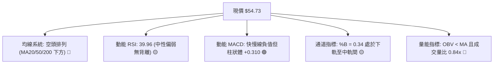

---

### 📈 移動平均線排列分析

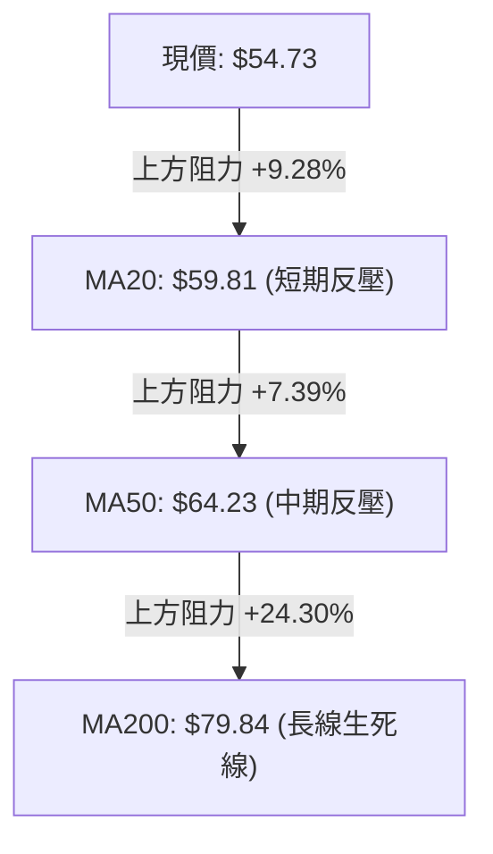

#### 各期移動平均線狀態表

| 均線名稱 | 數值 ($) | 乖離率 (%) | 均線斜率與走勢特徵 | 訊號評估 |
|:---|:---:|:---:|:---|:---:|
| **MA 5** | $56.91 | -3.83% | 短線下彎，近三日反彈夭折導致 MA5 重新走低 | 🔴 空頭 |
| **MA 10** | $54.43 | +0.55% | 走平微升，現價勉強維持在 MA10 之上 | 🟡 中性 |
| **MA 20** | $59.81 | -8.49% | 持續向下傾斜，構成日線級別首要反彈動態強阻力 | 🔴 空頭 |
| **MA 50** | $64.23 | -14.79% | 陡峭向下，中期空頭防線，與 R1 形成壓制區間 | 🔴 空頭 |
| **MA 60** | $66.76 | -18.02% | 穩定下行，中期趨勢徹底破壞 | 🔴 空頭 |
| **MA 120** | $82.47 | -33.64% | 斷崖下傾，上方堆積龐大套牢籌碼 | 🔴 空頭 |
| **MA 200** | $79.84 | -31.45% | 牛熊分界線失守，長期走勢進入熊市週期 | 🔴 空頭 |
| **MA 240** | $76.77 | -28.71% | 兩年線下行，中長期價值型買盤停滯 | 🔴 空頭 |

---

### 📉 RSI(14) 分析

```
RSI(14) 數值展示：39.96
0 ──────────── 30 ───────[39.96]─────── 70 ─────────── 100
[ 超賣區間 ]   │     🟡 中性偏弱區間     │   [ 超買區間 ]
▓▓▓▓▓▓▓▓▓▓▓▓▓▓░░░░░░░░░░░░░░░░░░░░░░░░░░░░░░░░░░░░░░░░░░
```

- **區間評估**：RSI(14) 為 39.96，脫離了 10-16 當週的恐慌極端超賣區（週 RSI 25.4），目前進入 30–50 的空頭修復區間。
- **背離診斷**：依據系統比對近 20 根 K 棒之首尾價格與 RSI 軌跡，當前**無明顯背離**（價格探底回升，RSI 同步自低位 25 附近抬升至 40，屬於同向變動）。缺乏底背離架構，意味著反彈僅為技術性跌深修復，而非大級別底部反轉。

---

### 📊 MACD(12/26/9) 訊號解讀

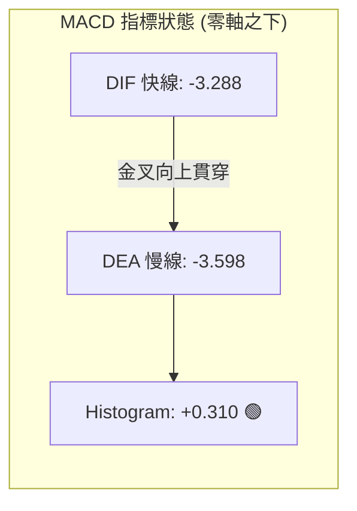

- **數值分析**：DIF (-3.288) 雖然自低檔由下向上穿越 DEA (-3.598)，帶動柱狀圖由負轉正至 **+0.310**，但兩者仍處於 **零軸（0.00）深處下方**。
- **技術意義**：零軸下的金叉屬於典型的「水下金叉」，通常定義為空頭市場中的弱勢抵抗或次級反彈。若無後續強勁量能推動快慢線向零軸靠攏，一旦柱狀圖翻黑，極易誘發新一輪「水下死叉」加速下跌。

---

### 📦 布林通道分析

```
布林通道 (20, 2) 結構示意圖
$75.92 ┤  上軌 (Upper Band)
       │  
$59.81 ┼──中軌 (MA20 / Middle Band) ─────────────
       │                                     
$54.73 ┤  ● 現價 (Close = $54.73, %B = 0.34)
       │  
$43.69 ┤  下軌 (Lower Band)
       └────────────────────────────────────────
```

- **軌道指標**：上軌 **$75.92**，中軌 **$59.81**，下軌 **$43.69**，通道寬度高達 $32.23。
- **定位分析**：%B 指標當前為 **0.34**（0 為下軌，0.5 為中軌，1 為上軌）。現價運行於中下軌之間，顯示股價依然處於弱勢空頭常態分佈，短線反彈首要考驗便是回測中軌（$59.81）之反壓。

---

### 💹 成交量分析（量價配合度）

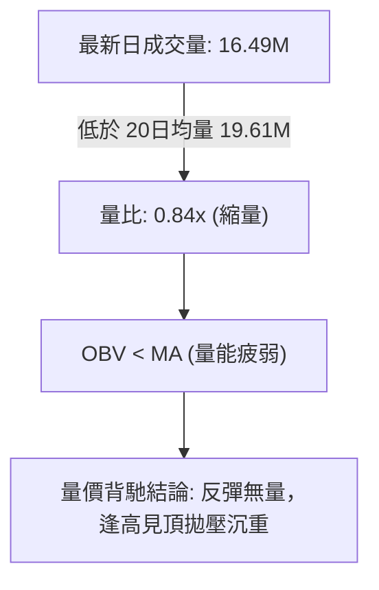

- **量價行為分析**：
  1. 在 10-27 出現 21.34M 之放量長陽後，隨後三日（10-28 至 10-30）股價衝高回落，成交量萎縮至 12.4M~16.4M，呈現「價漲量縮、價跌量增」的弱勢格局。
  2. 累計能量線（OBV）持續運行於移動平均線之下，顯示聰明資金在反彈過程中以調節減碼為主，並無持續性的機構資金大舉建倉回補。

---

## 6. 動能與波動率

### ⚡ 動能評估四象限

| 象限分區 | 動能特性 | 波動率特性 | 當前市場狀態判定 | 操作應對策略 |
|:---:|:---:|:---:|:---:|:---|
| **第一象限 (Q1)** | 強動能 (多頭) | 低波動 (穩定) | — | 最佳趨勢持有階段，順勢做多 |
| **第二象限 (Q2)** | 弱動能 (無力) | 低波動 (收斂) | — | 窄幅盤整，等待突破方向確認 |
| **第三象限 (Q3)** | 強動能 (加速) | 高波動 (激進) | — | 突破單邊趨勢，追逐高風險回報 |
| **第四象限 (Q4)** | **弱動能 (空頭)** | **高波動 (劇烈)** | **✓ RKLB 當前落點** | **空頭主導且高風險，嚴格控制倉位，以防守或逢高沽空為主** |

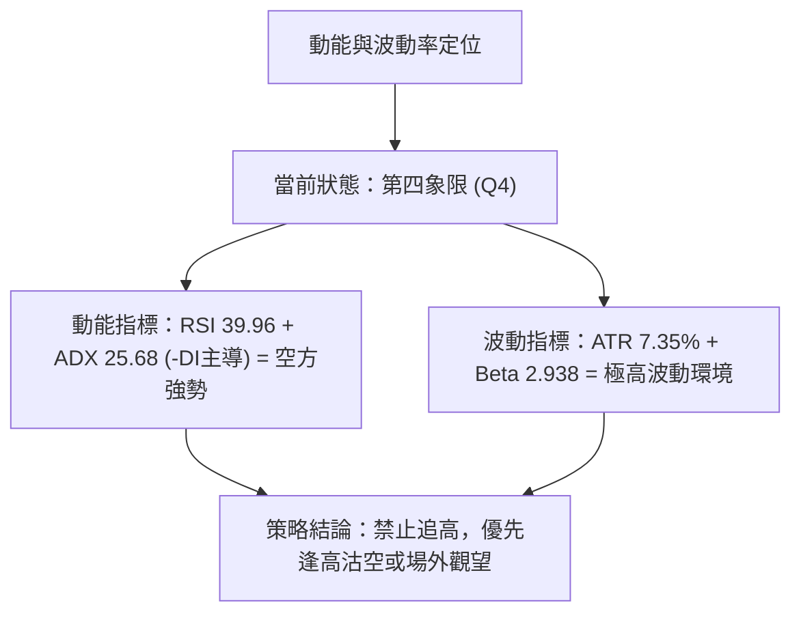

---

### 📊 ATR 波動率分析

- **ATR(14) 讀數**：**$4.02**（佔現價比率達 **7.35%**，Wilder 平滑計算）。
- **單日波動範圍預估**：
  - 正常單日波動區間：$54.73 ± $4.02 → **$50.71 至 $58.75**。
- **風控止損距離指導**：
  - 由於高達 7.35% 的日波幅，任何日內或短線交易若止損設定小於 1.5 倍 ATR（約 $6.03），極易遭遇正常市場雜訊洗盤出局。
  - 穩健止損距離應至少設置在 **1.5 至 2.0 倍 ATR**（$6.03 ~ $8.04），對應倉位規模必須相應縮小以匹配風控總額。

---

### 📐 Beta 與市場相關性

- **Beta 係數**：**2.938**（極高系統性風險敞口）。
- **技術解讀**：
  - RKLB 相對標普 500 指數具備近 **3 倍**的波動彈性。在大盤處於回檔週期時，其下行殺傷力會被顯著放大；反之，若大盤出現強力反彈，該股亦具備強烈的空頭回補脈衝。
  - 機構持股比例為 62.5%，內部人持股僅 0.8%，且空頭持倉佔流通盤達 7.6%（Short Ratio 2.0），顯示籌碼結構高度機構化，但在下行趨勢中極易誘發機構止損賣壓的踩踏效應。

---

## 7. 多時框架總結

### 📋 時框架評分表

| 時框架 | 趨勢方向 | 動能表現 | 均線排列 | 形態結構 | 綜合評分 | 建議方針 |
|:---:|:---:|:---:|:---:|:---:|:---:|:---|
| **月線 (長期)** | 🔴 下行空頭 | RSI 弱勢，脫離高檔 | 跌破 MA240 ($76.77) | 主升浪結束，向下尋求 52W 底 | 30/100 | 長期投資者減碼避險 |
| **週線 (中期)** | 🔴 下降通道 | MACD 零軸下收斂 | 空頭排列 (MA20/50/200 下) | 下降旗形，受阻於 R1/R2 | 35/100 | 順勢操作，逢反彈沽空 |
| **日線 (短期)** | 🟡 弱勢反彈 | MACD 柱狀翻正，RSI 40 | 承壓 MA20 ($59.81) | 雙底測試 S1 ($49.25) 後反抽 | 45/100 | 短線超跌交易者嚴格止損 |

---

### 🔲 綜合訊號矩陣

```
╔══════════════════════════════════════════════════════════════╗
║                   多時框訊號一致性收斂矩陣                   ║
╠══════════════════════════════════════════════════════════════╣
║ 維度         短期 (日線)        中期 (週線)        長期 (月線) ║
╠══════════════════════════════════════════════════════════════╣
║ 趨勢方向     🟡 跌深反抽        🔴 破位下行        🔴 高位退潮 ║
║ 均線壓制     🔴 受阻 MA20       🔴 受阻 MA50       🔴 破 MA240 ║
║ 動能狀態     🟢 MACD柱翻紅      🔴 -DI 絕對主導    🔴 動能衰退 ║
║ 量價關係     🔴 反彈縮量        🔴 崩跌放量        🔴 籌碼鬆動 ║
║ 一致性判定   日線短多與中長期長空格局發生嚴重背馳            ║
╚══════════════════════════════════════════════════════════════╝
```

---

### ⚖️ 多時框收斂結論

依據多時框收斂優先級規則：
1. **趨勢/盤整判定**：當前 ADX(14) = **25.68 > 25.00**，且 -DI (32.72) 遠高於 +DI (20.53)，技術結構**明確定義為趨勢行情（空頭主導之單邊下降趨勢）**，而非無方向的盤整震盪。
2. **時框優先取捨**：依規則，當處於趨勢行情時，**必須以中長期（週線、MA50、MA200）之方向為主導**，日線級別的指標反彈（如日 MACD 柱狀翻正、雙底雛形）僅能視為「次級折返走勢（Counter-trend Rally）」，主要功用在於尋找高勝率的逢高進場沽空點位，絕不可逆向做長線多頭佈局。
3. **唯一方向性結論**：**偏空（Bearish）**。整體技術評分卡得分為 **36/100**，第 8 章之交易策略嚴格錨定為**主推空頭策略**。

---

## 8. 交易策略建議

### 🗺️ 策略決策流程圖

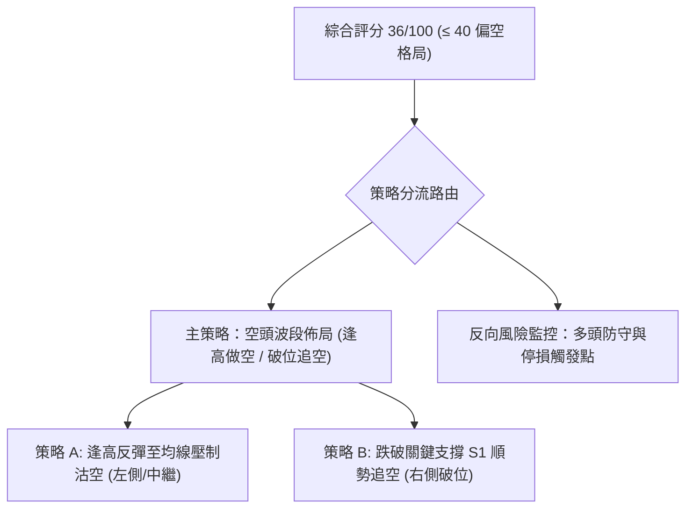

---

### 🧭 策略路由

> **當前主策略方向 = 偏空（依評分 36/100）**  
> 依據技術評分卡綜合評分 36 分（≤ 40），本報告主推**空頭做空策略**。多頭進場僅作為反轉風險提示與對沖參考，嚴禁在主要阻力位下方盲目抄底。

---

### 🎯 價格情境階梯（Price Scenarios）

以現價 **$54.73** 為基準，嚴格引用第 4 章之關鍵價位構建情境階梯：

| 觸發條件 | 下一目標 | 後續延伸 | 情境技術含義與應對方針 |
|:---|:---:|:---:|:---|
| **強勢向上突破 R1 ($67.70)** | R2 ($75.28) | R3 ($78.74) | 空頭結構被階段性破壞，空單必須全數止損離場 |
| **反彈受阻於 MA20 ($59.81)** | S1 ($49.25) | S2 ($37.57) | 弱勢反彈遇阻，最佳加碼沽空窗口 |
| **跌破關鍵支撐 S1 ($49.25)** | 布林下軌 ($43.69) | S2 ($37.57) | 下降旗形完成跌破，主跌浪重啟，右側追空信號 |
| **貫穿終極支撐 S2 ($37.57)** | 下方無數據支撐 | 自由落體探底 | 52 週低點失守，中長線恐慌崩盤 |

---

### 📊 情境機率分佈

| 情境類型 | 發生機率 | 主要技術依據 |
|:---|:---:|:---|
| **回落 / 再探底 (主情境)** | **55%** | 均線完全空頭排列、-DI (32.72) 強勢壓制、OBV 持續低迷、日線出現假突破長上影線 |
| **區間震盪整理 (次情境)** | **30%** | S1 ($49.25) 具備雙底支撐力道，日 MACD 柱狀翻正形成短期下檔支撐 |
| **強勢反轉上行 (極端情境)** | **15%** | 需放量站穩 MA20 ($59.81) 並向上長紅突破 R1 ($67.70)，目前量能條件顯著不具備 |

---

### 🟢 主策略詳情（方向：做空主導）

依據規範，所有進場點、目標價、止損點均嚴格引用系統計算之 S/R 價位或關鍵均線數值：

| 策略要素 | 策略 A（反彈至阻力沽空） | 策略 B（跌破支撐追空） |
|:---|:---|:---|
| **策略邏輯** | 逢反彈測試布林中軌 / MA20 受阻時建立空單 | 跌破雙底防線 S1 後順勢建立右側破位空單 |
| **進場條件** | 盤中反抽逼近 MA20 ($59.81) 出現滯漲倒狀 K 線 | 日K收盤價實體有效跌破 S1 ($49.25) |
| **進場價格** | **$59.81**（MA20 / 布林中軌） | **$49.25**（S1 關鍵支撐破位點） |
| **目標價 T1** | **$49.25**（S1 關鍵波段低點） | **$37.57**（S2 / 52週歷史低點） |
| **目標價 T2** | **$37.57**（S2 / 52週歷史低點） | N/A（數據中未偵測到 S3，以 T1 結清） |
| **止損價格** | **$64.23**（MA50 中期均線阻力上方） | **$54.73**（當前收盤價 / 跌破前平台頸線） |
| **風險報酬比** | **1 : 2.39（以 T1 計）**<br>*(計算: (59.81 - 49.25) ÷ (64.23 - 59.81) = 10.56 ÷ 4.42)*<br>另計 T2 為 **1 : 5.03（以 T2 計）** | **1 : 2.13（以 T1 計）**<br>*(計算: (49.25 - 37.57) ÷ (54.73 - 49.25) = 11.68 ÷ 5.48)* |
| **成功機率** | 65% | 55% |
| **建議倉位** | 總資產之 10% ~ 15% | 總資產之 5% ~ 8% |

---

### 🔴 反向風險觸發點（對沖提示）

若市場出現以下情況，意味著空頭結構被破壞，需立即啟動風控：
1. **多頭反轉預警點**：股價放量長紅收復 **MA20 ($59.81)** 並收於其上，且日成交量放大超過 20 日均量（> 19.61M）。
2. **空頭全數止損線**：若向上貫穿 **R1 ($67.70)**，下降通道徹底破位反轉，所有空單必須無條件止損出局，空倉觀望。

---

### ⭐ 整體訊號強度評星

```
做多訊號強度：★☆☆☆☆  (1.5/5星 — 僅屬嚴重超跌引發的技術性微弱反抽)
做空訊號強度：★★★★☆  (4.0/5星 — 均線與趨勢指標高度共振偏空)
整體可信度：  ★★★★☆  (4.0/5星 — 趨勢明確，ADX 確立單邊下行結構)
```

---

## 9. 風險提示與監控

### ✅ 關鍵監控指標 Checklist

```
╔══════════════════════════════════════════════════════════════╗
║               交易員每日風控監控清單 (Checklist)               ║
╠══════════════════════════════════════════════════════════════╣
║ [ ] 價格是否跌破 S1 ($49.25)？── 若破位，啟動策略 B 追空流程    ║
║ [ ] 價格是否觸及 MA20 ($59.81)？── 若受阻，啟動策略 A 沽空佈局  ║
║ [ ] 日成交量是否超越 20日均量 (19.61M)？── 觀察放量方向決定加減碼║
║ [ ] RSI(14) 是否跌破 30 進入超賣？── 防範極端超賣引發空頭踩踏回補║
║ [ ] MACD 柱狀圖是否翻黑 (< 0)？── 若翻黑，宣告反彈正式夭折      ║
║ [ ] 財報發布日（2026-11-09）逼近 ── 財報前三天強制降低倉位至半倉 ║
╚══════════════════════════════════════════════════════════════╝
```

---

### ⚠️ 風險場景分析

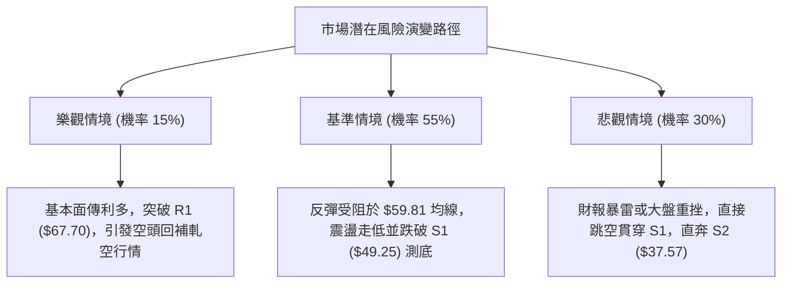

---

### 🛡️ 風險管理重要提醒

1. **極端波動風險（ATR 高達 7.35%）**：
   - RKLB 每日隱含波幅高達 **$4.02**，日內波動極其劇烈。做空交易必須嚴格控制槓桿，單筆交易虧損額度不得超過總帳戶淨值的 **1.0% ~ 1.5%**。
2. **高 Beta 系統性風險（Beta = 2.938）**：
   - 該股對美股大盤高度敏感，若納斯達克指數出現強勁反彈，RKLB 空頭部位極易面臨劇烈的軋空風險（Short Squeeze，目前空頭比率達 7.6%）。
3. **重大事件風險（Earnings Event）**：
   - 新聞顯示 Rocket Lab 將於 **2026-11-09** 公布最新 Q3 財報。歷史數據顯示航太科技股財報日跳空幅度常超過 15%~20%，強烈建議所有技術面波段策略在財報公布前 24 小時結清至少 70% 倉位，避免承擔不可控的隔夜跳空風險。

---

## 📋 報告總結

```
╔══════════════════════════════════════════════════════════════╗
║                    RKLB 技術分析報告總結                     ║
╠══════════════════════════════════════════════════════════════╣
║ 報告日期：2026-11-01                                         ║
║ 當前價格：$54.73                                             ║
║ 分析評級：🔴 偏空弱勢（技術評分：36/100）                     ║
║                                                              ║
║ 關鍵結論：                                                   ║
║ ├─ 長期趨勢：🔴 空頭主導，跌破兩年線 MA240，高點大幅回落     ║
║ ├─ 中期趨勢：🔴 下降通道，均線呈現完全空頭排列 (MA20<50<200)║
║ ├─ 短期趨勢：🟡 跌深弱勢反彈，受制於 MA20 ($59.81) 反壓      ║
║ ├─ 關鍵支撐：S1: $49.25 ｜ S2: $37.57 ｜ S3: 數據中未偵測到 ║
║ ├─ 關鍵阻力：R1: $67.70 ｜ R2: $75.28 ｜ R3: $78.74          ║
║ └─ 分析師目標價：均值 $102.15 (最低 $64.00 / 最高 $150.00)   ║
║                                                              ║
║ 最優策略組合：                                               ║
║ 1. 🥇 最佳機會：策略 A — 反彈至 MA20 ($59.81) 遇阻沽空，      ║
║                  止損 $64.23，目標 S1 $49.25 (風報比 1:2.39) ║
║ 2. 🥈 次選機會：策略 B — 跌破 S1 ($49.25) 順勢追空，          ║
║                  止損 $54.73，目標 S2 $37.57 (風報比 1:2.13) ║
║ 3. 🥉 保守選擇：場外完全空倉觀望，靜待 11-09 財報後方向明朗  ║
╚══════════════════════════════════════════════════════════════╝
```

---

> ⚠️ **免責聲明**：本報告為 AI 自動生成之技術分析，所有數據及估算均基於提供的歷史價格資訊。本報告**僅供研究與學術參考**，**不構成任何投資建議**。投資有風險，入市需謹慎。

---
*報告生成時間：2026-11-01 ｜ 數據來源：Yahoo Finance ｜ 分析框架：多時框技術分析*