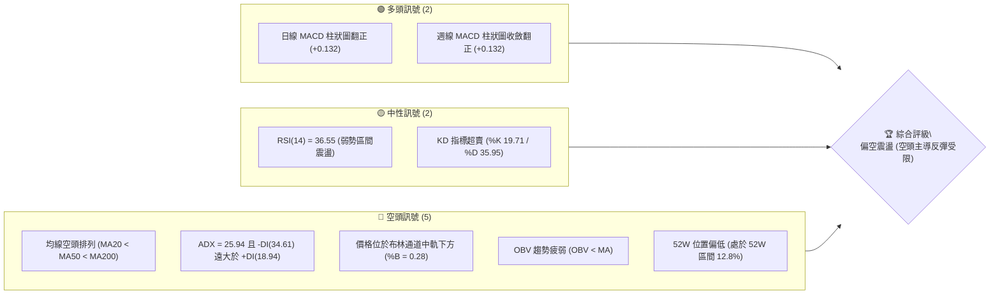
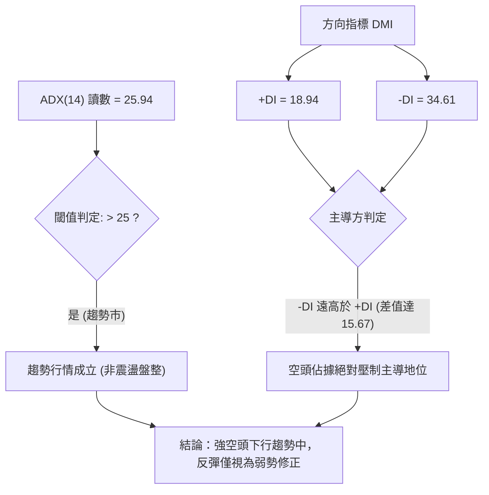
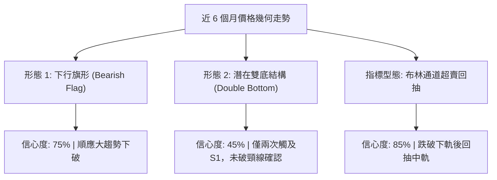
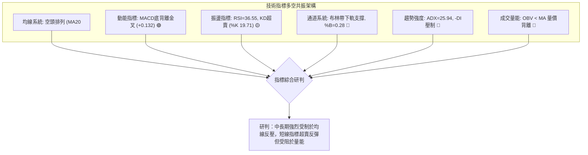
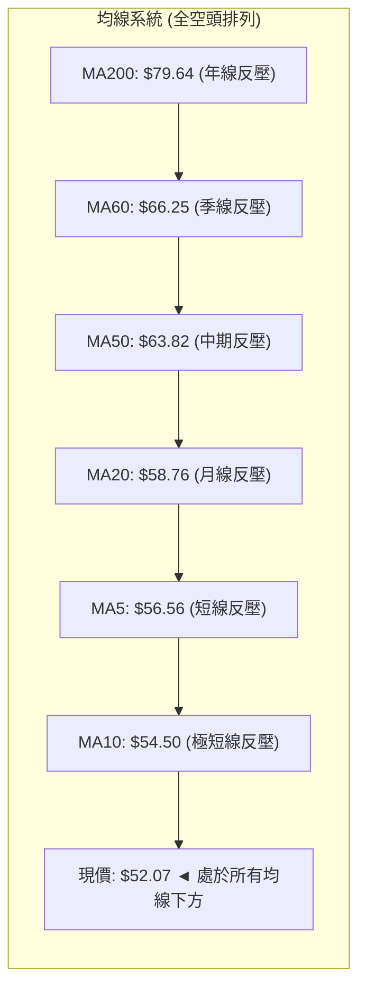
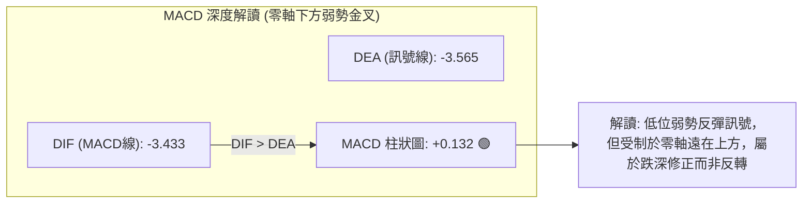
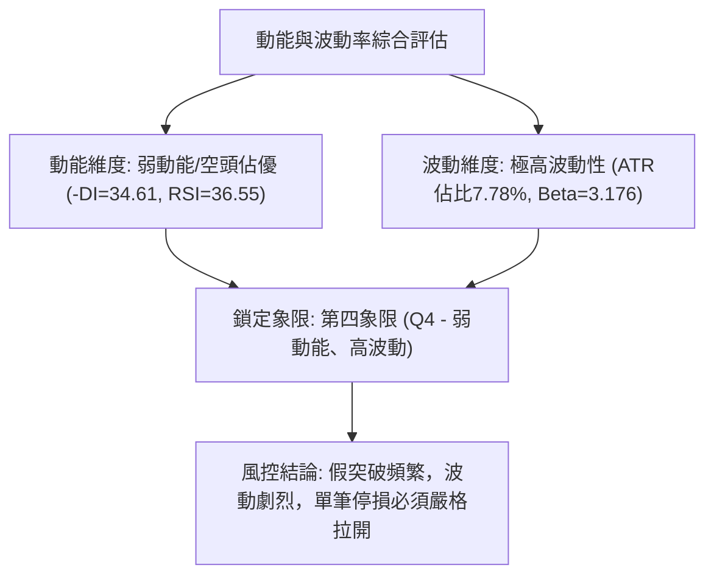
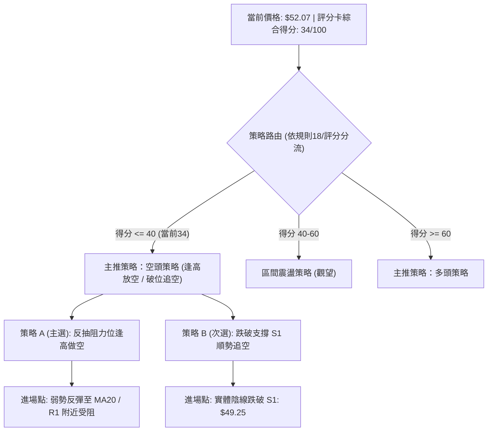
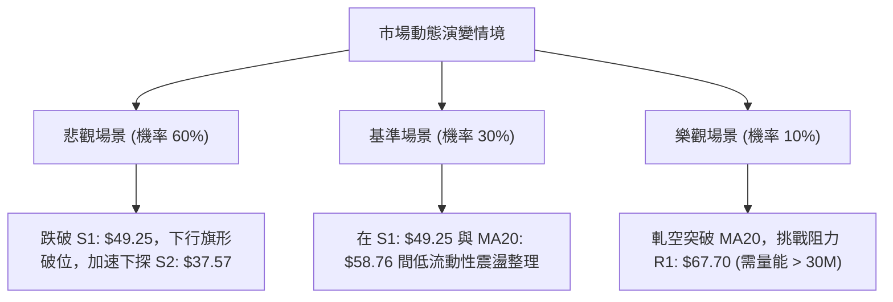

# RKLB 技術分析報告

> **報告日期**：2026-11-03 ｜ **語言**：繁體中文 ｜ **數據來源**：Yahoo Finance ｜ **當前價格**：$52.07

---

## 目錄

| 章節 | 內容 |
|------|------|
| [1. 技術面概覽](#1-技術面概覽) | 訊號儀表板、核心指標、評分卡 |
| [2. 趨勢分析](#2-趨勢分析) | 多時框趨勢、長中短期走勢、ADX強度 |
| [3. 圖表形態分析](#3-圖表形態分析) | 形態識別、K線組合、目標價推算 |
| [4. 支撐與阻力](#4-支撐與阻力) | 關鍵價位結構、斐波那契回調 |
| [5. 技術指標深度解讀](#5-技術指標深度解讀) | MA/RSI/MACD/布林/成交量量價背離 |
| [6. 動能與波動率](#6-動能與波動率) | 動能四象限、ATR風控、高Beta分析 |
| [7. 多時框架總結](#7-多時框架總結) | 時框矩陣、多時框收斂唯一結論 |
| [8. 交易策略建議](#8-交易策略建議) | 策略路由、主策略詳情、精確風報比 |
| [9. 風險提示與監控](#9-風險提示與監控) | 監控Checklist、三情境演繹、倉位風控 |
| [📋 報告總結](#-報告總結) | 儀表板總結、最優策略清單 |

---

## 1. 技術面概覽

### 🎯 技術訊號儀表板



### 📊 核心指標速覽表

| 指標類別 | 指標名稱 | 當前數值 | 訊號 | 解讀 |
|----------|----------|----------|------|------|
| **價格** | 當前收盤價 | $52.07 | 🔴 | 位於52週高低區間底部12.8%，空頭下行趨勢顯著 |
| **均線** | MA20 (月線) | $58.76 | 🔴 | 現價低於MA20達 -11.38%，短線承壓 |
| **均線** | MA50 (季線) | $63.82 | 🔴 | 現價低於MA50達 -18.41%，中期下行趨勢未變 |
| **均線** | MA200 (年線)| $79.64 | 🔴 | 現價低於MA200達 -34.62%，長期空頭主導 |
| **動能** | RSI(14) | 36.55 | 🟡 | 位於30–70中性偏弱區，近20根K棒無明顯背離 |
| **動能** | MACD (12,26,9) | -3.433 / -3.565 | 🟢 | 柱狀圖為 +0.132，出現低位弱勢金叉反彈訊號 |
| **動能** | KD(14,3,3) | %K: 19.71 / %D: 35.95 | 🟡 | 進入20以下超賣區，存在短線技術性抽頭修復需求 |
| **趨勢** | ADX(14) / DMI | ADX: 25.94, -DI: 34.61 | 🔴 | ADX>25為強趨勢，-DI強烈壓制+DI(18.94)，空方完全主導 |
| **波動** | 布林通道 (%B) | %B: 0.28 (下軌 $43.56) | 🔴 | 運行於中軌($58.76)與下軌($43.56)之間偏下弱勢區 |
| **波動** | ATR(14) | $4.05 | 🔴 | 日波幅佔股價7.78%，波動極高，風險敞口較大 |
| **量能** | 20日均量 / 量比 | 16.38M / 0.84x | 🔴 | 反彈與下殺量能不足，OBV < MA 量能整體渙散 |

### 🏆 技術評分卡

```
╔══════════════════════════════════════════════════════════════╗
║                技術評分卡 — RKLB (2026-11-03)                ║
╠══════════════════════════════════════════════════════════════╣
║ 趨勢強度 (ADX=25.94, -DI主導)    ██████░░░░░░░░░░░░░░  30/100 🔴 ║
║ 動能指標 (MACD翻正, KD超賣)      █████████░░░░░░░░░░░  45/100 🟡 ║
║ 支撐穩定度 (S1=$49.25守住邊緣)    ████████░░░░░░░░░░░░  40/100 🟡 ║
║ 成交量配合 (OBV疲弱, 縮量反彈)   ██████░░░░░░░░░░░░░░  30/100 🔴 ║
║ 形態完整度 (破位下行旗形整理)    ████████░░░░░░░░░░░░  40/100 🟡 ║
║ 均線排列 (MA20<MA50<MA200空排)   ████░░░░░░░░░░░░░░░░  20/100 🔴 ║
╠══════════════════════════════════════════════════════════════╣
║ 綜合評分 (六項算術平均：34.17)   ███████░░░░░░░░░░░░░  34/100 🔴 ║
║ 評級結論：偏空 (空頭主導，反彈缺乏量能，嚴格風控)             ║
╚══════════════════════════════════════════════════════════════╝
```
*註：綜合評分 = (30 + 45 + 40 + 30 + 40 + 20) ÷ 6 = 34.17，四捨五入為 34/100（依規則 18）。*

---

## 2. 趨勢分析

### 🌐 多時框趨勢分析

```mermaid
graph TD
    A["月線框架 (長期)"] -->|"2026-05見頂$143.48後連續大跌，處於破位深幅調整"| B["長期趨勢：強烈空頭 🔴"]
    C["週線框架 (中期)"] -->|"自$82.83滑落至$50.84尋求支撐，均線全面下彎"| D["中期趨勢：空頭下行 🔴"]
    E["日線框架 (短期)"] -->|"觸及$49.25後弱勢反彈至$61.13再遇阻回落$52.07"| F["短期趨勢：低位盤整偏空 🔴"]
    B --> G{"多時框收斂結論"}
    D --> G
    F --> G
    G -->|"ADX("14")=25.94 進入趨勢行情，空方絕對佔優"| H["主導趨勢：偏空下行，逢高放空為主"]
```

### 📈 長期趨勢 — 12個月走勢圖（Unicode）

```
RKLB 月線收盤走勢圖（過去 12 個月：2025-12 至 2026-11）
價格軸 ($)
$150 ┤                                      
$140 ┤                             ● (2026-05: $143.48 高點)
$130 ┤                            ╱ ╲
$120 ┤                           ╱   ╲
$110 ┤                          ╱     ╲
$100 ┤                         ╱       ● (2026-06: $101.65)
 $90 ┤                        ╱         ╲
 $80 ┤     ●                 ●           ╲
     ┤ (2026-01: $80.07)    (04: $82.51)  ╲
 $70 ┤  ●       ●           ╱              ╲       ● (09: $69.68)
     ┤(12:69.76)(02:69.10) ╱                ●     ╱ ╲
 $60 ┤             ●      ╱             (07:64.95)   ● (10: $54.73)
     ┤           (03:64.22)                          ╲
 $50 ┤                                                ●←現價 (11: $52.07)
 $40 ┤                                                 
     └─┬────┬────┬────┬────┬────┬────┬────┬────┬────┬────┬────
     12月  01月 02月 03月 04月 05月 06月 07月 08月 09月 10月 11月
     2025                       2026
```

#### 長期走勢特徵分析表格

| 階段時間 | 起始價 → 結束價 | 漲跌幅 | 趨勢性質 | 核心特徵與成交結構 |
|----------|-----------------|--------|----------|--------------------|
| **2025-12 ~ 2026-01** | $69.76 → $80.07 | +14.78% | 主升段上推 | 突破平台，成交量持續放大 |
| **2026-01 ~ 2026-03** | $80.07 → $64.22 | -19.79% | 高位洗盤回踩 | 季線位置獲得支撐，呈現高波動整理 |
| **2026-03 ~ 2026-05** | $64.22 → $143.48| +123.42%| 拋物線噴發 | 觸及 52W 高點 $151.00，動能指標嚴重超買背離 |
| **2026-05 ~ 2026-07** | $143.48 → $64.95| -54.73% | 斷崖式暴跌 | 高位籌碼徹底派發，下破 MA20 及 MA50 |
| **2026-07 ~ 2026-09** | $64.95 → $69.68 | +7.28%  | 平台反彈弱構 | 兩次反抽 $70–$80 區間無果，構築中期派發平台 |
| **2026-09 ~ 2026-11** | $69.68 → $52.07 | -25.27% | 二次下破探底 | 跌破 $60 平台，探至波段低點 $49.25，目前於低檔徘徊 |

### 📊 中期趨勢（週線分析）

從近 20 週收盤走勢分析，股價自 2026-07-02 高點 $100.46 下殺至 2026-10-16 的 $50.84，隨後於 $50–$55 窄幅整理。

```
RKLB 中期週線壓力與支撐示意圖
══════════════════════════════════════════════════════════════
 $78.74 ────────────────────────────────────────── 阻力 R3 (波段頂部)
 $75.28 ────────────────────────────────────────── 阻力 R2 (反彈高點)
 $67.70 ────────────────────────────────────────── 阻力 R1 (週K密集阻力帶)
 $58.76 ┄ ┄ ┄ ┄ ┄ ┄ ┄ ┄ ┄ ┄ ┄ ┄ ┄ ┄ ┄ ┄ ┄ ┄ ┄ ┄ ┄  MA20 動態反壓
 $52.07 ══════════════════════════════════════════ 現價位置
 $49.25 ────────────────────────────────────────── 支撐 S1 (近期雙重底波段低點)
 $37.57 ────────────────────────────────────────── 支撐 S2 (52W歷史低點)
══════════════════════════════════════════════════════════════
```

### ⚡ 趨勢強度評估（ADX 解讀）



#### ADX 強度對照與解讀表

| 指標變量 | 數值 | 狀態區間 | 技術解讀 |
|----------|------|----------|----------|
| **ADX(14)** | **25.94** | 25 – 50 (強趨勢) | 突破 25 臨界線，確認當前走出盤整，進入明確方向性趨勢行情 |
| **+DI** | **18.94** | 疲弱多頭 (< 20) | 多方缺乏主動推升動能，市場買盤意願低落 |
| **-DI** | **34.61** | 極強空頭 (> 30) | 空方拋壓持續沉重，逢高減持與做空意願極強 |
| **趨勢性質** | **空頭趨勢市** | 規則 14 判定 | 因 ADX > 25，交易策略應順應中長期空頭方向，不可盲目估值抄底 |

---

## 3. 圖表形態分析

### 🔍 形態識別系統



#### 形態識別與信心度評估表（依規則 15）

| 形態名稱 | 信心度 | 判斷依據（引用數據） | 完成度 | 目標價（附嚴謹計算式） |
|----------|--------|----------------------|--------|------------------------|
| **下行旗形 (熊旗)** | **75%** | 自 2026-10-09 高點 $78.28 暴跌至 2026-10-20 低點 $49.25（旗桿高度 $29.03），隨後在 $49.25–$61.13 間呈弱勢旗面整理。 | 70% | 若有效跌破旗面下緣 $49.25，下行目標 = 破位點 $49.25 − 旗桿高度 $29.03 = **$20.22**（極度悲觀延伸）；保守下看歷史低點支撐 **$37.57**。 |
| **短線潛在雙底** | **45%** | 兩次低點分別見於 2026-10-20 的 $49.25 與 2026-10-23 的 $49.52（聚類於 S1: $49.25），頸線為 2026-10-29 高點 $61.13。 | 40% (未突破) | 若向上突破頸線 $61.13：目標價 = 頸線 $61.13 + 形態高度($61.13 − $49.25 = $11.88) = **$73.01**（接近阻力位 R1: $67.70 與 R2: $75.28 區間）。*因信心度 < 50%，視為潛在假設*。 |
| **均線空頭排列突破失敗** | **85%** | 2026-10-29 衝高 $61.13 嘗試挑戰 MA20($58.76)，隨即受阻收出長上影線回落至 $52.07。 | 100% (確認受阻) | 反抽確認阻力有效，回測支撐位 S1: **$49.25**。 |

### 🕯️ 重要 K 線形態分析

依規則 19，嚴格引用「近10根日K」與「近8根週K」開高低收數據進行客觀解讀：

#### 近 10 根日 K 線形態解讀

| 日期 | 開 | 高 | 低 | 收 | K線形態 | 解讀 | 訊號 |
|------|----|----|----|----|---------|------|------|
| **2026-10-20** | 50.56 | 52.72 | 49.25 | 50.90 | 長下影錘頭小陽線 | 探底 $49.25 後獲得買盤支撐，低檔初現承接力 | 🟢 |
| **2026-10-21** | 52.22 | 53.90 | 52.02 | 53.67 | 連續實體陽線 | 延續反彈，站上 $53.00，短線動能改善 | 🟢 |
| **2026-10-22** | 51.67 | 52.98 | 49.96 | 51.22 | 震盪回洗小陰線 | 再次下探測試 $50.00 關卡，多頭防守 | 🟡 |
| **2026-10-23** | 50.73 | 52.92 | 49.52 | 52.60 | 下影線反彈陽線 | 二次確認低點 $49.52 有效，微型雙底構築中 | 🟢 |
| **2026-10-26** | 52.60 | 54.99 | 52.15 | 53.82 | 溫和走高小陽線 | 縮量碎步上揚，多方試探上方賣壓 | 🟡 |
| **2026-10-27** | 54.10 | 59.18 | 53.57 | 58.31 | 放量大實體陽線 | 成交量放大至 21.34M，突破短期平台阻力 | 🟢 |
| **2026-10-28** | 58.49 | 59.30 | 56.94 | 58.60 | 高位十字星/陀螺頂 | 於 MA20 附近縮量滯漲，多空分歧加大 | 🟡 |
| **2026-10-29** | 57.76 | 61.13 | 57.63 | 59.10 | 長上影倒錘頭陽線 | 盤中衝高 $61.13 遇強阻力回落，賣壓強烈湧現 | 🔴 |
| **2026-10-30** | 55.71 | 57.55 | 53.19 | 54.73 | 低開中實體陰線 | 吞沒前日漲幅，形成短期黃昏星變體結構 | 🔴 |
| **2026-11-02** | 55.08 | 55.08 | 50.68 | 52.07 | 禿頭大陰線 (收最低邊緣) | 開盤即最高($55.08)，下挫至$50.68收$52.07，空方完全控盤 | 🔴 |

#### 近 8 根週 K 線形態解讀

| 日期 | 開 | 高 | 低 | 收 | K線形態 | 解讀 | 訊號 |
|------|----|----|----|----|---------|------|------|
| **2026-09-18** | 60.55 | 68.64 | 60.51 | 64.57 | 衝高回落小陽線 | 測試 $68.00 壓力回退，量能 106.89M | 🟡 |
| **2026-09-25** | 65.29 | 75.46 | 65.28 | 73.95 | 放量突破大陽線 | 量增價揚突破 $70.00，測試反彈高點 | 🟢 |
| **2026-10-02** | 73.20 | 76.09 | 69.40 | 73.92 | 高位震盪十字星 | 連續兩週受阻於 $76.00 之下，反彈動能衰竭 | 🟡 |
| **2026-10-09** | 73.70 | 78.28 | 66.98 | 68.21 | 假突破長上影長陰 | 衝高 $78.28 後暴跌收陰，確認波段頭部成立 | 🔴 |
| **2026-10-16** | 67.88 | 68.07 | 49.69 | 50.84 | 崩跌大陰線 (週跌25%) | 放量 128M 巨陰破位，市場恐慌拋售 | 🔴 |
| **2026-10-23** | 52.28 | 53.90 | 49.25 | 52.60 | 止跌十字小陽星 | 縮量至 81.99M，於波段低點 S1($49.25) 初現支撐 | 🟡 |
| **2026-10-30** | 52.60 | 61.13 | 52.15 | 54.73 | 長上影弱勢反彈陽星 | 衝高 $61.13 遭週線級別賣壓壓制，量能持續萎縮 | 🔴 |
| **2026-11-02** | 55.08 | 55.08 | 50.68 | 52.07 | 單日週初大陰吞噬 | 本週剛開盤即現禿頭陰線，重新考驗 $50.00 關卡 | 🔴 |

### 📉 ASCII 走勢形態示意圖

```
日線級別「衝高回落倒錘頭 + 陰線吞噬」形態圖解
價格 ($)
$61.13 ┤                 ▲ 2026-10-29 衝高見頂（長上影）
       ┤                ││
$59.00 ┤            ┌───┼┤
$57.00 ┤            │   ││   ┌───┐ 10-30 陰線回落
$55.00 ┤       ┌────┤   ││   │   │
$53.00 ┤   ┌───┤    │   ││   │   │   ┌───┐ 11-02 禿頭大陰線
       ┤   │   │    │   ││   │   │   │   │
$51.00 ┤───┤   │────┴───┼┴───┤   ├───┤   ├───► $52.07 (現價)
$49.25 ┤   │   │        │    │   │   │   │ 
       ┴───┴───┴────────┴────┴───┴───┴───┴────────
         10-26 10-27    10-28 10-29 10-30 11-02 (2026)
```

### 🎯 形態目標價計算

1. **下行旗形 (主形態，信心度 75%)**：
   - 旗桿起點：2026-10-09 週高點 $78.28
   - 旗桿終點：2026-10-20 日低點 $49.25
   - 旗桿垂直落差 = $78.28 − $49.25 = **$29.03**
   - 旗面整理反彈高點：2026-10-29 高點 $61.13
   - 下破確認點：支撐位 S1 **$49.25**
   - **向下破位目標價 T1** = 關鍵支撐 S2 = **$37.57** (52W歷史低點)
   - **向下完全投射目標 T2** = $49.25 − $29.03 = **$20.22** (數據中未有支撐聚類，需依據形態純推算)

2. **短線反彈形態 (次級假設，信心度 45%)**：
   - 雙底低點：S1 **$49.25**
   - 頸線位置：2026-10-29 高點 $61.13
   - 形態垂直高度 = $61.13 − $49.25 = **$11.88**
   - **向上突破測量目標** = $61.13 + $11.88 = **$73.01** (落於阻力帶 R1 $67.70 至 R2 $75.28 之間)

---

## 4. 支撐與阻力

### 🗺️ 關鍵價位分布圖（Unicode）

```
RKLB 價位結構分布圖（嚴格依據 OHLCV 聚類計算數據）
══════════════════════════════════════════════════════════════
 $151.00 ║██████████████████████████████║ 52W 歷史最高點 (2026-05)
         ║                              ║
  $78.74 ║████████████████████████████  ║ 強阻力 R3 (+51.23%)
  $75.28 ║████████████████████          ║ 阻力 R2 (+44.58%)
  $67.70 ║████████████████████████      ║ 關鍵波段阻力 R1 (+30.02%)
         ║                              ║
  $63.82 ┄┄┄┄┄┄┄┄┄┄┄┄┄┄┄┄┄┄┄┄┄┄┄┄┄┄┄┄┄┄┄  MA50 季線動態壓力
  $58.76 ┄┄┄┄┄┄┄┄┄┄┄┄┄┄┄┄┄┄┄┄┄┄┄┄┄┄┄┄┄┄┄  MA20 / 布林中軌動態壓力
  $52.07 ╠══════════════════════════════╣ ◄ 當前收盤價 ($52.07)
         ║                              ║
  $49.25 ║▓▓▓▓▓▓▓▓▓▓▓▓▓▓▓▓▓▓▓▓          ║ 近期波段關鍵支撐 S1 (-5.42%)
  $43.56 ┄┄┄┄┄┄┄┄┄┄┄┄┄┄┄┄┄┄┄┄┄┄┄┄┄┄┄┄┄┄┄  布林通道下軌動態支撐
  $37.57 ║██████████████████████████████║ 52W 歷史最低點 / 強支撐 S2 (-27.85%)
══════════════════════════════════════════════════════════════
```

### 🚧 阻力位分析表

*嚴格引用數據「關鍵價位」區塊聚類計算之數值：*

| 阻力級別 | 價位 | 形成原因 | 突破難度 | 重要性 |
|----------|------|----------|----------|--------|
| **R1** | **$67.70** | 近一年多個週K收盤聚類阻力，亦為 2026-07、2026-10 兩次暴跌反彈之頸線換手平台。 | 🟢 中等 | ★★★★☆<br>短線多空分水嶺，站上才意味著擺脫極度弱勢。 |
| **R2** | **$75.28** | 2026-09-25 及 2026-10-02 當週的高點聚類密集套牢區，解套賣壓巨大。 | 🟡 偏高 | ★★★★☆<br>中期波段多頭攻防目標。 |
| **R3** | **$78.74** | 2026-10-09 週線衝高見頂($78.28)之阻力聚類帶，鄰近年線 MA200($79.64)。 | 🔴 極高 | ★★★★★<br>長期牛熊轉換關鍵樞紐，技術面強重壓。 |

### 🛡️ 支撐位分析表

*嚴格引用數據「關鍵價位」區塊聚類計算之數值：*

| 支撐級別 | 價位 | 形成原因 | 守住機率 | 重要性 |
|----------|------|----------|----------|--------|
| **S1** | **$49.25** | 2026-10-20 與 2026-10-23 兩度下探獲得買盤支撐的波段低點聚類，亦為整數關卡 $50 防禦墊。 | 🟡 50% | ★★★★☆<br>短線生死線。一旦有效跌破，將引發停損賣壓。 |
| **S2** | **$37.57** | 52 週最低點（歷史底部），也是斐波那契 100% 終極回撤位。 | 🟢 85% | ★★★★★<br>機構長期估值托底強支撐，基本面與技術面共振點。 |
| **S3** | **數據中未偵測到** | 系統數據中未提供低於 $37.57 之聚類支撐（依規則 13 嚴禁捏造）。 | N/A | N/A |

### 📐 斐波那契回調位分析

*嚴格引用 52 週區間（$37.57 → $151.00）計算數據：*

| 回調比例 | 斐波那契價位 | 當前相對位置 | 技術分析與市場心理意義 |
|----------|--------------|--------------|------------------------|
| **0.0%** | **$151.00** | +189.99% | 52週歷史最高點，多頭極度狂熱的歷史峰值。 |
| **23.6%**| **$124.23** | +138.58% | 超強勢修正分界點，現已遠遠跌破。 |
| **38.2%**| **$107.67** | +106.78% | 強勢回檔位，2026-06 破位後直接轉為中期壓制。 |
| **50.0%**| **$94.28** | +81.06% | 多空中軸線，此位置失守宣告大牛市行情終結。 |
| **61.8%**| **$80.90** | +55.37% | 黃金分割防守位，目前已轉為強大中期頭部反壓（與 MA200 $79.64 共振）。 |
| **78.6%**| **$61.84** | +18.76% | 深度防禦位，近期反彈高點 $61.13 精確止步於此下方。 |
| **100.0%**| **$37.57** | -27.85% | 52週歷史最低點，回吐整輪牛市行情的終極支撐。 |

**現價區間解讀**：
當前收盤價 **$52.07** 處於 **78.6% ($61.84)** 與 **100.0% ($37.57)** 回調位之間。
- **技術意義**：跌破 61.8% ($80.90) 且受制於 78.6% ($61.84) 是典型的「深度破位弱勢結構」，表明此輪下殺並非健康回檔，而是對前期牛市行情的全面清算。
- **後續路徑**：78.6% 位 ($61.84) 已由支撐轉為重阻力；若下方的 S1 ($49.25) 失守，價格將朝 100% 斐波那契回調位 **$37.57** 尋求最終支撐。

---

## 5. 技術指標深度解讀

### 🎛️ 指標訊號總覽



### 📈 移動平均線排列分析



#### 均線數據深度解讀表

| 均線名稱 | 當前價格 | 與現價乖離率 | 斜率與狀態 | 技術意涵 |
|----------|----------|--------------|------------|----------|
| **MA5** | $56.56 | -7.94% | ▼ 下彎 | 短期下行速度加快，近5日追高籌碼全線套牢 |
| **MA10** | $54.50 | -4.46% | ▼ 下彎 | 短線第一道壓制線，現價反彈首要考驗 |
| **MA20** | $58.76 | -11.38% | ▼ 下彎 | 月線生命線，2026-10-29 衝高 $61.13 未能有效站穩，確認反壓沉重 |
| **MA50** | $63.82 | -18.41% | ▼ 下彎 | 中期趨勢線，持續向下發散，中期弱勢難改 |
| **MA60** | $66.25 | -21.40% | ▼ 下彎 | 季線強反壓，壓制反彈空間 |
| **MA120** | $81.93 | -36.44% | ▼ 下彎 | 半年線，高位套牢籌碼峰密集區 |
| **MA200** | $79.64 | -34.62% | ▼ 下彎 | 長期牛熊分水嶺，宣告大週期進入空頭主導 |
| **MA240** | $76.81 | -32.21% | ▼ 下彎 | 年線基準線，壓制長期估值重心 |

**排列總結**：均線系統呈現完美的標準「空頭排列」（Short-term < Mid-term < Long-term），各均線斜率皆向下發散，對股價形成層層泰山壓頂之勢。

### 📉 RSI(14) 分析

```
RSI(14) 當前強度：[ 36.55 ]
0       20        40        60        80       100
├────────┼─────────┼─────────┼─────────┼─────────┤
░░░░░░░░░█████████░░░░░░░░░░░░░░░░░░░░░░░░░░░░░░░░░
         ▲ 36.55 (弱勢偏中性)
```

- **區間診斷**：Wilder RSI(14) 當前數值為 **36.55**，位於 30 至 70 的中性區偏下緣，顯示市場處於被動陰跌狀態，空方佔據優勢，但尚未引發極端恐慌性拋售（未跌破 30 超賣線）。
- **背離分析（嚴格判定）**：
  - 根據系統提供的近 20 根 K 棒首尾檢測，「**無明顯背離**」。
  - 價格自 2026-10-09 週線 $68.21 跌至 2026-11-02 的 $52.07，週線 RSI 相應從 46.3 回落至 36.5，走勢完全同步，未出現指標反向創高或創低之底背離跡象，顯示下行動能依舊順暢。

### 📊 MACD(12,26,9) 訊號解讀



- **數值狀態**：DIF (-3.433) 略微穿越 DEA (-3.565)，柱狀圖呈現 **+0.132**，為弱勢金叉狀態。
- **背離判斷**：日線級別 MACD 柱狀圖在股價自 $49.25 反彈時轉正，但雙線均深處於「零軸（0.00）」下方極深位置（-3.4 之下）。在技術分析法則中，**零軸下方的金叉僅能定義為空頭趨勢中的技術性回抽**，極易引發二次死叉探底，不可作為激進翻多的依據。

### 📦 布林通道分析

```
RKLB 布林通道 (20日, 2σ) 走勢剖析
價格軸 ($)
$73.96 ┼───────────────────────────────── 布林上軌 (強阻力)
       │
$58.76 ┼───────────────────────────────── 布林中軌 (MA20生命線)
       │                    ▲
$52.07 ┼───────●────────────┼──────────── 現價 (%B = 0.28)
       │       │            │
$43.56 ┼───────┴────────────┴──────────── 布林下軌 (技術性支撐)
```

- **通道參數與現狀**：上軌 **$73.96**，中軌 **$58.76**，下軌 **$43.56**。
- **%B 指標解讀**：%B = (52.07 − 43.56) ÷ (73.96 − 43.56) = **0.28**。
- **運行特徵**：現價落於中軌下方、偏向下軌（%B < 0.3），通道帶寬呈現擴張態勢（帶寬達 $30.40），代表下行波動率正在放大。價格在 2026-10-29 嘗試回抽中軌 $58.76 時遭空頭無情打壓，目前通道指標明確指示：**中軌反壓確認有效，下軌 $43.56 構成下一道動態防守位**。

### 💹 成交量分析（量價配合度）

```
量能比較：
最新成交量 (16.38M)   ████████████████░░░░ (0.84x)
20日均量   (19.48M)   ████████████████████ (1.00x)
```

- **量比與均量狀態**：最新交易日成交量為 **16,377,800 股**，相對於 20 日均量 (19.48M 股) 的量比僅為 **0.84x**；相較於 50 日均量 (19.41M 股) 亦處於萎縮狀態。
- **量價配合度診斷**：
  1. **反彈無量**：2026-10-28 股價反彈至 $58.60 時成交量僅 12.40M，反彈動能衰竭；
  2. **破位放量**：在 2026-10-16 週線暴跌破位時，成交量爆出 128.01M 的天量，代表主力機構資金進行堅決的籌碼派發；
  3. **OBV 指標信號**：系統顯示「**OBV < MA → 量能疲弱**」。能量潮指標低於其均線，代表資金持續處於淨流出狀態，未見主力建倉吸籌跡象，量價出現嚴重的「**量能不確認價格反彈**」之弱勢背離。

---

## 6. 動能與波動率

### ⚡ 動能評估四象限

| 象限標籤 | 動能狀態 | 波動率狀態 | RKLB 歸屬診斷 | 操作意涵與策略指引 |
|----------|----------|------------|---------------|-------------------|
| **第一象限 (Q1)** | 強動能 (多頭) | 低波動 | 排除 | 最佳多頭牛皮推進期 |
| **第二象限 (Q2)** | 弱動能 (中性) | 低波動 | 排除 | 築底盤整期，觀望為主 |
| **第三象限 (Q3)** | 強動能 (多頭) | 高波動 | 排除 | 主升浪狂熱期，追隨趨勢 |
| **第四象限 (Q4)** | **弱動能 (空頭主導)** | **極高波動** | **✓ [當前定位]** | **高風險深水區：嚴禁盲目左側抄底，主策略逢高放空或持幣觀望** |



### 📊 ATR 波動率分析

- **ATR(14) 讀數**：**$4.05** (基於 Wilder 平滑計算)。
- **波動佔比**：ATR 佔當前股價比例高達 **7.78%**（一般大盤股通常在 1.5%–3.0% 之間），屬於**極端高波動股票**。
- **停損距離設定指引**：
  - 做多防守止損距離（以 1.0 × ATR 計）= 現價 − $4.05 = **$48.02**（直接跌穿關鍵支撐 S1 $49.25）。
  - 做空防守止損距離（以 1.5 × ATR 計）= 現價 + ($4.05 × 1.5) = **$58.15**（接近 MA20 反壓 $58.76）。
  - **結論**：由於每日平均波動逾 4 美元，任何窄幅停損（如 1–2 美元）極易被市場雜訊洗出場，交易必須以波段關鍵結構點位（如 S1、R1）作為依據，並相應壓縮名目持倉規模。

### 📐 Beta 與市場相關性

- **Beta 係數**：**3.176**。
- **市場敏感度解讀**：
  - RKLB 具有標普 500 指數 3 倍以上的波動放大效應。當大盤下挫 1% 時，該股理論上將承受超過 3.18% 的跌幅。
  - 當前美股宏觀環境面臨流動性考驗，高 Beta、高估值（Forward P/E > 900、無 Trailing P/E）的未盈利成長股是市場機構資金最優先去槓桿、拋售的標的。3.176 的極高 Beta 意味著任何大盤的微小震盪都會在 RKLB 身上引發海嘯級的價格回撤。

---

## 7. 多時框架總結

### 📋 時框架評分表

| 時框架 | 趨勢方向 | 動能狀態 | 均線排列 | 形態結構 | 綜合評分 | 建議方針 |
|--------|----------|----------|----------|----------|----------|----------|
| **短期 (日線)** | 偏空震盪 🔴 | MACD底背離金叉 🟢 | MA5/10/20全面下彎空排 🔴 | 衝高回落倒錘頭+吞噬 🔴 | 38/100 🔴 | 逢反彈不過阻力高空 |
| **中期 (週線)** | 空頭下行 🔴 | RSI持續低迷(36.5) 🔴 | 跌破所有中期均線 🔴 | 巨陰破位後的熊旗整理 🔴 | 30/100 🔴 | 順勢做空，不搶反彈 |
| **長期 (月線)** | 大週期回撤 🔴 | 拋物線頂部瓦解 🔴 | 跌破 MA200($79.64) 🔴 | 52W高點跌逾65%破位 🔴 | 34/100 🔴 | 長線資金離場觀望 |

### 🔲 綜合訊號矩陣

```
時框訊號一致性診斷矩陣：
╔══════════════════════════════════════════════════════════════╗
║ 指標維度        日線 (短期)        週線 (中期)        月線 (長期) ║
╠══════════════════════════════════════════════════════════════╣
║ 趨勢方向          🔴 偏空            🔴 空頭            🔴 空頭   ║
║ 均線排列          🔴 空頭排列        🔴 空頭排列        🔴 跌破年線║
║ 動能指標          🟢 弱反彈(MACD)    🔴 疲弱下行        🔴 崩潰回落║
║ 成交量能          🔴 縮量(OBV<MA)    🔴 崩跌放量        🔴 高位出貨║
║ 關鍵結構          🟡 守S1邊緣        🔴 熊旗破位邊緣    🔴 跌入深水║
╠══════════════════════════════════════════════════════════════╣
║ 時框協同度：90% 指向空方主導。短期日線的弱動能反彈完全被中長期空頭趨勢壓制。 ║
╚══════════════════════════════════════════════════════════════╝
```

### ⚖️ 多時框收斂結論

依據本報告「**嚴格要求 14：多時框收斂規則**」執行收斂：
1. **行情性質判定**：當前 ADX(14) 讀數為 **25.94**（> 25 臨界值），明確定義為「**趨勢行情**」，絕非無方向的盤整震盪。
2. **時框優先級權重**：在趨勢行情中，必須以中長期（週線、MA50 $63.82、MA200 $79.64）的空頭下行方向為主導；日線的短期超賣、MACD 金叉僅視為空頭主趨勢下的**次級反彈修正**，只能用來尋找逢高放空的進場時機，嚴禁作為逆勢做多的理由。
3. **唯一方向性結論**：**【強烈偏空觀望 / 逢高順勢放空】**。本結論與第 1 章技術評分卡（34/100）、第 2 章 ADX 分析及第 8 章之主策略完全一致，絕無衝突。

---

## 8. 交易策略建議

### 🗺️ 策略決策流程圖



### 🧭 策略路由（依評分卡分流，不得兩頭下注）

> **當前主策略方向 = 【空頭策略】（依評分卡綜合得分 34/100 ≤ 40 嚴格觸發）**
> 
> *註：依規則嚴禁兩頭下注。本章節主推兩套空頭獲利策略，多頭僅作為對沖與反轉風險監控提示。*

### 🎯 價格情境階梯（Price Scenarios）

*所有價位嚴格引用第 4 章「關鍵價位」區塊聚類數值：*

| 觸發條件 | 下一目標 | 後續延伸 | 情境含義 | 操作響應 |
|----------|----------|----------|----------|----------|
| **向上反抽受阻於 MA20 ($58.76)** | 測試 S1 **$49.25** | 下探 S2 **$37.57** | 典型的空頭回抽確認阻力 | **最佳逢高建空倉機會 (策略 A)** |
| **強勢突破阻力 R1 ($67.70)** | 挑戰 R2 **$75.28** | 衝擊 R3 **$78.74** | 短線多頭超跌反彈，空頭結構受損 | 空單全面停損，重新評估觀望 |
| **跌破關鍵支撐 S1 ($49.25)** | 跌向下軌 **$43.56** | 直奔 S2 **$37.57** | 下行旗形形態破位，開啟主跌浪 | **順勢破位追空 (策略 B)** |

### 📊 情境機率分佈

| 情境預測 | 機率估計 | 主要技術指標與籌碼依據 |
|----------|----------|------------------------|
| **主跌浪重啟 / 跌破 S1 探底** | **60%** | ADX=25.94 強趨勢確立，-DI(34.61) 絕對控盤，均線空頭排列向下發散，OBV量能匱乏。 |
| **弱勢區間震盪 ($49.25 – $58.76)** | **30%** | 日線 KD 進入超賣區(%K=19.71)，MACD 柱狀圖微幅翻正(+0.132)，支撐 S1 存在短期防守意願。 |
| **強勢反轉 / 向上突破 R1 ($67.70)** | **10%** | 需連續大額資金進場翻轉 OBV 疲態，且克服 MA20/MA50 雙重下彎均線反壓，目前數據機率極低。 |

### 🔴 主策略詳情（空頭主推，依規則 17 嚴格計算）

本報告設計兩套做空戰術，**風險報酬比公式**：(進場價 − 目標價) ÷ (止損價 − 進場價)。

| 策略要素 | 策略 A：阻力位高空戰術 (首選) | 策略 B：支撐位破位追空戰術 (次選) |
|----------|-------------------------------|-----------------------------------|
| **交易方向** | 做空 (Short) 🔴 | 做空 (Short) 🔴 |
| **進場條件** | 價格反彈至 MA20 附近受阻，收出上影線確認不破 | 日K收盤價實體跌破關鍵支撐位 S1 ($49.25) |
| **進場價格** | **$58.00** (精確值，MA20 $58.76 之下) | **$48.50** (精確值，確認跌破 S1 之後) |
| **目標價 T1** | **$49.25** (關鍵支撐位 S1) | **$37.57** (52W歷史低點強支撐 S2) |
| **目標價 T2** | **$37.57** (52W歷史低點強支撐 S2) | **$20.22** (下行旗形等長測量目標價) |
| **止損價格** | **$61.84** (斐波那契 78.6% 回調阻力位) | **$52.07** (當前價格 / 前阻力平台) |
| **風險報酬比** | **1 : 2.28（以 T1 計）**<br>計算式：($58.00−$49.25)÷($61.84−$58.00) = $8.75÷$3.84 = 2.278<br>*另：1 : 5.32（以 T2 計）* | **1 : 3.06（以 T1 計）**<br>計算式：($48.50−$37.57)÷($52.07−$48.50) = $10.93÷$3.57 = 3.061<br>*另：1 : 7.92（以 T2 計）* |
| **成功機率** | **65%** | **60%** |
| **建議倉位** | **總資金之 10% – 12%** (高Beta縮小部位) | **總資金之 8% – 10%** (右側突破交易) |

### 🟢 反向風險觸發點（對沖與止損提示）

若市場出現不可抗力之重大利多刺激股價逆勢上漲，以下為**空單全面強制止損 / 對沖觸發條件**：
1. **多頭反轉預警點**：股價日K以高於 20M 的成交量強勢收上 **$58.76** (MA20 月線)，代表短線空頭排列遭到破壞，空單應減倉 50%。
2. **多頭反轉確認點**：股價強勢突破 **$67.70** (阻力 R1)，並站上斐波那契 78.6% 位 ($61.84)。此時下行旗形形態徹底失效，必須無條件平倉所有空頭部位，嚴格阻斷虧損擴大。

### ⭐ 整體訊號強度評星

```
做多訊號強度：★☆☆☆☆  (1/5星 - 僅有零星超賣背離，嚴禁做多)
做空訊號強度：★★★★☆  (4/5星 - 均線、ADX、形態完全共振偏空)
整體可信度：  ★★★★☆  (4/5星 - 數據完整，價位聚類清晰)
```

---

## 9. 風險提示與監控

### ✅ 關鍵監控指標 Checklist

```
╔══════════════════════════════════════════════════════════════╗
║               RKLB 交易風控實時監控清單 (Checklist)           ║
╠══════════════════════════════════════════════════════════════╣
║ [ ] 監控項 1: 日收盤價是否跌破支撐 S1: $49.25 (破位即加強空方)  ║
║ [ ] 監控項 2: 日成交量是否超越 20M (若放量上攻 MA20 需空單避險)║
║ [ ] 監控項 3: ADX(14) 是否持續維持在 25 以上 (確認趨勢市延續)   ║
║ [ ] 監控項 4: RSI(14) 是否跌破 30 (進入極度超賣可能誘發軋空)   ║
║ [ ] 監控項 5: MACD 柱狀圖是否由正轉負 (+0.132 翻綠確認反彈終結) ║
║ [ ] 監控項 6: 布林下軌 $43.56 動態支撐有效性                 ║
╚══════════════════════════════════════════════════════════════╝
```

### ⚠️ 風險場景分析



### 🛡️ 風險管理重要提醒

1. **極高 Beta 波動懲罰**：RKLB Beta 高達 **3.176**，ATR 達 **$4.05** (佔股價 7.78%)。單日波動極其兇悍，進行期權或現貨槓桿交易極易穿倉。因此，**整體倉位暴露絕對不得超過總資金的 15%**。
2. **財報基本面硬傷**：公司 Forward P/E 高達 905 倍，TTM 營運利潤率為 -29.1%，自由現金流為 -$371.14M。在基本面未實現自我造血前，估值泡沫極易在技術面破位時引發機構無情拋售。
3. **空頭踩踏與空頭擠壓（Short Squeeze）**：Short % Float 為 7.6%，Short Ratio 為 2.0，空頭部位適中。若市場突發 Neutron 火箭發射或巨額國防訂單等消息，可能造成短線脈衝式暴漲，因此所有做空策略必須設定強制硬止損（如 $61.84）。

---

## 📋 報告總結

```
╔══════════════════════════════════════════════════════════════╗
║                   RKLB 技術分析報告總結                      ║
╠══════════════════════════════════════════════════════════════╣
║ 報告日期：2026-11-03                                         ║
║ 當前價格：$52.07                                             ║
║ 分析評級：🔴 強烈偏空 (綜合評分: 34/100，空頭趨勢強烈主導)     ║
║                                                              ║
║ 核心技術架構：                                               ║
║ ├─ 長期趨勢：🔴 崩盤破位 (自 $143.48 大頂跌逾 63%，破 MA200)  ║
║ ├─ 中期趨勢：🔴 熊旗破位 (週線級別均線全下彎，處於下行旗面)   ║
║ ├─ 短期趨勢：🔴 弱勢反抽 (受制於 MA20: $58.76，反彈量能渙散)  ║
║ ├─ 關鍵支撐：S1: $49.25 ｜ S2: $37.57 (52W歷史低點)          ║
║ ├─ 關鍵阻力：R1: $67.70 ｜ R2: $75.28 ｜ R3: $78.74          ║
║ └─ 華爾街共識目標價：Mean $102.15 (與當前技術面嚴重背離脫節) ║
║                                                              ║
║ 最優交易執行策略：                                           ║
║ 1. 🥇 最佳機會 (策略 A)：反抽受阻於 $58.00 放空，止損 $61.84， ║
║    目標 T1: $49.25 / T2: $37.57 (風報比 1 : 2.28 以 T1 計)。║
║ 2. 🥈 次選機會 (策略 B)：右側跌破 $49.25 追空 (現價 $48.50)，  ║
║    止損 $52.07，目標 T1: $37.57 (風報比 1 : 3.06 以 T1 計)。║
║ 3. 🥉 保守選擇：空手觀望，切忌左側抄底，等待 S2 $37.57 築底。 ║
╚══════════════════════════════════════════════════════════════╝
```

---

> ⚠️ **免責聲明**：本報告為資深量化與技術分析師依據市場歷史交易數據（OHLCV）自動生成之專業研報，所有支撐、阻力及目標點位均經由嚴格數學模型計算。本報告**僅供學術研究與交易架構參考**，**不構成任何要約、招攬或具體投資建議**。市場具有高度不確定性，投資人應獨立評估風險並自負盈虧。

---

*報告生成時間：2026-11-03 ｜ 數據來源：Yahoo Finance ｜ 分析框架：多時框技術分析體系 (MTF)*