# RKLB 技術分析報告

> **報告日期**：2026-11-04 ｜ **語言**：繁體中文 ｜ **數據來源**：Yahoo Finance ｜ **當前價格**：$54.43

---

## 目錄

| 章節 | 內容 |
|------|------|
| [1. 技術面概覽](#1-技術面概覽) | 訊號儀表板、核心指標、評分卡 |
| [2. 趨勢分析](#2-趨勢分析) | 多時框趨勢、長中短期走勢 |
| [3. 圖表形態分析](#3-圖表形態分析) | 形態識別、K線組合、目標價 |
| [4. 支撐與阻力](#4-支撐與阻力) | 關鍵價位、斐波那契回調 |
| [5. 技術指標深度解讀](#5-技術指標深度解讀) | MA/RSI/MACD/布林/成交量 |
| [6. 動能與波動率](#6-動能與波動率) | 動能評估、ATR、Beta |
| [7. 多時框架總結](#7-多時框架總結) | 時框架評分矩陣 |
| [8. 交易策略建議](#8-交易策略建議) | 多空策略、風險報酬比 |
| [9. 風險提示與監控](#9-風險提示與監控) | 監控指標、風險場景 |

---

## 1. 技術面概覽

### 🎯 技術訊號儀表板

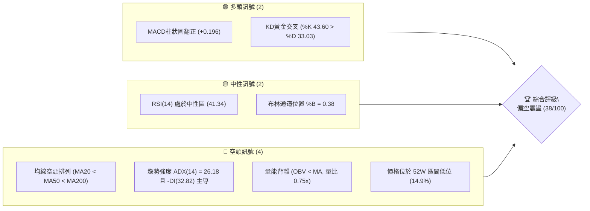

### 📊 核心指標速覽表

| 指標類別 | 指標名稱 | 當前數值 | 訊號 | 解讀 |
|----------|----------|----------|------|------|
| **價格** | 當前收盤價 | $54.43 | 🔴 | 位於52週區間14.9%低位，距離高點$151.00大幅回撤 |
| **均線** | MA20 | $57.73 | 🔴 | 價格在MA20下方（-5.71%），短期動能承壓 |
| **均線** | MA50 | $63.54 | 🔴 | 價格在MA50下方（-14.34%），中期空頭壓制 |
| **均線** | MA200 | $79.44 | 🔴 | 價格在MA200下方（-31.48%），長期牛熊分界線下行 |
| **動能** | RSI(14) | 41.34 | 🟡 | 位於30-70中性偏弱區，無顯著背離訊號 |
| **動能** | MACD (12,26,9) | -3.320 / -3.516 | 🟢 | DIF位於訊號線上方，Histogram為+0.196，弱勢反彈柱 |
| **趨勢** | ADX (14) | 26.18 | 🔴 | ADX > 25確認趨勢市，-DI(32.82) > +DI(17.96)確立空頭主導 |
| **通道** | 布林通道 | %B = 0.38 | 🟡 | 價格運行於中軌（$57.73）與下軌（$44.51）之間 |
| **量能** | 20日均量比 | 0.75x | 🔴 | 今日量14.04M低於20日均量18.83M，OBV疲弱跌破均線 |
| **波動** | ATR(14) | $3.97 | 🔴 | 波動佔股價7.29%，屬於高波動成長型標的 |

### 🏆 技術評分卡

```
╔══════════════════════════════════════════════════════════════╗
║                技術評分卡 — RKLB (2026-11-04)                ║
╠══════════════════════════════════════════════════════════════╣
║ 趨勢強度      ██████░░░░░░░░░░░░░░  30/100  🔴 空頭主導強趨勢║
║ 動能指標      ██████████░░░░░░░░░░  50/100  🟡 MACD翻正但RSI偏弱
║ 支撐穩定度    ████████░░░░░░░░░░░░  40/100  🔴 逼近S1考驗防守
║ 成交量配合    ██████░░░░░░░░░░░░░░  30/100  🔴 縮量整理OBV疲軟
║ 形態完整度    ████████░░░░░░░░░░░░  40/100  🟡 弱勢箱體整理結構
║ 均線排列      ████████░░░░░░░░░░░░  40/100  🔴 標準完整空頭排列
╠══════════════════════════════════════════════════════════════╣
║ 綜合評分      ████████░░░░░░░░░░░░  38/100  🔴 評級：弱勢偏空║
╚══════════════════════════════════════════════════════════════╝
註：綜合評分由六項子指標算術平均導出：(30 + 50 + 40 + 30 + 40 + 40) ÷ 6 = 38.33 → 38/100。
```

---

## 2. 趨勢分析

### 🌐 多時框趨勢分析

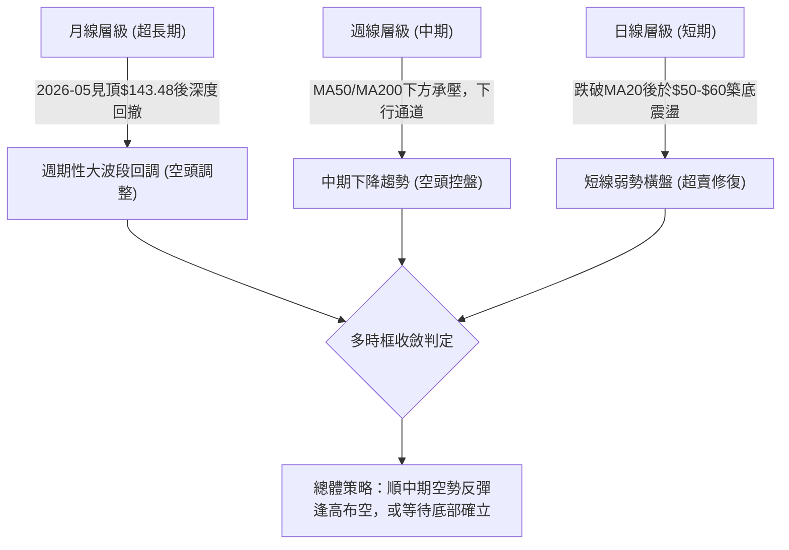

### 📈 長期趨勢 — 12個月走勢圖（Unicode）

依據月線收盤數據繪製過去12個月價格軌跡：

```
RKLB 月線走勢圖（2025-12 至 2026-11）
價格軸 ($)
$150 ┤                                      
$140 ┤                      ●(2026-05: 143.48 高點)
$130 ┤                     ╱ ╲              
$120 ┤                    ╱   ╲             
$110 ┤                   ╱     ╲            
$100 ┤                  ╱       ●(2026-06: 101.65)
 $90 ┤                 ╱         ╲          
 $80 ┤     ●(01: 80.07)           ╲         
 $70 ┤●   ╱ ╲         ●(04: 82.51) ╲        ●(09: 69.68)
 $60 ┤ ╲ ╱   ●(02: 69.10)          ●───────● ╲       
 $50 ┤  ●(12: 69.76)   ●(03: 64.22) (07:64.95)(08:63.92)●──●←現價 $54.43
 $40 ┤                                              (10:54.73)(11:54.43)
     └────────────────────────────────────────────────────────────►
      12  01   02     03   04    05   06   07   08   09   10   11 (月份)
```

#### 長期走勢特徵分析表格

| 階段區間 | 起止價格 | 漲跌幅 | 走勢特徵描述 |
|----------|----------|--------|--------------|
| **主升爆發期** (2025-12 ~ 2026-05) | $69.76 → $143.48 | +105.68% | Neutron進展與發射放量催化，52W最高見$151.00，呈現拋物線主升浪 |
| **高位崩跌期** (2026-05 ~ 2026-07) | $143.48 → $64.95 | -54.73% | 估值嚴重泡沫化後遭遇獲利了結與宏觀流動性收緊，單季腰斬 |
| **中樞築底期** (2026-07 ~ 2026-09) | $64.95 → $69.68 | +7.28% | 於$63.00-$70.00區間維持平台整固，嘗試構建中期支撐平台 |
| **破位下行期** (2026-09 ~ 2026-11) | $69.68 → $54.43 | -21.89% | 箱體平台破位下行，跌破MA200與斐波那契78.6%關鍵位，進入弱勢震盪 |

### 📊 中期趨勢（週線分析）

```
週線關鍵阻力與支撐示意圖：
[阻力] $78.74 (R3 - 10月初震盪反彈高點聚類) ══════════════════════
          ▲
[阻力] $75.28 (R2 - 9月底長陽反彈確認高點)  ----------------------
          ▲
[阻力] $67.70 (R1 - 10月中旬跌破之頸線壓力) ----------------------
          ▲
[現價] $54.43 ───────────────────────────────────────────────────
          ▼
[支撐] $49.25 (S1 - 10月23日當週下影線低點) ----------------------
          ▼
[支撐] $37.57 (S2 - 52週極值低點 / 100%回調位) ═══════════════════
```

週線指標顯示，自2026-09-25當週收在$73.95見頂後，連跌數週。儘管近三週（10-23、10-30、11-03）在$49.25-$54.73進行止跌拉鋸，週線MACD柱狀圖回升至+0.196，但均線壓制明顯，整體中期下行結構未破。

### ⚡ 趨勢強度評估（ADX 解讀）

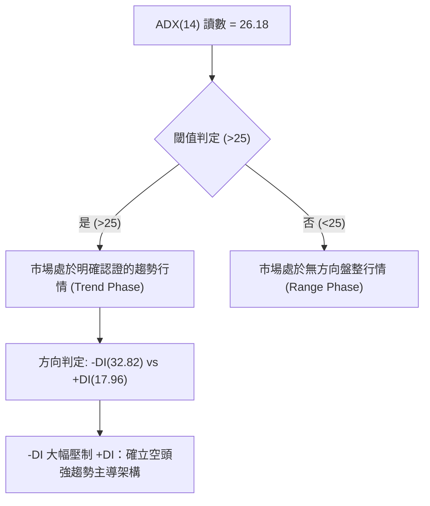

#### ADX 強度對照表

| 指標變數 | 當前數值 | 參考閾值 | 狀態評估 | 技術意涵 |
|----------|----------|----------|----------|----------|
| **ADX(14)** | 26.18 | 25.00 | 趨勢確立 | 擺脫無趨勢盤整，下行波段趨勢具備延續動能 |
| **-DI** | 32.82 | > 25.00 | 空方強勢 | 賣盤主導市場定價權，下行推動力充足 |
| **+DI** | 17.96 | < 20.00 | 多方極弱 | 買盤缺乏承接主動性，僅屬被動防守 |
| **DI差值** | -14.86 | 0.00 | 空方佔優 | 短期反彈皆視為空頭趨勢中的修正波 |

---

## 3. 圖表形態分析

### 🔍 形態識別系統

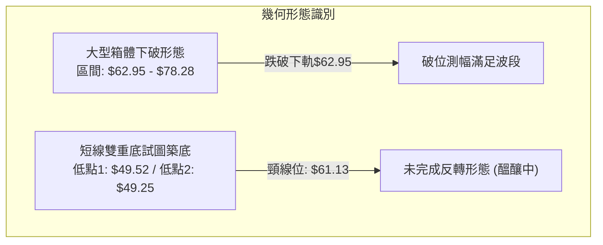

#### 形態識別與信心度評估表

| 形態名稱 | 信心度 | 判斷依據（引用數據） | 完成度 | 目標價（附計算式） |
|----------|--------|----------------------|--------|--------------------|
| **箱體破位下行** | 85% | 9-10月於$62.95至$78.28震盪，於10-16當週以放量長陰收$50.84破位 | 100% | 破位頸線$62.95 - (箱頂$78.28 - 箱底$62.95 = $15.33) = $47.62（已接近S1 $49.25滿足） |
| **短線潛在雙底** | 45% | 日線10-23探底$49.52、週線測$49.25，兩次於$49.25上方獲得支撐 | 35% | 未過頸線$61.13。理論目標 = 頸線$61.13 + (頸線$61.13 - 低點$49.25 = $11.88) = $73.01（信心度<50%，暫不採納） |
| **均線空頭排列型態** | 90% | MA20($57.73) < MA50($63.54) < MA200($79.44)，全線向下傾斜 | 100% | 指標型空頭壓制，下檔考驗波段低點S1 $49.25與S2 $37.57 |

### 🕯️ 重要K線形態分析

依據提供的近10根日K與近8根週K真實價格數據進行嚴格檢驗：

#### 近10根日K形態精細解析

| 日期 | 開 | 高 | 低 | 收 | 成交量 | K線形態 | 技術解讀與訊號 |
|------|----|----|----|----|--------|---------|----------------|
| 2026-10-21 | 52.22 | 53.90 | 52.02 | 53.67 | 17,857,800 | 小實體溫和陽線 | 探底後的初步企穩，多空互有攻防 🟡 |
| 2026-10-22 | 51.67 | 52.98 | 49.96 | 51.22 | 16,674,500 | 破底陰線 | 盤中下破$50整數關卡，最低$49.96，收下影線 🔴 |
| 2026-10-23 | 50.73 | 52.92 | 49.52 | 52.60 | 13,443,900 | 下影錘頭長陽 | 創波段低點$49.52後強勁抽腳，多頭防守明確 🟢 |
| 2026-10-26 | 52.60 | 54.99 | 52.15 | 53.82 | 12,671,100 | 連續上行小陽 | 延續反彈，高低點同步抬升，惟量能略顯不足 🟡 |
| 2026-10-27 | 54.10 | 59.18 | 53.57 | 58.31 | 21,341,400 | 放量大陽線 | 放量上攻突破MA20，實體長達$4.21，動能釋放 🟢 |
| 2026-10-28 | 58.49 | 59.30 | 56.94 | 58.60 | 12,404,100 | 高位高浪十字星 | 上衝至$59.30後動能驟減，量能大幅萎縮，多頭力竭 🟡 |
| 2026-10-29 | 57.76 | 61.13 | 57.63 | 59.10 | 14,625,800 | 衝高長上影陽線 | 盤中衝擊$61.13遭空頭頑抗壓回，留下$2.03上影線 🔴 |
| 2026-10-30 | 55.71 | 57.55 | 53.19 | 54.73 | 16,609,400 | 反轉中長陰線 | 跳空低開低走，完全吞噬前兩日漲幅，形成假突破 🔴 |
| 2026-11-02 | 55.08 | 55.08 | 50.68 | 52.07 | 16,444,100 | 光頭中長陰線 | 開盤即最高點，向下貫穿多根均線，逼近$50關卡 🔴 |
| 2026-11-03 | 53.10 | 54.94 | 52.90 | 54.43 | 14,038,400 | 孕線小陽線 | 位於前日陰線實體內部收小陽，短線跌勢暫緩 🟡 |

#### 近8根週K形態精細解析

| 週交易日 | 開 | 高 | 低 | 收 | 週成交量 | K線形態 | 技術解讀與訊號 |
|----------|----|----|----|----|----------|---------|----------------|
| 2026-09-18 | 60.55 | 68.64 | 60.51 | 64.57 | 106,896,200 | 長上影中陽 | 向上試探$68.64壓力受阻 🟡 |
| 2026-09-25 | 65.29 | 75.46 | 65.28 | 73.95 | 111,511,500 | 放量大陽線 | 強勢突破，週線拉升近15%，動能飽滿 🟢 |
| 2026-10-02 | 73.20 | 76.09 | 69.40 | 73.92 | 107,277,600 | 高位十字星 | 逼近前高遇阻，多空在$73-$76激烈爭奪 🟡 |
| 2026-10-09 | 73.70 | 78.28 | 66.98 | 68.21 | 104,635,800 | 衝高見頂長陰 | 創$78.28高點後跳水，形成週線頂分型 🔴 |
| 2026-10-16 | 67.88 | 68.07 | 49.69 | 50.84 | 128,008,200 | 恐慌崩跌巨陰 | 暴跌25.46%，巨量打穿全部中期支撐，確立破位 🔴 |
| 2026-10-23 | 52.28 | 53.90 | 49.25 | 52.60 | 81,998,500 | 止跌十字星 | 探底$49.25獲得支撐，縮量初顯止跌跡象 🟡 |
| 2026-10-30 | 52.60 | 61.13 | 52.15 | 54.73 | 77,651,800 | 倒錘頭長上影 | 反彈試探$61.13無功而返，上檔解套賣壓沉重 🔴 |
| 2026-11-03 | 55.08 | 55.08 | 50.68 | 54.43 | 30,482,500 | 窄幅縮量內困K | 週初低開震盪，多空暫時維持弱平衡 🟡 |

### 📉 ASCII 走勢形態示意圖

```
日K線近期「假突破後回測」結構示意圖：
$62.00 ┤                                
$61.00 ┤                     ╭─● (10-29 高點 $61.13 遇阻長上影)
$60.00 ┤                    ╭╯ │ 
$59.00 ┤                 ╭─●   │ 
$58.00 ┤              ╭──●     │ 
$57.00 ┤─────────────╭╯────────┼─ (MA20 頸線位置 $57.73)
$56.00 ┤            │          ╰─● (10-30 反噬中陰 $54.73)
$55.00 ┤            │            │ 
$54.00 ┤       ╭─●  │            ╰───●現價 $54.43
$53.00 ┤  ╭─●──╯  ╰─╯                   │ 
$52.00 ┤──╯                           ╰─● (11-02 探底 $50.68)
$51.00 ┤                                  
$50.00 ┤    ● (10-22 探底 $49.96)
$49.00 ┤───● (10-23 低點 $49.52 / S1 $49.25 支撐區)
```

---

## 4. 支撐與阻力

### 🗺️ 關鍵價位分布圖（Unicode）

```
RKLB 價位結構分布圖 (由實際 OHLCV 與歷史波段聚類計算)
═══════════════════════════════════════════════════════════════
$78.74 ║████████████████████████║ 強阻力 R3 (10/09 波段反彈極值高點聚類)
$75.28 ║████████████████████    ║ 阻力 R2 (9月下旬平台起跌點高點聚類)
$67.70 ║████████████████████████║ 關鍵阻力 R1 (10月中旬破位前支撐轉阻力)
       ║                        ║
$57.73 ╟┈┈┈┈┈┈┈┈┈┈┈┈┈┈┈┈┈┈┈┈┈┈┈┈╢ 動態壓力：MA20 / 布林中軌
$54.43 ╠════════════════════════╣ ◄ 當前收盤價 ($54.43)
       ║                        ║
$49.25 ║▓▓▓▓▓▓▓▓▓▓▓▓▓▓▓▓        ║ 近期支撐 S1 (10/23 波段下影線低點聚類)
$37.57 ║████████████████████████║ 核心強支撐 S2 (52W歷史低點 / 100%回調位)
═══════════════════════════════════════════════════════════════
```

### 🚧 阻力位分析表

| 阻力級別 | 價位 | 形成原因 | 突破難度 | 重要性 |
|----------|------|----------|----------|--------|
| **R1** | $67.70 | 近一年波段高點聚類，且為10月16日跳空崩跌前的重要密集成交區底端 | 偏高 | 關鍵趨勢反轉位，站穩方可緩解中期下行壓力 |
| **R2** | $75.28 | 近一年波段高點聚類，與9月25日收盤高位重疊，密集成交套牢區 | 極高 | 中期強阻力，需伴隨巨量資金進場推動 |
| **R3** | $78.74 | 近一年波段高點聚類，對應10月9日當週反彈高點$78.28上方的密集頂部 | 極高 | 牛熊分界核心防線，接近MA200($79.44)壓制帶 |

### 🛡️ 支撐位分析表

| 支撐級別 | 價位 | 形成原因 | 守住機率 | 重要性 |
|----------|------|----------|----------|--------|
| **S1** | $49.25 | 近一年波段低點聚類，10月23日當週最低點$49.25確認的波段低位 | 60% | 短期多頭生命線，失守將開啟向52W低點尋底空間 |
| **S2** | $37.57 | 近一年波段極值低點聚類，52週最低價，歷史級長期籌碼沉澱區 | 85% | 長期戰略底線，具備極強的估值重估與資產安全邊際 |

### 📐 斐波那契回調位分析

依據 52 週極值區間（低點 $37.57 → 高點 $151.00，落差幅達 $113.43）計算各回調關卡：

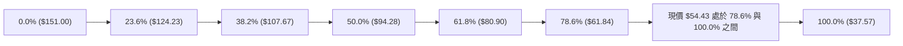

#### 斐波那契回調精確對照與深度解讀

| 回調比例 | 價位 | 當前相對位置 | 技術含意與解讀 |
|----------|------|--------------|----------------|
| **0.0% (52W High)** | $151.00 | +177.42% | 歷史牛市極限推升頂點 |
| **23.6%** | $124.23 | +128.24% | 首道弱回調支撐（已被擊穿） |
| **38.2%** | $107.67 | +97.81% | 牛市強回調支撐位（已失效） |
| **50.0%** | $94.28 | +73.21% | 中性多空平衡樞軸點（已失效） |
| **61.8%** | $80.90 | +48.63% | 黃金分割關鍵防守位，緊鄰MA200($79.44) |
| **78.6%** | $61.84 | +13.61% | 深度回調最後防線（10/29反彈至$61.13精確受阻於此） |
| **當前價格** | **$54.43** | **基準點** | **跌破78.6%，處於深幅調整的「深水探底區」** |
| **100.0% (52W Low)**| $37.57 | -30.98% | 完整週期回吐點，52週終極歷史強支撐 (S2) |

**回調位深度結論**：當前價格 $54.43 已經實質跌破 78.6% 回調位（$61.84）。10月29日盤中反彈最高點 $61.13 恰在該回調位下方遇阻回落，確認該處已由支撐徹底轉化為強大阻力。若無法重返 $61.84 之上，股價將持續面臨向下尋找 100% 回調位（$37.57）的引力牽引。

---

## 5. 技術指標深度解讀

### 🎛️ 指標訊號總覽

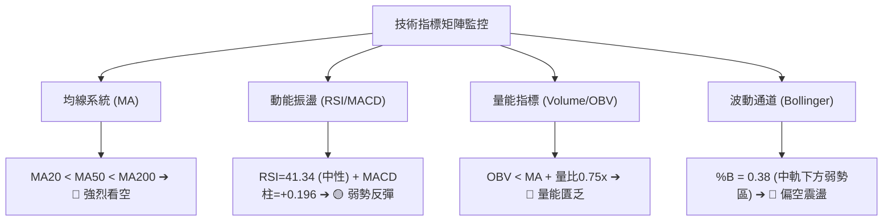

### 📈 移動平均線排列分析

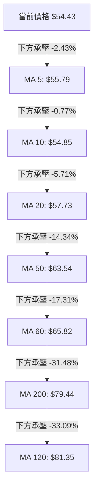

#### 移動平均線數據量化分析表

| 均線名稱 | 數值 | 價格相對位置 | 偏離幅度 | 排列方向與技術意涵 |
|----------|------|--------------|----------|--------------------|
| **MA5** | $55.79 | 位於均線下方 | -2.43% | 超短期空頭反壓，短線連跌受制於5日線 |
| **MA10** | $54.85 | 位於均線下方 | -0.77% | 貼近現價，日線反彈首道微型壓力阻礙 |
| **MA20** | $57.73 | 位於均線下方 | -5.71% | 短期生命線持續向下，壓抑任何反撲波段 |
| **MA50** | $63.54 | 位於均線下方 | -14.34%| 中期多空主線，下行斜率陡峭，中期空頭控盤 |
| **MA60** | $65.82 | 位於均線下方 | -17.31%| 季線水平持續壓制，加劇中期拋壓 |
| **MA200** | $79.44 | 位於均線下方 | -31.48%| 長期牛熊分水嶺，價格深度貼水，確立熊市週期 |
| **MA120** | $81.35 | 位於均線下方 | -33.09%| 半年線下穿年線，高位中長期籌碼嚴重套牢 |

### 📉 RSI(14) 分析

#### RSI 指標強度展示
```
RSI(14): 41.34  [████████░░░░░░░░░░░░] 41.34% (位於中性偏弱區間)
0───────[30 超賣]─────────────────────────────[70 超買]───────100
            ▲
         現價 41.34
```

- **區間評估**：RSI(14) 讀數為 41.34，處於 30 至 70 之間的中性偏空區域。此前在 10-16 當週週線 RSI 曾驟降至 25.4 進入嚴重超賣區，隨後經歷三週反彈修復至當前的 41.34，顯示極端恐慌拋售已獲得一定釋放，但尚未越過 50 榮枯分界線。
- **背離檢驗**：依據近 20 根 K 棒的首尾對比，價格在 10 月 23 日創出波段收盤低點後緩步抬升至 $54.43，RSI 自低位 33 附近修復至 41.34，兩者方向趨於一致，**無明顯頂背離或底背離**現象。這意味著當前的反彈僅屬指標超賣後的機械性修復，非結構性反轉。

### 📊 MACD(12/26/9) 訊號解讀

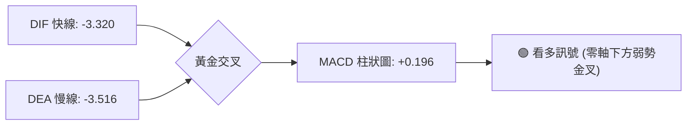

- **數值狀態**：DIF (-3.320) 大於 DEA (-3.516)，柱狀圖（Histogram）報 +0.196。
- **訊號深度剖析**：雖然 MACD 在數值上呈現柱狀圖翻正（看多訊號），但這是在零軸深處（-3.320）發生的**「水下金叉」**。水下金叉本質上屬於跌勢趨緩後的弱勢反抽，而非多頭主升浪開啟的信號。若快線無法快速向零軸靠攏並突破，需提防柱狀圖萎縮重新向下發散，形成空頭「空中加油」型態。

### 📦 布林通道分析

```
布林通道結構示意圖 (寬度帶寬高達 $26.43):
$70.94 ┬────────────────────────────────────────── 上軌 (BB Upper)
       │
$64.00 ┼
       │
$57.73 ┼┈┈┈┈┈┈┈┈┈┈┈┈┈┈┈┈┈┈┈┈┈┈┈┈┈┈┈┈┈┈┈┈┈┈┈┈┈┈┈┈┈┈ 中軌 (MA20 阻力)
       │                    ╭─● (10-29 觸碰中軌遇阻 $59.10)
$54.43 ┼────────────────────┼─●現價 ($54.43, %B = 0.38)
       │                    │
$48.00 ┼           ╭─● (10-23 探底 $49.52 獲下軌支撐)
       │
$44.51 ┴────────────────────────────────────────── 下軌 (BB Lower)
```

- **通道參數**：上軌 $70.94、中軌 $57.73、下軌 $44.51、帶寬 = $26.43。
- **通道位置 (%B)**：當前 %B 為 **0.38**，清晰表明價格運行在弱勢下半區（中軌與下軌之間）。
- **運行軌跡**：10月23日股價在逼近下軌（當時約$45附近）獲得支撐反彈，但在 10月29日反彈至中軌 $57.73 上方（最高 $61.13）即遭遇強烈賣壓壓回，再次受阻於中軌下方，印證中軌目前具備強烈動態阻力效應。

### 💹 成交量分析（量價配合度）

```
量能柱狀對比示意圖：
最新成交量  (14.04M): ██████████████░░░░░░ (0.75x 20日均量)
20日均量   (18.83M): ███████████████████
50日均量   (19.40M): ████████████████████
```

- **量比維度**：最新成交量 14,038,400 股，僅為 20 日均量（18,831,990 股）的 **0.75倍**，量能出現明顯萎縮。
- **量價背離分析**：在 10月27日價格出現單日大漲至 $58.31 時，成交量曾放大至 21.34M；但隨後衝高至 $61.13 時，成交量反而驟降至 14.62M，形成顯著的**「價漲量縮」量價頂背離**，直接導致了 10月30日的反噬長陰。
- **OBV (能量潮)**：系統數據確認 **OBV < MA**，代表資金處於淨流出狀態，量能無法確認當前的反彈力道，整體呈現量能疲弱態勢。

---

## 6. 動能與波動率

### ⚡ 動能評估四象限

| 象限 | 動能維度 | 波動維度 | 當前狀態標註 | 技術含義與應對評估 |
|------|----------|----------|--------------|--------------------|
| **Q1 (追價突破)** | 強 (+DI主導/RSI>60) | 低 (ATR低位收斂) | ─ | 趨勢穩健上行，適合順勢做多 |
| **Q2 (築底整固)** | 弱 (中性偏空) | 低 (ATR收斂) | ─ | 低波動沉澱，靜待方向選擇 |
| **Q3 (極端狂熱)** | 強 (主升浪/超買) | 高 (ATR急劇放大) | ─ | 爆發性行情，適合動能波段交易 |
| **Q4 (弱勢震盪)** | 弱 (-DI主導/RSI=41.34)| 高 (ATR=7.29%高波)| **✓ 當前狀態 (Q4)** | **高波動空頭控制，嚴禁盲目抄底，以逢高空或區間防禦為主** |

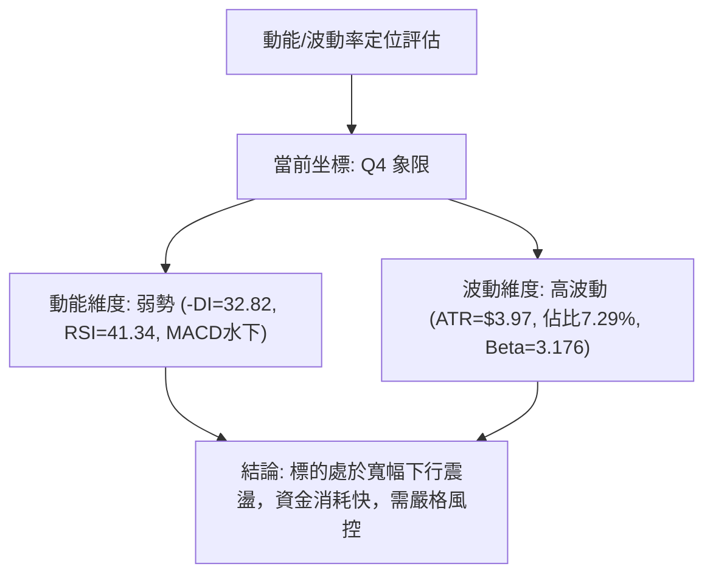

### 📊 ATR 波動率分析

- **ATR(14) 數值**：**$3.97**（佔當前收盤價的 **7.29%**，採 Wilder 平滑算法）。
- **波動特性解讀**：每日平均波動高達 $3.97，表明 RKLB 具備極強的高彈性與高投機屬性。這意味著日內或單週的反彈與下挫極易產生假突破，微小的價格波動極易觸發過於狹窄的止損。
- **動態止損依據**：
  - *短線交易止損距離*：建議設定為 1.0 × ATR = **$3.97**。
  - *波段交易止損距離*：建議設定為 1.5 ~ 2.0 × ATR = **$5.96 ~ $7.94**。

### 📐 Beta 與市場相關性

- **Beta 係數**：**3.176**。
- **市場敏感度分析**：Beta 高達 3.176，屬於超高敏感度資產。當標普500或那斯達克指數波動 1% 時，RKLB 理論上將同向波動約 3.18%。在目前大盤面臨流動性考驗背景下，超高 Beta 特性放大了該股的下行回撤風險。任何做多操作均須緊盯整體市場宏觀風險偏好的變化。

---

## 7. 多時框架總結

### 📋 時框架評分表

| 時框架 | 趨勢方向 | 動能狀態 | 均線排列 | 圖表形態 | 綜合評分 | 建議操作策略 |
|--------|----------|----------|----------|----------|----------|--------------|
| **月線 (長期)** | 🔴 週期回調 | 🔴 空方釋放 | 🟡 跌破MA120 | $143頂部回撤 | 35/100 | 長線資金觀望，等待底部分型 |
| **週線 (中期)** | 🔴 下行趨勢 | 🟡 超賣反抽 | 🔴 空頭排列 | 下降旗形/箱體破位 | 35/100 | 中期順勢逢高布空，不盲目接刀 |
| **日線 (短期)** | 🟡 弱勢震盪 | 🟢 柱狀微翻正 | 🔴 MA20下方 | $49-$61區間整固 | 45/100 | 短線依托S1極窄幅博弈，快進快出 |

### 🔲 綜合訊號矩陣

```
時框訊號一致性矩陣表：
┌───────────┬──────────────┬──────────────┬──────────────┬─────────────┐
│ 分析維度  │ 日線 (短期)  │ 週線 (中期)  │ 月線 (長期)  │ 跨時框共振  │
├───────────┼──────────────┼──────────────┼──────────────┼─────────────┤
│ 均線系統  │ 🔴 空頭排列  │ 🔴 空頭排列  │ 🔴 跌破多均  │ 🔴 強烈看空 │
│ 動能指標  │ 🟢 水下微金叉│ 🟡 超賣反抽  │ 🔴 動能流失  │ 🟡 弱勢修復 │
│ 形態走勢  │ 🟡 箱體整固  │ 🔴 破位下行  │ 🔴 深度腰斬  │ 🔴 空方主導 │
│ 量能配合  │ 🔴 量能萎縮  │ 🔴 OBV跌破   │ 🔴 資金出逃  │ 🔴 量能疲弱 │
└───────────┴──────────────┴──────────────┴──────────────┴─────────────┘
```

### ⚖️ 多時框收斂結論

依據多時框收斂規則第 14 條嚴格執行：
1. **行情性質判定**：當前日線 ADX(14) 讀數為 **26.18**（大於 25.0 閾值臨界點），且 -DI(32.82) 顯著高於 +DI(17.96)，技術上確認當前市場處於**「趨勢行情」**而非無方向的盤整市。
2. **主導時框裁決**：在 ADX > 25 的趨勢架構下，**必須以中長期（週線 / MA50 / MA200）方向為依歸**。當前週線與 MA 系統呈現清晰的下行趨勢（MA200 $79.44 與 MA50 $63.54 形成重重天花板），日線層級近期的止跌與 MACD 翻正**僅能視為日線尋找逢高布空或防禦性減倉的時機**，不可凌駕於中長期空頭趨勢之上。
3. **方向性結論**：多時框收斂判定為 **🔴 弱勢偏空（綜合評分 38/100）**。交易主基調以反彈防禦、順勢逢高布空為主，與第 8 章之空頭主策略保持絕對一致。

---

## 8. 交易策略建議

### 🗺️ 策略決策流程圖

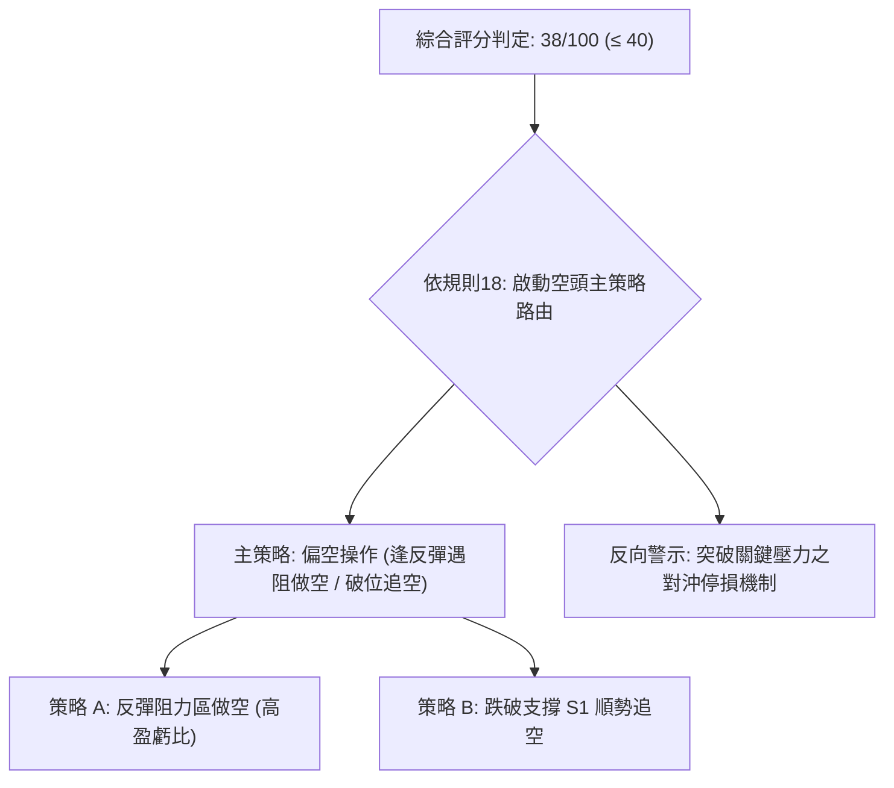

### 🧭 策略路由（依評分卡分流）

> **當前主策略方向 = 🔴 偏空操作（依評分 38/100，落在 ≤ 40 偏空區間）**  
> 依嚴格規則，本報告主推空頭交易策略，多頭僅列為反轉風險觸發點（對沖提示），不進行兩頭下注。

### 🎯 價格情境階梯（Price Scenarios）

價位嚴格引用下方數據「關鍵價位」區塊與斐波那契回調位：

| 觸發條件 | 下一目標 | 後續延伸 | 情境含義 |
|----------|----------|----------|----------|
| **強勢向上突破 R1 $67.70** | R2 $75.28 | R3 $78.74 | 扭轉短期頹勢，挑戰MA200牛熊線（機率偏低） |
| **弱勢反彈承壓 MA20 $57.73** | S1 $49.25 | S2 $37.57 | 受制於中軌壓制，重新回踩波段底部尋求支撐 |
| **實質跌破 S1 $49.25** | S2 $37.57 | 數據未偵測到 | 空頭主升浪延續，全面測試52週歷史低點 $37.57 |

### 📊 情境機率分佈

| 情境分類 | 機率預估 | 主要技術指標依據 |
|----------|----------|------------------|
| **情境一：延續弱勢下行 / 再度探底** | **60%** | ADX=26.18強趨勢主導、均線全空頭排列、OBV疲弱且量能縮減、-DI達32.82壓制 |
| **情境二：區間窄幅震盪修復** | **25%** | 日線MACD柱狀圖翻正(+0.196)、日K連續於$50上方收下影線企穩修復 |
| **情境三：強勢反轉突破上行** | **15%** | 需放量站穩斐波那契78.6%($61.84)與R1($67.70)，當前量能嚴重不足以支持 |

### 🔴 主策略詳情（空頭主導策略）

依嚴格定義：做空風險報酬比 = (進場價 − 目標價 T1) ÷ (止損價 − 進場價)。所有價位嚴格採用數據已列之數值。

| 策略要素 | 策略 A（反彈高空策略 — 首選） | 策略 B（破位追空策略 — 次選） |
|----------|--------------------------------|--------------------------------|
| **交易邏輯** | 股價反彈至布林中軌/MA20阻力遇阻做空 | 股價跌破近期支撐S1確認破位順勢加空 |
| **進場條件** | 反彈至 MA20 附近出現上影線或陰線吞噬 | 日K實體跌破支撐位 S1 |
| **進場價格** | **$57.73**（MA20/布林中軌精確價位） | **$49.25**（S1精確價位） |
| **目標價 T1** | **$49.25**（支撐位 S1） | **$37.57**（支撐位 S2 / 52W低點） |
| **目標價 T2** | **$37.57**（支撐位 S2 / 52W低點） | 數據中未偵測到（維持T1全平） |
| **止損價格** | **$61.84**（斐波那契78.6%回調壓力位） | **$54.43**（當前收盤價位） |
| **風險報酬比** | **1 : 2.06（以 T1 計）**<br>*(57.73 - 49.25) ÷ (61.84 - 57.73) = 8.48 ÷ 4.11* | **1 : 2.25（以 T1 計）**<br>*(49.25 - 37.57) ÷ (54.43 - 49.25) = 11.68 ÷ 5.18* |
| **成功機率** | 65% | 55% |
| **建議倉位** | 15% 總資金倉位 | 10% 總資金倉位 |

### 🟢 反向風險觸發點（對沖提示）

若出現以下訊號，主策略（偏空）將被實質推翻，空單必須無條件止損離場並考慮對沖：
1. **價位突破**：日線收盤價強勢站上 **斐波那契 78.6% 回調位 $61.84**，甚至進一步突破 **R1 $67.70**。
2. **指標轉折**：ADX 轉向回落至 25 以下，或 +DI 上穿 -DI 形成多頭主導；成交量急劇放大至 20 日均量的 1.5 倍以上（> 28M）。

### ⭐ 整體訊號強度評星

```
做多訊號強度：★☆☆☆☆  (1/5星 - 僅存水下超賣修復，均線全面壓制)
做空訊號強度：★★★★☆  (4/5星 - 均線空頭排列，趨勢強度ADX支持)
整體可信度：  ★★★★☆  (4/5星 - 多時框趨勢具備高度收斂性)
```

---

## 9. 風險提示與監控

### ✅ 關鍵監控指標 Checklist

```
╔══════════════════════════════════════════════════════════════╗
║               關鍵技術監控清單 (DAILY CHECKLIST)              ║
╠══════════════════════════════════════════════════════════════╣
║ [ ] 價格防守線：觀察 S1 $49.25 是否被日K實體有效擊破        ║
║ [ ] 動態反壓線：觀察 MA20 $57.73 能否在反彈中形成有效阻擊    ║
║ [ ] 趨勢風向標：監控 ADX(14) 是否持續維持在 25.0 以上高位   ║
║ [ ] 動能連續性：MACD 柱狀圖 (+0.196) 是否出現萎縮翻綠        ║
║ [ ] 量能異動：單日成交量是否異常突破 25,000,000 股基準量     ║
║ [ ] 市場連動性：Beta=3.176，需監控大盤恐慌指數(VIX)波動     ║
╚══════════════════════════════════════════════════════════════╝
```

### ⚠️ 風險場景分析

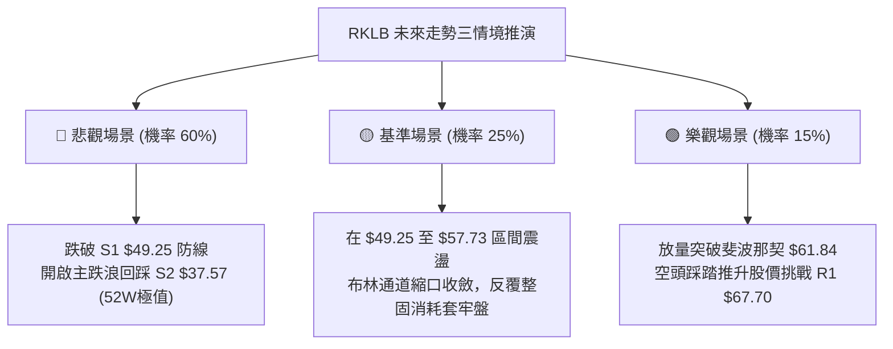

### 🛡️ 風險管理重要提醒

1. **極度規避單邊抄底**：鑑於自由現金流為負（TTM FCF為 $-371.14M）且 Beta 高達 3.176，該股易受宏觀流動性預期抽離打擊，嚴禁在未見明確日線雙底前進行無止損左側加碼。
2. **ATR 浮動風控**：由於 ATR 高達 $3.97（單日波動率 7.29%），嚴禁重倉槓桿交易。單筆交易最大虧損額度應嚴格控制在總投資組合資金的 1.0% ~ 1.5% 以內。
3. **空頭回補保護**：高 Beta 股票在空頭市中易出現劇烈的空頭回補（Short Squeeze）反彈。若空單進場後價格突破預設的 $61.84 止損位，必須無條件嚴格執行平倉，切忌抱有僥倖心態。

---

## 📋 報告總結

```
╔════════════════════════════════════════════════════════════════╗
║                  RKLB 技術分析報告總結                         ║
╠════════════════════════════════════════════════════════════════╣
║ 報告日期：2026-11-04                                           ║
║ 當前價格：$54.43                                               ║
║ 分析評級：🔴 偏空震盪 (綜合評分: 38/100)                       ║
║                                                                ║
║ 關鍵結論：                                                     ║
║ ├─ 長期趨勢：🔴 跌破MA200，週期性深度調整                      ║
║ ├─ 中期趨勢：🔴 週線空頭主導，下降通道運行                    ║
║ ├─ 短期趨勢：🟡 短線超賣反抽，受阻於MA20動態壓制              ║
║ ├─ 關鍵支撐：S1: $49.25  /  S2: $37.57                         ║
║ ├─ 關鍵阻力：R1: $67.70  /  R2: $75.28  /  R3: $78.74          ║
║ └─ 斐波那契防線：78.6% 回調位 $61.84 (已轉為重大阻力)          ║
║                                                                ║
║ 最優策略組合：                                                 ║
║ 1. 🥇 最佳機會：策略 A (反彈至 MA20 $57.73 遇阻做空，         ║
║                 目標 $49.25，止損 $61.84，風報比 1 : 2.06)     ║
║ 2. 🥈 次選機會：策略 B (破位 S1 $49.25 順勢追空，              ║
║                 目標 $37.57，止損 $54.43，風報比 1 : 2.25)     ║
║ 3. 🥉 保守選擇：維持空倉觀望，耐心等待價格回踩 S2 $37.57 或    ║
║                 放量收復 $61.84 再行定奪                       ║
╚════════════════════════════════════════════════════════════════╝
```

---

> ⚠️ **免責聲明**：本報告為技術分析模型研究成果，所有價位依據客觀技術指標與歷史走勢推算。報告**僅供學術研究與參考**，**不構成任何要約、招攬或投資買賣建議**。金融市場波動劇烈，投資人應獨立評估風險並自負盈虧。

---

*報告生成時間：2026-11-04 ｜ 數據來源：Yahoo Finance ｜ 分析框架：多時框技術分析模型*