# RKLB 技術分析報告

> **報告日期**：2026-11-05 ｜ **語言**：繁體中文 ｜ **數據來源**：Yahoo Finance ｜ **當前價格**：$52.37

---

## 目錄

| 章節 | 內容 |
|------|------|
| [1. 技術面概覽](#1-技術面概覽) | 訊號儀表板、核心指標、評分卡 |
| [2. 趨勢分析](#2-趨勢分析) | 多時框趨勢、長中短期走勢 |
| [3. 圖表形態分析](#3-圖表形態分析) | 形態識別、K線組合、目標價 |
| [4. 支撐與阻力](#4-支撐與阻力) | 關鍵價位、斐波那契回調 |
| [5. 技術指標深度解讀](#5-技術指標深度解讀) | MA/RSI/MACD/布林/成交量 |
| [6. 動能與波動率](#6-動能與波動率) | 動能評估、ATR、Beta |
| [7. 多時框架總結](#7-多時框架總結) | 時框架評分矩陣 |
| [8. 交易策略建議](#8-交易策略建議) | 多空策略、風險報酬比 |
| [9. 風險提示與監控](#9-風險提示與監控) | 監控指標、風險場景 |

---

## 1. 技術面概覽

### 🎯 技術訊號儀表板

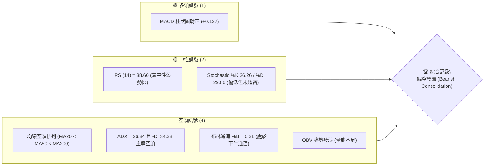

### 📊 核心指標速覽表

| 指標類別 | 指標名稱 | 當前數值 | 訊號 | 解讀 |
|:---|:---|:---|:---:|:---|
| **價格** | 當前收盤價 | $52.37 | 🔴 | 位於 52 週高低區間之 13.0%，處於近一年絕對低位區 |
| **均線** | 短期 MA20 | $56.75 | 🔴 | 價格在 MA20 下方 (-7.72%)，短線反彈遭遇首道動態壓力 |
| **均線** | 中期 MA50 | $63.25 | 🔴 | 價格在 MA50 下方 (-17.20%)，中期趨勢完全被空方壓制 |
| **均線** | 長期 MA200 | $79.25 | 🔴 | 價格在 MA200 下方 (-33.92%)，長期牛熊分界線失守 |
| **均線** | 排列狀態 | MA20 < MA50 < MA200 | 🔴 | 標準空頭發散排列，所有主要均線斜率均向下傾斜 |
| **動能** | RSI(14) | 38.60 | 🟡 | 位於 30-70 中性區間，呈現偏弱整理，尚未觸及超賣 (<30) |
| **動能** | MACD 柱狀圖 | +0.127 | 🟢 | 快慢線負值收斂，柱狀圖翻正，短線微幅底背馳醞釀反彈 |
| **動能** | 隨機指標 | %K 26.26 / %D 29.86 | 🟡 | 接近超賣區但未形成明確向上金叉，動能趨緩 |
| **趨勢** | ADX(14) / DI | ADX 26.84 / -DI 34.38 | 🔴 | ADX > 25 確立強趨勢，-DI(34.38) 遠大於 +DI(16.40)，空頭趨勢強烈 |
| **波動** | ATR(14) | $4.03 (7.70%) | 🔴 | 每日平均波動幅度高達 7.70%，顯示價格極端敏感與高風險 |
| **通道** | 布林通道 | %B = 0.31 | 🔴 | 價格壓制於中軌 ($56.75) 與下軌 ($45.17) 之間，下行壓力未解 |
| **量能** | 成交量比 / OBV | 1.00x / OBV < MA | 🔴 | 當日量能持平於 20 日均量，但 OBV 低於均線，量能未確認反轉 |

### 🏆 技術評分卡

```
╔══════════════════════════════════════════════════════════════════╗
║                   技術評分卡 — RKLB (2026-11-05)                 ║
╠══════════════════════════════════════════════════════════════════╣
║ 趨勢強度 (Trend)     ████████░░░░░░░░░░░░  40/100  🔴 空頭強勢   ║
║ 動能指標 (Momentum)  ██████████░░░░░░░░░░  50/100  🟡 弱勢企穩   ║
║ 支撐穩定度 (Support) ████████░░░░░░░░░░░░  40/100  🔴 逼近邊緣   ║
║ 成交量配合 (Volume)  ██████░░░░░░░░░░░░░░  30/100  🔴 縮量反彈   ║
║ 形態完整度 (Pattern) ████████░░░░░░░░░░░░  40/100  🔴 破位築底   ║
║ 均線排列 (MAs)       ████░░░░░░░░░░░░░░░░  20/100  🔴 空頭排列   ║
╠══════════════════════════════════════════════════════════════════╣
║ 綜合評分 (Overall)   ███████░░░░░░░░░░░░░  37/100  🔴 偏空震盪   ║
║                     (= (40+50+40+30+40+20) / 6 = 36.67 ≈ 37)     ║
╚══════════════════════════════════════════════════════════════════╝
```

---

## 2. 趨勢分析

### 🌐 多時框趨勢分析

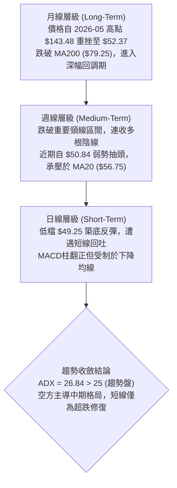

### 📈 長期趨勢 — 12個月走勢圖（Unicode）

以下為 RKLB 過去 12 個月（2025-12 至 2026-11）的月線收盤價走勢圖，清晰展示了由主升浪至見頂崩跌的完整週期：

```
RKLB 月線走勢圖（過去12個月：2025-12 至 2026-11）
價格 ($)
$150 ┤                                      
$140 ┤                                  ● $143.48 (2026-05 歷史高點)
$120 ┤                                 / \
$100 ┤                                /   ● $101.65 (2026-06)
 $80 ┤            ● $80.07           ●     \
 $70 ┤ ● $69.76  /        \         /       \          ● $69.68 (2026-09)
 $60 ┤          /          ● $64.22          ● $64.95 / \
 $50 ┤         ● $69.10                                ● $63.92  ● $52.37 (2026-11 現價)
 $40 ┤                                                            ● $54.73
     └─┬─────┬─────┬─────┬─────┬─────┬─────┬─────┬─────┬─────┬─────┬─────┬───
     12月   01月  02月  03月  04月  05月  06月  07月  08月  09月  10月  11月 (月份)
     2025  2026  2026  2026  2026  2026  2026  2026  2026  2026  2026  2026
```

#### 走勢特徵分析表格

| 階段週期 | 時間區間 | 起訖收盤價 | 漲跌幅 | 核心走勢特徵與結構分析 |
|:---|:---|:---|:---:|:---|
| **主升浪推進期** | 2025-12 至 2026-05 | $69.76 → $143.48 | +105.68% | 量價齊揚，52週最高觸及 $151.00，市場極度樂觀，火箭發射概念引爆估值泡沫 |
| **頂部反轉暴跌期** | 2026-05 至 2026-07 | $143.48 → $64.95 | -54.73% | 典型的「A字頂」獲利了結行情，跌破所有短中期均線，空頭巨量宣洩 |
| **低位平台整理期** | 2026-07 至 2026-09 | $64.95 → $69.68 | +7.28% | 於 $63.00 - $82.00 間進行高波動橫盤，試圖在 $64.00 一線構築支撐底座 |
| **破位再下行期** | 2026-09 至 2026-11 | $69.68 → $52.37 | -24.84% | 破位下殺，創下近期低點 $49.25，目前逼近 52 週低點 $37.57，均線徹底空頭排列 |

### 📊 中期趨勢（週線分析）

週線層級顯示，RKLB 在 2026 年 10 月中旬遭遇破位重挫（2026-10-16 當週大跌至收盤 $50.84，低點觸及 $49.69，成交量放大至 128,008,200 股），打破了前兩個月的箱體底界。

```
RKLB 週線壓力與支撐示意圖
價格 ($)
$80.00 ┤============================= 強阻力區 (MA200 / 斐波 61.8% $80.90)
$75.28 ┤----------------------------- 阻力 R2 (波段高點聚類)
$67.70 ┤----------------------------- 阻力 R1 (近期下破前平台低點轉阻力)
$63.25 ┤- - - - - - - - - - - - - - - 動態阻力 (週線 MA50 處)
$56.75 ┤~~~~~~~~~~~~~~~~~~~~~~~~~~~~~ 短線動態壓力 (MA20 / 布林中軌)
$52.37 ┤◄--- 現價 ($52.37)
$49.25 ┤_____________________________ 近期波段關鍵支撐 S1 (2026-10-23 週低點)
$37.57 ┤============================= 52週絕對強支撐 S2 (52W Low / 斐波 100%)
```

### ⚡ 趨勢強度評估（ADX 解讀）

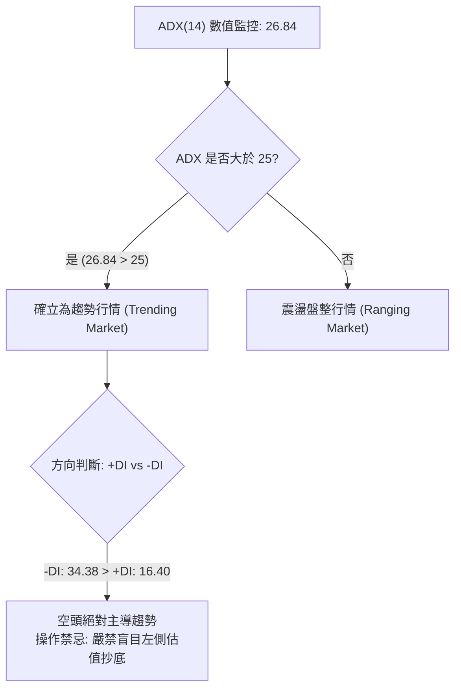

#### ADX 趨勢強度對照表

| 參數項目 | 當前數值 | 參考標準 | 狀態評估 | 實質技術含義 |
|:---|:---:|:---:|:---:|:---|
| **ADX(14)** | **26.84** | > 25 強趨勢 / < 20 無趨勢 | 🟢 趨勢明確 | 市場已脫離無方向的盤整，呈現單邊空方控盤狀態 |
| **+DI (多方動能)** | **16.40** | 數值越高多方越強 | 🔴 動能匱乏 | 多頭攻擊意願低落，無法形成連續推進波 |
| **-DI (空方動能)** | **34.38** | 數值越高空方越強 | 🔴 極度強烈 | 空方牢牢掌控價格下行節奏，每次反彈均引發賣壓 |
| **趨勢性質** | **空頭趨勢行情** | -DI 顯著壓制 +DI | 🔴 空方主導 | **遵循規則 14**：以中長期空頭方向為主，任何日線反彈僅視為尋找放空或解套點 |

---

## 3. 圖表形態分析

### 🔍 形態識別系統

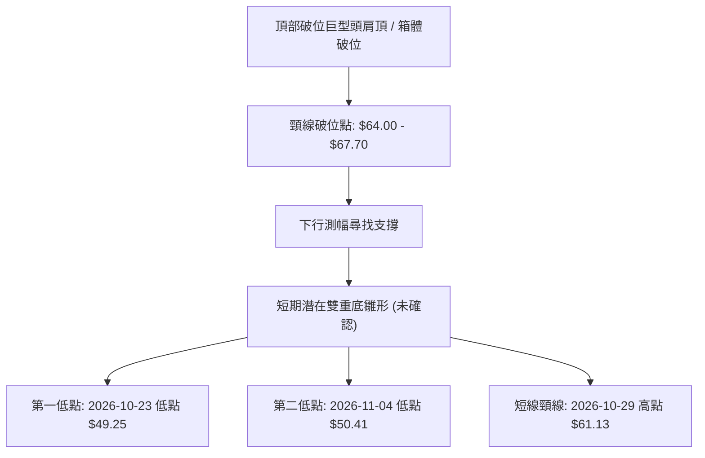

#### 形態識別與信心度評估表（依規則 15）

| 識別形態名稱 | 信心度 (%) | 判斷依據（引用數據） | 完成度 (%) | 目標價（附嚴謹計算式） |
|:---|:---:|:---|:---:|:---|
| **箱體破位下行測幅** | **75%** | 跌破 7-9 月橫盤箱體底部（約 $64.00 處），引發加速崩跌至 $49.25 | 70% | 由箱體高度推算：頸線 $64.00 − (頂部 $78.74 − 頸線 $64.00) = $64.00 − $14.74 = **$49.26**（已精準抵達 S1 $49.25 附近） |
| **日線潛在雙底 (W底)** | **42%** | 出現兩次回踩不破 $49.50：10-23 低點 $49.25 與 11-04 低點 $50.41；但受制於 MA20 ($56.75) | 35% | **訊號不足，僅做指標型解讀**（因信心度 < 50% 且尚未突破短線頸線 $61.13，計算式：頸線 $61.13 + ($61.13 − $49.25) = $73.01，暫不成立） |
| **均線空頭發散形態** | **90%** | MA5 ($54.54) < MA10 ($54.72) < MA20 ($56.75) < MA50 ($63.25) < MA200 ($79.25) | 100% | 空頭發散持續，動態壓制價格，目標直指下一主支撐 S2 **$37.57** |

### 🕯️ 重要K線形態分析

嚴格依據提供的「近10根日K」與「近8根週K」之開、高、低、收數據進行客觀解讀（依規則 19）：

#### 近10根日K棒形態解析

| 日期 (日K) | 開盤價 | 最高價 | 最低價 | 收盤價 | 識別K線形態 | 深度技術解讀 | 訊號方向 |
|:---|:---:|:---:|:---:|:---:|:---|:---|:---:|
| 2026-10-22 | 51.67 | 52.98 | 49.96 | 51.22 | 帶長下影短黑棒 | 盤中下探破 $50 後抽回，顯示低位有初步承接盤 | 🟡 中性 |
| 2026-10-23 | 50.73 | 52.92 | 49.52 | 52.60 | 下影小紅棒 | 創下波段低點 $49.25 聚類支撐後拉回，多空激烈爭奪 | 🟢 短多 |
| 2026-10-26 | 52.60 | 54.99 | 52.15 | 53.82 | 連續上行陽線 | 實體穩步抬高，低點不破前低，延續超跌反彈 | 🟢 偏多 |
| 2026-10-27 | 54.10 | 59.18 | 53.57 | 58.31 | 放量大陽線 | 量增至 2,134 萬股，長陽突破短期整理區，直逼 MA20 | 🟢 看多 |
| 2026-10-28 | 58.49 | 59.30 | 56.94 | 58.60 | 高位窄幅十字星 | 逼近 $59.00 遭遇獲利了結賣壓，多頭動能趨緩 | 🟡 滯漲 |
| 2026-10-29 | 57.76 | 61.13 | 57.63 | 59.10 | 長上影倒錘頭陽棒 | 衝高觸及 $61.13 後遭遇強大空方反撲，留下長上影線 | 🔴 頂背壓 |
| 2026-10-30 | 55.71 | 57.55 | 53.19 | 54.73 | 跳空中黑棒 | 實體吞噬前日低點，反彈宣告夭折，確立 $61.13 為波段頂 | 🔴 看空 |
| 2026-11-02 | 55.08 | 55.08 | 50.68 | 52.07 | 光頭大黑棒 | 開盤即最高點，空方完全主導，價格快速回瀉至 $52 附近 | 🔴 強空 |
| 2026-11-03 | 53.10 | 54.94 | 52.90 | 54.43 | 縮量修復小陽棒 | 逢低弱勢反抽，成交量縮減至 1,416 萬股，買盤謹慎 | 🟡 弱反彈 |
| 2026-11-04 | 54.60 | 55.31 | 50.41 | 52.37 | 長下影中陰棒 | 盤中再度跳水探至 $50.41，收盤跌破昨日開盤，放量回吐 | 🔴 偏空 |

#### 近8根週K棒形態解析

| 日期 (週K) | 開盤價 | 最高價 | 最低價 | 收盤價 | 識別K線形態 | 深度技術解讀 | 訊號方向 |
|:---|:---:|:---:|:---:|:---:|:---|:---|:---:|
| 2026-09-18 | 60.55 | 68.64 | 60.51 | 64.57 | 中陽實體線 | 自底部回升，成交量突破 1 億股，多頭試圖構築平台 | 🟢 偏多 |
| 2026-09-25 | 65.29 | 75.46 | 65.28 | 73.95 | 長陽突破棒 | 突破 $70 關口，量能持續維持 1.11 億股之強勢格局 | 🟢 看多 |
| 2026-10-02 | 73.20 | 76.09 | 69.40 | 73.92 | 長下影高位十字線 | 高位震盪劇烈，衝高至 $76.09 後回吐，顯露疲態 | 🟡 轉折 |
| 2026-10-09 | 73.70 | 78.28 | 66.98 | 68.21 | 穿頭破腳大陰棒 | 衝至波段高點聚類 R3 ($78.74 附近) 後暴跌，形成覆蓋頂 | 🔴 反轉看空 |
| 2026-10-16 | 67.88 | 68.07 | 49.69 | 50.84 | 巨量崩跌長黑棒 | 爆出 1.28 億股天量，單週暴跌 25.4%，徹底破位下殺 | 🔴 極度看空 |
| 2026-10-23 | 52.28 | 53.90 | 49.25 | 52.60 | 低位長下影星線 | 探底 $49.25 獲得承接，量能萎縮至 8,199 萬股，暫時企穩 | 🟡 止跌信號 |
| 2026-10-30 | 52.60 | 61.13 | 52.15 | 54.73 | 長上影倒錘頭週線 | 衝高 $61.13 遇阻回落，週線實體極窄，顯示反彈阻力極重 | 🔴 弱勢確認 |
| 2026-11-04 | 55.08 | 55.31 | 50.41 | 52.37 | 續跌小陰棒 | 截至週中延續下行探底，下影線再次考驗 $50.00 整數支撐 | 🔴 空方延續 |

### 📉 ASCII 走勢形態示意圖

```
RKLB 形態結構示意圖（日線破位反抽與壓制）
價格 ($)
$61.13 ┤                  ▲ 10/29 假突破高點（長上影反轉）
       │                 / \
$58.31 ┤        ▲       /   \
       │       / \     /     \
$56.75 ┤──────/───\───/───────\────── MA20 / 布林中軌動態反壓
       │     /     \ /         ▼ 10/30 - 11/02 跳空重挫
$52.37 ┤    /       ●           \____ ● 11/04 現價 ($52.37)
       │   /                         \
$49.25 ┤──▼ 10/23 波段低點 (S1)───────▼ 11/04 低點探至 $50.41 (雙底頸線未過)
```

### 🎯 形態目標價計算

根據日線形態與幾何對稱結構進行測算：
1. **下行破位測幅（已實現大半）**：
   - 頸線（破位點）：$64.00
   - 頭部區間高點：$78.74（R3 聚類）
   - 形態高度 $H = \$78.74 - \$64.00 = \$14.74$
   - 破位第一理論目標價 = 頸線 − $H = \$64.00 - \$14.74 =$ **$49.26**（與數據中支撐位 S1 **$49.25** 極端契合，確認空頭滿足點已初步達成）。
2. **潛在雙底反彈測幅（尚未觸發）**：
   - 頸線阻力點：2026-10-29 高點 $61.13
   - 底部支撐低點：2026-10-23 低點 $49.25
   - 形態高度 $H_{反彈} = \$61.13 - \$49.25 = \$11.88$
   - 若未來有效放量突破 $61.13，理論反彈目標 = $\$61.13 + \$11.88 =$ **$73.01**（接近 R2 $75.28）。
   - **現況評定**：當前收盤 $52.37 距離頸線 $61.13 尚有 +16.7% 差距，且均線反壓沉重，此多頭目標暫處於假想狀態，不可作為當前進場依據。

---

## 4. 支撐與阻力

### 🗺️ 關鍵價位分布圖（Unicode）

```
RKLB 價位結構分布圖 (嚴格引用 OHLCV 聚類數值)
═══════════════════════════════════════════════════════════════════
$78.74 ║██████████████████████████████║ 強阻力 R3 (+50.36%) — 多頭解套終極重壓
$75.28 ║████████████████████          ║ 阻力 R2   (+43.76%) — 波段套牢聚類高點
$67.70 ║████████████████████████      ║ 關鍵阻力 R1 (+29.27%) — 下破前期平台低點
       ╟──────────────────────────────╢
$61.84 ║░░░░░░░░░░░░░░░░░░░░░░░░      ║ 斐波那契 78.6% 回調位
$56.75 ║▒▒▒▒▒▒▒▒▒▒▒▒▒▒▒▒▒▒▒▒▒▒▒▒      ║ 動態壓力 — MA20 與布林中軌
$52.37 ╠══════════════════════════════╣ ◄ 現價 ($52.37)
       ╟──────────────────────────────╢
$49.25 ║▓▓▓▓▓▓▓▓▓▓▓▓▓▓▓▓▓▓▓▓▓▓▓▓      ║ 近期關鍵支撐 S1 (-5.96%) — 近一年波段低點聚類
$37.57 ║██████████████████████████████║ 終極強支撐 S2 (-28.26%) — 52週低點 / 斐波 100%
═══════════════════════════════════════════════════════════════════
```

### 🚧 阻力位分析表

全部價位嚴格引用技術數據「關鍵價位」區塊之波段高點聚類數值：

| 阻力級別 | 價位 (精確值) | 距現價幅標 | 形成原因與籌碼結構 | 突破難度 | 重要性評級 |
|:---|:---:|:---:|:---|:---:|:---:|
| **阻力 R1** | **$67.70** | +29.27% | 2026 年 7 月至 10 月中旬多個週K底部平台下破後「支撐轉阻力」；累積逾 4 億股大量套牢盤 | 極高 | 🔴 核心生命線 |
| **阻力 R2** | **$75.28** | +43.76% | 2026-09-25 及 2026-10-02 當週多次上攻乏力受阻之波段高點聚類；空方主力密集防守線 | 極高 | 🔴 強阻力 |
| **阻力 R3** | **$78.74** | +50.36% | 2026-10-09 週線衝高引發暴跌的起跌點高點聚類；接近 MA200 ($79.25) 及斐波 61.8% ($80.90) | 堅不可摧 | 🔴 終極天花板 |

### 🛡️ 支撐位分析表

全部價位嚴格引用技術數據「關鍵價位」區塊之波段低點聚類數值：

| 支撐級別 | 價位 (精確值) | 距現價幅標 | 形成原因與籌碼結構 | 守住機率 | 重要性評級 |
|:---|:---:|:---:|:---|:---:|:---:|
| **支撐 S1** | **$49.25** | -5.96% | 2026-10-23 週K錄得之近一年波段最低點聚類；連續兩週下影線防禦點，短線多頭最後堡壘 | 50% | 🟡 關鍵警戒線 |
| **支撐 S2** | **$37.57** | -28.26% | 52 週最低點 (52W Low) 及斐波那契 100% 回調位；長週期價值投資者與機構防守底線 | 80% | 🟢 終極護城河 |
| **支撐 S3** | **數據中未偵測到** | N/A（數據未提供） | 數據中未提供 S3 聚類數值，依規則 13 嚴禁捏造 | N/A | ⚪ 無數據 |

### 📐 斐波那契回調位分析

依據 52 週區間高點 **$151.00** 至低點 **$37.57** 之完整大波段回調計算：

| 斐波那契比例 | 價位 (精確值) | 現價相對位置與技術意義 |
|:---:|:---:|:---|
| **0.0% (52W High)** | **$151.00** | 歷史狂熱頂部，短期內完全不具備參考可達性 |
| **23.6%** | **$124.23** | 初級回調阻力 |
| **38.2%** | **$107.67** | 牛市健康回調位（已完全失守） |
| **50.0%** | **$94.28** | 多空力量均衡線（崩跌破位） |
| **61.8%** | **$80.90** | 黃金分割強防守位；與 MA200 ($79.25) 高度重疊，構成長期牛熊生死線 |
| **78.6%** | **$61.84** | **關鍵壓制位**：現價落於 78.6% ($61.84) 與 100% ($37.57) 之間，意味著回撤幅度已極度深邃 |
| **100.0% (52W Low)**| **$37.57** | 整個回撤週期的最終歸宿點與極限防禦點 |

- **現價區間解讀**：現價 **$52.37** 位於 78.6% 回調位 ($61.84) 下方。技術上，當標的跌破 61.8% 且無法站回 78.6% 時，資產已被定義為進入**超深幅回撤週期**，向 100% 回調位 ($37.57) 尋求支撐的磁吸效應將顯著增強。

---

## 5. 技術指標深度解讀

### 🎛️ 指標訊號總覽

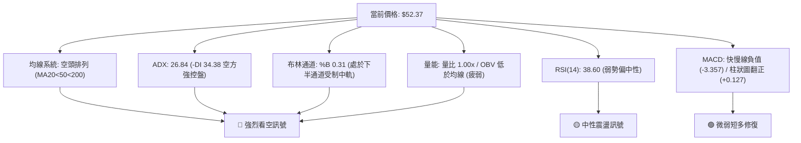

### 📈 移動平均線排列分析

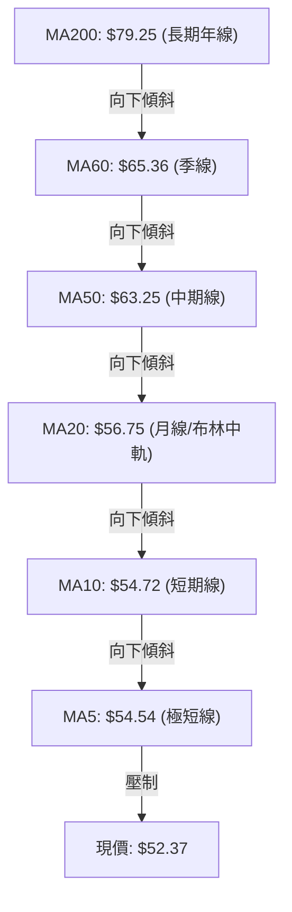

#### 移動平均線數據對照表

| 均線名稱 | 數值 | 價格相對於均線之偏離 | 斜率與狀態 | 技術解讀 |
|:---|:---:|:---:|:---:|:---|
| **MA 5** | $54.54 | -$2.17 (-3.98%) | 傾斜向下 | 極短線壓制，11-04 再次失守，短多進攻受挫 |
| **MA 10** | $54.72 | -$2.36 (-4.30%) | 傾斜向下 | 短線防守均線，與 MA5 黏合向下擴散 |
| **MA 20** | $56.75 | -$4.38 (-7.72%) | 傾斜向下 | 月線反壓極重，10-29 衝高 $61.13 後迅速跌回其下方 |
| **MA 50** | $63.25 | -$10.88 (-17.20%) | 傾斜向下 | 中期多空分水嶺，未有效收復前中期反轉無從談起 |
| **MA 60** | $65.36 | -$12.99 (-19.88%) | 傾斜向下 | 季線阻力，緊扣破位平台下沿 |
| **MA 120** | $80.68 | -$28.31 (-35.09%) | 傾斜向下 | 半年線阻力 |
| **MA 200** | $79.25 | -$26.88 (-33.92%) | 傾斜向下 | 牛熊分界線，長期趨勢已被完全破壞 |
| **MA 240** | $76.90 | -$24.53 (-31.90%) | 走平後下彎 | 超長週期均線開始調頭向下，長期空頭成型 |

- **均線排列結論**：標準「大空頭排列」（MA5 < MA10 < MA20 < MA50 < MA200），所有均線無一例外均處於現價上方，構成重重沉重的解套賣壓層級。

### 📉 RSI(14) 分析

```
RSI(14) 數值展示：38.60
[0] ────────── [30 超賣] ─────── [38.60] ─────────────── [70 超買] ────────── [100]
▓▓▓▓▓▓▓▓▓▓▓▓▓▓▓░░░░░░░░░░░░░░░░░░░░░░░░░░░░░░░░░░░░░░░░░░░░░░░░  38.60%
```

- **區間評估**：RSI(14) 當前值為 **38.60**（Wilder 計算法）。雖低於 50 中性軸，但並未進入低於 30 的極端超賣區。這意味著：**儘管價格經歷重挫，但指標尚未出現超賣鈍化或強烈的反彈拉力**，空方力量仍有進一步宣洩空間。
- **背離判斷**：
  - 根據技術數據中「近20根K棒首尾之價格與RSI方向」比對結果：**明確顯示為「無明顯背離」**。
  - 在日線層級上，價格自 10-29 之 $59.10 回落至 $52.37，RSI 同步自 40+ 回落至 38.60，價格與指標呈現同步弱勢，**底背離結構尚未成立**。

### 📊 MACD(12/26/9) 訊號解讀

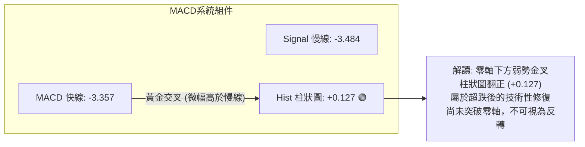

- **MACD 線與信號線**：DIF (-3.357) 略微穿越 DEA (-3.484)，在零軸下方深處形成低位金叉。
- **柱狀圖動態**：Histogram 由負翻正至 **+0.127**。雖然呈現綠色微弱看多信號，但由於雙線均在零軸深處（-3 以下），此類金叉極易演化為「零軸下中繼死叉」或弱勢震盪，屬於典型的「弱勢反彈」而非趨勢反轉。
- **背離判斷**：日線 MACD 柱狀圖在 10-16 創出最低負值後收窄翻正，但價格未破 10-23 低點 $49.25，形態呈現微幅指標修復，**未見典型的大級別底背離**。

### 📦 布林通道分析

```
RKLB 布林通道示意圖 (20日, 2σ)
價格 ($)
$68.33 ┤═══════════════════════════════════ 上軌 (BB Upper)
       │
$56.75 ┤----------------------------------- 中軌 (MA20) — 核心反壓位
       │                 
$52.37 ┤                   ●◄── 現價 ($52.37, %B = 0.31)
       │
$45.17 ┤═══════════════════════════════════ 下軌 (BB Lower) — 潛在回撤軌道
```

- **布林帶參數狀態**：
  - 上軌：**$68.33**
  - 中軌 (MA20)：**$56.75**
  - 下軌：**$45.17**
  - **布林通道指標 %B = 0.31**
- **解讀分析**：%B 為 0.31，明確指出當前價格處於下半通道（0 至 0.5 區間），空方掌控通道節奏。中軌 $56.75 呈現明確向下傾斜態勢，對價格形成嚴密的動態天花板。只要價格未能攜量站上中軌，任何觸及中軌的反彈皆為放空點；下軌 $45.17 則為空頭若跌破 S1 ($49.25) 後的短期下探磁吸目標。

### 💹 成交量分析（量價配合度）

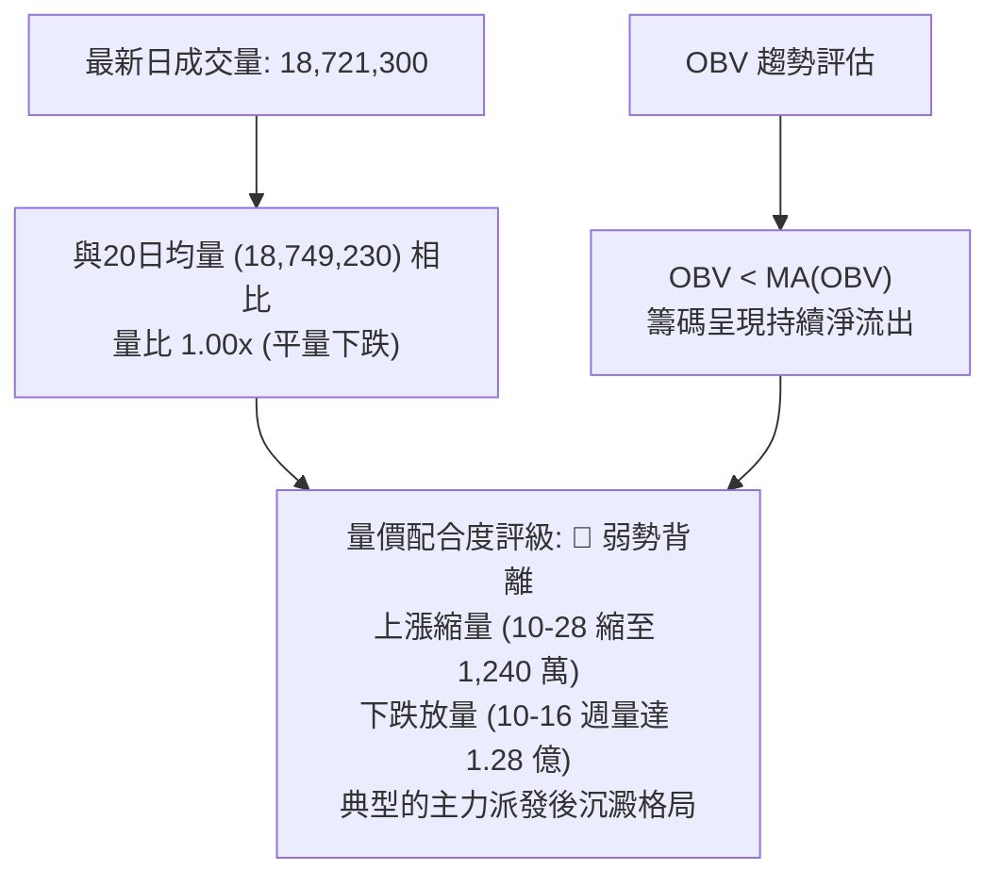

- **量比與均量特徵**：最新交易日成交量為 18,721,300 股，與 20 日均量 18,749,230 股幾乎完全一致（量比 1.00x），而略低於 50 日均量 19,479,374 股。此數據表明市場流動性陷入觀望，並未出現恐慌盤徹底出清的「天量見底」特徵。
- **OBV (能量潮) 深度解析**：數據明確指出「OBV 趨勢：OBV < MA → 量能疲弱」。這表明主力資金並無進場吸籌的軌跡，能量潮曲線被均線死死壓制，資金流向支持價格進一步下探尋底。

---

## 6. 動能與波動率

### ⚡ 動能評估四象限

根據 RKLB 目前的動能指標（RSI 38.60 偏弱、MACD 低位徘徊）與波動率（ATR 高達 7.70%、Beta 3.176）進行矩陣定位：

| 象限標籤 | 動能強度 (Momentum) | 波動率 (Volatility) | 當前狀態標記 | 戰略評估與操盤指引 |
|:---:|:---:|:---:|:---:|:---|
| **第一象限 (Q1)** | 強動能 (Bullish) | 低波動 (Low Vol) | — | 最佳穩健主升浪機會（非當前狀態） |
| **第二象限 (Q2)** | 弱動能 (Bearish) | 低波動 (Low Vol) | — | 沉悶低位橫盤休眠期（非當前狀態） |
| **第三象限 (Q3)** | 強動能 (Bullish) | 高波動 (High Vol) | — | 高風險高收益狂熱爆發期（如 2026-05 歷史高點期） |
| **第四象限 (Q4)** | **弱動能 (Bearish)** | **高波動 (High Vol)** | **✓ (當前處於此區)** | **高危下跌釋放期：嚴禁左側重倉接飛刀，反彈極易夭折** |

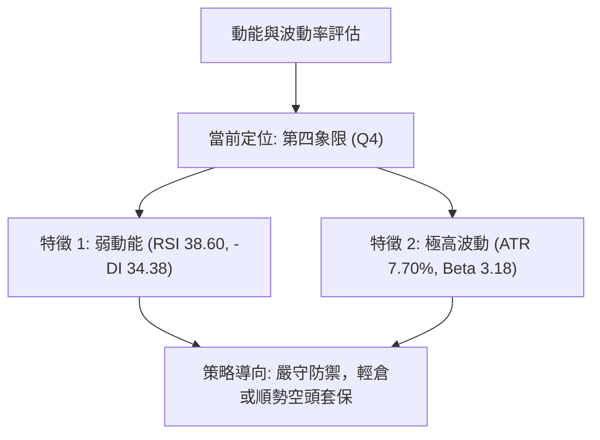

### 📊 ATR 波動率分析

- **ATR(14) 數值**：**$4.03**（採 Wilder 計算法）。
- **ATR 佔比**：佔當前股價之 **7.70%**。這意味著該股在單一交易日內，平均常態波動空間即達 $4.03，屬於美股市場中極端高波動的標的。
- **止損距離建議**：
  - 鑑於高達 7.70% 的單日 ATR，任何日內微小的噪音震盪都極易觸發過於狹窄的止損。
  - **保守型止損距離**：必須設定在 $1.5 \times \text{ATR}$ 以上，即 $\$4.03 \times 1.5 = \$6.05$。
  - **極限防守止損**：以近期關鍵支撐 S1 ($49.25$) 下方一定緩衝區為限。

### 📐 Beta 與市場相關性

- **Beta 係數**：**3.176**。
- **市場敏感度評估**：
  - RKLB 的波動彈性是大盤（S&P 500）的 **3.176 倍**。
  - 當大盤回調 1% 時，該股理論上將下挫逾 3.18%；反之亦然。這解釋了近期在宏觀與太空板塊動盪中，RKLB 股價出現崩跌式回撤的 Beta 放大效應。
  - **機構持股與放空情況**：機構持股佔比達 62.3%，但放空比率 (Short % Float) 達 7.6%（Short Ratio 2.0）。高 Beta 配合不低的做空部位，在均線空頭排列下容易產生多殺多的踩踏現象。

---

## 7. 多時框架總結

### 📋 時框架評分表

| 時框架 | 趨勢方向 | 動能狀態 | 均線排列 | 形態特徵 | 綜合評分 | 操作建議方向 |
|:---|:---:|:---:|:---:|:---:|:---:|:---|
| **長期 (月線)** | 🔴 強烈空頭 | 弱勢下探 | 跌破 MA200 | A頂崩跌破位 | 30/100 | 長線資金離場觀望，嚴禁加倉攤平 |
| **中期 (週線)** | 🔴 空頭控盤 | 下行中繼 | 均線下下彎 | 箱體向下破位 | 35/100 | 反彈皆為逢高減磅或空頭波段佈局點 |
| **短期 (日線)** | 🟡 弱勢震盪 | 短線修復 | 受到 MA20 壓制 | 潛在雙底未成形 | 45/100 | 超短線僅限嚴格止損之快進快出 |

### 🔲 綜合訊號矩陣

```
╔══════════════════════════════════════════════════════════════════╗
║                   多時框架綜合訊號交叉矩陣                       ║
╠════════════════════════════╦═════════╦═════════╦═════════════════╣
║ 維度 \ 時框                ║ 日線    ║ 週線    ║ 月線            ║
╠════════════════════════════╬═════════╬═════════╬═════════════════╣
║ 趨勢主導 (Trend Dominance) ║ 🔴 空頭 ║ 🔴 空頭 ║ 🔴 空頭         ║
║ 均線軌道 (Moving Averages) ║ 🔴 承壓 ║ 🔴 破位 ║ 🔴 跌破MA200    ║
║ 動能擺動 (Oscillators)     ║ 🟢 轉正 ║ 🔴 下傾 ║ 🔴 弱勢         ║
║ 量能支撐 (Volume Spread)   ║ 🟡 平量 ║ 🔴 賣壓 ║ 🔴 巨量派發     ║
║ 關鍵結構 (Structure)       ║ 🟡 築底 ║ 🔴 下破 ║ 🔴 深幅回撤     ║
╚════════════════════════════╩═════════╩═════════╩═════════════════╣
║ 時框收斂共振評級           ║      🔴🔴🔴 壓倒性偏空共振       ║
╚════════════════════════════╩═════════════════════════════════════╝
```

### ⚖️ 多時框收斂結論

- **遵循「嚴格要求 14」之收斂優先級規則**：
  1. **當前趨勢判定**：ADX(14) 數值為 **26.84**，明確大於 25 的趨勢分界線，**確立當前屬於標準的「趨勢行情」而非「盤整行情」**。
  2. **優先級取捨**：依規則，在 ADX > 25 的趨勢行情中，**必須以中長期（週線／MA50、MA200）方向為主導**，日線層級之訊號（如 MACD 柱狀圖翻正 +0.127）僅可用於尋找阻力位之進場放空或獲利了結時機，絕對不可作為逆勢做多的主導依據。
  3. **唯一方向性結論**：**偏空（Bearish）**。
  4. **訊號衝突收斂說明**：日線 MACD 微幅修復與下影線支撐，與週線、月線之大級別崩跌存在時框背離。在此架構下，中長期空頭具有最高統治力，判定日線反彈為「破位後的技術性抽抽回踩」，後續再度向下破位尋找支撐 S2 ($37.57) 的機率遠高於逆勢反轉。此結論完全收斂並貫徹至第 8 章之主交易策略。

---

## 8. 交易策略建議

### 🗺️ 策略決策流程圖

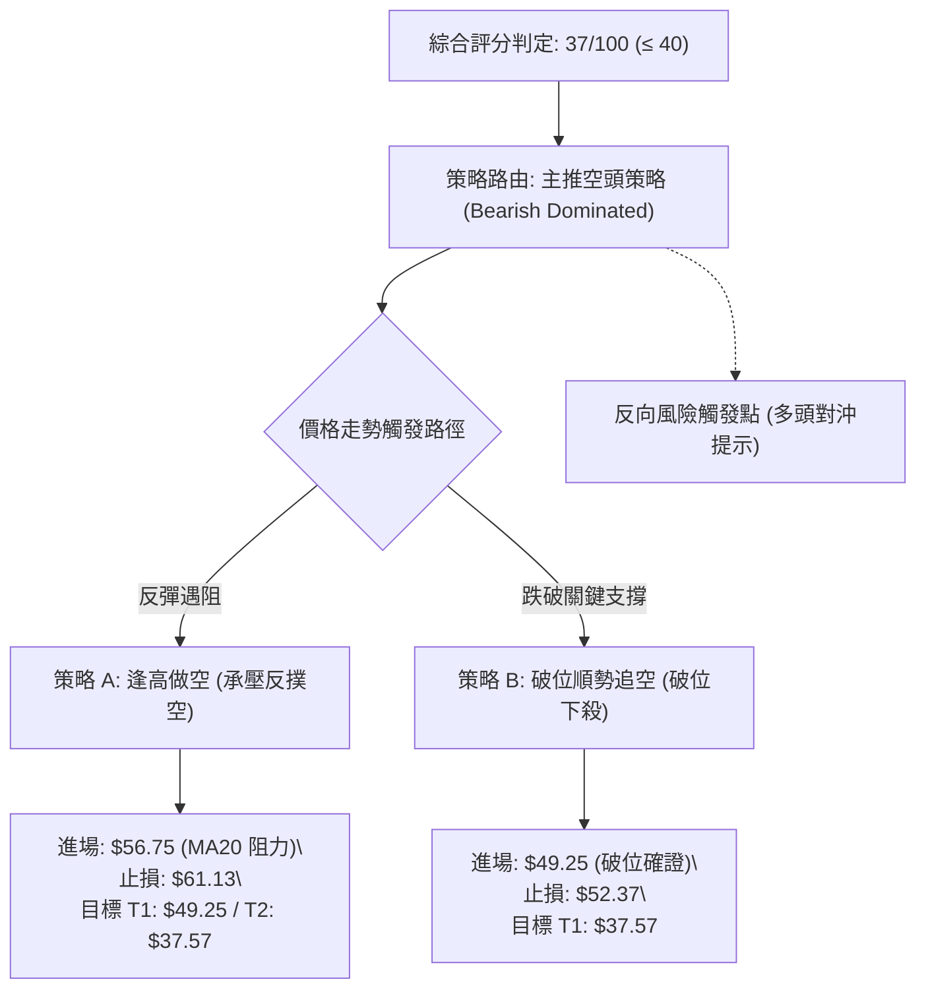

### 🧭 策略路由（依評分卡分流，嚴格執行）

- **當前主策略方向 = 🔴 主推空頭策略（依技術評分卡綜合評分 37/100，落在 ≤ 40 偏空區間）**。
- 依規則分流，本報告主推空頭佈局策略，多頭僅列為「反轉風險觸發點（對沖提示）」，杜絕兩頭下注。

### 🎯 價格情境階梯（Price Scenarios）

價位嚴格引用第 4 章及數據中之精確數值：

| 觸發條件 | 下一目標 | 後續延伸目標 | 情境技術含義與市場解讀 |
|:---|:---:|:---:|:---|
| **向上反彈突破 R1 $67.70** | R2 $75.28 | R3 $78.74 | 空頭格局遭到嚴重破壞，轉為中級反彈波段 |
| **受制於 MA20 $56.75 並站穩現價區間** | 震盪探底 | — | 於 $49.25 - $56.75 弱勢箱體進行籌碼殘餘換手 |
| **跌破 S1 $49.25** | S2 $37.57 | 數據中未偵測到 | 破位崩跌加速，直奔 52 週最低點與斐波那契 100% 歸宿 |

### 📊 情境機率分佈

| 預測情境名稱 | 發生機率 | 主要技術與量能依據 |
|:---|:---:|:---|
| **情境一：受阻回落 / 跌破再探底** | **60%** | ADX 26.84 強趨勢確立且 -DI 達 34.38；均線空頭排列向下發散；OBV < MA 顯示量能枯竭 |
| **情境二：箱體弱勢區間震盪** | **25%** | S1 $49.25 處連續兩週出現長下影線守護；日線 MACD 柱狀圖微翻正 (+0.127) 提供短期緩衝 |
| **情境三：強勢向上反彈** | **15%** | 缺乏成交量支持，且上方 R1 $67.70 與 MA200 壓制重重，除非突發基本面爆發性利多否則極難實現 |

### 🟢 主策略詳情（空頭主推策略）

嚴格依據規則 17 計算風險報酬比：做空風險報酬比 = $(\text{進場價} - \text{目標價 T1}) \div (\text{止損價} - \text{進場價})$。所有價位均取自數據之明確關鍵點位：

| 策略要素 | 策略 A：阻力位反彈做空 (主推) | 策略 B：跌破關鍵支撐順勢追空 (次選) |
|:---|:---|:---|
| **策略邏輯** | 趁日線超跌反彈觸及月線反壓放空 | 確認關鍵支撐失守後順勢追擊空頭主浪 |
| **進場條件** | 價格反彈至 MA20 / 布林中軌遇阻乏力 | 實體日K跌破關鍵支撐 S1 |
| **進場價格** | **$56.75** (精確對應 MA20 及布林中軌) | **$49.25** (精確對應支撐 S1) |
| **目標價 T1** | **$49.25** (精確引用關鍵支撐 S1) | **$37.57** (精確引用 52W Low / 支撐 S2) |
| **目標價 T2** | **$37.57** (精確引用 52W Low / 支撐 S2) | 數據中未偵測到 (僅以 T1 結清) |
| **止損價格** | **$61.13** (精確引用 10-29 波段反彈高點) | **$52.37** (精確引用當前收盤價阻力) |
| **風險報酬比** | **1 : 1.71**（以 T1 計）<br/>*計算式: (56.75 − 49.25) ÷ (61.13 − 56.75) = 7.50 ÷ 4.38 = 1.712*<br/>另列以 T2 計為 **1 : 4.38**<br/>*(56.75 − 37.57) ÷ 4.38 = 19.18 ÷ 4.38 = 4.378* | **1 : 3.74**（以 T1 計）<br/>*計算式: (49.25 − 37.57) ÷ (52.37 − 49.25) = 11.68 ÷ 3.12 = 3.743* |
| **成功機率** | **65%** | **60%** |
| **建議倉位** | **15%** (總資金佔比，控制高 Beta 波動) | **10%** (突破追單，嚴格控制部位) |

### 🔴 反向風險觸發點（對沖提示）

若市場出現以下情況，主空頭策略將被全面推翻，空單必須立即無條件止損，甚至反手對沖：
1. **價位確證**：日線收盤價**強勢帶量突破 $61.13**（10-29 倒錘頭高點），宣告雙底頸線被有效跨越，短線空頭結構瓦解。
2. **指標確證**：日線 RSI(14) 強力衝上 **55 以上**，且 MACD DIF 快線成功突破零軸。
3. **量能確證**：單日成交量放大至 **2,500 萬股以上**（顯著超越 50 日均量），形成多頭攻擊量。

### ⭐ 整體訊號強度評星

```
做多訊號強度：★☆☆☆☆  (1/5星 — 僅有MACD微弱柱狀翻正，其餘全線潰敗)
做空訊號強度：★★★★☆  (4/5星 — 均線排列、ADX趨勢、布林與OBV共振看空)
整體可信度：  ★★★★☆  (4/5星 — 多時框訊號一致性高，技術邏輯清晰)
```

---

## 9. 風險提示與監控

### ✅ 關鍵監控指標 Checklist

```
╔══════════════════════════════════════════════════════════════════╗
║                   每日盤後關鍵技術監控清單 (Checklist)           ║
╠══════════════════════════════════════════════════════════════════╣
║ [ ] 價格是否跌破近期防守底線 S1: $49.25 (破位即觸發策略 B)       ║
║ [ ] 價格反彈是否在 MA20 ($56.75) 再次遭遇長上影線壓制            ║
║ [ ] ADX(14) 是否持續維持在 25 以上 (確認趨勢行情的延續性)        ║
║ [ ] -DI 是否維持高於 +DI (確認空方控盤優勢未變)                  ║
║ [ ] 日成交量是否異常放大至 30,000,000 股以上 (警惕巨量反轉)      ║
║ [ ] RSI(14) 是否下破 30 進入極端超賣 (防範超跌報復性反彈)        ║
║ [ ] MACD 柱狀圖是否由正 (+0.127) 再次翻負 (確立空頭中繼加速)     ║
╚══════════════════════════════════════════════════════════════════╝
```

### ⚠️ 風險場景分析

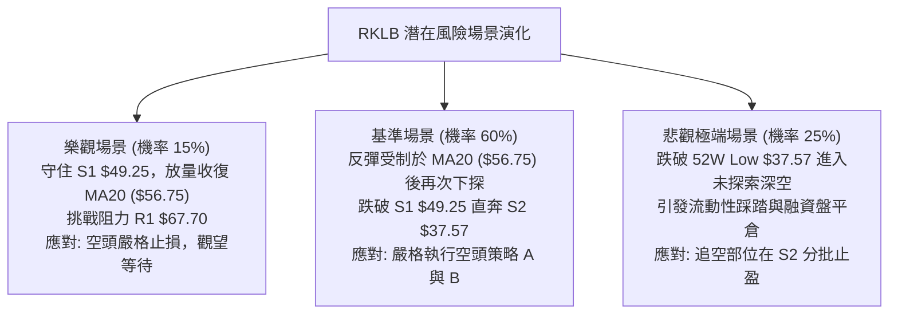

### 🛡️ 風險管理重要提醒

1. **極高 Beta 與槓桿風險**：RKLB Beta 高達 **3.176**，其日常波動劇烈程度為市場均值的 3 倍以上。任何部位操作（即使是做空）單筆承擔的總資金虧損風險嚴格不得超過總資產的 **1.0% - 1.5%**。
2. **ATR 劇烈震幅保護**：ATR(14) 為 **$4.03 (7.70%)**。這意味著盤中高低點跨度極大，嚴禁在盤中以市價單追單，所有限價單應依據明確均線與支撐阻力數值擺放，防止滑價與「插針」觸發止損。
3. **空頭擠壓 (Short Squeeze) 預警**：當前放空比率 (Short % Float) 為 **7.6%**，短期空頭籌碼相對集中。若有利好消息刺激引發跳空高開，應以價格觸及止損位為最高依據果斷離場，嚴禁抱持「死抗空單」之僥倖心理。

---

## 📋 報告總結

```
╔══════════════════════════════════════════════════════════════════╗
║                   RKLB 技術分析報告總結                          ║
╠══════════════════════════════════════════════════════════════════╣
║ 報告日期：2026-11-05                                             ║
║ 當前價格：$52.37                                                 ║
║ 分析評級：🔴 偏空震盪 (Bearish Consolidation / 評分: 37/100)      ║
║                                                                  ║
║ 關鍵結論：                                                       ║
║ ├─ 長期趨勢：🔴 強烈空頭 (自高點 $143.48 重挫，失守 MA200)       ║
║ ├─ 中期趨勢：🔴 空頭主導 (週線破位下殺，均線群呈現空頭排列)      ║
║ ├─ 短期趨勢：🟡 弱勢企穩 (受制於 MA20 $56.75，下探尋底)         ║
║ ├─ 關鍵支撐：S1 $49.25 (波段低點) / S2 $37.57 (52週最低點)       ║
║ ├─ 關鍵阻力：R1 $67.70 / R2 $75.28 / R3 $78.74                   ║
║ └─ 趨勢強度：ADX 26.84 (-DI 34.38，空方處於絕對趨勢控盤)         ║
║                                                                  ║
║ 最優策略組合：                                                   ║
║ 1. 🥇 最佳機會：策略 A (逢高做空) — 於 MA20 $56.75 進場放空，      ║
║                止損 $61.13，目標 T1 $49.25 / T2 $37.57           ║
║ 2. 🥈 次選機會：策略 B (破位追空) — 跌破 S1 $49.25 順勢做空，     ║
║                止損 $52.37，目標 T1 $37.57                       ║
║ 3. 🥉 保守選擇：空倉全面觀望 — 等待價格回落至 S2 $37.57 且       ║
║                出現明確大級別底背離與放量止跌後再行評估          ║
╚══════════════════════════════════════════════════════════════════╝
```

---

> ⚠️ **免責聲明**：本報告為技術分析研究，所有數據、圖表及測算均基於客觀歷史交易數據。本報告**僅供研究與學術參考**，**不構成任何形式的要約、招攬或投資建議**。金融市場投資具有極高風險，投資人應獨立評估自身財務狀況與風險承受能力，並自負盈虧。

---

*報告生成時間：2026-11-05 ｜ 數據來源：Yahoo Finance ｜ 分析框架：資深量化多時框技術分析體系*