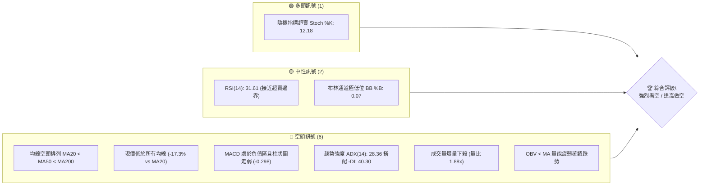
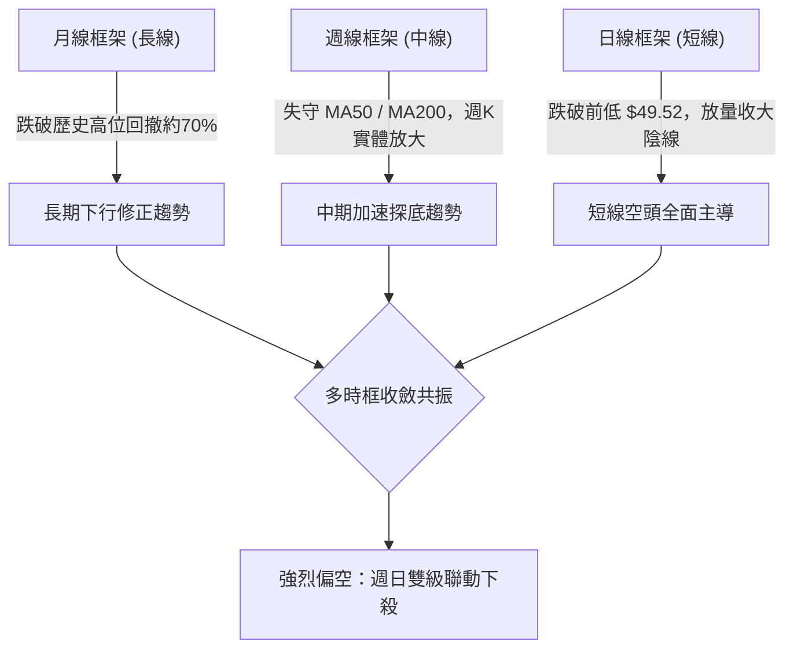
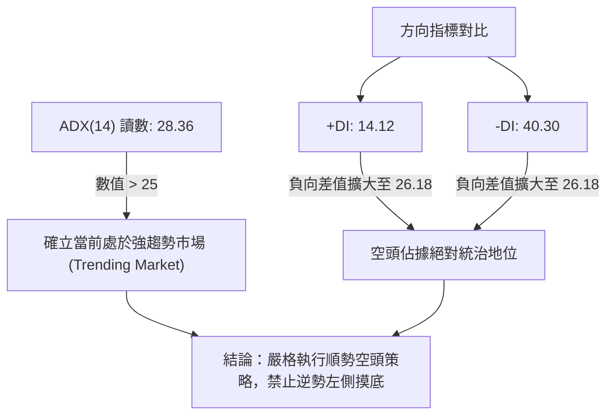
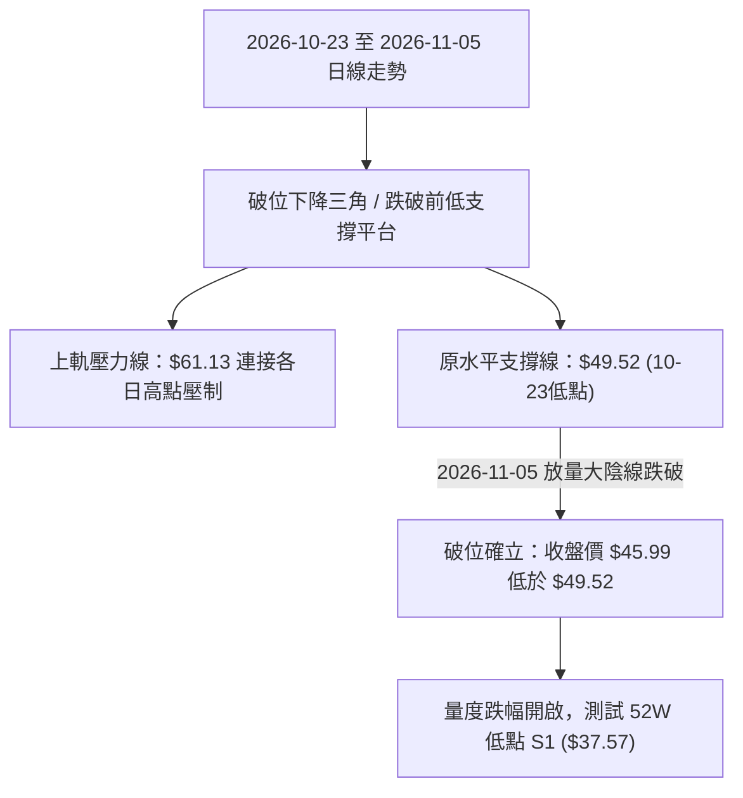
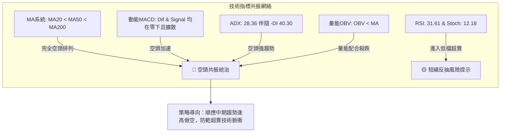
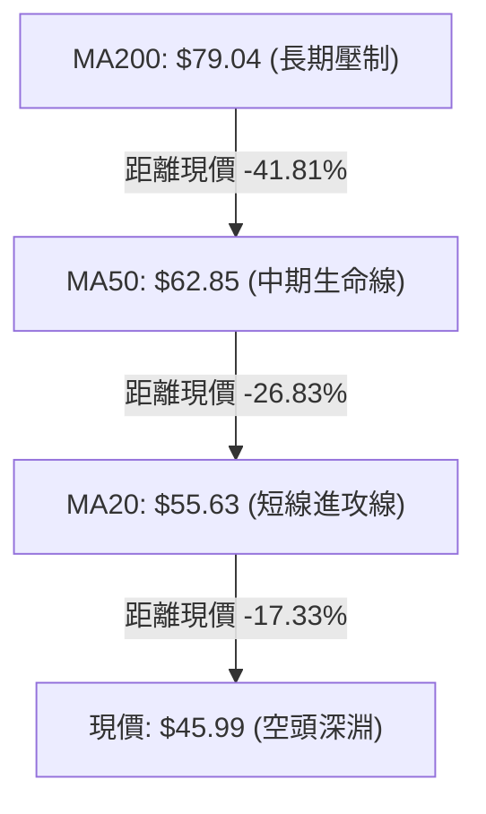
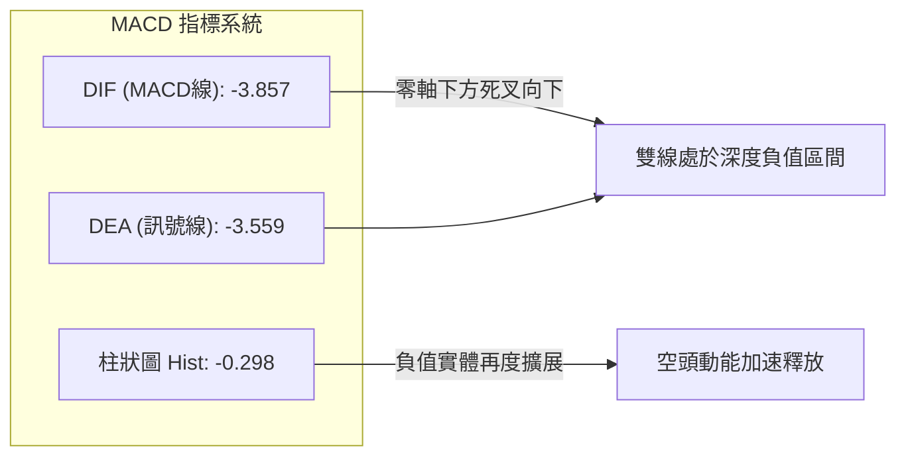
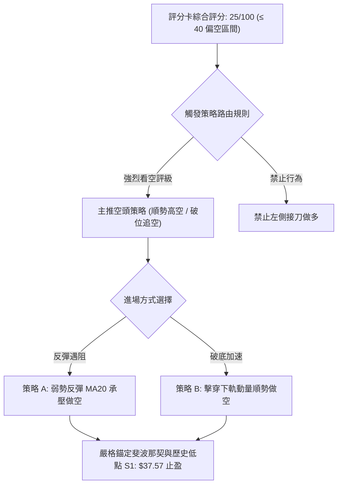
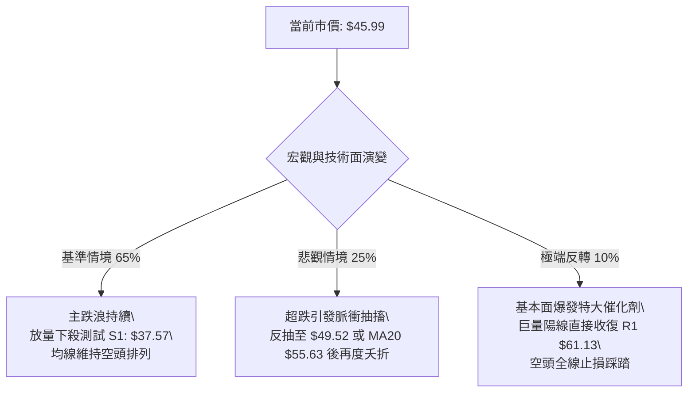

# RKLB 技術分析報告

> **報告日期**：2026-11-06 ｜ **語言**：繁體中文 ｜ **數據來源**：Yahoo Finance ｜ **當前價格**：$45.99

---

## 目錄

| 章節 | 內容 |
|------|------|
| [1. 技術面概覽](#1-技術面概覽) | 訊號儀表板、核心指標、評分卡 |
| [2. 趨勢分析](#2-趨勢分析) | 多時框趨勢、長中短期走勢 |
| [3. 圖表形態分析](#3-圖表形態分析) | 形態識別、K線組合、目標價 |
| [4. 支撐與阻力](#4-支撐與阻力) | 關鍵價位、斐波那契回調 |
| [5. 技術指標深度解讀](#5-技術指標深度解讀) | MA/RSI/MACD/布林/成交量 |
| [6. 動能與波動率](#6-動能與波動率) | 動能評估、ATR、Beta |
| [7. 多時框架總結](#7-多時框架總結) | 時框架評分矩陣 |
| [8. 交易策略建議](#8-交易策略建議) | 多空策略、風險報酬比 |
| [9. 風險提示與監控](#9-風險提示與監控) | 監控指標、風險場景 |

---

## 1. 技術面概覽

### 🎯 技術訊號儀表板



### 📊 核心指標速覽表

| 指標類別 | 指標名稱 | 當前數值 | 訊號 | 解讀 |
|----------|----------|----------|------|------|
| **價格** | 當前價格 | $45.99 | 🔴 | 位於52週區間7.4%極低分位，單日跳空重挫 |
| **均線** | MA20 | $55.63 | 🔴 | 現價低於MA20達 -17.33%，短期均線陡峭向下 |
| **均線** | MA50 | $62.85 | 🔴 | 現價低於MA50達 -26.83%，中期趨勢遭完全破壞 |
| **均線** | MA200 | $79.04 | 🔴 | 現價低於MA200達 -41.81%，長期多空分水嶺失守 |
| **動能** | RSI(14) | 31.61 | 🟡 | Wilder平滑數值處於中性偏空區間，瀕臨超賣臨界點30 |
| **動能** | MACD(12,26,9) | -3.857 / -3.559 | 🔴 | MACD位於零軸下方且Dif跌破Signal，柱狀體為 -0.298 |
| **趨勢** | ADX(14) | 28.36 | 🔴 | ADX>25呈現強勁趨勢，-DI (40.30) 遠高於 +DI (14.12)，空頭主導 |
| **通道** | 布林帶 %B | 0.07 | 🟡 | 現價緊貼布林下軌 $44.46，短線有超賣反抽可能但下軌張口 |
| **量能** | 當日成交量 | 36,507,900 | 🔴 | 量比達 1.88x，大陰線伴隨機構籌碼出逃放量特徵 |
| **波動** | ATR(14) | $4.35 | 🔴 | 佔價格比率高達 9.46%，波動風險極高 |

### 🏆 技術評分卡

```
╔══════════════════════════════════════════════════════════════╗
║                 技術評分卡 — RKLB (2026-11-06)               ║
╠══════════════════════════════════════════════════════════════╣
║ 趨勢強度 (Trend)      ████████░░░░░░░░░░░░  40/100  🔴 空頭強勢║
║ 動能指標 (Momentum)   ██████░░░░░░░░░░░░░░  30/100  🔴 動能渙散║
║ 支撐穩定度 (Support)  ██████░░░░░░░░░░░░░░  30/100  🔴 逼近新低║
║ 成交量配合 (Volume)   ████░░░░░░░░░░░░░░░░  20/100  🔴 放量下殺║
║ 形態完整度 (Pattern)  ████░░░░░░░░░░░░░░░░  20/100  🔴 破位下行║
║ 均線排列 (Moving Avg) ██░░░░░░░░░░░░░░░░░░  10/100  🔴 完全空頭║
╠══════════════════════════════════════════════════════════════╣
║ 綜合評分 (Overall)    ████░░░░░░░░░░░░░░░░  25/100  🔴 強烈看空║
╚══════════════════════════════════════════════════════════════╝
```
*(註：綜合評分由六項子評分算術平均計算：(40 + 30 + 30 + 20 + 20 + 10) / 6 = 25/100，評級依規則 18 判定為強烈看空。)*

---

## 2. 趨勢分析

### 🌐 多時框趨勢分析



### 📈 長期趨勢 — 12個月走勢圖（Unicode）

```
RKLB 月線走勢圖（過去12個月：2025-12 至 2026-11）
價格軸 ($)
$150 ┤                                  ● 2026-05 ($143.48)
$130 ┤                                 / \
$110 ┤                                /   ● 2026-06 ($101.65)
 $90 ┤                 ● 2026-01     /     \
 $70 ┤● 2025-12       / \           ● 04    \     ● 2026-09 ($69.68)
 $50 ┤ ($69.76)      /   ● 02-03 ($64.22)    ● 07-08   \     ●←現價 ($45.99)
 $30 ┤              /                        ($63.92)   ● 10 ($54.73)
     └─────────────────────────────────────────────────────────────
       12M    11M   10M    9M   8M    7M    6M    5M    4M   3M    2M   當前
      '25-12 '26-01 '26-02 '03  '04   '05   '06   '07   '08  '09   '10  '11
```

#### 走勢特徵分析表格

| 階段時間 | 月收盤價變動 | 區間漲跌幅 | 成交與形態特徵 | 趨勢性質 |
|----------|--------------|------------|----------------|----------|
| 2025-12 ~ 2026-01 | $69.76 → $80.07 | +14.78% | 突破前期平台，呈現波段主升浪前奏 | 長期多頭推升 |
| 2026-02 ~ 2026-03 | $69.10 → $64.22 | -7.06% | 縮量良性回踩，確立 $64.22 中期支撐平台 | 高位強勢整理 |
| 2026-04 ~ 2026-05 | $82.51 → $143.48| +73.89% | 投機性爆發拉升，月線創歷史天價 $151.00 後見頂 | 極端拋物線主升浪 |
| 2026-06 ~ 2026-07 | $101.65 → $64.95| -36.10% | 頂部破位腰斬，獲利盤與高槓桿多頭踐踏 | 崩盤式快速回撤 |
| 2026-08 ~ 2026-09 | $63.92 → $69.68 | +9.01% | 於 $64.00 上方構築雙底頸線反彈，受阻於 $75 阻力 | 中繼反彈波段 |
| 2026-10 ~ 2026-11 | $54.73 → $45.99 | -15.97% | 連續失守整數關口與日線支撐，加速逼近52W低點 | 破位下行主跌浪 |

### 📊 中期趨勢（週線分析）

```
中期週線阻力與支撐空間示意圖
價格 ($)
 78.28 ┬─── 近8週波段最高點 (2026-10-09 當週高點) ─── [頂部強阻力聚類]
 75.28 ├─── 波段阻力 R3
 67.70 ├─── 波段阻力 R2
 61.13 ├─── 近期反彈高點阻力 R1 (2026-10-30 週高點) ── [短線重要頸線位]
 55.63 ├─── MA20 / 布林中軌壓力帶
 45.99 ┼─── 現價 ($45.99) ── [緊貼布林下軌 $44.46]
 37.57 ┴─── 52週波段歷史最低點 S1 ── [終極多頭防守底線]
```

週線指標顯示，自 2026-09-25 創出收盤反彈高點 $73.95 以來，週線 RSI 從 59.4 快速崩跌至當前的 31.6，MACD 柱狀圖在短暫翻紅（+1.614）後迅速衰退並於 2026-11-05 跌入負值區（-0.298）。週線層級呈現典型的「反彈無力、再次破底」空頭結構。

### ⚡ 趨勢強度評估（ADX 解讀）



#### ADX 趨勢強度對照表

| 指標名稱 | 數值 | 臨界基準 | 當前狀態評估 | 操作指引 |
|----------|------|----------|--------------|----------|
| **ADX(14)** | 28.36 | 25.00 | 強趨勢形成階段（ADX > 25） | 遵循趨勢跟踪，放棄區間震盪高拋低吸思維 |
| **+DI(14)** | 14.12 | 20.00 | 多頭進攻動能極度渙散 | 缺乏買盤承接力，反彈高度受限 |
| **-DI(14)** | 40.30 | 25.00 | 空頭拋售動能極度強盛 | 具備強烈向下慣性，空單持倉優勢顯著 |
| **趨勢綜合**| 偏空趨勢 | 差值擴大 | 空方動能完勝多方 | 優先順應週日級別順勢逢高做空 |

---

## 3. 圖表形態分析

### 🔍 形態識別系統



#### 形態識別與信心度評估表

| 形態名稱 | 信心度 | 判斷依據（引用數據） | 完成度 | 目標價（附計算式） |
|----------|--------|----------------------|--------|--------------------|
| **短期破位下降三角** | 85% | 10-29 高點 $61.13，10-23 低點 $49.52，11-05 跌破低點收 $45.99 | 100% (已破位) | 頸線 $49.52 − 形態高差 ($61.13 − $49.52 = $11.61) = **$37.91**（直接威脅 S1 $37.57） |
| **布林下軌開口突破** | 90% | 收盤價 $45.99 逼近下軌 $44.46，BB %B 為 0.07，波動率擴張 | 95% | 沿通道下軌滑落，初步尋求 S1 **$37.57** |
| **反轉頭肩頂 / 雙底** | 20% | 數據不足以確認任何看多底部幾何結構 | 0% | 訊號不足，僅做指標型超賣解讀 |

### 🕯️ 重要K線形態分析

嚴格依據數據中「近10根日K」與「近8根週K」的實際 OHLCV 進行解析：

#### 近10根日K形態精析

| 日期 | 開盤價 | 最高價 | 最低價 | 收盤價 | K線形態 | 技術解讀 | 訊號 |
|------|--------|--------|--------|--------|---------|----------|------|
| 2026-10-23 | $50.73 | $52.92 | $49.52 | $52.60 | 探底小陽線 | 在 $49.52 獲得支撐，留有下影線，形成短暫防守底 | 🟡 |
| 2026-10-26 | $52.60 | $54.99 | $52.15 | $53.82 | 連續上攻陽線 | 實體溫和放大，呈現技術性弱勢反彈走勢 | 🟡 |
| 2026-10-27 | $54.10 | $59.18 | $53.57 | $58.31 | 放量大陽線 | 成交量增至 21.34M，突破 $58，多頭主力短暫發力 | 🟢 |
| 2026-10-28 | $58.49 | $59.30 | $56.94 | $58.60 | 高位十字星 | 上攻遇阻，高點受制於 $60 整數大關，買盤動能衰竭 | 🟡 |
| 2026-10-29 | $57.76 | $61.13 | $57.63 | $59.10 | 長上影倒錘頭 | 衝擊波段高點 R1 $61.13 未果，拋壓沉重，確認波段見頂 | 🔴 |
| 2026-10-30 | $55.71 | $57.55 | $53.19 | $54.73 | 覆蓋陰線 | 跳空低開低走，完全吞噬前兩日漲幅，反彈波段告終 | 🔴 |
| 2026-11-02 | $55.08 | $55.08 | $50.68 | $52.07 | 禿頭中陰線 | 開盤即最高價，空頭長驅直入，考驗 $50 整數防線 | 🔴 |
| 2026-11-03 | $53.10 | $54.94 | $52.90 | $54.43 | 弱勢小陽線 | 縮量抵抗，反彈無法收復前一日高點，屬典型空頭中繼 | 🟡 |
| 2026-11-04 | $54.60 | $55.31 | $50.41 | $52.37 | 衝高回落倒錘陰 | 多頭再次嘗試上拉至 $55.31 失敗，尾盤殺跌逼近前低 | 🔴 |
| 2026-11-05 | $50.58 | $50.83 | $43.89 | $45.99 | 破位巨量大長陰 | 成交量暴增至 36.51M，跳空擊穿 $49.52 平台，最低殺至 $43.89 | 🔴 |

#### 近8根週K形態精析

| 週末日期 | 開盤價 | 最高價 | 最低價 | 收盤價 | K線形態 | 技術解讀 | 訊號 |
|----------|--------|--------|--------|--------|---------|----------|------|
| 2026-09-18 | $60.55 | $68.64 | $60.51 | $64.57 | 探底回升中陽 | 成交 106.9M，在 $60 上方形成週線支撐買盤 | 🟢 |
| 2026-09-25 | $65.29 | $75.46 | $65.28 | $73.95 | 長紅實體大陽 | 衝擊 $75.46，確認週線反彈高浪，MACD 柱轉正 | 🟢 |
| 2026-10-02 | $73.20 | $76.09 | $69.40 | $73.92 | 高位流星線 | 上影線測試阻力區 $76.09，多頭推升力道觸頂停滯 | 🟡 |
| 2026-10-09 | $73.70 | $78.28 | $66.98 | $68.21 | 衝高回落長陰 | 週高 $78.28 後殺跌，收盤跌破開盤，確立週線雙頂結構 | 🔴 |
| 2026-10-16 | $67.88 | $68.07 | $49.69 | $50.84 | 崩盤大陰線 | 成交放大至 128M，週跌幅逾 25%，直接擊穿 $50 | 🔴 |
| 2026-10-23 | $52.28 | $53.90 | $49.25 | $52.60 | 低位十字孕線 | 週線縮量至 82M，在 $49.25 處尋求技術性弱勢抵抗 | 🟡 |
| 2026-10-30 | $52.60 | $61.13 | $52.15 | $54.73 | 長上影弱陽線 | 向上測試反彈阻力 R1 $61.13 遭無情壓制，留長上影線 | 🔴 |
| 2026-11-05 | $55.08 | $55.31 | $43.89 | $45.99 | 實體破位大陰 | 跌破前期多週低點 $49.25，向 52W 低點 $37.57 展開主跌 | 🔴 |

### 📉 ASCII 走勢形態示意圖

```
近10日日K破位形態（下降三角跌破平台示意）
價格 ($)
 61.13 ┬───────────────────────● (10-29 高點 R1 築頂)
       │                       / \
 58.00 ┤              ●───────●   \
       │             /             \
 55.00 ┤            /               ●───● (11-03, 11-04 弱勢反彈遇阻)
       │           /                     \
 52.00 ┤──●       /                       \
       │   \     /                         \
 49.52 ┼────●───●───────────────────────────\────── [破位頸線支撐平台失守]
       │   (10-23 低點)                      \
 45.99 ┼──────────────────────────────────────● (11-05 收盤破位 $45.99)
       │                                       \
 43.89 ┴────────────────────────────────────────● (11-05 盤中最低點)
```

### 🎯 形態目標價計算

根據 2026-10-23 至 2026-11-05 構建的短期破位下降三角形態進行嚴格幾何量度測算：
1. **形態基準頸線（支撐平台）**：以 2026-10-23 日低點 **$49.52** 為基準。
2. **形態頂部阻力點**：以 2026-10-29 日高點 **$61.13** 為反彈極限點。
3. **形態高度 ($H$) 計算**：
   $$H = \text{形態頂部} - \text{基準頸線} = \$61.13 - \$49.52 = \$11.61$$
4. **破位最小量度目標價 (Measured Target)**：
   $$\text{目標價} = \text{基準頸線} - H = \$49.52 - \$11.61 = \$37.91$$
5. **數據驗證與收斂**：此計算目標價 **$37.91** 與技術數據中波段低點聚類計算出的 52 週最低點支撐位 **S1 ($37.57)** 存在極高契合度（價差僅 $0.34）。這表明一旦 $49.52 平台破位確立，價格具備直奔歷史低點 S1 的強烈趨勢引力。

---

## 4. 支撐與阻力

### 🗺️ 關鍵價位分布圖（Unicode）

```
╔══════════════════════════════════════════════════════════════════╗
║                    RKLB 價位結構分布圖                           ║
╠══════════════════════════════════════════════════════════════════╣
║ $79.04 ║██████████████████████████████║ 長期多空分水嶺 MA200     ║
║ $75.28 ║████████████████████████      ║ 波段強阻力 R3 (+63.70%) ║
║ $67.70 ║████████████████              ║ 波段阻力 R2 (+47.21%)   ║
║ $62.85 ║████████████                  ║ 中期生命線 MA50         ║
║ $61.13 ║████████████████████          ║ 關鍵阻力 R1 (+32.92%)   ║
║ $55.63 ║████████                      ║ 短期壓制線 MA20/BB中軌   ║
║ $45.99 ╠══════════════════════════════╣ ◄ 當前收盤價格 ($45.99) ║
║ $44.46 ║▒▒▒▒▒▒                        ║ 布林通道下軌極限支撐     ║
║ $37.57 ║██████████████████████████████║ 52W 最低點強支撐 S1     ║
╚══════════════════════════════════════════════════════════════════╝
```

### 🚧 阻力位分析表

*(註：價位完全引用「關鍵價位」區塊波段高點聚類數值)*

| 阻力級別 | 價位 | 形成原因 | 突破難度 | 重要性 |
|----------|------|----------|----------|--------|
| **R1** | $61.13 | 2026-10-29 波段衝高頂點，近10日日K反彈最高點壓制聚類 | 🔴 極高 | ★★★★☆ 短線多空強弱分水嶺，未收復前短線維持極度看空 |
| **R2** | $67.70 | 近一年密集震盪籌碼套牢區中軸，接近 2026-07 月末週收盤平台 | 🔴 極難 | ★★★★☆ 中期反彈主要障礙，需巨量籌碼換手方可突破 |
| **R3** | $75.28 | 近一年波段高點聚類，對應 2026-09-25 週線反彈高點 $75.46 區域 | 🔴 險峻 | ★★★★★ 多頭中長期反轉頸線位，受 MA200 ($79.04) 疊加壓制 |

### 🛡️ 支撐位分析表

*(註：價位完全引用「關鍵價位」區塊波段低點聚類數值)*

| 支撐級別 | 價位 | 形成原因 | 守住機率 | 重要性 |
|----------|------|----------|----------|--------|
| **S1** | $37.57 | 52週歷史波段最低點聚類，斐波那契回調 100.0% 終極支撐位 | 🟡 45% | ★★★★★ 全年最後一道多頭實質防線，失守將開啟無支撐破底模式 |
| **S2** | N/A（數據未提供） | 數據中未偵測到更低層級波段低點聚類 | N/A | N/A |
| **S3** | N/A（數據未提供） | 數據中未偵測到更低層級波段低點聚類 | N/A | N/A |

### 📐 斐波那契回調位分析

依據 52 週區間高點 **$151.00** 至低點 **$37.57** 之完整波段計算（回調位完全引用給定數值）：

```
0.0%  (52W High) ────────────────────────── $151.00  (歷史天價頂部)
23.6%            ────────────────────────── $124.23
38.2%            ────────────────────────── $107.67
50.0%            ────────────────────────── $ 94.28
61.8%            ────────────────────────── $ 80.90  (黃金分割回調位，緊鄰 MA200 $79.04)
78.6%            ────────────────────────── $ 61.84  (強阻力位，緊鄰 R1 $61.13)
現價             ──► $45.99  (落於 78.6% 與 100.0% 之間)
100.0% (52W Low) ────────────────────────── $ 37.57  (全年最低點支撐 S1)
```

#### 斐波那契位置深度解讀
1. **當前區間落點**：現價 **$45.99** 目前處於 **78.6% ($61.84)** 與 **100.0% ($37.57)** 之間的深度回調極弱勢區域。
2. **多空心理意義**：
   - 價格已深度跌破 61.8% ($80.90) 黃金分割防守位，意味著始於 2026 年初的多頭主升浪架構遭到 100% 破壞。
   - 斐波那契 78.6% 回調位 $61.84 與阻力位 R1 ($61.13) 形成強烈的「共振阻力帶」，確立此區域為反彈的鐵壁天花板。
   - 現價距離 100.0% 回調位 $37.57 僅剩 $8.42 (-18.31%) 的空間，這意味著空頭慣性下殺的磁吸目標即為全年的波段低點。

---

## 5. 技術指標深度解讀

### 🎛️ 指標訊號總覽



### 📈 移動平均線排列分析



#### 移動平均線系統狀態表

| 均線名稱 | 數值 | 現價差距 | 現價相對位置 | 趨勢方向 | 形態特徵 |
|----------|------|----------|--------------|----------|----------|
| **MA 5** | $51.92 | -11.42% | 下方 | ▼ 陡峭下行 | 短線殺跌角度擴大，呈現超跌偏離 |
| **MA 10** | $54.20 | -15.15% | 下方 | ▼ 下行 | 壓制近兩週所有反彈嘗試 |
| **MA 20** | $55.63 | -17.33% | 下方 | ▼ 下行 | 20日扣抵高位，短線下壓斜率極大 |
| **MA 50** | $62.85 | -26.83% | 下方 | ▼ 下行 | 中期下降通道頂軌，空頭防守核心 |
| **MA 60** | $64.78 | -29.00% | 下方 | ▼ 下行 | 與阻力位 R2 形成重合壓制帶 |
| **MA120** | $80.02 | -42.53% | 下方 | ▼ 下行 | 半年線持續壓低，牛熊轉換失敗 |
| **MA200** | $79.04 | -41.81% | 下方 | ▼ 下行 | 年線壓頂，完全處於熊市格局 |
| **MA240** | $76.92 | -40.21% | 下方 | ▼ 下行 | 長期均線完全失守 |

**均線結構綜合解讀**：
當前呈現標準且極度發散的「全空頭排列」（MA5 < MA10 < MA20 < MA60 < MA200）。現價與短期 MA20 乖離率達 -17.33%，雖存在技術性超跌均線修復需求，但在均線下行慣性強勁的背景下，反抽均線均為絕佳的逢高加空點。

### 📉 RSI(14) 分析

#### RSI 數值強度展示
```
RSI(14) 當前讀數: 31.61 (Wilder平滑)
[0] ─────────────── [30] ──●────────────── [70] ─────────────── [100]
     超賣區 (Oversold)    現價 31.61          超買區 (Overbought)
進度條: ██████░░░░░░░░░░░░░░ 31.61%  (處於中性偏空臨界點)
```

#### 背離檢驗與結論
- **背離檢驗結論**：**無明顯背離**。
- **具體依據**：比對近 20 根 K 棒走勢，價格自 10-29 高點 $61.13 持續跌至 11-05 的 $45.99（創波段新低），RSI(14) 同步由約 59 下滑至 31.61（同步創波段新低）。指標與價格保持高度同向性，並未出現「價格創新低而 RSI 抬高」的底背離形態，亦無頂背離現象。這證明當前下跌為真實賣盤推動，尚未進入背離衰竭期。

### 📊 MACD(12/26/9) 訊號解讀



- **MACD 線 (DIF)**：-3.857
- **訊號線 (DEA)**：-3.559
- **柱狀圖 (Histogram)**：-0.298
- **技術解讀**：MACD 線與訊號線雙雙深陷零軸之下，且 DIF 於負值區重新跌破 DEA 形成空頭擴散，柱狀圖在 10-30 週暫時翻正後迅速重新翻綠收於 -0.298。零軸之下的死叉通常意味著中期「主跌浪」的重啟，多頭無力組織有效攻勢。

### 📦 布林通道分析

```
ASCII 布林通道位置示意圖 (日線級別，參數 20, 2)
價格 ($)
 66.79 ┬──────────────────────────────────────────── BB 上軌 (Upper Band)
       │
 55.63 ┼──────────────────────────────────────────── BB 中軌 / MA20 (Middle Band)
       │
 45.99 ┼─► [現價 $45.99，BB %B = 0.07]
 44.46 ┴──────────────────────────────────────────── BB 下軌 (Lower Band)
```

- **布林上軌**：$66.79
- **布林中軌**：$55.63 (MA20)
- **布林下軌**：$44.46
- **帶寬 (%B)**：0.07 (現價緊貼下軌，極度逼近下軌 0.0 軸)
- **通道形態分析**：伴隨 11-05 的爆量大陰線，原本收斂的布林通道呈現向下「喇叭口開口」破位形態。%B 驟降至 0.07 表明價格跌速極快。雖然緊貼下軌通常隱含短線超賣，但在趨勢行情（ADX > 25）中，價格常伴隨布林下軌持續向下「滑軌走跌」，通道下軌無法構成強效支撐，反而轉化為強大向下拉力。

### 💹 成交量分析（量價配合度）

```
量價配合關係柱狀對比
日均量 (20日) 19.42M ░░░░░░░░░░░░░░░░░░░░ (基準 1.0x)
最新量 (11-05) 36.51M ████████████████████████████████████ (1.88x 巨量破位)
```

1. **量價配合度解讀**：2026-11-05 單日成交量爆發至 36,507,900 股，相較於 20 日均量 19,423,945 股呈現 **1.88 倍**的巨量放大，大陰線實體達 -$6.38 (-12.18%)。這是極度典型的「放量破位下跌」，表明機構主力資金進行了堅決的止損與清倉式拋售，恐慌盤全面湧出。
2. **OBV (能量潮指標) 走勢**：數據顯示當前「OBV < MA → 量能疲弱」。OBV 處於均線下方持續下行，顯示每一波微小的反彈成交量均呈現縮量，而下跌時均呈現放量，量能與價格下行呈現高度的一致性驗證，量價結構完全健康地支持空頭趨勢。

---

## 6. 動能與波動率

### ⚡ 動能評估四象限

```
動能與波動率定位矩陣
       高波動率 (High Volatility)
           │
     Q3    │    Q4 (當前定位: RKLB)
 (強動能/  │ (弱動能/高波動)
  高波動)  │  ◄ 現價落點：Beta 3.18, ATR 9.46%, ADX 28.36 (-DI主導)
           │    狀態：空頭加速破位，下行爆發力強，避免左側接刀
───────────┼───────────────────────────
     Q1    │    Q2
 (強動能/  │ (弱動能/低波動)
  低波動)  │
           │
       低波動率 (Low Volatility)
  弱 ◄─────────────────────────► 強 (空頭動能方向)
```

#### 動能評估四象限分析表

| 象限標籤 | 動能狀態 | 波動狀態 | 標的所屬 | 戰術應對與風險評估 |
|----------|----------|----------|----------|--------------------|
| **第一象限 (Q1)** | 多頭強動能 | 低波動 | 否 | 穩健突破買進，波段持有 |
| **第二象限 (Q2)** | 弱動能震盪 | 低波動 | 否 | 觀望等待方向明朗 |
| **第三象限 (Q3)** | 多頭強動能 | 高波動 | 否 | 激進多頭進場，伴隨高止損幅度 |
| **第四象限 (Q4)** | **空頭強動能** | **極高波動** | **✓ RKLB** | **順勢高空主導，嚴禁逆勢抄底，嚴防下行尾端抽搐** |

### 📊 ATR 波動率分析

- **ATR(14) 絕對數值**：**$4.35**
- **ATR 佔比 (波動幅度)**：高達當前價格的 **9.46%** (依據 Wilder 平滑法計算)
- **單日預期波幅範圍**：以現價 $45.99 計算，單日正常波動區間覆蓋 $41.64 至 $50.34。
- **交易風控指引**：
  - 由於日均波動高達近 10%，任何過於狹窄的止損（如 < 1.0 ATR）極易被日常隨機雜訊掃出場。
  - **建議交易止損距離**：短線策略設定為 1.0 至 1.5 倍 ATR，即 **$4.35 至 $6.53** 的安全防護墊。
  - **倉位計算基準**：高 ATR 意味著單日資本曝險巨大，必須將整體名義倉位壓制在常規持倉的 30%~50% 水平。

### 📐 Beta 與市場相關性

- **Beta 係數**：**3.176** (極高彈性，超高波動成長股)
- **市場特徵解析**：
  - RKLB 具備大盤（標普500指數）3.18 倍的波動放大倍數。當市場風險偏好（Risk-Off）惡化或科技航太板塊遭拋售時，該股呈現倍數級暴跌。
  - 當前市場新聞反映「AI 股票拋售潮波及太空領域，板塊重挫」，這與 3.18 的超高 Beta 形成完美邏輯閉環。在系統性宏觀逆風下，高 Beta 特性導致 RKLB 成為機構首選的提款對象。

---

## 7. 多時框架總結

### 📋 時框架評分表

| 時框架 | 趨勢方向 | 動能狀態 | 均線排列 | 形態特徵 | 綜合評分 | 戰術建議 |
|--------|----------|----------|----------|----------|----------|----------|
| **月線 (長線)** | 🔴 長期下行回撤 | 弱 (跌幅超70%) | 空頭壓制 (跌破高點) | 拋物線頂部崩塌 | 30/100 | 長期戰略觀望，等待打底 |
| **週線 (中線)** | 🔴 中期加速破底 | 弱 (MACD柱翻綠) | 空頭排列 (失守MA200) | 衝高回落雙頂破位 | 20/100 | 逢反彈反手佈局做空 |
| **日線 (短線)** | 🔴 短線巨量暴跌 | 極弱 (RSI 31.6) | 完美發散空頭排列 | 下降三角破位下殺 | 25/100 | 順勢尋找次級反彈點做空 |

### 🔲 綜合訊號矩陣

```
╔══════════════════════════════════════════════════════════════════╗
║               RKLB 多時框綜合訊號矩陣                            ║
╠══════════════════════════════════════════════════════════════════╣
║ 分析維度     短線 (日線)          中線 (週線)          長線 (月線)║
╠══════════════════════════════════════════════════════════════════╣
║ 趨勢方向     🔴 極度看空          🔴 明確看空          🔴 深度修正║
║ 動能擺動     🟡 臨界超賣          🔴 動能衰竭          🔴 投機退潮║
║ 均線結構     🔴 均線死叉發散      🔴 均線全線失守      🟡 長期均線走平║
║ 量價關係     🔴 放量大陰破位      🔴 反彈縮量下跌放量  🔴 頂部天量出貨║
║ 形態結構     🔴 破位量度開啟      🔴 反彈高點逐級下移  🔴 巨型A頂回調 ║
╠══════════════════════════════════════════════════════════════════╣
║ 時框收斂一致度：██████████████████░░ 90% (強烈高度共振偏空)     ║
╚══════════════════════════════════════════════════════════════════╝
```

### ⚖️ 多時框收斂結論

嚴格依據「規則 14 多時框收斂規則」進行研判：
1. **行情性質判定**：當前日線 ADX(14) 讀數為 **28.36**，明確大於臨界基準 25.0，且 -DI (40.30) 具備絕對主導權。因此嚴格定義當前為**「強趨勢行情」（Trending Market）**，而非區間盤整行情。
2. **主導時框優先級**：在趨勢行情中，中長期（週線級別 / MA50 $62.85、MA200 $79.04）方向具備最高裁決權。目前週線處於破位下跌波段，所有均線失守；日線則用以尋求進場點位。
3. **收斂統一結論**：**唯一方向性結論為「強烈偏空」**。各時框之間無訊號衝突，呈現由長至短的共振殺跌，第 8 章交易策略完全收斂為主推「空頭策略」。

---

## 8. 交易策略建議

### 🗺️ 策略決策流程圖



### 🧭 策略路由

> **當前主策略方向 = 強烈偏空 / 主推空頭策略（依綜合評分 25/100，規則 18 判定）**

依據規則，綜合評分 ≤ 40 必須主推空頭策略，多頭僅列為反轉風險對沖提示，嚴禁兩頭下注。

### 🎯 價格情境階梯（Price Scenarios）

價位完全嚴格引用「關鍵價位（OHLCV計算）」及第 4 章數據：

| 觸發條件 | 下一目標 | 後續延伸 | 情境含義 |
|----------|----------|----------|----------|
| **反彈受阻於 R1 $61.13** | 回測 $49.52 頸線 | 測試 S1 $37.57 | 中期反彈確認無效，空頭再次主導 |
| **跌破下軌並逼近現價下方** | 探底 S1 $37.57 | 數據中未偵測到 | 破位加速主跌浪，測試全年唯一波段低點 |
| **強勢突破 R1 $61.13 (反轉)** | 測試 R2 $67.70 | 挑戰 R3 $75.28 | 短線空頭結構被破壞，空單必須無條件止損 |

### 📊 情境機率分佈

| 情境類型 | 預測機率 | 主要技術指標依據 |
|----------|----------|------------------|
| **加速回落 / 探底 S1** | **65%** | ADX 28.36 強趨勢、-DI 40.30、OBV 量能衰竭、巨量大陰線跌破平台 |
| **弱勢抽搐 / 低位橫盤** | **25%** | RSI(14) 降至 31.61 逼近超賣，隨機指標 Stoch %K: 12.18 極度超賣 |
| **強烈反轉 / 向上突破** | **10%** | 均線空頭完全排列壓制，當前無任何底背離或買盤進駐跡象 |

### 🟢 主策略詳情（方向：空頭主推）

*(註：風險報酬比嚴格按規則 17 計算：做空時比值 = (進場價 − 目標價 T1) ÷ (止損價 − 進場價)，格式為 1 : X.XX)*

| 策略要素 | 策略 A（反彈高空 — 逢阻力回抽佈局） | 策略 B（破位追空 — 順勢動量跟進） |
|----------|-----------------------------------|-----------------------------------|
| **進場條件** | 價格超跌弱勢反抽 MA20 / 前低阻力區受阻 | 盤中直接跌破前日最低點 $43.89 確認破位 |
| **進場價格** | **$49.52** (原日線平台頸線轉阻力位) | **$43.89** (2026-11-05 盤中最低點) |
| **目標價 T1** | **$37.57** (52週歷史最低點支撐位 S1) | **$37.57** (52週歷史最低點支撐位 S1) |
| **目標價 T2** | **$37.91** (下降三角形態量度跌幅目標) | **$37.91** (下降三角形態量度跌幅目標) |
| **止損價格** | **$55.63** (短期 MA20 / 布林中軌強阻力) | **$45.99** (2026-11-05 當日收盤價阻力) |
| **風險報酬比** | **1 : 1.96（以 T1 計）**<br>*(49.52-37.57)/(55.63-49.52) = 11.95/6.11 = 1.9557* | **1 : 3.01（以 T1 計）**<br>*(43.89-37.57)/(45.99-43.89) = 6.32/2.10 = 3.0095* |
| **成功機率** | 70% | 60% |
| **建議倉位** | 15% (分批掛單) | 10% (突破確認手動跟進) |

### 🔴 反向風險觸發點（對沖提示）

- **全面平空/對沖閾值**：日線收盤價**強勢站上 $55.63 (MA20)**，或盤中直接突破 **$61.13 (R1 阻力)**。
- **對沖行為指引**：若上述情況發生，意味著下降三角形量度跌幅失效，短線形成低位假突破。此時所有趨勢空單應立即獲利了結或止損離場，不得心存僥倖死抗。

### ⭐ 整體訊號強度評星

```
╔══════════════════════════════════════════════════════════════╗
║ 做多訊號強度：★☆☆☆☆  (1/5星 — 僅超賣指標發出微弱反抽提示)     ║
║ 做空訊號強度：★★★★☆  (4/5星 — 趨勢、均線、量價全面共振看空)   ║
║ 整體可信度：  ★★★★☆  (4/5星 — 數據完整，突破量能高度配合)     ║
╚══════════════════════════════════════════════════════════════╝
```

---

## 9. 風險提示與監控

### ✅ 關鍵監控指標 Checklist

```
╔══════════════════════════════════════════════════════════════╗
║                 每日風控監控清單 (Checklist)                  ║
╠══════════════════════════════════════════════════════════════╣
║ [ ] 監控 $44.46 布林下軌開口狀況：是否持續張口擴張支持主跌    ║
║ [ ] 監控 $37.57 (S1) 終極支撐防禦：初次觸及是否有極端爆量抽針║
║ [ ] 監控 RSI(14) 指標狀態：若下探至 20 以下需防範報復性反抽   ║
║ [ ] 監控 DIF 與 DEA 是否在零下形成金叉（目前 DIF -3.857 擴散） ║
║ [ ] 監控每日成交量比：若反彈量大於 20M 需提高警惕空頭平倉     ║
║ [ ] 監控阻力位 R1 $61.13 防守有效性：反彈不可逾越的鐵壁      ║
╚══════════════════════════════════════════════════════════════╝
```

### ⚠️ 風險場景分析



### 🛡️ 風險管理重要提醒

1. **ATR 劇烈波動下的倉位稀釋**：
   - RKLB 當前 ATR 高達 **$4.35 (9.46%)**，單日潛在震幅極大。交易者切勿使用常規個股的 50%~100% 倉位進行操作，單筆交易名義本金建議嚴格控制在總資金的 **10% ~ 15%** 以內。
2. **高 Beta 特性防範**：
   - 該股 Beta 值高達 **3.176**，高度依賴市場整體情緒。若納斯達克指數或航太軍工板塊出現單日報復性反彈，RKLB 極易出現日內 10% 以上的軋空行情。任何做空交易必須預設剛性條件止損單，嚴禁盤中手動猶豫。
3. **52週低點 S1 心理關卡防禦**：
   - 歷史最低點 **$37.57** 是市場所有長線多頭與量化演算法的終極心理支撐。一旦價格逼近 $38.00 - $37.57 區間，必須果斷將空單分批獲利了結，嚴防此處產生強烈的多頭抵抗浪潮。

---

## 📋 報告總結

```
╔══════════════════════════════════════════════════════════════════╗
║                   RKLB 技術分析報告總結                          ║
╠══════════════════════════════════════════════════════════════════╣
║ 報告日期：2026-11-06                                             ║
║ 當前價格：$45.99                                                 ║
║ 分析評級：🔴 強烈看空 (綜合評分: 25/100，規則 18 判定)           ║
║                                                                  ║
║ 關鍵結論：                                                       ║
║ ├─ 長期趨勢：🔴 深度熊市修復，自 $151.00 頂部暴跌近 70%          ║
║ ├─ 中期趨勢：🔴 週線破位下行，MA200 ($79.04) 完全失守           ║
║ ├─ 短期趨勢：🔴 下降三角巨量跌破頸線平台 ($49.52)，布林帶張口    ║
║ ├─ 關鍵支撐：S1: $37.57 (52週歷史最低點，量度目標 $37.91)        ║
║ ├─ 關鍵阻力：R1: $61.13 ｜ R2: $67.70 ｜ R3: $75.28              ║
║ └─ 分析師目標：均價 $102.15 (與當前技術盤面嚴重背離，暫不可取)    ║
║                                                                  ║
║ 最優策略組合：                                                   ║
║ 1. 🥇 最佳機會：策略 A (弱勢反抽至 $49.52 原支撐轉阻力處進場做空) ║
║ 2. 🥈 次選機會：策略 B (盤中跌破前低 $43.89 順勢動能追空至 S1)   ║
║ 3. 🥉 保守選擇：空倉觀望，耐心等待價格下探至 S1 $37.57 出現明確 ║
║                 底背離及右側反轉信號後再行佈局                   ║
╚══════════════════════════════════════════════════════════════════╝
```

---

> ⚠️ **免責聲明**：本報告為技術分析研究，所有數據、圖表及估算均嚴格基於歷史量價資訊計算生成。本報告**僅供研究與學術參考**，**不構成任何要約、招攬或投資建議**。金融市場投資具備極高風險，特別是高波動性股票，投資者入市前應獨立評估自身風險承受能力並自行承擔交易後果。

---

*報告生成時間：2026-11-06 ｜ 數據來源：Yahoo Finance ｜ 分析框架：資深多時框量化技術體系*