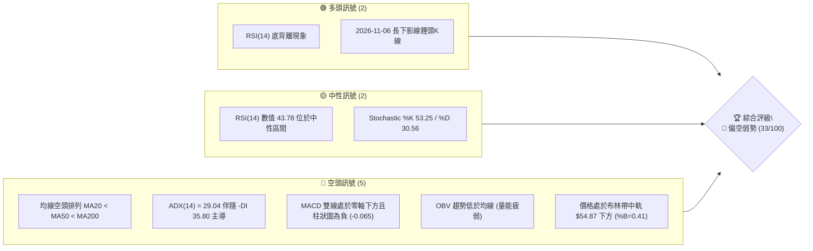
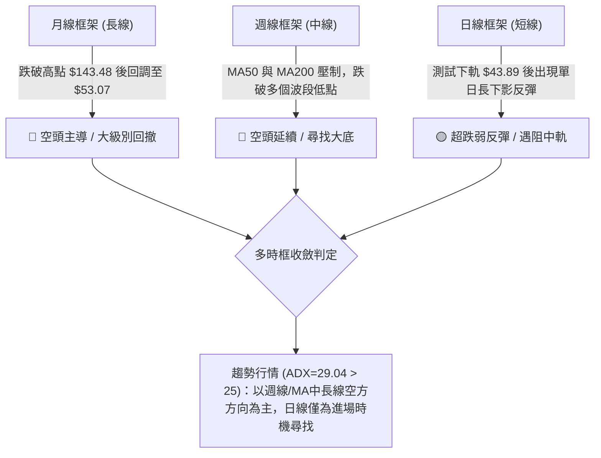
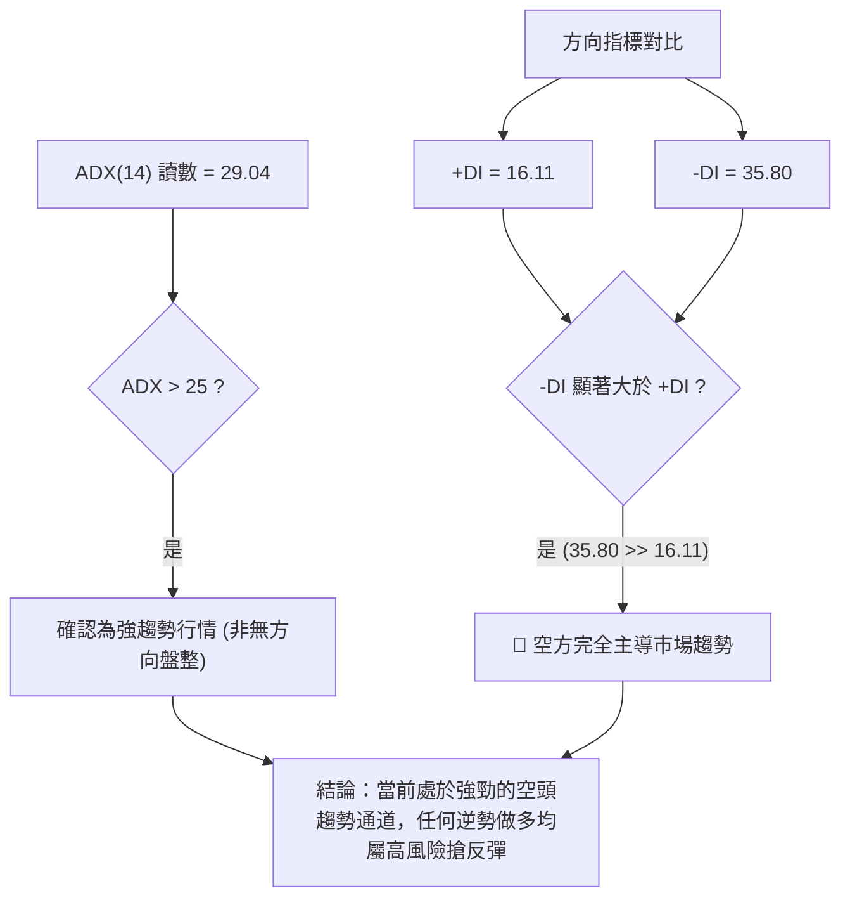
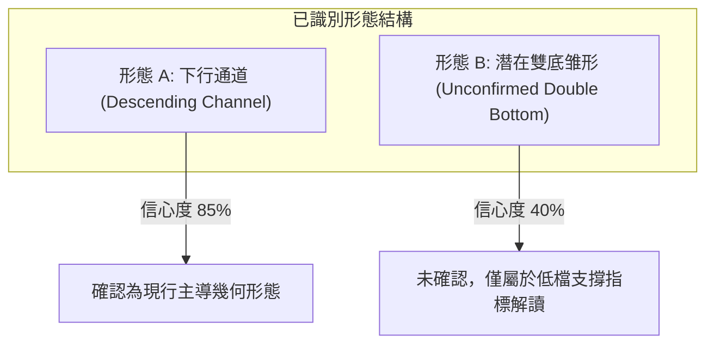
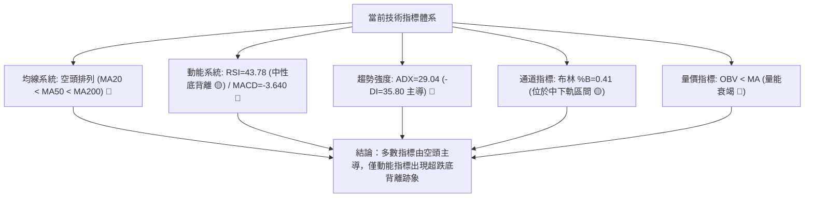
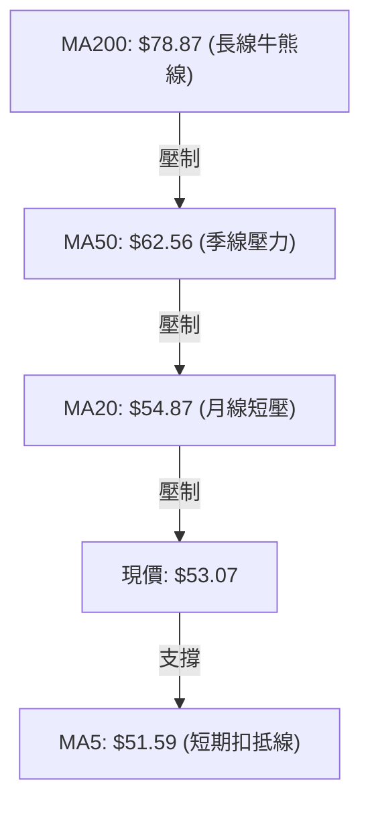
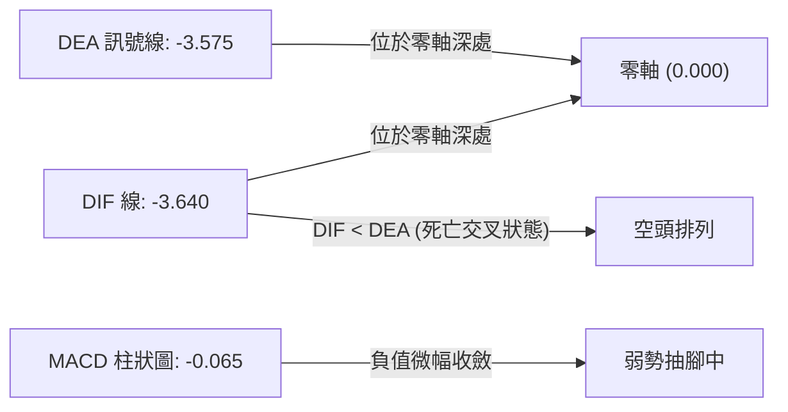
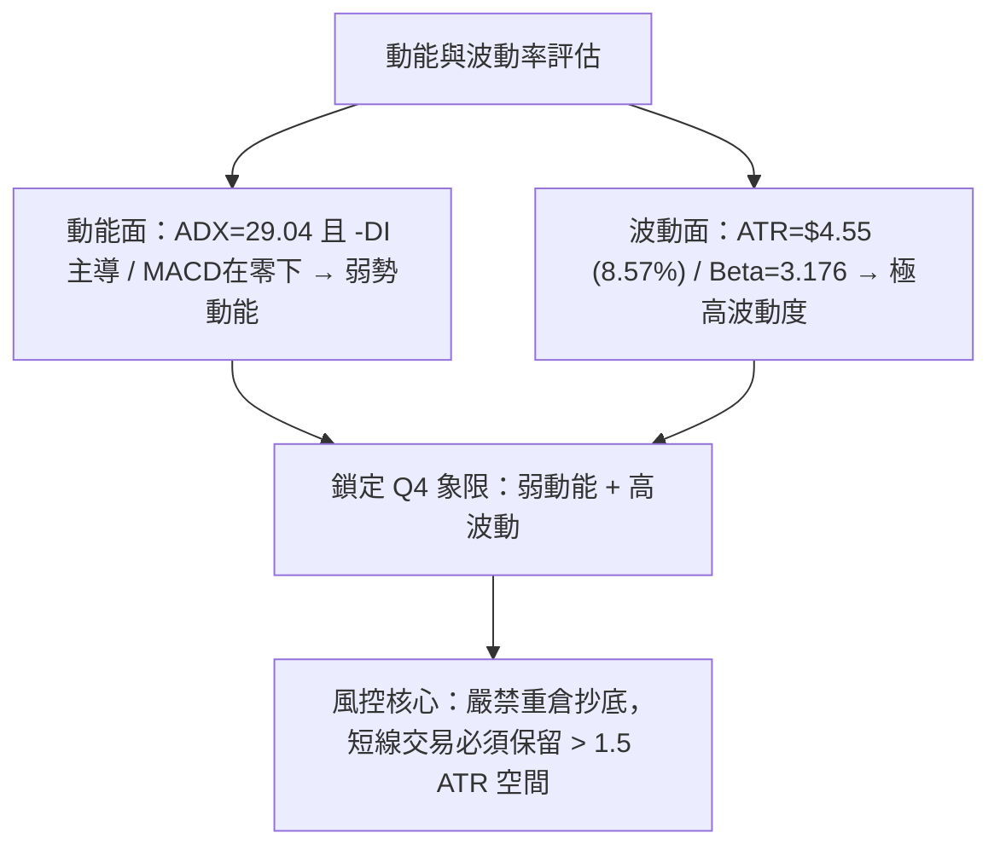
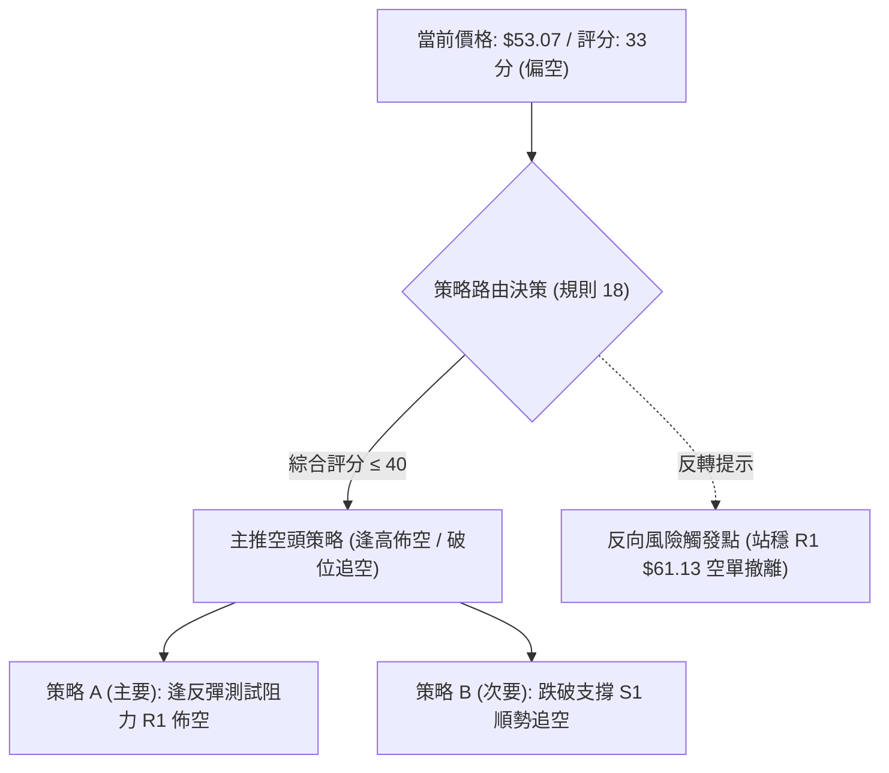
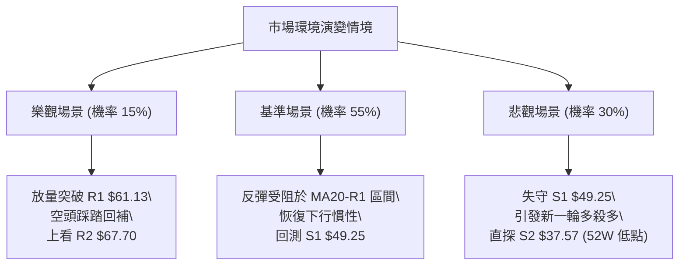

# RKLB 技術分析報告

> **報告日期**：2026-11-07 ｜ **語言**：繁體中文 ｜ **數據來源**：Yahoo Finance ｜ **當前價格**：$53.07

---

## 目錄

| 章節 | 內容 |
|------|------|
| [1. 技術面概覽](#1-技術面概覽) | 訊號儀表板、核心指標、評分卡 |
| [2. 趨勢分析](#2-趨勢分析) | 多時框趨勢、長中短期走勢 |
| [3. 圖表形態分析](#3-圖表形態分析) | 形態識別、K線組合、目標價 |
| [4. 支撐與阻力](#4-支撐與阻力) | 關鍵價位、斐波那契回調 |
| [5. 技術指標深度解讀](#5-技術指標深度解讀) | MA/RSI/MACD/布林/成交量 |
| [6. 動能與波動率](#6-動能與波動率) | 動能評估、ATR、Beta |
| [7. 多時框架總結](#7-多時框架總結) | 時框架評分矩陣 |
| [8. 交易策略建議](#8-交易策略建議) | 多空策略、風險報酬比 |
| [9. 風險提示與監控](#9-風險提示與監控) | 監控指標、風險場景 |

---

## 1. 技術面概覽

### 🎯 技術訊號儀表板



---

### 📊 核心指標速覽表

| 指標類別 | 指標名稱 | 當前數值 | 訊號 | 解讀 |
|:---|:---|:---|:---:|:---|
| **價格** | 當前收盤價 | $53.07 | 🔴 | 位於 52 週區間之 13.7%，接近近一年相對低位 |
| **均線** | MA20 (月線) | $54.87 | 🔴 | 價格在 MA20 下方 (-3.28%)，短期壓制明顯 |
| **均線** | MA50 (季線) | $62.56 | 🔴 | 價格在 MA50 下方 (-15.17%)，中期下行壓力沉重 |
| **均線** | MA200 (年線)| $78.87 | 🔴 | 價格在 MA200 下方 (-32.71%)，長期趨勢轉為空頭 |
| **動能** | RSI(14) | 43.78 | 🟡 | 位於 30–70 中性區間，呈現近 20 根首尾之底背離特徵 |
| **動能** | MACD (12,26,9)| -3.640 / -3.575 | 🔴 | 雙線位於零軸下，柱狀圖 -0.065，空方動能延續 |
| **動能** | Stochastic | %K: 53.25 / %D: 30.56 | 🟡 | 自低檔黃金交叉向上，短期具備弱反彈動能 |
| **趨勢** | ADX(14) | 29.04 (-DI: 35.80) | 🔴 | ADX > 25 且 -DI 顯著大於 +DI (16.11)，空頭強趨勢 |
| **通道** | 布林通道 | 中軌: $54.87 / 下軌: $45.37 | 🟡 | %B 為 0.41，價格自下軌反彈至中軌附近受阻 |
| **量能** | OBV 與均量 | 20,675,700 (量比 1.05x)| 🔴 | OBV < MA，資金外流趨勢未扭轉，反彈量能不足 |
| **波動** | ATR(14) | $4.55 (8.57%) | 🔴 | 波動幅度偏高，需保留足夠之風控止損空間 |

---

### 🏆 技術評分卡

```
╔══════════════════════════════════════════════════════════════╗
║               技術評分卡 — RKLB (2026-11-07)                 ║
╠══════════════════════════════════════════════════════════════╣
║ 趨勢強度 (Trend)     █████░░░░░░░░░░░░░░░  25/100   🔴 空頭強勢 ║
║ 動能指標 (Momentum)  ████████░░░░░░░░░░░░  40/100   🟡 中性偏弱 ║
║ 支撐穩定度 (Support) █████████░░░░░░░░░░░  45/100   🟡 低檔有守 ║
║ 成交量配合 (Volume)  ███████░░░░░░░░░░░░░  35/100   🔴 量能不足 ║
║ 形態完整度 (Pattern) ███████░░░░░░░░░░░░░  35/100   🔴 弱勢整理 ║
║ 均線排列 (Moving Avg)████░░░░░░░░░░░░░░░░  20/100   🔴 典型空頭 ║
╠══════════════════════════════════════════════════════════════╣
║ 綜合評分 (Average)   ███████░░░░░░░░░░░░░  33/100   🔴 偏空弱勢 ║
╚══════════════════════════════════════════════════════════════╝
```
*註：綜合評分由六項子評分嚴格算術平均四捨五入計算：(25 + 40 + 45 + 35 + 35 + 20) ÷ 6 = 33.33 → 33/100。*

---

## 2. 趨勢分析

### 🌐 多時框趨勢分析



---

### 📈 長期趨勢 — 12個月走勢圖（Unicode）

以下展示自 2025 年 12 月至 2026 年 11 月之 12 個月收盤走勢：

```
RKLB 月線收盤走勢圖（過去 12 個月：2025-12 至 2026-11）
價格軸 ($)
$150 ┤                                      
$140 ┤                                  ● $143.48 (2026-05 頂部)
$120 ┤                                 / \
$100 ┤                                /   ● $101.65 (2026-06)
 $80 ┤          ● $80.07       ● $82.51    \
 $70 ┤ ● $69.76   \    ● $69.10 /            \        ● $69.68
 $60 ┤             \--/  ● $64.22             ● $64.95 \   \
 $50 ┤                                           ● $63.92 ●--● $53.07 (現價)
     └─┬──────┬──────┬──────┬──────┬──────┬──────┬──────┬──────┬──────┬──────┬──────┬───
      12月   01月   02月   03月   04月   05月   06月   07月   08月   09月   10月   11月
     (2025) (------------------------------- 2026 --------------------------------)
```

#### 走勢特徵分析表格

| 階段區間 | 起訖月份 | 起點收盤 | 終點收盤 | 區間漲跌幅 | 主要走勢特徵 |
|:---|:---|:---|:---|:---:|:---|
| 階段一：主升推升 | 2025-12 ~ 2026-05 | $69.76 | $143.48 | +105.68% | 歷史狂熱推升行情，於 2026-05 觸及 52 週最高價 $151.00 |
| 階段二：暴跌回撤 | 2026-05 ~ 2026-07 | $143.48 | $64.95 | -54.73% | 資金大幅獲利了結，雙月腰斬，技術面跌破關鍵頸線 |
| 階段三：次級反彈 | 2026-07 ~ 2026-09 | $64.95 | $69.68 | +7.28% | 弱勢橫盤與區間整理，受制於季線壓力，反彈缺乏動能 |
| 階段四：二次破底 | 2026-09 ~ 2026-11 | $69.68 | $53.07 | -23.84% | 跌破前低支撐，下探波段新低 $43.89，目前於 $53.07 試圖止血 |

---

### 📊 中期趨勢（週線分析）

中期走勢呈現典型「高點降低、低點破底」的空頭軌道。自 2026-10-09 當週高點 $78.28 以來，週線連番下殺，並在 2026-10-16 創下單週成交量 128,008,200 股的帶量長黑破位。近 4 週週線收盤分別為 $50.84、$52.60、$54.73、$53.07，價格持續被 MA20 ($54.87) 與 MA50 ($62.56) 雙重死叉壓制。

```
週線級別價格壓力與支撐通道示意：
[阻力 R2: $67.70]  ──────────────────────────────────────────── (高階波段聚類)
[阻力 R1: $61.13]  ════════════════════════════════════════════ (近兩週反彈高點聚類)
                    ↓ 空方下壓軌道
[現價:    $53.07]  -------------- ◄ 目前位置 (均線 MA20 $54.87 正上方受阻)
                    ↑ 多方防禦
[支撐 S1: $49.25]  ════════════════════════════════════════════ (10月波段低點聚類)
[支撐 S2: $37.57]  ──────────────────────────────────────────── (52週最低點)
```

---

### ⚡ 趨勢強度評估（ADX 解讀）



| 指標名稱 | 數值 | 門檻判定 | 趨勢性質 | 交易含義 |
|:---|:---:|:---:|:---|:---|
| **ADX(14)** | 29.04 | > 25 (強趨勢) | 趨勢延續中 | 市場具備明確方向性，盤整突破或順勢操作勝率高 |
| **+DI (14)** | 16.11 | 低於 20 | 多頭衰竭 | 買盤力量微弱，缺乏推升價格突破重要均線的能量 |
| **-DI (14)** | 35.80 | 高於 30 | 空頭亢奮 | 賣壓強大且持續掌控盤面，下行推動力充足 |

---

## 3. 圖表形態分析

### 🔍 形態識別系統



#### 形態識別信心度與目標價評估表

| 形態名稱 | 信心度 | 判斷依據（引用數據） | 完成度 | 目標價（附嚴謹計算式） |
|:---|:---:|:---|:---:|:---|
| **下行通道** | 85% | 價格高點自 $78.28 (10-09週) 降至 $61.13 (10-29日)，低點自 $49.25 延伸至 $43.89，呈現平行下傾通道 | 90% | 下軌支撐目標：通道下緣對應支撐位 S2 = **$37.57** |
| **低檔雙底雏形** | 40% | 2026-10-23 出現低點 $49.25 (S1)，2026-11-05 跌破創 $43.89 後迅速收復 $49.25 回至 $53.07。但頸線尚未突破 | 35% | 頸線阻力 R1 ($61.13) − 低點 ($49.25) = 形態高度 $11.88；<br>推算突破目標價 = 頸線 $61.13 + $11.88 = **$73.01**（註：未突破前不成立） |

*依規則 15：雙底形態因信心度 40% < 50%，頸線未突破，當前不作為主要進場依據，僅以通道指標及關鍵支撐阻力進行判讀。*

---

### 🕯️ 重要 K 線形態分析

嚴格依據數據中「近 10 根日 K」與「近 8 根週 K」之實際開、高、低、收進行專業解讀：

#### 近 10 根日 K 線形態解讀

| 日期 | 開盤價 | 最高價 | 最低價 | 收盤價 | 成交量 | K線形態 | 技術解讀與訊號 |
|:---|:---:|:---:|:---:|:---:|:---:|:---|:---|
| 2026-10-26 | $52.60 | $54.99 | $52.15 | $53.82 | 12,671,100 | 小陽線 | 縮量企穩，多空於 $53 附近微幅爭奪 🟡 |
| 2026-10-27 | $54.10 | $59.18 | $53.57 | $58.31 | 21,341,400 | 放量中陽線 | 帶量突破短期日均線，測試 $59 壓力 🟢 |
| 2026-10-28 | $58.49 | $59.30 | $56.94 | $58.60 | 12,404,100 | 高位十字星 | 量能大幅萎縮，高檔出現猶豫與滯漲 🟡 |
| 2026-10-29 | $57.76 | $61.13 | $57.63 | $59.10 | 14,625,800 | 衝高長上影陽線 | 觸及關鍵阻力 R1 ($61.13) 後遭空頭頑抗壓回 🔴 |
| 2026-10-30 | $55.71 | $57.55 | $53.19 | $54.73 | 16,609,400 | 中陰破位線 | 跳空低開低走，完全吞噬前兩日漲幅 🔴 |
| 2026-11-02 | $55.08 | $55.08 | $50.68 | $52.07 | 16,444,100 | 光頭大陰線 | 開盤即最高價，空方全日單邊下壓 🔴 |
| 2026-11-03 | $53.10 | $54.94 | $52.90 | $54.43 | 14,162,600 | 孕線小陽線 | 窄幅縮量反抽，受阻於 MA20 下方 🟡 |
| 2026-11-04 | $54.60 | $55.31 | $50.41 | $52.37 | 18,771,200 | 長下影陰線 | 盤中再度探低 $50.41，空頭測試前低意圖明顯 🔴 |
| 2026-11-05 | $50.58 | $50.83 | $43.89 | $45.99 | 36,784,900 | 爆量長黑擊穿線 | 爆出近 10 日天量 (36.78M)，摜破支撐 S1 ($49.25) 🔴 |
| 2026-11-06 | $48.28 | $53.10 | $46.51 | $53.07 | 20,675,700 | 長下影長陽反轉線 (錘頭) | 早盤探底至 $46.51 後強勢拉升，收於當日最高點附近，站回 $53.07 🟢 |

#### 近 8 根週 K 線形態解讀

| 週交易日 | 開盤價 | 最高價 | 最低價 | 收盤價 | 成交量 | K線形態 | 技術解讀與訊號 |
|:---|:---:|:---:|:---:|:---:|:---:|:---|:---|
| 2026-09-18 | $60.55 | $68.64 | $60.51 | $64.57 | 106,896,200 | 帶上影陽線 | 震盪反彈測試 $68 阻力區 🟡 |
| 2026-09-25 | $65.29 | $75.46 | $65.28 | $73.95 | 111,511,500 | 實體大陽線 | 放量上攻突破 MA50，呈現波段多頭反撲 🟢 |
| 2026-10-02 | $73.20 | $76.09 | $69.40 | $73.92 | 107,277,600 | 高檔十字星 | 逼近 R3 ($75.28) 受阻，量價出現背離徵兆 🟡 |
| 2026-10-09 | $73.70 | $78.28 | $66.98 | $68.21 | 104,635,800 | 長上影倒錘陰線 | 衝刺 $78.28 遭主力倒貨，反轉向下 🔴 |
| 2026-10-16 | $67.88 | $68.07 | $49.69 | $50.84 | 128,008,200 | 破位放量大長黑 | 暴跌 -25.46%，巨量擊穿季線與多道整數關卡 🔴 |
| 2026-10-23 | $52.28 | $53.90 | $49.25 | $52.60 | 81,998,500 | 低檔窄幅十字星 | 於 S1 ($49.25) 初步獲支撐，呈現恐慌後休整 🟡 |
| 2026-10-30 | $52.60 | $61.13 | $52.15 | $54.73 | 77,651,800 | 長上影墓碑陽線 | 盤中衝高至 R1 ($61.13) 遭強力摜壓，解套賣壓沉重 🔴 |
| 2026-11-06 | $55.08 | $55.31 | $43.89 | $53.07 | 106,838,500 | 巨量深幅探底錘頭線 | 週低創 $43.89，週線收回至 $53.07，下檔買盤介入 🟢 |

---

### 📉 ASCII 走勢形態示意圖

```
近 10 日 K 線形態與關鍵突破/受阻示意：
$62.00 ┤                                           
$61.13 ┼───────────● 10-29 衝高受阻於 R1 ($61.13)
$58.00 ┤         ╭─┴─╮                             
$56.00 ┤     ╭──┤   │                             
$54.00 ┤ ╭──┤   │   │     ╭─╮                     ╭─● 11-06 收盤 $53.07
$52.00 ┤ │  │   │   ╰──┬──┤ │     ╭──╮         ╭─┤ │ 
$50.00 ┤ │  │   │      │  │ ╰──┬──┤  │     ╭───┤ │ │ 
$48.00 ┤ ╯  ╰───╯      ╰──╯   │  │  ╰─┬───┤   │ │ │ 
$46.00 ┤                         │  │    │   │   │ ╰─╯ 
$44.00 ┤                         ╰──╯    │   │   │     
$43.89 ┼─────────────────────────────────●───╯ 11-05 跌破 S1，下探 $43.89 爆量錘底
       └─┬──────┬──────┬──────┬──────┬──────┬──────┬──────┬──────┬──────┬──────
       10-26  10-27  10-28  10-29  10-30  11-02  11-03  11-04  11-05  11-06
```

---

## 4. 支撐與阻力

### 🗺️ 關鍵價位分布圖（Unicode）

```
╔══════════════════════════════════════════════════════════════════════╗
║                    RKLB 關鍵價位結構分布圖                           ║
╠══════════════════════════════════════════════════════════════════════╣
║ $75.28 ║██████████████████████████████║ 強阻力 R3 (年線/波段高點)    ║
║        ║                              ║                              ║
║ $67.70 ║████████████████████          ║ 中期阻力 R2 (反彈高點聚類)   ║
║        ║                              ║                              ║
║ $61.84 ║------------------------------║ 斐波那契 78.6% 回調位        ║
║ $61.13 ║██████████████████████████████║ 關鍵阻力 R1 (10-29日波段高點)║
║        ║                              ║                              ║
║ $54.87 ║┈┈┈┈┈┈┈┈┈┈┈┈┈┈┈┈┈┈┈┈┈┈┈┈┈┈┈┈┈┈║ 布林中軌 / MA20 短壓         ║
║ $53.07 ╠══════════════════════════════╣ ◄ 當前收盤價 (現價)          ║
║        ║                              ║                              ║
║ $49.25 ║▓▓▓▓▓▓▓▓▓▓▓▓▓▓▓▓▓▓▓▓▓▓▓▓      ║ 近期關鍵支撐 S1 (波段低點聚類)║
║        ║                              ║                              ║
║ $45.37 ║┈┈┈┈┈┈┈┈┈┈┈┈┈┈┈┈┈┈┈┈┈┈┈┈┈┈┈┈┈┈║ 布林下軌支撐                 ║
║ $37.57 ║██████████████████████████████║ 強支撐 S2 (52W 最低點 / Fib 100%)║
╚══════════════════════════════════════════════════════════════════════╝
```

---

### 🚧 阻力位分析表

*嚴格引用數據中「關鍵價位」區塊之數值：*

| 阻力級別 | 價位 | 與現價差距 | 形成原因與技術背景 | 突破難度 | 重要性 |
|:---|:---:|:---:|:---|:---:|:---:|
| **R1** | $61.13 | +15.19% | 近一年波段高點聚類、10-29 日最高點、鄰近斐波那契 78.6% ($61.84) | 🔴 極高 | ★★★★★ |
| **R2** | $67.70 | +27.57% | 2026 年 7 月至 10 月多次反彈之平台解套賣壓密集區 | 🔴 高 | ★★★★☆ |
| **R3** | $75.28 | +41.86% | 2026-10-02 當週高點區間、逼近年線 MA200 ($78.87) 之牛熊分水嶺 | 🔴 極高 | ★★★★★ |

---

### 🛡️ 支撐位分析表

*嚴格引用數據中「關鍵價位」區塊之數值：*

| 支撐級別 | 價位 | 與現價差距 | 形成原因與技術背景 | 守住機率 | 重要性 |
|:---|:---:|:---:|:---|:---:|:---:|
| **S1** | $49.25 | -7.20% | 近一年波段低點聚類、10-23 當週最低點，短線多頭第一道防線 | 🟡 50% | ★★★★☆ |
| **S2** | $37.57 | -29.21% | 52 週最低點 (52W Low)、斐波那契 100.0% 回調位，終極價值護城河 | 🟢 85% | ★★★★★ |

---

### 📐 斐波那契回調位分析

依據 52 週區間最高價 $151.00 至最低價 $37.57 計算：

| 斐波那契比例 | 對應價位 | 技術含義與當前關係 |
|:---:|:---:|:---|
| **0.0% (52W High)** | $151.00 | 歷史極值壓力，多頭終極目標 |
| **23.6%** | $124.23 | 強勢回調分界點（遠在現價上方） |
| **38.2%** | $107.67 | 中期多空平衡點 |
| **50.0%** | $94.28 | 半數回撤位，長期走勢中樞 |
| **61.8%** | $80.90 | 黃金分割關鍵壓制區，緊鄰 MA200 ($78.87) |
| **78.6%** | $61.84 | 深幅回撤防線，與阻力位 R1 ($61.13) 形成重疊共振壓力區 |
| **100.0% (52W Low)**| $37.57 | 支撐位 S2，本輪下行週期的底部極限 |

**現價區間解讀**：
當前收盤價 **$53.07** 落在 **78.6% 回調位 ($61.84)** 與 **100.0% 回調位 ($37.57)** 之間。這表明股價已經回吐了過去一年絕大部分漲幅，處於深幅弱勢探底階段。上方 $61.13 ~ $61.84 構成雙重共振阻力帶；下方若失守近期波段低點 S1 ($49.25)，將面臨下探 100% 回調位 S2 ($37.57) 的技術風險。

---

## 5. 技術指標深度解讀

### 🎛️ 指標訊號總覽



---

### 📈 移動平均線排列分析



#### 各期均線狀態表

| 均線名稱 | 當前數值 | 與現價偏離度 | 斜率與方向 | 多空解讀 |
|:---|:---:|:---:|:---|:---:|
| **MA 5** | $51.59 | +2.88% (上方) | ▲ 向上拐頭 | 超跌後短線技術反彈，提供微幅支撐 🟢 |
| **MA 10** | $54.25 | -2.17% (下方) | ▼ 持續下行 | 短線反彈第一道動態壓制 🔴 |
| **MA 20** | $54.87 | -3.28% (下方) | ▼ 陡峭下行 | 月線級別反壓，布林通道中軌所在 🔴 |
| **MA 50** | $62.56 | -15.17% (下方)| ▼ 下行 | 季線重壓，中期空頭防守陣地 🔴 |
| **MA 60** | $64.33 | -17.50% (下方)| ▼ 下行 | 中期波段套牢籌碼峰 🔴 |
| **MA 120** | $79.37 | -33.14% (下方)| ▼ 下行 | 半年線下壓 🔴 |
| **MA 200** | $78.87 | -32.71% (下方)| ▼ 平緩下移 | 長期趨勢完全轉空 🔴 |
| **MA 240** | $76.98 | -31.06% (下方)| ▼ 走平 | 年線失守，長期結構破壞 🔴 |

---

### 📉 RSI(14) 分析

```
RSI(14) 讀數儀表盤：
0 ─────── 30 ────────────────── 50 ─────── 70 ─────── 100
[ 超賣區 ]    [     當前: 43.78    ]      [ 超買區 ]
░░░░░░░░░░░░░██████████████████░░░░░░░░░░░░░░░░░░░░░░░░░
```

- **當前數值**：**43.78**，位於 30–70 之中性區間，擺脫了先前 10-16 當週的深度超賣 (25.4)。
- **背離分析**：**⚠️ 存在底背離 (Bullish Divergence)**。
  - **判定依據**：比對近 20 根 K 棒走勢，價格在 2026-11-05 創出波段新低 $43.89（低於 10-23 的低點 $49.25），然而 RSI(14) 卻從 10 月中旬的超賣低點 25.4 明顯抬升至當前的 43.78。
  - **結論**：指標與價格形成典型底背離，代表下行殺跌動能正在收斂，短期隨時可能引發技術性跌深反彈，但受制於整體均線下壓，反彈空間受限於 MA20 ($54.87) 及 R1 ($61.13)。

---

### 📊 MACD(12,26,9) 訊號解讀



- **MACD 線**：-3.640
- **MACD Signal 線**：-3.575
- **MACD 柱狀圖**：**-0.065**（🔴 看空）
- **詳細解讀**：雙線深處零軸下方，屬於典型空頭強勢控盤格局。柱狀圖雖為負值，但負值已由 10 月中旬的 -2.111 大幅收窄至 -0.065，顯示空方動能釋放已接近尾聲，短期若能形成低檔黃金交叉（DIF 上穿 DEA），則可望配合 RSI 底背離走出數日的反彈行情。

---

### 📦 布林通道分析

```
布林通道當前狀態示意圖（日線級別）：
$64.38 ┼────────────────────────────── BB 上軌 (Upper)
       │
$54.87 ┼┄┄┄┄┄┄┄┄┄┄┄┄┄┄┄┄┄┄┄┄┄┄┄┄┄┄┄┄┄┄ BB 中軌 (MA20) ◄ 強短壓
$53.07 ┼───────● 現價 (收盤價)
       │       (%B = 0.41，處中軌與下軌間)
$45.37 ┼────────────────────────────── BB 下軌 (Lower) ◄ 動態支撐
```

- **帶寬與位置**：BB 上軌為 $64.38，中軌為 $54.87，下軌為 $45.37。當前價格 $53.07，**%B 數值為 0.41**。
- **走勢特徵**：2026-11-05 盤中最低探至 $43.89，短暫跌破布林下軌 ($45.37)，觸發了通道下軌的極限乖離修復機制。11-06 強勁收回至 $53.07，重回帶內運行。當前正逼近中軌 $54.87，若無法帶量突破中軌，價格將在 $45.37 ~ $54.87 區間形成弱勢震盪。

---

### 💹 成交量分析（量價配合度）

```
量能比較：
最新成交量:  ████████████████████░ 20,675,700 股
20日均量:    ███████████████████░░ 19,724,850 股 (量比 1.05x)
50日均量:    ████████████████████░ 20,176,418 股
```

- **量價配合診斷**：
  - 11-05 暴跌時放量至 36,784,900 股，顯示低檔出現恐慌性拋售與初步承接；
  - 11-06 反彈收長陽時成交量萎縮至 20,675,700 股（量比僅 1.05x），反彈量能明顯不及下殺時的放量。
- **OBV 趨勢**：數據明確標示 **OBV < MA**，代表累積能量線仍在均線下方徘徊，主力資金尚未呈現連續性淨流入，目前的反彈多屬空頭回補而非增量買盤進場。

---

## 6. 動能與波動率

### ⚡ 動能評估四象限

| 象限分類 | 動能屬性 (Momentum) | 波動率屬性 (Volatility) | 當前標的狀態 | 交易策略啟示 |
|:---:|:---:|:---:|:---:|:---|
| **第 I 象限 (Q1)** | 強動能 (Bullish) | 低波動 (Low Vol) | — | 最佳多頭趨勢加碼點 |
| **第 II 象限 (Q2)** | 弱動能 (Bearish) | 低波動 (Low Vol) | — | 盤整蓄勢，等待方向突破 |
| **第 III 象限 (Q3)** | 強動能 (Bullish) | 高波動 (High Vol) | — | 突破拉升，追漲高風險高回報 |
| **第 IV 象限 (Q4)** | **弱動能 (Bearish)** | **高波動 (High Vol)** | **✓ RKLB 處於此象限** | **空頭主導且劇烈波動，做多極易遭侵蝕，宜逢高佈空或嚴設止損** |



---

### 📊 ATR 波動率分析

- **ATR(14) 讀數**：**$4.55**（佔股價比例高達 **8.57%**，Wilder 平滑）。
- **波動特性解讀**：每日平均振幅超過 $4.5 元，代表價格短線雜訊極大，極易觸發過於狹窄的止損單。
- **風控止損距離建議**：
  - **短線交易（1.0 × ATR）**：建議安全止損空間至少設為 **$4.55**。
  - **波段交易（1.5 × ATR）**：建議安全止損空間設為 **$6.83**（$4.55 × 1.5）。

---

### 📐 Beta 與市場相關性

- **Beta 係數**：**3.176**（高彈性、極高市場敏感度）。
- **市場環境交互分析**：Beta > 3 代表該股波動幅度為標普 500 指數的 3.1 倍以上。在整體市場風險偏好上升時具備爆發力，但在市場修正或利率高企環境下，拋壓亦將被放大三倍。當前該股的高 Beta 特性正加劇其下行慣性。

---

## 7. 多時框架總結

### 📋 時框架評分表

| 時框架 | 趨勢方向 | 動能狀態 | 均線排列 | 形態特徵 | 綜合評分 | 交易建議 |
|:---|:---:|:---:|:---:|:---:|:---:|:---|
| **長期 (月線)** | 🔴 空頭向下 | 弱勢回撤 | 跌破 MA120/MA240 | 頂部腰斬後尋底 | 25/100 | 規避長線盲目買入 |
| **中期 (週線)** | 🔴 空頭延續 | 柱狀微縮 | MA20 < MA50 < MA200 | 下行通道延伸中 | 30/100 | 反彈高空為主要邏輯 |
| **短期 (日線)** | 🟡 跌深反彈 | 底背離醞釀 | MA5 向上，MA20 壓制 | 錘頭線短線反轉 | 45/100 | 超跌快進快出搶反彈 |

---

### 🔲 綜合訊號矩陣

```
訊號維度對齊評估表：
┌──────────────┬──────────────┬──────────────┬──────────────┐
│  指標維度    │  日線 (短期) │  週線 (中期) │  月線 (長期) │
├──────────────┼──────────────┼──────────────┼──────────────┤
│ 均線系統     │  🔴 空頭排列 │  🔴 空頭排列 │  🔴 空頭壓制 │
│ 動能指標     │  🟢 底背離   │  🟡 柱狀收斂 │  🔴 負向延伸 │
│ 趨勢強度     │  🔴 空方主導 │  🔴 強烈下行 │  🔴 回撤深淵 │
│ 形態定位     │  🟡 低檔錘頭 │  🔴 破位下行 │  🔴 高檔崩落 │
└──────────────┴──────────────┴──────────────┴──────────────┘
```

---

### ⚖️ 多時框收斂結論

依據多時框收斂規則第 14 條：
1. **行情性質判斷**：ADX(14) 數值為 **29.04 > 25**，明確判定當前為**強趨勢行情**（非無方向盤整）。
2. **優先級權重收斂**：在趨勢行情下，**以中長期（週線 / MA50 $62.56、MA200 $78.87）方向為主導**，日線的超跌訊號與錘頭形態僅能視為次級折返走勢（進場時機尋找），不得覆蓋中長期的空頭方向。
3. **唯一方向性結論**：**🔴 偏空弱勢（反彈逢高佈空為主，抄底僅限極小倉位超短線）**。本結論嚴格收斂並與第 1 章技術評分卡（33/100）完全一致。

---

## 8. 交易策略建議

### 🗺️ 策略決策流程圖



---

### 🧭 策略路由

**當前主策略方向 = 🔴 主推空頭策略（依技術評分卡綜合評分 33/100 ≤ 40 嚴格判定）**

---

### 🎯 價格情境階梯（Price Scenarios）

*所有價位嚴格引用第 4 章及數據計算結果：*

| 觸發條件 | 下一目標 | 後續延伸 | 情境技術含義 |
|:---|:---:|:---:|:---|
| **強勢突破阻力 R1 $61.13** | 阻力 R2 $67.70 | 阻力 R3 $75.28 | 短線底部形態確認，空頭停損，展開中級反彈波 |
| **受阻於 MA20 並跌破現價** | 支撐 S1 $49.25 | 測試低點 $43.89 | 弱勢反彈結束，重回日線下行趨勢 |
| **有效跌破支撐 S1 $49.25** | 支撐 S2 $37.57 | 探底尋找新支撐 | 空頭主升浪延續，回測 52 週最低點與 Fib 100% |

---

### 📊 情境機率分佈

| 預測情境 | 發生機率 | 主要技術依據 |
|:---|:---:|:---|
| **受阻回落 / 再探前低 (主要走向)** | **55%** | 均線完整空頭排列，ADX=29.04 且 -DI 掌控盤面，反彈缺乏量能配合 (OBV < MA) |
| **弱勢區間震盪 (次要走向)** | **30%** | RSI 出現底背離，下軌 $45.37 具備初步支撐，空頭需在 $49.25 ~ $54.87 間換手 |
| **強勢突破反轉 (小機率走向)** | **15%** | 需連續爆量站穩 MA20 並一舉突破 R1 ($61.13)，目前基本面與技術面共振條件不足 |

---

### 🔴 主策略詳情（空頭防守與順勢佈局）

依據嚴格規則 17 計算風險報酬比：
- **做空風險報酬比公式** = (進場價 − 目標價 T1) ÷ (止損價 − 進場價)

| 策略要素 | 策略 A：反彈受阻佈空 (首選) | 策略 B：破位順勢跟進空 (次選) |
|:---|:---|:---|
| **交易邏輯** | 趁 RSI 底背離引發的反彈，在接近阻力位時建立空頭倉位 | 價格若無法反彈，直接跌破 S1 支撐時順勢追空 |
| **進場條件** | 反彈至 MA20 與阻力 R1 之間出現上影線滯漲訊號 | 日線收盤價實體有效跌破支撐位 S1 |
| **進場價格** | **$58.00**（取 $54.87 至 $61.13 之區間中點） | **$49.00**（S1 $49.25 跌破確認後） |
| **目標價 T1** | **$49.25**（關鍵支撐 S1） | **$37.57**（強支撐 S2 / 52W 低點） |
| **目標價 T2** | **$37.57**（強支撐 S2 / 52W 低點） | N/A（數據未提供更低價位，以 S2 為主） |
| **止損價格** | **$61.84**（斐波那契 78.6% 回調位 / 阻力 R1 上方） | **$53.07**（現價 / 前期反彈平台阻力） |
| **風險報酬比** | **1 : 2.28（以 T1 計）**<br>*(計算式: (58.00 - 49.25) ÷ (61.84 - 58.00) = 8.75 ÷ 3.84 = 2.28)*<br>*(以 T2 計為 1 : 5.32)* | **1 : 2.81（以 T1 計）**<br>*(計算式: (49.00 - 37.57) ÷ (53.07 - 49.00) = 11.43 ÷ 4.07 = 2.81)* |
| **成功機率** | **65%** | **60%** |
| **建議倉位** | **15%**（控制高波動 Beta 曝險） | **10%**（破位追空倉位宜輕） |

---

### 🟢 反向風險觸發點（對沖提示）

若市場出現外生利多或籌碼嘎空，導致以下現象發生，必須立即推翻空頭邏輯並啟動對沖或止損：
1. **關鍵點位突破**：日線收盤價**強勢站穩 R1 ($61.13)**，且連續兩日未跌回其下方。
2. **指標轉多確認**：日線 MACD 雙線向上突破零軸，且 ADX 之 +DI 向上穿越 -DI。
3. **風控行動**：所有空單全數離場；激進投資者可將停損資金轉向微量順勢做多，目標上看 R2 ($67.70)。

---

### ⭐ 整體訊號強度評星

```
做多訊號強度：★★☆☆☆  (2/5星 - 僅存技術面超跌底背離)
做空訊號強度：★★★★☆  (4/5星 - 均線空頭排列，趨勢向下確立)
整體可信度：  ★★★★☆  (4/5星 - 多指標高度共振確認下行)
```

---

## 9. 風險提示與監控

### ✅ 關鍵監控指標 Checklist

```
╔══════════════════════════════════════════════════════════════╗
║               交易員日常盤面監控清單 (Checklist)             ║
╠══════════════════════════════════════════════════════════════╣
║ [ ] 價格能否守住 S1 ($49.25)？若失守將加速滑向 S2 ($37.57)    ║
║ [ ] 反彈是否在 MA20 ($54.87) 或 R1 ($61.13) 出現長上影線？   ║
║ [ ] ADX 讀數是否維持在 25 以上？確認空頭趨勢是否疲軟         ║
║ [ ] 日成交量是否顯著超越 20 日均量 (19.72M) 形成異常爆量？    ║
║ [ ] RSI(14) 底背離是否轉化為實質雙底向上突破？               ║
║ [ ] 空頭回補天數 (Short Ratio=2.0) 是否引發短期軋空行情？    ║
╚══════════════════════════════════════════════════════════════╝
```

---

### ⚠️ 風險場景分析



---

### 🛡️ 風險管理重要提醒

1. **極端波動風險（High Beta & ATR）**：
   - RKLB 的 Beta 達到 **3.176**，ATR 高達 **$4.55**（單日波動率 8.57%）。
   - 任何策略均不可使用過滿倉位，單筆交易虧損曝險上限應嚴格控制在總投資組合淨值的 **1.0% ~ 1.5%** 之內。
2. **財報與消息面跳空風險**：
   - 近期新聞顯示財報即將公布（"Rocket Lab Earnings Ahead"），航天防務類股財報前後常出現超額跳空高開或低開。
   - 建議在重大事件披露前夕，適度縮減留倉部位或利用期權進行尾端風險對沖。

---

## 📋 報告總結

```
╔══════════════════════════════════════════════════════════════════╗
║                  RKLB 技術分析報告總結                          ║
╠══════════════════════════════════════════════════════════════════╣
║ 報告日期：2026-11-07                                             ║
║ 當前價格：$53.07                                                 ║
║ 分析評級：🔴 偏空弱勢 (綜合技術評分: 33/100)                     ║
║                                                                  ║
║ 關鍵維度結論：                                                   ║
║ ├─ 長期趨勢 (月線)：🔴 自 $143.48 大頂崩落，跌破年線，處深幅回撤 ║
║ ├─ 中期趨勢 (週線)：🔴 均線死叉空頭排列，下行通道運行中         ║
║ ├─ 短期趨勢 (日線)：🟡 超跌長下影線錘頭，醞釀技術性弱反彈       ║
║ ├─ 關鍵支撐：S1: $49.25 ｜ S2: $37.57 (52週最低點)               ║
║ ├─ 關鍵阻力：R1: $61.13 ｜ R2: $67.70 ｜ R3: $75.28              ║
║ └─ 外部分析師共識：Buy (20位分析師平均目標價: $102.15)           ║
║                                                                  ║
║ 最優策略架構：                                                   ║
║ 1. 🥇 最佳機會：等待弱反彈至 $58.00 附近佈空，停損設 $61.84，     ║
║                 第一目標看 S1 $49.25 (風報酬比 1 : 2.28)。       ║
║ 2. 🥈 次選機會：跌破支撐 S1 $49.25 後順勢輕倉追空，               ║
║                 目標直指 S2 $37.57 (風報酬比 1 : 2.81)。         ║
║ 3. 🥉 防守觀望：長線投資者在價格未有效站穩 R1 ($61.13) 之前，   ║
║                 應維持現金觀望，切忌左側重倉盲目抄底。           ║
╚══════════════════════════════════════════════════════════════════╝
```

---

> ⚠️ **免責聲明**：本報告為技術分析研究成果，所有價位、圖表及推算邏輯均基於客觀歷史技術數據。本報告**僅供研究與學術參考**，**不構成任何形式的要約、招攬或投資買賣建議**。金融市場具有高度波動風險，投資人應獨立評估自身風險承受能力並自負盈虧。

---
*報告生成時間：2026-11-07 ｜ 數據來源：Yahoo Finance ｜ 分析框架：資深多時框量化技術分析*