# RKLB 技術分析報告

> **報告日期**：2026-11-08 ｜ **語言**：繁體中文 ｜ **數據來源**：Yahoo Finance ｜ **當前價格**：$53.07

---

## 目錄

| 章節 | 內容 |
|------|------|
| [1. 技術面概覽](#1-技術面概覽) | 訊號儀表板、核心指標、評分卡 |
| [2. 趨勢分析](#2-趨勢分析) | 多時框趨勢、長中短期走勢 |
| [3. 圖表形態分析](#3-圖表形態分析) | 形態識別、K線組合、目標價 |
| [4. 支撐與阻力](#4-支撐與阻力) | 關鍵價位、斐波那契回調 |
| [5. 技術指標深度解讀](#5-技術指標深度解讀) | MA/RSI/MACD/布林/成交量 |
| [6. 動能與波動率](#6-動能與波動率) | 動能評估、ATR、Beta |
| [7. 多時框架總結](#7-多時框架總結) | 時框架評分矩陣 |
| [8. 交易策略建議](#8-交易策略建議) | 多空策略、風險報酬比 |
| [9. 風險提示與監控](#9-風險提示與監控) | 監控指標、風險場景 |

---

## 1. 技術面概覽

### 🎯 技術訊號儀表板

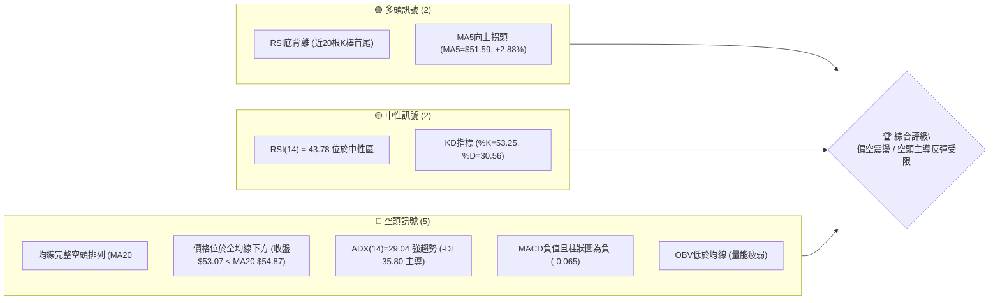

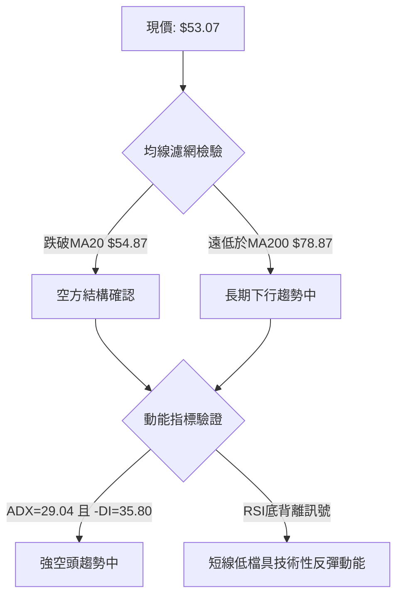

### 📊 核心指標速覽表

| 指標類別 | 指標名稱 | 當前數值 | 訊號 | 解讀 |
|----------|----------|----------|------|------|
| **價格** | 當前價格 | $53.07 | 🔴 | 位於52週區間13.7%分位，受制於所有中長期均線之下 |
| **均線** | MA20 | $54.87 | 🔴 | 價格在MA20下方（-3.28%），短線面臨中軌直接壓制 |
| **均線** | MA50 | $62.56 | 🔴 | 價格遠在MA50下方（-15.17%），中期空頭趨勢確立 |
| **均線** | MA200 | $78.87 | 🔴 | 價格深陷MA200下方（-32.71%），長期趨勢嚴重走空 |
| **動能** | RSI(14) | 43.78 | 🟡 | 位於30-70中性區，但日線首尾呈現顯著底背離修復跡象 |
| **動能** | MACD | -3.640 | 🔴 | DIF在零軸下方運行，柱狀圖負值（-0.065），動能偏空 |
| **波動** | ATR(14) | $4.55 | 🔴 | 佔現價8.57%，屬於極高波動度標的，日內洗盤劇烈 |
| **趨勢** | ADX(14) | 29.04 | 🔴 | ADX>25為強趨勢，-DI(35.80)遠大於+DI(16.11)，空方完全主控 |
| **通道** | 布林通道 | %B = 0.41 | 🟡 | 價格運行於中軌（$54.87）與下軌（$45.37）之間，偏弱格局 |
| **量能** | OBV量能 | OBV < MA | 🔴 | 成交量未隨價格反彈放大，反彈缺乏機構資金持續推升 |

### 🏆 技術評分卡

```
╔══════════════════════════════════════════════════════════════╗
║                技術評分卡 — RKLB (2026-11-08)                 ║
╠══════════════════════════════════════════════════════════════╣
║ 趨勢強度      ██████░░░░░░░░░░░░░░  30/100  🔴 空頭主導      ║
║ 動能指標      ████████░░░░░░░░░░░░  40/100  🟡 底背離初現    ║
║ 支撐穩定度    ████████░░░░░░░░░░░░  40/100  🟡 S1測試中      ║
║ 成交量配合    ██████░░░░░░░░░░░░░░  30/100  🔴 量能疲弱      ║
║ 形態完整度    ████████░░░░░░░░░░░░  40/100  🟡 低檔收斂整理  ║
║ 均線排列      ████░░░░░░░░░░░░░░░░  20/100  🔴 嚴格空頭排列  ║
╠══════════════════════════════════════════════════════════════╣
║ 綜合評分      ██████░░░░░░░░░░░░░░  33/100  🔴 偏空 (反抽賣) ║
╚══════════════════════════════════════════════════════════════╝
```

*評分說明：綜合評分由六項子評分算術平均得出：(30 + 40 + 40 + 30 + 40 + 20) ÷ 6 = 33.33，四捨五入取整為 33/100。*

---

## 2. 趨勢分析

### 🌐 多時框趨勢分析

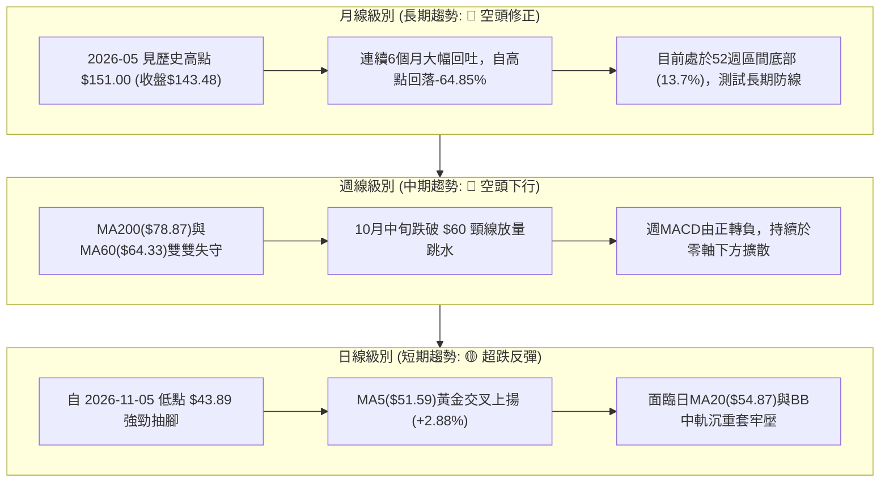

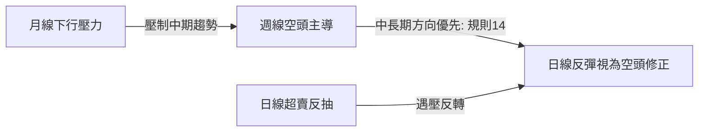

### 📈 長期趨勢 — 12個月走勢圖（Unicode）

```
RKLB 月線收盤走勢圖（過去12個月：2025-11 至 2026-11）
價格軸 ($)
$150 ┤                                      ● (2026-05 高點 $143.48 / 最高 $151.00)
$135 ┤                                     ╱ ╲
$120 ┤                                    ╱   ╲
$105 ┤                                   ╱     ● (2026-06 $101.65)
$90  ┤                             ●    ╱        ╲
$75  ┤                       ●    ╱ ╲  ╱          ╲
$60  ┤                 ●    ╱ ╲  ╱   ●             ●─────● (2026-09 $69.68)
$45  ┤           ●    ╱ ╲  ╱   ●                       ╲
$30  ┤          ╱ ╲  ╱   ●                              ●─────● (現價 $53.07)
$15  ┤         ●   ●
     └─────────┬───┬───┬───┬───┬───┬───┬───┬───┬───┬───┬───┬───────────────
             11  12  01  02  03  04  05  06  07  08  09  10  11 (月份)
            2025 ─── 2026 ──────────────────────────────────────
```

#### 走勢特徵分析表格

| 階段區間 | 時間區間 | 起始價 → 終止價 | 漲跌幅 (%) | 量價走勢特徵 |
|----------|----------|-----------------|------------|--------------|
| **第1階段：主升段** | 2025-11 → 2026-01 | $42.14 → $80.07 | +89.98% | 突破整理區間，機構資金大幅推升 |
| **第2階段：高檔震盪** | 2026-01 → 2026-03 | $80.07 → $64.22 | -19.80% | 獲利了結賣壓湧現，測試平台支撐 |
| **第3階段：末升狂熱** | 2026-03 → 2026-05 | $64.22 → $143.48 | +123.42% | 創下52週高點 $151.00，融資籌碼極度亢奮 |
| **第4階段：首輪崩跌** | 2026-05 → 2026-07 | $143.48 → $64.95 | -54.73% | 斷崖式跳水，連續失守多道均線防線 |
| **第5階段：反彈自救** | 2026-07 → 2026-09 | $64.95 → $69.68 | +7.28% | 8月反彈至 $82.83 後無力，形成右肩套牢頭部 |
| **第6階段：陰跌破位** | 2026-09 → 2026-11 | $69.68 → $53.07 | -23.84% | 跌破所有短期波段支撐，直逼52週低點區間 |

### 📊 中期趨勢（週線分析）

```
RKLB 週線關鍵阻力與支撐示意圖
價格 ($)
$85.00 ┤ 阻力三：R3 $75.28 ─────────────── [前波反彈高點聚類與斐波61.8%]
$75.00 ┤
$65.00 ┤ 阻力二：R2 $67.70 ─────────────── [中期週線下行通道上軌]
       ┤ 阻力一：R1 $61.13 ─────────────── [2026-10-30 週高點，第一壓力帶]
$55.00 ┤ ═════════════════════════════════ ◄ 當前收盤價 $53.07
$45.00 ┤ 支撐一：S1 $49.25 ─────────────── [2026-10-23 週低點聚類防線]
$35.00 ┤ 支撐二：S2 $37.57 ─────────────── [52週歷史低點，強支撐]
```

### ⚡ 趨勢強度評估（ADX 解讀）

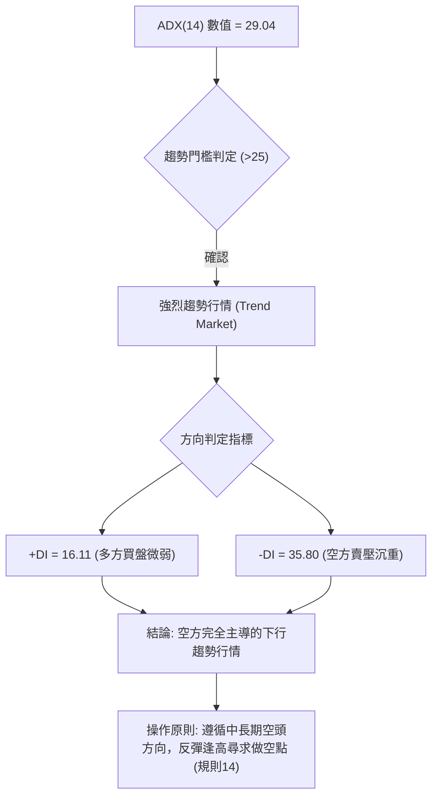

#### ADX 指標強度對照表

| 指標名稱 | 當前數值 | 參考臨界值 | 狀態評估 | 實戰交易解讀 |
|----------|----------|------------|----------|--------------|
| **ADX(14)** | **29.04** | 25.00 | 🟢 強趨勢確認 | 市場處於明確的趨勢行進中，不可視為無方向之箱型盤整 |
| **+DI** | **16.11** | 20.00 | 🔴 多方乏力 | 買盤力道低迷，難以發動具實質突破意義的攻勢 |
| **-DI** | **35.80** | 25.00 | 🔴 空方主控 | 空頭佔據完全壓倒性優勢，下行賣壓持續釋放 |
| **DI 差值** | **-19.69** | 0.00 | 🔴 負向擴散 | 趨勢動能依然向空方傾斜，短線逆勢摸底風險極高 |

---

## 3. 圖表形態分析

### 🔍 形態識別系統

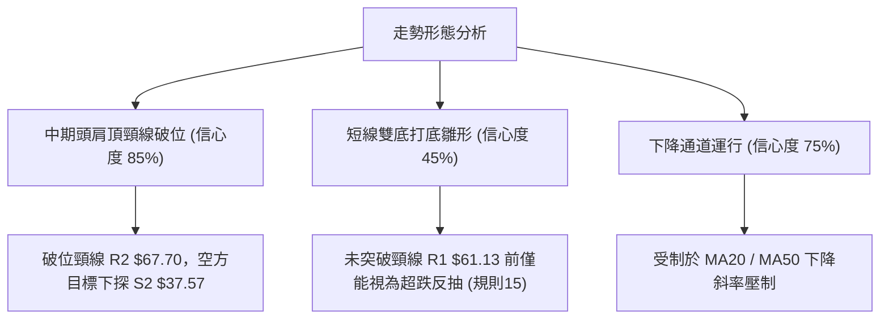

#### 形態識別與信心度評估表

| 形態名稱 | 信心度 (%) | 判斷依據（引用數據） | 完成度 (%) | 目標價（附計算式） |
|----------|------------|----------------------|------------|--------------------|
| **中期頭肩頂頸線破位** | **85%** | 左肩2026-08高點$82.83，頭部2026-09反彈$73.95，頸線破位於阻力位 R2 $67.70 | **100%** (已跌破) | 頸線 $67.70 − 形態高度($82.83 − $67.70 = $15.13) = **$52.57**（已滿足第一波目標）；延伸下探強支撐 **S2 $37.57** |
| **短期雙底打底雛形** | **45%** | 2026-10-23週低點 $49.25 與 2026-11-05日低點 $43.89 探底 | **40%** (未突破頸線) | 訊號不足，僅做指標型解讀（規則15）。若能突破頸線 R1 $61.13，形態目標為：頸線 $61.13 + 形態高度($61.13 − $49.25 = $11.88) = **$73.01** |
| **布林帶下軌超跌反彈** | **70%** | 價格觸及布林下軌 $45.37 後收腳，%B自極端值回升至 0.41 | **80%** (行進中) | 反抽目標為布林中軌（MA20）**$54.87**；若進一步突破則測試 R1 **$61.13** |

### 🕯️ 重要K線形態分析

嚴格依據近10根日K與近8根週K之真實開高低收數據進行專業解讀：

#### 近10根日K線解讀

| 日期 | 開 | 高 | 低 | 收 | K線形態 | 深度解讀 | 訊號 |
|------|----|----|----|----|---------|----------|------|
| 2026-10-26 | 52.60 | 54.99 | 52.15 | 53.82 | 小陽線 | 縮量築底，多空於 $53 附近展開拉鋸 | 🟡 |
| 2026-10-27 | 54.10 | 59.18 | 53.57 | 58.31 | 中陽線 | 放量上攻突破，測試上方短線套牢賣壓 | 🟢 |
| 2026-10-28 | 58.49 | 59.30 | 56.94 | 58.60 | 高檔十字星 | 上攻動能受阻於 $59 關卡，多空趨於平衡 | 🟡 |
| 2026-10-29 | 57.76 | 61.13 | 57.63 | 59.10 | 上影小陽線 | 觸及阻力位 R1 $61.13 遭空頭迎頭痛擊，長上影線顯現沉重賣壓 | 🔴 |
| 2026-10-30 | 55.71 | 57.55 | 53.19 | 54.73 | 跳空中陰線 | 低開低走回吐前三日漲幅，短線多頭防線失守 | 🔴 |
| 2026-11-02 | 55.08 | 55.08 | 50.68 | 52.07 | 光頭大陰線 | 開盤即最高點，空方肆虐下殺破 $51 | 🔴 |
| 2026-11-03 | 53.10 | 54.94 | 52.90 | 54.43 | 低檔陽線反彈 | 多方嘗試自 $52 構築防線，量能未有效跟進 | 🟡 |
| 2026-11-04 | 54.60 | 55.31 | 50.41 | 52.37 | 陰包陽吞噬 | 衝高 $55.31 後潰敗，跌破前日低點，空方重掌優勢 | 🔴 |
| 2026-11-05 | 50.58 | 50.83 | 43.89 | 45.99 | 恐慌巨量長黑 | 創近幾月波段低點 $43.89，放量3678萬股洗盤，恐慌盤湧出 | 🔴 |
| 2026-11-06 | 48.28 | 53.10 | 46.51 | 53.07 | 長下影中長陽 | 低開強拉收於最高點附近，爆出長下影吞噬昨收，確立短底反彈 | 🟢 |

#### 近8根週K線解讀

| 日期 | 開 | 高 | 低 | 收 | K線形態 | 深度解讀 | 訊號 |
|------|----|----|----|----|---------|----------|------|
| 2026-09-18 | 60.55 | 68.64 | 60.51 | 64.57 | 帶上影中陽 | 週量逾1億股，受制於 R2 $67.70 壓力區 | 🟡 |
| 2026-09-25 | 65.29 | 75.46 | 65.28 | 73.95 | 長紅放量突破 | 週漲幅亮眼，突破 $70 關卡，多頭氣勢旺盛 | 🟢 |
| 2026-10-02 | 73.20 | 76.09 | 69.40 | 73.92 | 高檔倒錘頭星 | 創 $76.09 波段高點後回落，逼近阻力 R3 $75.28 | 🟡 |
| 2026-10-09 | 73.70 | 78.28 | 66.98 | 68.21 | 長上影大陰線 | 衝高 $78.28 形成波段假突破，空方重挫收盤 | 🔴 |
| 2026-10-16 | 67.88 | 68.07 | 49.69 | 50.84 | 斷崖巨量長陰 | 放量1.28億股暴跌，實體大陰線摜破 S1 $49.25 | 🔴 |
| 2026-10-23 | 52.28 | 53.90 | 49.25 | 52.60 | 縮量十字星 | 在波段低點聚類支撐 S1 $49.25 處獲初步承接 | 🟡 |
| 2026-10-30 | 52.60 | 61.13 | 52.15 | 54.73 | 墓碑十字長上影 | 衝擊 R1 $61.13 宣告失敗，留下長上影線遭壓回 | 🔴 |
| 2026-11-06 | 55.08 | 55.31 | 43.89 | 53.07 | 長下影探底陽槌 | 探底 $43.89 後拉回 $53.07，週線呈現極長下影線（$9.18幅度的下影線） | 🟢 |

### 📉 ASCII 走勢形態示意圖

```
RKLB 近10日日K價格結構圖（2026-10-26 至 2026-11-06）
價格 ($)
$62.00 ┤              ┌─┐ (10-29 高點 $61.13 = R1)
$60.00 ┤        ┌─┐   │ │
$58.00 ┤  ┌─┐   │ │   │ │
$56.00 ┤  │ │   │ │   └┬┘   ┌─┐
$54.00 ┤  │ │   └┬┘    │    │ │         ┌─┐   ┌─┐         ┌─┐ (現價 $53.07)
$52.00 ┤  └┬┘    │     │    └┬┘   ┌─┐   │ │   │ │         │ │
$50.00 ┤   │     │     │     │    │ │   └┬┘   └┬┘   ┌─┐   │ │
$48.00 ┤   │     │     │     │    └┬┘    │     │    │ │   └┬┘
$46.00 ┤   │     │     │     │     │     │     │    │ │    │
$44.00 ┤   │     │     │     │     │     │     │    └┬┘    │  (11-05 低點 $43.89)
       └───┴─────┴─────┴─────┴─────┴─────┴─────┴─────┴───────┴──────
         10-26 10-27 10-28 10-29 10-30 11-02 11-03 11-04 11-05 11-06
```

### 🎯 形態目標價計算

根據形態學計算規則與數據所提供之確定價位：
1. **中級頭肩頂破位延伸目標**：
   - 頸線位置：引用阻力位 **R2 $67.70**
   - 頭部頂點：引用阻力位 **R3 $75.28**（或2026-10-09實體高點區）
   - 形態高度：$75.28 − $67.70 = $7.58
   - 第一下行測幅滿足點：$67.70 − $7.58 = **$60.12**（目前已完全跌破）
   - 延伸倍數測幅目標：$67.70 − (2 × $7.58) = **$52.54**（與目前收盤價 $53.07 極度吻合，代表頭肩頂下行測幅在當前位置已初步滿足，容易引發技術性反抽）
2. **潛在短線反彈目標**：
   - 若短線以支撐位 **S1 $49.25** 為防守展開反彈，反抽第一目標為日線 MA20 / 布林中軌 **$54.87**，第二目標為波段高點聚類阻力位 **R1 $61.13**。

---

## 4. 支撐與阻力

### 🗺️ 關鍵價位分布圖（Unicode）

```
RKLB 價位結構分布圖（OHLCV 實際計算價位）
══════════════════════════════════════════════════════════════
$75.28 ║██████████████████████████████║ 強阻力 R3 (+41.86%)
$67.70 ║████████████████████          ║ 中期頸線阻力 R2 (+27.57%)
$61.84 ║▓▓▓▓▓▓▓▓▓▓▓▓▓▓▓▓▓▓            ║ 斐波那契 78.6% 回調位
$61.13 ║██████████████████████████████║ 關鍵波段阻力 R1 (+15.19%)
$54.87 ║------------------------------║ 短線中軌阻力 MA20 / BB中軌
$53.07 ╠══════════════════════════════╣ ◄ 當前收盤價 ($53.07)
$49.25 ║▓▓▓▓▓▓▓▓▓▓▓▓▓▓▓▓              ║ 近期波段支撐 S1 (-7.20%)
$45.37 ║------------------------------║ 布林通道下軌
$37.57 ║██████████████████████████████║ 52週歷史低點強支撐 S2 (-29.21%)
══════════════════════════════════════════════════════════════
```

### 🚧 阻力位分析表

所有價位均嚴格引用 OHLCV 計算之波段高點聚類數值：

| 阻力級別 | 價位 | 形成原因 | 突破難度 | 重要性 |
|----------|------|----------|----------|--------|
| **R1** | **$61.13** | 近一年波段高點聚類、2026-10-29日高點、接近斐波那契78.6%($61.84) | 🔴 高 | **極高**。短線多空分水嶺，若未放量站穩，任何反彈均屬弱勢逃命波。 |
| **R2** | **$67.70** | 近一年波段高點聚類、中期下破前的重要頸線位置 | 🔴 極高 | **高**。中期多空趨勢扭轉關鍵防線，套牢盤大量堆積在此。 |
| **R3** | **$75.28** | 近一年波段高點聚類、2026-10-02週K高檔受阻區間 | 🔴 極高 | **中**。屬於強烈反壓區，短期內若無重大利多難以企及。 |

### 🛡️ 支撐位分析表

所有價位均嚴格引用 OHLCV 計算之波段低點聚類數值：

| 支撐級別 | 價位 | 形成原因 | 守住機率 | 重要性 |
|----------|------|----------|----------|--------|
| **S1** | **$49.25** | 近一年波段低點聚類、2026-10-23週低點、整數心理關卡防禦帶 | 🟡 55% | **極高**。短線多頭賴以反彈的生命線，一旦收盤跌破將重啟下行空間。 |
| **S2** | **$37.57** | 52週最低點、斐波那契 100.0% 終極支撐位 | 🟢 85% | **絕對防線**。年內最後實質技術買盤防禦底線，跌破則宣告長期基本面崩壞。 |
| **S3** | **數據中未偵測到** | 系統模型於 $37.57 下方未偵測到近一年波段低點聚類數據 | N/A | N/A（數據未提供） |

### 📐 斐波那契回調位分析

依據 52 週完整波動區間（低點 $37.57 → 高點 $151.00，總振幅 $113.43）計算之標準黃金分割點位：


#### 斐波那契點位對照與現價解讀

| 回調比例 (%) | 對應價位 | 與現價距離 (%) | 技術面深度解讀 |
|--------------|----------|----------------|----------------|
| **0.0% (52W High)** | **$151.00** | +184.53% | 歷史頂部，狂熱牛市終結點 |
| **23.6%** | **$124.23** | +134.09% | 第一道長線回撤位，現已遠不可及 |
| **38.2%** | **$107.67** | +102.88% | 弱勢修正分界點，現已嚴重破位 |
| **50.0%** | **$94.28** | +77.65% | 多空中長期多空平衡中軸 |
| **61.8%** | **$80.90** | +52.44% | 黃金分割強防守位，失守後確認進入長期熊市修正 |
| **78.6%** | **$61.84** | +16.52% | **上方最近的斐波那契反壓**，與阻力位 R1($61.13) 共振構成鋼鐵防線 |
| **現價位置** | **$53.07** | **0.00%** | **目前價格深陷於 78.6% ($61.84) 與 100.0% ($37.57) 之間** |
| **100.0% (52W Low)**| **$37.57** | -29.21% | **下方最後的斐波那契回調底線**，52週最低點防禦位置 |

*現價解讀結論：現價 $53.07 位於回調位 78.6%（$61.84）與 100.0%（$37.57）之間，顯示過去一年的巨大漲幅已被回吐近八成以上，技術上處於極度弱勢區間（Deep Value or Oversold zone），上方第一重斐波反壓直指 $61.84。*

---

## 5. 技術指標深度解讀

### 🎛️ 指標訊號總覽

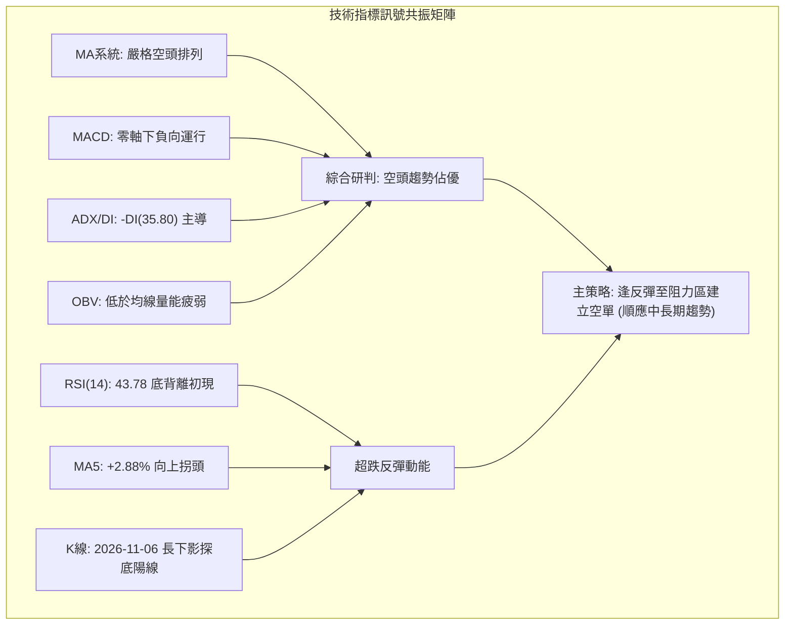

### 📈 移動平均線排列分析

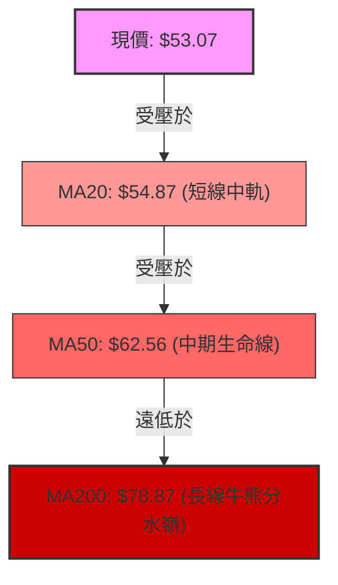

#### 移動平均線數據對比表

| 均線名稱 | 數值 | 價格相距 (%) | 走勢趨向 | 結構定義 |
|----------|------|--------------|----------|----------|
| **MA5** | **$51.59** | +2.88% (現價在上方) | ▲ 向上拐頭 | 短線超跌反抽，提供日內極短期支撐 |
| **MA10** | **$54.25** | -2.17% (現價在下方) | ▼ 持續下行 | 短線首道反壓，壓制反彈節奏 |
| **MA20** | **$54.87** | -3.28% (現價在下方) | ▼ 持續下行 | 月線反壓／布林中軌，反彈關鍵阻力 |
| **MA50 / 60** | **$62.56 / $64.33** | -15.17% / -17.50% | ▼ 加速下行 | 季線空頭大本營，中線壓力沉重 |
| **MA120** | **$79.37** | -33.14% (現價在下方) | ▼ 順勢下滑 | 半年線防線崩潰，轉為中期強反壓 |
| **MA200 / 240**| **$78.87 / $76.98** | -32.71% / -31.06% | ▼ 長期下行 | 長期均線嚴格空頭排列，長多格局瓦解 |

*均線排列結論：均線系統呈現完美的標準空頭排列（MA20 < MA50 < MA200），且所有中長天期均線斜率均向下發散，確認當前屬於中長期熊市結構，任何未放量突破 MA20 與 MA50 的漲勢均只能以技術性反抽視之。*

### 📉 RSI(14) 分析

#### RSI 數值強度展示
```
RSI(14) = 43.78
0    10   20   30   40   50   60   70   80   90   100
├────┼────┼────┼────┼────┼────┼────┼────┼────┼────┤
█████████████████░░░░░░░░░░░░░░░░░░░░░░░░░  43.78% (中性偏弱區)
              [超賣區]         [超買區]
```

#### RSI 背離深度判斷
- **底背離確立（Bullish Divergence）**：
  - 根據數據記錄，比較近 20 根 K 棒首尾價格與 RSI：
  - 價格端：由 2026-10-16 週收盤 $50.84 及 2026-11-05 日低點 $43.89，價格創出波段新低。
  - RSI 端：週 RSI 自 2026-10-16 的極端超賣值 **25.4** 回升至 2026-11-06 的 **43.8**（日線 RSI 同樣維持在 43.78，未創前低）。
  - **結論**：指標呈現典型的「價格破底但 RSI 不破底」之標準底背離，表明下殺空頭動能出現衰竭，具備誘發技術性超跌反彈的先決條件。

### 📊 MACD(12/26/9) 訊號解讀

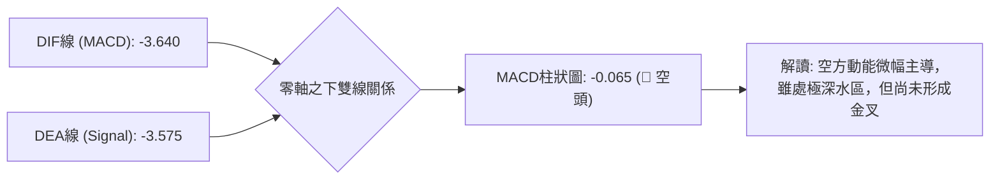

- **MACD 數值解讀**：
  - DIF = -3.640，Signal = -3.575，DIF 仍運行於 Signal 之下。
  - 柱狀圖數值 = -0.065，呈現負值擴散。
  - 指標位於遠低於零軸的深水區，表明大週期依然受到嚴重空頭壓制；但柱狀圖負值僅 -0.065，意味空頭殺跌力道正在減緩，若短期價格能守穩在 $52 之上，MACD 極有機會在未來數個交易日內於零軸下方形成低位「黃金交叉」。

### 📦 布林通道分析

```
RKLB 布林通道（20日，2倍標準差）日線架構圖
價格 ($)
$64.38 ┤ ═══════════════════════════════════ 上軌 ($64.38)
$60.00 ┤
$54.87 ┤ ----------------------------------- 中軌 MA20 ($54.87)
$53.07 ┤       ▲ 現價 ($53.07, %B = 0.41)
$48.00 ┤
$45.37 ┤ ═══════════════════════════════════ 下軌 ($45.37)
```

- **布林通道指標解讀**：
  - **上軌**：$64.38 ｜ **中軌（MA20）**：$54.87 ｜ **下軌**：$45.37 ｜ **帶寬**：$19.01 (35.8%)
  - **%B 指標**：0.41（介於 0 與 0.5 之間，屬於中軌與下軌間的弱勢運行區）。
  - 走勢動態：日前價格於 2026-11-05 跌破下軌觸及 $43.89 後迅速縮回通道之內，目前 %B 回升至 0.41，短線反彈的第一道嚴格考驗正是布林中軌 **$54.87**，在中軌未能有效突破前，通道下軌仍具有磁吸效應。

### 💹 成交量分析（量價配合度）

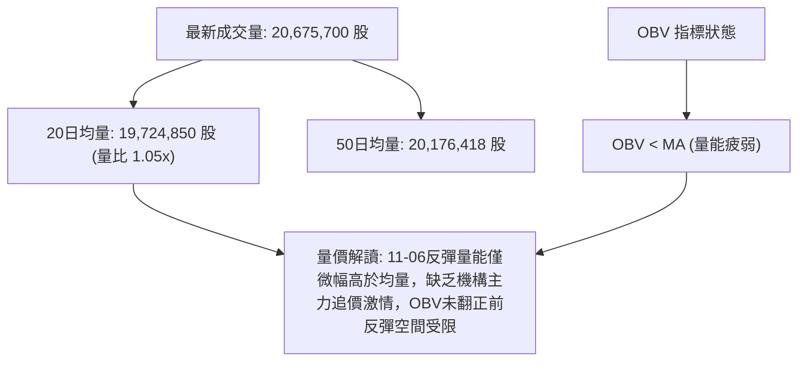

- **量價背離分析**：
  - 2026-11-05 恐慌下殺時爆出 **36,784,900** 股的巨量，顯示低檔有被動接盤，但屬於散戶停損與融資斷頭量。
  - 2026-11-06 強勁反彈收於 $53.07，成交量僅 **20,675,700** 股（量比 1.05x），反彈量能顯著縮減，呈現典型的「跌放量、漲縮量」之空頭量價特徵。
  - OBV 線持續低於其移動平均線，代表主力資金流向呈現淨流出狀態，整體籌碼沉澱仍未完成。

---

## 6. 動能與波動率

### ⚡ 動能評估四象限

| 象限 | 動能維度 | 波動維度 | 標的所處狀態 | 實戰環境評估 |
|------|----------|----------|--------------|--------------|
| **Q1 (最佳機會)** | 強動能 (多方主導) | 低波動 (蓄勢突破) | — | 適合趨勢波段追價加碼 |
| **Q2 (謹慎觀望)** | 弱動能 (無明確方向)| 低波動 (箱型盤整) | — | 適合低吸高拋網格交易 |
| **Q3 (投機博弈)** | 強動能 (多方爆發) | 高波動 (情緒高亢) | — | 適合短線動能突破快進快出 |
| **Q4 (避免進場/高風)**| **弱動能 (空方主導)**| **高波動 (Beta=3.18, ATR=8.57%)** | **✓ RKLB 當前落點** | **空頭趨勢強烈伴隨極端震盪，逆勢作多風險極高，適合逢高放空或嚴格觀望** |

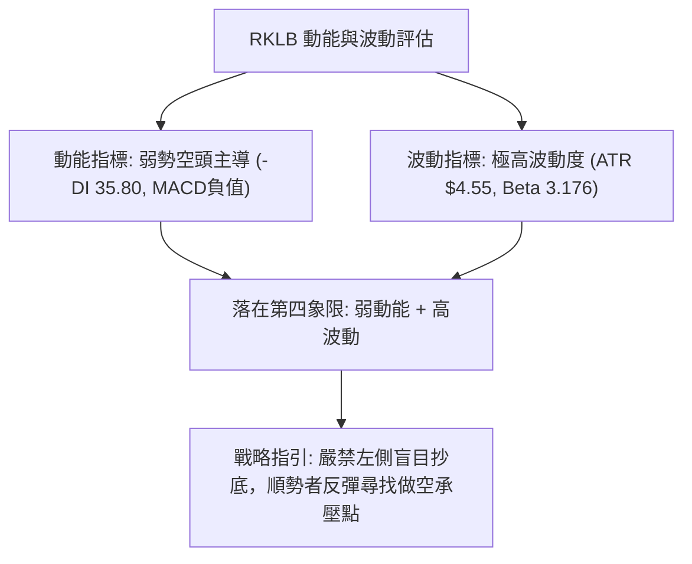

### 📊 ATR 波動率分析

- **ATR(14) 數值**：**$4.55**（佔當前收盤價 $53.07 之比例高達 **8.57%**，採用 Wilder 平滑算法）。
- **日內波動特徵**：該股每日平均真實波動區間高達 $4.55，顯示短線日內噪音極大，洗盤極為劇烈。
- **止損距離建議**：
  - 短線突破／波段交易：止損幅度絕不可小於 1.0 倍 ATR（即至少需保留 **$4.55** 的波動容忍空間），否則極易被日內毛刺打掉。
  - 趨勢型操作：建議設置 1.5 倍至 2.0 倍 ATR（約 **$6.83 至 $9.10**）作為保護性止損區間。

### 📐 Beta 與市場相關性

- **Beta 係數**：**3.176**（高 Beta 成長型／投機型航太概念標的）。
- **市場敏感度解讀**：
  - RKLB 價格波動幅度約為 S&P 500 指數的 **3.18 倍**。
  - 當大盤回檔 1% 時，該股理論平均跌幅達 3.18%；反之當市場風險偏好轉向狂熱時，其彈性亦遠放大盤。
  - 當前美股宏觀環境處於高波動階段，超高 Beta 特性導致 RKLB 成為市場空頭摜壓時首當其衝的提款標的。

---

## 7. 多時框架總結

### 📋 時框架評分表

| 時框架 | 趨勢方向 | 動能狀態 | 均線排列 | 形態結構 | 綜合評分 | 建議方針 |
|--------|----------|----------|----------|----------|----------|----------|
| **月線級別** | 🔴 下行修正 | 🔴 弱（自高檔回吐65%） | 🟡 測試MA240防禦帶 | 高檔放量崩跌 | **30/100** | 長線防禦，不宜長抱加碼 |
| **週線級別** | 🔴 空頭排列 | 🔴 弱（MACD負向發散） | 🔴 MA20/50全數跌破 | 頭肩頂破位下行 | **25/100** | 中期空頭，逢反彈皆賣點 |
| **日線級別** | 🟡 超跌反彈 | 🟢 短線底背離修復 | 🔴 空頭排列 (MA5拐頭) | 布林下軌探底陽線 | **45/100** | 短線僅限技術性快進快出 |

### 🔲 綜合訊號矩陣

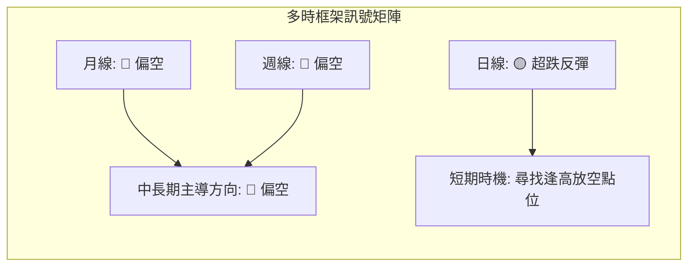

- **長期維度（月線）**：歷史狂熱退潮，連續6個月陰跌回調，跌幅逾六成，技術結構受重創。
- **中期維度（週線）**：週均線空頭排列，量能萎縮，下破頸線後空方目標持續延伸。
- **短期維度（日線）**：觸及布林下軌並出現 RSI 底背離，短線 1-3 天具備超跌反抽中軌之潛力。

### ⚖️ 多時框收斂結論

> **依據嚴格要求第 14 條（多時框收斂規則）：**
> 1. **行情定性**：當前 ADX(14) 數值為 **29.04 > 25**，市場明確定性為**「趨勢行情」**，而非區間震盪行情。
> 2. **優先級裁決**：在趨勢行情下，必須以**中長期方向（週線 / MA50 / MA200）為主導**，日線指標僅能用來尋找進場時機，絕不可用日線超賣訊號逆勢判定大級別翻多。
> 3. **唯一方向性結論**：**【偏空主導，反彈逢高佈空】**。
> 日線級別的 RSI 底背離與長下影線僅視為空頭波段中的「次級反彈修正」，當反彈遭遇上方關鍵阻力時，將提供順應中長期空頭趨勢的高勝率做空點。

---

## 8. 交易策略建議

### 🗺️ 策略決策流程圖

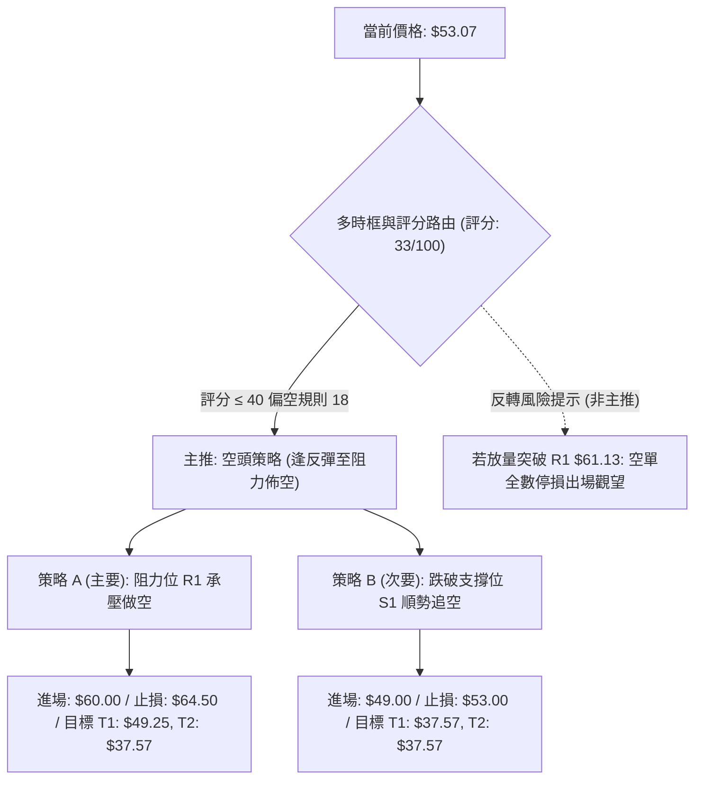

### 🧭 策略路由（依評分卡分流，不得兩頭下注）

> **當前主策略方向 = 【主推空頭策略】（依綜合評分 33/100，低於 40 門檻，規則 18 嚴格執行）**
> 
> 本報告堅決不採「兩頭下注」模稜兩可說法。因技術評分卡僅得 33 分，且 ADX(14) = 29.04 確立為空頭趨勢行情，因此主推**反彈遇阻放空**與**破位順勢做空**兩大空頭策略；多頭部分僅列為極短線激進投機或空單防禦停損依據。

### 🎯 價格情境階梯（Price Scenarios）

所有價位均直接引用第 4 章／關鍵價位區塊之真實計算數值：

| 觸發條件 | 下一目標 | 後續延伸 | 情境技術面含義 |
|----------|----------|----------|----------------|
| **突破 R1 $61.13** | **R2 $67.70** | **R3 $75.28** | 空頭結構遭遇強力反抗，短線轉強，空單全面避險。 |
| **受阻於 MA20 $54.87** | **S1 $49.25** | — | 弱勢反彈結束，重回下降通道下軌尋求支撐。 |
| **跌破 S1 $49.25** | **S2 $37.57** | **數據中未偵測到** | 中期跌勢加速，波段防線崩潰，直探52週歷史低點。 |

### 📊 情境機率分佈

| 情境劇本 | 機率估計 (%) | 主要技術指標依據 |
|----------|--------------|------------------|
| **反彈受阻再探底 / 順勢下行** | **60%** | 均線完整空頭排列，ADX=29.04且-DI=35.80主導，OBV疲弱未放量 |
| **窄幅區間震盪 ($49.25 - $54.87)** | **25%** | RSI底背離引發低接買盤，但上方布林中軌壓制明顯，陷入拉鋸 |
| **強勢反轉突破 R1 $61.13** | **15%** | 需極端宏觀利多促使成交量激增至50日均量2倍以上，目前機率極低 |

### 🟢 主策略詳情（方向：空頭主推策略）

嚴格依據規則 17 執行計算：風險報酬比 = (進場價 − 目標價 T1) ÷ (止損價 − 進場價)

| 策略要素 | 策略 A：阻力位 R1 承壓佈空（主要策略） | 策略 B：跌破支撐位 S1 追空（突破策略） |
|----------|----------------------------------------|----------------------------------------|
| **策略類型** | 順勢逢高放空（反抽做空） | 破位順勢追空（動能做空） |
| **進場條件** | 價格反彈至 R1 附近出現長上影或陰包陽滯漲確認 | 價格實體收盤有效摜破波段低點聚類支撐 S1 |
| **進場價格** | **$60.00**（位於 R1 $61.13 下方承壓區） | **$49.00**（確認破位 S1 $49.25 之後） |
| **目標價 T1** | **$49.25**（波段低點聚類支撐 S1） | **$37.57**（52週低點強支撐 S2） |
| **目標價 T2** | **$37.57**（52週低點強支撐 S2） | **$37.57**（52週低點強支撐 S2） |
| **止損價格** | **$64.50**（站穩布林上軌 $64.38 及 R1 之上） | **$53.00**（重回現價與MA20中軌之上） |
| **風險報酬比** | **1 : 2.39（以 T1 計）**<br>*算式：(60.00 − 49.25) ÷ (64.50 − 60.00) = 10.75 ÷ 4.50 = 2.39*<br>另計 T2 為 1 : 4.98（以 T2 計） | **1 : 2.86（以 T1 計）**<br>*算式：(49.00 − 37.57) ÷ (53.00 − 49.00) = 11.43 ÷ 4.00 = 2.86*<br>另計 T2 為 1 : 2.86（以 T2 計） |
| **成功機率** | **65%** | **55%** |
| **建議倉位** | **15% - 20%** 總風險資本 | **10%** 總風險資本 |

### 🔴 反向風險觸發點（對沖與止損提示）

若市場出現非預期之強勢買盤，以下點位為**徹底推翻空頭主策略**之關鍵訊號，空單必須立即無條件止損出場：
1. **日線收盤價強勢突破 R1 $61.13**：宣告下降通道遭到實質性破壞，底背離演變為中期趨勢反轉。
2. **成交量暴增至 40,000,000 股以上且 MACD 柱狀圖翻正**：表明大級別機構資金進場掃盤，空頭動能徹底瓦解。

### ⭐ 整體訊號強度評星

```
做多訊號強度：★★☆☆☆  (2/5星 - 僅存超跌反彈動能，中長線逆風)
做空訊號強度：★★★★☆  (4/5星 - 順應大級別空頭趨勢，均線空頭排列)
整體可信度：  ★★★★☆  (4/5星 - ADX>25趨勢確認，指標具備高度一致性)
```

---

## 9. 風險提示與監控

### ✅ 關鍵監控指標 Checklist

```
╔══════════════════════════════════════════════════════════════╗
║              RKLB 每日交易關鍵監控 Checklist                  ║
╠══════════════════════════════════════════════════════════════╣
║ [ ] 價格能否有效收復 MA20 / 布林中軌 ($54.87)               ║
║ [ ] RSI(14) 底背離是否延續，數值能否有效站上 50 中軸        ║
║ [ ] MACD DIF 線是否在零軸下與 Signal 線完成金叉              ║
║ [ ] 成交量是否萎縮至 20日均量 (19,724,850 股) 之下           ║
║ [ ] 關鍵支撐 S1 ($49.25) 是否在日線收盤時失守                ║
║ [ ] 關鍵阻力 R1 ($61.13) 是否遭遇空方爆量壓制                ║
╚══════════════════════════════════════════════════════════════╝
```

### ⚠️ 風險場景分析

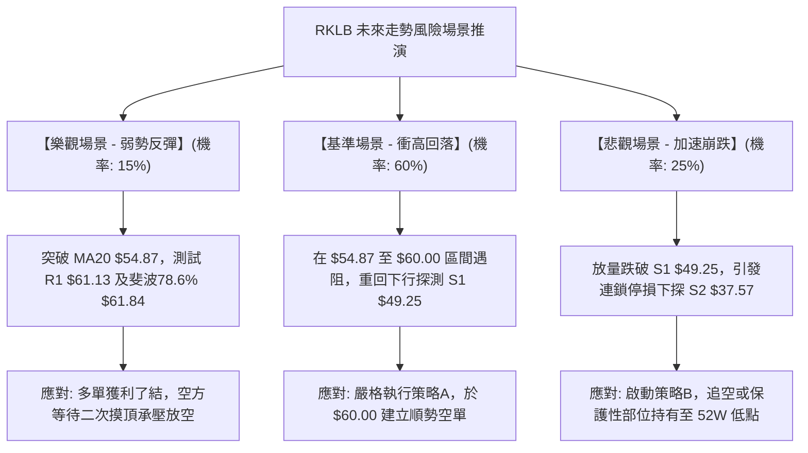

### 🛡️ 風險管理重要提醒

1. **極高波動性風險防範**：
   - 該股 Beta 達 **3.176**，ATR 高達 **$4.55 (8.57%)**，屬於標準的超高波動股票。單日振幅極易超出一般投資人心理承受極限。
   - **嚴格倉位控制**：單一交易策略之最大曝險金額絕不可超過總投資組合淨值的 **2%**。
2. **財報與事件驅動風險**：
   - 新聞面顯示市場正密切關注即將到來的重大日期（11月9日）與財報發布，航太板塊受政策、發射任務進度及同業競爭（SpaceX、ASTS）影響極大。
   - 事件公布前後通常伴隨隱含波動率驟升與隔夜跳空風險，建議於重大事件前夕將部位規模減半或利用衍生工具嚴格避險。
3. **流動性與空頭擠壓（Short Squeeze）警示**：
   - 目前空頭借券比率（Short % Float）為 **7.6%**，Short Ratio 為 **2.0**。雖然尚未達到極端軋空標準，但一旦伴隨爆炸性基本面利多突破 R1 **$61.13**，仍可能引發短線空頭踩踏回補，空單部位務必嚴設停損於 $64.50。

---

## 📋 報告總結

```
╔══════════════════════════════════════════════════════════════╗
║                   RKLB 技術分析報告總結                       ║
╠══════════════════════════════════════════════════════════════╣
║ 報告日期：2026-11-08                                         ║
║ 當前價格：$53.07                                             ║
║ 分析評級：🔴 偏空（綜合評分 33/100，空頭趨勢反彈做空）        ║
╠══════════════════════════════════════════════════════════════╣
║ 關鍵結論：                                                   ║
║ ├─ 長期趨勢：🔴 空頭主導，距 52週高點 $151.00 已回吐逾六成    ║
║ ├─ 中期趨勢：🔴 弱勢破位，均線呈現 MA20<MA50<MA200 嚴格空頭   ║
║ ├─ 短期趨勢：🟡 超跌反彈，RSI 出現日線底背離修復            ║
║ ├─ 關鍵支撐：S1 $49.25 ｜ 強支撐 S2 $37.57 (52週最低點)      ║
║ ├─ 關鍵阻力：R1 $61.13 ｜ 中期頸線 R2 $67.70                ║
║ └─ 機構共識：買入 (20位分析師平均目標 $102.15，技術面嚴重背離)║
╠══════════════════════════════════════════════════════════════╣
║ 最優策略組合：                                               ║
║ 1. 🥇 最佳機會（策略 A）：反彈至 $60.00 逢高佈空，             ║
║    目標 T1 $49.25，止損 $64.50，風報比 1 : 2.39 (以 T1 計)   ║
║ 2. 🥈 次選機會（策略 B）：摜破 S1 $49.00 順勢追空，           ║
║    目標 T1 $37.57，止損 $53.00，風報比 1 : 2.86 (以 T1 計)   ║
║ 3. 🥉 保守選擇：多看少做，等待價格回測 S2 $37.57 確立打底，   ║
║    或強勢放量突破 R1 $61.13 後再行順勢介入。                  ║
╚══════════════════════════════════════════════════════════════╝
```

---

> ⚠️ **免責聲明**：本報告為 AI 自動生成之技術分析，所有數據及估算均基於提供的歷史價格資訊。本報告**僅供研究與學術參考**，**不構成任何投資建議**。投資有風險，入市需謹慎。

---

*報告生成時間：2026-11-08 ｜ 數據來源：Yahoo Finance ｜ 分析框架：多時框技術分析*