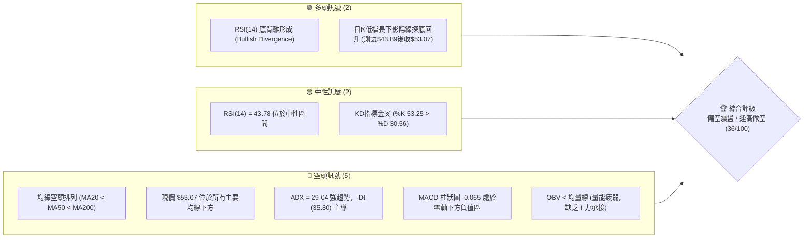
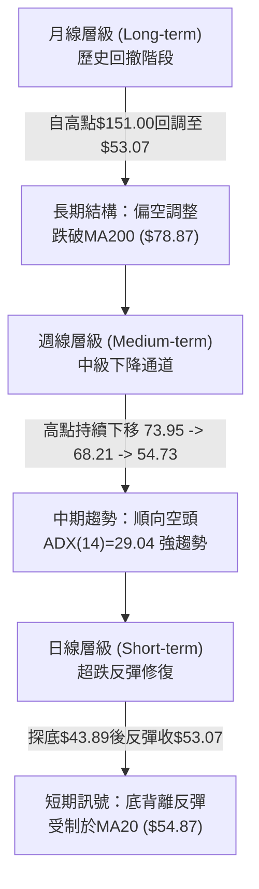
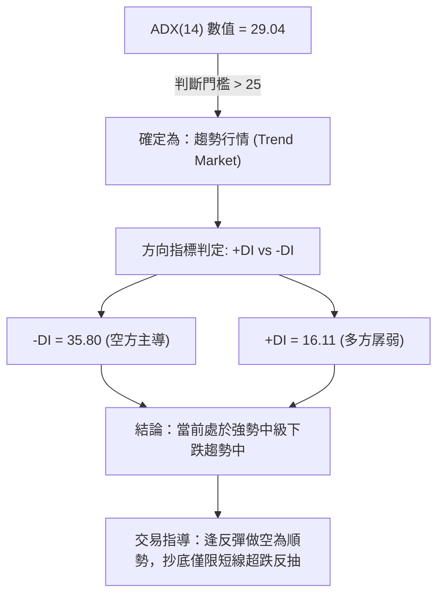
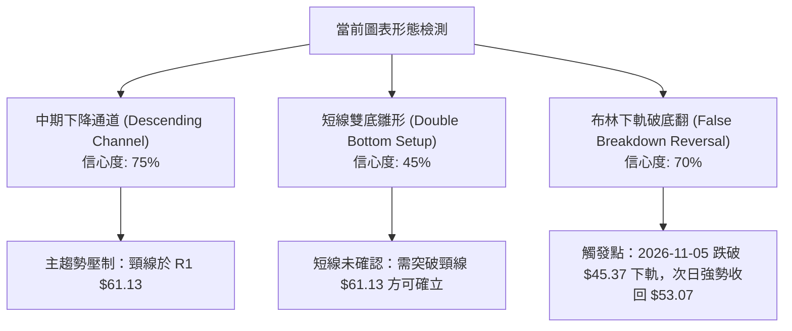
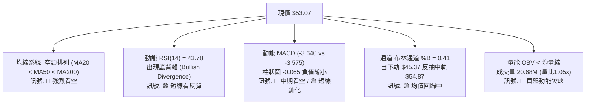
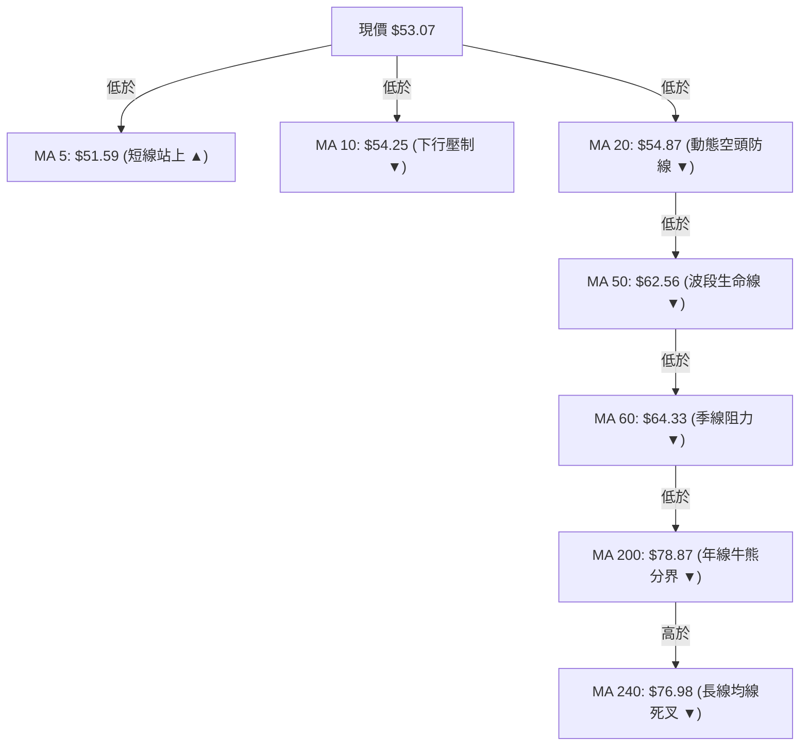
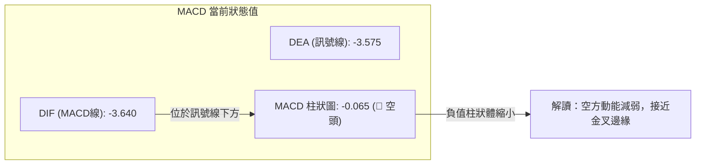
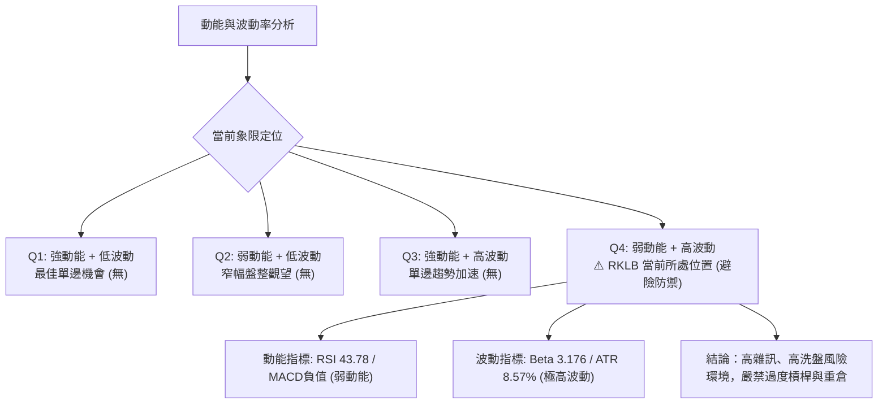
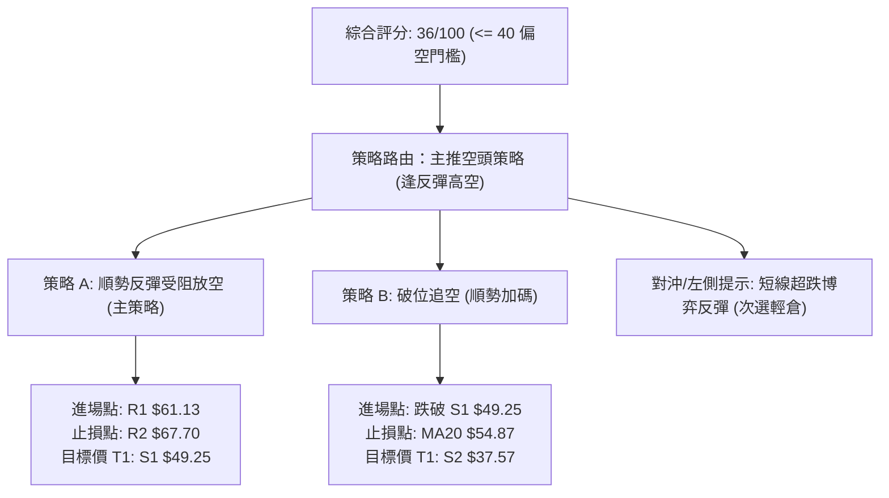
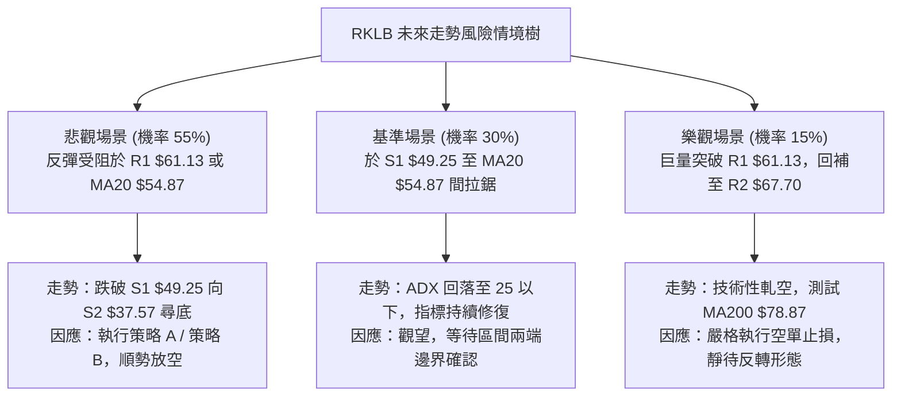

# RKLB 技術分析報告

> **報告日期**：2026-11-09 ｜ **語言**：繁體中文 ｜ **數據來源**：Yahoo Finance ｜ **當前價格**：$53.07

---

## 目錄

| 章節 | 內容 |
|------|------|
| [1. 技術面概覽](#1-技術面概覽) | 訊號儀表板、核心指標、評分卡 |
| [2. 趨勢分析](#2-趨勢分析) | 多時框趨勢、長中短期走勢、ADX解讀 |
| [3. 圖表形態分析](#3-圖表形態分析) | 形態識別、K線組合、目標價計算 |
| [4. 支撐與阻力](#4-支撐與阻力) | 關鍵價位結構、斐波那契回調深度分析 |
| [5. 技術指標深度解讀](#5-技術指標深度解讀) | 均線系統、RSI背離、MACD、布林通道、量價 |
| [6. 動能與波動率](#6-動能與波動率) | 動能四象限、ATR波動率、Beta風險係數 |
| [7. 多時框架總結](#7-多時框架總結) | 時框架矩陣、趨勢收斂結論 |
| [8. 交易策略建議](#8-交易策略建議) | 策略路由、主客策略、精確風報比 |
| [9. 風險提示與監控](#9-風險提示與監控) | 監控清單、情境樹、風控法則 |

---

## 1. 技術面概覽

### 🎯 技術訊號儀表板



### 📊 核心指標速覽表

| 指標類別 | 指標名稱 | 當前數值 | 訊號 | 專業解讀 |
|:---|:---|:---|:---:|:---|
| **價格** | 當前收盤價 | $53.07 | 🔴 | 位於52週區間 13.7% 極低檔，受制於MA20 ($54.87) 壓制 |
| **均線** | 短期 MA20 | $54.87 | 🔴 | 價格在MA20下方，斜率向下，構成第一道動態阻力 |
| **均線** | 中期 MA50 | $62.56 | 🔴 | 價格在MA50下方，中波段空頭防線，與R1及斐波78.6%共振 |
| **均線** | 長期 MA200 | $78.87 | 🔴 | 價格遠在MA200下方，長期牛熊分界線失守，長期走勢走弱 |
| **動能** | RSI(14) | 43.78 | 🟡 | 脫離超賣區進入中性，伴隨近20根K棒首尾之顯著「底背離」 |
| **動能** | MACD (12,26,9) | -3.640 / -3.575 | 🔴 | 快慢線均在零軸深處負值區，Hist = -0.065，空方動能佔優 |
| **趨勢** | ADX(14) / DMI | 29.04 / -DI:35.80 | 🔴 | ADX > 25 確認為強勢趨勢行情，-DI壓制+DI(16.11)，空頭主導 |
| **通道** | 布林通道 | %B: 0.41 | 🟡 | 脫離下軌($45.37)朝中軌($54.87)反彈，尚未突破中軌阻力 |
| **量能** | OBV 與量比 | 量比 1.05x / OBV<MA | 🔴 | 量能疲弱，反彈過程中無機構增量買盤，OBV低於其均線 |
| **波動** | ATR(14) | $4.55 (8.57%) | 🔴 | 日均振幅高達8.57%，極高波動度，需寬幅止損與輕倉應對 |

### 🏆 技術評分卡

```
技術評分卡 — RKLB (2026-11-09)
════════════════════════════════════════════════════
趨勢強度 (ADX=29.04, -DI主導) █████░░░░░░░░░░░░░░░  28/100  🔴 空頭主導
動能指標 (RSI底背離 vs MACD負值)█████████░░░░░░░░░░░  44/100  🟡 短線反彈
支撐穩定度 (守住S1, 測試$43.89)  ████████░░░░░░░░░░░░  42/100  🟡 低檔支撐
成交量配合 (OBV<MA, 反彈無放量) ███████░░░░░░░░░░░░░  36/100  🔴 量價背離
形態完整度 (下降通道, 雙底雛形) ████████░░░░░░░░░░░░  40/100  🟡 形態未決
均線排列 (空頭排列, 全線失守)   █████░░░░░░░░░░░░░░░  26/100  🔴 嚴格空頭
════════════════════════════════════════════════════
綜合評分                      ███████░░░░░░░░░░░░░  36/100  🔴 偏空弱勢
════════════════════════════════════════════════════
* 綜合評分 = (28 + 44 + 42 + 36 + 40 + 26) ÷ 6 = 36.00 (依規則18算術平均)
```

---

## 2. 趨勢分析

### 🌐 多時框趨勢分析



### 📈 長期趨勢 — 12個月走勢圖（Unicode）

```
RKLB 月線收盤走勢圖（2025-11 至 2026-11）
價格軸 ($)
$150 ┤                                  ● $143.48 (2026-05, 高點$151.00)
$130 ┤                                 / \
$110 ┤                                /   ● $101.65 (2026-06)
 $90 ┤                 ● $80.07      ● $82.51 \
 $70 ┤          ● $69.76 \          /          \
 $50 ┤   ● $42.14         ● $69.10 ● $64.22     ● $64.95 ──● $69.68
 $30 ┤                                                      \     ● $53.07 (現在)
     └─────────────────────────────────────────────────────────────● $54.73
       11   12   01   02   03   04   05   06   07   08   09   10   11 (月份)
      2025 │ 2026
```

#### 走勢特徵分析表格

| 階段 | 時間區間 | 起止價格 | 漲跌幅 | 走勢特徵與結構意涵 |
|:---|:---|:---|:---:|:---|
| **主升浪突破** | 2025-11 至 2026-05 | $42.14 → $143.48 | +240.48% | 量價齊揚，月線呈現拋物線式噴出，創下52週高點 $151.00 |
| **派發見頂** | 2026-05 至 2026-07 | $143.48 → $64.95 | -54.73% | 頂部快速套現，大陰線跌破百元大關，多頭防線全面潰敗 |
| **低檔盤整** | 2026-07 至 2026-09 | $64.95 → $69.68 | +7.28% | 在 $64.00 - $70.00 構築中繼平台，成交量顯著萎縮 |
| **下破尋底** | 2026-09 至 2026-11 | $69.68 → $53.07 | -23.84% | 平台跌破，日線加速尋底至 $43.89，當前於 S1 ($49.25) 上方震盪 |

### 📊 中期趨勢（週線分析）

```
週線關鍵阻力與支撐分佈示意圖：
$78.87 ────────────────────────────────────────── MA200 / 斐波61.8% ($80.90) [強阻力]
                                  ▼
$67.70 ────────────────────────────────────────── 阻力 R2 / 前波週線反彈高點
                                  ▼
$61.13 ────────────────────────────────────────── 阻力 R1 / MA50 ($62.56) / 斐波78.6% ($61.84)
                        ▲
$53.07 ═════════════════╬════════════════════════ 現價（反彈受壓於MA20 $54.87）
                        ▼
$49.25 ────────────────────────────────────────── 支撐 S1（近一年波段低點聚類）
                                  ▼
$37.57 ────────────────────────────────────────── 強支撐 S2（52週最低價 100.0%回調位）
```

近20週數據顯示，收盤價由 2026-07-02 之高點 $100.46 一路滑落至當前之 $53.07。雖然近四週在跌破 $50.84 後迅速於 2026-11-06 該週探底 $43.89 並強勢收復至 $53.07，週成交量達 106,838,500 股，顯示低檔有初步承接盤，但週線 MACD 仍維持在 -0.065 負值區，週線下降通道尚未扭轉。

### ⚡ 趨勢強度評估（ADX 解讀）



| 指標名稱 | 數值 | 臨界值標準 | 當前狀態解讀 |
|:---|:---:|:---:|:---|
| **ADX(14)** | **29.04** | > 25.00 為趨勢盤，< 20.00 為盤整盤 | **強趨勢行情**。趨勢動能充足，不可將當前行情視為無趨勢之窄幅震盪 |
| **+DI(14)** | **16.11** | 多方攻擊動能閥值（>25） | 多方動能嚴重不足，買盤缺乏持續推升力道 |
| **-DI(14)** | **35.80** | 空方主導動能閥值（>25） | 空頭佔據完全主導地位，-DI 大幅壓制 +DI，空方力量強烈 |
| **方向差值**| **-19.69** | +DI 減 -DI | 負差值擴大，確認市場下行阻力最小路徑依舊向下 |

---

## 3. 圖表形態分析

### 🔍 形態識別系統



#### 圖表形態信心度評估表

| 形態名稱 | 信心度 | 判斷依據（引用數據） | 完成度 | 目標價（附精確計算式） |
|:---|:---:|:---|:---:|:---|
| **中期下降通道** | **75%** | 2026-09-25 高點 $75.46、2026-10-29 高點 $61.13 連線下壓；低點由 $50.84 延伸至 $43.89 | 85% | 跌破通道下軌目標為 S2: **$37.57**（數據中52W Low） |
| **短線雙底雛形** | **45%** | 第一低點 2026-10-23 之 $49.25 (S1)，第二低點 2026-11-05 之 $43.89，但未突破頸線 | 40% | 依規則15推算：頸線 R1 $61.13 + 形態高度 ($61.13 - $43.89 = $17.24) = **$78.37**（接近 MA200 $78.87 與 R3 $75.28） |
| **極限破底翻** | **70%** | 2026-11-05 跌破布林下軌 $45.37 最低見 $43.89，2026-11-06 迅速放量收於 $53.07 | 100% | 理論反彈目標為布林中軌 MA20: **$54.87**，延伸目標為 R1: **$61.13** |

*註：由於短線雙底形態信心度僅 45%（< 50%），未獲頸線突破確認前，不可作為中期反轉依據，僅能定義為指標型超跌反彈。*

### 🕯️ 重要K線形態分析

嚴格依據數據中「近10根日K」與「近8根週K」之開高低收進行精確解讀：

| 日期（日K/週K） | 開盤價 | 最高價 | 最低價 | 收盤價 | 成交量 | K線形態 | 深度解讀與多空訊號 |
|:---|:---:|:---:|:---:|:---:|:---:|:---|:---|
| **2026-10-27 (日K)** | $54.10 | $59.18 | $53.57 | $58.31 | 21,341,400 | 中長陽線 | 🟢 放量長陽突破短期均線，帶動短線買盤進場 |
| **2026-10-29 (日K)** | $57.76 | $61.13 | $57.63 | $59.10 | 14,625,800 | 衝高受阻流星星線 | 🔴 最高觸及 R1 ($61.13) 即遭空頭重壓回落，確立 R1 壓力強固 |
| **2026-10-30 (日K)** | $55.71 | $57.55 | $53.19 | $54.73 | 16,609,400 | 中陰線 | 🔴 跌破開盤價，回吐漲幅，確立短波段見頂 |
| **2026-11-05 (日K)** | $50.58 | $50.83 | $43.89 | $45.99 | 36,784,900 | 恐慌長黑破位棒 | 🔴 放量重挫（成交量放大至36.78M），跌破 S1 ($49.25)，帶有恐慌恐慌盤拋售特徵 |
| **2026-11-06 (日K)** | $48.28 | $53.10 | $46.51 | $53.07 | 20,675,700 | 探底大陽線 (Hammer) | 🟢 低開高走收光頭陽線，實體收復前日跌幅大部，確立 $43.89 短線底部 |
| **2026-10-16 (週K)** | $67.88 | $68.07 | $49.69 | $50.84 | 128,008,200| 崩跌大陰線 | 🔴 單週重挫超 25%，成交量爆出 1.28 億股，主力機構破位派發 |
| **2026-10-30 (週K)** | $52.60 | $61.13 | $52.15 | $54.73 | 77,651,800 | 長上影紡錘線 | 🔴 衝高至 R1 ($61.13) 後回落，顯示中線空頭壓制堅固 |
| **2026-11-06 (週K)** | $55.08 | $55.31 | $43.89 | $53.07 | 106,838,500| 長下影探底錘頭棒 | 🟡 單週振幅極大，下影線長達 $9.18 ($53.07 - $43.89)，成交量放大至 1.06 億股 |

### 📉 ASCII 走勢形態示意圖

```
日K線近期探底回升走勢圖（2026-10-26 至 2026-11-06）
價格 ($)
$62 ┤               ┌─┐高點 $61.13 (R1阻力)
$60 ┤             ┌─┤ │
$58 ┤      ┌─┐    │ │ │
$56 ┤      │ │    │ │ │   ┌─┐
$54 ┤ ┌─┐  │ │┌─┐ │ └─┘┌─┐│ │    ┌─┐           ┌─┐收 $53.07
$52 ┤ │ │  │ ││ │ │   │ ││ │┌─┐ │ │     ┌─┐   │ │
$50 ┤ └─┘  └─┘│ │ └───┘└─┘│ ││ │ └─┘     │ │   │ │
$48 ┤         └─┘         └─┘└─┘         │ │   │ │
$46 ┤                                    │ │   └─┘
$44 ┤                                    └─┴─┐
$42 ┤                                        │恐慌低點 $43.89
    └────────────────────────────────────────┴───────────────
      10/26 10/27 10/28 10/29 10/30 11/02 11/03 11/04 11/05 11/06
```

### 🎯 形態目標價計算

1. **破底翻反彈第一目標 (T1)**：
   - 依布林通道均值回歸理論，下軌極端超賣（%B: 0.41，11/05最低觸及 $43.89 穿透下軌 $45.37）後之標準修復目標為布林中軌：
   $$\text{目標價 T1} = \text{布林中軌 (MA20)} = \$54.87$$
2. **下降通道反彈第二目標 (T2)**：
   - 引用數據中波段高點聚類阻力位 R1：
   $$\text{目標價 T2} = \text{阻力位 R1} = \$61.13$$
3. **空頭順勢破位目標**：
   - 若短線反彈於 MA20 ($54.87) 或 R1 ($61.13) 受阻，再度跌破 S1 ($49.25)，則打開下行通道，直接指向52週最低點：
   $$\text{空頭終極目標} = \text{支撐位 S2} = \$37.57$$

---

## 4. 支撐與阻力

### 🗺️ 關鍵價位分布圖（Unicode）

```
RKLB 關鍵價位結構分布圖
══════════════════════════════════════════════════════════════════
$78.87 ║████████████████████████║ MA200 / 斐波61.8% ($80.90) 長期牛熊線
$75.28 ║██████████████████████  ║ 強阻力 R3 (+41.86%)
$67.70 ║████████████████        ║ 阻力 R2 (+27.57%)
$61.13 ║████████████████████████║ 關鍵阻力 R1 (+15.19%) / 斐波78.6% ($61.84)
$54.87 ║------------------------║ 動態阻力：MA20 / 布林中軌
$53.07 ╠════════════════════════╣ ◄ 現價 (Last Close)
$49.25 ║▓▓▓▓▓▓▓▓▓▓▓▓▓▓▓▓        ║ 近期關鍵支撐 S1 (-7.20%)
$45.37 ║........................║ 動態支撐：布林下軌 (11/05穿透低點$43.89)
$37.57 ║████████████████████████║ 終極強支撐 S2 (-29.21%) / 52週低點 (100%)
══════════════════════════════════════════════════════════════════
```

### 🚧 阻力位分析表

阻力位完全引用數據中「關鍵價位」區塊之波段高點聚類數值：

| 阻力級別 | 價位 | 與現價距離 | 形成原因與籌碼技術結構 | 突破難度 | 重要性 |
|:---|:---:|:---:|:---|:---:|:---:|
| **動態阻力** | **$54.87** | +3.39% | MA20 移動平均線與布林通道中軌共振點，日線多空爭奪中軸 | 🟡 中等 | ★★★☆☆ |
| **阻力 R1** | **$61.13** | +15.19% | 近一年波段高點聚類點；與斐波那契 78.6% ($61.84) 及 MA50 ($62.56) 形成強大密集反壓區 | 🔴 極高 | ★★★★★ |
| **阻力 R2** | **$67.70** | +27.57% | 前期週線平台破位頸線位置（2026-10-09 當週低點 $66.98 附近） | 🔴 高 | ★★★★☆ |
| **阻力 R3** | **$75.28** | +41.86% | 2026-09-25 及 2026-10-02 兩週高點聚類區，密集套牢籌碼峰 | 🔴 極高 | ★★★★★ |

### 🛡️ 支撐位分析表

支撐位完全引用數據中「關鍵價位」區塊之波段低點聚類數值：

| 支撐級別 | 價位 | 與現價距離 | 形成原因與籌碼技術結構 | 守住機率 | 重要性 |
|:---|:---:|:---:|:---|:---:|:---:|
| **近期支撐 S1** | **$49.25** | -7.20% | 近一年波段低點聚類點（2026-10-23 週K最低價即為 $49.25），多頭短線生命線 | 🟡 55% | ★★★★☆ |
| **極端動態位** | **$45.37** | -14.51% | 布林通道下軌動態位置，11-05 恐慌低點 $43.89 構成之緩衝帶 | 🟡 60% | ★★★☆☆ |
| **強支撐 S2** | **$37.57** | -29.21% | 52週歷史最低價（52W Low），斐波那契 100.0% 終極回調位，歷史重大機構建倉底 | 🟢 85% | ★★★★★ |

### 📐 斐波那契回調位分析

依據數據提供的 52 週完整波段（區間高點 $151.00 → 區間低點 $37.57，總落差 $113.43），嚴格引用回調數據：

```
斐波那契回調位階梯 (52W High $151.00 → 52W Low $37.57)
──────────────────────────────────────────────────────────────────
  0.0% (52W High)    $151.00  ▓▓▓▓▓▓▓▓▓▓▓▓▓▓▓▓▓▓▓▓▓▓▓▓▓▓▓▓▓▓▓▓▓▓▓▓
 23.6%               $124.23  ▓▓▓▓▓▓▓▓▓▓▓▓▓▓▓▓▓▓▓▓▓▓▓▓▓▓▓▓
 38.2%               $107.67  ▓▓▓▓▓▓▓▓▓▓▓▓▓▓▓▓▓▓▓▓
 50.0%               $ 94.28  ▓▓▓▓▓▓▓▓▓▓▓▓▓▓▓▓
 61.8%               $ 80.90  ▓▓▓▓▓▓▓▓▓▓▓▓ (MA200 $78.87 共振區)
 78.6%               $ 61.84  ▓▓▓▓▓▓ (R1 $61.13 共振區)
──────────────────────────────────────────────────────────────────
 ► 現價落點: $53.07  (處於 78.6% 與 100.0% 之間，回調深度達 86.3%)
──────────────────────────────────────────────────────────────────
100.0% (52W Low)     $ 37.57  ▓ (終極支撐 S2)
```

**斐波那契深度解讀**：
1. **當前區間落點**：現價 $53.07 坐落於 78.6% ($61.84) 與 100.0% ($37.57) 之間，意味著本輪自 $151.00 展開的大熊市回撤幅度已高達 86.3%（計算式：$(151.00 - 53.07) \div 113.43 = 86.33\%$）。
2. **黃金分割共振壓制**：斐波那契 78.6% 回調位 ($61.84) 與數據給出的波段高點阻力 R1 ($61.13) 僅差 $0.71，且與 MA50 ($62.56) 幾乎重合。這構築了難以逾越的中期「天花板」，反彈至此區間將面臨多重技術共振阻力。
3. **下行空間評估**：現價距離 100.0% 終極回調點 $37.57 仍有 $15.50 (-29.21%) 的下行敞口，若 S1 ($49.25) 在日線級別收盤有效失守，價格將向 $37.57 尋求長期底部支撐。

---

## 5. 技術指標深度解讀

### 🎛️ 指標訊號總覽



### 📈 移動平均線排列分析



#### 均線數據全景表

| 均線代號 | 數值 | 現價與均線差距 | 漲跌趨向 | 技術含義 |
|:---|:---:|:---:|:---:|:---|
| **MA 5** | $51.59 | +$1.48 (+2.88%) | ▲ 向上微勾 | 5日線被價格收復，日線超跌反抽啟動 |
| **MA 10** | $54.25 | -$1.18 (-2.17%) | ▼ 向下傾斜 | 10日線下壓，與現價形成直接對峙 |
| **MA 20** | $54.87 | -$1.80 (-3.28%) | ▼ 向下傾斜 | 月線持續下行，空頭排列第一核心壓制點 |
| **MA 50** | $62.56 | -$9.49 (-15.17%)| ▼ 向下傾斜 | 中期多空分水嶺，遠在現價上方 |
| **MA 60** | $64.33 | -$11.26 (-17.50%)| ▼ 向下傾斜 | 季線下壓，中線套牢盤極為沉重 |
| **MA 120**| $79.37 | -$26.30 (-33.14%)| ▼ 向下傾斜 | 半年線快速下行，中期趨勢嚴重受損 |
| **MA 200**| $78.87 | -$25.80 (-32.71%)| ▼ 向下傾斜 | 年線空頭運行，長週期確立轉入熊市格局 |
| **MA 240**| $76.98 | -$23.91 (-31.06%)| ▼ 向下傾斜 | 長天期均線全面調頭向下 |

**綜合均線評判**：典型之「**完全空頭排列**」（Perfect Bearish Alignment）。短天期均線全數運行於長天期均線下方，均線斜率一致向下發散。雖然 MA5 出現短期勾頭向上，但屬於嚴重的空頭發散後之技術性負乖離修復，未改變均線系統對價格的泰山壓頂之勢。

### 📉 RSI(14) 分析

- **當前數值**：43.78 (Wilder)
- **數值可視化**：
  $$\text{超賣 (0)} \quad \underbrace{\text{████████████████░░░░░░░░░░░░░░░░░░░░}}_{\text{當前 RSI: 43.78 (中性偏弱)}} \quad \text{超買 (100)}$$
- **背離分析（Divergence）**：
  - **形態確認**：數據明確標記 **⚠️ 底背離 (Bullish Divergence)**。
  - **技術對比**：比較近 20 根 K 棒走勢，價格於 2026-10-16 創出收盤低點 $50.84，並於 2026-11-05 跌破創出波段極低點 $43.89；然而 RSI(14) 卻由 2026-10-16 的極端超賣值 25.4 逐步墊高，在最新收盤回升至 43.8 個點。
  - **背離結論**：此為典型的「**標準日線級別底背離**」。表明空頭下殺動能已出現衰竭跡象，短線下行動力邊際遞減，極易催生技術性反彈走勢。但需注意，在強烈空頭排列中，單純的 RSI 底背離往往僅能引發向 MA20 的短線抽腳，難以直接扭轉主趨勢。

### 📊 MACD(12, 26, 9) 訊號解讀



- **絕對數值解讀**：DIF (-3.640) 與 DEA (-3.575) 均深處於零軸下方（距離零軸超 3.5 個點），說明市場處於深層的空頭主導市場，中長期回調態勢未除。
- **柱狀圖動態**：當前 MACD Hist 為 -0.065。對比 2026-10-16 當週的 -2.111，柱狀圖負值大幅收斂，快慢線負向乖離收窄，顯示空方動能正處於衰減週期，日線隨時可能產生低位鈍化或弱勢金叉。然而，零軸下方的金叉均屬「**水下弱勢金叉**」，往往只對應反彈行情，遇阻容易形成二次死叉。

### 📦 布林通道分析

```
布林通道 (Bollinger Bands 20, 2) 結構示意圖：
$64.38 ────────────────────────────────────── 上軌 (Upper Band)
                                               ↑
                                               │
$54.87 ────────────────────────────────────── 中軌 (Middle Band = MA20)
                         ▲                     │ 距離中軌 +$1.80
$53.07 ══════════════════╬════════════════════ 現價 (%B: 0.41)
                         │                     │
$45.37 ──────────────────▼─────────────────── 下軌 (Lower Band) [11/05跌破$43.89後收回]
```

- **通道參數現狀**：上軌 $64.38，中軌 $54.87，下軌 $45.37。帶寬（Bandwidth）= $(\$64.38 - \$45.37) \div \$54.87 = 34.6\%$，呈現擴張後的高波動狀態。
- **%B 指標解讀**：目前 %B 為 **0.41**（0 代表下軌，0.5 代表中軌，1 代表上軌）。
- **走勢特徵**：2026-11-05 股價最低下探 $43.89，已實質擊穿布林下軌（%B < 0），屬於嚴重超賣破位；2026-11-06 強勁反彈收於 $53.07，重新站回通道內部，確認此為一次「**布林下軌假跌破（False Breakdown）**」。依據通道交易法，價格自下軌發起反彈，第一標準回歸目標即為中軌 MA20 ($54.87)。

### 💹 成交量分析（量價配合度）

1. **量能基本面數據**：
   - 最新單日成交量：**20,675,700 股**
   - 20日移動平均量：**19,724,850 股**（量比：**1.05x**，呈現微幅平量）
   - 50日移動平均量：**20,176,418 股**
2. **OBV 趨勢狀態**：
   - 數據明確顯示：「**OBV趨勢：OBV < MA → 量能疲弱**」。
   - **分析**：在價格從 9 月份高點回落的整個進程中，OBV 能量潮持續運行於其移動平均線下方，說明籌碼持續處於淨流出狀態。雖然 2026-11-05 爆出 36,784,900 股的近兩週最大成交量，但該量能為恐慌拋盤所致；次日 11-06 反彈至 $53.07 時成交量萎縮至 20,675,700 股，呈現典型的「**價漲量縮**」空頭修復格局，尚未見到大資金規模進場翻多之跡象。

---

## 6. 動能與波動率

### ⚡ 動能評估四象限



| 象限標記 | 動能狀態 | 波動狀態 | 當前符合狀態 | 策略指導與風險評估 |
|:---:|:---:|:---:|:---:|:---|
| **Q1** | 強 (多頭) | 低波動 | — | 趨勢穩健推進，最優做多機會 |
| **Q2** | 弱 | 低波動 | — | 盤整蓄勢，適合區間網格操作 |
| **Q3** | 強 (空頭) | 高波動 | — | 主跌浪加速，順勢單邊放空 |
| **Q4** | **弱 (超跌反彈)** | **極高波動** | **✓ (當前狀態)** | **高風險高洗盤期**：動能反覆鈍化，價格振幅極大，易誘多誘空 |

### 📊 ATR 波動率分析

- **ATR(14) 數值**：**$4.55**
- **價格百分比**：**8.57%**（計算式：$\$4.55 \div \$53.07 = 8.57\%$，Wilder 平滑）
- **專業解讀**：
  - 日常波動高達 8.57%，意味著 RKLB 每日平均波動空間即有 $4.55。在缺乏趨勢連續性時，短線窄幅止損極易被市場雜訊掃出場。
- **止損距離建議**：
  - **短線戰術止損 (1.0 × ATR)**：$\$4.55$（對應價格空間約 8.57%）
  - **波段標準止損 (1.5 × ATR)**：$1.5 \times \$4.55 = \mathbf{\$6.83}$（對應價格空間約 12.87%）
  - **防守性寬幅止損 (2.0 × ATR)**：$2.0 \times \$4.55 = \mathbf{\$9.10}$（對應價格空間約 17.15%）

### 📐 Beta 與市場相關性

- **Beta 係數**：**3.176**
- **市場敏感性評估**：
  - Beta 高達 3.176，表明該股為典型之「**超高彈性進攻型標的**」。標普500指數每波動 1.0%，RKLB 理論上將同向放大波動約 3.18%。
  - **宏觀與市場風險傳導**：當前美股整體若面臨利率預期或通膨數據擾動，RKLB 將首當其衝承受三倍於大盤的拋售壓力；同理，若市場迎來大盤級別反彈，其超跌彈性亦十分可觀。極高的 Beta 要求交易者必須將倉位控制在一般權值股的三分之一以內。

---

## 7. 多時框架總結

### 📋 時框架評分表

| 時框架 | 趨勢方向 | 動能狀態 | 均線排列 | 形態特徵 | 綜合評分 | 戰術建議 |
|:---|:---:|:---:|:---:|:---|:---:|:---|
| **月線 (長期)** | 🔴 偏空調整 | 🔴 走弱中 | 🔴 跌破MA200 ($78.87) | 大頂回落，高位套牢籌碼沉重 | 25/100 | 長期機構部位謹慎觀望 |
| **週線 (中期)** | 🔴 強烈空頭 | 🔴 -DI壓制 | 🔴 均線全面下壓 | 下降通道運行，逼近通道下沿 | 32/100 | 順勢逢反彈高空為主 |
| **日線 (短期)** | 🟡 超跌反彈 | 🟢 底背離 | 🔴 MA20/MA50空頭排列 | 下軌假破底翻，受制於MA20 | 48/100 | 短線博弈反抽，嚴守紀律 |

### 🔲 綜合訊號矩陣

```
訊號一致性矩陣 (Signal Alignment Matrix)
┌──────────────┬──────────────┬──────────────┬──────────────┐
│   分析維度   │   短期日線   │   中期週線   │   長期月線   │
├──────────────┼──────────────┼──────────────┼──────────────┤
│ 趨勢方向     │  🟡 震盪反彈 │  🔴 空頭順向 │  🔴 大級別調整│
│ 動能強度     │  🟢 底背離   │  🔴 空頭增強 │  🔴 動能衰退 │
│ 均線支撐/阻力│  🔴 MA20阻力 │  🔴 遠離均線 │  🔴 失守MA200 │
│ 量能配合     │  🔴 價漲量縮 │  🔴 拋售放量 │  🔴 籌碼流出 │
│ 波動性威脅   │  🔴 極高ATR  │  🔴 週振幅大 │  🔴 Beta=3.18│
└──────────────┴──────────────┴──────────────┴──────────────┘
一致性診斷：短中長三週期呈現「長空、中空、短反彈」之分歧架構。
```

### ⚖️ 多時框收斂結論

依據多時框收斂優先級規則（規則 14）：
1. **行情性質判定**：當前 ADX(14) 數值為 **29.04**（高於閥值 25），且 -DI 高達 35.80。系統確認當前**完全屬於「趨勢行情（Trend Market）」而非無序之「盤整行情」**。
2. **時框優先級權重**：在 ADX > 25 的趨勢行情中，必須以中長期（週線下降通道 / MA50 $62.56、MA200 $78.87）的方向作為主導操作方向；日線層級之 RSI 底背離及低檔錘頭形態，**僅能視為逆勢的短線超跌反抽，只可用於尋找波段高空的較佳進場價位，絕不可判定為主趨勢之反轉**。
3. **唯一方向性結論**：**【偏空主導，反彈遇阻做空】**。此結論與技術評分卡之綜合評分 **36/100 (🔴 偏空)** 完全一致，直接引導第 8 章之核心策略路由。

---

## 8. 交易策略建議

### 🗺️ 策略決策流程圖



### 🧭 策略路由（依評分卡分流）

> **當前主策略方向 = 【空頭偏空主導，逢反彈關鍵阻力做空】（依評分卡 36/100）**
> 
> 依據嚴格規則分流標準：綜合評分 ≤ 40 確立為偏空市場，本報告**主推空頭交易策略**（包含反彈高空與破位做空），多頭策略僅作為極短線博弈或反轉風險提示，不得喧賓奪主。

### 🎯 價格情境階梯（Price Scenarios）

價位完全嚴格引用數據中「關鍵價位」區塊之波段數值與均線：

| 觸發條件 | 下一目標 | 後續延伸 | 情境技術含義與應對要點 |
|:---|:---:|:---:|:---|
| **反彈受阻於 MA20 ($54.87)** | S1: **$49.25** | S2: **$37.57** | 極弱勢反彈，表明多頭連第一動態阻力均無法逾越，空頭強勢主導 |
| **反彈突破 MA20，測試 R1 ($61.13)**| R2: **$67.70** | R3: **$75.28** | 標準技術性超跌修復，R1 ($61.13) 與斐波 78.6% 重合，為絕佳空頭進場點 |
| **強勢站穩 R1 ($61.13) 之上** | R2: **$67.70** | R3: **$75.28** | 空頭結構遭遇實質破壞，多空進入再平衡，空單全數離場觀望 |
| **有效跌破 S1 ($49.25)** | S2: **$37.57** | N/A (數據未提供)| 破位加速下行，回測 52 週最低點，打開 20% 以上之下跌空間 |

### 📊 情境機率分佈

| 情境劇本 | 機率 | 主要技術依據 |
|:---|:---:|:---|
| **劇本一：反彈遇阻回落 (繼續下行)** | **55%** | ADX = 29.04 強趨勢確認，-DI (35.80) 壓制，均線完全空頭排列，OBV 疲軟無機構接盤 |
| **劇本二：低檔區間震盪 (S1~MA20之間)** | **30%** | RSI 出現日線級底背離，11-06 日K出現長下影探底回升，短線拋壓暫獲消化 |
| **劇本三：強勢反轉向上 (突破R1)** | **15%** | 需連續放量突破 MA20 ($54.87) 與 R1 ($61.13)，在當前 1.05x 量比下機率偏低 |

### 🟢 主策略詳情（空頭主導策略）

嚴格依據規則 17 計算風險報酬比：$\text{風報比} = (\text{進場價} - \text{目標價 T1}) \div (\text{止損價} - \text{進場價})$。

| 策略要素 | 策略 A（主選：反彈至阻力高空） | 策略 B（次選：破位追空） |
|:---|:---|:---|
| **策略屬性** | 逢反彈高空（波段順勢） | 跌破關鍵支撐追空（動能破位） |
| **進場條件** | 價格反彈至 R1 遇阻出現滯漲信號 | 日線收盤價實質跌破支撐位 S1 |
| **進場價格** | **$61.13**（精確引用阻力 R1） | **$49.25**（精確引用支撐 S1） |
| **止損價格** | **$67.70**（精確引用阻力 R2） | **$54.87**（精確引用 MA20 / 布林中軌）|
| **目標價 T1** | **$49.25**（精確引用支撐 S1） | **$37.57**（精確引用 52W Low / S2） |
| **目標價 T2** | **$37.57**（精確引用 52W Low / S2） | N/A（數據未提供更低支撐） |
| **風險報酬比** | **1 : 1.81（以 T1 計）**<br/>計算式：$(61.13 - 49.25) \div (67.70 - 61.13) = 11.88 \div 6.57$ | **1 : 2.08（以 T1 計）**<br/>計算式：$(49.25 - 37.57) \div (54.87 - 49.25) = 11.68 \div 5.62$ |
| **延伸風報比** | **1 : 3.59（以 T2 計）**<br/>計算式：$(61.13 - 37.57) \div (67.70 - 61.13) = 23.56 \div 6.57$ | N/A |
| **成功機率估計** | **60%** | **55%** |
| **建議倉位** | **10% - 15%**（高波動環境輕倉） | **10%**（破位加碼或建倉） |

### 🔴 反向風險觸發點（對沖／短線多頭提示）

本小節僅為風控與避險提示，非完整反向策略：
- **短線戰術反彈進場點**：現價 **$53.07**。
- **保護性止損點**：**$49.25**（S1 支撐）。
- **反彈減碼目標 T1**：**$54.87**（MA20 / 布林中軌）；**目標 T2**：**$61.13**（R1 阻力）。
- **短線風報比（以 T1 計）**：$(54.87 - 53.07) \div (53.07 - 49.25) = 1.80 \div 3.82 = \mathbf{1 : 0.47}$（風報比不良，不建議在此冒險做多）。
- **短線風報比（以 T2 計）**：$(61.13 - 53.07) \div (53.07 - 49.25) = 8.06 \div 3.82 = \mathbf{1 : 2.11}$。
- **推翻空頭觀點之核心信號**：日線連續兩日實體收盤突破 **$61.13** (R1)，且成交量放大至 20 日均量之 1.5 倍以上。

### ⭐ 整體訊號強度評星

```
做多訊號強度：★★☆☆☆  (2/5星 - 僅存底背離與下影線，受制均線大網)
做空訊號強度：★★★★☆  (4/5星 - ADX強勢空頭，均線極度發散，順勢高空)
整體可信度：  ★★★★☆  (4/5星 - 價位聚類清晰，多時框指向收斂明確)
```

---

## 9. 風險提示與監控

### ✅ 關鍵監控指標 Checklist

```
╔══════════════════════════════════════════════════════════════╗
║                RKLB 每日盤後關鍵監控清單                     ║
╠══════════════════════════════════════════════════════════════╣
║ [ ] 價格是否收復 MA20 ($54.87) 動態中軸？                    ║
║ [ ] 價格觸及 R1 ($61.13) 時是否出現放量滯漲或長上影線？      ║
║ [ ] 日K收盤價是否實質失守 S1 ($49.25) 防線？                 ║
║ [ ] MACD 柱狀圖是否由負轉正完成零軸下水下金叉？              ║
║ [ ] RSI(14) 底背離是否延續並突破 50 中性水準？               ║
║ [ ] 單日成交量是否異常超越 3,600 萬股（機構異動警訊）？       ║
║ [ ] 宏觀 Beta 傳導：大盤波動時 RKLB 振幅是否超過 8% (ATR)？  ║
╚══════════════════════════════════════════════════════════════╝
```

### ⚠️ 風險場景分析



### 🛡️ 風險管理重要提醒

1. **極高 ATR 波動下的倉位控制**：
   - 鑑於 RKLB 之 ATR(14) 高達 **$4.55**（佔股價比 **8.57%**），日常單日波動即達常規股票數倍。
   - **單筆交易風險上限**：任何交易之本金最大虧損不得超過總帳戶資產之 **1.0%**。
   - **倉位計算公式**：
     $$\text{最大允許股數} = \frac{\text{總帳戶資產} \times 1\%}{\text{進場價} - \text{止損價}}$$
     若以策略 A（進場 $61.13，止損 $67.70，每股風險 $6.57）計算，每 10 萬美元資金最多僅能建立約 150 股，絕不可重倉賭博。
2. **財報與事件驅動風險**：
   - 新聞面顯示相關火箭發射專案（如 Neutron）進度與高管持股異動消息，可能在盤前盤後造成巨大跳空缺口（Gap）。
   - 止損單在跳空市場中可能面臨滑價風險，故嚴禁在無避險情況下使用融資槓桿。

---

## 📋 報告總結

```
╔══════════════════════════════════════════════════════════════════╗
║                    RKLB 技術分析報告總結                         ║
╠══════════════════════════════════════════════════════════════════╣
║ 報告日期：2026-11-09                                             ║
║ 當前價格：$53.07                                                 ║
║ 技術評級：🔴 偏空弱勢（技術評分卡綜合得分：36 / 100）           ║
║ 趨勢屬性：ADX = 29.04（強趨勢行情），空頭 -DI (35.80) 主導       ║
╠══════════════════════════════════════════════════════════════════╣
║ 關鍵結論：                                                       ║
║ ├─ 長期趨勢：🔴 偏空調整（跌破 MA200 $78.87，月線大級別修正）    ║
║ ├─ 中期趨勢：🔴 強烈空頭（週線下降通道，高點持續下移）          ║
║ ├─ 短期趨勢：🟡 超跌反彈（RSI 呈現底背離，日K錘頭自$43.89反抽）  ║
║ ├─ 關鍵支撐：S1: $49.25 ｜ S2: $37.57 (52週最低價)               ║
║ ├─ 關鍵阻力：MA20: $54.87 ｜ R1: $61.13 ｜ R2: $67.70            ║
║ └─ 目標共識：分析師平均目標 $102.15，技術面短期受制於 $61.13     ║
╠══════════════════════════════════════════════════════════════════╣
║ 最優策略組合：                                                   ║
║ 1. 🥇 最佳機會（順勢高空）：反彈至 R1 $61.13 受阻放空，          ║
║    止損設 R2 $67.70，目標 S1 $49.25（風報比 1 : 1.81）           ║
║ 2. 🥈 次選機會（破位做空）：日線跌破 S1 $49.25 順勢追空，        ║
║    止損設 MA20 $54.87，目標 S2 $37.57（風報比 1 : 2.08）         ║
║ 3. 🥉 保守選擇（觀望等待）：空手者等待反彈測試 R1 或底部打實再動  ║
╚══════════════════════════════════════════════════════════════════╝
```

---

> ⚠️ **免責聲明**：本報告為技術分析研究成果，所有數據、價位計算及趨勢研判均嚴格基於歷史量價與技術指標體系。本報告**僅供研究與學術參考**，**不構成任何個人化投資建議或買賣要約**。金融市場具有極高風險，投資人應獨立評估自身風險承受能力並自負盈虧。

---

*報告生成時間：2026-11-09 ｜ 數據來源：Yahoo Finance ｜ 分析框架：多時框技術分析體系*