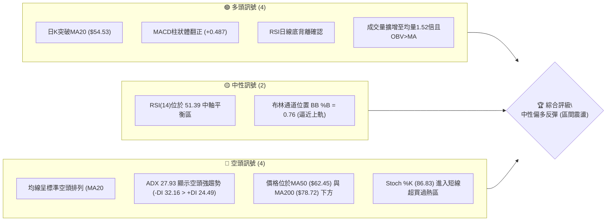
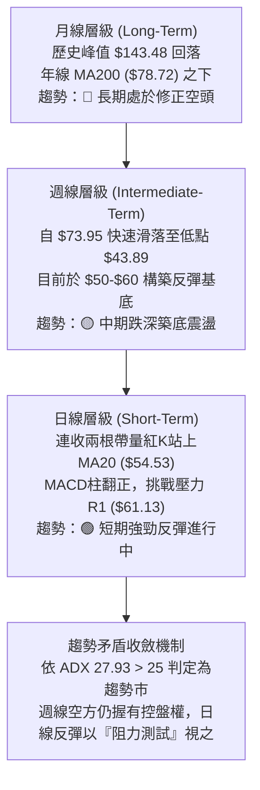
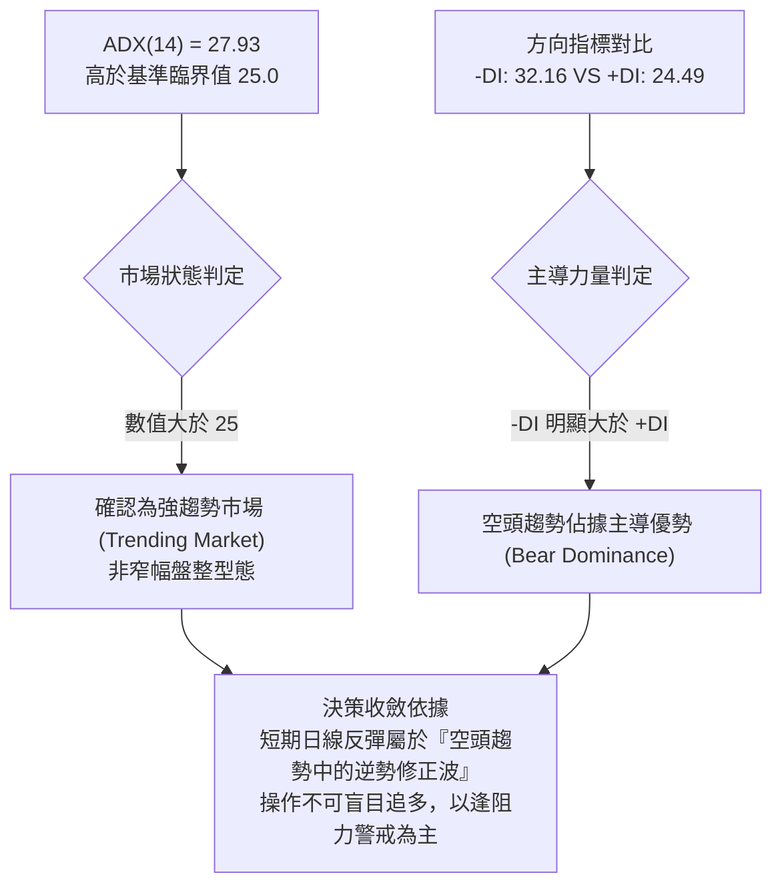
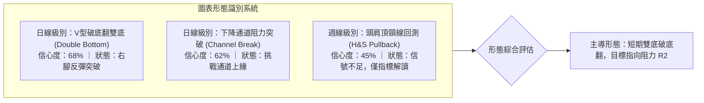
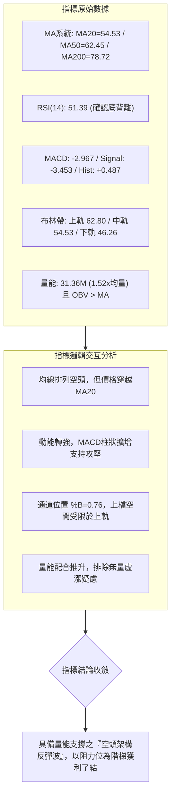
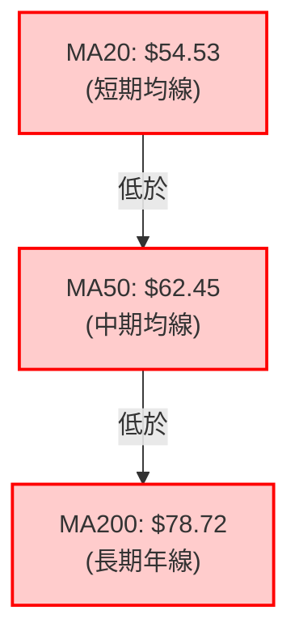
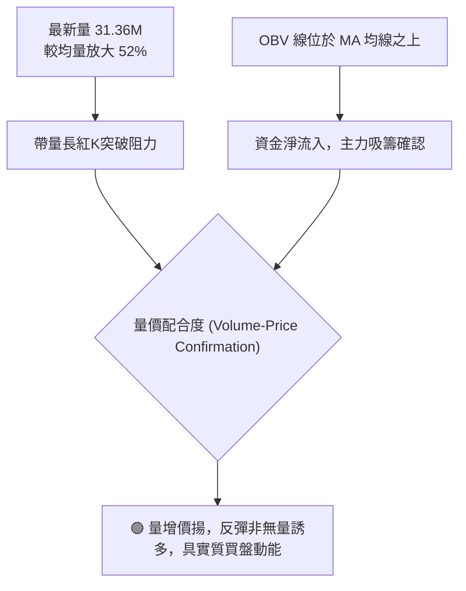
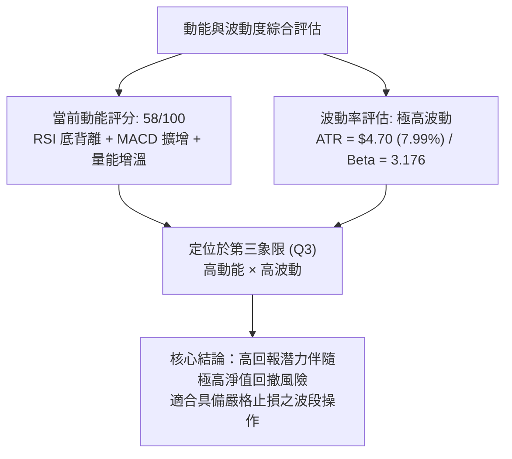
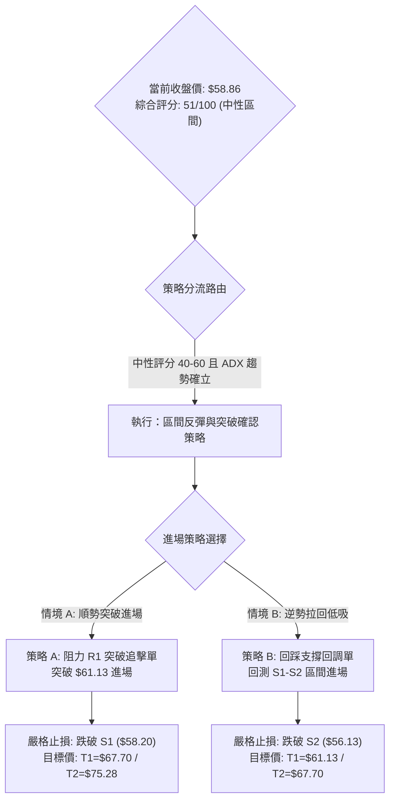
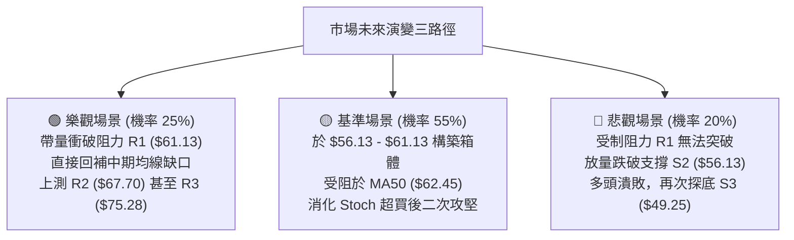

# RKLB 技術分析報告

> **報告日期**：2026-11-10 ｜ **語言**：繁體中文 ｜ **數據來源**：Yahoo Finance ｜ **當前價格**：$58.86 USD

---

## 目錄

| 章節 | 內容 |
|------|------|
| [1. 技術面概覽](#1-技術面概覽) | 訊號儀表板、核心指標、評分卡 |
| [2. 趨勢分析](#2-趨勢分析) | 多時框趨勢、長中短期走勢、ADX 解讀 |
| [3. 圖表形態分析](#3-圖表形態分析) | 形態識別、K線組合、目標價計算 |
| [4. 支撐與阻力](#4-支撐與阻力) | 關鍵價位分布、阻力支撐表、斐波那契回調 |
| [5. 技術指標深度解讀](#5-技術指標深度解讀) | MA系統、RSI、MACD、布林通道、成交量OBV |
| [6. 動能與波動率](#6-動能與波動率) | 動能四象限、ATR 波動率、Beta 市場敏感度 |
| [7. 多時框架總結](#7-多時框架總結) | 時框架矩陣、信號收斂與優先級判定 |
| [8. 交易策略建議](#8-交易策略建議) | 策略路由、價格階梯、主策略A/B、風險報酬比 |
| [9. 風險提示與監控](#9-風險提示與監控) | 監控清單、情境模擬、倉位與風控指引 |

---

## 1. 技術面概覽

### 🎯 技術訊號儀表板

本儀表板綜合日線與週線之動能、量價結構與均線位階，呈現多空力量之角力分布。當前短線呈現強勁技術性反彈，但中長期空頭均線壓制仍顯著。



### 📊 核心指標速覽表

下表彙整 RKLB 當前核心指標之最新數值、多空屬性與量化判讀：

| 指標類別 | 指標名稱 | 當前數值 | 訊號 | 解讀 |
|:---|:---|:---:|:---:|:---|
| **價格** | 當前收盤價 | $58.86 | 🟡 | 位於52週區間18.8%分位，自波段低點$43.89顯著反彈 |
| **均線** | MA20 (短期) | $54.53 | 🟢 | 收盤價高於MA20達+7.94%，短期趨勢重回多方掌控 |
| **均線** | MA50 (中期) | $62.45 | 🔴 | 價格低於MA50（-5.75%），中期空頭反壓形成關鍵阻力區 |
| **均線** | MA200 (長期) | $78.72 | 🔴 | 價格低於年線達-25.23%，長期空頭架構尚未扭轉 |
| **動能** | RSI(14) | 51.39 | 🟢 | 擺脫弱勢區重返50中軸上方，近20根K棒呈現標準底背離 |
| **動能** | MACD (12,26,9) | -2.967 / -3.453 | 🟢 | 快線黃金交叉慢線，柱狀體擴增至+0.487，反彈動能強勁 |
| **震盪** | Stoch %K / %D | 86.83 / 50.75 | 🔴 | %K高於80進入嚴重超買區，慎防短線衝高後拉回修正 |
| **趨勢** | ADX (14) | 27.93 | 🔴 | ADX>25為趨勢行情，但-DI(32.16)高於+DI(24.49)，大格局空方佔優 |
| **通道** | 布林通道帶寬 | $46.26 - $62.80 | 🟡 | %B為0.76，價格運行於中軌($54.53)與上軌($62.80)之間 |
| **量能** | 最新量 / 20日均量 | 31.36M / 20.58M | 🟢 | 量比達 1.52x，帶量長紅確認買盤介入，OBV > MA 量能配合 |
| **波動** | ATR(14) | $4.70 | 🔴 | 佔股價 7.99%，屬於極高波動度標的，操作需嚴控風險溢價 |

### 🏆 技術評分卡

評分機制依據六大維度量化打分（各項滿分 100 分），綜合評分為六項評分之**算術平均值**：

```
╔══════════════════════════════════════════════════════════════════╗
║                技術評分卡 — RKLB (2026-11-10)                   ║
╠══════════════════════════════════════════════════════════════════╣
║ 趨勢強度 (Trend)      ████████░░░░░░░░░░░░  40/100  🔴 空頭壓制  ║
║ 動能指標 (Momentum)    ████████████░░░░░░░░  58/100  🟢 底背反彈  ║
║ 支撐穩定度 (Support)  ████████████░░░░░░░░  60/100  🟢 底部構築  ║
║ 成交量配合 (Volume)   █████████████░░░░░░░  65/100  🟢 帶量推進  ║
║ 形態完整度 (Pattern)  ██████████░░░░░░░░░░  52/100  🟡 區間收斂  ║
║ 均線排列 (MA System)  ██████░░░░░░░░░░░░░░  31/100  🔴 空頭排列  ║
╠══════════════════════════════════════════════════════════════════╣
║ 綜合評分 (Overall)    ██████████░░░░░░░░░░  51/100  🟡 中性區間  ║
║ 評分公式：(40 + 58 + 60 + 65 + 52 + 31) ÷ 6 = 51.00 (四捨五入)   ║
╚══════════════════════════════════════════════════════════════════╝
```

---

## 2. 趨勢分析

### 🌐 多時框趨勢分析

多時框架（MTF）架構中，長、中、短期技術走勢彼此牽引。透過由大至小之層級遞進分析，釐清主趨勢與次級反彈波之交互關係。



### 📈 長期趨勢 — 12個月走勢圖（Unicode）

以下繪製 2025 年 12 月至 2026 年 11 月（共 12 個月）收盤價月線變化軌跡，並標註波段頂部與深幅回調低點：

```
RKLB 月線歷史走勢圖（過去12個月：2025-12 至 2026-11）
價格 ($)
$150 ┤                                     
$140 ┤                                  ● $143.48 (2026-05 歷史高點區)
$130 ┤                                 ╱ ╲
$120 ┤                                ╱   ╲
$110 ┤                               ╱     ● $101.65 (2026-06)
$100 ┤                              ╱       ╲
 $90 ┤                             ╱         ╲
 $80 ┤     ● $80.07 (01)     ● $82.51 (04)    ╲
 $70 ┤● $69.76    ╲         ╱                  ● $69.68 (09)
 $60 ┤     (12)    ● $69.10(02)● $64.22(03)      ● $64.95 (07) ╲   ● $58.86 (11 現價)
 $50 ┤                                            ● $63.92 (08) ╲ ╱
 $40 ┤                                                           ● $54.73 (10)
     └─┬────┬────┬────┬────┬────┬────┬────┬────┬────┬────┬────┬────
      12   01   02   03   04   05   06   07   08   09   10   11 (月份)
      25   26   26   26   26   26   26   26   26   26   26   26 (年份)
```

**月線走勢特徵分析表**：

| 階段時間 | 月收盤價區間 | 波段漲跌幅 | 走勢結構與量價特徵 |
|:---|:---:|:---:|:---|
| **2025-12 ~ 2026-04** | $69.76 → $82.51 | +18.28% | **高檔箱形蓄勢**：於 $64 - $82 區間反覆震盪洗盤，均線呈多頭集結。 |
| **2026-04 ~ 2026-05** | $82.51 → $143.48 | +73.89% | **主升段噴出**：月收盤創歷史最高紀錄 $143.48，盤中觸及 52 週最高價 $151.00。 |
| **2026-05 ~ 2026-07** | $143.48 → $64.95 | -54.73% | **高檔暴跌崩盤**：獲利了結賣壓湧現，連續跌破百元大關與月線支撐。 |
| **2026-07 ~ 2026-09** | $64.95 → $69.68 | +7.28% | **次級弱勢反彈**：反彈至 $69.68 遇阻無力，多方追價意願薄弱。 |
| **2026-09 ~ 2026-10** | $69.68 → $54.73 | -21.46% | **主跌段延續**：失守年線關卡，跌勢擴大，市場情緒陷入極度悲觀。 |
| **2026-11 (當前)** | $54.73 → $58.86 | +7.55% | **觸底反彈試探**：11月盤中下探低點 $43.89 後拉出長下影線，暫收 $58.86。 |

### 📊 中期趨勢（週線分析）

從近 8 週週 K 棒結構觀察（由 9 月末的 $73.95 崩落至 11 月首週的 $53.07），中期呈現顯著的下降通道。

```
週線級別價格軌跡與關鍵點位示意圖：
$78.28 (2026-10-09 週高點，頂部反轉確認)
   ╲
    $68.21 (破位中長黑)
       ╲
        $50.84 (放量重挫破位，週量 1.28 億股)
           ╲
            $49.25 (築底第一腳，支撐 S3) ── $43.89 (2026-11-06 週低點，破底翻假跌破)
                                              ╲        ▲
                                               $58.86 (本週強彈，收復失土)
```

週線指標顯示，MACD 柱狀體在 10 月中旬曾創下 -2.111 之波段低谷，隨後於 10 月 30 日當週收斂至 +0.310，雖然 11 月 6 日當週微降至 -0.065，但最新交易日隨即拉升至 +0.487，週線層級正醞釀指標底背離架構。

### ⚡ 趨勢強度評估（ADX 解讀）

當前趨勢強度指標 ADX(14) 讀數為 **27.93**，方向指標組為 **+DI = 24.49**、**-DI = 32.16**。



**ADX 狀態量化對照解析**：

| 指標變數 | 當前讀數 | 強度區間 | 實質技術含義 |
|:---|:---:|:---:|:---|
| **ADX(14)** | 27.93 | 25 ~ 50 (強趨勢) | 趨勢動能確立，行情具備方向延續性，突破或跌破具備高可信度。 |
| **+DI (14)** | 24.49 | 弱勢反彈區 | 多頭推進力道雖然自低檔回升，但仍處於次要防禦地位。 |
| **-DI (14)** | 32.16 | 強勢壓制區 | 賣盤力量依舊沉重，空頭仍在主導中長期趨勢軌道。 |
| **差值 (-DI - +DI)**| +7.67 | 空方優勢 | 差值為正，表示任何日線級別之拉升均面臨中線波段解套賣壓。 |

---

## 3. 圖表形態分析

### 🔍 形態識別系統

在多空轉換過程中，日線與週線結構已初步形成短線反轉與中期整理形態。依照嚴格形態學標準，逐一評估其信心度與幾何結構。



**形態信心度與目標價計算表**：

| 形態名稱 | 信心度 | 判斷依據（引用數據與點位） | 完成度 | 目標價（附嚴謹計算式） |
|:---|:---:|:---|:---:|:---|
| **日線雙底（破底翻）** | **68%** | 第一腳於 2026-10-23 之低點 S3 **$49.25**；第二腳於 2026-11-05 跌破創 **$43.89** 後次日（11-06）強勢收復 $53.07，形成典型假跌破（Bear Trap）與破底翻架構。頸線為 2026-10-29 高點 **$61.13**（即阻力位 R1）。 | 75% | **形態理論目標價**：<br/>由形態高度推算：頸線 $61.13 + 形態高度 ($61.13 - $43.89 = $17.24) = **$78.37**（精確對接長期均線 MA200 之 $78.72 阻力區）。 |
| **短線布林通道突破** | **62%** | 價格連破 MA20（$54.53）並強勢推升至 %B = 0.76，收盤價 $58.86 逼近上軌 $62.80，伴隨 1.52 倍成交量確認。 | 85% | **通道通道目標價**：<br/>通道上軌值 = **$62.80**（若有效站上，延伸測試阻力 R2 之 **$67.70**）。 |
| **頭肩頂形態回抽** | **45%** | 週線高檔 $143.48 回落後，頸線位於約 $80.00 附近，目前價格距離頸線過遠（現價 $58.86）。 | 30% | *信心度 < 50%，數據不足以支撐完整幾何確認，依規則僅作指標型均線反壓解讀，不預設延伸目標。* |

### 🕯️ 重要K線形態分析

嚴格依據提供的「近 10 根日 K」與「近 8 根週 K」實際 OHLCV 數據進行形態解讀：

| 日期（週期） | 開盤價 (O) | 最高價 (H) | 最低價 (L) | 收盤價 (C) | 成交量 (V) | K線形態名稱 | 專業技術解讀 | 訊號強度 |
|:---|:---:|:---:|:---:|:---:|:---:|:---|:---|:---:|
| **2026-11-04 (日)** | $54.60 | $55.31 | $50.41 | $52.37 | 18,771,200 | 中長陰線破位 | 開高走低跌破 $53 關卡，空頭下殺試探前低。 | 🔴 強空 |
| **2026-11-05 (日)** | $50.58 | $50.83 | $43.89 | $45.99 | 36,784,900 | 爆量長下影陰棒 | 恐慌盤湧出，創波段最低點 $43.89，但下影線達 $2.10，量能暴增至 36.78M。 | 🟡 恐慌竭盡 |
| **2026-11-06 (日)** | $48.28 | $53.10 | $46.51 | $53.07 | 20,876,200 | 低開大陽線（破底翻） | 次日開低走高，實體大漲 +$4.79 (+9.92%)，吞噬前一日大半跌幅，確立洗盤反轉。 | 🟢 極強多頭 |
| **2026-11-09 (日)** | $54.31 | $59.69 | $53.01 | $58.86 | 31,355,900 | 帶量光頭大長紅 | 開盤微測低點後持續走高，收盤逼近最高點，成交量放大至 31.36M，多頭全面控盤。 | 🟢 極強多頭 |
| **2026-10-16 (週)** | $67.88 | $68.07 | $49.69 | $50.84 | 128,008,200 | 週線長黑斷頭鍘 | 跌幅達 -25.46%，巨量 1.28 億股跌破多重支撐，為本輪跌勢之主跌觸發棒。 | 🔴 崩盤訊號 |
| **2026-10-23 (週)** | $52.28 | $53.90 | $49.25 | $52.60 | 81,998,500 | 縮量十字晨星雛形 | 週線最低探至 $49.25，量能顯著萎縮至 81.99M，顯現低檔賣壓竭盡特徵。 | 🟡 止跌信號 |
| **2026-11-06 (週)** | $55.08 | $55.31 | $43.89 | $53.07 | 107,039,000 | 爆量長下影錘頭週K | 週線創下 $43.89 歷史低點後拉出近 $10 之長下影線，單週成交量突破 1.07 億股。 | 🟢 強烈見底 |
| **2026-11-09 (週)** | $54.31 | $59.69 | $53.01 | $58.86 | 31,355,900 | 連續反彈強實體棒 | 本週僅首個交易日即大漲逾 10%，收復失土並直接突破前兩週高點。 | 🟢 多頭延續 |

### 📉 ASCII 走勢形態示意圖

下圖展示日線級別「破底翻雙底」成形過程及頸線壓制關鍵位置：

```
RKLB 日線破底翻雙底形態示意圖
價格 ($)
$62.00 ┤                                                    [阻力位 R1: $61.13 / 頸線]
$60.00 ┤                     ● (10-29 H: $61.13)            ▲
$58.00 ┤                    ╱ ╲                            ● (11-09 C: $58.86 現價)
$56.00 ┤                   ╱   ● (10-30 C: $54.73)        ╱
$54.00 ┤                  ╱     ╲                        ● (11-06 C: $53.07)
$52.00 ┤                 ╱       ● (11-02 C: $52.07)    ╱
$50.00 ┤   ● (10-23 L: $49.25)    ╲                    ╱
$48.00 ┤   [第一底: S3 支撐]       ● (11-04 C: $52.37)╱
$46.00 ┤                             ╲
$44.00 ┤                              ● (11-05 L: $43.89 假跌破 / 第二底)
$42.00 ┴─────────────────────────────────────────────────────────────────
       2026-10-23          2026-10-29        2026-11-05     2026-11-09
```

### 🎯 形態目標價計算

根據經典技術分析幾何測幅原理（Measuring Rule）：
1. **底部支撐基準點（最低低點）**：2026-11-05 盤中最低價 **$43.89**。
2. **形態頸線阻力點（波段反彈高點）**：2026-10-29 盤中最高價 **$61.13**（恰為阻力位 R1）。
3. **垂直形態高度（Pattern Height, H）**：
   $$\text{高度 } H = \$61.13 - \$43.89 = \$17.24$$
4. **最小量度滿足目標價（Minimum Price Target, T1）**：
   $$\text{目標價 } T1 = \text{頸線 } \$61.13 + H = \$61.13 + \$17.24 = \mathbf{\$78.37}$$
   *(註：此推算目標價 $78.37 與年線 MA200 之 $78.72 差距僅 0.44%，高度重疊，構成極強的共振目標區。)*

---

## 4. 支撐與阻力

### 🗺️ 關鍵價位分布圖（Unicode）

本圖以當前收盤價 **$58.86** 為中心，展現上方波段高點聚類阻力與下方波段低點聚類支撐之密度結構：

```
RKLB 關鍵價位空間結構分布圖
═══════════════════════════════════════════════════════════════════
$75.28 ║████████████████████████████████║ 強阻力 R3 (年線反壓防線)
       ║                                ║  
$67.70 ║████████████████████            ║ 次級阻力 R2 (中期波段頸線)
       ║                                ║  
$61.84 ║▓▓▓▓▓▓▓▓▓▓▓▓▓▓▓▓▓▓▓▓▓▓▓▓▓▓▓▓    ║ 斐波那契 78.6% 回調關鍵位
$61.13 ║████████████████████████████    ║ 關鍵阻力 R1 (日線形態頸線 / 突破點)
═══════╬════════════════════════════════╬══════════════════════════
$58.86 ╠════════════════════════════════╣ ◄ 當前收盤價 (Last Close)
═══════╬════════════════════════════════╬══════════════════════════
$58.20 ║▓▓▓▓▓▓▓▓▓▓▓▓▓▓▓▓▓▓▓▓            ║ 近期支撐 S1 (日K跳空下緣守位)
       ║                                ║  
$56.13 ║████████████████████████        ║ 關鍵支撐 S2 (短線強弱分水嶺)
       ║                                ║  
$49.25 ║████████████████████████████████║ 強支撐 S3 (雙底波段防守底線)
═══════════════════════════════════════════════════════════════════
```

### 🚧 阻力位分析表

阻力位嚴格引用 OHLCV 計算聚類數據：

| 阻力級別 | 價格數值 | 距離現價幅幅 | 形成原因與技術共振背景 | 突破難度評估 | 重要性權重 |
|:---|:---:|:---:|:---|:---:|:---:|
| **阻力 R1** | **$61.13** | +3.86% | 2026-10-29 前波反彈高點聚類；與斐波那契 78.6% 回調位（$61.84）及 MA50（$62.45）構成狹幅密集壓制帶。 | 🟡 中等 (需 3,000 萬股以上放量) | ★★★★☆ |
| **阻力 R2** | **$67.70** | +15.02% | 2026-10-09 週線崩跌前實體跌破區，為前波密集套牢盤解套拋壓重災區。 | 🔴 偏高 (需連續補量消化賣壓) | ★★★★☆ |
| **阻力 R3** | **$75.28** | +27.91% | 近一年長期下降趨勢軌道頂部；緊鄰 MA200（$78.72）與 MA120（$78.80）長期均線堡壘。 | 🔴 極高 (大週期牛熊轉換分水嶺) | ★★★★★ |

### 🛡️ 支撐位分析表

支撐位嚴格引用 OHLCV 計算聚類數據：

| 支撐級別 | 價格數值 | 距離現價幅幅 | 形成原因與技術共振背景 | 守住機率評估 | 重要性權重 |
|:---|:---:|:---:|:---|:---:|:---:|
| **支撐 S1** | **$58.20** | -1.12% | 2026-10-27 收盤價（$58.31）與 10-28 收盤價（$58.60）構建之微型支撐平台，極短線防線。 | 🟢 70% (回踩不破維持強勢) | ★★★☆☆ |
| **支撐 S2** | **$56.13** | -4.63% | 突破之 20 日均線 MA20（$54.53）延伸動態防守位，短線多頭反彈攻勢之命脈點。 | 🟢 65% (波段進場之核心防護) | ★★★★☆ |
| **支撐 S3** | **$49.25** | -16.33% | 2026-10-23 波段起漲低點；此位置一旦失守，宣告破底翻反彈徹底失敗，將再度探底。 | 🟢 85% (中期多頭最後生死防線) | ★★★★★ |

### 📐 斐波那契回調位分析

依據 52 週完整波段高點 **$151.00**（2026-05）至 52 週最低點 **$37.57**，嚴格對照回調位點：

```
斐波那契回調層級標註：
0.0%  (52W High) ─────────────────────── $151.00
23.6%            ─────────────────────── $124.23
38.2%            ─────────────────────── $107.67
50.0% (中位分水嶺) ─────────────────────── $94.28
61.8% (黃金分割) ─────────────────────── $80.90
78.6% (深度回撤) ─────────────────────── $61.84  ▲ 緊鄰阻力 R1 ($61.13)
當前價格 ($58.86) ─────────────────────── ◄ 運行於 78.6% 與 100.0% 之間
100.0% (52W Low) ─────────────────────── $37.57
```

**斐波那契結構解讀**：
當前收盤價 **$58.86** 正處於 **78.6% 回調位（$61.84）** 與 **100.0% 基底位（$37.57）** 之間的深幅回撤修復區間。技術意義重大：
- 斐波那契 78.6%（$61.84）為多頭防守的「最後心理防線」轉化而來的強大阻力。此位置與日線關鍵阻力 R1（$61.13）以及中期均線 MA50（$62.45）在 $61.13 - $62.45 區間形成一個高達三個技術權重疊加的「共振阻力密碼區」。
- 若日線能帶量實體站穩 $61.84 之上，代表自歷史高點跌落的極端空頭勢力開始瓦解，行情才有機會進一步向上修復挑戰 61.8%（$80.90）黃金分割位。

---

## 5. 技術指標深度解讀

### 🎛️ 指標訊號總覽

技術指標系統展現短線多頭動能激增與中長線均線趨勢壓制的強烈對衝。



### 📈 移動平均線排列分析



**移動平均線數值與乖離率矩陣**：

| 均線名稱 | 當前價格對比均線 | 價格乖離率 (%) | 均線走勢方向 | 技術面意涵 |
|:---|:---:|:---:|:---:|:---|
| **MA 5** | $52.94 | +11.17% (▲ 上方) | 快速陡峭上升 | 短線超買，極短線價格有向五日線拉回靠攏需求。 |
| **MA 10** | $54.75 | +7.50% (▲ 上方) | 止跌回勾向上 | 形成短多第一道下檔支撐階梯。 |
| **MA 20** | $54.53 | +7.94% (▲ 上方) | 拐頭由跌轉升 | 成功收復月線，奠定波段反彈初階架構。 |
| **MA 50** | $62.45 | -5.75% (▼ 下方) | 持續傾斜下行 | 關鍵波段反壓，對反彈波構成重力吸墜。 |
| **MA 60** | $63.97 | -7.99% (▼ 下方) | 下行 | 季線下彎，中期趨勢仍處空頭修復週期。 |
| **MA 120** | $78.80 | -25.30% (▼ 下方) | 陡峭下行 | 半年線沈重套牢盤，中長期阻力極大。 |
| **MA 200** | $78.72 | -23.60% (▼ 下方) | 緩步下移 | 年線生命線失守，整體格局仍屬空頭熊市。 |
| **MA 240** | $77.04 | -23.60% (▼ 下方) | 走平下彎 | 兩年均線下彎，顯示長期牛市結構已破壞。 |

當前各級均線關係為：$54.53 (MA20) < $62.45 (MA50) < $78.72 (MA200)，結構為典型的「死亡交叉後之空頭排列」。當前走勢屬於「價格在跌破所有均線後，展開對短期均線 MA20 的向上突破，並進一步向中期均線 MA50 靠攏回抽之技術反抽」。

### 📉 RSI(14) 分析

當前 RSI(14) 數值為 **51.39**。

```
RSI (14) 指標動能儀表：
0       20      30               50 51.39        70      80     100
├───────┼───────┼────────────────┼───●───────────┼───────┼───────┤
  極度超賣   超賣區      弱勢區           │  強勢區    超買區  極度超買
                                      ▲ 當前位置：中軸上方多頭偏強
進度條展示：
██████████░░░░░░░░░░ 51.39%
```

- **超買超賣判讀**：RSI(14) 從 10 月中旬低點 25.4（極度超賣區）強勢爬升至 51.39，正式脫離弱勢壓制區，回到 50 之上的多頭控制領域。
- **背離分析判斷（重要）**：數據明確提示「**⚠️ 底背離 (Bullish Divergence)**」。
  - 檢視近 20 根 K 棒走勢：價格於 2026-10-16 收 $50.84、10-23 探 $49.25、11-05 盤中更跌落至 $43.89，**價格顯著破底創下更低點（Lower Lows）**；
  - 然而在對應的週期中，RSI(14) 自 10-16 的 25.4 逐波拉升至 10-23 的 33.4、10-30 的 40.0，最後躍升至當前的 51.39，**RSI 底部持續墊高（Higher Lows）**；
  - **背離結論**：此為標準的「二度多頭底背離（Double Bullish Divergence）」，確認空頭殺跌動能枯竭，短多具備強烈動能將價格推升至主要阻力區。

### 📊 MACD(12/26/9) 訊號解讀

MACD 當前各分項數值：
- 快線（DIF）：**-2.967**
- 慢線（Signal）：**-3.453**
- 柱狀體（Histogram）：**+0.487**


MACD 在零軸以下形成顯著之「金叉上攻」，且 Histogram 柱狀體連日正向放大（由負翻正至 +0.487），進一步印證短期多頭動能正在急遽擴張。

### 📦 布林通道分析

日線布林通道（20日參數）數值：
- **上軌 (Upper Band)**：$62.80
- **中軌 (Middle Band, MA20)**：$54.53
- **下軌 (Lower Band)**：$46.26
- **通道位置指標 (%B)**：**0.76**

```
日線布林通道價格位置示意圖：
$62.80 ───┬──────────────────────────────────── 布林上軌 (Upper Band)
          │
$58.86 ───┼──────────────────────── ● 現價 ($58.86, %B = 0.76)
          │
$54.53 ───┼──────────────────────────────────── 布林中軌 (Middle Band / MA20)
          │
$46.26 ───┴──────────────────────────────────── 布林下軌 (Lower Band)
```

**布林通道動態評估**：
1. **通道位置**：%B 讀數為 0.76，說明價格已突破中軌（0.50）並快速朝上軌（1.00）逼近。
2. **阻力臨界點**：布林上軌當前位於 **$62.80**，與阻力 R1（$61.13）及 MA50（$62.45）重合。若無連續巨量配合，價格在觸及 $62.80 附近時極易出現回調，形成布林帶內的常態性震盪修正。

### 💹 成交量分析（量價配合度）

量能數據：
- 最新日成交量：**31,355,900 股**
- 20日平均量：**20,577,720 股**（量比 Volume Ratio = **1.52x**）
- 50日平均量：**20,436,124 股**
- **OBV（能量潮）狀態**：**OBV > MA → 量能支撐上漲**



量價結構顯示，2026-11-09 的大漲並非無量虛拉，而是伴隨超過兩千萬股基準線的 3,135 萬股大量，量能放大 1.52 倍。配合能量潮 OBV 向上突破其均線，確認此波反彈有實質機構性買盤支撐。

---

## 6. 動能與波動率

### ⚡ 動能評估四象限

藉由將市場切分為「動能強/弱」與「波動高/低」四個象限，精準定位 RKLB 目前之市場微觀狀態：

| 象限標籤 | 動能維度 | 波動維度 | 典型市場特徵 | 當前狀態判定 | 戰術應對評估 |
|:---:|:---:|:---:|:---|:---:|:---|
| **第一象限 (Q1)** | 強動能 | 低波動 | 穩健牛市單邊推升 | — | 順勢加碼，趨勢追隨 |
| **第二象限 (Q2)** | 弱動能 | 低波動 | 縮量橫盤死水洗盤 | — | 謹慎觀望，靜待破局 |
| **第三象限 (Q3)** | **強動能** | **高波動** | **劇烈震盪反轉/情緒極端修復** | **✓ 當前所處位置** | **嚴格止損，分批高出低進** |
| **第四象限 (Q4)** | 弱動能 | 高波動 | 恐慌崩跌無序宣洩 | — | 全面空倉，避免進場 |



### 📊 ATR 波動率分析

當前 14 日真實波動區間（Wilder ATR）讀數為 **$4.70**，佔當前股價之比率高達 **7.99%**。

**ATR 量化風險與止損設定指引**：
1. **單日波動範圍預期**：在正常市場分布下，RKLB 每日震幅預期高達 $4.70 美元。以現價 $58.86 計算，單日向上或向下波動區間通常在 $54.16 至 $63.56 之間。
2. **止損緩衝距離（ATR Stop-Loss Distance）**：
   - 保守型交易者止損距離（1.5 倍 ATR）：$$1.5 \times \$4.70 = \mathbf{\$7.05}$$
   - 積極型交易者短線止損距離（1.0 倍 ATR）：$$1.0 \times \$4.70 = \mathbf{\$4.70}$$
3. **戰術含義**：任何小於 $2.00 美元之過緊止損，在 RKLB 高達 7.99% 的波動屬性下，極易在市場常態噪聲（Market Noise）中被無效掃出場，操作必須拉開止損空間，並依比例縮小單筆持倉部位。

### 📐 Beta 與市場相關性

- **Beta 係數**：**3.176**（極高市場敏感度）
- **技術解讀**：
  - RKLB 具備大盤（S&P 500 / Nasdaq）**3.18 倍** 的槓桿波動特性。當大盤指數上漲 1% 時，該股預期上漲約 3.18%；反之當大盤回檔 1% 時，該股下殺幅度預期超過 3.18%。
  - 在大盤近期震盪或利多釋放背景下（如新聞提及 Dow Jones 大漲等環境），高 Beta 特性極易放大短多投機資金之追價力道；但在防守時，高 Beta 意味著防守價位極易出現突發性破位，風控標準必須以個股技術位為主，不可對大盤抱持僥倖心態。

---

## 7. 多時框架總結

### 📋 時框架評分表

依據多時框架分析體系，將日線、週線與月線之各項指標與走勢進行標準化打分：

| 時框架層級 | 趨勢方向 | 動能狀態 | 均線排列 | 形態特徵 | 綜合評分 | 操作戰術建議 |
|:---|:---:|:---:|:---:|:---:|:---:|:---|
| **短期 (日線)** | 🟢 向上反彈 | 🟢 RSI底背 / MACD金叉 | 🟡 站上MA20 / 受制MA50 | 🟢 雙底破底翻 | **65/100** | 逢回拉踩進場，以短線波段操作為主 |
| **中期 (週線)** | 🔴 震盪偏空 | 🟡 週MACD柱翻正 / 跌勢收斂 | 🔴 均線空頭排列 | 🟡 週K長下影錘頭見底 | **45/100** | 不盲目追高，等待實體突破 $61.13 |
| **長期 (月線)** | 🔴 空頭修正 | 🔴 股價低於長期MA200 | 🔴 空頭發散下行 | 🔴 高檔崩跌後深幅回檔 | **35/100** | 嚴禁大資金長線重倉，防守為上 |

### 🔲 綜合訊號矩陣

| 技術維度 | 短期視角 (日線) | 中期視角 (週線) | 長期視角 (月線) | 訊號一致性評估 |
|:---|:---:|:---:|:---:|:---|
| **趨勢強度** | 🟢 短期轉強 (連二紅) | 🔴 下行通道整理 | 🔴 大幅回檔修正 | 矛盾：短強中弱，屬典型反彈波 |
| **均線位置** | 🟢 突破 MA20 ($54.53) | 🔴 低於 MA50 ($62.45) | 🔴 遠低於 MA200 ($78.72) | 矛盾：多空分水嶺於 $61-$62 間 |
| **動能指標** | 🟢 RSI 底背離確立 | 🟡 MACD 柱正向微增 | 🔴 長期動能仍在釋放 | 一致性低：短線動能領先指標修復 |
| **量價配合** | 🟢 量比 1.52x 放量 | 🟢 週成交量破億爆量見底 | 🟡 歷史高檔爆量後之縮量 | 較一致：中短期低檔有主力護盤換手 |

### ⚖️ 多時框收斂結論

嚴格遵循報告規則 14 之「多時框收斂優先級規則」進行判定：

1. **市場性質判定**：當前 ADX(14) 讀數為 **27.93**（> 25），根據規則，當前市場狀態屬於 **「趨勢行情（Trending Market）」**，而非無方向之純窄幅盤整。
2. **時框優先級權重**：在趨勢行情下，**必須以中長期（週線 / MA50、MA200）方向為主導架構**，日線級別之強勁上攻僅能定義為「次級逆勢反彈波」，其功能在於尋找精準之進場時機與反彈獲利了結點，而不能直接判定為新一輪大牛市之展開。
3. **方向性收斂唯一結論**：
   $$\mathbf{當前整體結論：中性偏多反彈（區間震盪逢阻力減碼）}$$
   週線與月線之空頭均線排列，決定了上方阻力 R1（$61.13）至 MA50（$62.45）將遭遇極為頑強之拋壓；但日線帶量底背離則確認當前反彈攻勢尚未結束。因此，本報告收斂結論為：**「以日線多頭動能為主導之波段反彈操作，但嚴格受制於中期阻力位階梯；多空策略以區間操作為依歸，不盲目長線做多」**。

---

## 8. 交易策略建議

### 🗺️ 策略決策流程圖



### 🧭 策略路由（依評分卡分流）

**當前主策略方向 = 區間震盪反彈與阻力突破操作（依評分 51/100，落於 40–60 中性區間，以短多反彈與等待突破確認為主導）。**

依據評分卡結論，由於綜合評分為 51 分，多空訊號在不同時框處於交錯狀態，因此策略主軸界定為「捕捉短期日線強動能之反彈收益，同時於關鍵阻力位保留風控避險機制」，絕不於阻力區追價。

### 🎯 價格情境階梯（Price Scenarios）

階梯價位嚴格引用第 4 章由 OHLCV 聚類計算之實際關鍵位：

| 階梯層級 | 觸發條件（觸及/突破） | 下一目標價位 | 後續延伸測試點 | 情境技術含義與戰術指示 |
|:---|:---:|:---:|:---:|:---|
| **強勢進攻** | 實體放量突破 **R1 ($61.13)** | **R2 ($67.70)** | **R3 ($75.28)** | 短線雙底頸線正式攻克，形態量度目標指向 $78.37，反彈波升級為波段攻勢。 |
| **區間運行** | 站穩現價 **$58.86** ~ **S1 ($58.20)** | **R1 ($61.13)** | — | 維持於短期均線上方微幅整理，蓄勢消化 MA50 之下壓賣盤。 |
| **轉弱跌破** | 跌破 **S1 ($58.20)** 下探 | **S2 ($56.13)** | **S3 ($49.25)** | 短線反彈動能衰竭，將回測 MA20 支撐，若失守 S2 則反彈結束重回跌勢。 |

### 📊 情境機率分佈

| 運行情境 | 發生機率 | 主要技術數據支撐依據 |
|:---|:---:|:---|
| **情境一：繼續上行挑戰阻力 (R1/R2)** | **55%** | 日線 MACD 柱翻正 (+0.487)、RSI 出現標準多頭底背離、最新日成交量放大 1.52x、OBV > MA 量能配合。 |
| **情境二：於 $56.13 - $61.13 區間震盪** | **30%** | 布林帶上軌（$62.80）壓制、MA50（$62.45）持續下彎、Stoch %K 高達 86.83 短線進入超買區需要鈍化。 |
| **情境三：跌破支撐回落再探底** | **15%** | ADX 27.93 顯示整體空頭仍未完全解除武裝 (-DI 32.16 > +DI 24.49)、年線 MA200 仍呈絕對空頭下壓。 |

### 🟢 主策略詳情

嚴格按照規則 17 之風險報酬比計算定義：
$$\text{風險報酬比 (RRR)} = \frac{\text{目標價 } T1 - \text{進場價}}{\text{進場價} - \text{止損價}}$$

| 策略要素 | 策略 A（突破順勢買入） | 策略 B（拉回支撐低吸） |
|:---|:---|:---|
| **策略邏輯** | 突破日線雙底頸線與阻力 R1 追擊波段 | 等待極短線超買降溫，回踩支撐接刀 |
| **進場條件** | 日 K 盤中突破或收盤站穩阻力 R1 | 價格回調至 S1 與 S2 支撐區間內企穩 |
| **進場價格** | **$61.13**（精確引用阻力位 R1） | **$57.17**（S1 $58.20 與 S2 $56.13 區間中點） |
| **目標價 T1** | **$67.70**（精確引用阻力位 R2） | **$61.13**（精確引用阻力位 R1） |
| **目標價 T2** | **$75.28**（精確引用阻力位 R3） | **$67.70**（精確引用阻力位 R2） |
| **止損價格** | **$58.20**（精確引用支撐位 S1） | **$56.13**（精確引用支撐位 S2） |
| **風險空間** | $\$61.13 - \$58.20 = \$2.93$ | $\$57.17 - \$56.13 = \$1.04$ |
| **獲利空間 (T1)** | $\$67.70 - \$61.13 = \$6.57$ | $\$61.13 - \$57.17 = \$3.96$ |
| **風險報酬比** | **1 : 2.24（以 T1 計）**<br/>*(算式: 6.57 ÷ 2.93 = 2.24)*<br/>**1 : 4.83（以 T2 計）**<br/>*(算式: (75.28 - 61.13) ÷ 2.93 = 14.15 ÷ 2.93 = 4.83)* | **1 : 3.81（以 T1 計）**<br/>*(算式: 3.96 ÷ 1.04 = 3.81)*<br/>**1 : 10.13（以 T2 計）**<br/>*(算式: (67.70 - 57.17) ÷ 1.04 = 10.53 ÷ 1.04 = 10.13)* |
| **策略成功率** | **55%** | **60%** |
| **建議持倉比例** | **10% ~ 15% 資金倉位** | **15% ~ 20% 資金倉位** |

### 🔴 反向風險觸發點（對沖提示）

若出現以下訊號，主策略假設即告失效，投資人應即刻執行停損或進行空頭避險：
1. **反轉破位訊號**：日 K 線帶量實體跌破支撐位 **S2 ($56.13)** 且收於 MA20（$54.53）之下，代表多頭底背離反彈遭空頭無情瓦解。
2. **量能萎縮衰竭**：價格上攻逼近 R1（$61.13）但單日成交量萎縮至 1,500 萬股以下（顯著低於 20 日均量 2,057 萬股），形成典型「量價背離」，應提早獲利了結。
3. **對沖操作觸發**：若跌破 **S2 ($56.13)**，短線交易者可考慮建立輕度反向空頭避險部位，下看前波波段起漲支撐 **S3 ($49.25)**，止損設於 $58.20。

### ⭐ 整體訊號強度評星

```
╔══════════════════════════════════════════════════════════════════╗
║ 做多訊號強度：  ★★★☆☆  (3.0/5星) ｜ 短多動能強勁但受制中期均線  ║
║ 做空訊號強度：  ★★☆☆☆  (2.5/5星) ｜ 空方佔優但指標嚴重底背離  ║
║ 整體訊號可信度：★★★☆☆  (3.5/5星) ｜ 帶量反彈具可信度，需防假突破║
╚══════════════════════════════════════════════════════════════════╝
```

---

## 9. 風險提示與監控

### ✅ 關鍵監控指標 Checklist

交易執行期間，每日盤後必須嚴格檢核以下技術訊號之異動：

```
╔══════════════════════════════════════════════════════════════════╗
║               RKLB 交易風控每日關鍵監控清單 (Checklist)          ║
╠══════════════════════════════════════════════════════════════════╣
║ [ ] 價格是否成功收於 MA20 ($54.53) 之上？（多頭底線）             ║
║ [ ] 盤中是否觸及或有效突破阻力 R1 ($61.13)？（突破確認點）        ║
║ [ ] 單日成交量是否維持於 20 日均量 (20.58M) 之上？（動能檢驗）    ║
║ [ ] MACD Histogram 柱狀體是否持續保持正值？（動能延續性）        ║
║ [ ] RSI(14) 是否在進入 60-70 區間後出現死叉反轉？（超買監控）     ║
║ [ ] 跌破支撐 S1 ($58.20) 時是否出現量能異常放大？（停損預警）    ║
║ [ ] 大盤波動引發之 Beta (3.176) 溢出風險是否在容忍範圍內？        ║
╚══════════════════════════════════════════════════════════════════╝
```

### ⚠️ 風險場景分析



### 🛡️ 風險管理重要提醒

1. **極端波動風險（High Volatility Risk）**：
   RKLB 之 ATR(14) 高達 **$4.70**（佔股價 7.99%），且 Beta 高達 **3.176**。此類標的具備「高收益伴隨高破壞力」之特徵。在單日波動可能達到 8% 的情況下，萬不可進行過高槓桿之衍生品操作或融資買進。
2. **單筆資金風險上限原則（2% Risk Rule）**：
   嚴格限制單筆交易之最大虧損金額不得超過總投資本金之 **1.5% ~ 2.0%**。
   - *倉位規模計算公式*：$$\text{最大持股股數} = \frac{\text{總帳戶本金} \times 2\%}{\text{進場價} - \text{止損價}}$$
   - 例如以策略 A 進場（進場 $61.13，止損 $58.20，每股風險 $2.93），若帳戶本金為 100,000 美元（最大容忍風險 $2,000 美元），則最大買入股數不得超過：$$\$2,000 \div \$2.93 \approx 682 \text{ 股（部位價值約 \$41,690 美元）}$$
3. **重大基本面事件催化風險**：
   近期新聞顯示，雖然 Neutron 火箭長期商業訂單展望樂觀（NASA 登月項目獲選），但 Q3 財報表現呈現營收超預期、獲利遜於預期（EPS -0.27、FCF 為 -$371.14M）之資本密集燒錢階段。任何技術面形態均可能受突發之發射進度或宏觀利率變更干擾，嚴格執行技術位停損為唯一生存法則。

---

## 📋 報告總結

```
╔══════════════════════════════════════════════════════════════════╗
║                   RKLB 技術分析報告總結                          ║
╠══════════════════════════════════════════════════════════════════╣
║ 報告日期：2026-11-10                                             ║
║ 當前價格：$58.86 USD                                             ║
║ 分析評級：⚖️ 中性偏多（波段反彈，逢阻力減碼）                    ║
║                                                                  ║
║ 關鍵技術結論：                                                   ║
║ ├─ 長期趨勢：🔴 空頭修正（價格遠低於年線 MA200: $78.72）         ║
║ ├─ 中期趨勢：🟡 跌深震盪（ADX=27.93 空頭主導，但週K錘頭見底）    ║
║ ├─ 短期趨勢：🟢 強勁反彈（站上 MA20: $54.53，MACD金叉，RSI底背）║
║ ├─ 關鍵支撐：S1: $58.20 ｜ S2: $56.13 ｜ S3: $49.25              ║
║ ├─ 關鍵阻力：R1: $61.13 ｜ R2: $67.70 ｜ R3: $75.28              ║
║ └─ 分析師目標：均價 $102.15 (最低 $64.00 / 最高 $150.00，20位Buy)║
║                                                                  ║
║ 最優策略組合建議：                                               ║
║ 1. 🥇 最佳機會（策略 B）：拉回 $57.17 附近分批低吸，止損 S2     ║
║    ($56.13)，博弈反彈挑戰 R1 ($61.13)，風險報酬比 1:3.81        ║
║ 2. 🥈 次選機會（策略 A）：帶量突破阻力 R1 ($61.13) 後順勢追擊，  ║
║    止損設於 S1 ($58.20)，目標看 R2 ($67.70)，風險報酬比 1:2.24  ║
║ 3. 🥉 保守選擇：空倉觀望，等待日線實體站穩 MA50 ($62.45) 且均線 ║
║    扭轉後，再行介入大波段右側買點。                             ║
╚══════════════════════════════════════════════════════════════════╝
```

---

> ⚠️ **免責聲明**：本報告為依據客觀量化技術指標與價格數據產出之技術分析，所有數據及估算均基於市場歷史行情資訊。本報告**僅供研究與學術參考**，**不構成任何要約、推薦或投資操作建議**。金融市場具高度風險，投資人應獨立評估風險並自負盈虧。

---

*報告生成時間：2026-11-10 ｜ 數據來源：Yahoo Finance ｜ 分析框架：多時框技術分析體系*