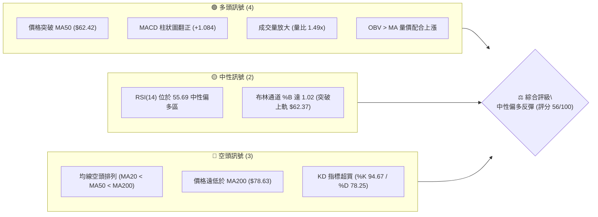
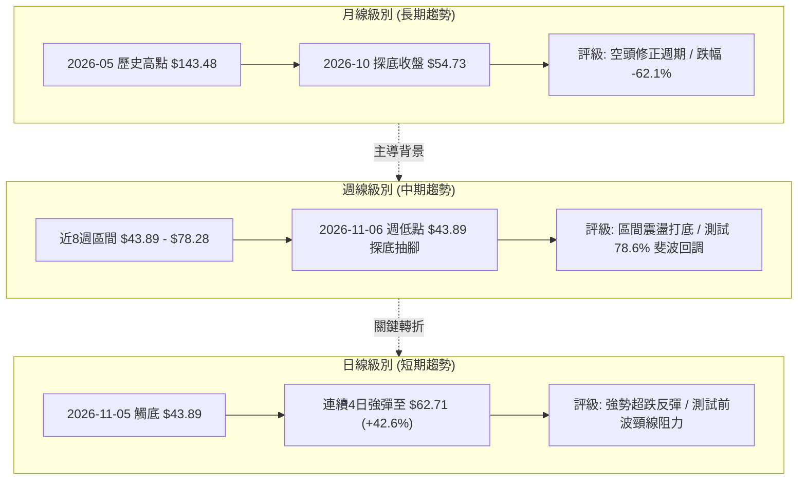
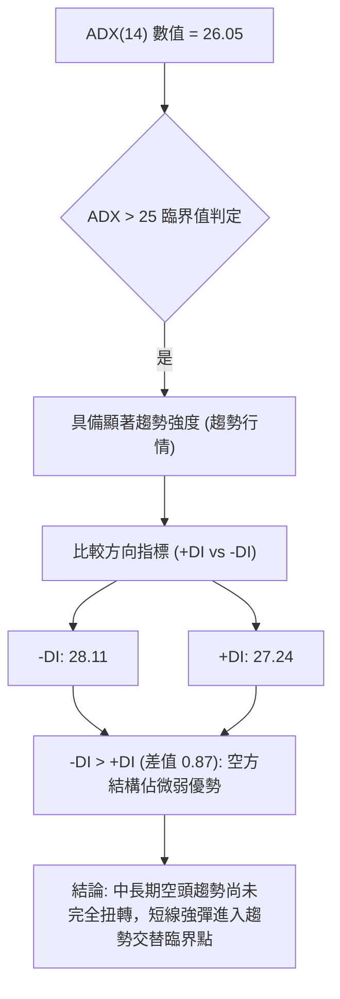
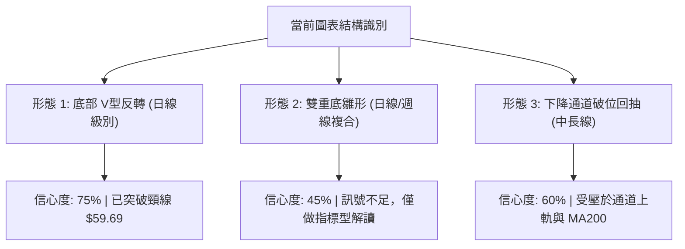
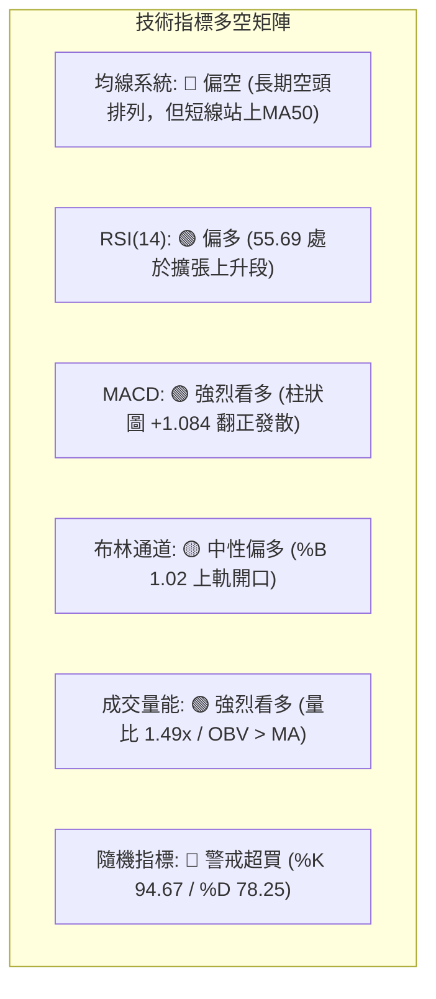
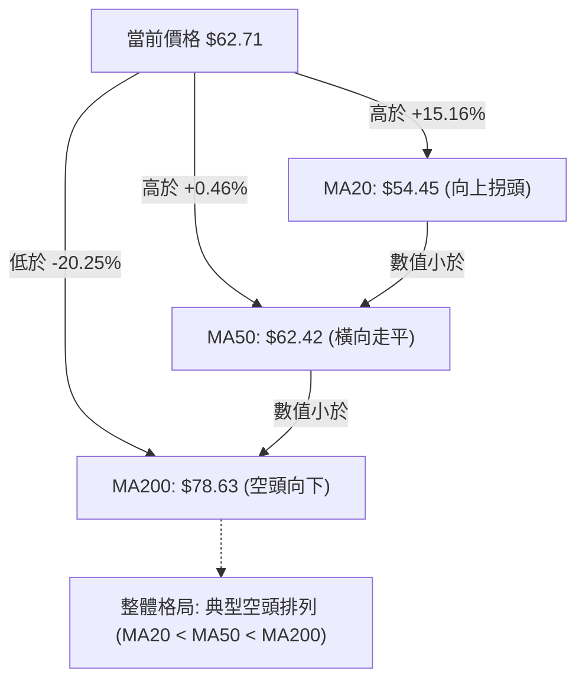
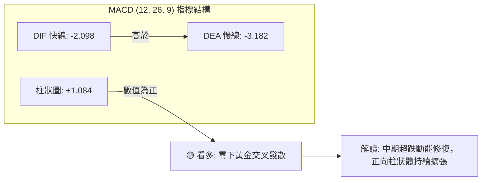
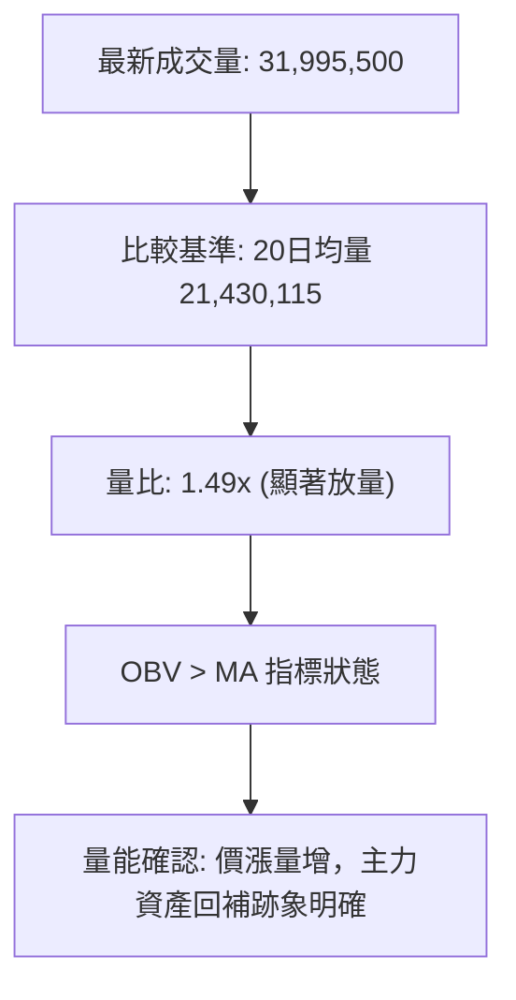
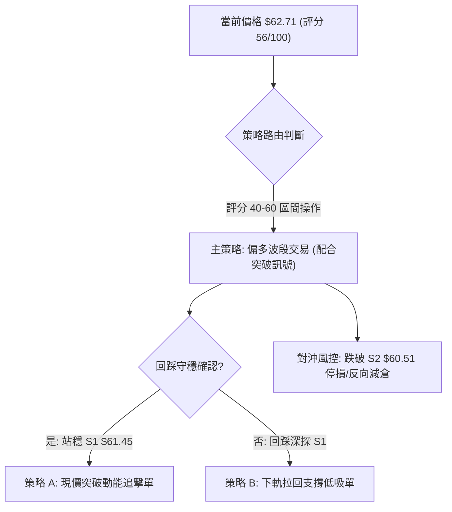
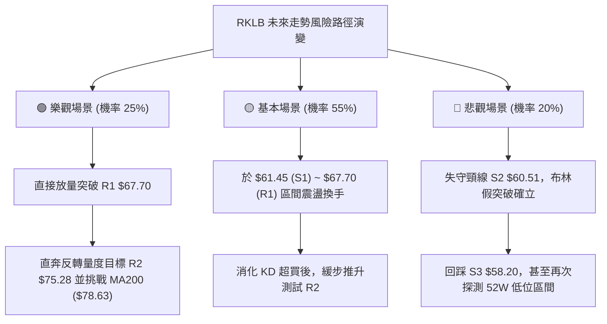

# RKLB 技術分析報告

> **報告日期**：2026-11-11 ｜ **語言**：繁體中文 ｜ **數據來源**：Yahoo Finance ｜ **當前價格**：$62.71 USD

---

## 目錄

| 章節 | 內容 |
|------|------|
| [1. 技術面概覽](#1-技術面概覽) | 訊號儀表板、核心指標、評分卡 |
| [2. 趨勢分析](#2-趨勢分析) | 多時框趨勢、長中短期走勢 |
| [3. 圖表形態分析](#3-圖表形態分析) | 形態識別、K線組合、目標價 |
| [4. 支撐與阻力](#4-支撐與阻力) | 關鍵價位、斐波那契回調 |
| [5. 技術指標深度解讀](#5-技術指標深度解讀) | MA/RSI/MACD/布林/成交量 |
| [6. 動能與波動率](#6-動能與波動率) | 動能評估、ATR、Beta |
| [7. 多時框架總結](#7-多時框架總結) | 時框架評分矩陣 |
| [8. 交易策略建議](#8-交易策略建議) | 多空策略、風險報酬比 |
| [9. 風險提示與監控](#9-風險提示與監控) | 監控指標、風險場景 |

---

## 1. 技術面概覽

### 🎯 技術訊號儀表板



### 📊 核心指標速覽表

| 指標類別 | 指標名稱 | 當前數值 | 訊號 | 解讀 |
|:---|:---|:---:|:---:|:---|
| **價格** | 當前價格 | $62.71 | 🟢 | 站上 MA50，近兩日自低點 $43.89 強力拉升 |
| **均線** | MA20 | $54.45 | 🟢 | 價格位於 MA20 上方 (+15.16%)，短線反彈確立 |
| **均線** | MA50 | $62.42 | 🟢 | 價格微幅突破 MA50，由壓力轉為短線動態支撐 |
| **均線** | MA200 | $78.63 | 🔴 | 價格低於 MA200 (-20.25%)，長期格局仍受制於空方 |
| **動能** | RSI(14) | 55.69 | 🟡 | 位於 50–70 中性強勢區間，未出現極端超買 |
| **動能** | MACD(12,26,9) | -2.098 / -3.182 | 🟢 | MACD 線穿過訊號線，柱狀圖為 +1.084，底背離動能擴展 |
| **動能** | Stoch KD(14) | 94.67 / 78.25 | 🔴 | 進入極度超買區，需提防短線指標鈍化後的拉回 |
| **趨勢** | ADX(14) | 26.05 | 🟡 | 大於 25 具備趨勢強度；-DI(28.11) 仍高於 +DI(27.24) |
| **通道** | 布林通道 | 上軌 $62.37 | 🟡 | %B 為 1.02，收盤穿破上軌，帶動軌道開口擴張 |
| **量能** | 成交量 / 20日均量 | 31,995,500 / 21,430,115 | 🟢 | 量比達 1.49x，價漲量增且 OBV 高於均線 |
| **波動** | ATR(14) | $4.99 | 🔴 | 波動佔股價 7.96%，屬於極高波動度標的 |

### 🏆 技術評分卡

依規則 18，綜合評分採六大子維度算術平均：(52 + 64 + 58 + 72 + 50 + 40) ÷ 6 = 56.0，四捨五入為 **56/100**。

```
╔══════════════════════════════════════════════════════════════════╗
║                 技術評分卡 — RKLB (2026-11-11)                  ║
╠══════════════════════════════════════════════════════════════════╣
║ 趨勢強度      ██████████░░░░░░░░░░  52/100  🟡 中性 (ADX 26.05)   ║
║ 動能指標      █████████████░░░░░░░  64/100  🟢 看多 (MACD黃金交叉) ║
║ 支撐穩定度    ████████████░░░░░░░░  58/100  🟡 中性 (S1 $61.45守穩)║
║ 成交量配合    ██████████████░░░░░░  72/100  🟢 看多 (放量突破1.49x)║
║ 形態完整度    ██████████░░░░░░░░░░  50/100  🟡 中性 (深V破位後回抽)║
║ 均線排列      ████████░░░░░░░░░░░░  40/100  🔴 看空 (MA200下方壓制)║
╠══════════════════════════════════════════════════════════════════╣
║ 綜合評分      ███████████░░░░░░░░░  56/100  ⚖️ 區間震盪／反彈突破   ║
╚══════════════════════════════════════════════════════════════════╝
```

---

## 2. 趨勢分析

### 🌐 多時框趨勢分析



### 📈 長期趨勢 — 12個月走勢圖（Unicode）

依據月度收盤價數據繪製 2025-11 至 2026-11 走勢圖：

```
RKLB 月線收盤走勢圖（過去12個月）
價格軸 ($)
$150 ┤                                      ● $143.48 (2026-05 高點)
$130 ┤                                     / \
$110 ┤                                    /   ● $101.65
 $90 ┤                 ● $80.07          ● $82.51
 $70 ┤        ● $69.76  \      ● $64.22 /       \   ● $69.68
 $50 ┤ ●42.14            ● $69.10                ●64.95 \   ● $62.71 (現價)
 $30 ┤                                                    ● $54.73
     └─────────────────────────────────────────────────────────────
       11   12   01   02   03   04   05   06   07   08   09   10   11 (月份)
      2025 2025 2026 2026 2026 2026 2026 2026 2026 2026 2026 2026 2026
```

#### 月度走勢特徵分析表

| 階段 | 期間 | 價格區間 (收盤) | 漲跌幅 | 走勢特徵與成交量狀態 |
|:---|:---:|:---:|:---:|:---|
| **主升段起漲** | 2025-11 ~ 2026-01 | $42.14 → $80.07 | +90.0% | 脫離底部平台，單月大陽線拉升，太空產業資金進駐 |
| **高位箱型整理** | 2026-02 ~ 2026-04 | $69.10 → $82.51 | +19.4% | $64–$82 寬幅震盪洗盤，均線聚攏蓄勢 |
| **極端噴發狂熱** | 2026-04 ~ 2026-05 | $82.51 → $143.48 | +73.9% | 投機買盤爆發，創下 52 週天價 $151.00，嚴重偏離均線 |
| **主跌段回吐** | 2026-05 ~ 2026-07 | $143.48 → $64.95 | -54.7% | 資金出逃與獲利回吐，兩個月內腰斬，跌破 MA50 |
| **弱勢盤整再破位**| 2026-08 ~ 2026-10 | $63.92 → $54.73 | -14.4% | 低位陰跌，10月收盤創波段低點 $54.73，恐慌盤湧現 |
| **當前修復反彈** | 2026-10 ~ 2026-11 | $54.73 → $62.71 | +14.6% | 11月財報發布前後自 $43.89 V型抽回，收復 $60 大關 |

### 📊 中期趨勢（週線分析）

週線近 8 週走勢顯示，RKLB 在 2026-10-09 當週達到波段高點 $78.28 後遭遇急速下殺，並於 2026-10-16 當週放量（128,008,200 股）跌破 $50 大關，收於 $50.84。隨後在 2026-11-06 當週下探 $43.89 後出現極長下影線（最低 $43.89，收盤 $53.07），形成實質空頭力竭信號。

```
週線支撐與阻力結構示意圖
$78.28 ═════════════════════════════════ 週線強阻力（2026-10-09高點 / MA200群聚）
        ║
$73.95 ───────────────────────────────── 前波箱頂阻力（2026-09-25收盤）
        ║
$62.71 ═════════════════════════════════ 【當前收盤價】(突破 MA50: $62.42)
        ║
$53.07 ───────────────────────────────── 前週收盤支撐（長下影線回踩確認）
        ║
$43.89 ═════════════════════════════════ 週線防守底線（2026-11-06低點 / 破底翻起點）
```

### ⚡ 趨勢強度評估（ADX 解讀）



#### ADX 與方向指標強度對照

| 項目 | 數值 | 狀態評估 | 實質交易含義 |
|:---|:---:|:---:|:---|
| **ADX(14)** | 26.05 | 強趨勢 (>25) | 脫離無方向盤整，走勢具有單向延伸力道，不宜採用純網格操作 |
| **+DI(14)** | 27.24 | 快速上升 | 買盤動能連四日強勢挹注，推動短期走勢脫離底部 |
| **-DI(14)** | 28.11 | 高位回落 | 賣盤施壓雖由峰值驟降，但數值仍大於 +DI，中長線上方賣壓猶存 |
| **方向確認** | -DI > +DI | 空頭主導（微弱） | 空頭主導幅度收窄至 0.87；多頭若欲扭轉趨勢，需 +DI 向上黃金交叉 |

---

## 3. 圖表形態分析

### 🔍 形態識別系統



#### 圖表形態評估表

| 形態名稱 | 信心度 | 判斷依據（引用數據） | 完成度 | 目標價（附精確計算式） |
|:---|:---:|:---|:---:|:---|
| **底部 V型反轉** | 75% | 2026-11-05 觸及最低 $43.89 後放量 36,784,900 股急拉，連四根陽線突破前高 $59.69 | 85% | 頸線 $59.69 + (頸線 $59.69 − 低點 $43.89) = **$75.49**（與阻力位 R2 $75.28 吻合） |
| **雙重底雛形** | 45% | 兩次低點分別為 2026-10-16 之 $49.69 與 2026-11-05 之 $43.89，兩者落差 $5.80 過大 | 35% | **訊號不足，僅做指標型解讀**（不符合嚴格雙底對稱原則） |
| **布林帶向上破軌**| 80% | 收盤價 $62.71 突破布林上軌 $62.37，%B = 1.02，伴隨成交量放大至 1.49 倍 | 100% | 依布林通道擴張推算，第一目標鎖定阻力位 **R1 $67.70** |

### 🕯️ 重要 K 線形態分析

嚴格依據數據中「近 10 根日 K」與「近 8 根週 K」實際數據判讀：

#### 近 10 根日 K 線形態解讀

| 日期 | 開盤 | 最高 | 最低 | 收盤 | 成交量 | K線形態名稱 | 形態專業解讀 | 訊號 |
|:---|:---:|:---:|:---:|:---:|:---:|:---|:---|:---:|
| 2026-10-28 | 58.49 | 59.30 | 56.94 | 58.60 | 12,404,100 | 窄幅十字小陽 | 實體僅 $0.11，交投清淡，市場觀望 | 🟡 |
| 2026-10-29 | 57.76 | 61.13 | 57.63 | 59.10 | 14,625,800 | 長上影小陽線 | 盤中衝高 $61.13 遇阻回落，上方賣壓初現 | 🔴 |
| 2026-10-30 | 55.71 | 57.55 | 53.19 | 54.73 | 16,609,400 | 跳空放量中陰 | 低開低走跌破 $55.00，空方全面下殺 | 🔴 |
| 2026-11-02 | 55.08 | 55.08 | 50.68 | 52.07 | 16,444,100 | 光頭下影中陰 | 開盤即最高點，下探 $50.68，跌勢加劇 | 🔴 |
| 2026-11-03 | 53.10 | 54.94 | 52.90 | 54.43 | 14,162,600 | 孕線小陽反彈 | 被前一日陰線包裹，短線弱勢修復 | 🟡 |
| 2026-11-04 | 54.60 | 55.31 | 50.41 | 52.37 | 18,771,200 | 長下影倒轉陰 | 跌破 $51.00 後收斂，空方持續宣洩 | 🔴 |
| 2026-11-05 | 50.58 | 50.83 | 43.89 | 45.99 | 36,784,900 | 恐慌長下影陰 | 放量至 36.78M 探 52W 低位 $43.89，爆發主力接盤 | 🟢 |
| 2026-11-06 | 48.28 | 53.10 | 46.51 | 53.07 | 20,876,200 | 大陽吞噬實體 | 收盤 $53.07 包裹前一日收盤，構成日線吞噬架構 | 🟢 |
| 2026-11-09 | 54.31 | 59.69 | 53.01 | 58.86 | 31,996,800 | 跳空放量大陽 | 放量突破 MA20 ($54.45)，強勢光腳大陽線 | 🟢 |
| 2026-11-10 | 54.99 | 63.77 | 54.96 | 62.71 | 31,995,500 | 突破放量光腳長陽 | 盤中直撲 $63.77，收盤突破 MA50，多頭全面掌控短線 | 🟢 |

#### 近 8 根週 K 線形態解讀

| 週末日期 | 開盤 | 最高 | 最低 | 收盤 | 成交量 | K線形態名稱 | 形態專業解讀 | 訊號 |
|:---|:---:|:---:|:---:|:---:|:---:|:---|:---|:---:|
| 2026-09-25 | 65.29 | 75.46 | 65.28 | 73.95 | 111,511,500 | 放量實體大陽 | 週漲幅顯著，多頭上攻阻力區間 | 🟢 |
| 2026-10-02 | 73.20 | 76.09 | 69.40 | 73.92 | 107,277,600 | 高位十字星 | 衝高 $76.09 受阻，多空在 $73 處產生僵持 | 🟡 |
| 2026-10-09 | 73.70 | 78.28 | 66.98 | 68.21 | 104,635,800 | 倒錘頭長上影 | 觸及波段高點 $78.28 後長上影崩落，多頭力竭 | 🔴 |
| 2026-10-16 | 67.88 | 68.07 | 49.69 | 50.84 | 128,008,200 | 破位放量大長陰 | 放量至 128M 殺破支撐，跌幅達 -25.5%，確立跌勢 | 🔴 |
| 2026-10-23 | 52.28 | 53.90 | 49.25 | 52.60 | 81,998,500 | 縮量低位星線 | 跌勢暫歇，於 $50 附近尋求支撐 | 🟡 |
| 2026-10-30 | 52.60 | 61.13 | 52.15 | 54.73 | 77,651,800 | 衝高回落小陽 | 衝擊 $61.13 失敗，實體收窄，多頭買盤不足 | 🟡 |
| 2026-11-06 | 55.08 | 55.31 | 43.89 | 53.07 | 107,039,000 | 破底長下影錘頭 | 創波段新低 $43.89 後拉出 $9.18 下影線，量達 107M 恐慌止跌 | 🟢 |
| 2026-11-10 | 54.31 | 63.77 | 53.01 | 62.71 | 63,992,300 | 兩日放量大實體陽 | 僅兩個交易日成交即達 63.99M，實體大漲 +18.16% 站上 MA50 | 🟢 |

### 📉 ASCII 走勢形態示意圖

```
日線級別：V型反轉與頸線突破示意圖
價格 ($)
$67.70 ┤                                         [阻力位 R1]
$63.77 ┤                                    ▲ (11-10 高點)
$62.71 ┤───────────────────────────────────● 突破收盤 [現價 / 穿越MA50]
$59.69 ┤                           ▲        │ (突破確認)
$58.86 ┤                          / ＼──────● 頸線阻力轉支撐
$54.45 ┤                  ▲      /   (11-09) [MA20 翻揚支撐]
$52.07 ┤                 / ＼   /
$48.28 ┤                /   ＼ / (11-06 吞噬起點)
$43.89 ┤               ● (11-05 恐慌破底低點)
       └────────────────────────────────────────
              11-03   11-04   11-05   11-06   11-09   11-10
```

### 🎯 形態目標價計算

依據 2026-11-05 至 2026-11-10 形成的日線 V 型反彈幾何測幅：
1. **反轉頸線基準位**：取自 2026-11-09 盤中高點與 2026-10-29 波段高點之聚合位，設定為 **$59.69**。
2. **形態最低點**：2026-11-05 盤中創下的波段極值 **$43.89**。
3. **垂直形態高度 (H)**：$59.69 − $43.89 = **$15.80**。
4. **最小量度目標價 (T1)**：頸線 $59.69 + 形態高度之 50% ($7.90) = **$67.59**（極度接近關鍵阻力位 R1 之 **$67.70**）。
5. **完整量度目標價 (T2)**：頸線 $59.69 + 形態高度 100% ($15.80) = **$75.49**（與關鍵阻力位 R2 之 **$75.28** 形成共振點位）。

---

## 4. 支撐與阻力

### 🗺️ 關鍵價位分布圖（Unicode）

```
RKLB 關鍵價位結構分布圖 (2026-11-11)
═══════════════════════════════════════════════════════════════════
$78.74 ║████████████████████████║ 強阻力 R3 (年線群聚 / 2026-10-09 波段起跌點)
$75.28 ║████████████████████    ║ 阻力 R2 (V型反轉量度目標 / 9月密集成交區)
$67.70 ║████████████████████████║ 關鍵阻力 R1 (前波回抽高點群聚 +7.96%)
$62.71 ╠════════════════════════╣ ◄ 當前收盤價 ($62.71)
$61.84 ║░░░░░░░░░░░░░░░░░░░░░░░░║ 斐波那契 78.6% 回調關鍵樞紐
$61.45 ║▓▓▓▓▓▓▓▓▓▓▓▓▓▓▓▓▓▓▓▓    ║ 近期支撐 S1 (第一道回踩防線 -2.01%)
$60.51 ║▓▓▓▓▓▓▓▓▓▓▓▓▓▓▓▓▓▓▓▓▓▓▓▓║ 重要支撐 S2 (頸線防守位 -3.51%)
$58.20 ║████████████████████████║ 強支撐 S3 (MA20與缺口支撐帶 -7.19%)
═══════════════════════════════════════════════════════════════════
```

### 🚧 阻力位分析表

依據數據庫中由 OHLCV 歷史波段高點聚類精確計算得出之數值：

| 阻力級別 | 價位 | 形成原因與籌碼結構 | 突破難度 | 重要性 |
|:---|:---:|:---|:---:|:---:|
| **阻力 R1** | **$67.70** | 近一年波段高點聚類位，距現價 +7.96%；對應 2026-10-16 暴跌前之最後震盪平台下緣 | 🟡 中等 | ★★★★☆ |
| **阻力 R2** | **$75.28** | 近一年波段高點密集成交區，距現價 +20.05%；對應 2026-09-25 及 10-02 週線收盤平台籌碼套牢區 | 🔴 較高 | ★★★★☆ |
| **阻力 R3** | **$78.74** | 近一年波段極值高點聚類，距現價 +25.57%；與 MA200 ($78.63) 及 MA120 ($78.20) 重疊，為牛熊分界線 | 🔴 極高 | ★★★★★ |

### 🛡️ 支撐位分析表

依據數據庫中由 OHLCV 歷史波段低點聚類精確計算得出之數值：

| 支撐級別 | 價位 | 形成原因與籌碼結構 | 守住機率 | 重要性 |
|:---|:---:|:---|:---:|:---:|
| **支撐 S1** | **$61.45** | 近一年波段低點聚類位，距現價 -2.01%；極度貼近斐波那契 78.6% ($61.84) 與 MA50 ($62.42) | 70% | ★★★★☆ |
| **支撐 S2** | **$60.51** | 近一年波段次級低點聚類，距現價 -3.51%；為 11-10 長陽線突破 $60 整數心理關卡後的頂底互換位 | 65% | ★★★★☆ |
| **支撐 S3** | **$58.20** | 近一年波段強支撐帶，距現價 -7.19%；鄰近 11-09 實體突破中軸與 MA20 ($54.45) 上移防線 | 85% | ★★★★★ |

### 📐 斐波那契回調位分析

依據 52 週極端區間（低點 $37.57 → 高點 $151.00，垂直振幅 $113.43）計算之標準黃金分割回調位：

```
斐波那契水平位與當前價格映射關係
0.0%  (52W High) ----------------------- $151.00
23.6%            ----------------------- $124.23
38.2%            ----------------------- $107.67
50.0%            ----------------------- $94.28
61.8%            ----------------------- $80.90  ◄ [中長期牛熊反轉分水嶺]
                     ↑  (上方空間 +28.99%)
當前價格          ======================= $62.71  ◄ 【當前位置: 落在 78.6% ~ 61.8% 區間】
                     ↓  (下方防守 -1.39%)
78.6%            ----------------------- $61.84  ◄ [超跌黃金分割支撐樞紐]
100.0% (52W Low) ----------------------- $37.57
```

#### 斐波那契位置深度解讀
* **區間定位**：當前價格 $62.71 精準運行於 **78.6% ($61.84)** 與 **61.8% ($80.90)** 之間。
* **回調意義**：78.6% 回調位 ($61.84) 通常為深度修正行情的「最後多頭防線」。RKLB 日前深跌至 $43.89 屬於對該點位的「假跌破（Bear Trap）」，連四日放量重回 $61.84 之上，確立了 78.6% 斐波那契點位的有效性與強烈反彈屬性。
* **向上目標**：站穩 $61.84 後，理論上的波段延伸回調目標將直指 61.8% 的黃金分割強壓 **$80.90**，該位置亦與阻力位 R3 ($78.74) 及 MA200 ($78.63) 形成三重共振壓制帶。

---

## 5. 技術指標深度解讀

### 🎛️ 指標訊號總覽



### 📈 移動平均線排列分析



#### 移動平均線數據全景表

| 均線名稱 | 當前價格 | 與現價價差 | 乖離率 (Bias) | 斜率與方向 | 角色定位 |
|:---|:---:|:---:|:---:|:---:|:---|
| **MA 5** | $54.60 | +$8.11 | +14.85% | ▲ 陡峭向上 | 極短期超買支撐 |
| **MA 10** | $55.19 | +$7.52 | +13.62% | ▲ 向上發散 | 短線多頭防守線 |
| **MA 20** | $54.45 | +$8.26 | +15.16% | ▲ 止跌回升 | 中短期生命線 (布林中軌) |
| **MA 50** | $62.42 | +$0.29 | +0.46% | ▲ 向上突破 | 中期多空轉折分水嶺 |
| **MA 60** | $63.65 | -$0.94 | -1.47% | ▼ 微幅向下 | 季線阻力位 (即刻面臨壓制) |
| **MA 120** | $78.20 | -$15.49 | -19.81% | ▼ 持續走低 | 半年線強阻力 |
| **MA 200** | $78.63 | -$15.92 | -20.25% | ▼ 向下傾斜 | 長期牛熊分界線 |
| **MA 240** | $77.13 | -$14.42 | -18.69% | ▼ 走平下彎 | 年線基準壓制帶 |

* **均線結構診斷**：目前處於空頭排列（MA20 < MA50 < MA200）。然而，短期均線出現「短週期強行穿透」跡象——價格於兩日內連續攻克 MA5、MA10、MA20 及 MA50，呈現「破底翻」後的多頭反撲，唯 MA60 ($63.65) 與現價相差不及 $1，構成第一道動態均線反壓。

### 📉 RSI(14) 分析

* **當前數值**：**55.69**（採 Wilder 計算方法）。
* **進度條視覺化**：
  ```
  RSI(14) = 55.69: ▓▓▓▓▓▓▓▓▓▓▓▓▓░░░░░░░ 55.7% (中性偏多區間)
  [0 ─── 極度超賣 ─── 30 ──────── 中性區 50 ─────── 70 ─── 極度超買 ─── 100]
                                      ▲ (55.69)
  ```
* **背離客觀判斷**：
  * 比對近 20 根 K 棒首尾：2026-10-16 週收盤價 $50.84（RSI 25.4），2026-11-10 收盤價 $62.71（RSI 55.7）。
  * 價格自低位回升，RSI 同步自超賣區大幅上攻，兩者方向一致。
  * **結論**：依近 20 根 K 棒嚴格審視，**無明顯頂背離或底背離**現象，指標忠實反映價格反彈強度，且數值尚未進入 >70 之超買警戒區，具備進一步向上彈升空間。

### 📊 MACD(12,26,9) 訊號解讀



* **數值細節**：MACD 線（-2.098）已向上強勢穿越訊號線（-3.182），柱狀圖讀數為 **+1.084**，相較前一週（2026-11-06）之 -0.065 呈現「翻紅暴扣」擴張。
* **位置研判**：交叉點發生於零軸下方（雙線皆為負值），定義為**空頭趨勢中的超跌黃金交叉反彈**。此類交叉通常帶來強烈的均值回歸推動力，首波目標為推動 DIF 快線向零軸靠攏。

### 📦 布林通道分析

```
布林通道 (20, 2) 結構示意圖 (寬度: 15.84)
$65 ┤
$62.37 ┤───────┬─────────────────────────────── 布林上軌 ($62.37)
$62.71 ┤       ● 現價突破 (%B = 1.02)
$60 ┤       │
$55 ┤       │
$54.45 ┤───────┴─────────────────────────────── 布林中軌 / MA20 ($54.45)
$50 ┤
$46.53 ┤─────────────────────────────────────── 布林下軌 ($46.53)
$45 ┤
```

* **通道參數**：上軌 **$62.37** ｜ 中軌(MA20) **$54.45** ｜ 下軌 **$46.53**。
* **%B 指標解讀**：最新收盤價 $62.71 高於上軌，**%B 達 1.02**。當價格運行於布林上軌之外，表示市場處於極度強勢的單邊推升階段；若後續兩個交易日能持續收於上軌 $62.37 之上，布林帶寬將迎來「喇叭口發散」，反彈波段將擴大為新一輪主升驅動。

### 💹 成交量分析（量價配合度）



* **量能指標驗證**：
  * 最新單日成交量 **31,995,500 股**，超越 20 日均量（21,430,115 股）達 49.3%，量比為 **1.49x**。
  * 50 日均量為 20,783,264 股，近兩日（11-09 與 11-10）成交量均維持在 31.99M 水準，量能結構連續放大。
  * **OBV（能量潮）狀態**：官方技術指標明確標示「OBV > MA → 量能支撐上漲」。此一訊號排除了「無量虛漲」的疑慮，證實有實質中長線資金在底部進行承接與追價。

---

## 6. 動能與波動率

### ⚡ 動能評估四象限

```
動能與波動率四象限矩陣
    高動能 (High Momentum)
        │
   Q1   │   Q3 [RKLB 當前位置]
        │   高動能 / 高波動
        │   (RSI 55.7 / MACD金叉 / ATR 7.96%)
────────┼─────────────────────
   Q2   │   Q4
        │
    低動能 (Low Momentum)
 ── 低波動 ────────── 高波動 ──
```

#### 動能評估狀態分析

| 象限 | 動能狀態 | 波動狀態 | 標的匹配 | 當前綜合評估 |
|:---|:---:|:---:|:---:|:---|
| **Q1** | 強 | 低 | — | 穩定單邊趨勢，最佳低風險加碼點 |
| **Q2** | 弱 | 低 | — | 盤整築底期，適合網格低吸或觀望 |
| **Q3** | **強** | **高** | **✓ (RKLB)** | **高風險高報酬機會，短線反彈動能爆發，但波動巨大需嚴格止損** |
| **Q4** | 弱 | 高 | — | 破位恐慌下殺，流動性陷阱，嚴禁進場 |

### 📊 ATR 波動率分析

* **ATR(14) 數值**：**$4.99**（採 Wilder 平滑算法）。
* **波動幅度比率**：佔當前股價之 **7.96%**。
* **交易實務應用**：
  * **每日預期波動範圍**：正常交易日內，RKLB 單日震盪幅度可達 ±$5.00，進場時必須預留足夠的「市場雜訊容忍度」。
  * **防守止損距離設定**：標準短線止損距離至少應設為 1.0 倍 ATR（約 $5.00），以避免在日內正常雜訊中遭到洗盤掃出場；波段防守點位則需參考 1.5 倍 ATR（約 $7.50）。

### 📐 Beta 與市場相關性

* **Beta 係數**：**N/A（數據未提供）**。
* **市場相關性替代分析**：依據近 24 個月價格走勢分析，RKLB 在 2026-05 衝刺 $143.48 及後續回落至 $54.73 的震盪幅度遠超美股三大指數（S&P 500、Nasdaq）。即使缺乏官方精確 Beta 數值，其價格走勢呈現典型的「極高彈性高貝塔（High-Beta）成長股／太空主題投機資產」特徵，對利率預期及市場風險偏好極度敏感。

---

## 7. 多時框架總結

### 📋 時框架評分表

| 時框架 | 趨勢方向 | 動能狀態 | 均線排列 | 形態特徵 | 綜合評分 | 操作建議 |
|:---|:---:|:---:|:---:|:---:|:---:|:---|
| **長期 (月線)** | 🔴 空頭 | 🟡 中性回穩 | 🔴 空頭排列 | 自歷史天價深幅回吐 62% | 35/100 | 長期建倉需等待站穩 MA200 |
| **中期 (週線)** | 🟡 震盪 | 🟢 轉強翻紅 | 🔴 空頭排列 | 週線 $43.89 抽腳長下影 | 52/100 | 區間底部反彈，波段分批參與 |
| **短期 (日線)** | 🟢 強多 | 🟢 動能爆發 | 🟡 突破中軌 | V型反轉連續放量大陽線 | 75/100 | 順勢短多，以 S1 為防守追擊 R1 |

### 🔲 綜合訊號矩陣

```
時框架訊號交叉驗證表
┌──────────┬───────────┬───────────┬───────────┐
│ 指標項目 │ 日線 (短期)│ 週線 (中期)│ 月線 (長期)│
├──────────┼───────────┼───────────┼───────────┤
│ 價格位置 │ 🟢 突破MA50│ 🟡 區間震盪│ 🔴 均線下方│
│ RSI      │ 🟢 55.69  │ 🟢 55.70  │ 🟡 45-50  │
│ MACD     │ 🟢 柱狀+1.08│ 🟢 柱狀+1.08│ 🔴 雙線向下│
│ 成交量   │ 🟢 1.49x量比│ 🟡 均量水平│ 🔴 峰值回落│
│ 趨勢一致 │ 🟢 向上發散│ 🟡 底部確認│ 🔴 大週期空│
└──────────┴───────────┴───────────┴───────────┘
```

### ⚖️ 多時框收斂結論

依「嚴格要求 14」之多時框收斂優先級進行判定：
1. **趨勢/盤整屬性判定**：當前 ADX(14) 讀數為 **26.05 (>25)**，系統確立為**趨勢行情**。
2. **多時框衝突收斂**：在 ADX>25 的趨勢行情下，優先級規則要求：「以中長期（週線/MA50、MA200）方向為主，日線只用來尋找進場時機」。
   * **衝突點**：日線呈現連續放量大陽線的極強多頭突破，但週線與月線受制於 MA200 ($78.63) 之空頭壓制，且 -DI (28.11) 仍高於 +DI (27.24)。
   * **收斂取捨**：中長期的宏觀背景仍處於主跌段後的弱勢反彈，但日線突破 MA50 ($62.42) 觸發了中期「修正過大均線回抽行情」。
3. **唯一方向性結論**：**中性偏多反彈（Tactical Bullish Counter-Trend Bounce）**。
   * 此結論完全收斂第 1 章的綜合評分 **56/100**：拒絕盲目長線做多，而是以「日線放量突破」為進場依據，執行針對上方阻力位（R1 $67.70、R2 $75.28）的防守型多頭進攻策略。

---

## 8. 交易策略建議

### 🗺️ 策略決策流程圖



### 🧭 策略路由

* **當前主策略方向 = 區間震盪偏多反彈（依評分 56/100）**
* **路由說明**：綜合評分為 56/100，落於中性區間（40–60）。基於價格突破布林上軌 ($62.37) 與站上 MA50 ($62.42)，主推「偏多短線波段策略」，空方僅列為防守停損與反轉避險觸發點。

### 🎯 價格情境階梯（Price Scenarios）

價位嚴格引用第 4 章由 OHLCV 計算之實際數值：

| 觸發條件 | 下一目標 | 後續延伸 | 情境含義 |
|:---|:---:|:---:|:---|
| **強勢突破阻力 R1 $67.70** | **阻力 R2 $75.28** | **阻力 R3 $78.74** | 確立 V型反轉量度滿足，挑戰年線與 MA200 |
| **守穩現價與支撐 S1 $61.45** | **阻力 R1 $67.70** | **阻力 R2 $75.28** | 站穩布林上軌，維持短線多頭發散結構 |
| **失守支撐 S2 $60.51** | **支撐 S3 $58.20** | **前低 $43.89** | 假突破確立，多頭動能竭盡，重回日線陰跌軌道 |

### 📊 情境機率分佈

| 情境 | 機率 | 主要技術依據 |
|:---|:---:|:---|
| **情境一：延續反彈衝擊 R1 / R2** | **55%** | MACD 柱狀圖暴擴 (+1.084)、成交量比達 1.49x、OBV 指標多頭確認 |
| **情境二：在 S1 與 R1 間區間震盪** | **30%** | ADX 為 26.05 且 -DI 仍壓制 +DI、KD 指標進入極端超買 (%K 94.67) |
| **情境三：跌破 S2 再探底部 S3** | **15%** | 均線長週期呈現空頭排列 (MA200 壓頂)、大盤流動性收緊風險 |

### 🟢 主策略詳情

嚴格依據規則 17 計算風險報酬比：(目標價 T1 − 進場價) ÷ (進場價 − 止損價)。

| 策略要素 | 策略 A（動能突破追擊） | 策略 B（拉回支撐低吸） |
|:---|:---|:---|
| **進場條件** | 盤中站穩布林上軌 $62.37，以當前收盤價切入 | 盤中拉回回踩支撐位 S1，出現分時止跌信號 |
| **進場價格** | **$62.71**（當前收盤價） | **$61.45**（關鍵支撐 S1） |
| **目標價 T1** | **$67.70**（阻力位 R1） | **$67.70**（阻力位 R1） |
| **目標價 T2** | **$75.28**（阻力位 R2） | **$75.28**（阻力位 R2） |
| **止損價格** | **$60.51**（關鍵支撐 S2，破頸線出場） | **$58.20**（強支撐 S3，破缺口出場） |
| **風險報酬比** | **1 : 2.27（以 T1 計）**<br>*(67.70−62.71)÷(62.71−60.51) = 4.99÷2.20*<br>*(以 T2 計為 1 : 5.71)* | **1 : 1.92（以 T1 計）**<br>*(67.70−61.45)÷(61.45−58.20) = 6.25÷3.25*<br>*(以 T2 計為 1 : 4.26)* |
| **成功機率** | **55%** | **65%** |
| **建議倉位** | **10% ~ 15%**（動態部位） | **15% ~ 20%**（核心部位） |

### 🔴 反向風險觸發點（對沖提示）

* **空頭防守反轉線**：若日線收盤價**實體跌破支撐位 S2 ($60.51)**，意味著短線突破宣告失敗（多頭陷阱）。
* **避險減碼行動**：立即推翻所有主多策略，多單全數出場觀望，並於跌破 S2 時對衝保護現貨部位，下一道承接目標直接下移至 **S3 $58.20** 乃至回測起漲點。

### ⭐ 整體訊號強度評星

```
做多訊號強度：★★★☆☆  (3.5/5星 — 短線量價配合凌厲，唯受制於大週期MA200)
做空訊號強度：★★☆☆☆  (2.0/5星 — 超賣反彈動能強勁，做空勝率偏低)
整體可信度：  ★★★★☆  (4.0/5星 — 量價、布林帶與斐波那契點位高度共振)
```

---

## 9. 風險提示與監控

### ✅ 關鍵監控指標 Checklist

```
╔══════════════════════════════════════════════════════════════════╗
║                   盤面動態監控清單 (Checklist)                   ║
╠══════════════════════════════════════════════════════════════════╣
║ [ ] 價格是否連續兩日收於布林上軌 ($62.37) 之上？               ║
║ [ ] 日成交量是否能維持在 20日均量 (21.43M) 之上？               ║
║ [ ] KD 指標 (%K 94.67) 是否於高位出現死叉背離？                ║
║ [ ] 盤中是否跌破第一道生命線 S1 ($61.45)？                     ║
║ [ ] +DI (27.24) 是否能向上交叉穿越 -DI (28.11)？               ║
║ [ ] 阻力位 R1 ($67.70) 處是否出現爆量長上影線？               ║
╚══════════════════════════════════════════════════════════════════╝
```

### ⚠️ 風險場景分析



### 🛡️ 風險管理重要提醒

1. **高波動資金控管**：ATR 高達 $4.99（股價之 7.96%），意味著槓桿或融資操作極易面臨爆倉風險。嚴格要求**總投入資金不得超過投資組合之 15%**。
2. **禁止追高原則**：當前 Stoch %K 達 94.67，處於技術性極度超買狀態。盤中若開盤急拉逾 5%，切忌盲目市價追價，應等待回踩分時均線或支撐 S1 ($61.45) 再行切入。
3. **客觀停損紀律**：以 S2 ($60.51) 為全單嚴格停損界線，一旦收盤跌破，絕不進行向下攤平。

---

## 📋 報告總結

```
╔══════════════════════════════════════════════════════════════════╗
║                    RKLB 技術分析報告總結                         ║
╠══════════════════════════════════════════════════════════════════╣
║ 報告日期：2026-11-11                                             ║
║ 當前價格：$62.71 USD                                            ║
║ 技術評分：56/100                                                ║
║ 分析評級：⚖️ 區間震盪偏多反彈 (中性偏多)                         ║
╠══════════════════════════════════════════════════════════════════╣
║ 關鍵結論：                                                       ║
║ ├─ 長期趨勢：🔴 弱勢空頭 (深跌 62% 後修復，遠在 MA200 下方)     ║
║ ├─ 中期趨勢：🟡 打底回升 (測試 78.6% 斐波那契 $61.84 成功)       ║
║ ├─ 短期趨勢：🟢 強力反彈 (連四日放量大陽，突破布林上軌與 MA50)  ║
║ ├─ 關鍵支撐：S1: $61.45  │  S2: $60.51  │  S3: $58.20           ║
║ ├─ 關鍵阻力：R1: $67.70  │  R2: $75.28  │  R3: $78.74           ║
║ └─ 外資共識：買入 (Buy) ｜ 平均目標價：$98.25                     ║
╠══════════════════════════════════════════════════════════════════╣
║ 最優策略組合：                                                   ║
║ 1. 🥇 最佳機會：策略 A (現價 $62.71 突破進場，止損 $60.51，      ║
║                  目標 $67.70，風報比 1:2.27，順勢捕捉動能)      ║
║ 2. 🥈 次選機會：策略 B (等待拉回 $61.45 低吸，止損 $58.20，      ║
║                  目標 $67.70，風報比 1:1.92，勝率更高達 65%)    ║
║ 3. 🥉 保守選擇：待價格有效收復阻力 R1 ($67.70) 且 KD 回踩 50 後，║
║                  再順勢進場佈局目標位 R2 ($75.28)                ║
╚══════════════════════════════════════════════════════════════════╝
```

---

> ⚠️ **免責聲明**：本報告為 AI 自動生成之技術分析研究，所有數據指標及價位均嚴格基於所提供之歷史價格資訊推導。本報告**僅供學術研究與交易思路參考**，**不構成任何要約、招攬或具體投資建議**。金融市場具有高度風險，投資人應獨立評估自身財務承受能力與風險屬性，盈虧自負。

---
*報告生成時間：2026-11-11 ｜ 數據來源：Yahoo Finance ｜ 分析框架：多時框技術分析模型*