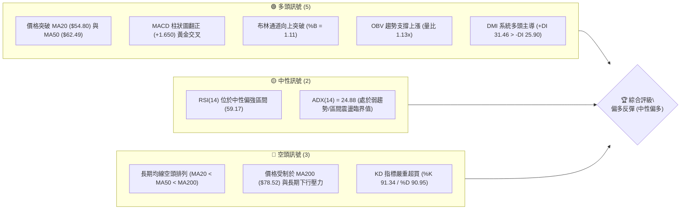
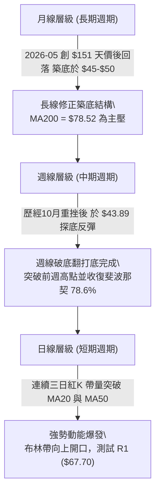
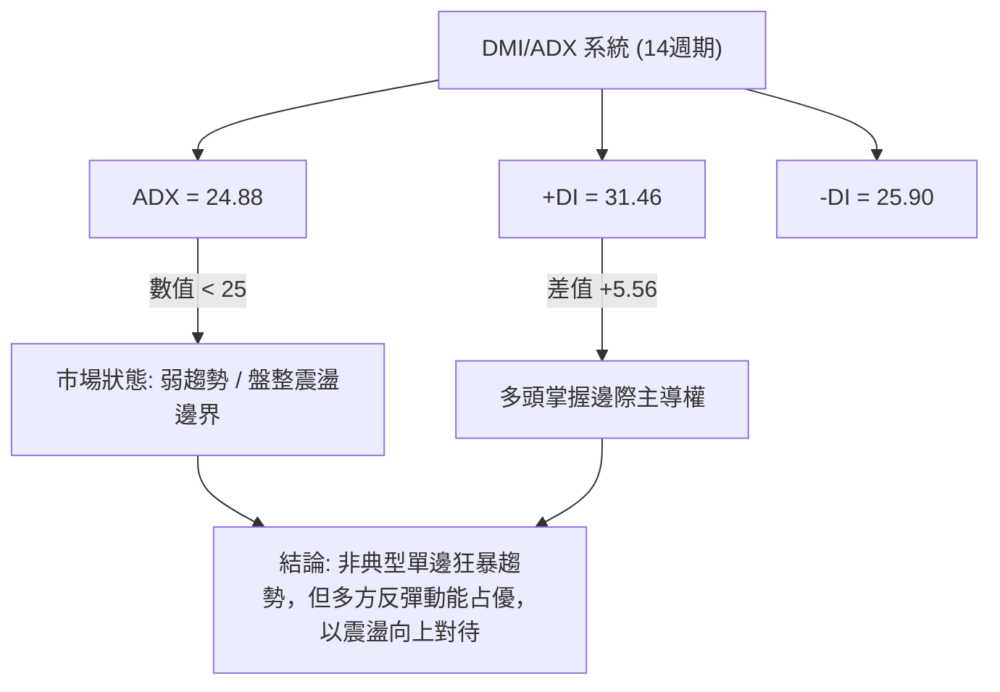
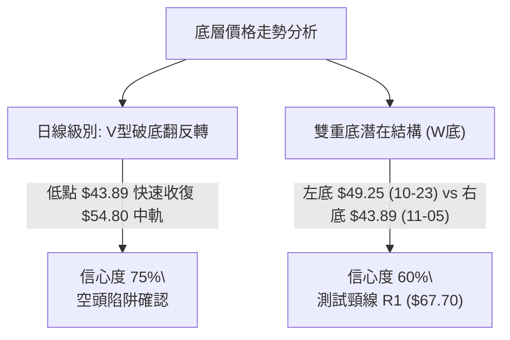
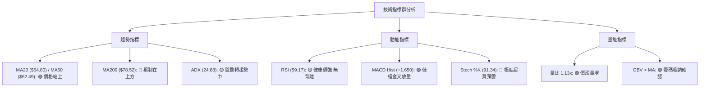
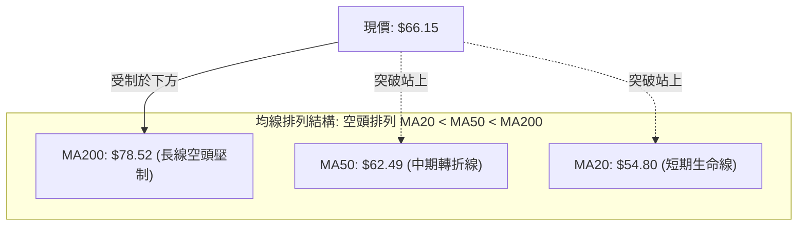
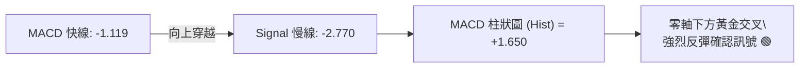
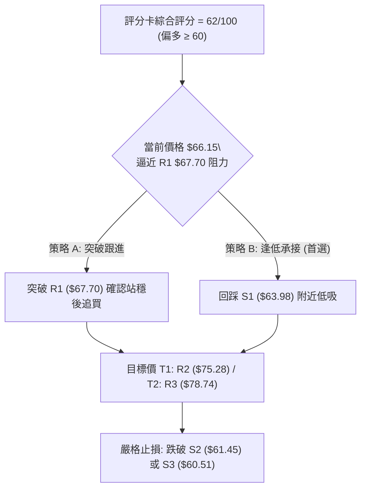
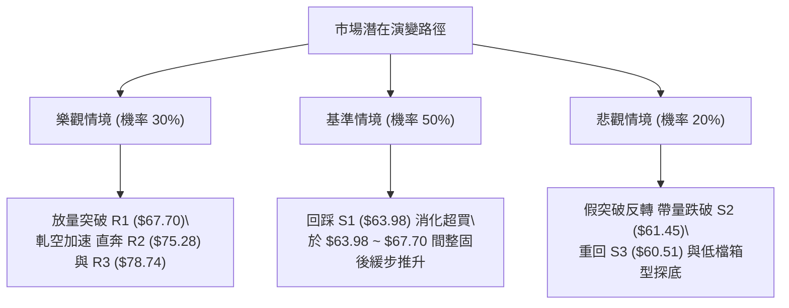

# RKLB 技術分析報告

> **報告日期**：2026-11-12 ｜ **語言**：繁體中文 ｜ **數據來源**：Yahoo Finance ｜ **當前價格**：$66.15

---

## 目錄

| 章節 | 內容 |
|------|------|
| [1. 技術面概覽](#1-技術面概覽) | 訊號儀表板、核心指標、評分卡 |
| [2. 趨勢分析](#2-趨勢分析) | 多時框趨勢、長中短期走勢 |
| [3. 圖表形態分析](#3-圖表形態分析) | 形態識別、K線組合、目標價 |
| [4. 支撐與阻力](#4-支撐與阻力) | 關鍵價位、斐波那契回調 |
| [5. 技術指標深度解讀](#5-技術指標深度解讀) | MA/RSI/MACD/布林/成交量 |
| [6. 動能與波動率](#6-動能與波動率) | 動能評估、ATR、Beta |
| [7. 多時框架總結](#7-多時框架總結) | 時框架評分矩陣 |
| [8. 交易策略建議](#8-交易策略建議) | 多空策略、風險報酬比 |
| [9. 風險提示與監控](#9-風險提示與監控) | 監控指標、風險場景 |

---

## 1. 技術面概覽

### 🎯 技術訊號儀表板



### 📊 核心指標速覽表

| 指標類別 | 指標名稱 | 當前數值 | 訊號 | 解讀 |
|----------|----------|----------|------|------|
| **價格** | 當前價格 | $66.15 | 🟢 | 連續三日帶量長紅，站上 $66 大關，短線強烈反彈 |
| **均線** | MA20 | $54.80 | 🟢 | 價格位於 MA20 上方 (+20.71%)，短多動能極強 |
| **均線** | MA50 | $62.49 | 🟢 | 帶量突破中期生命線，扭轉近兩個月的修正格局 |
| **均線** | MA200 | $78.52 | 🔴 | 價格在長線牛熊分界線下方 (-15.75%)，長線格局仍受壓 |
| **動能** | RSI(14) | 59.17 | 🟡 | 脫離超賣區進入中性偏強區間，未見背離，多頭具推進空間 |
| **動能** | MACD(12,26,9) | 柱狀: +1.650 | 🟢 | 快線 (-1.119) 穿越慢線 (-2.770)，形成強烈低檔金叉 |
| **動能** | 隨機指標 (KD) | K: 91.34 / D: 90.95 | 🔴 | 進入極度超買區，短線隨時有回測支撐或技術性整理之可能 |
| **趨勢** | ADX(14) | 24.88 | 🟡 | ADX < 25 表明處於弱趨勢或震盪格局，但 +DI(31.46) > -DI(25.90) 偏多 |
| **通道** | 布林通道 | %B: 1.11 | 🟢 | 股價突破布林上軌 ($64.09)，呈現短線通道擴張向上走勢 |
| **波動** | ATR(14) | $5.03 (7.61%) | 🔴 | 單日平均振幅高達 7.61%，屬於高波動成長型標的，風險控制需嚴格 |
| **成交量** | 最新量/20日均量 | 24.17M / 21.38M | 🟢 | 量比 1.13x，價漲量增，OBV > MA 表明主力籌碼回流支持上攻 |

### 🏆 技術評分卡

```
╔════════════════════════════════════════════════════════════════╗
║             技術評分卡 — RKLB (2026-11-12)                     ║
╠════════════════════════════════════════════════════════════════╣
║ 趨勢強度      ████████████░░░░░░░░  60/100  🟡 中性 (ADX=24.88) ║
║ 動能指標      ██████████████░░░░░░  70/100  🟢 偏多 (MACD金叉)  ║
║ 支撐穩定度    ██████████████░░░░░░  70/100  🟢 偏多 (S1已確認)  ║
║ 成交量配合    ██████████████░░░░░░  70/100  🟢 偏多 (價漲量增)  ║
║ 形態完整度    ████████████░░░░░░░░  60/100  🟡 中性 (築底反彈)  ║
║ 均線排列      ████████░░░░░░░░░░░░  40/100  🔴 偏空 (空頭排列)  ║
╠════════════════════════════════════════════════════════════════╣
║ 綜合評分      ████████████░░░░░░░░  62/100  🟢 偏多（算術平均） ║
╚════════════════════════════════════════════════════════════════╝
```
*(註：綜合評分 = (60 + 70 + 70 + 70 + 60 + 40) ÷ 6 = 61.67，四捨五入為 62/100，落在 ≥60 偏多區間)*

---

## 2. 趨勢分析

### 🌐 多時框趨勢分析



### 📈 長期趨勢 — 12個月走勢圖（Unicode）

依據月度收盤價數據，RKLB 在 2026 年 5 月達到峰值收盤價 $143.48（最高 $151.00），隨後歷經五個月的劇烈下行修正，並於 2026 年 10 月下探至 $54.73（11 月初盤中低點 $43.89），目前 11 月收盤價回升至 $66.15。

```
RKLB 月線收盤走勢圖（2025-12 至 2026-11）
價格軸 ($)
$150 ┤                                      ● (2026-05: $143.48)
$130 ┤                                     / \
$110 ┤                                    /   ● (2026-06: $101.65)
$90  ┤                ● (01: $80.07)     /     \
$80  ┤               / \          ● (04)       \
$70  ┤  ● (12: 69.76)   ● (02)   /              ● (09: $69.68)
$60  ┤                    \     /                \          ●←現價 $66.15
$50  ┤                     ● (03: $64.22)         ● (10: $54.73)
$40  ┤
     └─────────────────────────────────────────────────────────────
       12    01    02    03    04    05    06    07    08    09    10    11 (月份)
```

#### 長期走勢特徵分析表格

| 階段區間 | 月收盤起止價 | 漲跌幅 (%) | 形態與成交特徵 | 趨勢性質 |
|----------|--------------|------------|----------------|----------|
| **2025-12 ~ 2026-01** | $69.76 → $80.07 | +14.78% | 主升段初級加速，成交量穩健放大 | 長期上升趨勢 |
| **2026-02 ~ 2026-03** | $69.10 → $64.22 | -7.06% | 籌碼高檔換手，回踩前波平台支撐 | 中期健康回檔 |
| **2026-04 ~ 2026-05** | $82.51 → $143.48 | +73.89% | 投機買盤爆發，直衝歷史高點 $151.00 | 主升浪狂熱期 |
| **2026-06 ~ 2026-07** | $101.65 → $64.95 | -36.10% | 高檔崩跌，長黑破線，機構出貨顯著 | 快速退潮修正 |
| **2026-08 ~ 2026-09** | $63.92 → $69.68 | +9.01% | 圍繞 $65-$70 區間反覆震盪打底 | 中期低檔盤整 |
| **2026-10 ~ 2026-11** | $54.73 → $66.15 | +20.87% | 跌破 $50 後強力破底翻，帶量長陽回升 | 空頭力竭轉反彈 |

### 📊 中期趨勢（週線分析）

從近 20 週數據來看，RKLB 在 2026 年 7 月初跌破 $100 後，於 $63.00 ~ $82.00 建立為期兩個月的中期箱型。隨後於 10 月中旬遭遇空頭狙擊，跌破箱型底，並於 2026-11-06 該週盤中下探 $43.89。然而，最新一週（截至 2026-11-11）呈現巨幅長下影反轉長紅，週收盤大漲至 $66.15，週成交量達 88,289,800 股，週 RSI 快速由 43.8 彈升至 59.2，週 MACD 柱狀圖由 -0.065 驟升至 +1.650，確認中期打底成型。

```
中期週線箱型結構示意圖 ($)
$85 ┼────────────────────────────────── 箱型頂部阻力 ($82.83)
$78 ┼─────────────────── MA200 長期壓力線 ($78.52)
$70 ┼─────── 密集換手平台 ───────
$64 ┼─────── 箱型底部頸線 ($63.98) ◄────── 當前價格突破上收 ($66.15)
$50 ┼─────────────────── 破底翻假跌破誘空區間 ($43.89 ~ $50.84)
```

### ⚡ 趨勢強度評估（ADX 解讀）



#### ADX 數值強度對照解讀

| 指標 | 數值 | 臨界標準 | 狀態評估 | 實戰策略含義 |
|------|------|----------|----------|--------------|
| **ADX(14)** | 24.88 | 25.00 | 弱趨勢 / 盤整 | 尚未構成單邊強趨勢，不宜追高，採取支撐低吸與突破回踩確認 |
| **+DI(14)** | 31.46 | 20.00 以上 | 多方主動進攻 | 買盤力道強勁，多方具有主導權 |
| **-DI(14)** | 25.90 | 衰退中 | 空方退守 | 賣壓逐步消化，空方動能減弱 |

---

## 3. 圖表形態分析

### 🔍 形態識別系統



#### 形態識別與信心度評估表

| 形態 | 信心度 | 判斷依據（引用數據） | 完成度 | 目標價（附計算式） |
|------|--------|----------------------|--------|--------------------|
| **日線破底翻 (Bear Trap)** | 75% | 11-05 跌破前低下探 $43.89，次日 11-06 長紅反彈收 $53.07，三日內突破 S1 ($63.98) | 90% | 由起跌點 $59.10 延伸計算：目標價 $67.70 (R1) |
| **潛在雙重底 (W-Bottom)** | 60% | 第一底為 10-23 該週低點 $49.25，第二底為 11-06 該週低點 $43.89，低點聚類在支撐區 | 70% | 頸線 R1 ($67.70) − 右底低點 $43.89 = 高度 $23.81；目標價 = $67.70 + $23.81 = $91.51（短線先看 R2 $75.28 與 R3 $78.74） |
| **布林通道喇叭口突破** | 80% | 收盤價 $66.15 穿透上軌 $64.09，帶量脫離盤整帶 | 85% | 由通道中軌 $54.80 推算：目標價指向上軌延伸區 R2 ($75.28) |

### 🕯️ 重要K線形態分析

根據提供的「近10根日K」與「近8根週K」四價數據，詳細解讀關鍵轉折 K 線：

#### 近10根日K形態精解

| 日期（日K） | 開 | 高 | 低 | 收 | 成交量 | K線形態 | 解讀與訊號 |
|------------|----|----|----|----|--------|---------|------------|
| 2026-10-29 | 57.76 | 61.13 | 57.63 | 59.10 | 14.63M | 衝高回落小陽線 | 試探上方壓力未果，量能平淡 🟡 |
| 2026-10-30 | 55.71 | 57.55 | 53.19 | 54.73 | 16.61M | 中黑實體K線 | 跌破開盤價，空方開始下壓 🔴 |
| 2026-11-02 | 55.08 | 55.08 | 50.68 | 52.07 | 16.44M | 光頭下影黑K | 開盤即最高，空頭全面主導 🔴 |
| 2026-11-03 | 53.10 | 54.94 | 52.90 | 54.43 | 14.16M | 止跌小紅星 | 下跌力道暫緩，低檔換手 🟡 |
| 2026-11-04 | 54.60 | 55.31 | 50.41 | 52.37 | 18.77M | 破底陰線 | 再次跌破前日低點，恐慌盤湧出 🔴 |
| 2026-11-05 | 50.58 | 50.83 | 43.89 | 45.99 | 36.78M | 爆量長下影黑K | 創近半年低點 $43.89，巨量 36.78M 承接，主力洗盤吸籌 🟢 |
| 2026-11-06 | 48.28 | 53.10 | 46.51 | 53.07 | 20.88M | 低開高走長陽K | 實體高達 $4.79，吞噬前一日大半跌幅，確認 $43.89 為短期底部 🟢 |
| 2026-11-09 | 54.31 | 59.69 | 53.01 | 58.86 | 32.00M | 跳空放量大紅棒 | 放量 32.00M，直接貫穿 MA20，多頭全面主導 🟢 |
| 2026-11-10 | 54.99 | 63.77 | 54.96 | 62.71 | 32.12M | 帶量突破長紅K | 連續放量，強勢突破 MA50 ($62.49)，確立中期反轉 🟢 |
| 2026-11-11 | 64.29 | 68.26 | 63.20 | 66.15 | 24.17M | 高檔穿刺紅棒 | 盤中觸及 $68.26，突破布林上軌，尾盤收 $66.15，維持多頭強推 🟢 |

#### 近8根週K形態精解

| 日期（週K） | 開 | 高 | 低 | 收 | 成交量 | K線形態 | 解讀與訊號 |
|------------|----|----|----|----|--------|---------|------------|
| 2026-09-25 | 65.29 | 75.46 | 65.28 | 73.95 | 111.51M | 週長陽突破線 | 突破底部整理平台，多方發力 🟢 |
| 2026-10-02 | 73.20 | 76.09 | 69.40 | 73.92 | 107.28M | 高檔十字震盪 | 於 $74 附近遭遇強烈籌碼獲利了結 🟡 |
| 2026-10-09 | 73.70 | 78.28 | 66.98 | 68.21 | 104.64M | 週流星長上影 | 衝擊 $78.28 後重挫，長上影線預示回檔 🔴 |
| 2026-10-16 | 67.88 | 68.07 | 49.69 | 50.84 | 128.01M | 巨量殺跌大長黑 | 週量達 128M，崩跌下穿多道支撐 🔴 |
| 2026-10-23 | 52.28 | 53.90 | 49.25 | 52.60 | 82.00M | 縮量十字星 | 低檔量縮止跌，多空暫時均衡 🟡 |
| 2026-10-30 | 52.60 | 61.13 | 52.15 | 54.73 | 77.65M | 弱勢反彈帶上影 | 反彈遭遇空頭均線壓制 🔴 |
| 2026-11-06 | 55.08 | 55.31 | 43.89 | 53.07 | 107.04M | 巨量長下影錘頭 | 盤中殺破 $45 後被狂暴買盤收回，週長下影宣告見底 🟢 |
| 2026-11-11 | 54.31 | 68.26 | 53.01 | 66.15 | 88.29M | 週級別大陽線反轉 | 僅用三日即吞噬前四週高點，動能極度澎湃 🟢 |

### 📉 ASCII 走勢形態示意圖

```
日線級別「V型破底翻」與突破結構示意圖
價格 ($)
$68.26 ┼─────────────────────────────────● (11-11 當前高點，逼近 R1 $67.70)
$66.15 ┼───────────────────────────────●  (最新收盤價)
$62.71 ┼─────────────────────────●      (11-10 突破 MA50)
$58.86 ┼───────────────────●          (11-09 站上 MA20)
$54.80 ┼┄┄┄┄┄┄┄┄┄┄┄┄┄┄┄┄┄┄┄┄┄┄┄┄┄┄┄┄┄┄┄┄ (MA20 頸線水平位置)
$53.07 ┼─────────────●                  (11-06 強勢吞噬確認反轉)
$45.99 ┼───────●                        (11-05 恐慌低收)
$43.89 ┼──●                            (11-05 破底洗盤極限點)
       └────────────────────────────────────────────────────────
         11-05  11-06  11-09  11-10  11-11
```

### 🎯 形態目標價計算

根據雙重底/破底翻形態的高度投射原理：
- **形態基底（最低點）**：$43.89（2026-11-05 低點）
- **關鍵頸線位置**：$67.70（即阻力位 R1）
- **形態理論高度**：$67.70 − $43.89 = $23.81
- **第一形態目標價**：直接對齊數據阻力位 **R2 = $75.28**（頸線突破後的初步反彈目標）
- **第二形態目標價**：對齊數據長期均線壓制與阻力位 **R3 = $78.74**（波段阻力聚類點）
- **完全投射目標**：$67.70 + $23.81 = $91.51（需待突破 R3 且成交量持續爆發時方可啟動）

---

## 4. 支撐與阻力

### 🗺️ 關鍵價位分布圖（Unicode）

```
RKLB 價位結構分布圖（引用 OHLCV 計算聚類值）
══════════════════════════════════════════════════════════════════
$78.74 ║██████████████████████████████║ 強阻力 R3 / 接近 MA200 ($78.52)
$75.28 ║████████████████████        ║ 中期波段阻力 R2
$67.70 ║████████████████████████████  ║ 近端關鍵阻力 R1 (頸線位置)
$66.15 ╠══════════════════════════════╣ ◄ 當前收盤價 ($66.15)
$63.98 ║▓▓▓▓▓▓▓▓▓▓▓▓▓▓▓▓▓▓▓▓          ║ 近期核心支撐 S1 (前波低點聚類)
$61.45 ║████████████████████████      ║ 關鍵支撐 S2 (近 MA50 $62.49)
$60.51 ║████████████████████████████  ║ 強支撐 S3 (整數防守大關)
══════════════════════════════════════════════════════════════════
```

### 🚧 阻力位分析表

所有價位精確引用自 OHLCV 計算聚類結果：

| 阻力級別 | 價位 | 形成原因 | 突破難度 | 重要性 |
|----------|------|----------|----------|--------|
| **R1** | $67.70 | 近一年波段高點聚類點，距離現價僅 +2.34%，為 11-11 盤中高點 ($68.26) 密集套牢解套區 | 🟡 中等 | ★★★★☆<br>短線多空分水嶺，有效帶量突破將打開上行空間 |
| **R2** | $75.28 | 2026 年 8 月至 9 月多次反彈的高點聚類，距離現價 +13.81% | 🔴 較高 | ★★★★☆<br>中期波段關鍵壓力區，堆積大量歷史套牢籌碼 |
| **R3** | $78.74 | 2026 年 10 月初週線衝高受阻點，且與 MA200 ($78.52) 產生共振，距離現價 +19.04% | 🔴 極高 | ★★★★★<br>長期牛熊轉換線，決定能否重回百元大關 |

### 🛡️ 支撐位分析表

所有價位精確引用自 OHLCV 計算聚類結果：

| 支撐級別 | 價位 | 形成原因 | 守住機率 | 重要性 |
|----------|------|----------|----------|--------|
| **S1** | $63.98 | 近一年波段低點聚類點，與布林上軌 ($64.09) 形成頂底互換支撐，距現價 -3.27% | 75% | ★★★★☆<br>超短線防守第一道關卡，回測不破確認強勢 |
| **S2** | $61.45 | 接近 MA50 ($62.49) 與 10 月下旬密集換手帶，距現價 -7.11% | 85% | ★★★★★<br>中期反彈生命線，跌破則反彈動能衰竭 |
| **S3** | $60.51 | 前波多空爭奪中軸，波段低點支撐聚類，距現價 -8.53% | 90% | ★★★★☆<br>多頭波段底線，失守將重回弱勢探底 |

### 📐 斐波那契回調位分析

依據 52 週完整區間（低點 $37.57 → 高點 $151.00，總跨度 $113.43）計算之標準斐波那契回調位：

```
斐波那契結構階梯圖 ($)
$151.00 ┼── 0.0% (52W High)
$124.23 ┼── 23.6% 回調位
$107.67 ┼── 38.2% 回調位
$94.28  ┼── 50.0% 中樞平衡位
$80.90  ┼── 61.8% 黃金分割回調位 (強阻力)
 ───────────────── 當前價格 $66.15 位於 61.8% 與 78.6% 之間 ─────────────────
$61.84  ┼── 78.6% 深度回調位 ◄── 已被強勢收復，轉化為重要支撐
$37.57  ┼── 100.0% (52W Low)
```

#### 斐波那契深度解讀
1. **現價位置意義**：當前股價 $66.15 剛成功收復 **78.6% 回調位 ($61.84)**。在技術分析中，當資產歷經深度回檔（回調超過 61.8% 甚至達到 78.6%）後能重新放量站回 78.6% 之上，通常意味著「極限洗盤」告一段落，空頭動能枯竭。
2. **上方空間測算**：站穩 $61.84 後，斐波那契理論的第一上行目標位指向 **61.8% 回調位 ($80.90)**。值得注意的是，$80.90 與前述阻力位 R3 ($78.74) 以及 MA200 ($78.52) 形成三合一「多重阻力共振區」，這將是本輪反彈最核心的獲利了結與考驗區域。

---

## 5. 技術指標深度解讀

### 🎛️ 指標訊號總覽



### 📈 移動平均線排列分析



#### 移動平均線數據特徵表

| 均線名稱 | 當前價格 | 與現價乖離率 | 走勢微積分 (趨勢) | 訊號意涵 |
|----------|----------|--------------|-------------------|----------|
| **MA 5** | $57.36 | +15.33% | ▲ 陡峭向上 | 超短期動能極強，呈現噴出走勢 🟢 |
| **MA 10** | $55.95 | +18.23% | ▲ 快速拐頭 | 確立短線轉折底 🟢 |
| **MA 20** | $54.80 | +20.71% | ▲ 由跌轉平向上 | 突破月線，短多取得主導權 🟢 |
| **MA 60** | $63.43 | +4.29% | ▲ 略微走平上翹 | 穿越季線，中期賣壓獲消化 🟢 |
| **MA 120** | $77.71 | -14.88% | ▼ 緩步下行 | 半年線持續形成上方壓力 🔴 |
| **MA 200** | $78.52 | -15.75% | ▼ 穩步下行 | 長期均線空頭排列，長性格局仍受限 🔴 |

### 📉 RSI(14) 分析

當前 RSI(14) 數值為 **59.17**（Wilder 計算）。

```
RSI(14) 動能強度儀表
0 ──────────── 30 ───────────────────── 59.17 ────────── 70 ────────── 100
[   超賣區    ] [       中性區         ▲       ] [   超買區   ]
                                       當前位置 (59.17)
進度條: ███████████████░░░░░░░░░░  59.2%
```

#### 背離深度診斷
- **背離狀況**：無明顯背離。
- **指標行為解讀**：在 2026-10-16 股價暴跌至 $50.84 時，週 RSI 一度跌至 25.4 極度超賣區；隨後在 11 月初股價下探 $43.89 時，日線 RSI 守在 30 附近，並在近三日連續長陽中迅速回升至 59.17。此走勢表明 RSI 順利修復超賣狀態，目前進入 50-70 的多頭良性擴張區間，既無頂背離衰竭跡象，亦未達到 70 以上的超買警示，後續具備進一步推升的動能餘裕。

### 📊 MACD(12,26,9) 訊號解讀



#### MACD 動能柱解析
- **數值表現**：快線 (-1.119) 顯著高於慢線 (-2.770)，差值為正，柱狀圖達到 **+1.650**。
- **歷史對比**：回顧近 20 週數據，MACD 柱狀圖在 10 月中旬重挫時低至 -2.111，隨後柱狀體收斂，至最新交易日噴出 +1.650，這是自 2026 年 8 月以來的最大正向擴張力度。
- **技術意義**：雖然 MACD 仍位於零軸之下（代表大週期仍處於長線修正的大環境），但零軸下方的低檔金叉往往是高風險報酬比的波段起漲點，量能配合極佳。

### 📦 布林通道分析

```
布林通道 (20, 2) 當前結構圖 ($)
$64.09 ┼┄┄┄┄┄┄┄┄┄┄┄┄┄┄┄┄┄┄┄┄┄┄┄┄┄┄┄┄┄┄┄┄┄┄┄┄┄ BB 上軌
$66.15 ┼─────────────────────────────● 現價 ($66.15，突破上軌 %B=1.11)
       │
$54.80 ┼───────────────────────────── BB 中軌 (MA20)
       │
$45.51 ┼┄┄┄┄┄┄┄┄┄┄┄┄┄┄┄┄┄┄┄┄┄┄┄┄┄┄┄┄┄┄┄┄┄┄┄┄┄ BB 下軌
```

#### 布林指標深度解讀
- **當前帶寬與位置**：BB 上軌為 $64.09，中軌為 $54.80，下軌為 $45.51。最新收盤價 $66.15，**%B 達 1.11**。
- **通道形態**：%B 大於 1.0 表明股價已直接衝出布林通道上軌外側，屬於強烈的「通道擴張（Walking the Bands）」初期形態。
- **操作含義**：在強勢單邊推升行情中，價格常會沿著上軌外側推進；但若次日未能持續補量創高，易引發向通道內（即 $64.09 附近）的技術性回踩，回測該處若獲支撐，則是典型突破回踩買點。

### 💹 成交量分析（量價配合度）

```
成交量動態分佈圖 (股數)
最新量: 24.17M  ████████████████████████ (量比 1.13x)
20均量: 21.38M  █████████████████████
50均量: 20.98M  ████████████████████
```

#### 量價結構研判
1. **量價齊揚**：最新單日成交量為 24,172,100 股，顯著超越 20 日均量 (21,379,535) 與 50 日均量 (20,980,354)，量比達 1.13x。此前在 11-09 與 11-10 突破日更分別爆出 32.00M 與 32.12M 的天量，顯示機構法人進場回補跡象明顯。
2. **OBV 能量潮確認**：數據明確指示「**OBV > MA → 量能支撐上漲**」。能量潮指標持續位於其均線之上，這排除了「無量虛漲」或「誘多陷阱」的疑慮，顯示目前價格推升背後具備實質籌碼沉澱與換手支持。

---

## 6. 動能與波動率

### ⚡ 動能評估四象限

```
動能與波動率矩陣分佈
高動能 │                                      ★ RKLB 當前位置
      │                                (高動能 + 高波動)
      │                                 - 動能強勁 (突破上軌)
      │                                 - ATR=7.61%, Beta=3.18
──────┼───────────────────────────────────────
低動能 │
      │
      └───────────────────────────────────────
        低波動                                高波動
```

#### 動能與波動狀態分析表

| 象限 | 動能維度 | 波動維度 | 標的代表狀態 | 當前符合度與解讀 |
|------|----------|----------|--------------|------------------|
| **Q1** | 強 | 低 | 穩健牛市緩推 | 不符合。RKLB 波動屬性極為劇烈 |
| **Q2** | 弱 | 低 | 低波盤整築底 | 不符合。已脫離低波動壓縮區 |
| **Q3** | **強** | **高** | **爆發性突破 / 高風險高收益** | **✓ 完全吻合。MACD 金叉 + 高 ATR，收益空間大但需嚴設止損** |
| **Q4** | 弱 | 高 | 恐慌崩跌下洩 | 剛於 11 月初脫離此象限（當時處於破底恐慌殺戮期） |

### 📊 ATR 波動率分析

- **ATR(14) 數值**：**$5.03**（依據 Wilder 平滑法）。
- **ATR 佔價格比率**：$5.03 ÷ $66.15 = **7.61%**。
- **波動率解讀**：單日平均潛在波動超過 5 美元，佔現價高達 7.61%，表明該標的具有極高的日內與波段風險。在進行風控規劃時，過度緊湊的止損點（例如 2%-3%）極易遭到日內常態隨機波動掃出場。
- **止損距離建議**：
  - **超短線進場**：至少預留 1.0 倍 ATR（約 $5.00 空間）。
  - **波段交易進場**：應預留 1.5 ~ 2.0 倍 ATR（約 $7.50 ~ $10.00 緩衝），防守位置應置於關鍵技術位下方（如 S1 $63.98 或 S2 $61.45）。

### 📐 Beta 與市場相關性

- **Beta 係數**：**3.176**。
- **市場敏感度**：Beta > 3 代表其波動幅度為標普 500 指數的 3.18 倍，屬於極端高敏感度的成長型航太科技股。
- **空頭部位比例**：做空比率（Short Ratio）為 2.3 天，空頭佔流通盤比例（Short % Float）達 **7.3%**。近期放量連續長陽，帶有相當程度的**空頭軋空（Short Squeeze）**色彩，這是推動股價短線迅速由 $43.89 飆升至 $66.15 的催化劑之一。

---

## 7. 多時框架總結

### 📋 時框架評分表

| 時框架 | 趨勢方向 | 動能狀態 | 均線排列 | 形態結構 | 綜合評分 | 操作建議 |
|--------|----------|----------|----------|----------|----------|----------|
| **長期 (月線)** | 🔴 偏空修正 | 🟡 中性緩解 | 空頭排列 (MA200下方) | 高檔滑落築底 | 45/100 | 長期投資者靜待 MA200 壓力消化 |
| **中期 (週線)** | 🟢 破底翻多 | 🟢 動能轉強 (MACD金叉) | 爭奪 MA50 ($62.49) | 週長下影大陽轉折 | 68/100 | 波段持有，逢回測關鍵支撐布局 |
| **短期 (日線)** | 🟢 強勢進攻 | 🔴 極度超買 (%K 91.34) | 多頭排列 (MA5>10>20) | 突破布林上軌 | 72/100 | 短線不追高，等待日內拉回支撐進場 |

### 🔲 綜合訊號矩陣

| 評估維度 | 短期訊號 (日線) | 中期訊號 (週線) | 長期訊號 (月線) | 衝突研判與權重收斂 |
|----------|-----------------|-----------------|-----------------|-------------------|
| **趨勢方向** | 🟢 強烈看多 | 🟢 轉向看多 | 🔴 長性格局偏空 | 短中期強勢反彈正衝擊長線空頭架構 |
| **動能指標** | 🔴 KD 超買預警 | 🟢 MACD 放量金叉 | 🟡 RSI 脫離超賣 | 中期動能具備持續性，短期或有震盪消化 |
| **量價配合** | 🟢 量比 1.13x 價增量增 | 🟢 週成交量 88M 大增 | 🟡 月成交量回溫 | 量能全面支持此輪由下而上的轉折反轉 |

### ⚖️ 多時框收斂結論

依據多時框收斂規則：
1. **行情屬性判定**：當前 **ADX(14) = 24.88**，數值剛好處於 25 的臨界點下方，定義為「**震盪偏強向弱趨勢過渡期**」。
2. **多時框權重取捨**：雖然長期均線（MA200 = $78.52）呈現空頭壓制，但中期週線與短期日線均出現強烈的爆量破底翻與 MACD 金叉反轉訊號。在日線與中長期產生摩擦時，由於 ADX 尚未進入單邊主升趨勢（<25），日線突破上軌後不宜盲目追高，主導節奏應以**中期箱型築底的波段反彈**為主。
3. **唯一方向性結論**：**【偏多操作，順勢做多】**。整體操作以「回測支撐逢低承接」為主軸，向上挑戰中期壓力區。

---

## 8. 交易策略建議

### 🗺️ 策略決策流程圖



### 🧭 策略路由（依評分卡分流）

> **當前主策略方向 = 【主推多頭策略】（依據第 1 章技術評分卡綜合評分 62/100，落在 ≥60 偏多區間）**

### 🎯 價格情境階梯（Price Scenarios）

所有價位均精確引用自數據之關鍵價位聚類：

| 觸發條件 | 下一目標 | 後續延伸 | 情境含義 |
|----------|----------|----------|----------|
| **帶量突破 R1 $67.70** | **R2 $75.28** | **R3 $78.74** | 短線轉強，多頭展開對 MA200 的衝擊浪 |
| **於 $63.98 ~ $67.70 間震盪** | $66.15 (現價中軸) | — | 消化 KD 超買壓力，布林通道震盪整固 |
| **跌破支撐 S1 $63.98** | **S2 $61.45** | **S3 $60.51** | 反彈受阻，回踩測試 MA50 支撐防線 |

### 📊 情境機率分佈

| 情境劇本 | 機率 | 主要依據 |
|----------|------|----------|
| **情境一：繼續上行 / 擴大反彈** | **55%** | MACD 柱狀圖暴增至 +1.650，OBV 能量潮上穿均線，多頭籌碼強烈介入 |
| **情境二：區間震盪 / 消化超買** | **35%** | ADX = 24.88 表明處於弱趨勢盤整，Stoch %K 達 91.34 處於極度超買區 |
| **情境三：回落破底 / 再探新低** | **10%** | S1 ($63.98) 與 S2 ($61.45) 形成厚實雙重支撐防線，短期內再次崩跌機率極低 |

### 🟢 主策略詳情（方向：主推多頭）

嚴格遵守風險報酬比定義：**風險報酬比 = (目標價 T1 − 進場價) ÷ (進場價 − 止損價)**。

| 策略要素 | 策略 A（右側追價突破策略） | 策略 B（左側逢低承接策略 — 推薦） |
|----------|----------------------------|-----------------------------------|
| **進場條件** | 帶量有效突破並站穩阻力位 R1 | 股價回踩測試支撐位 S1 獲支撐回升 |
| **進場價格** | **$67.70**（精確對齊 R1） | **$63.98**（精確對齊 S1） |
| **目標價 T1** | **$75.28**（精確對齊 R2） | **$75.28**（精確對齊 R2） |
| **目標價 T2** | **$78.74**（精確對齊 R3） | **$78.74**（精確對齊 R3） |
| **止損價格** | **$63.98**（跌破 S1 止損） | **$60.51**（跌破 S3 止損） |
| **風險報酬比 (T1)** | **1 : 2.04（以 T1 計）**<br>*(75.28 − 67.70) ÷ (67.70 − 63.98) = 7.58 ÷ 3.72 = 2.0376* | **1 : 3.26（以 T1 計）**<br>*(75.28 − 63.98) ÷ (63.98 − 60.51) = 11.30 ÷ 3.47 = 3.2565* |
| **風險報酬比 (T2)** | **1 : 2.97（以 T2 計）**<br>*(78.74 − 67.70) ÷ (67.70 − 63.98) = 11.04 ÷ 3.72 = 2.9677* | **1 : 4.25（以 T2 計）**<br>*(78.74 − 63.98) ÷ (63.98 − 60.51) = 14.76 ÷ 3.47 = 4.2536* |
| **成功機率** | 60% | 65% |
| **建議倉位** | 10% ~ 15% | 15% ~ 20% |

### 🔴 反向風險觸發點（對沖提示）

若出現以下情況，主推多頭策略將被全面推翻，需立即啟動風控對沖或清倉觀望：
1. **關鍵點位失守**：日 K 線收盤價**跌破支撐位 S2 ($61.45)**，代表回調跌破斐波那契 78.6% 回調位 ($61.84) 與 MA50 ($62.49)，多頭反轉宣告失敗。
2. **量價異化訊號**：若股價在觸及阻力位 R1 ($67.70) 時，爆出超過 35M 的天量卻收長上影線陰線（如流星線），且次日跌回布林通道內側，表明主力高檔出貨，應立即平倉多單避險。

### ⭐ 整體訊號強度評星

```
╔══════════════════════════════════════════════╗
║ 做多訊號強度：★★★★☆  (4/5星)                 ║
║ 做空訊號強度：★★☆☆☆  (2/5星)                 ║
║ 整體可信度：  ★★★★☆  (4/5星)                 ║
╚══════════════════════════════════════════════╝
```

---

## 9. 風險提示與監控

### ✅ 關鍵監控指標 Checklist

```
╔══════════════════════════════════════════════════════════════╗
║              RKLB 每日交易關鍵監控清單 (Checklist)            ║
╠══════════════════════════════════════════════════════════════╣
║ [ ] 價格是否成功衝破並站穩阻力 R1 ($67.70)                    ║
║ [ ] 股價若回檔，能否在支撐 S1 ($63.98) 形成有效止跌           ║
║ [ ] RSI(14) 是否在進入 70 超買區前出現鈍化或頂背離            ║
║ [ ] MACD 柱狀圖是否維持在正向擴張（高於 +1.000）              ║
║ [ ] 每日成交量是否維持在 20 日均量 (21.38M) 之上              ║
║ [ ] 跌破防守極限點 S2 ($61.45) 必須無條件執行停損離場         ║
╚══════════════════════════════════════════════════════════════╝
```

### ⚠️ 風險場景分析



### 🛡️ 風險管理重要提醒

1. **極度波動性風險（高 ATR 與高 Beta）**：
   - RKLB 當前 ATR 高達 **$5.03 (7.61%)**，Beta 高達 **3.176**。這種標的具備極高的日內劇烈洗盤特徵。投資人絕不可過度放大財務槓桿，建議單筆交易虧損金額控制在總投資本金的 **1.0% ~ 1.5%** 以內。
2. **KD 超買帶來的技術性拉回**：
   - 隨機指標 %K 目前達到 **91.34**，已連續處於 90 以上極值。儘管強勢行情中指標可能鈍化，但追高買盤面臨的「日內回撤風險」遠大於「踏空風險」，因此嚴格恪守「策略 B（回踩 S1 布局）」為最優原則。
3. **長期均線壓制現實**：
   - MA200 仍處於 $78.52 下行壓制中，代表目前所有的反彈性質均屬於「大級別修正後的強勢反彈波段」，而非無阻力的超級大多頭。接近阻力位 R2 ($75.28) 與 R3 ($78.74) 時，必須分批減倉獲利了結。

---

## 📋 報告總結

```
╔════════════════════════════════════════════════════════════════╗
║                   RKLB 技術分析報告總結                        ║
╠════════════════════════════════════════════════════════════════╣
║ 報告日期：2026-11-12                                           ║
║ 當前價格：$66.15                                               ║
║ 分析評級：🟢 偏多反彈 (評分: 62/100，技術指標低檔金叉共振)       ║
║                                                                ║
║ 關鍵結論：                                                     ║
║ ├─ 長期趨勢：🔴 偏空修正 (受制於 MA200 $78.52 之下)            ║
║ ├─ 中期趨勢：🟢 破底翻反轉 (收復斐波那契 78.6% $61.84)         ║
║ ├─ 短期趨勢：🟢 動能強烈突破 (突破布林上軌，MACD柱 +1.650)     ║
║ ├─ 關鍵支撐：S1: $63.98 ｜ S2: $61.45 ｜ S3: $60.51            ║
║ ├─ 關鍵阻力：R1: $67.70 ｜ R2: $75.28 ｜ R3: $78.74            ║
║ └─ 分析師目標：共識均價 $96.50 (機構維持 Overweight 評級)      ║
║                                                                ║
║ 最優策略組合：                                                 ║
║ 1. 🥇 最佳機會：策略 B (回踩 S1 $63.98 進場，風報比 1:3.26)    ║
║ 2. 🥈 次選機會：策略 A (突破 R1 $67.70 追單，風報比 1:2.04)    ║
║ 3. 🥉 保守選擇：等待股價於 $63.98-$67.70 充分整固確認後再行介入║
╚════════════════════════════════════════════════════════════════╝
```

---

> ⚠️ **免責聲明**：本報告為 AI 自動生成之技術分析，所有數據及估算均基於提供的歷史價格資訊。本報告**僅供研究與學術參考**，**不構成任何投資建議**。投資有風險，入市需謹慎。

---

*報告生成時間：2026-11-12 ｜ 數據來源：Yahoo Finance ｜ 分析框架：多時框技術分析*