# RKLB 技術分析報告

> **報告日期**：2026-11-13 ｜ **語言**：繁體中文 ｜ **數據來源**：Yahoo Finance ｜ **當前價格**：$64.07

---

## 目錄

| 章節 | 內容 |
|------|------|
| [1. 技術面概覽](#1-技術面概覽) | 訊號儀表板、核心指標、評分卡 |
| [2. 趨勢分析](#2-趨勢分析) | 多時框趨勢、長中短期走勢 |
| [3. 圖表形態分析](#3-圖表形態分析) | 形態識別、K線組合、目標價 |
| [4. 支撐與阻力](#4-支撐與阻力) | 關鍵價位、斐波那契回調 |
| [5. 技術指標深度解讀](#5-技術指標深度解讀) | MA/RSI/MACD/布林/成交量 |
| [6. 動能與波動率](#6-動能與波動率) | 動能評估、ATR、Beta |
| [7. 多時框架總結](#7-多時框架總結) | 時框架評分矩陣 |
| [8. 交易策略建議](#8-交易策略建議) | 多空策略、風險報酬比 |
| [9. 風險提示與監控](#9-風險提示與監控) | 監控指標、風險場景 |

---

## 1. 技術面概覽

### 🎯 技術訊號儀表板

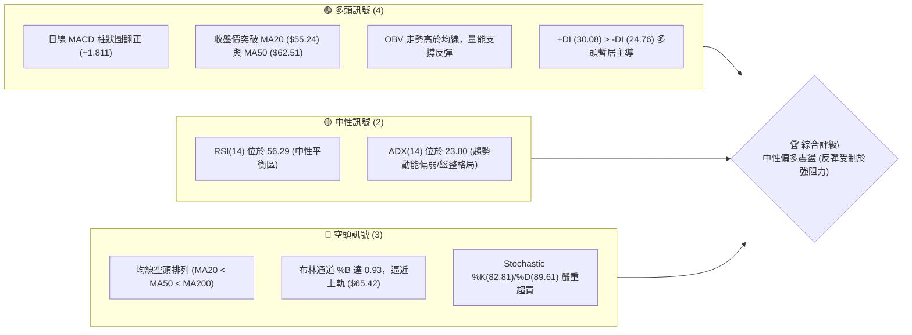

### 📊 核心指標速覽表

| 指標類別 | 指標名稱 | 當前數值 | 訊號 | 解讀 |
|----------|----------|----------|------|------|
| **價格** | 當前價格 | $64.07 | 🟡 | 位於52週區間 23.4% 低檔區，自近週低位大幅反彈 |
| **均線** | MA20 | $55.24 | 🟢 | 現價高於 MA20 達 +15.98%，短期脫離底部均線 |
| **均線** | MA50 | $62.51 | 🟢 | 現價突破中天期防線 (+2.50%)，短線扭轉頹勢 |
| **均線** | MA200 | $78.40 | 🔴 | 現價低於長期牛熊分界線 (-18.28%)，長線結構未轉牛 |
| **動能** | RSI(14) | 56.29 | 🟡 | 脫離超賣區進入中性溫和區間，無明顯背離現象 |
| **動能** | MACD Hist | +1.811 | 🟢 | 快慢線負值收斂，柱狀圖放大至正值區，看多修復 |
| **動能** | Stoch %K/%D | 82.81 / 89.61 | 🔴 | 進入 >80 極端超買區間，短線存在拉回與獲利了結壓力 |
| **趨勢** | ADX(14) | 23.80 | 🟡 | 數值低於 25，市場缺乏強大單邊趨勢，屬區間震盪行情 |
| **波動** | ATR(14) | $4.89 | 🔴 | 佔價格 7.63%，日波動極大，操作需嚴格控制停損距離 |
| **通道** | BB %B | 0.93 | 🔴 | 價格逼近布林上軌 ($65.42)，短線空間壓縮，面臨技術承壓 |

### 🏆 技術評分卡

```
╔══════════════════════════════════════════════════════════════════╗
║                   技術評分卡 — RKLB (2026-11-13)                 ║
╠══════════════════════════════════════════════════════════════════╣
║ 趨勢強度 (ADX=23.80, 長線空頭未改)   ████████░░░░░░░░░░░░  40/100 🔴 ║
║ 動能指標 (MACD翻紅, RSI中性, KD超買)  ████████████░░░░░░░░  60/100 🟡 ║
║ 支撐穩定度 (S1=$63.98, S2=$61.45)   ██████████████░░░░░░  70/100 🟢 ║
║ 成交量配合 (OBV偏多, 量比0.68x)     ██████████░░░░░░░░░░  50/100 🟡 ║
║ 形態完整度 (V型強彈碰軌, 頸線未克)   ████████████░░░░░░░░  60/100 🟡 ║
║ 均線排列 (MA20<MA50<MA200, 站上MA50)████████░░░░░░░░░░░░  40/100 🔴 ║
╠══════════════════════════════════════════════════════════════════╣
║ 綜合評分                            ██████████░░░░░░░░░░  53/100 🟡 ║
║ 評級結論：區間震盪 / 破底翻反彈遭遇強阻 (算術平均四捨五入)         ║
╚══════════════════════════════════════════════════════════════════╝
```

---

## 2. 趨勢分析

### 🌐 多時框趨勢分析

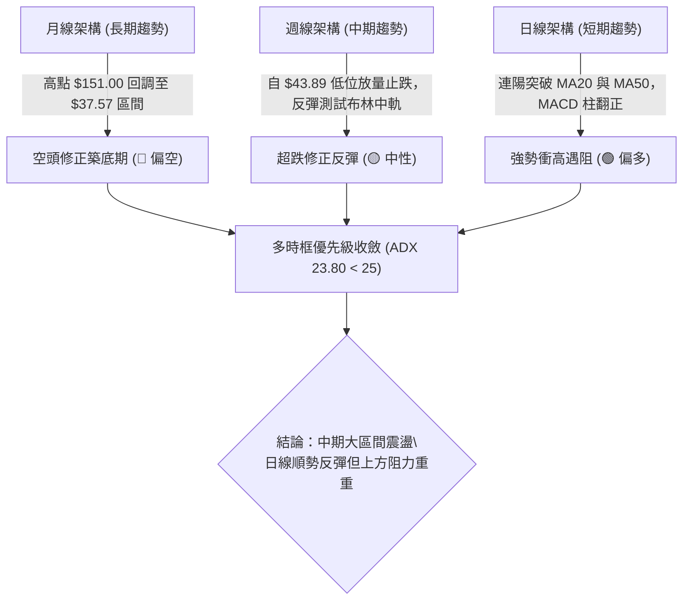

### 📈 長期趨勢 — 12個月走勢圖（Unicode）

依據月度收盤數據繪製過去 12 個月（2025-12 至 2026-11）價格演變：

```
RKLB 月線走勢圖（過去12個月）
價格軸 ($)
$150 ┤                            ● 2026-05 ($143.48)
$130 ┤                           / \
$110 ┤                          /   ● 2026-06 ($101.65)
 $90 ┤           ● 2026-01     ●     \
 $70 ┤● 2025-12   \     2026-04       \           ● 2026-09 ($69.68)
     │ ($69.76)    ●     ($82.51)      ●- - - - -/ \       ● 現價 $64.07
 $50 ┤          2026-03 ($64.22)     2026-07/08     ● 2026-10 ($54.73)
 $30 ┤
     └─────────────────────────────────────────────────────────────
       12   01    02    03    04    05    06    07   08    09    10    11
```

**12 個月走勢特徵分析表格**：

| 階段區間 | 起訖月份 | 起訖價格 ($) | 漲跌幅 (%) | 核心特徵與量價行為 |
|----------|----------|--------------|------------|--------------------|
| 主升前蓄勢 | 2025-12 → 2026-04 | 69.76 → 82.51 | +18.28% | 於 $64.22–$80.07 寬幅震盪洗盤，構築推升底層籌碼 |
| 爆發噴出期 | 2026-04 → 2026-05 | 82.51 → 143.48 | +73.89% | 量能極度擴張，月線長陽逼近歷史天價 $151.00，動能透支 |
| 崩跌去泡沫 | 2026-05 → 2026-07 | 143.48 → 64.95 | -54.73% | 斷崖式跳水下跌，連續跌破多條長期均線，浮額慘遭清洗 |
| 低檔盤整期 | 2026-07 → 2026-10 | 64.95 → 54.73 | -15.74% | 於 $50–$70 區間反覆震盪打底，10月下探至 $54.73 測試底部 |
| 當前修復期 | 2026-10 → 2026-11 | 54.73 → 64.07 | +17.07% | 自週K最低 $43.89 大幅拉升，收盤重回 $64.00 平台線上方 |

### 📊 中期趨勢（週線分析）

中期走勢呈現「快速下殺後的打底修復波段」。近 20 週收盤走勢顯示，RKLB 自 7 月初 $100.46 跌落後，9 月底一度反彈至 $73.95，隨後於 10 月 16 日當週暴跌至 $50.84（週成交量爆出 128,008,200 股的天量換手），形成中期賣壓極限點。

```
RKLB 週線中期價位示意圖
═════════════════════════════════════════════════════════════════════
$78.74 ────────────────── 阻力 R3 (密集套牢頂部區)
$75.28 ────────────────── 阻力 R2 (9-10月反彈次高點區域)
$67.70 ────────────────── 阻力 R1 (本週高點 $68.26 附近關鍵頸線)
$64.07 ══════════════════ [現價位置: 剛越過 MA50，上攻力道待量能檢驗]
$63.98 ------------------ 支撐 S1 (近期日線回檔守望點)
$61.45 ------------------ 支撐 S2 (斐波那契 78.6% 回調重疊區)
$43.89 ────────────────── 52週波段次低點 (11月6日週K下影線探底)
═════════════════════════════════════════════════════════════════════
```

### ⚡ 趨勢強度評估（ADX 解讀）

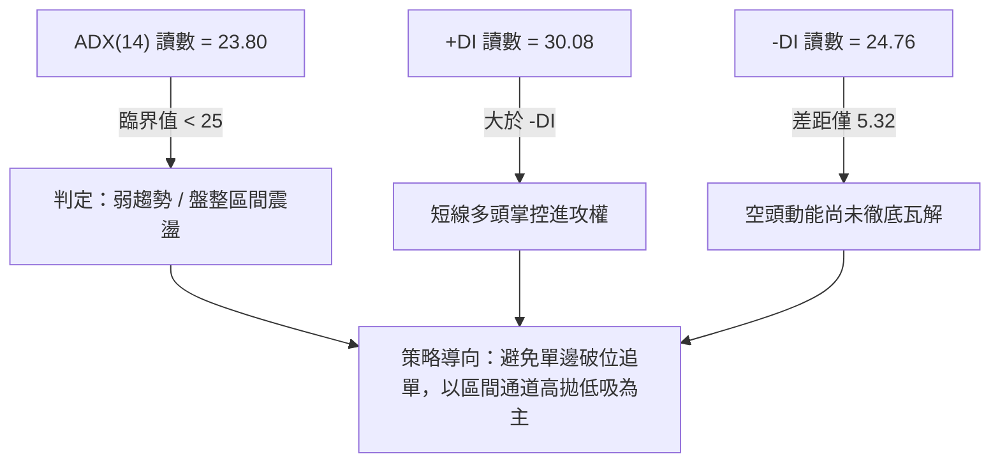

**ADX 趨勢強度對照表**：

| 指標變數 | 當前讀數 | 標準閾值區間 | 當前市場狀態解讀 |
|----------|----------|--------------|------------------|
| **ADX(14)** | 23.80 | < 20: 無趨勢<br>20–25: 弱趨勢/震盪<br>> 25: 強單邊趨勢 | 目前數值 23.80 處於盤整區，說明近日由 $43.89 至 $66.15 的漲勢屬於「超跌反彈」而非新一輪不可逆的大牛市趨勢。 |
| **+DI** | 30.08 | 高於 25 表多方強勁 | 買盤經過連續三日放量大幅進攻，+DI 升至 30.08，短多氣勢佔優。 |
| **-DI** | 24.76 | 高於 25 表空方強勁 | 空方力道顯著回落但仍貼近 25，多方若不能放量突破 R1 ($67.70)，隨時有反撲可能。 |

---

## 3. 圖表形態分析

### 🔍 形態識別系統

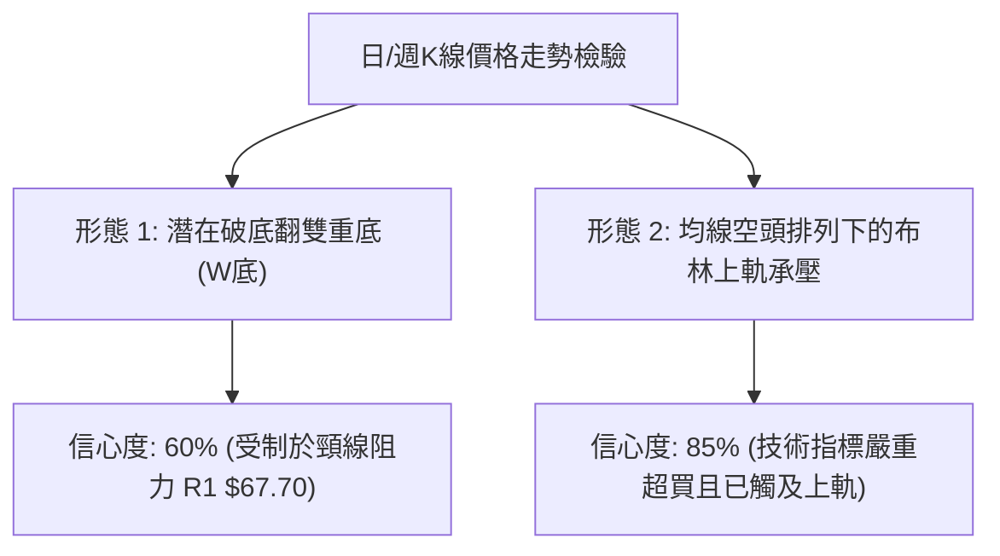

**形態識別與評估表格**：

| 形態名稱 | 信心度 | 判斷依據（引用數據） | 完成度 | 目標價（附計算式） |
|----------|--------|----------------------|--------|--------------------|
| **雙重底 (W底)** | 60% | 第一次低點為 10/16 當週低點 $49.69，第二次低點為 11/05 日低 $43.89（週低 $43.89），隨後強力拉升至頸線 R1 $67.70 附近。 | 75% | 頸線阻力 R1 ($67.70) + 形態高度 [頸線 R1 ($67.70) − 次低點 ($43.89) = $23.81] = **$91.51**（若實體收盤有效突破 R1） |
| **布林上軌承壓/通道超買回踩** | 85% | 日線收盤 $64.07 已達布林 %B = 0.93，上軌為 $65.42，11/11 最高衝至 $68.26 後迅速收回，Stoch %K 達 82.81。 | 90% | 回調測試中軌 (MA20) = **$55.24**，或測試第一道支撐 S2 = **$61.45** |

### 🕯️ 重要K線形態分析

依據提供的近 10 根日 K 與近 8 根週 K 實際成交數據，識別關鍵 K 棒反轉與確認訊號：

| 日期（週期） | 開盤 ($) | 最高 ($) | 最低 ($) | 收盤 ($) | K線形態名稱 | 技術解讀 | 訊號強度 |
|--------------|----------|----------|----------|----------|-------------|----------|----------|
| **2026-11-05 (日K)** | 50.58 | 50.83 | 43.89 | 45.99 | **恐慌長下影陰線** | 爆出 36,784,900 股巨量（近期天量），盤中下殺至 $43.89 後引發強力抄底盤，屬典型空頭力竭竭盡點。 | 🟢 強烈買盤介入 |
| **2026-11-06 (日K)** | 48.28 | 53.10 | 46.51 | 53.07 | **反轉大陽線 (多頭吞噬前日大部分跌幅)** | 成交量 20,876,200 股，實體大陽線收在 $53.07，確立 $43.89 為短線極端低點，破底翻成立。 | 🟢 多頭確認轉折 |
| **2026-11-10 (日K)** | 54.99 | 63.77 | 54.96 | 62.71 | **實體放量光頭大陽棒** | 成交量 32,120,900 股，單日大漲突破 MA50 ($62.51)，強勢軋空。 | 🟢 多頭主升波段 |
| **2026-11-11 (日K)** | 64.29 | 68.26 | 63.20 | 66.15 | **長上影衝高受阻星線** | 盤中衝高至 $68.26 遇阻 R1 ($67.70)，留下 $2.11 上影線，成交量縮至 24,432,400 股，追價動能轉弱。 | 🔴 短線推升動能受阻 |
| **2026-11-12 (日K)** | 63.82 | 66.70 | 63.69 | 64.07 | **量縮陀螺十字小陰線** | 成交量萎縮至 13,430,400 股（量比僅 0.68x），收盤險守 $64.00，顯示多空於高檔陷入僵持。 | 🟡 短線整理觀望 |
| **2026-11-06 (週K)** | 55.08 | 55.31 | 43.89 | 53.07 | **週線極長下影線探底錘頭棒** | 當週成交量達 107,039,000 股，下影線長達 $9.18 ($53.07 - $43.89)，中期底部強支撐訊號。 | 🟢 中期觸底結構 |
| **2026-11-12 (週K)** | 54.31 | 68.26 | 53.01 | 64.07 | **週線帶長上影大陽棒** | 實體由 $54.31 漲至 $64.07，量能突破 1 億股，但上影線測試 $68.26 阻力明確。 | 🟡 中期多頭反擊但留阻力 |

### 📉 ASCII 走勢形態示意圖

```
RKLB 日線近期「破底翻」衝擊阻力圖示
價格 ($)
$68.26 ┤                 ▲ 11/11 衝高留上影 (受壓於 R1 $67.70)
$66.00 ┤                / \
$64.07 ┤               /   ● 現價 11/12 收盤 ($64.07, 量縮十字)
$62.51 ┤-------------/----- MA50 阻力轉支撐
$58.86 ┤             / 
$54.00 ┤     ●      /
       │    / \    /
$50.00 ┤---/---\--/-------- 10/16 週低點 $49.69
$45.99 ┤  /     ● 11/05 收盤 ($45.99)
$43.89 ┤ /       ▼ 11/05 爆量長下影低點 ($43.89 破底翻底腳)
       └────────────────────────────────────────────────────────
        10/30  11/02  11/04  11/05  11/06  11/09  11/10  11/11  11/12
```

### 🎯 形態目標價計算

根據雙重底破底翻架構進行幾何量度預測：

1. **第一波段滿足點（保守預期，已抵達）**：
   - 底部支撐基點：$43.89（11/05 盤中最低價）
   - 初級反彈測量：突破 MA50 ($62.51)，目標直指近期籌碼阻力聚類 R1 = **$67.70**（11/11 最高已衝至 $68.26，宣告第一階段目標達成）。
2. **第二波段延伸目標（激進預期，需帶量確認收復 R1）**：
   - 頸線位置：R1 = **$67.70**
   - 形態垂直幅度：頸線 $67.70 − 雙底低點 $43.89 = **$23.81**
   - 幾何破位延伸目標價：$67.70 + $23.81 = **$91.51**
   - 中途強阻力攔截：在抵達 $91.51 前，必然面臨阻力聚類 R2 (**$75.28**) 與 R3 (**$78.74**，重疊 MA200 $78.40) 的劇烈拋壓。

---

## 4. 支撐與阻力

### 🗺️ 關鍵價位分布圖（Unicode）

```
RKLB 價位結構分布圖（OHLCV 實際聚類計算）
═══════════════════════════════════════════════════════════════════
$78.74 ║████████████████████████║ 強阻力 R3 (+22.90%) [重疊 MA200 $78.40]
$75.28 ║████████████████████    ║ 阻力 R2 (+17.50%) [近一年波段次高密集區]
$67.70 ║████████████████████████║ 關鍵阻力 R1 (+5.67%) [近一年波段高點聚類]
$65.42 ║▒▒▒▒▒▒▒▒▒▒▒▒▒▒▒▒▒▒▒▒    ║ 布林通道上軌
$64.07 ╠════════════════════════╣ ◄ 當前收盤價 ($64.07)
$63.98 ║▓▓▓▓▓▓▓▓▓▓▓▓▓▓▓▓▓▓▓▓▓▓▓▓║ 近期第一支撐 S1 (-0.13%) [極短線強弱線]
$62.51 ║▒▒▒▒▒▒▒▒▒▒▒▒▒▒▒▒▒▒      ║ 50日均線 MA50 
$61.84 ║░░░░░░░░░░░░░░░░░░░░░░░░║ 斐波那契 78.6% 回調關鍵點
$61.45 ║████████████████████████║ 關鍵支撐 S2 (-4.09%) [波段低點聚類核心]
$60.51 ║████████████████        ║ 強支撐 S3 (-5.56%) [多頭防守底線]
$55.24 ║▒▒▒▒▒▒▒▒▒▒▒▒▒▒          ║ 布林中軌 / MA20
═══════════════════════════════════════════════════════════════════
```

### 🚧 阻力位分析表

全部價位嚴格引用系統計算之波段聚類點位：

| 阻力級別 | 價位 ($) | 距離現價幅度 | 形成原因與籌碼解讀 | 突破難度 | 重要性 |
|----------|----------|--------------|--------------------|----------|--------|
| **阻力 R1** | $67.70 | +5.67% | 近一年多次波段反彈高點聚類；11/11 最高衝至 $68.26 即遭長上影線壓回，為當前多頭最大枷鎖。 | 🟢🟡 中等 | ★★★★☆ |
| **阻力 R2** | $75.28 | +17.50% | 2026 年 9 月底反彈頂部區間（9/25 週高 $75.46，10/02 週高 $76.09），套牢盤籌碼密集堆積。 | 🔴 偏高 | ★★★★★ |
| **阻力 R3** | $78.74 | +22.90% | 10/09 週高 $78.28 形成的高點聚類，且與長期牛熊線 MA200 ($78.40)、斐波那契 61.8% ($80.90) 形成強共振阻力帶。 | 🔴🔴 極高 | ★★★★★ |

### 🛡️ 支撐位分析表

全部價位嚴格引用系統計算之波段聚類點位：

| 支撐級別 | 價位 ($) | 距離現價幅度 | 形成原因與籌碼解讀 | 守住機率 | 重要性 |
|----------|----------|--------------|--------------------|----------|--------|
| **支撐 S1** | $63.98 | -0.13% | 近期波段回踩密集成交位；現價 $64.07 緊貼該位置，為短線多頭維持強勢攻擊姿態的防守線。 | 🟡 60% | ★★★☆☆ |
| **支撐 S2** | $61.45 | -4.09% | 核心低點聚類支撐，與 MA50 ($62.51) 及斐波那契 78.6% 回調位 ($61.84) 構成密集共振多頭防守護城河。 | 🟢 75% | ★★★★★ |
| **支撐 S3** | $60.51 | -5.56% | 日線整數關卡前的最後防禦堡壘，一旦跌破則宣告本次自 $43.89 的強反彈動能衰竭。 | 🟢 85% | ★★★★☆ |

### 📐 斐波那契回調位分析

依據 52 週極端區間（低點 $37.57 → 高點 $151.00，總垂直振幅 $113.43）計算之斐波那契回調層次如下：

| 斐波那契回調層級 | 價位 ($) | 與現價 ($64.07) 相對關係 | 技術面共振與意義解讀 |
|------------------|----------|--------------------------|----------------------|
| **0.0% (52W High)** | $151.00 | +135.68% | 歷史頂部，長期超級壓力位 |
| **23.6%** | $124.23 | +93.90% | 深度套牢區 |
| **38.2%** | $107.67 | +68.05% | 中期空頭下殺反抽強阻力 |
| **50.0%** | $94.28 | +47.15% | 多空平衡分水嶺 |
| **61.8% (黃金分割)** | $80.90 | +26.27% | **極強阻力**：與 R3 ($78.74) 及 MA200 ($78.40) 形成「黃金口袋死叉壓制帶」 |
| **78.6%** | $61.84 | -3.48% | **核心支撐**：現價落於 61.8% ($80.90) 與 78.6% ($61.84) 之間。$61.84 與支撐 S2 ($61.45) 形成極佳底部防禦 |
| **100.0% (52W Low)**| $37.57 | -41.36% | 全年最低點，週期大底 |

**現價區間解讀**：
當前收盤價 $64.07 剛自 78.6% 回調位 ($61.84) 向上脫離，確認了 $61.84 作為「深度回調極限防守位」的有效性。上方空間已被打開至 61.8% 回調位 ($80.90)，但中途將在 R1 ($67.70) 與 R2 ($75.28) 遭遇密集的實質解套賣壓。

---

## 5. 技術指標深度解讀

### 🎛️ 指標訊號總覽

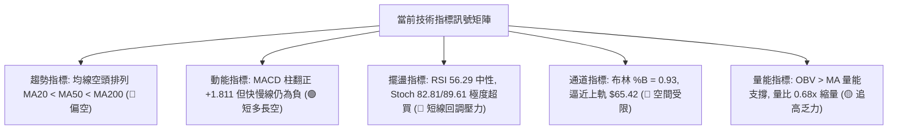

### 📈 移動平均線排列分析

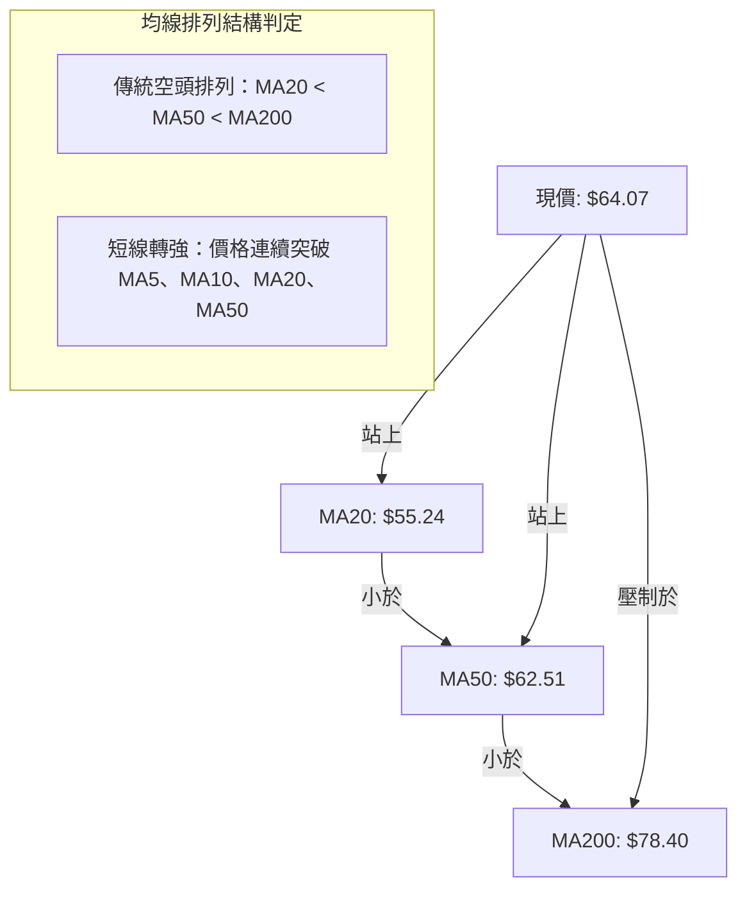

**移動平均線狀態詳細檢視**：

| 均線名稱 | 數值 ($) | 現價與均線距離 | 走勢微型圖 | 趨勢方向解讀 |
|----------|----------|----------------|------------|--------------|
| **MA 5** | $60.97 | +5.08% | ██████▇▇▆▅▃▂▁▁▁▁▁▁▂▂▃▂▂▂▁▁▁▂▃▄ | ▲ 向上微勾，短線極具進攻爆發力 |
| **MA 10** | $56.45 | +13.51% | ████████▇▆▅▅▃▃▂▁▁▁▁▁▁▁▁▁▁▁▁▁▁▂ | ▲ 向上反轉，提供短波段助推力道 |
| **MA 20** | $55.24 | +15.98% | ▇██████████▇▇▆▆▅▅▄▄▄▃▃▂▂▁▁▁▁▁▁ | ▲ 落後轉折中，成為回調強支撐點 |
| **MA 50** | $62.51 | +2.50% | 數據未單獨圖示 | ▲ 現價甫突破 MA50，尚未形成黃金交叉 |
| **MA 60** | $63.23 | +1.32% | ██████████▇▇▇▆▆▆▆▆▅▅▅▄▃▃▂▂▁▁▁▁ | ▲ 走平回升，短線壓制解除 |
| **MA 120** | $77.11 | -16.91% | █████████▇▇▇▇▇▆▆▆▆▆▅▅▅▄▄▃▂▂▁▁▁ | ▼ 持續向下傾斜，中期趨勢壓力未解 |
| **MA 200** | $78.40 | -18.28% | 數據未單獨圖示 | ▼ 長期牛熊分界線，下壓斜率明顯 |
| **MA 240** | $77.32 | -17.14% | ▁▁▂▂▂▂▂▂▂▂▁▁▁▁▁▁▁▁▁▂▂▃▃▄▄▅▅▆▇█ | ▼ 長期年線走平偏下，大格局未脫弱勢 |

### 📉 RSI(14) 分析

- **當前數值**：56.29 (Wilder)
- **數值進度條**：
  ```
  [0] ░░░░░░░░░░░░░░░░░░░░░░░░░░░░░░ [30] ▓▓▓▓▓▓▓▓▓▓▓▓▓▓▓ [56.29] ░░░░░░░░░░░░░ [70] ░░░░░░░░░░░░░░░░░░░░░░░░░░░░░░ [100]
  強度指示：███████████░░░░░░░░░ 56.29% (處於 30–70 中性強勢區間)
  ```
- **區間與背離判定**：
  - RSI 自 10 月中旬低谷（週線 RSI 曾低至 25.4 極端超賣區）強勢修復至 56.29，成功重返 50 中軸上方，表彰多方力量回溫。
  - **背離檢查結論**：系統比對近 20 根 K 棒首尾之價格與 RSI 方向，判定為「**無明顯背離**」。價格自 $43.89 低位回升伴隨 RSI 同步走揚，屬合理的超跌修復動能釋放。

### 📊 MACD(12/26/9) 訊號解讀

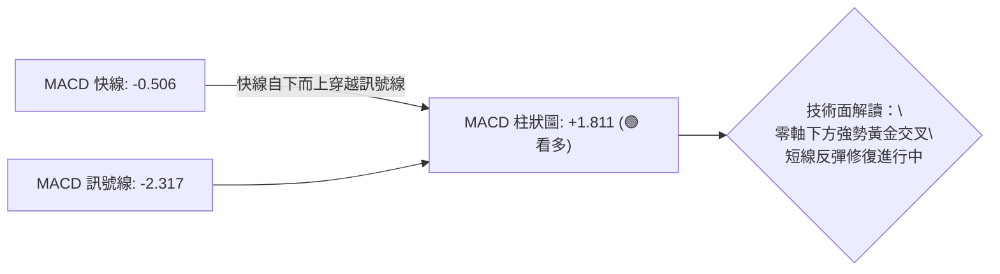

- **MACD 快線**：-0.506
- **MACD 訊號線 (Signal)**：-2.317
- **MACD 柱狀圖 (Histogram)**：+1.811
- **解讀**：MACD 快線與訊號線雙雙位於零軸之下，反映中長週期仍處於空頭主導範疇；然而，快線急速拉升穿越慢線形成零軸下的「超跌黃金交叉」，柱狀圖擴張至 +1.811，給予現貨價格強勁的短線推升力道。此現象屬於典型的「空頭架構下的強勢修正反彈」。

### 📦 布林通道分析

```
RKLB 日線布林通道位置示意圖 (通道寬度: $20.35)
══════════════════════════════════════════════════════════════════
$65.42 ────────────────────────── 布林上軌 (Resistance)
$64.07 ══════════════════════════ 現價位置 (%B = 0.93，高度貼近上軌)
$55.24 -------------------------- 布林中軌 (MA20 / 短期均線支撐)
$45.07 ────────────────────────── 布林下軌 (Support)
══════════════════════════════════════════════════════════════════
```

- **通道特徵分析**：
  - 布林通道 %B 讀數高達 **0.93**（0 表下軌，0.5 表中軌，1.0 表上軌），顯示當前價格已經高度貼近上軌 ($65.42)。
  - 在 ADX(14) = 23.80（盤整/弱趨勢模式）下，布林通道上下軌具備極高反轉參考性。價格在未伴隨巨量持續突破前，直接向上強穿上軌的機率較低，極易在上軌 $65.42 至 R1 $67.70 區間遇阻並回踩中軌 ($55.24)。

### 💹 成交量分析（量價配合度）

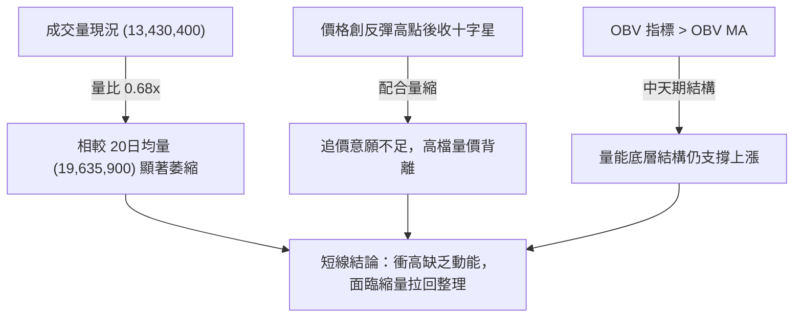

- **成交量數據詳情**：
  - 最新單日成交量：13,430,400 股
  - 20 日均量：19,635,900 股（量比：0.68x，量能萎縮逾三成）
  - 50 日均量：20,921,376 股
- **量價關係解讀**：
  - 11/05 下殺爆出 36,784,900 股，11/09 與 11/10 反彈分別放大至 31,996,800 與 32,120,900 股，展現良好的低檔放量吸籌特徵。
  - 然而在 11/11 測試 R1 ($67.70) 衝高至 $68.26 時，成交量降至 24,432,400 股；11/12 收盤 $64.07 成交量更驟降至 13,430,400 股。**量能未能呈現「價增量增」的健康攻擊盤**，呈現短線「量價背離」態勢。
  - **OBV 趨勢**：OBV > MA，長期量能水位仍處於多頭保護傘下，意味著主力資金並未在大跌中完全潰散，中長線仍具備資金底蘊。

---

## 6. 動能與波動率

### ⚡ 動能評估四象限

動能評估將價格行為置於「動能強度」與「波動率」兩大維度進行橫向與縱向對比：

| 象限代號 | 動能強度 | 波動率水平 | 當前市場狀態判定 | 操作策略評估 |
|----------|----------|------------|------------------|--------------|
| **Q1 (高動能·低波動)** | 強 (Bullish) | 低 (Low Volatility) | — | 穩定多頭主升趨勢，最佳順勢加碼區間 |
| **Q2 (弱動能·低波動)** | 弱 (Bearish/Neutral) | 低 (Low Volatility) | — | 沉悶築底或無量盤整，建議謹慎觀望 |
| **Q3 (強動能·高波動)** | 強 (Bullish Rebound)| 高 (High Volatility)| **✓ 當前 RKLB 所屬象限** | **高風險高回報博弈區**：反彈猛烈但震幅劇烈，宜設嚴格停損短線應對 |
| **Q4 (弱動能·高波動)** | 弱 (Bearish Drop) | 高 (High Volatility)| — | 恐慌崩跌與多殺多，必須堅決離場避免介入 |

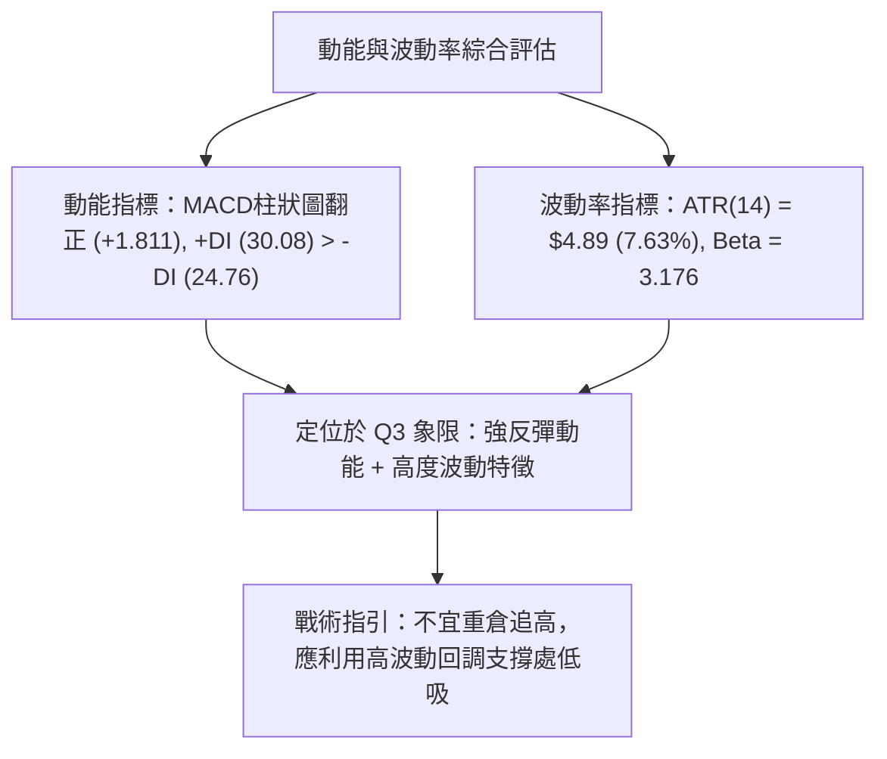

### 📊 ATR 波動率分析

- **ATR(14) 數值**：**$4.89**
- **價格佔比**：**7.63%**（基於收盤價 $64.07 計算）
- **波動特性評估**：
  - 日均 $4.89 的擺動空間，在美股工業與航太軍工板塊中屬於**極端高波動標的**。
  - **停損與風控設置指引**：
    - 短線窄幅防守距離（0.5 倍 ATR）：$2.45，對應價格下檔 $61.62（恰好覆蓋支撐 S2 $61.45 區域）。
    - 正常波段防守距離（1.0 倍 ATR）：$4.89，對應價格下檔 $59.18（可避免盤中雜訊掃損）。
    - 嚴禁使用低於 $2.00 的過窄停損，否則在每日高達 7.63% 的常態雜訊下極易遭到被動觸發。

### 📐 Beta 與市場相關性

- **Beta 係數**：**3.176**
- **市場特徵解讀**：
  - RKLB 呈現標準的「超高彈性高 Beta 成長股」特性。當標普 500 指數或納斯達克波動 1.0% 時，該股平均呈現約 3.18 倍的放大效應。
  - **機構持股與放空結構**：
    - 機構持股比例達 59.6%，具備主力控盤特徵。
    - 空單佔浮額比例（Short % Float）為 7.3%，Short Ratio 為 2.3 天。該空頭部位規模在中度區間，雖然足以在突破關鍵阻力時引發短暫軋空（Short Squeeze），但尚不足以引發如迷因股般的失控軋空狂潮。

---

## 7. 多時框架總結

### 📋 時框架評分表

| 時框架 | 趨勢方向 | 動能狀態 | 均線排列特徵 | 形態完成度 | 綜合評分 | 建議操作維度 |
|--------|----------|----------|--------------|------------|----------|--------------|
| **月線 (長期)** | 🔴 偏空 | 🟡 負值收斂 | MA200 下方壓制，自 $143.48 深度回調 | 52週區間築底階段 (40%) | **38/100** | 長線投資者僅宜定投，不宜重倉單筆押注 |
| **週線 (中期)** | 🟡 中性 | 🟢 柱狀圖翻正 | 測試中軌，MA20 仍高於現價 | 週線長下影探底反彈 (65%) | **52/100** | 波段操作者關注回踩 S2 ($61.45) 企穩訊號 |
| **日線 (短期)** | 🟢 偏多 | 🔴 極度超買 | 站上 MA20/MA50，但均線空頭未逆轉 | 雙底反彈遇頸線阻力 R1 (75%) | **62/100** | 短線嚴禁追高，布林上軌附近逢高減磅 |

### 🔲 綜合訊號矩陣

```
╔══════════════════════════════════════════════════════════════════╗
║                    多時框綜合訊號確認矩陣                        ║
╠═════════════════╦══════════════════╦═════════════════════════════╣
║ 分析維度        ║ 短期 (日線)      ║ 中長期 (週線 / 月線)        ║
╠═════════════════╬══════════════════╬═════════════════════════════╣
║ 趨勢方向        ║ 🟢 短多進攻      ║ 🔴 長期下降通道修復期       ║
║ 動能指標        ║ 🟢 MACD 翻正     ║ 🟡 RSI 脫離超賣重回中性     ║
║ 均線系統        ║ 🟢 突破 MA20/50  ║ 🔴 遠低於 MA200 ($78.40)    ║
║ 擺盪與通道      ║ 🔴 觸及布林上軌  ║ 🟡 位於斐波那契 78.6% 上方  ║
║ 量能支持        ║ 🔴 量比 0.68x 縮量║ 🟢 OBV 結構支撐中期反彈     ║
╠═════════════════╩══════════════════╩═════════════════════════════╣
║ 訊號衝突判定：日線超買轉強 vs 中長期重度阻力壓制                 ║
╚══════════════════════════════════════════════════════════════════╝
```

### ⚖️ 多時框收斂結論

依據多時框收斂規則（嚴格要求 14）：
1. **行情模式檢驗**：ADX(14) 讀數為 **23.80 (< 25)**，嚴格判定當前市場處於**盤整震盪行情**，而非單邊趨勢主導行情。
2. **優先級收斂導向**：在盤整行情下，**以日線布林通道上下軌 ($45.07 – $65.42) 與關鍵支撐阻力為主要交易區間**。中長期均線（MA200 $78.40）與阻力位（R1 $67.70、R2 $75.28）構成反彈天花板。
3. **方向性結論**：**中性偏多區間震盪（逢阻力減磅、回調支撐低吸）**。
   - 日線級別短多訊號強烈但已觸碰布林通道上軌邊界（%B = 0.93）且 Stochastic 嚴重超買，短線直接向上貫穿阻力 R1 ($67.70) 的量能明顯匱乏（量比 0.68x）；因此，必須服從盤整行情原則，預防衝高回落。

---

## 8. 交易策略建議

### 🗺️ 策略決策流程圖

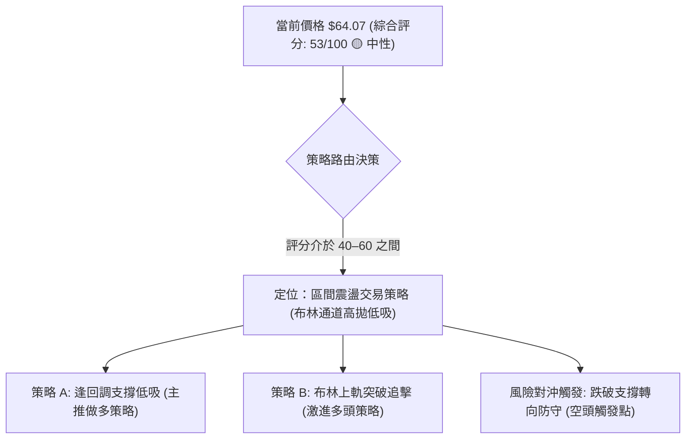

### 🧭 策略路由（依評分卡分流）

**當前主策略方向 = 區間震盪操作，以回調低吸為主（依綜合評分 53/100）**
- **理由**：綜合評分為 53/100（介於 40–60 之區間操作範疇）。日線雖然展現突破動能，但布林通道上軌壓制強烈且 ADX < 25，不具備盲目追高條件。策略以「耐心等待拉回重要支撐 S2 附近低吸」為核心，並以「帶量突破 R1」作為激進右側加碼條件。

### 🎯 價格情境階梯（Price Scenarios）

價位嚴格引用系統計算之波段聚類數值：

| 觸發條件 | 下一目標 | 後續延伸 | 情境含義與操作指引 |
|----------|----------|----------|--------------------|
| **強勢突破 R1 ($67.70)** | R2 ($75.28) | R3 ($78.74) | **短線加速軋空**：突破近一年高點聚類，宣告大級別雙底正式確認，可順勢右側跟進。 |
| **站穩現價區間 ($61.45–$65.42)** | 上軌 ($65.42) | R1 ($67.70) | **區間蓄勢震盪**：消化日線 Stochastic 超買賣壓，洗清短線獲利盤，維持健康震盪。 |
| **跌破 S1 ($63.98) 進而失守 S2 ($61.45)** | S3 ($60.51) | MA20 ($55.24) | **反彈動能衰竭**：多頭反撲受挫，重新回踩測試布林中軌尋求支撐，多單應立即離場。 |

### 📊 情境機率分佈

| 預期情境 | 機率估計 | 主要技術指標依據 |
|----------|----------|------------------|
| **情境一：回調蓄勢後再次衝擊阻力** | **55%** | MACD 柱狀圖翻正 (+1.811)、OBV 持續在均線上方提供底層支持、日線成功收復 MA50。 |
| **情境二：於布林通道中上軌橫盤震盪** | **30%** | ADX 僅 23.80（盤整格局）、日線最新成交量顯著萎縮（量比 0.68x），多空動能互相抵消。 |
| **情境三：假突破遇阻後大幅下挫再探底** | **15%** | Stochastic 處於極端超買區 (%K 82.81, %D 89.61)、布林 %B 達 0.93，若大盤轉弱恐遭殺多。 |

### 🟢 主策略詳情

依規則 17，風險報酬比統一計算至小數點後兩位，公式：(目標價 T1 − 進場價) ÷ (進場價 − 止損價)。

| 策略要素 | 策略 A（穩健型：回踩支撐 S2 逢低吸納） | 策略 B（激進型：放量突破 R1 右側追擊） |
|----------|----------------------------------------|----------------------------------------|
| **進場條件** | 價格拉回 S2 ($61.45) 附近止跌，日K收下影線企穩 | 日K實體收盤帶量突破 R1 ($67.70) 頸線阻力 |
| **進場價格** | **$61.45** (精確引用支撐位 S2) | **$67.70** (精確引用阻力位 R1) |
| **目標價 T1** | **$67.70** (阻力位 R1) | **$75.28** (阻力位 R2) |
| **目標價 T2** | **$75.28** (阻力位 R2) | **$78.74** (阻力位 R3 / 重疊 MA200) |
| **止損價格** | **$58.50** (位於 S3 $60.51 下方約 0.4 倍 ATR) | **$63.98** (跌破原阻力轉化之支撐 S1) |
| **風險報酬比** | **1 : 2.12（以 T1 計）**<br>*(計算: (67.70−61.45)/(61.45−58.50) = 6.25/2.95 = 2.12)*<br>註：若以 T2 計則為 1 : 4.69 | **1 : 2.04（以 T1 計）**<br>*(計算: (75.28−67.70)/(67.70−63.98) = 7.58/3.72 = 2.04)*<br>註：若以 T2 計則為 1 : 2.97 |
| **預估勝率** | 65% | 50% |
| **建議倉位** | **12% – 15%** (總投資組合資金) | **8% – 10%** (突破初期輕倉介入) |

### 🔴 反向風險觸發點（對沖提示）

- **多單全面離場/反手避險觸發線**：
  - 若日線實體陰線跌穿 **支撐 S2 ($61.45)**，尤其是進一步跌破 **支撐 S3 ($60.51)**，則本次自 $43.89 以來的多頭破底翻結構宣告失效。
  - **防禦操作**：持有現貨者應即刻減碼 50% 以上，並密切觀察布林中軌 MA20 (**$55.24**) 之防守力道；跌破 S3 後切忌盲目抄底。

### ⭐ 整體訊號強度評星

```
╔══════════════════════════════════════════════════════════════════╗
║                    整體訊號強度綜合評星                          ║
╠══════════════════════════════════════════════════════════════════╣
║ 做多訊號強度：★★★☆☆  (3.0/5星) [動能充足但受制於布林上軌與均線結構]║
║ 做空訊號強度：★★☆☆☆  (2.0/5星) [MACD柱翻正且量能支撐，空方動能減弱]║
║ 整體可信度：  ★★★★☆  (4.0/5星) [價位由真實高低點聚類共振確認]   ║
╚══════════════════════════════════════════════════════════════════╝
```

---

## 9. 風險提示與監控

### ✅ 關鍵監控指標 Checklist

```
╔══════════════════════════════════════════════════════════════════╗
║                     每日關鍵技術監控清單                         ║
╠══════════════════════════════════════════════════════════════════╣
║ [ ] 價格收盤是否守穩 50日均線 MA50 ($62.51) 與 支撐 S1 ($63.98)   ║
║ [ ] 向上挑戰 阻力 R1 ($67.70) 時，單日成交量是否放大至 2500萬股以上║
║ [ ] RSI(14) 是否在衝破 60 後迅速拐頭向下形成頂部結構             ║
║ [ ] Stochastic (%K/%D) 是否在 >80 區間發生高檔死亡交叉           ║
║ [ ] 日線布林通道是否發生「開口擴張」亦或壓制收口                 ║
║ [ ] 跌破 支撐 S2 ($61.45) 時是否伴隨成交量放大 (觸發停損預警)     ║
╚══════════════════════════════════════════════════════════════════╝
```

### ⚠️ 風險場景分析

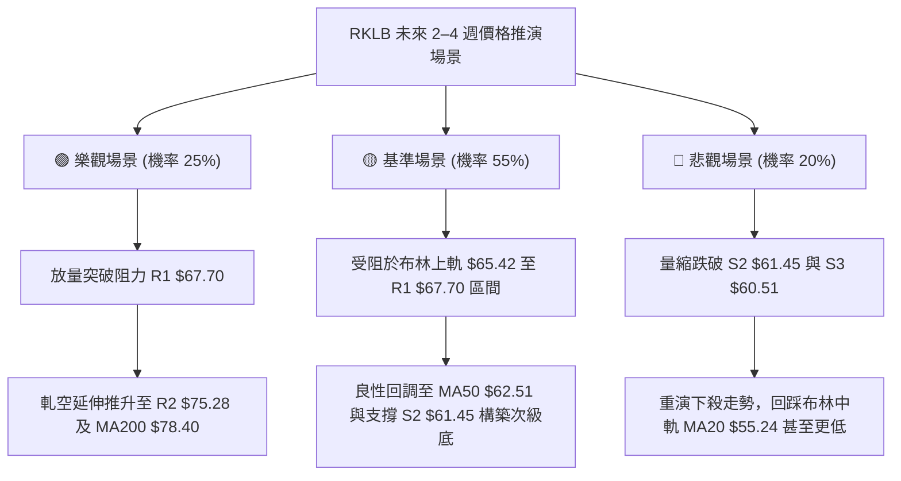

### 🛡️ 風險管理重要提醒

1. **Beta 3.176 與極端高波動因應**：
   - RKLB 每日平均波動幅度高達 $4.89 (7.63%)。這意味著在正常的日內震盪中，個股波動動輒超過 5%。交易者必須嚴格將「單筆交易最大虧損額」控制在總投資組合淨值的 **1.0% – 1.5%** 之內。
2. **倉位配置比例公式**：
   - 最大允許建倉股數 = (總投資組合資產 × 1%) ÷ (進場價 − 止損價)
   - 以策略 A 為例（進場 $61.45，止損 $58.50，每股風險 $2.95）：若總資金為 100,000 美元，單筆風險 1,000 美元，則最大建立股數不應超過 338 股（約合市值 20,770 美元，即倉位不超過 20.7%）。
3. **重大基本面事件防範**：
   - 儘管當前華爾街 20 位分析師平均目標價給出 $96.60（評級為 Buy），但近期新聞顯示 Neutron 火箭時程有所遞延。太空發射與硬體交付具備高度二元性風險（Binary Risk），一旦發射任務受挫，極易造成技術面跳空破位，任何純技術交易者均須嚴格設置停損，絕不可將短線交易演變為被動長期套牢。

---

## 📋 報告總結

```
╔══════════════════════════════════════════════════════════════════╗
║                     RKLB 技術分析報告總結                        ║
╠══════════════════════════════════════════════════════════════════╣
║ 報告日期：2026-11-13                                             ║
║ 當前價格：$64.07 USD                                             ║
║ 技術評分：53 / 100 (算術平均值)                                  ║
║ 分析評級：⚖️ 中性偏多區間震盪 (Short-Term Bullish Rebound)         ║
╠══════════════════════════════════════════════════════════════════╣
║ 關鍵結論矩陣：                                                   ║
║ ├─ 長期趨勢 (月線)：🔴 空頭下行修復，遠低於年線與 MA200 ($78.40) ║
║ ├─ 中期趨勢 (週線)：🟡 探底企穩回升，收復斐波那契 78.6% ($61.84) ║
║ ├─ 短期趨勢 (日線)：🟢 突破 MA20/MA50，MACD柱翻正，但極度超買   ║
║ ├─ 關鍵第一支撐：$63.98 (S1) / 核心支撐：$61.45 (S2)             ║
║ ├─ 關鍵第一阻力：$67.70 (R1) / 核心阻力：$75.28 (R2)             ║
║ └─ 分析師目標共識：$96.60 (當前處於低階修復階段)                 ║
╠══════════════════════════════════════════════════════════════════╣
║ 最優策略組合導引：                                               ║
║ 1. 🥇 最佳機會 (穩健)：耐心等待拉回 S2 ($61.45) 企穩進場做多，     ║
║    目標 R1 ($67.70)，止損 $58.50，風險報酬比 1 : 2.12。          ║
║ 2. 🥈 次選機會 (激進)：若放量強行突破 R1 ($67.70)，右側跟進追多，║
║    目標 R2 ($75.28)，止損 $63.98，風險報酬比 1 : 2.04。          ║
║ 3. 🥉 保守選擇 (防守)：現價 $64.07 緊鄰布林上軌與阻力帶，觀望    ║
║    不追高，等待市場消除超買訊號後再行定奪。                      ║
╚══════════════════════════════════════════════════════════════════╝
```

---

> ⚠️ **免責聲明**：本報告為依據客觀市場數據進行之技術面量化與形態分析研究，所有點位、指標與結論均基於已發生的歷史價格與成交量資訊。本報告**僅供學術研究與投資架構參考**，**不構成任何個人化之投資買賣建議或獲利保證**。金融市場瞬息萬變，高 Beta 與高波動性股票具備顯著本金虧損風險，投資人應獨立評估自身風險承受能力並嚴格執行資金管理。

---

*報告生成時間：2026-11-13 ｜ 數據來源：Yahoo Finance ｜ 分析框架：多時框技術分析體系 (CFA Level III Standards)*