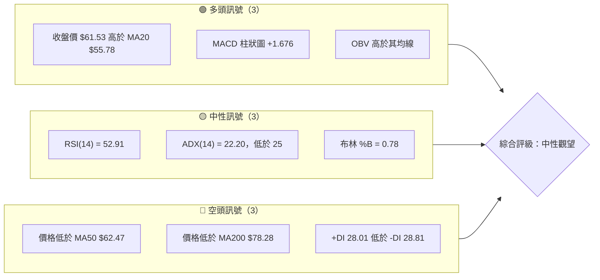
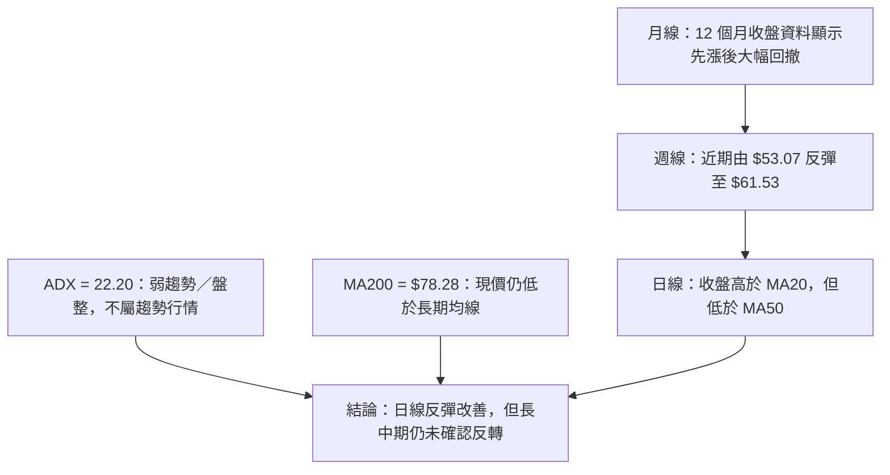
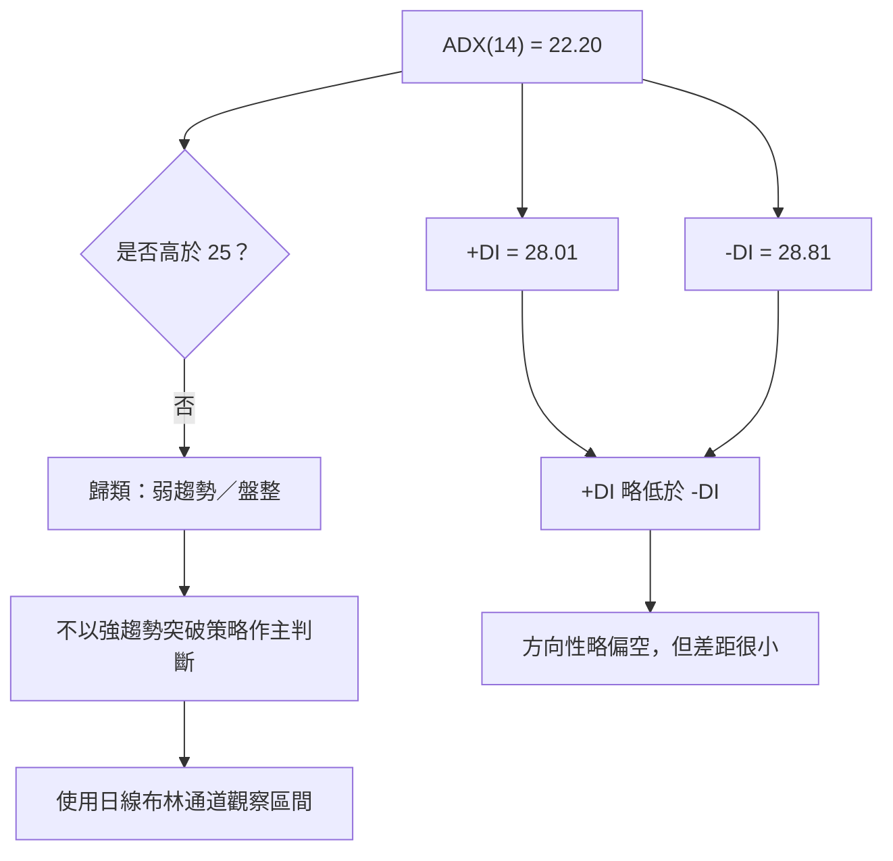
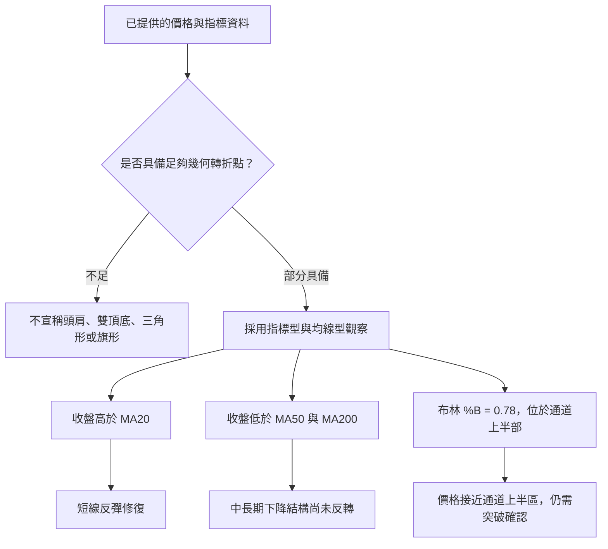
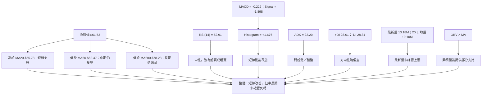
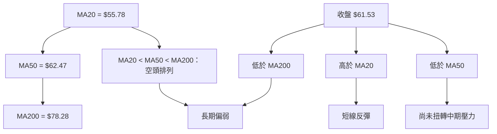
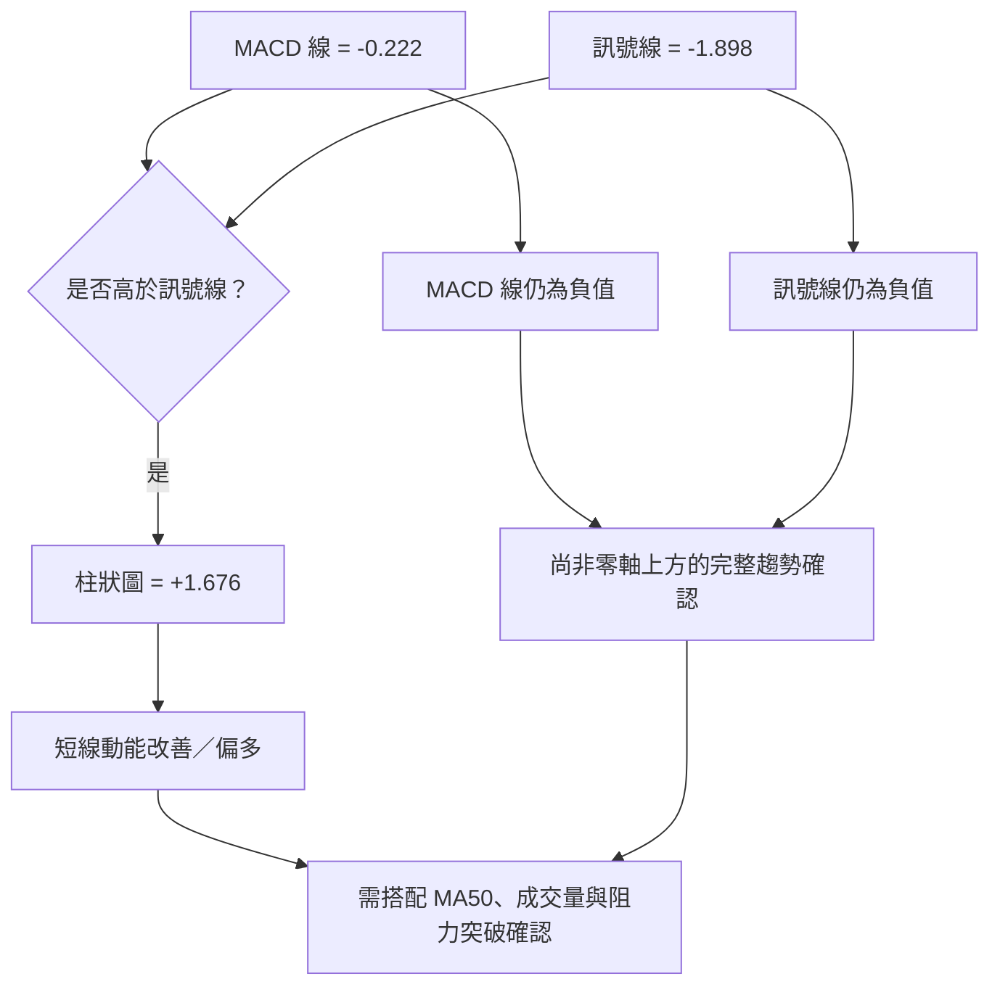
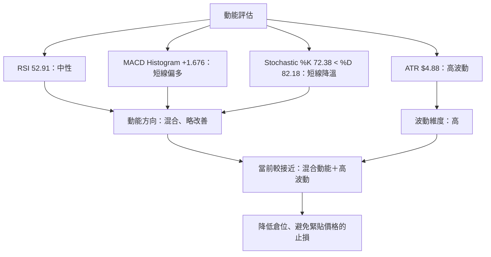
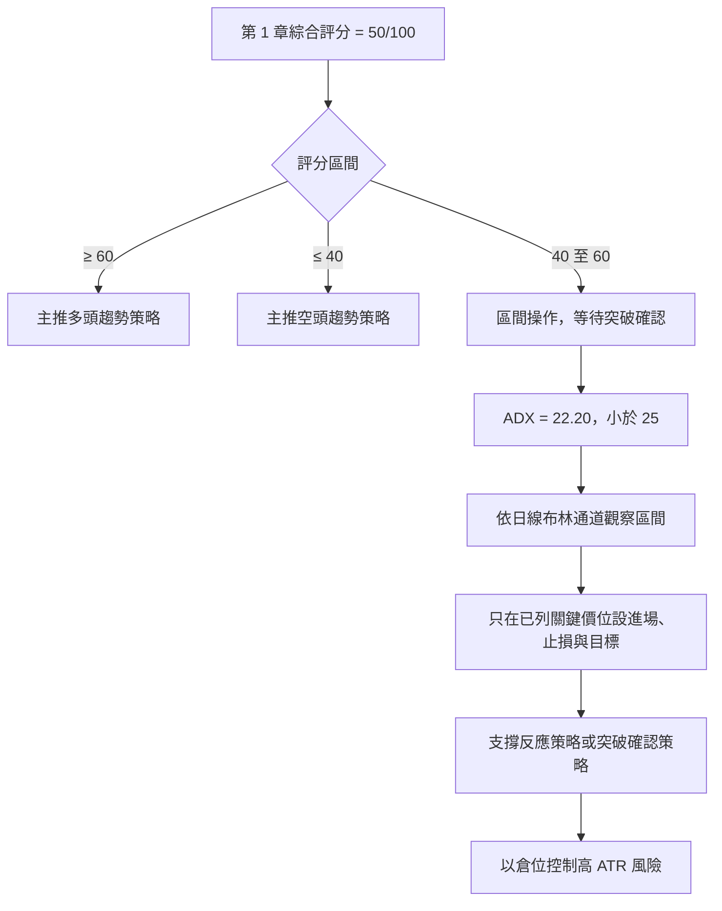
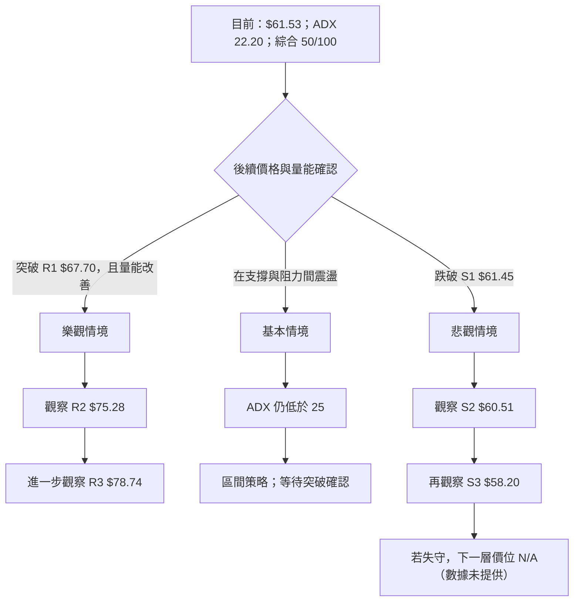

# RKLB 技術分析報告

> **報告日期**：2026-11-14 ｜ **語言**：繁體中文 ｜ **數據來源**：題示 Yahoo Finance 技術數據  
> **當前價格**：**$61.53**（2026-11-13 收盤價；本報告所稱當前價格均以此為準）

---

## 目錄

| 章節 | 內容 |
|------|------|
| 1. 技術面概覽 | 訊號儀表板、核心指標、評分卡 |
| 2. 趨勢分析 | 多時框趨勢、長中短期走勢 |
| 3. 圖表形態分析 | 形態識別、K 線組合、目標價 |
| 4. 支撐與阻力 | 關鍵價位、斐波那契回調 |
| 5. 技術指標深度解讀 | MA、RSI、MACD、布林、成交量 |
| 6. 動能與波動率 | 動能評估、ATR、Beta |
| 7. 多時框架總結 | 時框架評分矩陣 |
| 8. 交易策略建議 | 區間主策略、風險報酬比 |
| 9. 風險提示與監控 | 監控指標、風險場景 |
| 報告總結 | 核心結論與策略摘要 |

> **數據紀律說明**：支撐、阻力及斐波那契價位僅引用題示「關鍵價位」區塊。任何策略目標價若採用關鍵價位以外的價格，均會明確標示計算式；本報告未發現足以計算形態量度目標的可靠幾何形態。N/A 項目不自行估算。

---

## 1. 技術面概覽

### 🎯 技術訊號儀表板

當前訊號呈現明顯分歧：MACD 柱狀圖轉正、OBV 高於其均線及收盤價高於 MA20，支持短線反彈；但價格仍低於 MA50、MA200，均線維持空頭排列，ADX 未達趨勢行情門檻，且 +DI 略低於 −DI。依照 ADX 盤整規則，現階段應優先視為區間行情，而非確認的新一輪趨勢。



**訊號數量只是狀態摘要，不代表同權重投票。** 均線、DI 與 MACD 的時間尺度不同；應以 ADX 判定行情類型，再以中長期均線控制方向偏誤，並以日線訊號協助進場時機。

### 📊 核心指標速覽表

| 指標類別 | 指標名稱 | 當前數值 | 訊號 | 解讀 |
|----------|----------|----------:|:---:|------|
| 價格 | 收盤價 | **$61.53** | 🟡 | 位於 52 週高低區間的 21.1% 位置，距 52 週高點 $151.00 遠，接近 52 週低點 $37.57 一側 |
| 均線 | MA20 | $55.78 | 🟢 | 收盤價高於 MA20，短線反彈仍在延續 |
| 均線 | MA50 | $62.47 | 🔴 | 收盤價低於 MA50，尚未收復中期均線 |
| 均線 | MA200 | $78.28 | 🔴 | 收盤價低於 MA200，長期趨勢尚未扭轉 |
| 動能 | RSI(14) | 52.91 | 🟡 | 中性區間，未超買也未超賣 |
| 動能 | MACD | −0.222；柱 +1.676 | 🟢／🟡 | MACD 線高於訊號線、柱狀圖為正；兩線仍在零軸下方附近，反彈訊號尚非長期多頭確認 |
| 動能 | Stoch %K / %D | 72.38 / 82.18 | 🟡 | %K 低於 %D，短線動能有降溫跡象 |
| 趨勢 | ADX / +DI / −DI | 22.20 / 28.01 / 28.81 | 🟡／🔴 | ADX 低於 25，屬弱趨勢或盤整；DI 微幅偏空 |
| 波動 | ATR(14) | $4.88 | 🔴 | ATR 為收盤價的 7.92%，單日波動風險偏高 |
| 量能 | 最新成交量／20 日均量 | 13,178,500 / 19,097,090 | 🔴 | 最新量約為 20 日均量的 0.69 倍，最新收盤缺乏放量確認 |
| 量能 | OBV 趨勢 | OBV > MA | 🟢 | 量能累積趨勢支持近期反彈，但不能取代最新成交量確認 |

### 🏆 技術評分卡

六項子評分依 1–10 分制評估，再換算成百分制顯示。綜合評分使用六項分數的算術平均，四捨五入至整數：

\[
(4+6+6+5+4+3)\div 6 = 4.67 \rightarrow 5/10 = 50/100
\]

```text
╔══════════════════════════════════════════════════════════════════════╗
║                 技術評分卡 — RKLB（2026-11-14）                  ║
╠══════════════════════════════════════════════════════════════════════╣
║ 趨勢強度      ████░░░░░░░░░░░░░░░░   40/100   4/10   🟡              ║
║ 動能指標      ██████░░░░░░░░░░░░░░   60/100   6/10   🟡              ║
║ 支撐穩定度    ██████░░░░░░░░░░░░░░   60/100   6/10   🟡              ║
║ 成交量配合    █████░░░░░░░░░░░░░░░   50/100   5/10   🟡              ║
║ 形態完整度    ████░░░░░░░░░░░░░░░░   40/100   4/10   🟡              ║
║ 均線排列      ███░░░░░░░░░░░░░░░░░   30/100   3/10   🔴              ║
╠══════════════════════════════════════════════════════════════════════╣
║ 綜合評分      █████░░░░░░░░░░░░░░░   50/100   5/10   ⚖️ 中性觀望     ║
╚══════════════════════════════════════════════════════════════════════╝
```

**評分解讀：**

- **趨勢強度 4/10**：MA20 雖上揚，但 MA50、MA200 仍下行，ADX 22.20 未達強趨勢標準。
- **動能指標 6/10**：RSI 中性、MACD 柱狀圖轉正，短線改善；Stochastic %K 低於 %D，抵銷部分正面訊號。
- **支撐穩定度 6/10**：題示支撐聚類提供明確參考，但價格緊貼 S1、S2，緩衝空間有限；所列關鍵價位不代表支撐必然守住。
- **成交量配合 5/10**：OBV 高於其均線有利，但最新成交量低於 20 日與 50 日均量。
- **形態完整度 4/10**：價格有反彈及均線修復，但沒有足夠資料確認高信心度的反轉幾何形態。
- **均線排列 3/10**：MA20 < MA50 < MA200，空頭排列尚未解除。

---

## 2. 趨勢分析

### 🌐 多時框趨勢分析



#### 時框收斂原則

1. **ADX(14) = 22.20 < 25**，依題定規則，現階段分類為弱趨勢／盤整。
2. 盤整環境以日線布林通道為區間參考：上軌 $66.10、中軌 $55.78、下軌 $45.45。
3. 但日線反彈不應凌駕中長期均線狀態：價格仍低於 MA50 $62.47 及 MA200 $78.28。
4. 因此結論不是「長期多頭」，而是**短線反彈中的中性區間行情，長期方向仍偏弱**。

### 📈 長期趨勢 — 12 個月月收盤走勢圖

以下採用 2025 年 12 月至 2026 年 11 月共 12 筆月收盤資料。圖中只呈現已提供的月收盤價，不將月收盤價冒充為月內高低點。2026 年 11 月數值為截至題示資料的月內收盤。

```text
RKLB 月線走勢圖（12 個月月收盤；每列為實際收盤價）

價格帶 ($)
150 ┤                    ● 2026-05  $143.48
130 ┤                    │
110 ┤                    └──● 2026-06  $101.65
 90 ┤       ● 2026-12* $69.76  ● 2026-01 $80.07
 80 ┤                         ● 2026-04 $82.51
 70 ┤                                      ● 2026-02 $69.10
 60 ┤                                           ● 2026-03 $64.22
    ┤                                                  ● 2026-07 $64.95
    ┤                                                       ● 2026-08 $63.92
    ┤                                                            ● 2026-09 $69.68
    ┤                                                                 ● 2026-10 $54.73
    ┤                                                                      ● 2026-11 $61.53
 40 ┤
    └──────────────────────────────────────────────────────────────────────
      2025-12  2026-01  02  03  04  05  06  07  08  09  10  11

*註：2025-12 月收盤為 12 個月觀察區間第一筆資料；圖為文字化月收盤序列。
```

> 為避免 ASCII 圖形位置造成精度誤讀，月收盤原始數值完整列於下表；圖中資料點不代表月內盤中高低。

| 月份 | 收盤價 | 相鄰月變化 | 走勢觀察 |
|------|-------:|-----------:|----------|
| 2025-12 | $69.76 | — | 12 個月觀察區間起點 |
| 2026-01 | $80.07 | +14.8% | 延續上行 |
| 2026-02 | $69.10 | −13.7% | 回落 |
| 2026-03 | $64.22 | −7.1% | 延續整理偏弱 |
| 2026-04 | $82.51 | +28.5% | 反彈加速 |
| 2026-05 | $143.48 | +73.9% | 觀察區間最高月收盤 |
| 2026-06 | $101.65 | −29.2% | 高位大幅回撤 |
| 2026-07 | $64.95 | −36.1% | 回撤延續 |
| 2026-08 | $63.92 | −1.6% | 低位整理 |
| 2026-09 | $69.68 | +9.0% | 反彈 |
| 2026-10 | $54.73 | −21.5% | 再度轉弱，為表列 12 月最低收盤 |
| 2026-11 | $61.53 | +12.4% | 截至資料日反彈 |

計算摘要：

- 2025-12 至 2026-11 月收盤變化：\((61.53 / 69.76)-1 \approx -11.8\%\)。
- 2026-05 月收盤 $143.48 至 2026-11 收盤 $61.53：\((61.53 / 143.48)-1 \approx -57.1\%\)。
- 2026-10 月收盤 $54.73 至 2026-11 收盤 $61.53：\((61.53 / 54.73)-1 \approx +12.4\%\)。

以上變化反映的是月收盤到月收盤，不代表任意兩日之間的實際最大回撤或盤中漲幅。

### 📊 中期趨勢（週線分析）

近 20 週收盤資料呈現急跌、短暫反彈、再回落及最新反彈的反覆結構。近期由 2026-11-06 收盤 $53.07 上升至 2026-11-13 收盤 $61.53，週收盤變化為 **+15.94%**；該週成交量 115,252,500，高於前一週 107,039,000，增加約 **7.67%**。這為反彈提供一定量能支持，但價格仍低於 MA50 $62.47、MA60 $63.04 與 MA200 $78.28。

```text
近期週線關鍵結構（收盤序列，不代表週內高低）

$78.28  ───────────── MA200 長期均線
$68.26  ───────────── 2026-11-13 週高（OHLC 資料）
$63.04  ───────────── MA60
$62.47  ───────────── MA50
$61.53  ───────────── 最新收盤
$55.78  ───────────── MA20／布林中軌
$53.07  ───────────── 2026-11-06 週收盤
$45.45  ───────────── 布林下軌
```

> 上圖中的均線與布林值為指標參考，不等同本報告依 OHLCV 計算的波段支撐／阻力。支撐、阻力的正式價位以第 4 章列示的 S1–S3、R1–R3 為準。

### ⚡ 趨勢強度評估（ADX 解讀）



| ADX 範圍 | 一般技術解讀 | RKLB 當前狀態 |
|----------|--------------|----------------|
| 低於 20 | 趨勢偏弱，常見盤整 | — |
| 20–25 | 弱趨勢至盤整過渡區 | **22.20，位於此區間** |
| 高於 25 | 趨勢強度增加 | 尚未達標 |
| 高於 40 | 強勢趨勢 | 不適用 |

**結論：** ADX 22.20 不支持「已有強勢趨勢」的判讀。+DI 28.01 與 −DI 28.81 相差僅 0.80，空方雖略占優勢，但方向性差異有限。這與 MACD 柱狀圖轉正、RSI 回到 50 以上形成拉鋸，適合定位為**低信心度反彈／盤整，而非趨勢反轉確認**。

---

## 3. 圖表形態分析

### 🔍 形態識別系統

近 12 個月資料顯示先急升至 2026 年 5 月，再大幅回撤，之後有多次反彈與回落。但由於月度序列不足以精確辨識局部波峰、波谷的幾何位置與頸線，且目前價格資料不足以確認穩定的頭肩、雙底、旗形或三角形結構，本章不強行宣稱複雜形態。



| 形態／訊號 | 信心度 | 判斷依據（引用資料） | 完成度 | 目標價 |
|---|---:|---|---:|---|
| 頭肩頂／頭肩底 | N/A（數據未提供） | 無足夠且可核對的峰谷與頸線資料，不作形態判定 | N/A（數據未提供） | N/A（數據未提供） |
| 雙頂／雙底 | N/A（數據未提供） | 已提供近期週收盤序列，但不足以確認兩個等高／等低轉折與有效頸線 | N/A（數據未提供） | N/A（數據未提供） |
| 旗形／三角形 | N/A（數據未提供） | 未提供足以確認收斂趨勢線及形態邊界的資料 | N/A（數據未提供） | N/A（數據未提供） |
| 指標型反彈修復 | 60% | 收盤 $61.53 高於 MA20 $55.78，MACD 柱 +1.676，RSI 52.91 | 進行中 | 不適用；未形成可計算形態高度 |
| 中長期均線空頭排列 | 85% | MA20 $55.78 < MA50 $62.47 < MA200 $78.28 | 仍成立 | 不適用；均線狀態不是幾何形態目標 |

> 信心度只用於描述「已提供資料對該判讀的支持程度」，不代表未來價格達成率。幾何形態因資料不足而不給予人為信心百分比。

### 🕯️ 重要 K 線形態分析

以下僅依題示「近 10 根日 K」及「近 8 根週 K」的開、高、低、收描述。表內「形態」為 OHLC 幾何特徵，不引用資料區塊以外日期的 K 線。

| 日期（日 K／週 K） | 開 | 高 | 低 | 收 | K 線形態 | 解讀 | 訊號 |
|------|---:|---:|---:|---:|---|---|:---:|
| 2026-11-02（日） | $55.08 | $55.08 | $50.68 | $52.07 | 開盤等於最高，收低於開盤 | 當日賣壓明顯，收盤靠近低位 | 🔴 |
| 2026-11-03（日） | $53.10 | $54.94 | $52.90 | $54.43 | 偏多實體，短下影 | 收盤高於開盤，當日買方占優 | 🟢 |
| 2026-11-04（日） | $54.60 | $55.31 | $50.41 | $52.37 | 偏空實體、上下影均存在 | 開收跌幅較大，未見確定反轉訊號 | 🔴 |
| 2026-11-05（日） | $50.58 | $50.83 | $43.89 | $45.99 | 偏空長實體，低位收盤 | 當日向下壓力強，低點為近 10 日低位 | 🔴 |
| 2026-11-06（日） | $48.28 | $53.10 | $46.51 | $53.07 | 強勢反彈實體 | 收盤接近當日高位，呈現買盤回補 | 🟢 |
| 2026-11-09（日） | $54.31 | $59.69 | $53.01 | $58.86 | 偏多長實體 | 延續反彈，收盤高於開盤 | 🟢 |
| 2026-11-10（日） | $54.99 | $63.77 | $54.96 | $62.71 | 偏多長實體，上影較短 | 當日上漲幅度明顯，低點接近開盤 | 🟢 |
| 2026-11-11（日） | $64.29 | $68.26 | $63.20 | $66.15 | 偏多實體、上影線 | 收盤高於開盤，但未收於高點 | 🟢 |
| 2026-11-12（日） | $63.82 | $66.70 | $63.69 | $64.07 | 小實體、長於實體的上下影 | 單日方向猶豫，不能單獨判定反轉 | 🟡 |
| 2026-11-13（日） | $63.71 | $64.46 | $59.76 | $61.53 | 偏空實體、上下影線 | 反彈後回吐，收盤低於開盤 | 🔴 |
| 2026-09-25（週 K） | $65.29 | $75.46 | $65.28 | $73.95 | 偏多實體，上影較長 | 週內上漲，但高位有供給 | 🟢 |
| 2026-10-02（週 K） | $73.20 | $76.09 | $69.40 | $73.92 | 小實體、上下影線 | 周收近開盤，方向不強 | 🟡 |
| 2026-10-09（週 K） | $73.70 | $78.28 | $66.98 | $68.21 | 偏空實體、上下影線 | 週收低於開盤，賣壓擴大 | 🔴 |
| 2026-10-16（週 K） | $67.88 | $68.07 | $49.69 | $50.84 | 大型偏空實體 | 週內下跌幅度大，空方主導明顯 | 🔴 |
| 2026-10-23（週 K） | $52.28 | $53.90 | $49.25 | $52.60 | 小型偏多實體 | 低位有反彈，但未能確認反轉 | 🟡 |
| 2026-10-30（週 K） | $52.60 | $61.13 | $52.15 | $54.73 | 偏多實體、上影較長 | 反彈受阻，收盤低於週內高點 | 🟡 |
| 2026-11-06（週 K） | $55.08 | $55.31 | $43.89 | $53.07 | 偏空實體、長下影 | 週內曾大幅下探，收盤從低位回升 | 🟡 |
| 2026-11-13（週 K） | $54.31 | $68.26 | $53.01 | $61.53 | 偏多長實體，雙向影線 | 反彈顯著，但收盤仍低於 MA50 | 🟢／🟡 |

#### K 線整合判讀

- 11 月 6 日至 11 月 11 日的日 K 連續偏多，顯示短線買盤由低位推升價格。
- 11 月 12 日出現小實體，11 月 13 日收盤回落，代表短線上攻後已有獲利了結或供給反應。
- 週 K 11 月 13 日收盤較前一週上升，但週內高點 $68.26 並未成為週收盤，且收盤低於 MA50 $62.47 的狀態並未解除。
- 單一強勢週 K 不足以推翻月線大幅回撤及均線空頭排列。

### 📉 ASCII 走勢形態示意圖

```text
近期週收盤序列（只按已提供收盤價繪示；非趨勢線或形態量度）

$100.46  ● 2026-07-02
           \
$81.04      ●
              \
$67.62         ●──● $63.91──● $64.95
                         \       /
$82.83                    ●─────
                           \     \
$72.57                     ●      \
$64.39                      ●──●──●──●
                                  \   \
$73.95                             ●──● $73.92
                                        \
$68.21                                   ●
                                           \
$50.84                                      ●──● $52.60
                                                  \
$54.73                                             ●
                                                    \
$53.07                                               ●
                                                      \
$61.53                                                ● 最新
──────────────────────────────────────────────────────────
說明：週收盤資料呈現多次反彈與回落；不足以確認標準化幾何形態。
```

### 🎯 形態目標價計算

常見形態量度目標需具備可確認的形態邊界、頸線及形態高度，例如：

\[
\text{向上量度目標} = \text{頸線} + (\text{頸線} - \text{形態低點})
\]

本次資料沒有足以確認的雙底、頭肩底、旗形或三角形幾何結構，因此：

- **形態頸線**：N/A（數據未提供）
- **形態高度**：N/A（數據未提供）
- **形態推算目標價**：N/A（數據未提供）

實際交易情境改以第 4 章已列明的 S1–S3、R1–R3 作規劃，不以未確認形態推算目標。

---

## 4. 支撐與阻力

### 🗺️ 關鍵價位分布圖

```text
RKLB 價位結構分布圖（引用題示 OHLCV 關鍵價位）

$78.74 ║████████████████████████║ R3 阻力
$75.28 ║████████████████████    ║ R2 阻力
$67.70 ║████████████████████████║ R1 阻力
$61.53 ╠════════════════════════╣ ◄ 最新收盤／當前價格
$61.45 ║▓▓▓▓▓▓▓▓▓▓▓▓▓▓▓▓        ║ S1 支撐
$60.51 ║████████████████████    ║ S2 支撐
$58.20 ║████████████████████████║ S3 支撐
        └────────────────────────
```

> 價格圖僅表達價位相對位置，方塊長度不代表成交量、支撐強度機率或價格精度。

### 🚧 阻力位分析表

| 阻力級別 | 價位 | 相對當前價格 | 形成原因 | 突破難度 | 重要性 |
|----------|-----:|-------------:|----------|----------|--------|
| R1 | **$67.70** | +10.03% | 近一年波段高點聚類 | 中 | 首要上方確認區；突破前反彈仍可能遇阻 |
| R2 | **$75.28** | +22.35% | 近一年波段高點聚類 | 中高 | 若突破 R1，需評估能否延續至此 |
| R3 | **$78.74** | +27.98% | 近一年波段高點聚類 | 高 | 與長期弱勢背景並存，需更強趨勢與量能才能有效突破 |

阻力分析重點：

- 收盤 $61.53 低於 R1 $67.70，距離 R1 約 10.03%。
- 11 月 11 日日 K 高點 $68.26 高於 R1，但單日高點不等同於有效突破；題示的 11 月 13 日收盤仍為 $61.53。
- 依盤整行情規則，須看到突破後收盤與量能延續，才可將短線反彈升級為趨勢突破訊號。

### 🛡️ 支撐位分析表

| 支撐級別 | 價位 | 相對當前價格 | 形成原因 | 守住機率 | 重要性 |
|----------|-----:|-------------:|----------|----------|--------|
| S1 | **$61.45** | −0.13% | 近一年波段低點聚類 | 中低 | 非常接近現價，短線須觀察是否形成有效承接 |
| S2 | **$60.51** | −1.66% | 近一年波段低點聚類 | 中 | 次級支撐參考；若 S1 失守，該區為下一觀察點 |
| S3 | **$58.20** | −5.41% | 近一年波段低點聚類 | 中 | 近期支撐結構下緣；跌破將增加回落風險 |

> 「守住機率」屬定性風險分級，不是統計模型勝率；資料未提供各支撐位的歷史測試次數或命中率。

### 📐 斐波那契回調位分析

以下直接引用題示 52 週高低區間計算結果：

| 回調比率 | 價位 |
|----------|-----:|
| 0.0%（52 週高點） | $151.00 |
| 23.6% | $124.23 |
| 38.2% | $107.67 |
| 50.0% | $94.28 |
| 61.8% | $80.90 |
| 78.6% | $61.84 |
| 100.0%（52 週低點） | $37.57 |

**現價位置：** $61.53 低於 78.6% 回調位 $61.84，且高於 100.0% 回調位 $37.57；換言之，現價位於 **78.6% 回調位與 100.0% 回調位之間**，距 $61.84 約 $0.31。

技術含義：

- 價格已回吐從 $37.57 至 $151.00 升幅的大部分。
- 78.6% 回調位附近不是必然支撐；若價格未能重新站回 $61.84，不能據此認定回調已結束。
- 即使收復 $61.84，仍須面對 MA50、MA200 及第 4 章波段阻力，不能單靠 Fibonacci 位階判斷反轉。

---

## 5. 技術指標深度解讀

### 🎛️ 指標訊號總覽



### 📈 移動平均線排列分析

| 均線 | 數值 | 收盤價相對位置 | 均線方向（題示 MA 走勢） | 技術含義 |
|------|-----:|----------------|---------------------------|----------|
| MA20 | $55.78 | 收盤高於均線 $5.75 | 上升，約 +10.31% | 短線反彈已收復短期均線 |
| MA50 | $62.47 | 收盤低於均線 $0.94 | MA50 當前值低於 MA60 $63.04 | 中期尚未完全收復 |
| MA200 | $78.28 | 收盤低於均線 $16.75 | 長期壓力顯著 | 長期趨勢仍未反轉 |
| MA5 | $62.66 | 收盤低於均線 $1.13 | 題示方向向下 | 極短線反彈後出現回吐 |
| MA10 | $57.12 | 收盤高於均線 $4.41 | 題示方向向上 | 短線改善 |
| MA60 | $63.04 | 收盤低於均線 $1.51 | 題示方向向下 | 週期性中期壓力 |
| MA120 | $76.43 | 收盤低於均線 $14.90 | 題示方向向下 | 長週期走弱 |
| MA240 | $77.41 | 收盤低於均線 $15.88 | 題示方向向下 | 長週期仍有供給壓力 |



**整合判讀：** MA20、MA10 上行反映短期修復；MA50、MA60、MA120、MA200、MA240 的相對結構仍偏弱。MA20 < MA50 < MA200 的空頭排列是當前最重要的中長期技術限制。短線價格回到 MA50 之下，代表反彈仍未建立完整均線多頭結構。

### 📉 RSI(14) 分析

```text
RSI(14) = 52.91

0          30               50              70          100
|-----------|----------------|---------------|------------|
             超賣區          中性區           超買區
                         ▲ 52.91
                         ██████████░░░░░░░░░░  52.91 / 100
```

- **數值**：52.91，位於常用的 30–70 中性區。
- **短線含義**：買賣動能大致平衡，既未進入超賣，也未進入傳統超買區。
- **與價格的關係**：RSI 回到中性區，配合近期週收盤反彈與 MACD 柱狀圖轉正，說明短線動能較 10 月下跌階段改善。
- **與均線的關係**：RSI 中性並不等於趨勢反轉；價格仍低於 MA50、MA200，長期均線仍偏空。

#### RSI 背離判斷

題示數據已明確標示「RSI 背離：無明顯背離（僅比較近 20 根 K 棒首尾的價格與 RSI 方向）」。

**結論：**

- RSI 頂背離：**無明顯背離**。
- RSI 底背離：**無明顯背離**。
- 判讀限制：目前只有資料源摘要結論，未提供逐根 RSI 數值與完整配對波峰／波谷，因此不另行製造背離位置或價格點。

### 📊 MACD(12/26/9) 訊號解讀

| MACD 項目 | 數值 | 狀態 | 解讀 |
|-----------|-----:|------|------|
| MACD 線 | −0.222 | 負值 | 尚未明確進入零軸上方多頭區 |
| 訊號線 | −1.898 | 負值 | 位於 MACD 線下方 |
| MACD 柱狀圖 | +1.676 | 正值 | MACD 線高於訊號線，短線動能偏多 |



**MACD 背離判斷：**

- 題示數據未提供 MACD 背離標籤或多個價格／指標轉折點配對，故**MACD 頂背離／底背離：N/A（數據未提供）**。
- 現有 MACD 線、訊號線及柱狀圖只能判斷目前動能方向，不能單獨確認背離。
- MACD 柱狀圖 +1.676 與 RSI 52.91 方向一致，均顯示短線較前期改善；但低於 MA50、MA200及弱量狀態則構成反向限制。

### 📦 布林通道分析

- 上軌：**$66.10**
- 中軌（MA20）：**$55.78**
- 下軌：**$45.45**
- %B：**0.78**
- 收盤價：**$61.53**

```text
布林通道示意（指標位置；非 OHLCV 波段支撐／阻力）

$66.10  上軌 ───────────────────────────────
                          ● 收盤 $61.53
                          %B = 0.78
$55.78  中軌／MA20 ─────────────────────────
$45.45  下軌 ───────────────────────────────
```

**解讀：**

1. %B = 0.78，代表價格位於布林通道上半部，且相對接近上軌。
2. 這與 MACD 柱狀圖為正及收盤高於 MA20 相互確認短線反彈。
3. 但 %B 尚未大於 1，不能稱為收盤突破布林上軌。
4. 若價格靠近上軌後未能延續，而最新量能仍低於均量，可能轉為上軌附近受阻或回到中軌附近的均值回歸。
5. 盤整規則下，布林上下軌可作區間參考；但本報告實際交易目標仍依規定使用第 4 章已列出的關鍵價位。

### 💹 成交量分析（量價配合度）

| 量能項目 | 數值 | 比較 | 技術解讀 |
|----------|-----:|------|----------|
| 最新日成交量 | 13,178,500 | — | 11 月 13 日收盤回落時成交量偏低 |
| 20 日均量 | 19,097,090 | 最新量／均量 = **0.69x** | 最新日量低於短期均量 |
| 50 日均量 | 20,808,552 | 最新量低於均量 | 中期平均量仍高於最新日量 |
| 最新週成交量 | 115,252,500 | 前週 107,039,000；約 +7.67% | 最新週反彈伴隨週量增加 |
| OBV 趨勢 | OBV > MA | 正面 | 累積量能方向對反彈有部分確認 |

**量價整合判讀：**

- 週線層級，最新週成交量高於前一週，配合週收盤由 $53.07 升至 $61.53，構成較正面的週線量價訊號。
- 日線層級，最新成交量只相當於 20 日均量的 0.69 倍，且低於 50 日均量，最新收盤並未得到放量確認。
- OBV 高於其均線支持買盤累積，但題示沒有提供 OBV 絕對值、OBV 均線值或每日 OBV 序列，無法量化斜率及背離幅度。
- **OBV 結論：部分確認，而非全面確認。** 週線反彈與 OBV 趨勢偏正面；最新日量偏弱，價格若要突破阻力仍需更明顯的量能配合。

---

## 6. 動能與波動率

### ⚡ 動能評估四象限

| 象限 | 動能 | 波動 | 常見狀態 | RKLB 評估 |
|------|------|------|----------|------------|
| Q1 | 強 | 低 | 趨勢品質佳、風險較易管理 | 不符合；ATR 高 |
| Q2 | 弱 | 低 | 低效率盤整 | 不完全符合；短線動能已有改善 |
| Q3 | 強 | 高 | 高風險、高波動趨勢 | 有部分相似，但趨勢確認不足 |
| Q4 | 弱／混合 | 高 | 容易快速反轉，需控制部位 | **最接近當前狀態** |



**整體定位：** 不是「動能已全面轉強」的高信心趨勢環境。MACD 與 RSI 有改善，但 Stochastic %K 低於 %D、DI 微幅偏空、均線空頭排列仍在。高波動會放大交易方向正確與否的損益幅度。

### 📊 ATR 波動率分析

| 指標 | 數值 | 解讀 |
|------|-----:|------|
| ATR(14) | **$4.88** | 以 Wilder 方法計算的每日平均真實波幅 |
| ATR／收盤價 | **7.92%** | 相對於 $61.53 的日波動比例偏高 |
| 52 週 Beta | **3.176** | 相對大盤的系統性波動敏感度高 |
| 日收盤變化與 ATR 比較 | N/A（數據未提供完整日序列） | 不以 ATR 推算不存在的歷史價格區間 |

ATR 的實務含義：

- $4.88 約為現價的 7.92%；若使用極窄止損，日常波動可能使部位在方向判斷錯誤之前就被觸發。
- ATR 是波動度參考，不是支撐或阻力位，也不保證未來波動固定。
- 交易止損仍按題示關鍵價位設定；部位大小應根據止損距離與可承受損失調整，而不是把 ATR 倍數當成新的支撐／阻力價位。
- 依高 Beta 與高 ATR 特徵，宜降低單筆倉位，避免以一般低波動大型股的部位尺度交易。

### 📐 Beta 與市場相關性

- **Beta = 3.176**：顯示該股對市場整體波動具有較高敏感度。
- Beta 是歷史統計敏感度，不代表每個交易日會固定放大市場漲跌 3.176 倍，也不等於相關係數。
- **相關係數、Beta 計算期間及市場基準：N/A（數據未提供）**。
- 受產業事件、公司任務節奏及高波動特性影響，RKLB 可能出現與大盤短期不同步的價格波動；不能只依 Beta 推斷當日方向。
- 實務上，若大盤急跌，高 Beta 會增加組合波動風險；若投資組合已有大量高 Beta 成長股，應考慮總體相關風險而非孤立檢視單一股票。

---

## 7. 多時框架總結

### 📋 時框架評分表

| 時框架 | 趨勢方向 | 動能 | 均線排列 | 形態 | 綜合評分 | 建議 |
|--------|----------|------|----------|------|----------|------|
| 月線／長期 | 大幅上升後深度回撤，長期修復未確認 | 12 個月內回撤顯著 | 收盤低於 MA200 $78.28；MA200 空頭背景 | 無足夠資料確認反轉形態 | 4/10 | 長期不追高，等待均線與價格結構修復 |
| 週線／中期 | 近期由 $53.07 反彈至 $61.53 | MACD 週柱 +1.676；週 RSI 52.9 | 仍面臨 MA50 $62.47、MA60 $63.04 | 最新週 K 偏多，但不是反轉證明 | 5/10 | 觀察能否站穩中期均線並突破 R1 |
| 日線／短期 | 反彈後回吐，收盤高於 MA20 | RSI 中性；MACD 柱轉正；Stoch 降溫 | 高於 MA20、低於 MA50 | 無高信心度幾何形態 | 5/10 | 以盤整區間為主，等待突破確認 |
| **整體** | **中性，長期偏弱、短線改善** | **混合** | **空頭排列** | **形態未確認** | **5/10，即 50/100** | **區間操作，控制風險** |

> 第 1 章綜合評分為 50/100；本章整體評分依同一評分結果，沒有另行改寫綜合分數。

### 🔲 綜合訊號矩陣

| 維度 | 短期（日線） | 中期（週線） | 長期（均線／月線） | 一致性 |
|------|--------------|--------------|---------------------|--------|
| 價格 | 高於 MA20；最新日收盤回落 | 週收盤反彈 | 距 MA200 有明顯差距 | 🟡 不一致 |
| 動能 | RSI 中性、MACD 柱正、Stoch 降溫 | 最新週 MACD 柱正 | 長期趨勢動能資料不足以確認轉向 | 🟡 部分改善 |
| 趨勢強度 | ADX 22.20，未達 25 | 週線反彈但趨勢延續未確認 | 月線仍在大幅回撤背景中 | 🔴 趨勢確認不足 |
| 均線 | 收盤高於 MA20、低於 MA50 | 接近 MA50／MA60 區 | 低於 MA200 | 🔴 長線偏弱 |
| 成交量 | 最新量低於均量 | 最新週量高於前週 | 長期成交量序列未提供 | 🟡 部分確認 |
| 結論 | 反彈／回吐交替 | 反彈改善 | 長期仍弱 | 🟡 中性偏審慎 |

### ⚖️ 多時框收斂結論

1. **行情分類：盤整／弱趨勢。** ADX 22.20 < 25。
2. 依盤整規則，日線布林通道上下軌作為短線區間參考：$45.45 至 $66.10；中軌為 $55.78。
3. 方向判定時仍檢視中長期背景：MA20 < MA50 < MA200，且價格低於 MA50、MA200，因此不把短線反彈升級為長期多頭。
4. MACD 柱轉正與週線反彈是改善訊號；低於 MA50／MA200、+DI 略低於 −DI、日成交量偏低則是制約訊號。

**唯一方向性結論：中性觀望。**  
短線以區間反彈看待，中長期仍未扭轉偏弱結構；操作上等待突破確認，不追逐尚未被中長期均線與成交量確認的反彈。

---

## 8. 交易策略建議

### 🗺️ 策略決策流程圖



### 🧭 策略路由

**當前主策略方向 = 區間操作（依評分 50/100）**。

- 綜合評分落在 40–60 的中性區間，不符合單邊強多或強空條件。
- ADX 低於 25，依指定規則使用日線布林通道判斷盤整環境。
- **等待突破確認**：不因週線反彈或 MACD 柱狀圖轉正而直接認定多頭趨勢成立。
- 以下兩種交易構想均屬區間框架中的條件式規劃，不代表同時建立相反方向的重倉部位。

### 🎯 價格情境階梯

| 觸發條件 | 下一目標 | 後續延伸 | 情境含義 |
|----------|----------|----------|----------|
| 突破並有效站上 R1 **$67.70** | R2 **$75.28** | R3 **$78.74** | 短線轉強；仍需觀察均線與量能是否確認 |
| 在 S1 **$61.45** 至 R1 **$67.70** 之間整理 | — | — | 區間震盪；依 ADX < 25 的盤整判斷 |
| 跌破 S1 **$61.45** | S2 **$60.51** | S3 **$58.20** | 支撐逐級失守，反彈結構轉弱 |
| 跌破 S3 **$58.20** | N/A（數據未提供） | N/A（數據未提供） | 題示關鍵支撐資料之外不推算下一層目標 |

> 價格情境只描述觸發後需要觀察的已知價位，不代表價格必然抵達目標。

### 📊 情境機率分佈

以下為**主觀技術情境估計**，不是歷史回測勝率；總和為 100%。

| 情境 | 機率 | 主要依據 |
|------|-----:|----------|
| 繼續上行／延續反彈 | **30%** | 收盤高於 MA20、MACD 柱 +1.676、週量高於前週、OBV > MA；但尚低於 MA50，最新日量僅 0.69 倍 20 日均量 |
| 區間震盪 | **40%** | ADX 22.20 < 25、RSI 52.91 中性、布林 %B 0.78，方向性訊號互有矛盾 |
| 回落／再測支撐 | **30%** | MA20 < MA50 < MA200、+DI < −DI、最新日收盤低於前一日收盤，S1–S3 支撐距離不遠 |

情境機率是基於目前快照的風險權重，不是對未來價格的保證，也不應替代止損或倉位控制。

### 📊 區間型主策略詳情

| 策略要素 | 策略 A：支撐區間反應 | 策略 B：阻力突破確認 |
|----------|----------------------|----------------------|
| 適用邏輯 | 盤整行情中，價格回測近端支撐後出現承接 | 只有在收盤突破 R1 後才考慮，避免提前追價 |
| 進場條件 | 價格到達 S2 **$60.51**，且不以盤中觸及代替收盤確認 | 收盤確認站上 R1 **$67.70** 後，以 R1 作規劃進場價 |
| 進場價格 | **$60.51** | **$67.70** |
| 止損價格 | **$58.20（S3）** | **$61.45（S1）** |
| 目標價 T1 | **$67.70（R1）** | **$75.28（R2）** |
| 目標價 T2 | **$75.28（R2）** | **$78.74（R3）** |
| 風險報酬比 | **1 : 3.11（以 T1 計）**；以 T2 計 1 : 6.39 | **1 : 1.21（以 T1 計）**；以 T2 計 1 : 1.77 |
| 成功機率 | 估計 **45%**；主觀技術情境，非回測勝率 | 估計 **35%**；須等突破及收盤確認，非回測勝率 |
| 建議倉位 | 帳戶淨值的 **0.5%–1.0% 風險額度**，按止損距離換算股數 | 帳戶淨值的 **0.25%–0.75% 風險額度**，突破策略需較小起始風險 |
| 策略限制 | 若沒有在 S2 附近出現承接，不追價進場 | R1 突破若量能仍低於均量，降低成功信心或不執行 |

#### 風險報酬比驗算

**策略 A：**

- 進場：$60.51
- 止損：$58.20
- 目標 T1：$67.70
- 單位風險：$60.51 − $58.20 = **$2.31**
- 單位報酬：$67.70 − $60.51 = **$7.19**
- 報酬／風險：$7.19 ÷ $2.31 = **3.11**
- 因此風險報酬比為 **1 : 3.11（以 T1 計）**

T2 驗算：\((75.28-60.51) ÷ (60.51-58.20) = 14.77 ÷ 2.31 = 6.39\)，即 **1 : 6.39（以 T2 計）**。

**策略 B：**

- 進場：$67.70
- 止損：$61.45
- 目標 T1：$75.28
- 單位風險：$67.70 − $61.45 = **$6.25**
- 單位報酬：$75.28 − $67.70 = **$7.58**
- 報酬／風險：$7.58 ÷ $6.25 = **1.21**
- 因此風險報酬比為 **1 : 1.21（以 T1 計）**

T2 驗算：\((78.74-67.70) ÷ (67.70-61.45) = 11.04 ÷ 6.25 = 1.77\)，即 **1 : 1.77（以 T2 計）**。

> 以上報酬／風險比是以指定價位直接計算，未計交易成本、滑價、跳空與執行風險。實際成交可能與計畫價不同。

### 🔴 反向風險觸發點（對沖提示）

- 收盤跌破 S1 **$61.45**：代表近期近端支撐承接不足，應重新評估區間反彈假設。
- 進一步失守 S2 **$60.51**：價格進入下一層支撐觀察區，避免把短線回落誤當成已確認支撐。
- 跌破 S3 **$58.20**：本報告提供的近一年波段低點聚類支撐下緣失守，應降低或撤出區間多頭風險；下一層技術位 **N/A（數據未提供）**。
- 突破 R1 **$67.70** 但量能未配合：需防止假突破；觀察是否能持續站穩，而非只看盤中高點。
- 高波動風險：ATR 為 $4.88、Beta 為 3.176，跳空或快速波動可能使實際止損成交價格偏離計畫價。

### ⭐ 整體訊號強度評星

```text
做多訊號強度：★★★☆☆  (3/5 星)
做空訊號強度：★★★☆☆  (3/5 星)
整體可信度：  ★★★☆☆  (3/5 星)
```

- 做多訊號有 MACD 柱狀圖、RSI 回到中性及週線反彈支持。
- 做空訊號有空頭均線排列、價格低於 MA50／MA200 及 DI 微幅偏空支持。
- 兩邊訊號皆未達單邊趨勢確認，符合中性區間評級。

---

## 9. 風險提示與監控

### ✅ 關鍵監控指標 Checklist

```text
╔════════════════════════════════════════════════════════════════════╗
║                   RKLB 技術風險監控清單                           ║
╠════════════════════════════════════════════════════════════════════╣
║ □ 收盤是否守住 S1 $61.45                                         ║
║ □ 若失守 S1，是否在 S2 $60.51 出現價格承接                        ║
║ □ S2 失守後，是否進一步測試 S3 $58.20                            ║
║ □ 收盤是否有效站上 R1 $67.70，而非只有盤中高點觸及               ║
║ □ 突破 R1 時，成交量是否改善；目前最新量／20 日均量為 0.69x       ║
║ □ RSI 是否維持在 50 上方；當前為 52.91                           ║
║ □ MACD 柱狀圖是否保持正值；當前為 +1.676                         ║
║ □ Stoch %K 是否重新高於 %D；當前 72.38 低於 82.18                ║
║ □ ADX 是否升至 25 以上；當前為 22.20                              ║
║ □ MA20 $55.78 是否持續高於 MA50 $62.47；目前仍低於 MA50           ║
║ □ 價格是否逐步收復 MA50 $62.47、MA200 $78.28                      ║
║ □ 是否因 ATR $4.88 與 Beta 3.176 調降倉位                         ║
╚════════════════════════════════════════════════════════════════════╝
```

### ⚠️ 風險場景分析



| 情境 | 觸發及觀察條件 | 技術含義 | 風控回應 |
|------|----------------|----------|----------|
| 樂觀 | 收盤有效站上 R1 $67.70，且成交量增強 | 反彈逐步升級為突破嘗試；後續觀察 R2、R3 | 確認量價與收盤，不以盤中穿越視為有效突破 |
| 基本 | 價格未能突破 R1，也未明確跌破支撐，ADX 維持低於 25 | 盤整行情延續，指標訊號可能持續反覆 | 以區間策略為主，避免高位追買或低位盲目加倉 |
| 悲觀 | 收盤跌破 S1 $61.45，之後失守 S2、S3 | 短線反彈結構轉弱，支撐區逐層失守 | 依原先止損規則降低曝險，不在下跌中無條件攤平 |

### 🛡️ 風險管理重要提醒

#### 1. 高波動與跳空風險

ATR(14) 為 $4.88，約為收盤價的 7.92%；Beta 為 3.176。價格可能在短時間內走過多個計畫價位，也可能因跳空使止損不能按理想價格成交。止損只能規劃風險，不能保證最大損失。

#### 2. 技術訊號彼此矛盾

- **正面部分**：MACD 柱狀圖 +1.676、RSI 52.91、OBV 高於其均線、最新週成交量高於前週。
- **負面部分**：收盤低於 MA50 及 MA200、MA20 < MA50 < MA200、+DI 略低於 −DI、最新日量只有 20 日均量的 0.69 倍。
- 因為確認訊號不足，建議避免將單一指標視為獨立買賣理由。

#### 3. 支撐位不是保證價

S1 $61.45、S2 $60.51、S3 $58.20 均為題示波段低點聚類計算結果，不代表市場必然在該價位反轉。若價格在高成交量下跌破支撐，應重新評估原本的區間判斷。

#### 4. 成交量確認不足

OBV > MA 是正面條件，但最新日量低於 20 日及 50 日均量。若突破 R1 時成交量未提高，應防範突破失敗。相反，若跌破支撐伴隨放量，則風險等級應提高。

#### 5. 倉位須以最大可承受損失反推

建議先設定單筆交易可承受損失，再以進場價與止損價的差距計算股數。由於 ATR 與 Beta 均偏高，不宜直接以低波動股票的部位規模配置。

#### 6. 策略失效條件要事先明確

- 支撐區間策略的失效參考為 S3 **$58.20**。
- 突破策略若未能維持高於 R1 **$67.70**，應重新檢視突破是否有效。
- 價格若跌破題示最低層支撐，後續技術價位為 **N/A（數據未提供）**，不以 Fibonacci 位階或歷史資料之外的數字補造新支撐。

---

## 📋 報告總結

```text
╔════════════════════════════════════════════════════════════════════╗
║                    RKLB 技術分析報告總結                          ║
╠════════════════════════════════════════════════════════════════════╣
║ 報告日期：2026-11-14                                              ║
║ 當前價格：$61.53（2026-11-13 收盤）                               ║
║ 分析評級：⚖️ 中性觀望；綜合評分 50/100（六項平均）               ║
╠════════════════════════════════════════════════════════════════════╣
║ 長期趨勢：🔴 收盤低於 MA200 $78.28，均線空頭排列                  ║
║ 中期趨勢：🟡 週線反彈，但仍低於 MA50 $62.47、MA60 $63.04          ║
║ 短期趨勢：🟡 高於 MA20 $55.78，MACD 柱正，但最新日收盤回落        ║
║ 關鍵支撐：S1 $61.45；S2 $60.51；S3 $58.20                         ║
║ 關鍵阻力：R1 $67.70；R2 $75.28；R3 $78.74                         ║
║ 分析師共識均值：$93.10（外部分析師目標，不是技術形態目標）         ║
╠════════════════════════════════════════════════════════════════════╣
║ 最優策略組合：                                                     ║
║ 1. 🥇 區間支撐反應：條件式觀察 S2 $60.51，止損 $58.20              ║
║ 2. 🥈 突破確認：收盤站上 R1 $67.70 後再評估                        ║
║ 3. 🥉 保守選擇：等待價格突破 R1 或失守支撐後再重新評估             ║
╚════════════════════════════════════════════════════════════════════╝
```

**總結判斷：** RKLB 在 2026-11-13 收於 $61.53，短線由 10 月低位反彈，RSI 回到中性、MACD 柱狀圖轉正、OBV 高於其均線，均屬改善訊號。然而，ADX 22.20 顯示行情尚非強趨勢，價格仍低於 MA50 與 MA200，且均線維持空頭排列；最新日成交量亦低於均量。依多時框收斂規則，現階段應定性為**中性盤整、短線反彈但長期未反轉**，等待關鍵價位與成交量提供確認。

---

> ⚠️ **免責聲明**：本報告為 AI 依據題示技術數據所作之研究分析，僅供研究與學術參考，不構成任何投資建議或買賣邀約。技術指標及價位分析不保證未來結果；實際成交可能受市場波動、跳空、流動性與滑價影響。投資有風險，入市需謹慎。

*報告生成時間：2026-11-14 ｜ 數據來源：題示 Yahoo Finance 數據 ｜ 分析框架：多時框技術分析*