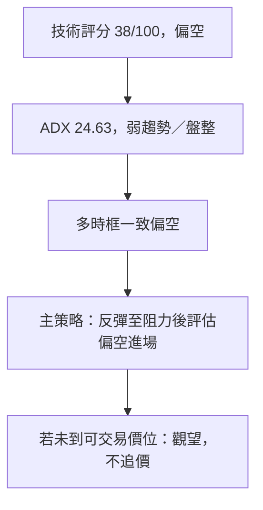

# RKLB 技術分析報告

> **報告日期**：2026-11-28 ｜ **語言**：繁體中文 ｜ **數據來源**：Yahoo Finance ｜ **當前價格**：$50.88 USD（2026-11-27 收盤）

---

## 目錄

| 章節 | 內容 |
|------|------|
| [1. 技術面概覽](#1-技術面概覽) | 核心指標速覽、評分卡 |
| [2. 趨勢分析](#2-趨勢分析) | 長中短期走勢、ADX |
| [3. 圖表形態分析](#3-圖表形態分析) | 形態、K 線、缺口 |
| [4. 支撐與阻力](#4-支撐與阻力) | 關鍵價位、斐波那契 |
| [5. 技術指標深度解讀](#5-技術指標深度解讀) | MA、RSI、MACD、布林、成交量、進階指標 |
| [6. 動能與波動率](#6-動能與波動率) | ATR、Beta、相對強度 |
| [7. 多時框架總結](#7-多時框架總結) | 時框架方向矩陣 |
| [8. 交易策略建議](#8-交易策略建議) | 歷史基準、策略、風險報酬比 |
| [9. 風險提示與監控](#9-風險提示與監控) | 監控指標、風險場景 |

---

## 1. 技術面概覽

RKLB 技術面整體偏空：均線呈空頭排列，且日、週、月三個時框方向一致偏空。  
短線雖有低位反彈跡象，但 MACD、DI、OBV 與相對強度尚未提供趨勢反轉確認。  
主要依據是價格仍低於中長期趨勢均線，並且週線及月線方向同樣偏空。  
最大的反向風險是 ADX 尚未達趨勢行情門檻，盤整期間容易出現急速反彈或假突破。

### 📊 核心指標速覽表

| 指標類別 | 指標名稱 | 當前數值 | 訊號 | 解讀 |
|----------|----------|----------|------|------|
| **價格** | 當前價格 | **$50.88** | 🔴 | 低於主要趨勢均線，短線仍在弱勢區域 |
| **均線** | MA20 / MA50 / MA200 | 見第 5 章 | 🔴 | 收盤低於三條均線，排列偏空 |
| **動能** | RSI(14)（日線） | 見第 5 章 | 🟡 | 中性區，但不足以確認轉強 |
| **動能** | MACD 柱（日線） | 見第 5 章 | 🔴 | 柱體為負，短線動能偏空 |
| **趨勢** | ADX(14) | 見第 2 章 | 🟡 | 尚未達強趨勢門檻，依盤整規則處理 |
| **波動** | ATR(14) | 見第 6 章 | 🔴 | 相對價格的日波動幅度偏高 |
| **多時框** | 一致性 | 見第 7 章 | 🔴 | 日、週、月方向一致偏空 |

### 🏆 技術評分卡

以下為全報告唯一評分卡。綜合評分依六項子評分的算術平均計算，並四捨五入至整數。

| 維度 | 評分（0–100） | 訊號 | 主要依據 |
|------|---------------|------|----------|
| 趨勢強度 | 35 | 🔴 | ADX 未確認強趨勢，但方向性指標由空方主導；詳見第 2 章 |
| 動能指標 | 45 | 🔴 | RSI 未轉強，MACD 柱偏空；詳見第 5 章 |
| 支撐穩定度 | 55 | 🟡 | 價格仍接近波段支撐區，但量能疲弱且支撐尚待再次驗證；詳見第 4 章 |
| 成交量配合 | 35 | 🔴 | OBV 偏弱，A/D 與價格同向下行；詳見第 5 章 |
| 形態完整度 | 40 | 🔴 | 有短線下影線與反彈，但未形成可確認的反轉結構；詳見第 3 章 |
| 均線排列 | 20 | 🔴 | 中短期至長期均線呈空頭排列；詳見第 5 章 |
| **綜合評分** | **38** | **偏空** | 六項平均：230 ÷ 6 = 38.33，四捨五入為 38 |

---

## 2. 趨勢分析

**結論：長期價格由急升後轉入顯著回落，中期仍偏空；日線 ADX 接近盤整門檻但尚未構成趨勢行情。**  
依多時框規則，當前不以日線反彈推翻週線與月線方向；在 ADX 低於趨勢門檻的情況下，日線布林區間是交易框架參考，但方向仍受中長期偏空背景限制。

### 📈 長期趨勢（近 12 個月）

下表整理價格資料庫的月收盤走勢。區間報酬依起訖收盤計算；當月未結束時，採最新可用收盤資料。

| 階段 | 起訖月收盤 | 漲跌幅 | 特徵 |
|------|------------|--------|------|
| 2025-12 至 2026-03 | $69.76 → $64.22 | -7.94% | 高位震盪後回落，方向偏弱 |
| 2026-04 至 2026-05 | $82.51 → $143.48 | +73.89% | 月收盤快速拉升，形成階段性高位 |
| 2026-06 至 2026-08 | $101.65 → $63.92 | -37.08% | 急升後大幅修正，漲勢明顯反轉 |
| 2026-09 至 2026-11 | $69.68 → 最新收盤（見標題） | -26.98% | 反彈未延續，近期再度走弱 |

月線 RSI 由春末及初夏的強勢區域逐步降至目前偏弱區間，與月線收盤低於月線趨勢均線的方向一致。月 MACD 柱為 **N/A（數據未提供）**，不以其他時框指標補推月線 MACD。

### 📊 中期趨勢（週線）

週線方向照多時框指標區塊判定為偏空：週線收盤低於自身趨勢均線，週 RSI 低於中性分界，週 MACD 柱仍為負值。  
近 20 週資料顯示，週收盤由七月中旬的 $67.62 下行至十一月下旬的最新收盤；期間曾反彈至 $82.83，惟未能扭轉週 MACD 柱持續為負的背景。  
最近一週收盤較前一週回升，但週成交量較前一週低，不能單靠這段回升確認週線反轉。

| 週線觀察 | 結論 | 技術含義 |
|----------|------|----------|
| 週趨勢均線關係 | 收盤在週趨勢均線下方 | 中期方向仍弱 |
| 週 RSI | 41.8 | 動能偏弱，尚未回到多方主導狀態 |
| 週 MACD 柱 | -1.719 | 負值延續，仍未完成週線動能反轉 |
| 近期週收盤與成交量 | 最新週收盤反彈，成交量低於前一週 | 有反彈，但量能確認不足 |

### ⚡ 趨勢強度（ADX）

日線 ADX 為 **24.63**，低於趨勢行情門檻。+DI 為 **19.47**，−DI 為 **35.49**，空方方向性力量較強，但趨勢強度尚未達到「強趨勢」判準。  
因此依規則 14，當前歸類為**盤整／弱趨勢行情**，不是已確認的趨勢行情；日線布林通道上下軌作為區間判讀參考，中長期偏空方向仍用來限制逆勢做多的信心。

| 指標 | 數值 | 判斷 |
|------|------|------|
| ADX(14) | 24.63 | 🟡 低於 25，弱趨勢／盤整 |
| +DI | 19.47 | 多方方向力量較弱 |
| −DI | 35.49 | 空方方向力量占優 |
| 行情分類 | 弱趨勢／盤整 | 依日線布林區間判讀，不將短線反彈視為中長期反轉 |

---

## 3. 圖表形態分析

**結論：目前沒有足夠 OHLCV 證據確認頭肩、雙底或旗形等完整幾何形態。**  
日線近端出現長下影線及收復部分跌幅的 K 棒，但它們仍需要後續價格與量能確認；缺口資料則顯示近期兩個已列缺口均已回補，不能把它們當作未回補支撐或阻力。

### 🔍 形態識別

| 形態 | 信心度 | 判斷依據 | 完成度 | 目標價 |
|------|--------|----------|--------|--------|
| 雙底 | 低 | 近期低點附近雖有反彈，但數據不足以確認兩個間隔清晰、頸線明確的低點結構 | 未確認；僅能視為支撐區附近震盪 | N/A（數據未提供） |
| 頭肩／反頭肩 | 低 | 可用日線與週線資料不足以確認肩部、頭部及頸線的幾何對稱性 | 未確認 | N/A（數據未提供） |
| 旗形或楔形 | 低 | 沒有足夠的形態邊界及量價結構資料可確認整理通道 | 未確認 | N/A（數據未提供） |
| 指標型反彈 | 中 | 近端 K 棒有下影線，且短期收盤回升；但週線方向與成交量尚未確認反轉 | 尚待後續確認 | 不適用；未形成可計算的形態高度 |

### 🕯️ 重要 K 線形態

以下 K 線形態僅依 Yahoo Finance 列出的近 10 根日 K、近 8 根週 K 的開高低收判讀。表中價格以美元計。

| 日期（日 K／週 K） | 開 | 高 | 低 | 收 | K 線形態 | 解讀 | 訊號 |
|------|----:|----:|----:|----:|----------|------|------|
| 2026-11-20（日 K） | 49.75 | 50.67 | 45.10 | 45.42 | 長下影線黑 K | 盤中跌幅擴大後仍收低於開盤，反映低位有承接但空方仍占上風 | 🟡 |
| 2026-11-25（日 K） | 43.89 | 48.16 | 42.12 | 47.02 | 長下影線紅 K | 收盤高於開盤且遠離低點，顯示低位買盤介入；單根 K 棒不足以確認反轉 | 🟡 |
| 2026-11-27（日 K） | 49.50 | 50.95 | 47.47 | 50.88 | 長下影線紅 K | 收盤靠近當日高位，短線反彈訊號較正面；成交量低於 20 日均量，確認力有限 | 🟡 |
| 2026-11-27（週 K） | 52.16 | 52.22 | 42.12 | 50.88 | 長下影線黑 K | 週內下探後收復大部分跌幅，但收盤仍低於週開盤；屬反彈而非已確認反轉 | 🟡 |

### 🕳️ 跳空缺口

依市場脈絡區塊列示近 60 個交易日中達門檻的缺口。兩個缺口均已回補，故不作未回補價位使用。

| 日期 | 方向 | 缺口區間 | 回補狀態 | 技術解讀 |
|------|------|----------|----------|----------|
| 2026-10-15 | 向下跳空 | $55.40–$58.84 | 已回補 | 曾形成向下價格斷層，但已回補，現階段不再視為未回補缺口 |
| 2026-09-17 | 向上跳空 | $64.56–$65.26 | 已回補 | 曾形成向上跳空，但已回補，不構成現存缺口支撐 |

---

## 4. 支撐與阻力

**結論：上方阻力層級較多，價格若反彈，須逐級消化前波供給；下方可辨識兩層波段支撐。**  
波段價位來自程式由 OHLCV 計算的近一年波段高低點聚類；支撐與阻力表依原始標示引用，不以樞軸點補充。

### 🚧 阻力位分析表

阻力聚類採用近一年波段高點。

| 阻力級別 | 價位 | 形成原因 | 突破難度 | 重要性 |
|----------|------:|----------|----------|--------|
| R1 | $61.13 | 近一年波段高點聚類；亦與週線反彈供給區相近 | 中 | 近期反彈首先需要面對的阻力 |
| R2 | $67.98 | 近一年波段高點聚類 | 高 | 上方結構阻力，突破需要價格及量能共同確認 |
| R3 | $75.28 | 近一年波段高點聚類 | 高 | 更上方的波段供給區，屬延伸反彈層級 |

### 🛡️ 支撐位分析表

支撐聚類採用近一年波段低點；原始資料僅列出兩級支撐，第三級為 **N/A（數據未提供）**。

| 支撐級別 | 價位 | 形成原因 | 守住可能性 | 重要性 |
|----------|------:|----------|------------|--------|
| S1 | $49.25 | 近一年波段低點聚類；與近期週線低點區有價格重疊 | 中 | 短線支撐，若失守，價格可能轉向下一層支撐 |
| S2 | $43.89 | 近一年波段低點聚類；亦與近端日線低位區相近 | 中 | 主要下方支撐；若失守，弱勢結構將加深 |
| S3 | N/A（數據未提供） | 波段支撐區塊未列出第三級 | N/A | 不自行外推 |

### 📐 斐波那契回調位分析

斐波那契數值直接引用價格資料庫中以 52 週高低區間計算的回調位。當前收盤落在 **61.8% 與 78.6% 回調位之間**，顯示價格已回吐大部分前段升幅；這是回撤深度的描述，不代表該區間必然形成支撐。

| 回調比例 | 價位 | 解讀 |
|----------|------:|------|
| 23.6% | $124.80 | 較淺回調層級，距現價較遠 |
| 38.2% | $108.59 | 中淺回調層級 |
| 50.0% | $95.49 | 升幅的一半回吐位置 |
| 61.8% | $82.39 | 常見重要回調層級；價格已低於此位 |
| 78.6% | $63.74 | 深度回調層級；現價仍低於此位 |
| 52 週高點 | $151.00 | 區間上端 |
| 52 週低點 | $39.98 | 區間下端 |

---

## 5. 技術指標深度解讀

**結論：均線、MACD、DI、OBV 與相對強度大致同向偏空；RSI 位於中性區且出現底背離訊號，構成短線反彈的反向線索，但尚不足以改變主趨勢判讀。**

### 📈 均線、RSI、MACD、布林通道

| 指標 | 數值 | 訊號 | 解讀 |
|------|------|------|------|
| MA20 / MA50 / MA200 與排列 | MA20 $54.07；MA50 $60.06；MA200 $77.23；MA20 < MA50 < MA200 | 🔴 | 收盤低於三條均線，且短中長均線由低至高排列，屬明確空頭排列 |
| RSI(14)（日線）與背離 | RSI 45.17；程式標示底背離 | 🟡 | RSI 在中性區，未達超賣；近 20 根 K 棒首尾比較標示底背離，可能支持短線反彈，但不能單獨確認底部 |
| MACD 線／Signal／柱 | MACD -2.942；Signal -2.304；Hist -0.638 | 🔴 | MACD 低於 Signal 且柱體為負，日線動能仍偏空 |
| 布林上軌／中軌／下軌／%B | 上軌 $66.34；中軌 $54.07；下軌 $41.80；%B 0.37 | 🟡 | 價格位於中軌下方、下軌上方的區間中下段；與 ADX 盤整訊號相符，尚未出現下軌極端位置 |

**背離結論：**日線 RSI 有程式標示的底背離；資料未提供 MACD 背離訊號，因此 MACD 背離為 **N/A（數據未提供）**。  
RSI 底背離與近端長下影線提供短線反彈線索；但負向 MACD 柱、空頭均線排列及空方 DI 占優互相確認偏空背景。綜合而言，底背離目前屬於**尚未被趨勢指標確認的反向訊號**，不應視為完整趨勢反轉。

### 💹 成交量（量價配合度）

| 指標 | 數值／狀態 | 解讀 |
|------|------------|------|
| 最新成交量 | 10,429,100 股 | 低於近期平均量，最新反彈的量能確認不足 |
| 20 日均量 | 19,177,315 股 | 最新量約為均量的 0.54 倍 |
| 50 日均量 | 20,206,378 股 | 最新成交量亦低於較長的短線平均量 |
| OBV 趨勢 | OBV < MA | 量能趨勢疲弱，尚未確認價格反彈 |
| A/D 線 | 不高於其 20 日均值；A/D 下降、價格下跌 | A/D 與價格同向，確認近期下跌壓力 |

**量價結論：**近期低位反彈尚未獲得 OBV 或成交量的明確確認；A/D 線與價格同步下行，表示累積／派發動能仍不利多方。量能訊號因此偏空，而不是底部反轉的確認訊號。

### 🧭 進階指標

以下數值均為程式由日線計算。收盤相對位置依原始指標區塊判讀。

| 指標 | 數值 | 收盤相對位置 | 解讀 |
|------|------|--------------|------|
| 一目均衡表（轉換線／基準線／雲層） | 轉換線 $52.01；基準線 $55.19；先行帶 A $61.51；先行帶 B $68.04；前方先行帶 A $53.60、B $60.20 | 雲層下方；轉換線低於基準線；前方 A 在 B 下方 | 一目均衡表偏空，與均線及日線 MACD 結論互相確認 |
| 成交量分布（POC／價值區） | POC $70.05；價值區 $53.86–$90.86 | 價值區下方 | 價格位於過去成交量集中區之下，反映上方存在潛在供給；與偏空均線方向一致 |
| 錨定 VWAP（自 52 週高點／低點） | 自 2026-05-27 起 $78.05；自 2025-12-01 起 $79.15 | 收盤均在兩條錨定 VWAP 下方 | 兩個主要錨定區間均顯示價格低於成交量加權成本參考，偏空 |
| A/D 線 | 近 20 根不高於其 20 日均值；A/D 下降、價格下跌 | — | 與價格同向，確認近期賣壓，與 RSI 底背離所示的潛在反彈訊號相抵 |

---

## 6. 動能與波動率

**結論：RKLB 的單日波動幅度高，停損距離需避免過窄；相對大盤的弱勢明顯，Beta 亦顯示股價對市場波動敏感。**  
ATR 是波動參考，不是支撐／阻力或必然止損價；實際策略停損仍須按第 8 章的明確價位與風險報酬比規則設定。

### 📊 ATR 波動率分析

| 指標 | 數值 | 解讀 |
|------|------|------|
| ATR(14) | $5.08 | 每日真實波幅參考值偏大 |
| ATR 佔價格比例 | 9.98% | 相對價格波動幅度高，持倉風險較一般低波動標的高 |
| 1.5 倍 ATR | $7.62 | 可作為波動敏感度檢查；不是獨立交易止損價 |
| 2 倍 ATR | $10.16 | 反映較寬的波動緩衝需求；使用時須同步縮小倉位 |

### 📐 Beta 與相對強度

| 期間 | RKLB 價格報酬 | VTI 基準報酬 | 超額報酬 | 相對強度解讀 |
|------|---------------:|-------------:|---------:|--------------|
| 1 個月 | -19.4% | -6.5% | -12.8% | 顯著落後整體市場 |
| 3 個月 | -30.4% | -7.2% | -23.2% | 弱勢擴大 |
| 6 個月 | -68.2% | -5.0% | -63.3% | 長一點的比較期間亦大幅落後 |

相對強度資料截至 2026-11-25，且為不含股息的價格報酬。比值趨勢低於其 50 日均值，代表相對大盤走弱；此訊號支持偏空主策略，並與多時框偏空結論一致。

| 市場敏感度指標 | 數值 | 解讀 |
|----------------|------|------|
| Beta | 3.176 | 對市場波動的歷史敏感度高；市場反彈時可能放大波動，市場下跌時亦可能加劇回撤 |
| 相對強度比值趨勢 | 相對走弱，低於 50 日均值 | 不支持目前直接建立趨勢性多頭部位 |

---

## 7. 多時框架總結

**結論：多時框方向一致偏空，沒有日線訊號足以推翻週線及月線的偏空判定。**  
ADX 將當前行情歸類為盤整／弱趨勢，而非強趨勢；交易節奏應尊重日線區間特性，但方向性結論仍以週線與月線偏空為主。

### 📋 時框架方向表

多時框方向及指標依「多時框指標」區塊列示；月 MACD 柱依規則標示為 **N/A（數據未提供）**。

| 時框架 | 趨勢方向 | RSI(14) | MACD 柱 | 收盤 vs 趨勢均線 | 形態 | 建議 |
|--------|----------|---------|---------|------------------|------|------|
| 日線 | 偏空 | 45.17 | -0.638 | 收盤低於 MA50 $60.06 | 均線偏空；底背離尚未獲確認 | 等待反彈至阻力區再評估，不追價 |
| 週線 | 偏空 | 41.76 | -1.719 | 收盤低於 MA20 $63.67 | 週線下行後有反彈，未改變偏空方向 | 以反彈阻力作為風險控制參考 |
| 月線 | 偏空 | 46.90 | N/A（數據未提供） | 收盤低於 MA10 $76.51 | 月線仍處回落階段 | 不將短線反彈解讀為中長期反轉 |

**多時框一致性：3/3 偏空。**

### ⚖️ 多時框收斂結論

日線 ADX 低於趨勢行情門檻，因此按照盤整行情規則，以日線布林通道作為區間判讀參考；但日、週、月方向在多時框指標區塊均列為偏空，並且週線及月線收盤都低於各自趨勢均線。  
因此唯一方向性結論為：**偏空**。短線若反彈，優先視作弱勢行情內的反彈，須等量價及中長期趨勢指標改善後，才重新評估方向。

---

## 8. 交易策略建議

**當前主策略方向 = 偏空（依評分 38/100）。**  
策略採反彈至已列阻力後尋找空方進場，不在低位追空；此安排與中長期偏空方向一致，也避免在弱勢區域賣出後承受盤整反彈風險。以下數字均為條件式計畫，並非保證成交或價格預測。

### 🧭 策略路由

### 📊 歷史基準機率

今日狀態為 RSI(14) 介於 30–50，且收盤低於 MA200。歷史樣本期間為 **2020-11-24 至 2026-11-27**，共 **1,509 個交易日**。下表為與今日狀態相同時的歷史價格報酬，不含股息。

| 持有期 | 相同狀態樣本（段數） | 上漲比例 | 中位數報酬 | 25%–75% 分位 | 全部交易日上漲比例／中位數 |
|--------|----------------------|----------|------------|--------------|----------------------------|
| 5 日 | 397（51 段） | 45% | -0.5% | -6.1% 至 +3.9% | 48%／-0.2% |
| 20 日 | 387（50 段） | 47% | -1.6% | -11.7% 至 +9.4% | 52%／+1.5% |
| 60 日 | 365（47 段） | 52% | +1.0% | -21.0% 至 +16.4% | 52%／+2.1% |

歷史同狀態的短期上漲比例低於全部交易日基準，較長持有期的上漲比例則與全部交易日相同。這些是歷史頻率，不是預測；同狀態交易日可能連續出現且持有期重疊，獨立事件段數低於交易日樣本數，因此不能視為大量獨立觀測。整體而言，歷史基準對短期偏空策略略有支持，但不足以單獨構成進場理由。

### 🎯 價格情境階梯（Price Scenarios）

價位均取自第 4 章所列的波段支撐與阻力。可能性為定性判斷，不是統計機率。

| 觸發條件 | 下一目標 | 後續延伸 | 可能性 | 依據 |
|----------|----------|----------|--------|------|
| 突破並站穩 R1 | R2 | R3 | 低 | 目前均線、週線及月線偏空；若有效突破，才代表空方阻力開始被消化 |
| 於現價區間內震盪 | — | — | 中 | ADX 屬弱趨勢／盤整，但 OBV 與相對強度仍偏弱 |
| 跌破 S1 | S2 | S3：N/A（數據未提供） | 中 | 空方 DI 占優，若支撐失守，下一級已列支撐可作參考；第三級資料未提供 |

### 🟢 主策略詳情

**策略 A 為唯一可執行主策略；策略 B 不達最低風險報酬要求，不列為可執行策略。**  
策略 A 等待價格反彈至 R1 後出現拒絕訊號再考慮做空。風險報酬比以空頭公式計算：**（進場價 − T1）÷（止損價 − 進場價）**。

| 策略要素 | 策略 A：反彈阻力做空 | 策略 B：跌破支撐追空 |
|----------|---------------------|----------------------|
| 進場條件 | 價格反彈至 R1，並出現日線轉弱或無法站穩的確認訊號 | 跌破 S1 後直接追空；此為不執行的比較情境 |
| 進場價格 | $61.13 | 此價位不交易（風險報酬比 1 : 0.45 不足）；假設進場 $49.25 |
| 目標價 T1 | $49.25 | $43.89 |
| 目標價 T2 | $43.89 | N/A（未列出更低級別支撐） |
| 止損價格 | $67.98 | $61.13 |
| 風險報酬比 | **1 : 1.73（以 T1 計）**；（$61.13−$49.25）÷（$67.98−$61.13）= 1.73 | **1 : 0.45（以 T1 計）**；（$49.25−$43.89）÷（$61.13−$49.25）= 0.45 |
| 交易判定 | 達到最低門檻，可條件式執行 | 未達最低門檻，不交易；需等待反彈至 R1，並以策略 A 的風險框架重新評估 |
| 把握度 | 中：與多時框偏空及相對弱勢一致，但 ADX 顯示盤整，仍有反彈風險 | 低：追空位置接近支撐，止損距離相對目標過大 |
| 建議倉位 | 以單筆最大帳戶風險不超過 0.5%–1% 作為風控上限，再反推股數 | 不建立部位 |

**策略執行限制：**策略 A 只有在價格到達指定進場位並出現轉弱確認後才成立；若價格未到進場位，不將現價直接視為進場訊號。目標價與止損價為計畫價位，急速跳空或流動性不足時可能無法按指定價格成交。

### 🔴 反向風險觸發點（對沖提示）

| 風險訊號 | 對主策略的影響 | 風控處理 |
|----------|----------------|----------|
| 價格有效站上 R1 並續向 R2 推進 | 反彈強度高於預期，空頭進場理由減弱 | 不提前建立空單；已持倉者依預設止損執行 |
| 價格接近 R2 並伴隨放量 | 可能代表中短線空頭結構正在被挑戰 | 檢查週線趨勢與成交量，避免加碼空單 |
| RSI 底背離延續且 MACD 柱轉為正值 | 反彈可能由短線修正轉為動能改善 | 暫停新增空單，重新評估策略 |
| 價格跌破 S2 並加速下行 | 空單可能已實現目標，但波動及反彈風險同時上升 | 依計畫分批停利，不因延伸行情任意擴大止盈目標 |

---

## 9. 風險提示與監控

**結論：主要風險來自高波動、反彈造成的空單回撤，以及目前財報日資訊缺漏。**  
由於日線仍屬弱趨勢／盤整，進場必須依賴價位觸發與價格行為確認；不應只憑單一指標或單根 K 線建立部位。

### ✅ 關鍵監控指標

| 監控項目 | 數據／觸發 | 觸發後動作 |
|----------|-------------|------------|
| 阻力確認 | R1、R2、R3 依第 4 章 | 觀察反彈是否受阻；未見轉弱確認前不提前做空 |
| 支撐確認 | S1、S2 依第 4 章 | 若支撐失守，評估下行延伸；不在支撐附近盲目追空 |
| 日線均線與 MACD | 均線仍空頭排列，MACD 柱仍為負時偏空訊號延續 | 若均線結構改善且 MACD 柱轉強，降低新增空單意願 |
| 量能確認 | OBV 低於其均線、A/D 與價格同向下行 | 若 OBV 與 A/D 回升且伴隨放量，重新評估空頭策略 |
| 相對強度 | RKLB 相對 VTI 比值趨勢偏弱 | 若相對弱勢改善並持續，檢查是否存在趨勢反轉 |
| 下次財報日 | N/A（數據未提供） | 無法依資料確認財報日；不得據此推定持倉期間不包含財報事件 |
| 距最新收盤日的日曆天數 | N/A（財報日未提供） | 因缺少財報日期，不計算天數 |
| 跳空風險 | 近期列示缺口均已回補；未來仍可能出現新的跳空 | 使用限額風險倉位；止損不保證於預定價格成交 |

### ⚠️ 風險場景

| 情境 | 觸發條件 | 價位參考 | 可能性 | 應對 |
|------|----------|----------|--------|------|
| 樂觀情境 | RSI 底背離延續，且價格伴隨量能突破近端阻力 | R1、其後 R2 | 低 | 暫停新增空單；等週線與月線訊號重新確認 |
| 基本情境 | 價格在支撐與阻力之間反覆震盪，趨勢指標尚未轉強 | S1 至 R1 | 中 | 等反彈至主策略進場條件，不在區間中段追價 |
| 悲觀情境 | 支撐失守，且空方方向力量與相對弱勢延續 | S2；S3 為 N/A（數據未提供） | 中 | 依計畫管理空單；若已有利潤，考慮按策略分批停利 |

### 🛡️ 風險管理提醒

- 將倉位大小建立在可承受的單筆損失上，再以止損距離反推部位，不以固定股數套用不同波動情境。
- ATR 顯示日常波動幅度偏大；避免將止損設得過窄，以免被一般波動觸發。
- 策略 A 必須等待指定阻力附近的轉弱確認；價格未達條件時以觀望為主，不追空。
- 預先設定止損與分批停利安排；跳空、停牌或流動性變化可能造成實際成交價偏離計畫價。
- 財報日期為 N/A（數據未提供），無法確認策略持有期間是否涵蓋財報事件；持倉前須自行核實公司公告日程。

---

## 📋 報告總結

| 項目 | 結論 |
|------|------|
| 報告日期 | 2026-11-28 |
| 當前價格 | 見標題（收盤日期：2026-11-27） |
| 綜合評分／方向 | 38/100，偏空 |
| 長期／中期／短期趨勢 | 🔴 長期回落；🔴 週線偏空；🟡 日線盤整背景下偏弱 |
| 關鍵支撐／關鍵阻力 | S1、S2；R1、R2、R3，價位見第 4 章 |
| 🥇 最佳機會 | 策略 A：等待反彈至 R1 並確認轉弱後做空；未到位則觀望 |
| 最大風險 | 高波動盤整中出現強力反彈，或財報事件造成跳空並使止損無法按計畫成交 |

> ⚠️ **免責聲明**：本報告為 AI 自動生成之技術分析，所有數據及估算均基於歷史價格資訊。本報告僅供研究與學術參考，不構成任何投資建議。投資有風險，入市需謹慎。

---

## 資料與來源

| 項目 | 內容 |
|------|------|
| 價格 | 50.88 USD，2026-11-27 收盤（Yahoo Finance 日線） |
| K 棒 | 500 根日線，2024-11-29 至 2026-11-27（Yahoo Finance）；較長期間的價位與基準機率取自價格資料庫 |
| 關鍵價位回溯期間 | 阻力 近一年、支撐 近一年 |
| 有回應的資料來源 | Yahoo Finance、Finviz、StockAnalysis、Roic.ai |
| 由程式計算 | 所有指標、R1–S3 與斐波那契價位、多時框方向、相對強度、缺口、歷史基準機率、綜合評分 |
| 撰寫模型 | openai / gpt-6-luna |

> 本區塊由產生報告的程式依實際取得的資料填寫，非模型撰寫。「由程式計算」的數字不是模型的估計；其餘判斷（評分、情境、策略）是模型的分析。
