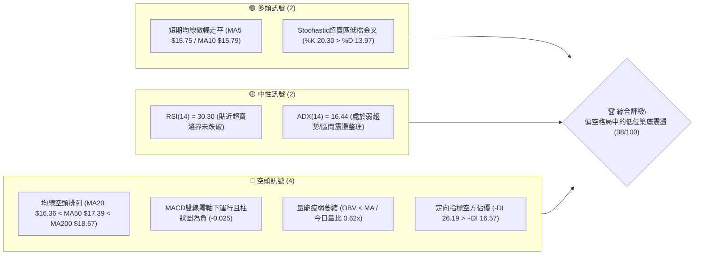
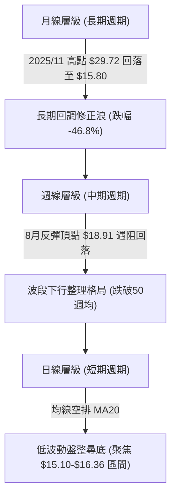
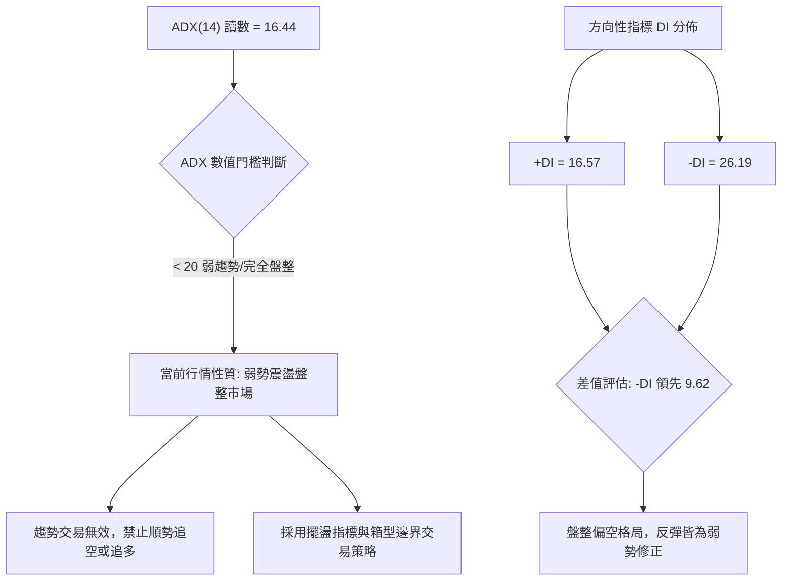
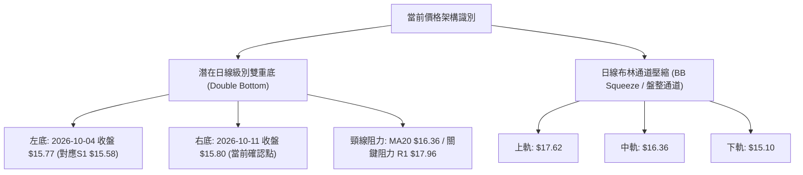
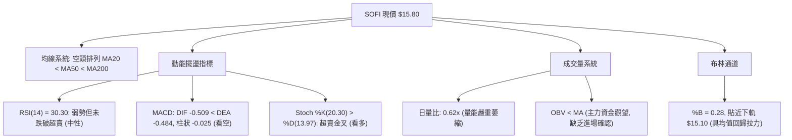
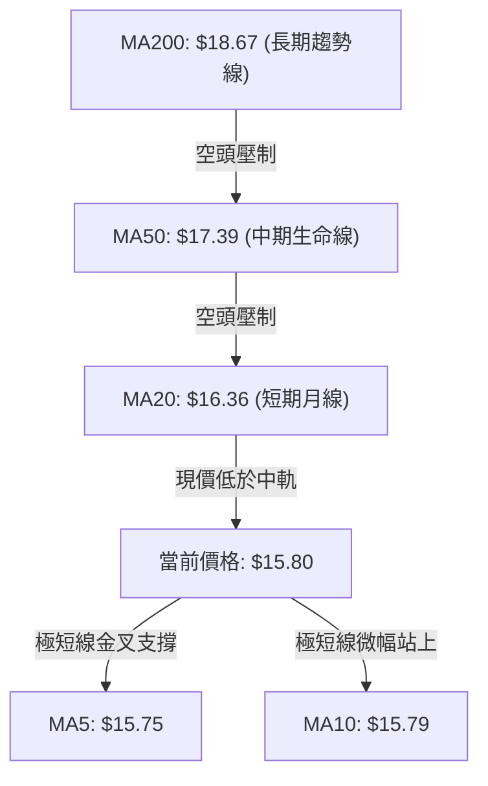
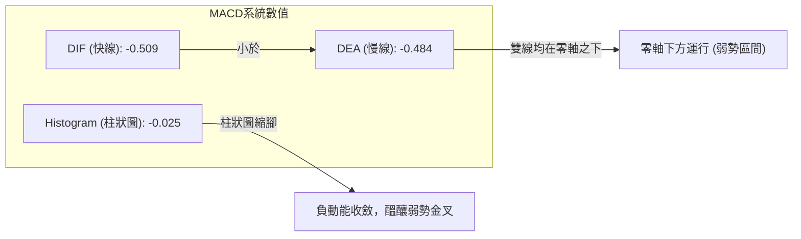
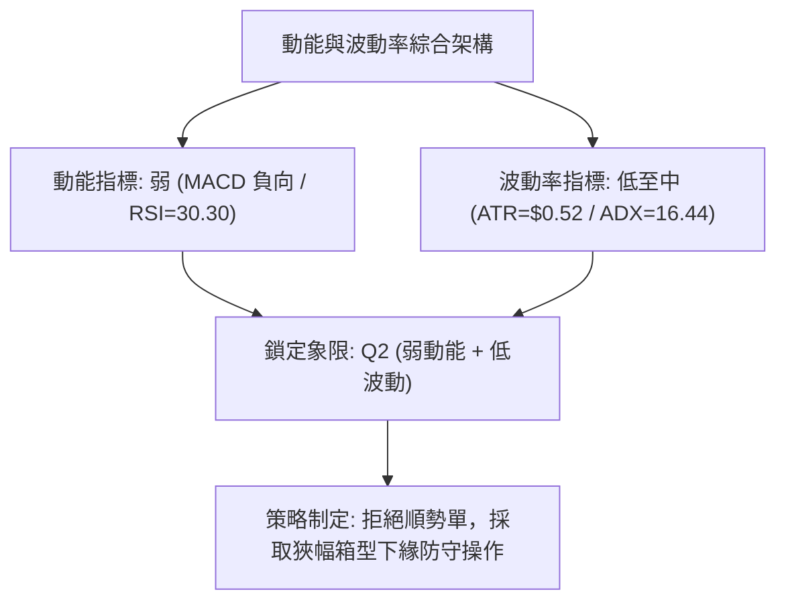
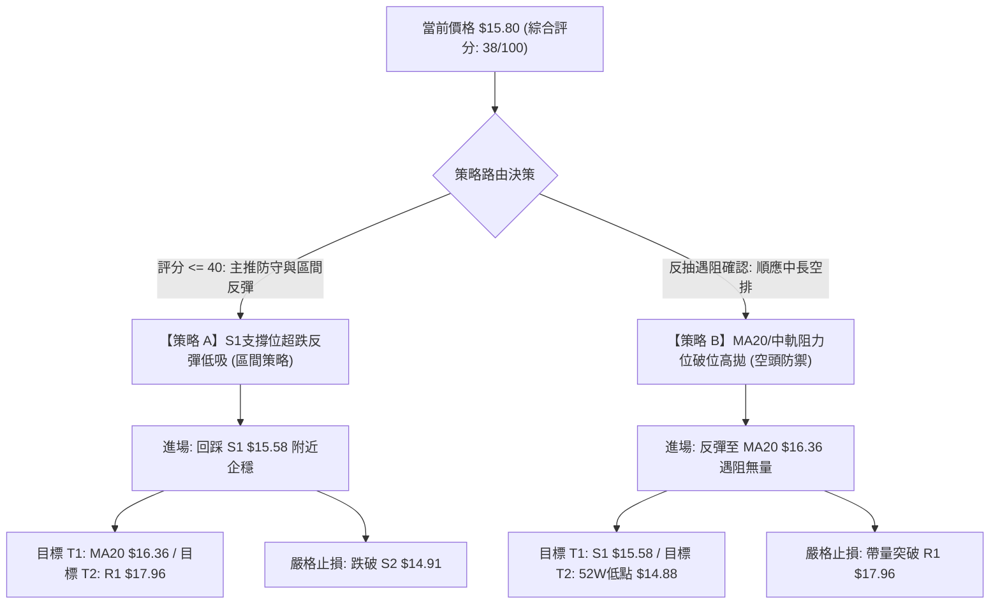
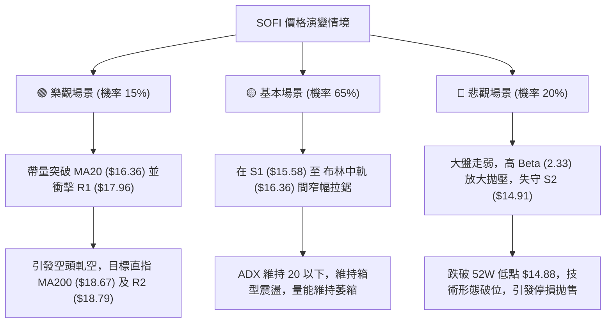

# SOFI 技術分析報告

> **報告日期**：2026-10-11 ｜ **語言**：繁體中文 ｜ **數據來源**：Yahoo Finance ｜ **當前價格**：$15.80

---

## 目錄

| 章節 | 內容 |
|------|------|
| [1. 技術面概覽](#1-技術面概覽) | 訊號儀表板、核心指標、評分卡 |
| [2. 趨勢分析](#2-趨勢分析) | 多時框趨勢、長中短期走勢 |
| [3. 圖表形態分析](#3-圖表形態分析) | 形態識別、K線組合、目標價 |
| [4. 支撐與阻力](#4-支撐與阻力) | 關鍵價位、斐波那契回調 |
| [5. 技術指標深度解讀](#5-技術指標深度解讀) | MA/RSI/MACD/布林/成交量 |
| [6. 動能與波動率](#6-動能與波動率) | 動能評估、ATR、Beta |
| [7. 多時框架總結](#7-多時框架總結) | 時框架評分矩陣 |
| [8. 交易策略建議](#8-交易策略建議) | 多空策略、風險報酬比 |
| [9. 風險提示與監控](#9-風險提示與監控) | 監控指標、風險場景 |
| [10. 報告總結](#10-報告總結) | 儀表板總結、最優交易機會 |

---

## 1. 技術面概覽

### 🎯 技術訊號儀表板



### 📊 核心指標速覽表

| 指標類別 | 指標名稱 | 當前數值 | 訊號 | 解讀 |
|:---|:---|:---|:---:|:---|
| **價格** | 當前收盤價 | $15.80 | 🔴 | 位於 52 週價格區間僅 5.2% 分位，深陷空頭壓力區 |
| **均線** | MA20 | $16.36 | 🔴 | 價格低於 MA20 達 -3.43%，短線處於下行軌道中 |
| **均線** | MA50 | $17.39 | 🔴 | 價格低於 MA50 達 -9.14%，中期下行趨勢顯著 |
| **均線** | MA200 | $18.67 | 🔴 | 價格低於 MA200 達 -15.37%，長期牛熊分界線失守 |
| **動能** | RSI(14) | 30.30 | 🟡 | 進入超賣臨界區間，但未見底背離，具短線跌深反彈契機 |
| **動能** | MACD (12,26,9) | -0.509 / -0.484 | 🔴 | DIF 線低於訊號線，柱狀圖 -0.025，空方動能主導 |
| **趨勢** | ADX(14) | 16.44 | 🟡 | ADX < 25，表明前期單邊下跌動能衰竭，轉入盤整磨底 |
| **波動** | ATR(14) | $0.52 (3.26%) | 🟡 | 波動率處於常規水平，每日震盪區間約 $0.50 - $0.55 |
| **通道** | 布林通道 %B | 0.28 | 🟡 | 位於中軌 ($16.36) 與下軌 ($15.10) 之間，偏向下軌測試 |
| **量能** | 20日成交量比 | 0.62x | 🔴 | 成交量為 2,920 萬股，量能持續萎縮，OBV < MA |

### 🏆 技術評分卡

```
╔══════════════════════════════════════════════════════════════╗
║             技術評分卡 — SOFI (2026-10-11)                  ║
╠══════════════════════════════════════════════════════════════╣
║ 趨勢強度 (Trend)     ██████░░░░░░░░░░░░░░  30/100  🔴 空頭壓制 ║
║ 動能指標 (Momentum)  ████████░░░░░░░░░░░░  40/100  🟡 低檔鈍化 ║
║ 支撐穩定度 (Support) ████████████░░░░░░░░  60/100  🟡 考驗S1/S2║
║ 成交量配合 (Volume)  ██████░░░░░░░░░░░░░░  30/100  🔴 無量陰跌 ║
║ 形態完整度 (Pattern) ████████░░░░░░░░░░░░  40/100  🟡 築底未成 ║
║ 均線排列 (Moving Av) ████░░░░░░░░░░░░░░░░  20/100  🔴 完美空排 ║
╠══════════════════════════════════════════════════════════════╣
║ 綜合評分             ███████░░░░░░░░░░░░░  38/100  🔴 偏空震盪 ║
╚══════════════════════════════════════════════════════════════╝
```

---

## 2. 趨勢分析

### 🌐 多時框趨勢分析



### 📈 長期趨勢 — 12個月走勢圖（Unicode）

SOFI 於 2025 年末見頂後展開深幅回調，自 2025 年 11 月的 $29.72 收盤價回落至當前 $15.80，累積回檔達 46.8%。

```
SOFI 月線走勢圖（2025-11 至 2026-10）
價格軸 ($)
$30.00 ┤  ●(2025-11: $29.72 歷史頂部)
$27.00 ┤     ●(2025-12: $26.18)
$24.00 ┤        ●(2026-01: $22.81)
$21.00 ┤           
$18.00 ┤              ●(02: $17.76)         ●(05: $18.22)   ●(08: $17.88)
$15.00 ┤                 ●━━━━━━━━●━━━━━━━━━━━●━━━━━━━━━━━━━━━●←現價 $15.80
$12.00 ┤                 (03:$15.88; 04:$16.10; 07:$16.31; 09:$15.72)
       └──────────────────────────────────────────────────────────────
         11   12   01    02   03   04   05   06   07   08   09   10  (月份)
```

#### 長期月度價格特徵分析

| 階段區間 | 時間跨度 | 起始/結束收盤價 | 區間幅度 | 趨勢性質與量能特徵 |
|:---|:---|:---|:---:|:---|
| **第一階段：高檔崩跌** | 2025-11 → 2026-03 | $29.72 → $15.88 | **-46.57%** | 獲利了結與高估值修正，單邊連續黑K貫穿多道均線 |
| **第二階段：弱勢反彈** | 2026-03 → 2026-05 | $15.88 → $18.22 | **+14.74%** | 超跌反彈，反抽至原頸線區間即遭遇沉重解套賣壓 |
| **第三階段：箱型震盪** | 2026-05 → 2026-08 | $18.22 → $17.88 | **-1.87%** | 在 $16.00 至 $18.90 間反覆拉鋸，主力資金進行籌碼沉澱 |
| **第四階段：二次探底** | 2026-08 → 2026-10 | $17.88 → $15.80 | **-11.63%** | 再次向近一年低點回撤，當前收於 $15.80，進入磨底期 |

### 📊 中期趨勢（週線分析）

中期走勢顯示自 2026 年 8 月 23 日創下反彈高點 $18.91 以來，週線已走出連續 7 週的下行通道。

```
週線級別價格壓力與支撐通道示意圖
價格 ($)
$19.50 ─────────────────────────────────────────────────── [長期壓力帶 MA200: $18.67]
$18.91 ─────────● (08-23 週高點)
$18.22 ───────────────● (09-06) ───\ (中期阻力線向下傾斜)
$17.32 ───────────────────────● (09-13)───\
$16.58 ───────────────────────────────● (09-27)───\
$15.80 ───────────────────────────────────────● (10-11 現價)
$14.88 ═══════════════════════════════════════════════════ [52W 絕對低點支撐]
```

中期指標表明：MACD 週線柱狀圖由 8 月下旬的 +0.063 持續擴大轉負至 -0.147，隨後在 10 月收斂至 -0.025；週線 RSI 自 59.6 深度跌入 23.0 後回升至 30.30，表明中期賣壓已宣洩大半，進入中階築底期。

### ⚡ 趨勢強度評估（ADX 解讀）



| 指標變數 | 當前讀數 | 門檻區間 | 市場狀態解讀 |
|:---|:---:|:---:|:---|
| **ADX (14)** | **16.44** | < 20 (極弱) | 單邊動能完全衰竭，行情轉入狹幅震盪，趨勢指標失效 |
| **+DI (14)** | **16.57** | 低檔鈍化 | 買盤力量渙散，多頭無力組織連續攻擊 |
| **-DI (14)** | **26.19** | 中度偏強 | 空頭仍掌控局勢，但已無力推動加速破位行情 |
| **趨勢強度結論** | **無方向性** | 盤整市 | 符合嚴格規則 14：盤整行情以日線布林通道 ($15.10–$17.62) 為交易邊界 |

---

## 3. 圖表形態分析

### 🔍 形態識別系統



#### 形態識別信心度評估表

| 形態名稱 | 信心度 | 判斷依據（嚴格引用數據） | 完成度 | 目標價（附嚴謹計算式） |
|:---|:---:|:---|:---:|:---|
| **潛在雙重底** | **55%** | 10-04 收盤 $15.77 與 10-11 收盤 $15.80 在支撐位 S1 ($15.58) 上方獲支撐 | 35% | 依形態高度推算：頸線 R1 ($17.96) - 雙底低點 S1 ($15.58) = 高度 $2.38；突破頸線目標 = $17.96 + $2.38 = **$20.34**（數據中未確認突破，僅為潛在目標） |
| **日線下行箱體** | **75%** | 價格持續在布林下軌 $15.10 與上軌 $17.62 間運行，受制於 MA20 ($16.36) | 85% | 依通道幅度推算：下軌支撐 $15.10，中軌目標 **$16.36**，上軌極限目標 **$17.62** |
| **頭肩底形態** | **20%** | 數據中未偵測到完整的右肩架構，成交量無右肩放大特徵 | 0% | 訊號不足，僅做指標型解讀，不預設此形態目標價 |

### 🕯️ 重要K線形態分析

| 週期/月份 | 收盤價 | K線形態名稱 | 技術解讀 | 訊號 |
|:---|:---:|:---|:---|:---:|
| **2026-08 (月線)** | $17.88 | 長上影十字星 (Spinning Top) | 衝高 $18.91 遭遇解套賣壓，多空力量劇烈分歧 | 🔴 |
| **2026-09 (月線)** | $15.72 | 中實體陰線 (Bearish Bar) | 跌破 8 月低點，空方主導向下尋底 | 🔴 |
| **2026-10-04 (週線)** | $15.77 | 低檔倒轉鎚頭線 (Inverted Hammer) | 週 RSI 降至 23.0 極度超賣，出現低位承接盤買盤介入 | 🟢 |
| **2026-10-11 (週線)** | $15.80 | 低檔孕線/平底十字星 (Harami Cross) | 實體極小，收盤微漲 +0.03，空頭下行慣性暫時停止 | 🟡 |

### 📉 ASCII 走勢形態示意圖

```
日線級別低檔支撐築底與布林通道關係
價格 ($)
$17.62 ┤                                        ─────── 布林上軌 (強阻力)
       │                                       /
$17.39 ┤                                     ─/─ MA50 壓力線
       │                                    /
$16.36 ┤             ────── 頸線區 (MA20 / 布林中軌)
       │            /      \
$15.80 ┤─●─────────/        \────────●← 現價 $15.80 (右底形成中)
       │  \       /                  /
$15.58 ┤   \─────●                  /  ────── 支撐 S1
       │      (左底 10-04: $15.77) /
$15.10 ┤                          /    ─────── 布林下軌
       └────────────────────────────────
         T-10   T-8   T-5   T-2  當前
```

### 🎯 形態目標價計算

若當前低位整理形成有效突破，其路徑計算如下：

$$高度 H = 頸線阻力 (R1) - 雙底低點 (S1) = 17.96 - 15.58 = 2.38$$

$$理論多頭量度目標 = 頸線阻力 (R1) + 高度 H = 17.96 + 2.38 = 20.34$$

*註：在未有效放量突破 MA20 ($16.36) 及 R1 ($17.96) 前，該形態僅處於孕育期，首要目標仍以布林中軌 $16.36 為第一阻力位。*

---

## 4. 支撐與阻力

### 🗺️ 關鍵價位分布圖（Unicode）

```
SOFI 價位結構分布圖 (2026-10-11)
═══════════════════════════════════════════════════════════════
$19.62 ║██████████████████████████████║ 強阻力 R3 (年內高點聚類)
$18.79 ║████████████████████          ║ 阻力 R2 (近半年波段反彈高點)
$18.67 ║------------------------------║ 長期牛熊分水嶺 (MA200)
$17.96 ║██████████████████████████    ║ 關鍵頸線阻力 R1 (突破轉強點)
$17.62 ║..............................║ 布林通道上軌
$16.36 ║------------------------------║ 短線多空分水嶺 (MA20 / 布林中軌)
$15.80 ╠══════════════════════════════╣ ◄ 當前收盤價 ($15.80)
$15.58 ║▓▓▓▓▓▓▓▓▓▓▓▓▓▓▓▓▓▓            ║ 近期波段關鍵支撐 S1 (-1.42%)
$15.10 ║..............................║ 布林通道下軌動態支撐
$14.91 ║██████████████████████████████║ 強支撐 S2 (近一年波段低點聚類)
$14.88 ║==============================║ 52週極限低點 (52W Low)
═══════════════════════════════════════════════════════════════
```

### 🚧 阻力位分析表

所有價位均嚴格引用 OHLCV 計算聚類數據：

| 阻力級別 | 價位 | 與現價距離 | 形成原因與籌碼架構 | 突破難度 | 重要性評級 |
|:---|:---:|:---:|:---|:---:|:---:|
| **R1** | **$17.96** | +13.67% | 近一年波段高點聚類區，亦為 5-8 月多次震盪之中軸套牢區 | 🔴 極高 | ★★★★★ (中期反轉樞紐) |
| **R2** | **$18.79** | +18.89% | 近期波段反彈最高點 (8/23: $18.91 聚類)，緊鄰 MA200 ($18.67) | 🔴 高 | ★★★★☆ (長期牛熊阻力) |
| **R3** | **$19.62** | +24.16% | 2026 上半年成交密集區上限，強阻力帶頂部 | 🔴 極高 | ★★★☆☆ (強多頭目標) |

### 🛡️ 支撐位分析表

所有價位均嚴格引用 OHLCV 計算聚類數據：

| 支撐級別 | 價位 | 與現價距離 | 形成原因與籌碼架構 | 守住機率 | 重要性評級 |
|:---|:---:|:---:|:---|:---:|:---:|
| **S1** | **$15.58** | -1.42% | 近一年波段低點聚類，10 月初週線連續守住的關鍵防線 | 🟡 65% | ★★★★☆ (短線多頭生命線) |
| **S2** | **$14.91** | -5.63% | 歷史低點聚類區，與 52 週低點 ($14.88) 形成雙重底部保護 | 🟢 85% | ★★★★★ (年度防禦堡壘) |

### 📐 斐波那契回調位分析

依據 52 週完整循環區間（高點 **$32.73** 至 低點 **$14.88**）精確回調點位分析：

```
斐波那契回調階梯與現價定位
回調比例      價位       現價相對位置
 0.0% (52W High) $32.73 ──┤
23.6%            $28.52 ──┤
38.2%            $25.91 ──┤
50.0%            $23.80 ──┤
61.8%            $21.70 ──┤
78.6%            $18.70 ──┤  (上方主要目標阻力，緊扣 R2 $18.79)
現價 ($15.80)    $15.80 ──┼──► 處於 78.6% ($18.70) 至 100.0% ($14.88) 底部超深回調區
100.0% (52W Low) $14.88 ──┴──  (區間底線)
```

- **回調區間定位**：現價 $15.80 深陷於 **78.6% ($18.70)** 與 **100.0% ($14.88)** 之間的極度回撤區間。
- **技術意義**：跌破 61.8% ($21.70) 黃金分割防線後，整個上升趨勢架構已被破壞，當前價格已回撤了 52 週漲幅的 94.8%（現價僅比 52W 低點高出 5.2%）。這意味著當前不再屬於上升趨勢中的正常回調，而是處於週期性底部的重新定價階段。

---

## 5. 技術指標深度解讀

### 🎛️ 指標訊號總覽



### 📈 移動平均線排列分析



#### 各週期移動平均線數值與乖離率

| 均線名稱 | 數值 | 價格相對於均線乖離率 | 排列狀態 | 技術含義解讀 |
|:---|:---:|:---:|:---:|:---|
| **MA 5** | $15.75 | **+0.32%** | 🟢 站上 | 超短線停止破底，展開橫盤 |
| **MA 10** | $15.79 | **+0.05%** | 🟢 站上 | 短線均線走平，跌勢趨緩 |
| **MA 20** | $16.36 | **-3.43%** | 🔴 下方 | 20日下行壓力顯著，為第一波反彈阻力 |
| **MA 60** | $17.29 | **-8.59%** | 🔴 下方 | 季線下行，中期反彈天花板 |
| **MA 120** | $17.19 | **-8.10%** | 🔴 下方 | 半年線持續壓制，均線呈現空頭糾結 |
| **MA 240** | $20.27 | **-22.05%** | 🔴 下方 | 年線嚴重下彎，長線籌碼套牢深重 |

均線系統整體呈現標準的**空頭排列**（MA20 < MA50 < MA200），但 MA5 與 MA10 開始收斂走平，顯示下行動能已自高速轉為低速盤整。

### 📉 RSI(14) 分析

```
RSI(14) 讀數與區間位置
0       20       30       50               70      100
├────────┼────────┼────────┼────────────────┼────────┤
│ 極度超賣│ 嚴重超賣│ 超賣區 │      中性      │  超買區 │
└────────┴────────┴────────┴────────────────┴────────┘
                  ▲
             當前 30.30
進度條: ██████░░░░░░░░░░░░░░░░ 30.30%
```

- **超買超賣判定**：RSI(14) 當前讀數為 **30.30**，處於 30 臨界值附近。過去三週週線 RSI 走勢為：`28.9 → 23.0 → 30.3`，顯示極度超賣狀態正開始修復。
- **背離判斷**：日線與週線層級經核對**無明顯背離**（價格創低 $15.77 時 RSI 同步打出低點 23.0，隨後價格收於 $15.80，RSI 升至 30.30，並未出現價格新低而 RSI 抬高的底背離結構）。結論：當前僅為超賣後的技術性修復，非強烈反轉訊號。

### 📊 MACD(12/26/9) 訊號解讀



- 快線 DIF (-0.509) 仍在慢線 DEA (-0.484) 下方運行，差值為 **-0.025**。
- **柱狀圖動態**：負值柱狀圖正在顯著收斂（週線柱狀圖自 -0.147 收斂至 -0.025），空方打壓動能大幅萎縮，若能帶量推升至 $16.00 之上，MACD 即將形成低檔零軸下金叉。

### 📦 布林通道分析

```
布林通道 (20, 2) 結構圖
價格 ($)
$17.62 ┤────────────────────────────── 上軌 (Upper Band)
       │
$16.36 ┤- - - - - - - - - - - - - - - 中軌 (Middle Band = MA20)
       │
$15.80 ┤==============●============== 現價 ($15.80, %B = 0.28)
       │
$15.10 ┤────────────────────────────── 下軌 (Lower Band)
       └──────────────────────────────
```

- **通道帶寬**：上軌 $17.62，下軌 $15.10，頻寬為 $2.52（佔現價 15.9%）。
- **當前位置 %B**：**0.28**。當價格運行於 0.2 至 0.3 區間時，代表價格處於弱勢常態分佈，但下方受到 $15.10 的下軌強支撐，且具備回歸中軌 $16.36 的均值拉力。

### 💹 成交量分析（量價配合度）

- **量能萎縮**：最新單日成交量為 29,199,800 股，相較於 20 日均量 47,248,835 股，量比僅為 **0.62x**。
- **量價關係**：週成交量連續數週下滑（由 8 月初的 4.83 億股降至當前 1.99 億股），呈現「價跌量縮」格局。
- **OBV 趨勢**：OBV 指標持續位於其均線下方（OBV < MA），確認當前價跌量縮並非主力強勢進場吸籌，而是典型的散戶觀望、缺乏增量買盤介入之「陰跌無量」架構。

---

## 6. 動能與波動率

### ⚡ 動能評估分析

| 象限分類 | 動能強度 | 波動率狀態 | 當前市場狀態判定 | 操作指導評估 |
|:---|:---:|:---:|:---:|:---|
| **第一象限 (Q1)** | 強 | 低 | ✕ | 最佳趨勢機會 (主升段) |
| **第二象限 (Q2)** | **弱** | **低** | **✓ (SOFI 當前位置)** | **謹慎觀望 / 區間低吸高拋** |
| **第三象限 (Q3)** | 強 | 高 | ✕ | 高風險高收益 (突破加速段) |
| **第四象限 (Q4)** | 弱 | 高 | ✕ | 避免進場 (恐慌崩跌段) |



### 📊 ATR 波動率分析

- **ATR(14) 數值**：**$0.52**，佔當前價格之 **3.26%**。
- **日間波動預期**：在正常市況下，SOFI 的每日波動區間約為 $0.52。
- **止損與風控設置基準**：
  - *短線交易止損距離*：建議為 1.5 × ATR = $0.52 × 1.5 = **$0.78**。
  - *波段交易止損距離*：建議為 2.0 × ATR = $0.52 × 2.0 = **$1.04**。

### 📐 Beta 與市場相關性

- **Beta 係數**：**2.332**（高彈性 Beta 特徵）。
- **市場敏感度分析**：SOFI 的波動幅度約為 S&P 500 指數的 2.33 倍。當大盤反彈時，SOFI 具備極高的向上槓桿潛力；反之，若大盤面臨宏觀回調，SOFI 將承擔加倍的拋售下行壓力。
- **放空比例 (Short Interest)**：空頭佔流通盤比例達 **16.9%**，Short Ratio 為 **4.84 天**。高賣空比例配合低位盤整，意味著一旦基本面或技術面突破關鍵阻力（如 R1 $17.96），將有機會引發空頭軋空（Short Squeeze）連鎖反應。

---

## 7. 多時框架總結

### 📋 時框架評分表

| 時框架 | 趨勢方向 | 動能狀態 | 均線排列 | 圖表形態 | 綜合評分 | 操作建議 |
|:---|:---:|:---:|:---:|:---:|:---:|:---|
| **長期 (月線)** | 🔴 下行修正 | 弱勢回落 | 跌破多數均線 | 高檔破位尋底 | 30/100 | 長線資金觀望，不宜重倉逢低承接 |
| **中期 (週線)** | 🔴 偏空震盪 | 柱狀圖收斂 | 空頭壓制 (MA200破位)| 連續下行後孕線收斂 | 40/100 | 關注 S1 ($15.58) 支撐力道 |
| **短期 (日線)** | 🟡 橫向盤整 | 超賣修復中 | MA5/10走平，MA20反壓| 潛在雙底測試中 | 45/100 | 依布林通道邊界採取低吸高拋 |

### 🔲 綜合訊號矩陣

```
時框架訊號收斂矩陣
時框       趨勢      動能(RSI/MACD)     均線      量價配合    綜合判定
月線       🔴 空頭        🔴 看空        🔴 空排     🔴 弱勢     🔴 偏空
週線       🔴 空頭        🟡 鈍化        🔴 空排     🔴 弱勢     🔴 偏空
日線       🟡 盤整        🟢 反彈        🔴 空排     🔴 萎縮     🟡 中性偏空
────────────────────────────────────────────────────────────
權重匯聚   ADX=16.44 (盤整) ─► 採納日線布林區間為主要參考架構
```

### ⚖️ 多時框收斂結論

依據多時框收斂規則（嚴格要求 14）：
1. **行情性質判斷**：ADX(14) 讀數為 **16.44**，遠低於 25 的趨勢門檻，確認當前市場處於**盤整行情**而非趨勢行情。
2. **主導時框取捨**：在盤整行情中，趨勢性指標（均線空排）鈍化，**交易邏輯以日線布林通道上下軌 ($15.10–$17.62) 為核心區間**。
3. **方向性最終結論**：**中性偏空觀望（綜合評分 38/100）**。
   - 儘管中長期均線呈現空頭壓制，但由於當前已緊貼 52 週低點 ($14.88) 及布林下軌 ($15.10)，盲目追空風險極高；而缺乏突破量能亦不具備大舉做多的條件。因此策略應聚焦於「支撐位防守型博弈」或「中軌反抽受阻之高空對沖」。

---

## 8. 交易策略建議

### 🗺️ 策略決策流程圖



### 🧭 策略路由（依評分卡分流）

**當前主策略方向 = 偏空環境下的區間防守與超賣反抽（依評分 38/100）**
- 由於技術評分低於 40 分，大格局確立為空方市場；但因 ADX 僅 16.44 且價格逼近年度支撐堡壘 S2 ($14.91)，不宜在現價直接開空。主策略採用「**依託年度強支撐之超跌短多博弈（策略 A）**」，次選策略為「**反抽關鍵均線受阻後的順勢做空（策略 B）**」。

### 🎯 價格情境階梯（Price Scenarios）

價位嚴格引用關鍵價位聚類與均線數值：

| 觸發條件 | 下一目標 | 後續延伸 | 情境含義解讀 |
|:---|:---:|:---:|:---|
| **帶量突破 MA20 ($16.36)** | 關鍵阻力 R1 ($17.96) | 阻力 R2 ($18.79) | 短線底部確認，展開均值回歸強反彈 |
| **維持在 $15.58 - $16.36 之間** | 布林中軌 ($16.36) | 支撐 S1 ($15.58) | 低波動無量橫盤磨底，主力進行籌碼沈澱 |
| **有效跌破支撐 S1 ($15.58)** | 強支撐 S2 ($14.91) | 52W 低點 ($14.88) | 短線防線崩潰，下探年度絕對歷史鐵底 |
| **失守 52W 低點 ($14.88)** | 數據中未偵測到支撐 | 深度價格發現 | 徹底破位，展開新一輪恐慌拋售行情 |

### 📊 情境機率分佈

| 情境劇本 | 機率 | 主要技術依據 |
|:---|:---:|:---|
| **區間弱勢震盪 (窄幅磨底)** | **55%** | ADX 僅 16.44 趨勢薄弱；成交量持續萎縮 (0.62x)；MA5/MA10 走平鈍化 |
| **超跌反彈測試 MA20** | **30%** | 週線 RSI 觸及 23.0 後回升；Stochastic 出現低檔金叉；負向 MACD 柱狀圖收斂 |
| **回落跌破 S2 再探底** | **15%** | 均線整體維持空頭排列；-DI 仍大於 +DI；若大盤下挫高 Beta (2.33) 恐遭拖累 |

### 🟢 主策略詳情

所有進出場點位均嚴格取自上述分析之支撐阻力數值：

| 策略要素 | 策略 A：S1 支撐低吸反彈 (多頭短線) | 策略 B：MA20 反抽遇阻回落 (空頭順勢) |
|:---|:---|:---|
| **進場條件** | 價格回踩 S1 ($15.58) 獲支撐且出現小陽K | 價格反抽至 MA20 ($16.36) 附近量能不濟受阻 |
| **進場價格** | **$15.58** | **$16.36** |
| **目標價 T1** | **$16.36** (布林中軌 / MA20，空間 +5.01%) | **$15.58** (支撐 S1，空間 +4.77%) |
| **目標價 T2** | **$17.96** (關鍵阻力 R1，空間 +15.28%) | **$14.91** (強支撐 S2，空間 +8.86%) |
| **止損價格** | **$14.91** (跌破強支撐 S2，風險 -4.30%) | **$17.62** (突破布林上軌，風險 -7.70%) |
| **風險報酬比** | **3.55 : 1** (以目標 T2 計算) | **1.15 : 1** (以目標 T2 計算) |
| **成功機率** | **55%** | **45%** |
| **建議倉位** | **10% - 15%** (輕倉防守型) | **10%** (對沖防護型) |

### 🔴 反向風險觸發點（對沖提示）

若已採取策略 A（低吸反彈），出現以下訊號應立即止損離場：
- **關鍵反向信號**：日線收盤價**實體跌破 $14.91 (S2)**。
- **指標反轉信號**：日成交量突發放大至 5,000 萬股以上（量比 > 1.2x）且伴隨向下跳空缺口，MACD 柱狀圖重新向下擴散。

### ⭐ 整體訊號強度評星

```
做多訊號強度：★★☆☆☆  (2/5星 — 僅屬超跌反抽，無右側反轉確認)
做空訊號強度：★★★☆☆  (3/5星 — 大趨勢偏空，但短線空間被 S2 擠壓)
整體可信度：  ★★★☆☆  (3/5星 — 處於 ADX<20 低流動性整理期)
```

---

## 9. 風險提示與監控

### ✅ 關鍵監控指標 Checklist

```
╔══════════════════════════════════════════════════════════════╗
║              每日交易關鍵監控指標 CHECKLIST                  ║
╠══════════════════════════════════════════════════════════════╣
║ [ ] 價格能否守穩近一年支撐位 S1: $15.58                      ║
║ [ ] 價格是否跌破年度歷史底部 S2: $14.91 (破位則全面停損)    ║
║ [ ] 日成交量是否顯著超越 20日均量 (47,248,835股)              ║
║ [ ] RSI(14) 能否穩步突破 40.0 阻力軸                         ║
║ [ ] MACD 快慢線能否於零軸下方形成金叉 (DIF > DEA)            ║
║ [ ] ADX(14) 是否放量升破 25.0 (標誌新一輪趨勢啟動)           ║
║ [ ] 放空比例 (Short Float 16.9%) 是否引發軋空回補潮          ║
╚══════════════════════════════════════════════════════════════╝
```

### ⚠️ 風險場景分析



### 🛡️ 風險管理重要提醒

1. **高 Beta 屬性管理**：SOFI 的 Beta 高達 **2.332**，在宏觀經濟數據（如利率決議、就業數據）公佈期間，每日波動區間可能擴大至 2 倍 ATR（約 $1.00 以上）。務必將單筆交易損失控制在總資金的 1% 以內。
2. **空頭排列禁追原則**：在價格未能有效站上 MA50 ($17.39) 之前，所有的急拉上漲在技術面上均只能視為「反彈」而非「反轉」，嚴禁在遠離均線支撐時追高。
3. **無量盤整陷阱**：量比僅 0.62x，缺乏主力大資金介入的無量橫盤容易演變為「長時間消耗資金成本後突然向下破位」的陰跌行情，嚴格執行以 $14.91 為基準的止損紀律。

---

## 10. 報告總結

```
╔══════════════════════════════════════════════════════════════╗
║               SOFI 技術分析報告總結                          ║
╠══════════════════════════════════════════════════════════════╣
║ 報告日期：2026-10-11                                         ║
║ 當前價格：$15.80                                             ║
║ 分析評級：⚖️ 偏空震盪中的磨底觀察 (評分: 38/100)             ║
║                                                              ║
║ 關鍵結論：                                                   ║
║ ├─ 長期趨勢：🔴 空頭主導 (自 $29.72 高點下挫 -46.8%)         ║
║ ├─ 中期趨勢：🔴 弱勢整理 (週線受制於 MA200 $18.67)           ║
║ ├─ 短期趨勢：🟡 狹幅盤整 (ADX=16.44，均線 MA5/10 走平)       ║
║ ├─ 關鍵支撐：S1: $15.58 ｜ 強支撐 S2: $14.91                 ║
║ ├─ 關鍵阻力：MA20: $16.36 ｜ 頸線 R1: $17.96                 ║
║ └─ 分析師目標均價：$20.33 (當前折價約 22.3%)                 ║
║                                                              ║
║ 最優策略組合：                                               ║
║ 1. 🥇 最佳機會：依託支撐 S1 ($15.58) 輕倉介入超跌反抽，      ║
║                 停損設於 S2 ($14.91)，目標看至 MA20 ($16.36) ║
║ 2. 🥈 次選機會：若價格弱勢反彈至 MA20 ($16.36) 遇阻且無量，  ║
║                 建立小額空頭對沖倉位，目標看回 $15.58        ║
║ 3. 🥉 保守選擇：完全空倉觀望，耐心等待價格帶量突破 R1        ║
║                 ($17.96) 或跌破 $14.91 完成方向選擇再行跟進  ║
╚══════════════════════════════════════════════════════════════╝
```

---

> ⚠️ **免責聲明**：本報告為 AI 自動生成之技術分析，所有數據及估算均基於提供的歷史價格資訊。本報告**僅供研究與學術參考**，**不構成任何投資建議**。投資有風險，入市需謹慎。

---

*報告生成時間：2026-10-11 ｜ 數據來源：Yahoo Finance ｜ 分析框架：多時框技術分析*