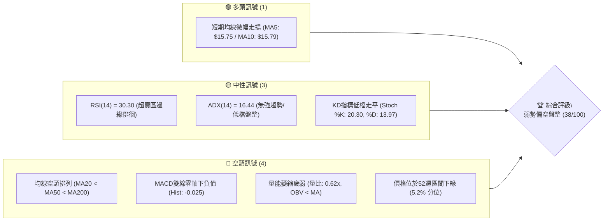
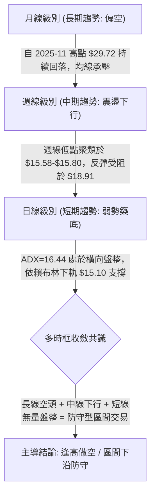
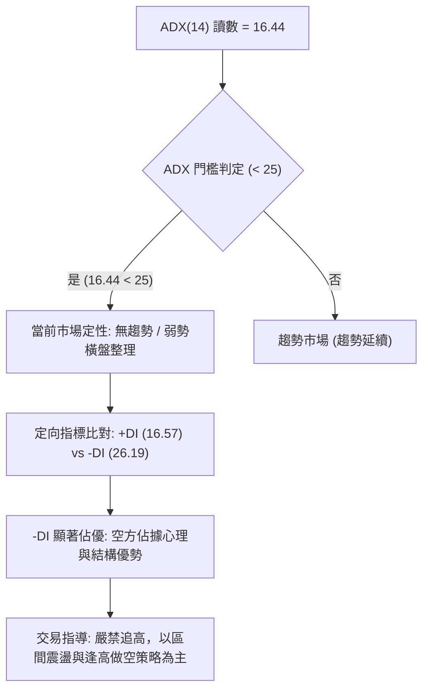
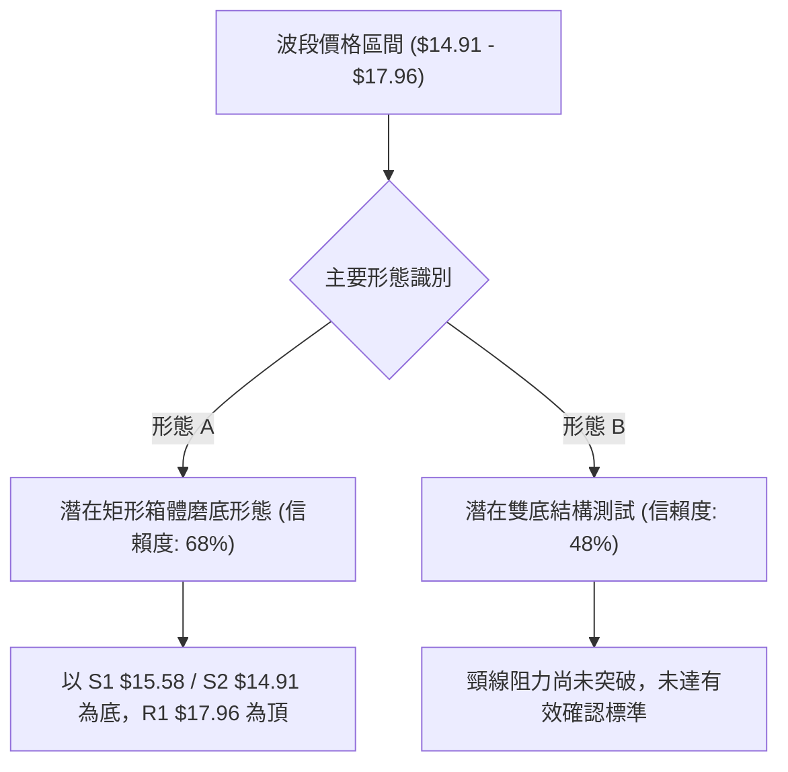
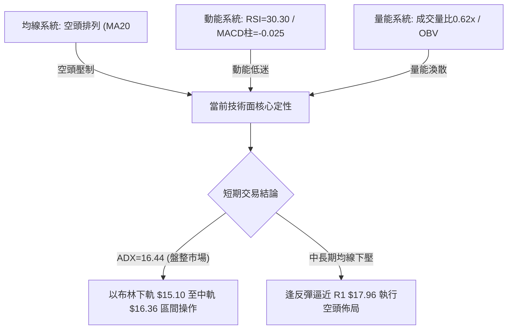
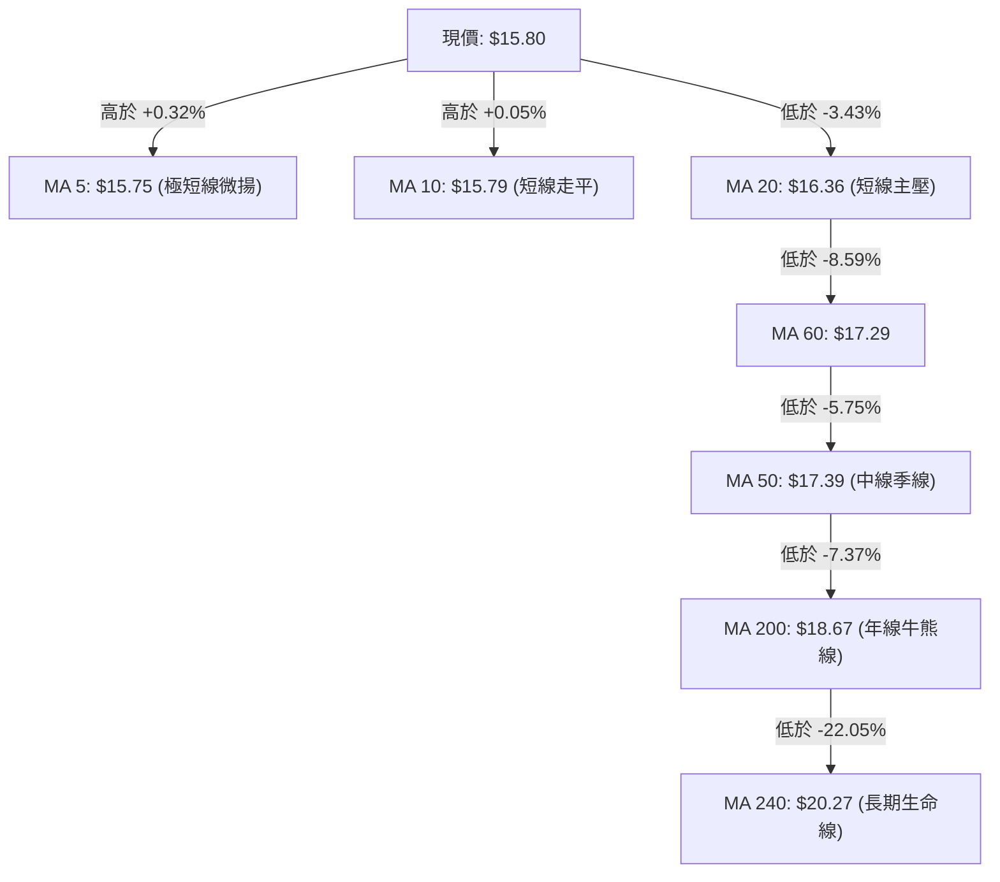
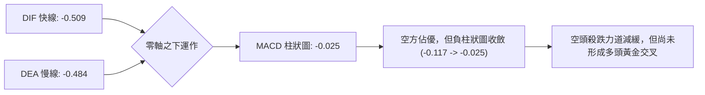
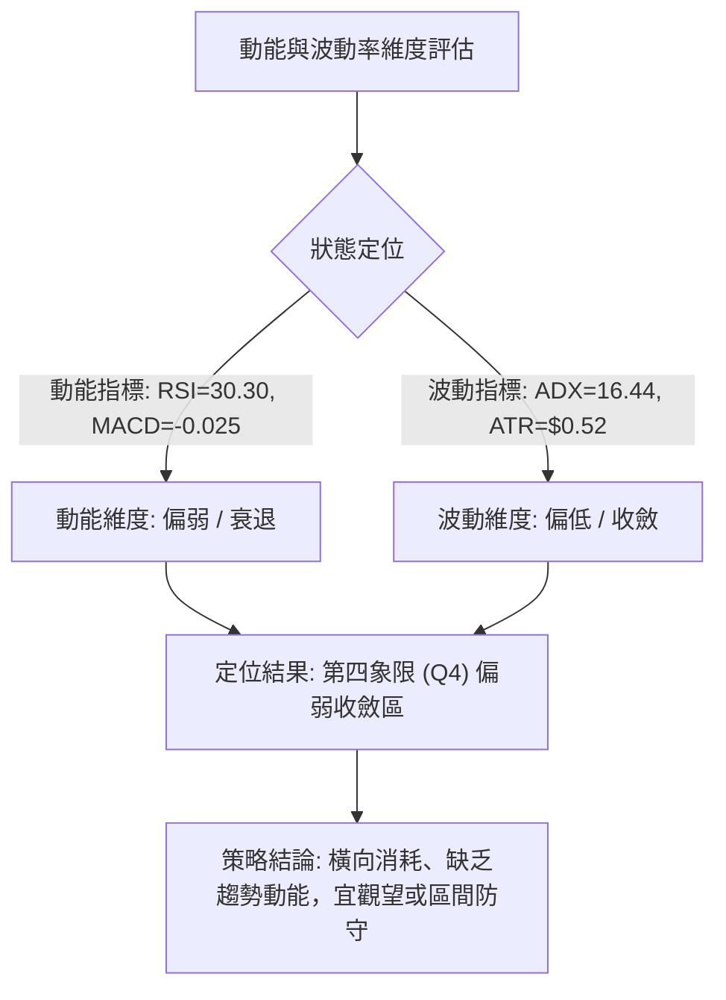
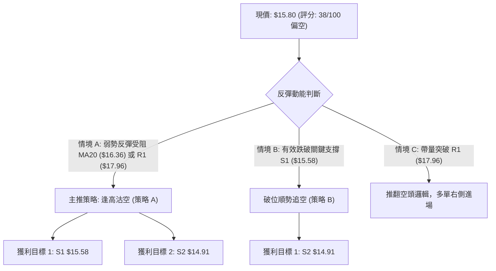
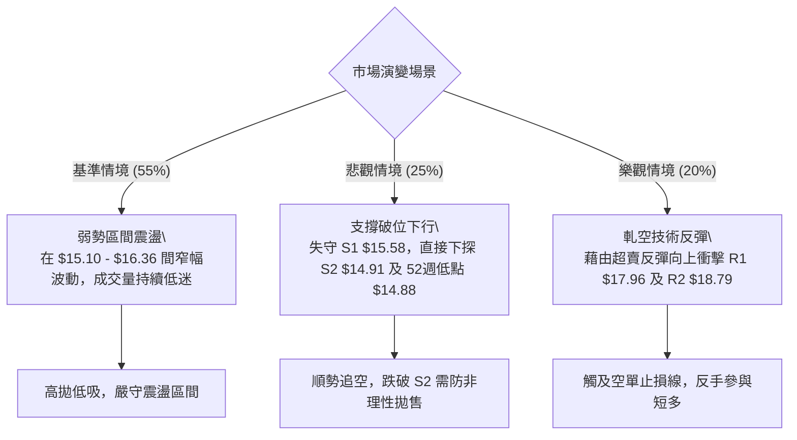

# SOFI 技術分析報告

> **報告日期**：2026-10-12 ｜ **語言**：繁體中文 ｜ **數據來源**：Yahoo Finance ｜ **當前價格**：$15.80

---

## 目錄

| 章節 | 內容 |
|------|------|
| [1. 技術面概覽](#1-技術面概覽) | 訊號儀表板、核心指標、評分卡 |
| [2. 趨勢分析](#2-趨勢分析) | 多時框趨勢、長中短期走勢 |
| [3. 圖表形態分析](#3-圖表形態分析) | 形態識別、K線組合、目標價 |
| [4. 支撐與阻力](#4-支撐與阻力) | 關鍵價位、斐波那契回調 |
| [5. 技術指標深度解讀](#5-技術指標深度解讀) | MA/RSI/MACD/布林/成交量 |
| [6. 動能與波動率](#6-動能與波動率) | 動能評估、ATR、Beta |
| [7. 多時框架總結](#7-多時框架總結) | 時框架評分矩陣 |
| [8. 交易策略建議](#8-交易策略建議) | 多空策略、風險報酬比 |
| [9. 風險提示與監控](#9-風險提示與監控) | 監控指標、風險場景 |
| [📋 報告總結](#-報告總結) | 核心摘要與配置建議 |

---

## 1. 技術面概覽

### 🎯 技術訊號儀表板



### 📊 核心指標速覽表

| 指標類別 | 指標名稱 | 當前數值 | 訊號 | 解讀 |
|----------|----------|----------|------|------|
| **價格** | 當前收盤價 | $15.80 | 🔴 | 位於52週高低區間底部（5.2%分位），極度貼近波段低點 |
| **均線** | MA20 (月線) | $16.36 | 🔴 | 價格低於MA20達 -3.43%，短中期承壓 |
| **均線** | MA50 (季線) | $17.39 | 🔴 | 價格低於MA50，中線空頭壓制明確 |
| **均線** | MA200 (年線) | $18.67 | 🔴 | 價格深陷年線下方，長期趨勢偏空 |
| **動能** | RSI(14) | 30.30 | 🟡 | 進入超賣臨界點，具備技術性修復潛力但尚未放量 |
| **動能** | MACD(12,26,9) | -0.509 / -0.484 | 🔴 | DIF與DEA均在零軸之下，柱狀圖為 -0.025，空方掌控局勢 |
| **動能** | Stoch %K / %D | 20.30 / 13.97 | 🟡 | 位於超賣區鈍化，短線反彈動能醞釀中 |
| **趨勢** | ADX(14) | 16.44 | 🟡 | 趨勢強度低於25，代表市場處於弱勢橫向磨底與無方向盤整 |
| **方向** | +DI / -DI | 16.57 / 26.19 | 🔴 | -DI明顯高於+DI，空方主導力量尚未消退 |
| **通道** | 布林通道 %B | 0.28 | 🔴 | 價格貼近布林下軌（$15.10），通道中軌（$16.36）形成直接反壓 |
| **量能** | 成交量比率 | 0.62x | 🔴 | 29.20M vs 20日均量 47.25M，量能極度萎縮，OBV弱於均線 |
| **波動** | ATR(14) | $0.52 (3.26%) | 🟡 | 日波動幅度收窄，短線面臨變盤突破節點 |

### 🏆 技術評分卡

```
╔══════════════════════════════════════════════════════════════╗
║              技術評分卡 — SOFI (2026-10-12)                   ║
╠══════════════════════════════════════════════════════════════╣
║ 趨勢強度 (ADX/DI)   ███████░░░░░░░░░░░░░  35/100  🔴 空方主導 ║
║ 動能指標 (RSI/MACD) ████████░░░░░░░░░░░░  38/100  🔴 動能疲弱 ║
║ 支撐穩定度 (S1/S2)  ███████████░░░░░░░░░  55/100  🟡 臨近底線 ║
║ 成交量配合 (OBV/Vol)██████░░░░░░░░░░░░░░  30/100  🔴 量能退潮 ║
║ 形態完整度 (結構)   █████████░░░░░░░░░░░  45/100  🟡 築底雛形 ║
║ 均線排列 (MA系統)   ████░░░░░░░░░░░░░░░░  20/100  🔴 空頭排列 ║
╠══════════════════════════════════════════════════════════════╣
║ 綜合技術評分        ███████░░░░░░░░░░░░░  38/100  🔴 弱勢偏空 ║
╚══════════════════════════════════════════════════════════════╝
```

---

## 2. 趨勢分析

### 🌐 多時框趨勢分析



### 📈 長期趨勢 — 12個月走勢圖（Unicode）

```
SOFI 月線歷史收盤走勢圖（2025-10 至 2026-10）
價格軸 ($)
$29.72 ┤              ●   ●(歷史頂部 $29.72)
$26.18 ┤          ●           ●
$22.81 ┤                          ●
$18.22 ┤                              ●               ●
$17.88 ┤                                                  ●   ●
$16.31 ┤                                  ●                   ●
$15.80 ┤━━━━━━━━━━━━━━━━━━━━━━━━━━━━━━━━━━━━━━━━━━━━━━━━━━━━━━━●← 現價 ($15.80)
       └──────┬───┬───┬───┬───┬───┬───┬───┬───┬───┬───┬───┬───┬───┘
            25-10 11  12 26-01 02  03  04  05  06  07  08  09  10
```

#### 走勢特徵分析表格

| 階段 | 時間區間 | 起訖價位 | 區間漲跌幅 | 走勢特徵與量價結構 |
|------|----------|----------|------------|--------------------|
| **主升見頂段** | 2025-10 至 2025-11 | $29.68 → $29.72 | +0.13% | 於 $29.72 形成波段高位雙頂滯漲結構，動能指標初顯疲態 |
| **主跌下行段** | 2025-11 至 2026-03 | $29.72 → $15.88 | -46.57% | 連續4個月大陰線下挫，均線系統全線被摜破，失守年線 |
| **弱勢抵抗段** | 2026-03 至 2026-08 | $15.88 → $17.88 | +12.59% | 在 $16.00-$18.00 構築橫盤整理箱體，反彈高點受限於 $18.91 |
| **破底探尋段** | 2026-08 至 2026-10 | $17.88 → $15.80 | -11.63% | 連續兩月回落，重新測試波段低點聚類 S1 ($15.58) 與 52週低點 ($14.88) |

### 📊 中期趨勢（週線分析）

```
近期週線壓力與支撐階梯分布：
[阻力階梯 R3]  $19.62 ────────────────────── 近一年波段高點強壓力聚類
[阻力階梯 R2]  $18.79 ────────────────────── 斐波那契 78.6% 回調位 ($18.70) / MA200 壓制區
[阻力階梯 R1]  $17.96 ────────────────────── 週線箱體上緣 / 布林上軌 ($17.62)
               ▲
[當前收盤價]   $15.80 ───● (位於 MA5: $15.75 與 MA20: $16.36 之間窄幅膠著)
               ▼
[支撐階梯 S1]  $15.58 ────────────────────── 近一年波段低點聚類支撐線
[支撐階梯 S2]  $14.91 ────────────────────── 52週極值低點防線 ($14.88)
```

從近 20 週數據觀察，SOFI 在 2026 年 8 月下旬觸及 $18.91 後，成交量持續衰退（由每週 4.8 億股萎縮至當前 1.99 億股），週 RSI 跌至 30.3 附近，顯示中期拋壓沉重但下殺力道略有減緩。

### ⚡ 趨勢強度評估（ADX 解讀）



#### ADX 趨勢強度對照表

| ADX 數值區間 | 當前讀數 | 趨勢強度等級 | 市場狀態特徵 | 操作指導原則 |
|--------------|----------|--------------|--------------|--------------|
| 0 – 20 | **16.44** | 🔴 極弱 / 盤整 | 缺乏方向性大單推動，價格呈現窄幅洗盤 | 採用區間震盪指標，不宜使用突破策略 |
| 20 – 25 | — | 🟡 趨勢醞釀 | 動能逐步積累，方向即將選擇 | 關注布林通道開口變化與量能激增點 |
| 25 – 40 | — | 🟢 強趨勢 | 趨勢明確形成，均線呈現單邊排列 | 順勢交易，回調均線加碼 |
| 40 – 60 | — | 🟣 極強趨勢 | 單邊極致行情，動能爆發 | 警惕超買超賣背離與趨勢耗竭 |

---

## 3. 圖表形態分析

### 🔍 形態識別系統



#### 形態識別與信心度評估表

| 形態名稱 | 信心度 | 判斷依據（引用數據） | 完成度 | 目標價（附計算式） |
|----------|--------|----------------------|--------|--------------------|
| **矩形橫向箱體** | 68% | 價格在 S1 ($15.58) 與 R1 ($17.96) 間反覆震盪超過10週 | 75% | 箱體突破目標：$17.96 + ($17.96 - $15.58) = **$20.34**（數據中未確認突破前不觸發） |
| **潛在雙重底** | 48% | 2026-03 低點 $15.88 與當前低點 $15.72 聚類 | 35% | 訊號不足（信心度<50%），頸線 $18.91 遙遠，**僅做指標型低檔鈍化解讀** |
| **均線空頭排列夾層** | 85% | MA20 ($16.36) < MA50 ($17.39) < MA200 ($18.67) | 100% | 下行反壓目標：反彈第一阻力受制於 MA20 ($16.36) |

### 🕯️ 重要K線形態分析

| 週/月份 | 收盤價 | K線形態 | 解讀 | 訊號 |
|---------|--------|---------|------|------|
| **2026-08-23 週** | $18.91 | 長上影流星線 | 上攻波段高點 R2 ($18.79) 失敗，多頭動能耗盡受阻回落 | 🔴 看跌阻力確認 |
| **2026-09-27 週** | $16.58 | 中黑下挫破位K | 貫穿 MA20 均線支撐，週成交量放大至 302M，確認空方重掌優勢 | 🔴 跌勢加速 |
| **2026-10-04 週** | $15.77 | 帶下影長陰棒 | 探底至 52週低點區間，觸及 S1 ($15.58) 引發技術性逢低承接買盤 | 🟡 空方動能放緩 |
| **2026-10-11 週** | $15.80 | 低檔十字星/錘頭 | 週跌勢暫歇，收盤微漲 +0.03，量能萎縮至 199M，顯現磨底特徵 | 🟡 變盤十字線 |

### 📉 ASCII 走勢形態示意圖

```
SOFI 日線/週線 關鍵築底測試形態示意圖
阻力區 R1 $17.96 ──────┬─────────────────────────────────── (箱體頂部)
                      │       ╭───╮       ╭───╮
                      │      ╭╯   ╰╮     ╭╯   ╰╮
MA20 阻力 $16.36 ─────┼─────╭╯─────╰╮───╭╯─────╰╮────────── (反彈阻力線)
                      │    ╭╯       ╰╮ ╭╯       ╰╮
現價位階 $15.80 ──────┼───●───────────●───────────●─────── (現價位階: 弱勢整理)
                      │  ╭╯                       ╰╮
支撐位階 S1 $15.58 ───┼─╭╯                         ╰╮───── (波段低點支撐)
支撐極限 S2 $14.91 ───┴─┴───────────────────────────┴──── (52W低點防線 $14.88)
                        2026-03       2026-08       2026-10
```

### 🎯 形態目標價計算

依據幾何對稱結構與波段極值計算：
1. **箱體下限跌破情境**：
   - 頸線/支撐基點 = S1 ($15.58)
   - 形態箱體高度 = R1 ($17.96) - S1 ($15.58) = $2.38
   - 若有效跌破 S1，理論下行投影價位 = $15.58 - $2.38 = $13.20（**注意**：數據中波段防禦最底層為 S2 $14.91 及 52週低點 $14.88，若跌破 $14.88 則將開啟空頭失控走勢）。
2. **反彈測頂情境**：
   - 若於 S1 ($15.58) 獲得持續支撐，第一反彈目標為 MA20 均線 **$16.36**，第二目標為布林上軌與 R1 共振區 **$17.96**。

---

## 4. 支撐與阻力

### 🗺️ 關鍵價位分布圖（Unicode）

```
SOFI 價位結構分布圖 (由實際交易數據聚類計算)
═══════════════════════════════════════════════════════════════
$19.62 ║████████████████████████║ 強阻力 R3 (波段高點/空頭最後防線)
$18.79 ║████████████████████    ║ 阻力 R2 (斐波那契 78.6% 回調位 / MA200)
$17.96 ║████████████████████████║ 關鍵阻力 R1 (布林通道上軌聚類區)
$16.36 ║▓▓▓▓▓▓▓▓▓▓▓▓            ║ 短線均線壓制位 (MA20 / 布林中軌)
───────╫────────────────────────╫───────────────────────────────
$15.80 ╠════════════════════════╣ ◄ 當前市價 ($15.80)
───────╫────────────────────────╫───────────────────────────────
$15.58 ║▓▓▓▓▓▓▓▓▓▓▓▓▓▓▓▓        ║ 近期支撐 S1 (近一年波段低點聚類)
$14.91 ║████████████████████████║ 強支撐 S2 (52週歷史低點防線 $14.88)
═══════════════════════════════════════════════════════════════
```

### 🚧 阻力位分析表

| 阻力級別 | 精確價位 | 距現價空間 | 形成原因與技術共振 | 突破難度 | 重要性等級 |
|----------|----------|------------|--------------------|----------|------------|
| **R1** | **$17.96** | +13.67% | 近一年波段高點聚類、布林通道上軌（$17.62）附近共振區 | 相當高 | 🔴 核心波段阻力 |
| **R2** | **$18.79** | +18.89% | 斐波那契 78.6% 回調位（$18.70）、年線 MA200（$18.67）強空頭重壓 | 極高 | 🔴 中期多空分水嶺 |
| **R3** | **$19.62** | +24.16% | 近一年密集高點聚類頂部、下行波段起跌點 | 難以逾越 | 🔴 終極結構阻力 |

### 🛡️ 支撐位分析表

| 支撐級別 | 精確價位 | 距現價空間 | 形成原因與技術共振 | 守住機率 | 重要性等級 |
|----------|----------|------------|--------------------|----------|------------|
| **S1** | **$15.58** | -1.42% | 近一年波段低點聚類、多重日K下影線密集區 | 58% | 🟢 短線防守基石 |
| **S2** | **$14.91** | -5.63% | 52週歷史最低點（$14.88）防線、布林下軌（$15.10）外圍支撐 | 72% | 🟢 多頭生命線底限 |

### 📐 斐波那契回調位分析

> **計算基點**：52週波段區間 $14.88（100.0% 低點）→ $32.73（0.0% 高點）

| 回調比率 | 斐波那契價位 | 距現價空間 | 技術意涵與結構分析 |
|----------|--------------|------------|--------------------|
| **0.0% (52W High)** | **$32.73** | +107.15% | 波段歷史最高點，超級壓力頂 |
| **23.6%** | **$28.52** | +80.51% | 強勢回調防守線，失守後轉為大級別阻力 |
| **38.2%** | **$25.91** | +63.99% | 弱勢反彈極限阻力位 |
| **50.0%** | **$23.80** | +50.63% | 中期多空平衡中軸 |
| **61.8%** | **$21.70** | +37.34% | 黃金分割關鍵反轉點（牛熊分野） |
| **78.6%** | **$18.70** | +18.35% | 深幅回調防守點，與 R2 ($18.79) 及 MA200 ($18.67) 形成強共振 |
| **100.0% (52W Low)**| **$14.88** | -5.82% | 原始上升浪起點，極度關鍵之波段鐵底 |

#### 現價位階解讀
當前現價 **$15.80** 處於 **78.6% ($18.70)** 至 **100.0% ($14.88)** 的極度深水區間。當資產回撤超過 78.6% 時，技術面代表原始牛市上行結構已遭到實質性破壞，市場已非正常回調，而是轉為「長線空頭框架下的低檔尋底」。上方每一檔斐波那契水位在未來均將轉化為強大套牢賣壓。

---

## 5. 技術指標深度解讀

### 🎛️ 指標訊號總覽



### 📈 移動平均線排列分析



#### 均線架構解讀
1. **完全空頭排列**：MA20 ($16.36) < MA50 ($17.39) < MA200 ($18.67)。所有中長天期均線均向下傾斜，顯示過去 1 至 12 個月進場的投資人全面處於帳面虧損狀態，反彈至均線附近均將遭遇解套賣壓。
2. **短期止跌徵兆**：現價目前微幅站上 MA5 ($15.75) 與 MA10 ($15.79)，且兩條短線均線在底部呈現走平黏合態勢，說明超跌後有短暫築底抗跌跡象，但尚不足以逆轉整體空頭排列格局。

### 📉 RSI(14) 分析

```
RSI(14) 讀數：30.30
[0] ─────────── [30] ──────────────────── [70] ─────────── [100]
█████████████░░░░░░░░░░░░░░░░░░░░░░░░░░░░░░  30.30%
【極度超賣區間】    【      正常震盪區間      】     【極度超買區間】
```

#### RSI 深度解讀與背離判斷
- **超買超賣判定**：RSI 讀數 **30.30** 緊貼 30 的超賣臨界線。回顧近20週數據，2026-10-04 當週 RSI 曾跌至 23.0 的極度超賣區，隨後於本週回升至 30.30，展現指標修復動能。
- **背離判斷結論**：
  - **日線/週線背離情況**：**無明顯底背離**。
  - **判定依據**：價格在 2026-10-04 創下週收盤新低 $15.77，RSI 同步滑落至 23.0；本週價格小幅回升至 $15.80，RSI 同步上行至 30.30。價格低點與指標低點同步下移並同步微升，未出現「價格創新低而 RSI 低點抬高」的典型多頭底背離結構。因此，目前的停跌僅屬超賣自然喘息，並非可靠反轉訊號。

### 📊 MACD(12/26/9) 訊號解讀



- **MACD 線位階**：快線 (-0.509) 低於慢線 (-0.484)，雙線深處零軸下方，屬典型空頭市場。
- **柱狀圖動態**：負柱狀圖（-0.025）較上週的 -0.117 明顯收斂，表明短線空頭拋壓減緩，若後續 DIF 能向上穿越 DEA 形成零軸下「弱勢金叉」，可能誘發一波觸及 MA20 ($16.36) 的技術性反彈。

### 📦 布林通道分析

```
SOFI 布林通道結構示意圖 (帶寬與現價分布)
$17.62 ────────────────────────────────── 上軌 (強阻力壓制區)
          │
$16.36 ───┼────────────────────────────── 中軌 / MA20 (多空反彈防線)
          │           ● 現價 $15.80 (%B = 0.28)
$15.10 ───┴────────────────────────────── 下軌 (動態超賣支撐區)
```

- **帶寬與現價位置**：%B = 0.28，價格位於通道下半部，非常貼近下軌（$15.10）。
- **通道態勢解讀**：通道呈現收斂後的低檔走平狀態，並未伴隨向下大幅開口，印證當前 ADX=16.44 的「低波動盤整」特徵。在有效突破中軌 $16.36 之前，價格大概率將被壓制在 $15.10 至 $16.36 區間內反覆拉扯。

### 💹 成交量分析（量價配合度）

```
最新單日成交量:  29,199,800 股
20日平均成交量:  47,248,835 股  (當前量比: 0.62x)  [██████░░░░] 萎縮 38%
50日平均成交量:  45,529,846 股
```

- **量價特徵**：最新成交量大幅縮減至 29.2M，量比僅 0.62x。在跌破均線的過程中出現縮量，表明市場恐慌性拋售已基本釋放完畢，但也同時印證多頭買盤意願極度低落，缺乏機構資金主力進場拉抬。
- **OBV 走勢**：OBV 指標持續位於其自身均線下方（OBV < MA），量能趨勢疲弱，量價未能形成健康齊揚的多頭確認結構。無量盤整暗示後市極易受大盤或突發利空打壓而再度破位。

---

## 6. 動能與波動率

### ⚡ 動能評估四象限



| 象限 | 動能強度 | 波動率狀態 | 當前定位 | 操作環境評估 |
|------|----------|------------|----------|--------------|
| **Q1** | 強 | 低 | — | 穩定單邊上行，低風險最佳持股區 |
| **Q2** | 強 | 高 | — | 爆發突破行情，高收益伴隨大幅震盪 |
| **Q3** | 弱 | 高 | — | 恐慌主跌浪，單邊跳水殺跌階段 |
| **Q4** | **弱** | **低** | **✓ (當前狀態)** | **磨底盤整期，動能衰退且波動萎縮，嚴禁盲目重倉追單** |

### 📊 ATR 波動率分析

- **ATR(14) 數值**：**$0.52**（佔現價 $15.80 之 **3.26%**）。
- **日內波動特徵**：目前每日合理平均震盪範圍約為 ±$0.52。波動率較前期主跌段已大幅降低，有利於設定清晰嚴密的停損空間。
- **風控止損距離建議**：
  - **日內/超短線止損**：1.0 × ATR = **$0.52**
  - **波段短線止損**：1.5 × ATR = **$0.78**
  - **波段中線止損**：2.0 × ATR = **$1.04**

### 📐 Beta 與市場相關性

- **Beta 係數**：**2.332**
- **市場敏感度分析**：SOFI 的 Beta 高達 2.332，顯示其股價波動敏銳度為大盤標普500指數的 2.33 倍以上。在當前技術面偏弱且大盤若出現震盪的情境下，該股具有極高的下行波動放大風險；但相對地，若市場迎來整體流動性轉折，其反彈爆發彈性亦極高。

---

## 7. 多時框架總結

### 📋 時框架評分表

| 時框架 | 趨勢方向 | 動能狀態 | 均線排列 | 形態特徵 | 綜合評分 | 交易建議 |
|--------|----------|----------|----------|----------|----------|----------|
| **月線 (長期)** | 🔴 單邊下行 | 🔴 弱勢超賣 | 🔴 空頭排列 (低於MA240 $20.27) | 見頂 $29.72 後大幅回落 | 25/100 | 規避長線做多 |
| **週線 (中期)** | 🔴 震盪偏空 | 🔴 負柱收斂 | 🔴 空頭排列 (承壓MA50 $17.39) | 箱體下沿反覆拉鋸 | 35/100 | 逢反彈高空 |
| **日線 (短期)** | 🟡 橫向盤整 | 🟡 超賣修復 | 🟡 短均微揚 (高於MA5/MA10) | 布林下半部窄幅震盪 | 45/100 | 區間低吸高拋 |

### 🔲 綜合訊號矩陣

| 維度 | 短期 (日線) | 中期 (週線) | 長期 (月線) | 訊號一致性評估 |
|------|-------------|-------------|-------------|----------------|
| **均線位置** | 價格介於 MA10 與 MA20 之間 | 價格全面受壓於 MA20/MA50 | 價格深陷長週期均線下方 | 🔴 中長線高度一致偏空 |
| **動能方向** | RSI 進入 30 邊緣反彈 | 週 MACD 負柱狀收斂 | 月線級別動能全面衰竭 | 🟡 短多長空，動能分歧 |
| **量價配合** | 量能萎縮，追價無力 | 連續數週縮量回落 | 主升量退潮，資金撤離 | 🔴 缺乏機構買盤確認 |
| **結構突破** | 測試 S1 $15.58 支撐 | 位於 S1 與 R1 箱體內 | 處於 78.6%-100% 回撤區間 | 🔴 總體防禦結構極度被動 |

### ⚖️ 多時框收斂結論

依據多時框收斂優先級規則：
1. **行情定性**：當前 **ADX(14) = 16.44 (< 25)**，明確指示當前市場屬於**「無趨勢盤整行情」**。
2. **時框主導與矛盾化解**：
   - 儘管中長期（週線/MA50、月線/MA200）方向為明確的強烈空頭，但在 ADX < 25 且 ATR 波動收斂的無趨勢環境下，空方已不具備單邊摜壓的動能，市場不會立即展開流暢的下行單邊走勢。
   - 交易主導邏輯依規則收斂為：**以日線布林通道上下軌 ($15.10 - $17.62) 與關鍵價位 S1 ($15.58) 至 R1 ($17.96) 作為主要震盪箱體**。
3. **唯一方向性結論**：**【弱勢偏空震盪（評分 38/100）】**。總體戰略不宜盲目追空，而應採取「逢反彈至布林中軌/阻力位反手做空，或在極度貼近下軌 S1 支撐處進行極窄止損的短線防守性博弈」。

---

## 8. 交易策略建議

### 🗺️ 策略決策流程圖



### 🧭 策略路由

- **當前主策略方向 = 【防守型逢高做空 / 偏空區間操作】（依技術評分卡 38/100，落於 ≤40 偏空區間）**
- 由於綜合評分低於 40，技術面空頭排列佔優，**主推空頭策略**；多頭反彈僅作為逆勢短線投機或空頭對沖監控，不予列為主推方案。

### 🎯 價格情境階梯（Price Scenarios）

| 觸發條件 | 下一目標 | 後續延伸 | 技術情境含義 |
|----------|----------|----------|--------------|
| **向上突破 R1 $17.96** | R2 **$18.79** | R3 **$19.62** | 突破布林上軌與近一年波段阻力，短線實質反轉，空單全面止損 |
| **反彈受阻 MA20 $16.36** | 現價 **$15.80** | S1 **$15.58** | 受制於中軌下壓，回歸弱勢震盪尋底 |
| **跌破支撐 S1 $15.58** | S2 **$14.91** | 52W低點 **$14.88** | 跌破近一年波段低點聚類，空頭結構下行延伸 |

### 📊 情境機率分佈

| 價格情境 | 機率預估 | 主要指標依據 |
|----------|----------|--------------|
| **情境一：弱勢區間震盪** | **55%** | ADX 僅 16.44，布林帶寬窄化，成交量縮減（量比 0.62x），多空雙方均無力走出單邊 |
| **情境二：回落測試 S1/S2** | **25%** | 均線系統呈標準空頭排列，MACD 處於零軸之下，-DI (26.19) 壓制 +DI (16.57) |
| **情境三：展開強勁反彈** | **20%** | RSI(14) 處於 30.30 超賣邊界，短線 Stoch %K 低檔交叉，具技術性修復動能 |

### 🔴 主策略詳情（方向：偏空主導）

所有價位均嚴格取自數據庫計算數值：

| 策略要素 | 策略 A（主推：反彈遇阻沽空） | 策略 B（輔助：破位順勢追空） |
|----------|------------------------------|------------------------------|
| **進場條件** | 股價弱勢反彈至 MA20 附近出現上影線滯漲 | 價格日K收盤實質跌破 S1 支撐位 |
| **進場價格** | **$16.36** (MA20 阻力位) | **$15.58** (跌破 S1 觸發) |
| **目標價 T1** | **$15.58** (S1 波段支撐位) | **$14.91** (S2 強支撐位) |
| **目標價 T2** | **$14.91** (S2 波段支撐位) | **$14.88** (52週極值低點) |
| **止損價格** | **$17.39** (MA50 季線強阻力位) | **$16.36** (重回 MA20 均線之上) |
| **風險報酬比** | **1 : 1.41** (風險 $1.03，目標2回報 $1.45) | **1 : 0.89** (短線破位快打，風險 $0.78，目標1回報 $0.67) |
| **模型預估勝率** | **58%** | **52%** |
| **建議倉位** | **15% - 20%** | **10%** (嚴格控制部位) |

### 🟢 反向風險觸發點（對沖與停損提示）

若出現以下訊號，代表空頭結構被破壞，主推空策略立即失效：
1. **價位停損觸發**：若股價放量帶長陽棒有效站上 **R1 ($17.96)**，意味著突破了布林通道上軌及近一年箱體頂部，所有空頭頭寸必須無條件市價平倉。
2. **指標轉強確認**：日線 MACD 出現零軸下金叉，且成交量激增放大至 20日均量（47.25M）之 1.5 倍以上。

### ⭐ 整體訊號強度評星

```
做多訊號強度：★☆☆☆☆  (1/5星 - 僅存超賣修復，均線全面壓制)
做空訊號強度：★★★☆☆  (3/5星 - 趨勢偏空但受限於 ADX<25 盤整空間)
整體可信度：  ★★★☆☆  (3/5星 - 縮量震盪環境，需提防假突破)
```

---

## 9. 風險提示與監控

### ✅ 關鍵監控指標 Checklist

```
╔══════════════════════════════════════════════════════════════╗
║               SOFI 每日技術監控重點 CHECKLIST                 ║
╠══════════════════════════════════════════════════════════════╣
║ [ ] 價格是否跌破 S1 ($15.58)？ (若破位，下探 S2 $14.91 風險大增) ║
║ [ ] 價格能否收復 MA20 ($16.36)？ (若突破，短線空頭受阻)      ║
║ [ ] RSI(14) 是否跌破 30.00 形成鈍化，或回升至 45.00 以上？    ║
║ [ ] 單日成交量是否突破 47.25M (20日均量)？ (確認是否有主力進場) ║
║ [ ] 空頭借券放空比例 (Short % Float = 16.9%) 是否引發軋空？   ║
║ [ ] ADX(14) 是否自 16.44 向上突破 25？ (確認單邊趨勢開啟)    ║
╚══════════════════════════════════════════════════════════════╝
```

### ⚠️ 風險場景分析



### 🛡️ 風險管理重要提醒

1. **極高 Beta 與波動放大風險**：SOFI 的 Beta 高達 **2.332**，市場一旦出現系統性回檔，其股價跌幅往往呈現倍數放大。交易者必須將總持倉部位嚴格控制在總投資組合的 15% 以內。
2. **高放空比率的軋空風險（Short Squeeze）**：當前 SOFI 空頭佔浮動盤比例高達 **16.9%**，Short Ratio 達到 **4.84 天**。若出現任何超出預期的利多消息刺激，高放空部位可能導致空頭集中回補，引發劇烈且毫無預警的脈衝式向上軋空走勢。因此，任何空頭操作均須嚴格設置停損於 **$17.39** 或 **$17.96**，絕不可抱僥倖心理抗單。
3. **資金管理紀律**：單筆交易的最大承擔風險金額不得超過總帳戶資金的 1.5%。依 ATR ($0.52) 推算之合理停損距離為 $0.78 - $1.03，應相應反推合理下單股數，避免因重倉槓桿引發本金不可逆侵蝕。

---

## 📋 報告總結

```
╔══════════════════════════════════════════════════════════════╗
║                 SOFI 技術分析報告總結                          ║
╠══════════════════════════════════════════════════════════════╣
║ 報告日期：2026-10-12                                         ║
║ 當前價格：$15.80                                             ║
║ 技術評級：🔴 弱勢偏空盤整 (綜合評分: 38/100)                  ║
║                                                              ║
║ 關鍵技術維度結論：                                           ║
║ ├─ 長期趨勢：🔴 單邊下行，受阻於年線 MA200 ($18.67)          ║
║ ├─ 中期趨勢：🔴 箱體震盪偏弱，反彈高點受限於 R1 ($17.96)     ║
║ ├─ 短期趨勢：🟡 超賣微幅喘息，受制於 MA20 ($16.36)           ║
║ ├─ 關鍵支撐：S1: $15.58 ｜ S2: $14.91 ｜ 52W低點: $14.88     ║
║ ├─ 關鍵阻力：R1: $17.96 ｜ R2: $18.79 ｜ R3: $19.62          ║
║ └─ 分析師目標均價：$20.33 (較現價溢價 +28.7%)                ║
║                                                              ║
║ 最優交易策略組合：                                           ║
║ 1. 🥇 最佳機會：反彈至 MA20 ($16.36) 逢高沽空，停損設 $17.39  ║
║ 2. 🥈 次選機會：實質跌破 S1 ($15.58) 順勢輕倉追空，目標 $14.91║
║ 3. 🥉 保守選擇：維持空倉觀望，等待 ADX>25 趨勢方向明朗再行動 ║
╚══════════════════════════════════════════════════════════════╝
```

---

> ⚠️ **免責聲明**：本報告為依據客觀市場數據進行之量化技術分析，所有數據及走勢推演均基於歷史價格與技術指標資訊。本報告**僅供研究與學術參考**，**不構成任何形式之投資建議、推介或買賣邀約**。金融市場投資具有極大風險，資產價格可升亦可跌，投資人應自行審慎評估風險並承擔交易結果。

---

*報告生成時間：2026-10-12 ｜ 數據來源：Yahoo Finance ｜ 分析框架：多時框技術分析體系*