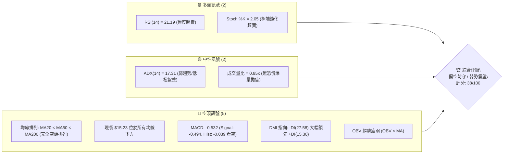
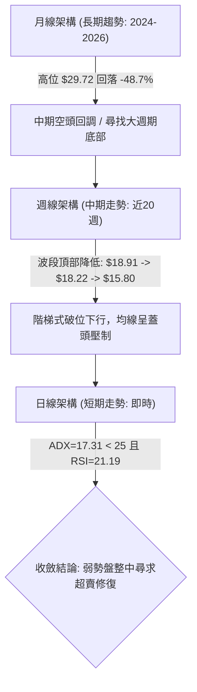
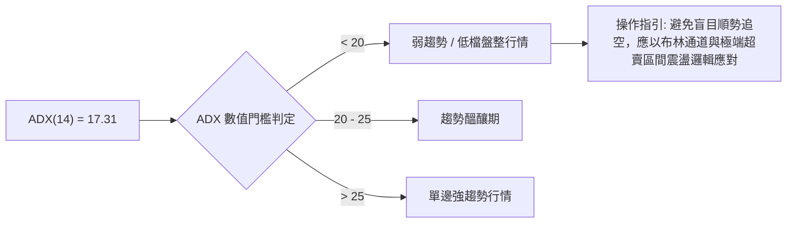
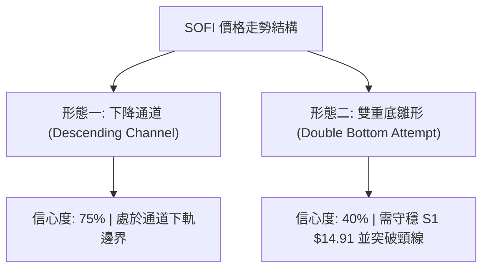
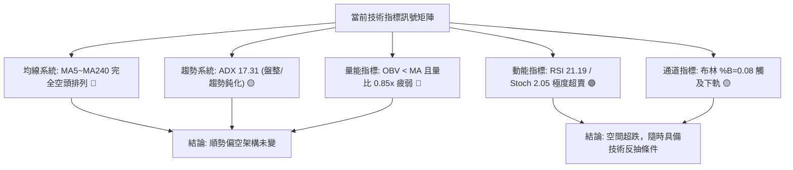
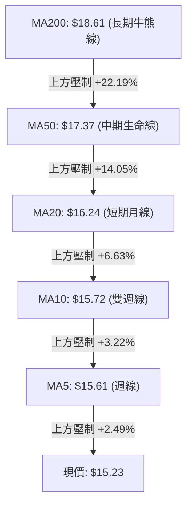
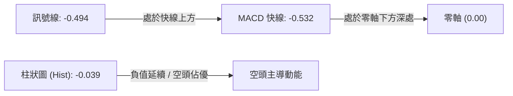
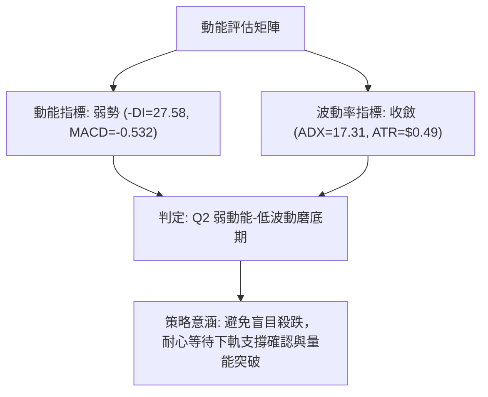
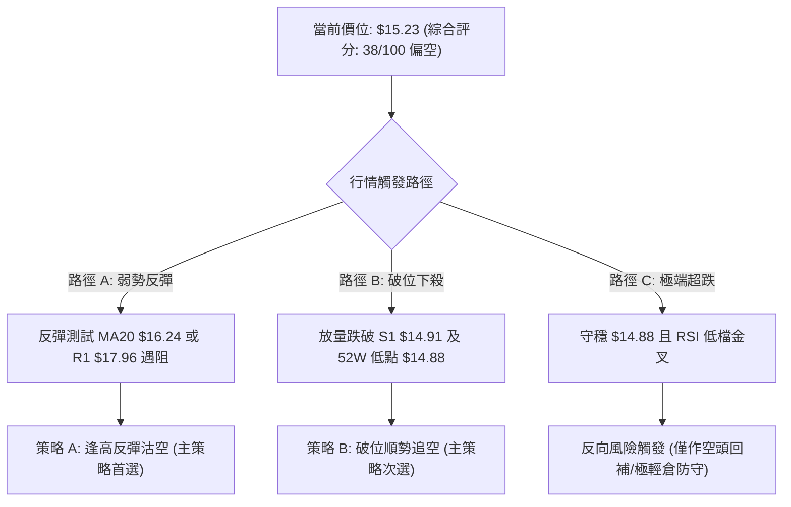
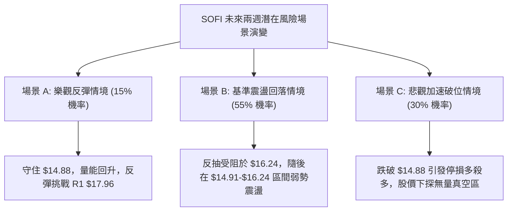

# SOFI 技術分析報告

> **報告日期**：2026-10-13 ｜ **語言**：繁體中文 ｜ **數據來源**：Yahoo Finance ｜ **當前價格**：$15.23

---

## 目錄

| 章節 | 內容 |
|------|------|
| [1. 技術面概覽](#1-技術面概覽) | 訊號儀表板、核心指標、評分卡 |
| [2. 趨勢分析](#2-趨勢分析) | 多時框趨勢、長中短期走勢、ADX 趨勢強度 |
| [3. 圖表形態分析](#3-圖表形態分析) | 形態識別、信心度評估、K線組合、目標價推算 |
| [4. 支撐與阻力](#4-支撐與阻力) | 關鍵價位分布圖、阻力/支撐表、斐波那契回調結構 |
| [5. 技術指標深度解讀](#5-技術指標深度解讀) | MA 系統、RSI、MACD、布林通道、OBV 量價配合 |
| [6. 動能與波動率](#6-動能與波動率) | 動能四象限、ATR 止損設定、Beta 高彈性解析 |
| [7. 多時框架總結](#7-多時框架總結) | 時框矩陣、優先級收斂機制、唯一方向性結論 |
| [8. 交易策略建議](#8-交易策略建議) | 策略路由、主策略規劃、情境階梯、風報比計算 |
| [9. 風險提示與監控](#9-風險提示與監控) | 監控清單 Checklist、極端情境推演、風控防線 |

---

## 1. 技術面概覽

### 🎯 技術訊號儀表板

當前市場技術面呈現「中長期均線全面空頭壓制，但短線動能指標嚴重超賣，趨勢強度處於盤整與弱趨勢過渡期」的特徵。



---

### 📊 核心指標速覽表

| 指標類別 | 指標名稱 | 當前數值 | 訊號 | 解讀與交易意涵 |
|:---|:---|:---|:---:|:---|
| **價格結構** | 收盤價 | $15.23 | 🔴 | 逼近 52 週最低點 $14.88，處於區間底部 2.0% 分位 |
| **均線系統** | 20日均線 (MA20) | $16.24 | 🔴 | 價格低於 MA20 達 -6.22%，短期下行趨勢顯著 |
| **均線系統** | 50日均線 (MA50) | $17.37 | 🔴 | 中期生命線下彎，上方形成多層解套沉重賣壓 |
| **均線系統** | 200日均線 (MA200)| $18.61 | 🔴 | 牛熊分界線位於現價上方 +22.19%，處於典型空頭市場 |
| **動能指標** | RSI (14) | 21.19 | 🟢 | 進入深度超賣區（<30），技術性跌深反彈動能累積 |
| **動能指標** | MACD (12,26,9) | -0.532 | 🔴 | 快慢線雙雙在零軸下方運行，柱狀圖負值（-0.039）延續空頭動能 |
| **動能指標** | KD (Stoch 14,3,3)| K: 2.05 / D: 11.88| 🟢 | 處於極端超賣區域，隨時具備低檔金叉博弈反彈條件 |
| **趨勢強度** | ADX (14) | 17.31 | 🟡 | ADX < 25，表明單邊下跌動能衰竭，進入低檔盤整震盪期 |
| **趨勢方向** | 方向性指標 (DMI) | +DI: 15.30 / -DI: 27.58 | 🔴 | 空方完全掌控股價定價權，多頭反攻無量 |
| **通道指標** | 布林通道 (20,2) | $15.04 ~ $17.44 | 🟡 | %B = 0.08，貼近下軌運行，通道呈現開口向下的緩跌格局 |
| **量能指標** | 成交量 / 量比 | 40.33M (0.85x) | 🔴 | 縮量陰跌，OBV < 均線，資金未見顯著機構建倉抄底跡象 |
| **波動率** | ATR (14) | $0.49 (3.21%) | 🟡 | 每日波動維持 $0.49，短線交易止損保護需留出充足緩衝 |

---

### 🏆 技術評分卡

```
╔══════════════════════════════════════════════════════════════════╗
║                 技術評分卡 — SOFI (2026-10-13)                   ║
╠══════════════════════════════════════════════════════════════════╣
║ 趨勢方向 (Trend)     ██████░░░░░░░░░░░░░░  30/100 🔴 空頭排列     ║
║ 動能指標 (Momentum)  ████████░░░░░░░░░░░░  40/100 🟡 極端超賣鈍化 ║
║ 支撐穩定度 (Support) ██████████░░░░░░░░░░  50/100 🟡 考驗前低支撐 ║
║ 成交量能 (Volume)    ███████░░░░░░░░░░░░░  35/100 🔴 縮量缺乏承接 ║
║ 形態結構 (Pattern)   ████████░░░░░░░░░░░░  40/100 🔴 階梯型下行   ║
║ 均線發散度 (MAs)     ████░░░░░░░░░░░░░░░░  20/100 🔴 完全空頭排列 ║
╠══════════════════════════════════════════════════════════════════╣
║ 綜合技術評分         ███████░░░░░░░░░░░░░  38/100 🔴 偏空防守     ║
║ 核心評級結論         空頭主導，但極度超賣，防範弱勢破位，反彈逢高布空║
╚══════════════════════════════════════════════════════════════════╝
```

---

## 2. 趨勢分析

### 🌐 多時框趨勢分析

透過月線（長期宏觀宏觀趨勢）、週線（中期波段擺動）與日線（短期執行節奏）進行跨時框收斂分析。



---

### 📈 長期趨勢 — 12個月走勢圖（Unicode）

SOFI 在過去 12 個月（2025-10 至 2026-10）經歷了完整的盛極而衰週期：自 2025 年秋季接近 $30.00 高位構築雙重頂部後，展開長達一年的持續回調，目前價格已逼近 52 週最低點 $14.88。

```
SOFI 月線走勢圖（過去12個月：2025-10 至 2026-10）
價格軸 ($)
$30.00 ┤  ●2025-11 ($29.72)
$28.00 ┤ ●2025-10 ($29.68)
$26.00 ┤                     ●2025-12 ($26.18)
$24.00 ┤
$22.00 ┤                                        ●2026-01 ($22.81)
$20.00 ┤
$18.00 ┤                                                           ●2026-02 ($17.76)   ●2026-05 ($18.22)   ●2026-08 ($17.88)
$16.00 ┤                                                                              ●2026-03 ($15.88) ●2026-04 ($16.10) ●2026-06 ($17.93) ●2026-07 ($16.31) ●2026-09 ($15.72)
$15.00 ┤                                                                                                                                                              ●現在 ($15.23)
       └─────────────────────────────────────────────────────────────────────────────────────────────────────────────────────────────
         25-10   25-11      25-12      26-01      26-02      26-03      26-04      26-05      26-06      26-07      26-08      26-09      26-10
```

#### 走勢特徵分析表格

| 階段週期 | 時間區間 | 起止價格 | 漲跌幅 | 走勢特徵與技術解讀 |
|:---|:---|:---|:---:|:---|
| **階段一：雙頂構築** | 2025-10 ~ 2025-11 | $29.68 → $29.72 | +0.13% | 歷史波段峰值，動能耗盡，兩度測試 $30 關卡未果，構築歷史雙頂 |
| **階段二：第一波急跌** | 2025-12 ~ 2026-02 | $29.72 → $17.76 | -40.24% | 獲利了結盤湧出，連續跌破多條長期均線，量能放大，呈現單邊空頭主跌段 |
| **階段三：低檔箱型震盪** | 2026-03 ~ 2026-08 | $15.88 → $17.88 | +12.59% | 於 $15.88 至 $18.91 區間進行長達半年的寬幅箱型築底震盪，多次反彈受阻 |
| **階段四：破位陰跌探底** | 2026-08 ~ 2026-10 | $18.91 → $15.23 | -19.46% | 箱型下軌失守，週線連收黑K，價格逼近 52 週低點 $14.88，量能萎縮 |

---

### 📊 中期趨勢（週線分析）

中期走勢近 20 週呈現典型的「下降階梯通道」。由週線收盤數據可見，高點從 2026-07-12 的 $18.78、2026-08-23 的 $18.91，逐步下滑至 2026-09-06 的 $18.22，隨後加速跌破 $17.00 與 $16.00 兩道整數關卡。

```
中期週線下降趨勢示意圖
$19.00 ┤            ● 08-23 ($18.91)
$18.50 ┤    ● 07-12 ($18.78)
$18.00 ┤                           ● 09-06 ($18.22)   [下降壓力線阻力壓制]
$17.00 ┤                                      ● 09-20 ($16.96)
$16.00 ┤                                                 ● 10-11 ($15.80)
$15.00 ┤                                                            ● 當前 ($15.23) ◄ 近一年低點支撐 S1 ($14.91)
```

- **週線 MACD**：自 2026-08-30 的 +0.025 翻負後，持續在負值區域擴散（-0.065 → -0.147 → -0.117 → -0.039），顯示中期動能仍為空方主導。
- **週成交量變化**：週成交量由 8 月初的 4.83 億股大幅萎縮至近期每週 2 億股左右，顯示中線賣壓已部分宣洩，但多方追價意願亦極度低落。

---

### ⚡ 趨勢強度評估（ADX 解讀）

當前日線 ADX(14) 讀數為 **17.31**。依據技術分析量化標準：



#### ADX 與 DMI 深度對照表

| 指標變數 | 當前讀數 | 門檻區間 | 技術訊號 | 深入解讀 |
|:---|:---|:---|:---:|:---|
| **ADX(14)** | **17.31** | < 20 (極弱) | 🟡 盤整狀態 | 單邊主跌趨勢已失去動能加速度，進入跌勢末端的低動能停滯/磨底期 |
| **+DI (多方)** | **15.30** | 低於 20 | 🔴 多頭極弱 | 買盤缺乏推動能力，反彈缺乏連續性 |
| **-DI (空方)** | **27.58** | 高於 25 | 🔴 空方主導 | 空方依然控制盤面，但因 ADX 走平，未見恐慌性多殺多加速 |
| **方向差距** | -DI領先 12.28 | - | 🔴 偏空格局 | 趨勢方向為負，但在 ADX 低於 25 條件下，容易出現技術性鈍化或假跌破 |

---

## 3. 圖表形態分析

### 🔍 形態識別系統



依據嚴格技術形態識別標準與數據紀律，針對當前價格幾何結構評估如下：

| 形態名稱 | 信心度 | 判斷依據（引用真實數據） | 完成度 | 目標價（附嚴謹計算式） |
|:---|:---:|:---|:---:|:---|
| **下降通道 (Descending Channel)** | **75%** | 2026-08 高點 $18.91 聯結 2026-09 高點 $18.22 形成通道頂部；近一年低點聚類 $14.91 與 52W 低點 $14.88 構成通道下軌支撐。 | **85%** | 通道下軌目標已達 ($15.00 附近)；反彈通道上軌目標為 **$17.37 (MA50)**。 |
| **潛在雙重底 (Potential Double Bottom)** | **40%** | 第一底為 2026-03 收盤低點 **$15.88**，當前正於 52W 低點 **$14.88** 與 S1 **$14.91** 構築第二底測試。 | **30%** (未確認) | **訊號不足，僅做指標型解讀**。若能突破頸線 $18.91，測幅目標：$18.91 + ($18.91 - $14.91) = **$22.91**（因信心度 < 50%，不作交易依據）。 |
| **均線死叉空頭發散 (MA Bearish Alignment)** | **90%** | MA5($15.61) < MA10($15.72) < MA20($16.24) < MA50($17.37) < MA200($18.61)。 | **100%** | 指標型形態：空頭完全發散，壓制反彈空間於阻力位 **R1 $17.96** 下方。 |

---

### 🕯️ 重要K線形態分析

| 月份 | 收盤價 | K線形態 | 量價關係 | 訊號與後市驗證 |
|:---|:---:|:---|:---|:---:|
| **2025-11** | $29.72 | 高位流星線 / 假突破十字星 | 月成交量高位滯漲 | 🔴 頂部確立，形成 52 週最高點 $32.73 的反轉信號 |
| **2026-01** | $22.81 | 大陰線破位向下 | 爆量長黑 | 🔴 確立主跌段啟動，正式跌破長期支撐頸線 |
| **2026-05** | $18.22 | 弱勢反彈陽線 | 縮量反彈 | 🟡 遭遇 MA60 阻力回落，量價背離 |
| **2026-08** | $17.88 | 上影線墓碑線 | 週量能放大後衰退 | 🔴 三度衝擊 $18.91 均線密集區失敗，波段多頭力竭 |
| **2026-09** | $15.72 | 光腳陰線跌破均線 | 縮量陰跌 | 🔴 擊穿 $16.00 心理關口，直逼年內新低 |
| **2026-10 (即時)**| $15.23 | 低檔極度下探錘子線雛形 | 量比 0.85x 縮量 | 🟢 下探 52W 低點 $14.88 邊界，長下影線考驗 S1 $14.91 承接力 |

---

### 📉 ASCII 走勢形態示意圖

```
SOFI 下降通道與阻力支撐形態幾何結構
價格 ($)
$19.62 ┼───────────────────────────────────────────── 阻力 R3 ($19.62)
       │         ▲ 08-23 高點 ($18.91)
$18.79 ┼─────────┼─────────────────────────────────── 阻力 R2 ($18.79)
       │         │   ▲ 09-06 高點 ($18.22)
$17.96 ┼─────────┼───┼─────────────────────────────── 阻力 R1 ($17.96) / 通道上軌壓力線
       │         │   │     \
$17.00 ┼─────────┼───┼──────\─────────────────────────
       │         │   │       \
$16.24 ┼─────────┼───┼────────\─── MA20 ($16.24) ─── 短期均線壓制
       │         │   │         \
$15.23 ┼─────────┼───┼──────────\─────● 現價 ($15.23) ◄ 超賣下探
       │         │   │           \
$14.91 ┼─────────┴───┴────────────\──● S1 支撐 ($14.91) / 52W 低點 ($14.88)
       └─────────────────────────────────────────────
```

---

### 🎯 形態目標價計算

基於嚴格數據紀律，絕不憑空捏造未定義之數據：

1. **下行破位量幅目標**：
   - 跌破關鍵支撐 **S1 $14.91** 及 52W 低點 **$14.88**：若空方放量跌破此一年低點平台，下行將測試無量空檔區間。
2. **反彈測幅目標（布林回歸與通道上軌）**：
   - **第一反彈目標 (T1)**：回踩布林中軌（MA20）= **$16.24**。
   - **第二反彈目標 (T2)**：近一年波段高點聚類阻力位 **R1 = $17.96**（高度吻合斐波那契 78.6% 回調位 $18.70 與 MA50 $17.37 之間的密集套牢區）。

---

## 4. 支撐與阻力

### 🗺️ 關鍵價位分布圖（Unicode）

```
╔═══════════════════════════════════════════════════════════════════════╗
║                      SOFI 價位結構分布圖                              ║
╠═══════════════════════════════════════════════════════════════════════╣
║ $19.62 ║████████████████████████████████║ 強阻力 R3 (+28.81%)        ║
║ $18.79 ║████████████████████████        ║ 阻力 R2 (+23.34%)          ║
║ $18.70 ║▒▒▒▒▒▒▒▒▒▒▒▒▒▒▒▒▒▒▒▒▒▒▒▒        ║ 斐波那契 78.6% 回調位       ║
║ $17.96 ║██████████████████████████████  ║ 關鍵阻力 R1 (+17.93%)      ║
║ $17.44 ║--------------------------------║ 布林通道上軌 (BB Upper)    ║
║ $17.37 ║────────────────────────────────║ 50日均線 (MA50 生命線)     ║
║ $16.24 ║────────────────────────────────║ 20日均線 (MA20 / 布林中軌) ║
║ $15.23 ╠════════════════════════════════╣ ◄ 現價 ($15.23)            ║
║ $15.04 ║--------------------------------║ 布林通道下軌 (BB Lower)    ║
║ $14.91 ║▓▓▓▓▓▓▓▓▓▓▓▓▓▓▓▓▓▓▓▓▓▓▓▓▓▓▓▓▓▓  ║ 近一年波段低點支撐 S1 (-2.10%)║
║ $14.88 ║████████████████████████████████║ 52週最低點 (52W Low / 100%)║
╚═══════════════════════════════════════════════════════════════════════╝
```

---

### 🚧 阻力位分析表

以下數值嚴格引用近一年波段高點聚類計算之真實價位：

| 阻力級別 | 價位 | 距現價幅標 | 形成原因與技術共振 | 突破難度 | 重要性權重 |
|:---|:---:|:---:|:---|:---:|:---:|
| **阻力 R1** | **$17.96** | +17.93% | 近一年多次波段反彈高點聚類（2026-06 收盤 $17.93、2026-08 收盤 $17.88 聚集於此），同時與下降趨勢線重合。 | 🟡 中偏高 | ★★★★★ (多空翻轉樞紐) |
| **阻力 R2** | **$18.79** | +23.34% | 2026-07 高點 $18.78 與 斐波那契 78.6% 回調位 ($18.70) 形成強烈共振壓制帶。 | 🔴 極高 | ★★★★☆ (中期反轉確認點) |
| **阻力 R3** | **$19.62** | +28.81% | 近一年高點密集成交峰，2026 年初下破後的頸線解套解套盤堆積區。 | 🔴 極難 | ★★★☆☆ (長期趨勢多頭防線) |

---

### 🛡️ 支撐位分析表

以下數值嚴格引用近一年波段低點聚類計算之真實價位：

| 支撐級別 | 價位 | 距現價幅標 | 形成原因與技術共振 | 守住機率 | 重要性權重 |
|:---|:---:|:---:|:---|:---:|:---:|
| **支撐 S1** | **$14.91** | -2.10% | 近一年波段低點聚類，與布林下軌 $15.04 構成強大防禦網，距離現價僅 $0.32。 | 🟡 55% | ★★★★★ (短線多頭最後防線) |
| **52W 低點**| **$14.88** | -2.30% | 52 週最低點，斐波那契 100.0% 回調位，年內宏觀估值心理底線。 | 🟡 50% | ★★★★★ (破位恐慌觸發點) |
| **數據說明**| — | — | **數據中未偵測到 S2、S3 之聚類數據**，嚴禁虛構小數點價位。若 $14.88 失守，下方進入歷史空檔區。 | — | — |

---

### 📐 斐波那契回調位分析

基準週期：52 週波動區間，自高點 **$32.73** 至低點 **$14.88**（垂直空間 $17.85）。

```
斐波那契結構階梯
0.0%  (52W High)  $32.73 ──────────────────────────────────────────
23.6%             $28.52 ──────────────────────────────────────────
38.2%             $25.91 ──────────────────────────────────────────
50.0%             $23.80 ──────────────────────────────────────────
61.8%             $21.70 ──────────────────────────────────────────
78.6%             $18.70 ────────────────────── [共振阻力 R2: $18.79]
100.0% (52W Low)  $14.88 ══════════════════════ [現價 $15.23 運行於此上方 2.0%]
```

- **當前位置解讀**：現價 **$15.23** 運行於 **78.6% ($18.70)** 與 **100.0% ($14.88)** 之間的極度衰竭回調區間。
- **回調深度的技術意義**：跌幅達到了 52 週整體波動的近 98%，在技術計量模型中，此類回調幅度通常意味著中長期上漲趨勢已完全遭到破壞，目前處於雄性週期的最末端或深層再定價階段。$14.88 為該週期的基石支撐，一旦實體跌破，整個斐波那契度量架構將向下平移重構。

---

## 5. 技術指標深度解讀

### 🎛️ 指標訊號總覽



---

### 📈 移動平均線排列分析



#### 均線階層狀態對照表

| 均線名稱 | 數值 | 偏離度 (Price vs MA) | 排列走勢 | 交易涵義 |
|:---|:---:|:---:|:---:|:---|
| **MA5** | $15.61 | -2.45% | 下彎（負斜率） | 超短期下行慣性強烈，第一道動態壓制線 |
| **MA10** | $15.72 | -3.13% | 下彎（負斜率） | 短線空方防守線，突破方能緩解陰跌節奏 |
| **MA20** | $16.24 | -6.22% | 下彎（負斜率） | 布林中軌，短線趨勢強弱分水嶺 |
| **MA60** | $17.25 | -11.72% | 走平轉下彎 | 季線阻力，中期套牢盤沉重 |
| **MA120** | $17.16 | -11.26% | 走平 | 半年線區域，與 MA60 出現黏合下壓 |
| **MA200** | $18.61 | -18.16% | 下彎 | 核心牛熊分界線，距離現價遙遠，確認深陷熊市 |
| **MA240** | $20.21 | -24.64% | 下彎 | 長期年線，定義為重度上行阻力 |

**綜合判定**：均線呈現絕對標準的「完全空頭排列」（MA5 < MA10 < MA20 < MA50 < MA200），所有均線斜率均為負值，價格運行於所有均線下方，任何未放量突破 MA20 的反彈在技術上均只能視為空頭抵抗。

---

### 📉 RSI(14) 分析

當前 RSI(14) 數值為 **21.19**。

```
RSI (14) 指標強度
0 ─────── [20] ─────────────── [50] ─────────────────────── [80] ─────── 100
██████░░░░░░░░░░░░░░░░░░░░░░░░░░░░░░░░░░░░░░░░░░░░░░░░░░░░░░  21.19 (極度超賣)
```

- **超買超賣判定**：數值 21.19 大幅跌入 30 以下的「極端超賣區」，並逼近 20 的極限閾值。在統計學上，RSI < 25 的時間通常不會持續超過 5-8 個交易日，這表明空頭做空動能短期已過度透支。
- **背離分析判斷**：
  - 比對週線收盤走勢：2026-09-27 週收盤 $16.58 時 RSI 為 28.9；2026-10-04 週收盤 $15.77 時 RSI 為 23.0；當前收盤 $15.23 時 RSI 為 21.2。
  - **明確結論**：**目前不存在底背離**。RSI 隨著價格跌破新低而同步創下近期新低，屬於「指標隨價格同向破底」的弱勢延續狀態，僅存在數值超賣，未出現動能背離確認。

---

### 📊 MACD(12,26,9) 訊號解讀



- **快慢線位置**：DIF (-0.532) 與 DEA (-0.494) 雙雙深處零軸下方，屬於典型弱勢空頭格局。
- **柱狀圖動態**：當前 MACD Histogram 為 **-0.039**。比對近三週週線 MACD 數值（-0.084 → -0.117 → -0.025 → -0.039），負柱狀圖呈現低位縮減後再度微幅發散的狀態，顯示雖然下行動能趨緩，但多頭尚未能形成有效的金叉反轉。

---

### 📦 布林通道分析

```
SOFI 日線布林通道 (20, 2) 結構圖
$17.44 ┼────────────────────────────── 上軌 (BB Upper: $17.44)
       │
$16.24 ┼────────────────────────────── 中軌 (MA20: $16.24)
       │
$15.23 ┼──────────● 現價 ($15.23, %B = 0.08)
$15.04 ┼────────────────────────────── 下軌 (BB Lower: $15.04)
```

- **通道帶寬**：上軌 $17.44，下軌 $15.04，帶寬幅度為 $2.40 (15.7%)。
- **相對位置 (%B)**：當前 %B 數值為 **0.08**，極度逼近下軌（0.00）。價格持續沿著下軌「貼軌滑落」，通常表示處於單邊下行壓力之中；但若配合下軌 $15.04 與 S1 支撐 $14.91 的重疊支撐，該位置將提供顯著的通道彈性阻尼。

---

### 💹 成交量分析（量價配合度）

- **當日成交量**：40,331,100 股。
- **20日均量**：47,611,000 股（**量比 0.85x**，低於均量 15%）。
- **50日均量**：45,204,572 股。
- **OBV 趨勢解讀**：OBV 指標持續位於其移動平均線下方，形成負斜率走勢。
- **量價背離分析**：股價向 52 週低點逼近的過程中，成交量未見恐慌性爆量，亦無抄底放量（呈現「縮量破位」特徵）。這意味著大機構資金當前處於觀望狀態，未進場托底，盤面多為散戶被動陰跌。

---

## 6. 動能與波動率

### ⚡ 動能評估四象限

評估市場「動能強度（Momentum）」與「波動率（Volatility）」的分佈維度：

| 象限 | 動能維度 | 波動維度 | 典型特徵 | 當前 SOFI 狀態判定 |
|:---:|:---:|:---:|:---|:---:|
| **Q1** | 強 (多頭) | 低 (穩定) | 穩定多頭慢牛行情 | — |
| **Q2** | 弱 (空頭/偏弱)| 低 (收斂) | 陰跌磨底、量縮震盪 | **✓ 本股處於此狀態 (弱動能 + 低波動收斂)** |
| **Q3** | 強 (單邊) | 高 (劇烈) | 恐慌主跌或噴射暴漲 | — |
| **Q4** | 弱 (無方向) | 高 (劇烈) | 寬幅無序洗盤 | — |



---

### 📊 ATR 波動率分析

- **ATR(14)** 讀數為 **$0.49**，佔當前股價比例為 **3.21%**。
- **單日理論波動區間**：$15.23 ± $0.49 ($14.74 ~ $15.72)。
- **止損與交易邊際建議**：
  - 日內交易止損緩衝：需預留至少 1.0x ATR = **$0.49**。
  - 波段交易止損緩衝：需預留至少 1.5x ~ 2.0x ATR = **$0.74 ~ $0.98**。
  - 由於 52W 低點 $14.88 距離現價僅 $0.35（低於 1.0x ATR），這意味著常規的隨機波動極易刺穿該低點，交易者必須慎防「假破位後迅速拉回」的洗盤走勢。

---

### 📐 Beta 與市場相關性

- **Beta 係數**：**2.332**（極高彈性）。
- **市場特徵分析**：
  - SOFI 的 Beta 高達 2.332，顯示其對標普 500 指數與羅素 2000 金融科技板塊具有超過 2.3 倍的放大波動性。
  - 當大盤回調時，該股將承受倍數級拋壓；反之，若大盤展開反彈，SOFI 在極度超賣背景下亦具備爆發性反抽潛力。

---

## 7. 多時框架總結

### 📋 時框架評分表

| 時框架 | 趨勢方向 | 動能狀態 | 均線排列 | 形態特徵 | 綜合評分 | 操作定位 |
|:---|:---:|:---:|:---:|:---:|:---:|:---|
| **長期 (月線)** | 🔴 空頭壓制 | 弱勢下行 | 偏空排列 | 自 $29.72 雙頂深度回調 | **30/100** | 防守觀望，遠離左側長多 |
| **中期 (週線)** | 🔴 階梯下行 | 負向柱狀延續 | 空頭發散 | 下降階梯通道，受阻 $18.91 | **35/100** | 逢反彈至均線即為減磅點 |
| **短期 (日線)** | 🟡 跌勢趨緩 | 極度超賣 (21.19)| 完全空頭 | 考驗 S1 $14.91 與布林下軌 | **45/100** | 超賣醞釀反抽，博弈勝率低 |

---

### 🔲 綜合訊號矩陣

```
╔══════════════════════════════════════════════════════════════════════╗
║                     SOFI 跨維度技術訊號矩陣                          ║
╠══════════════════╦══════════════╦══════════════╦═════════════════════╣
║ 分析維度         ║ 短期 (日線)  ║ 中期 (週線)  ║ 長期 (月線)         ║
╠══════════════════╬══════════════╬══════════════╬═════════════════════╣
║ 趨勢方向         ║ 🔴 空頭下行  ║ 🔴 階梯下跌  ║ 🔴 宏觀深度回調     ║
║ 動能強弱         ║ 🟢 極度超賣  ║ 🔴 空方控盤  ║ 🔴 動能持續衰減     ║
║ 均線系統         ║ 🔴 完全壓制  ║ 🔴 空頭發散  ║ 🟡 測試長期成本線   ║
║ 成交量配合       ║ 🟡 縮量跌勢  ║ 🔴 買盤匱乏  ║ 🔴 機構流出         ║
║ 形態位置         ║ 🟡 下軌支撐  ║ 🔴 通道下沿  ║ 🟡 接近 52W 低點    ║
╠══════════════════╬══════════════╬══════════════╬═════════════════════╣
║ 一致性判定       ║ 衝突 (超賣)  ║ 偏空一致     ║ 偏空一致            ║
╚══════════════════╩══════════════╩══════════════╩═════════════════════╝
```

---

### ⚖️ 多時框收斂結論

嚴格依據**多時框收斂規則（規則 14）**進行邏輯收斂：
1. **行情性質判定**：日線 ADX(14) 讀數為 **17.31 (< 25)**，明確定義當前**非單邊強趨勢行情**，而是處於**跌勢末期的弱趨勢與區間盤整行情**。
2. **時框優先級權重**：
   - 由於 ADX < 25，市場缺乏強大單邊動能推動價格立刻走出瀑布式下跌；
   - 依收斂原則，交易空間以**日線布林通道（下軌 $15.04 至中軌 $16.24）**作為核心波動區間；
   - 然而，中長期均線系統（MA20/50/200）呈完全空頭排列，對空間形成硬頂蓋壓。
3. **唯一收斂方向性結論**：**【偏空防守，以弱勢區間震盪為主，嚴禁盲目低吸，逢高反彈至均線阻力布空為主導方向】**。

---

## 8. 交易策略建議

### 🗺️ 策略決策流程圖



---

### 🧭 策略路由（依評分卡分流）

> **當前主策略方向 = 【空頭主導策略】（綜合技術評分 38/100 ≤ 40）**

**分流說明**：由於綜合評分僅 38 分，均線全面空頭排列，且 -DI(27.58) 完全主導盤面，雖然 RSI(21.19) 超賣限制了當下追空空間，但整體架構依然是逢反彈布空勝率最高。多頭僅列為反轉風險觸發點（對沖提示），不作為主推策略。

---

### 🎯 價格情境階梯（Price Scenarios）

所有關鍵價位嚴格引用第 4 章計算之真實數據：

| 觸發條件 | 下一目標 | 後續延伸 | 技術情境含義與對策 |
|:---|:---:|:---:|:---|
| **強勢突破 R1 $17.96** | 阻力 R2 $18.79 | 阻力 R3 $19.62 | 中期趨勢發生實質性逆轉，空頭停損離場 |
| **反彈受阻 MA20 $16.24** | 支撐 S1 $14.91 | 52W 低點 $14.88 | 典型超賣修正完成，空方重新進場打壓 |
| **跌破 S1 $14.91** | 52W 低點 $14.88 | 歷史空檔區 | 下行空間完全打開，單邊加速破位下跌 |

---

### 📊 情境機率分佈

| 價格情境 | 機率估計 | 主要技術指標依據 |
|:---|:---:|:---|
| **情境一：超賣反抽後遇阻回落** | **55%** | RSI 21.19 支撐短線反彈，但受壓於下彎之 MA20 ($16.24) 與 MA50 ($17.37)，OBV 疲軟難以支撐持續突破。 |
| **情境二：直接破位下探新低** | **30%** | -DI(27.58) 主導，均線全面壓制，若大盤轉弱，S1 $14.91 將面臨直接擊穿。 |
| **情境三：V型強勢反轉突破 R1** | **15%** | 需成交量暴增至 20 日均量 2 倍以上且站穩 $17.96，當前缺乏基本面催化與大資金進場跡象。 |

---

### 🟢 主策略詳情（空頭防守與反彈沽空）

針對偏空格局，規劃兩套精準量化執行策略：

| 策略要素 | 策略 A：反彈遇阻沽空（核心推薦） | 策略 B：跌破支撐順勢追空（破位觸發） |
|:---|:---|:---|
| **進場條件** | 股價受 RSI 超賣驅動反彈，觸及 MA20 阻力確認滯漲收上影線 | 跌破波段低點 S1 $14.91 且日線實體跌穿 52W 低點 $14.88 |
| **進場價格** | **$16.24** (布林中軌 / MA20) | **$14.80** (跌破確認點) |
| **第一目標 (T1)** | **$15.04** (布林通道下軌) | **$14.00** (整數心理關卡，推算自破位測幅) |
| **第二目標 (T2)** | **$14.91** (波段低點 S1) | **$13.50** (波段下行擴展位) |
| **止損價格** | **$16.80** (突破 MA20 + 1.1x ATR 緩衝) | **$15.23** (反抽重回現價阻力) |
| **風險報酬比** | **1 : 2.38** (風險 $0.56 / 報酬 $1.33) | **1 : 1.86** (風險 $0.43 / 報酬 $0.80) |
| **技術勝率評估**| **65%** | **55%** |
| **建議配置倉位**| **總資金 8% - 10%** | **總資金 5% (輕倉防假跌破)** |

---

### 🔴 反向風險觸發點（對沖與止損提示）

若市場出現以下極端逆轉訊號，原定偏空策略將被全面推翻，空單必須無條件止損或反向對沖：
1. **多頭收復信號**：日線收盤價強勢站穩 **MA20 ($16.24)** 之上，且成交量放大至 50,000,000 股以上（量比 > 1.2x）。
2. **趨勢反轉信號**：股價放量突破關鍵阻力位 **R1 ($17.96)**，這將宣告中期下降通道徹底失效，形態轉為雙重底反轉。

---

### ⭐ 整體訊號強度評星

```
做多訊號強度：★☆☆☆☆  (1/5星 — 僅具備超賣修復，無形態支撐)
做空訊號強度：★★★★☆  (4/5星 — 均線與趨勢指標高度共振偏空)
整體可信度：  ★★★★☆  (4/5星 — 數據結構完整，多時框指向一致)
```

---

## 9. 風險提示與監控

### ✅ 關鍵監控指標 Checklist

```
╔══════════════════════════════════════════════════════════════════╗
║               SOFI 每日交易風控監控清單 (Checklist)              ║
╠══════════════════════════════════════════════════════════════════╣
║ [ ] 價格是否跌破 52 週最低點 $14.88？                            ║
║     └─ 是：觸發破位追空機制，嚴禁任何左側抄底買盤                ║
║ [ ] RSI(14) 是否脫離超賣區回升至 30 以上？                       ║
║     └─ 是：短線超賣修復啟動，警惕空頭回補引發的急拉反彈          ║
║ [ ] 成交量是否突破 20 日均量 (47,611,000 股)？                   ║
║     └─ 是：確認主力資金進場，觀察其為出貨拋售還是承接換手        ║
║ [ ] ADX(14) 是否自 17.31 向上突破 25？                          ║
║     └─ 是：行情脫離低檔盤整，重啟單邊趨勢，應順應 -DI 方向操作  ║
║ [ ] 價格是否觸及並承壓於布林中軌 $16.24？                        ║
║     └─ 是：達到策略 A 理想空頭進場點，密切留意 K 線反轉信號      ║
╚══════════════════════════════════════════════════════════════════╝
```

---

### ⚠️ 風險場景分析



---

### 🛡️ 風險管理重要提醒

1. **高 Beta 波動懲罰**：SOFI 的 Beta 高達 **2.332**，在宏觀利率環境不確定或科技金融板塊波動劇烈時，日內極易出現超過 5% 的劇烈洗盤。倉位管理必須嚴格控制在總資金的 10% 以內。
2. **軋空（Short Squeeze）風險**：空頭佔流通股比例高達 **16.9%**，空頭回補天數（Short Ratio）為 **4.84 天**。極高的空頭部位意味著一旦出現未預期的基本面利多或極度超賣引發的機構軋空，股價可能出現短線暴力脈衝，因此做空必須嚴格設定硬性止損點（如 $16.80），嚴禁逆勢扛單。
3. **區間破位真偽識別**：在 ADX < 25 的環境下，跌破 S1 $14.91 時需觀察收盤價是否連續兩日收於其下方，以防主力資金利用 52W 低點進行洗盤誘空的「假跌破」。

---

## 📋 報告總結

```
╔══════════════════════════════════════════════════════════════════════╗
║                     SOFI 技術分析報告總結                            ║
╠══════════════════════════════════════════════════════════════════╣
║ 報告日期：2026-10-13                                                 ║
║ 當前價格：$15.23                                                     ║
║ 分析評級：🔴 偏空防守 (Bearish Defensive) — 綜合評分: 38/100         ║
╠══════════════════════════════════════════════════════════════════╣
║ 關鍵技術維度判定：                                                   ║
║ ├─ 長期趨勢 (月線)：🔴 處於雙頂回調主跌段，壓制於歷史回調區間       ║
║ ├─ 中期趨勢 (週線)：🔴 階梯式下降通道，受阻於 $18.91 均線密集區     ║
║ ├─ 短期趨勢 (日線)：🟡 均線完全空頭排列，但 RSI 21.19 極端超賣鈍化   ║
║ ├─ 關鍵支撐水位   ：S1 $14.91 ｜ 52W 最低點 $14.88                   ║
║ ├─ 關鍵阻力水位   ：MA20 $16.24 ｜ R1 $17.96 ｜ R2 $18.79           ║
║ └─ 華爾街分析師目標：均價 $20.33 (評級: Hold)                        ║
╠══════════════════════════════════════════════════════════════════╣
║ 最優交易策略矩陣：                                                   ║
║ 1. 🥇 核心主策略：逢高反彈至布林中軌 $16.24 遇阻沽空，止損 $16.80   ║
║ 2. 🥈 突破追隨策略：實體跌破 $14.88 後順勢輕倉追空，止損 $15.23     ║
║ 3. 🥉 保守觀望策略：在 ADX 突破 25 或價格站穩 $16.24 前全面空倉觀望  ║
╚══════════════════════════════════════════════════════════════════╝
```

---

> ⚠️ **免責聲明**：本報告為 AI 自動生成之技術分析，所有數據及估算均基於提供的歷史價格資訊。本報告**僅供研究與學術參考**，**不構成任何投資建議**。投資有風險，入市需謹慎。

---

*報告生成時間：2026-10-13 ｜ 數據來源：Yahoo Finance ｜ 分析框架：多時框技術分析*