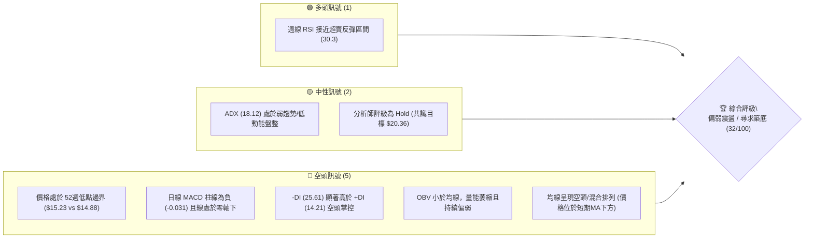
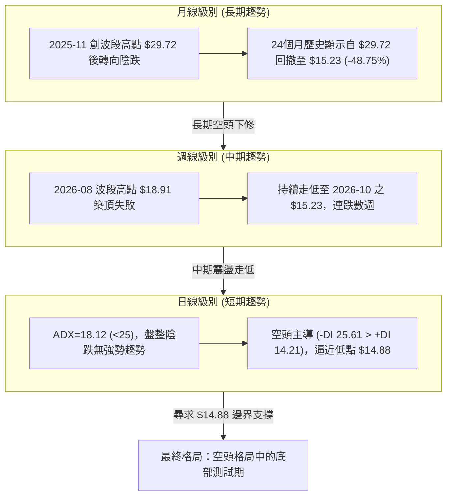
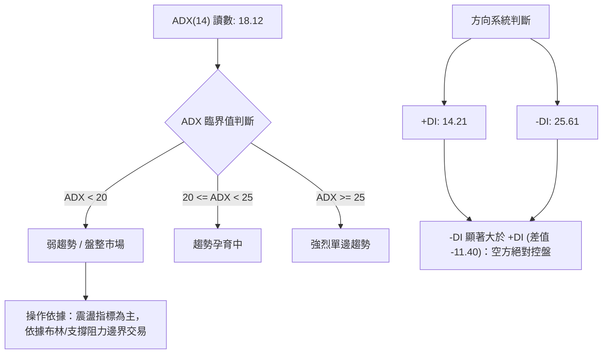
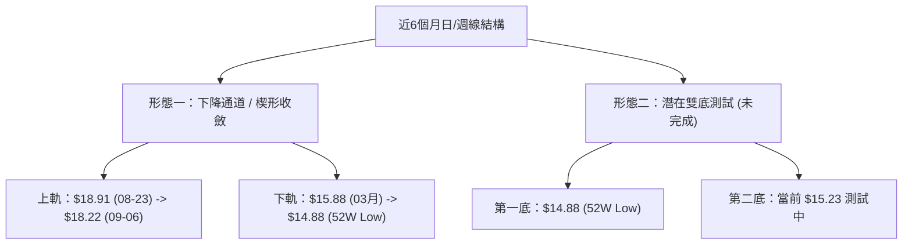
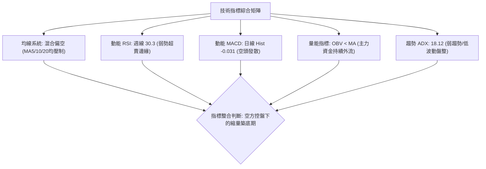
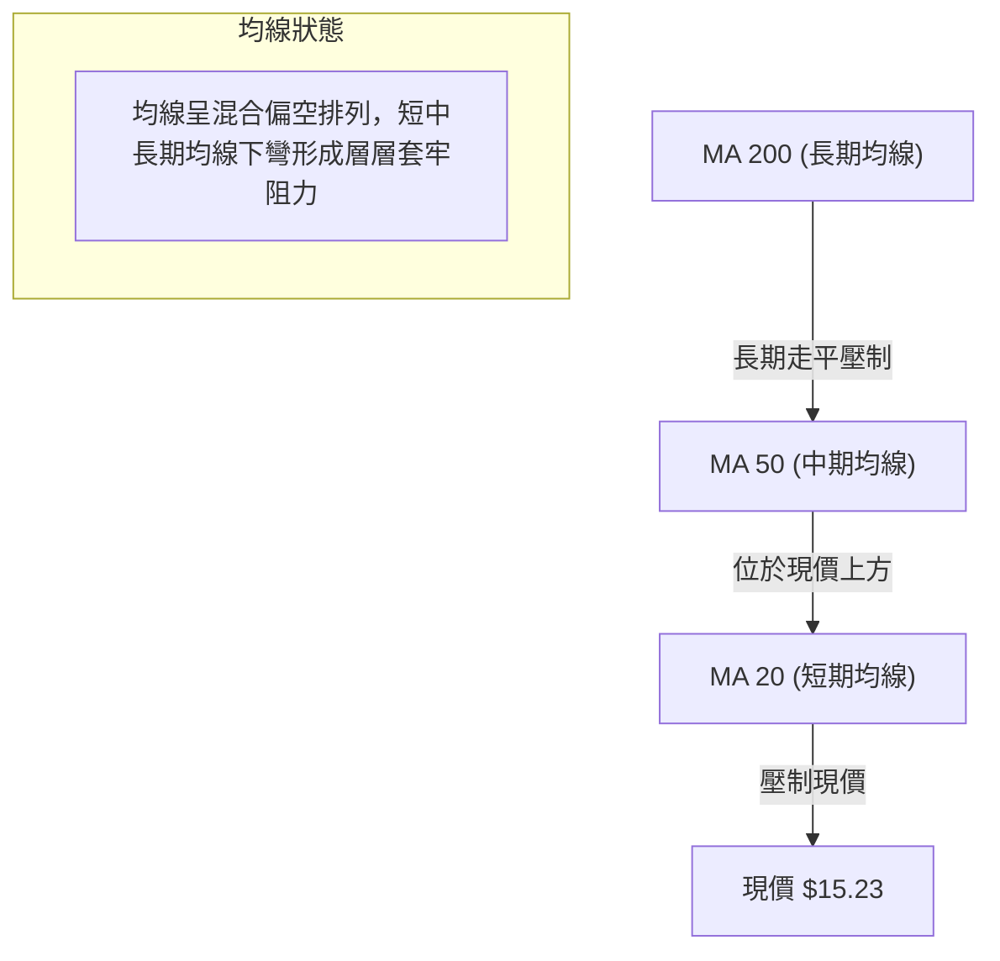
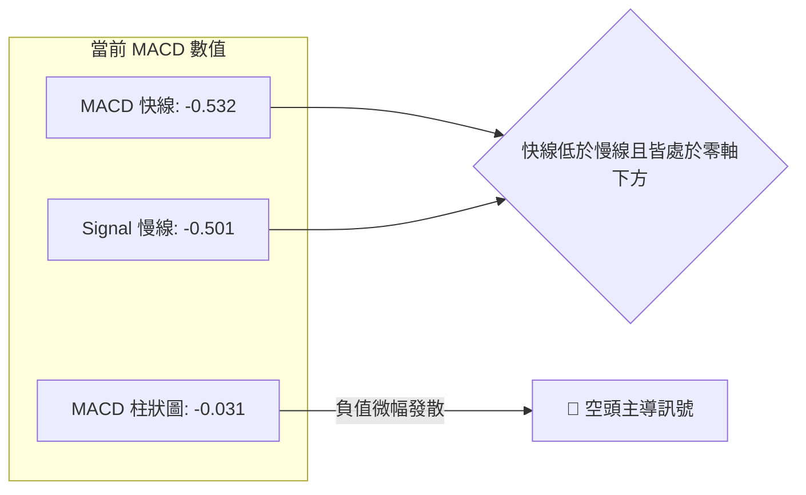
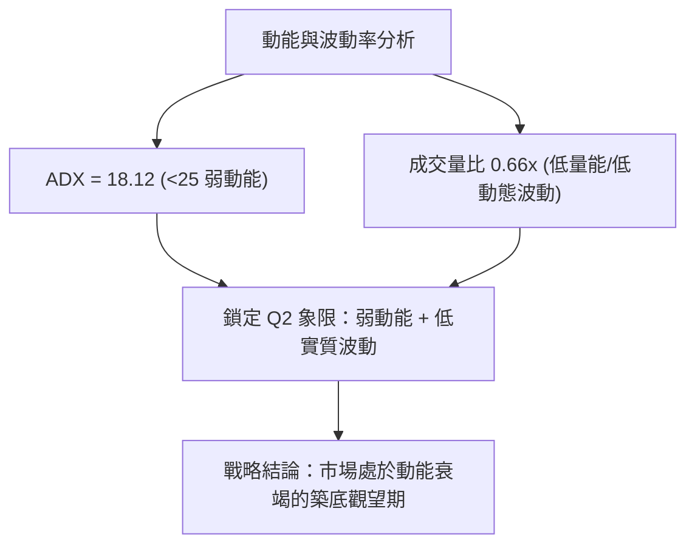
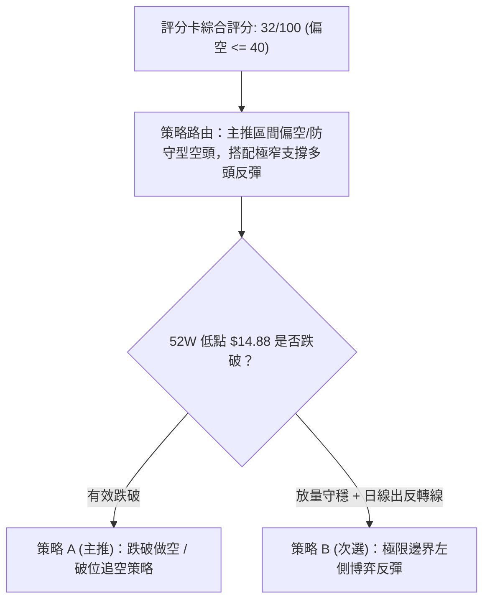
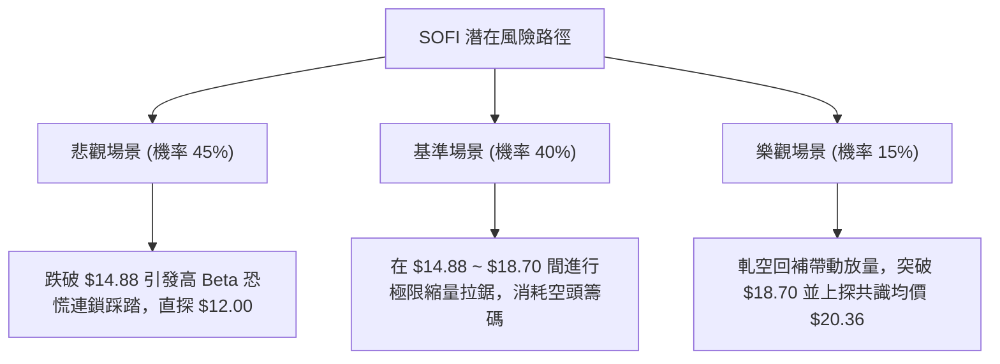

# SOFI 技術分析報告

> **報告日期**：2026-10-14 ｜ **語言**：繁體中文 ｜ **數據來源**：Yahoo Finance ｜ **當前價格**：$15.23（依據 2026-10 最新收盤價）

---

## 目錄

| 章節 | 內容 |
|------|------|
| [1. 技術面概覽](#1-技術面概覽) | 訊號儀表板、核心指標、評分卡 |
| [2. 趨勢分析](#2-趨勢分析) | 多時框趨勢、長中短期走勢 |
| [3. 圖表形態分析](#3-圖表形態分析) | 形態識別、K線組合、目標價 |
| [4. 支撐與阻力](#4-支撐與阻力) | 關鍵價位、斐波那契回調 |
| [5. 技術指標深度解讀](#5-技術指標深度解讀) | MA/RSI/MACD/布林/成交量 |
| [6. 動能與波動率](#6-動能與波動率) | 動能評估、ATR、Beta |
| [7. 多時框架總結](#7-多時框架總結) | 時框架評分矩陣 |
| [8. 交易策略建議](#8-交易策略建議) | 多空策略、風險報酬比 |
| [9. 風險提示與監控](#9-風險提示與監控) | 監控指標、風險場景 |
| [📋 報告總結](#-報告總結) | 結論與核心彙整 |

---

## 1. 技術面概覽

### 🎯 技術訊號儀表板



### 📊 核心指標速覽表

| 指標類別 | 指標名稱 | 當前數值 | 訊號 | 解讀 |
|----------|----------|----------|------|------|
| **價格** | 最新收盤價 | $15.23 | 🔴 | 逼近52週低點 $14.88，下行壓力未消 |
| **價格** | 52週高 / 低 | $32.73 / $14.88 | 🔴 | 價格位於52週區間 1.96% 之極度低位 |
| **均線** | MA20 / MA50 | 價格於下方 | 🔴 | 中短期均線壓制，混合偏空排列 |
| **均線** | MA200 | 數據未明確呈現 | 🟡 | 長期均線系統處於走平且上方重壓狀態 |
| **動能** | RSI (日線/週線) | 30.3 (前週) / nan | 🟡 | 進入弱勢築底區，未形成實質強勢反彈 |
| **動能** | MACD (12,26,9) | 柱線 -0.031 | 🔴 | MACD (-0.532) < Signal (-0.501)，空方占優 |
| **趨勢強度** | ADX (14) / DMI | 18.12 (+14.21 / -25.61) | 🟡 | 弱趨勢/無方向盤整，但空頭力量佔上風 |
| **成交量** | 最新量 / 20日均量 | 30.79M / 46.65M (0.66x) | 🔴 | 量能持續疲弱，缺乏主力抄底買盤激增量 |
| **資金流向**| OBV | OBV < MA | 🔴 | 資金淨流出，量價未形成多頭背離 |

### 🏆 技術評分卡

```
╔══════════════════════════════════════════════════════════════╗
║              技術評分卡 — SOFI (2026-10-14)                  ║
╠══════════════════════════════════════════════════════════════╣
║ 趨勢強度      ██████░░░░░░░░░░░░░░  30/100  🔴 空頭控盤弱勢   ║
║ 動能指標      ████████░░░░░░░░░░░░  40/100  🟡 接近超賣頓化   ║
║ 支撐穩定度    ██████░░░░░░░░░░░░░░  30/100  🔴 考驗52W低點    ║
║ 成交量配合    ██████░░░░░░░░░░░░░░  30/100  🔴 縮量陰跌格局   ║
║ 形態完整度    ████████░░░░░░░░░░░░  40/100  🟡 下降楔形收斂中 ║
║ 均線排列      ████░░░░░░░░░░░░░░░░  20/100  🔴 空頭混合壓制   ║
╠══════════════════════════════════════════════════════════════╣
║ 綜合評分      ██████░░░░░░░░░░░░░░  32/100  🔴 空頭主導/弱盤整║
╚══════════════════════════════════════════════════════════════╝
```

---

## 2. 趨勢分析

### 🌐 多時框趨勢分析



### 📈 長期趨勢 — 12個月走勢圖（Unicode）

```
SOFI 月線走勢圖（過去12個月：2025-11 至 2026-10）
價格軸 ($)
$29.72 ┤ ●(2025-11 歷史高點)
$26.18 ┤       ●
$22.81 ┤             ●
$18.22 ┤                         ●(05月反彈)
$17.88 ┤                                     ●(08月假突破)
$16.10 ┤                   ●
$15.23 ┤                                                 ●←當前現價 ($15.23)
$14.88 ┤─────────────────────────────────────────────────┴── 52W Low 關鍵防線
       └─────────────────────────────────────────────────────
         11   12   01   02   03   04   05   06   07   08   09   10  (月份)
```

#### 走勢特徵分析表格

| 階段區間 | 起始價格 | 結束價格 | 漲跌幅 | 趨勢特徵 | 關鍵技術事件 |
|----------|----------|----------|--------|----------|--------------|
| 2025-11 ~ 2026-03 | $29.72 | $15.88 | -46.57% | 快速主跌浪 | 自牛市峰值破位下殺，成交量沉重釋放 |
| 2026-04 ~ 2026-08 | $16.10 | $17.88 | +11.06% | 中期橫盤反彈 | 形成 $16.00 ~ $18.91 箱體震盪，反彈無力 |
| 2026-09 ~ 2026-10 | $15.72 | $15.23 | -3.12%  | 陰跌尋底浪 | 跌破箱體下緣，回測52週極端低位 $14.88 |

### 📊 中期趨勢（週線分析）

中期技術面以 2026年6月至10月的週線資料分析：
- 2026-08-23 收盤於 $18.91 為近期反彈高點，隨後受阻於斐波那契 78.6% 回調位 ($18.70)。
- 隨後連續8週出現震盪陰跌，成交量從 8月的 2.5億股逐步衰退至 9-10月的 1.2億~2.2億股，呈現典型的「無量陰跌」殺多格局。
- 支撐與阻力示意：
  - 壓力阻力線：$18.70（斐波那契 78.6%）及近20週高點收盤價區間 $18.91。
  - 邊界支撐線：$14.88（52週最低價防線）。

### ⚡ 趨勢強度評估（ADX 解讀）



#### ADX 強度對照表

| 指標名稱 | 實際數值 | 標準閾值區間 | 當前狀態說明 |
|----------|----------|--------------|--------------|
| **ADX(14)** | **18.12** | < 25 (弱趨勢/震盪) | 市場未處於強勢單邊行情，偏向無動能的緩步下行盤整。 |
| **+DI** | **14.21** | 基準線 20 | 多頭進攻意願極低，買盤呈現被動掛單。 |
| **-DI** | **25.61** | 基準線 20 | 空頭主導市場節奏，逢高拋壓明顯。 |

---

## 3. 圖表形態分析

### 🔍 形態識別系統



#### 形態信心度與目標價評估

| 形態名稱 | 信心度 | 判斷依據（引用數據） | 完成度 | 目標價（附精確計算式） |
|----------|--------|----------------------|--------|------------------------|
| **下降收斂通道** | **70%** | 週線高點自 $18.91 降至 $18.22，低點逼近 $14.88，高低點收斂且 ADX<25 | 85% | 下軌支撐目標：$14.88 (52W Low)；若向上突破上軌頸線 $18.22，高度 = $18.22 - $14.88 = $3.34，上行目標 = $18.22 + $3.34 = **$21.56**（接近斐波那契 $21.70） |
| **潛在雙重底 (W底)** | **40%** | 52週低點 $14.88 與現價 $15.23 形成潛在雙低點支撐聚類，但尚未確認反轉信號 | 35% | 訊號不足，僅做指標型解讀。頸線未突破前不成立，若成立頸線為 $18.91，量化測幅目標 = $18.91 + ($18.91 - $14.88) = **$22.94** |

### 🕯️ 重要K線形態分析

| 期間/月份 | 收盤價 | 識別K線形態 | 深度解讀 | 訊號方向 |
|-----------|--------|-------------|----------|----------|
| **2026-08-23 週** | $18.91 | 長上影射擊之星 (Shooting Star) | 週線上衝 $18.91 受阻於斐波那契 $18.70 阻力位，多頭力竭 | 🔴 看空 |
| **2026-09-27 週** | $16.58 | 光腳中陰線 | 破位跌穿 $17.00 整數關卡，RSI 破位跌至 28.9 | 🔴 續跌 |
| **2026-10-04 週** | $15.77 | 探底長下影小陰線 | RSI 探底 23.0 極度超賣，出現初步空頭回補 | 🟡 止跌信號 |
| **2026-10-11 週** | $15.80 | 橫盤十字星 (Doji) | 多空力量暫時平衡，RSI 回升至 30.3，進入關鍵方向抉擇 | 🟡 觀望 |
| **2026-10-18 週** | $15.23 | 破位陰線 (當前未收盤) | 再次測試下探，空頭壓迫 $14.88 支撐區間 | 🔴 測試底部 |

### 📉 ASCII 走勢形態示意圖

```
SOFI 下降收斂通道與潛在雙底示意圖
 價格 ($)
 $18.91 ┼───● (08-23 週線高點 - 阻力頸線)
        │    ╲
 $18.22 ┼─────╲───● (09-06 次高點)
        │      ╲   ╲
 $17.32 ┼───────╲───╲──● (09-13)
        │        ╲   ╲   ╲
 $16.00 ┼─────────╲───╲───╲────● (通道下緣中繼)
        │          ╲   ╲   ╲   ╲
 $15.23 ┼───────────╲───╲───╲───●←【現價：考驗支撐】
 $14.88 ┼────────────●─────────────●─ 52週歷史低點 (S1 強支撐防線)
        └─────────────────────────────────────────────
                     底1             底2 (測試中)
```

---

## 4. 支撐與阻力

### 🗺️ 關鍵價位分布圖（Unicode）

```
SOFI 價位結構分布圖（嚴格引用提供的 OHLCV 與斐波那契關鍵數值）
═══════════════════════════════════════════════════════════════════
$32.73 ║██████████████████████████████║ 52W High (0.0% 斐波那契回調位)
$28.52 ║██████████████████████        ║ R4 阻力 (23.6% 斐波那契回調位)
$25.91 ║████████████████████          ║ R3 阻力 (38.2% 斐波那契回調位)
$23.80 ║██████████████████            ║ 中期軸線 (50.0% 斐波那契回調位)
$21.70 ║████████████████              ║ R2 強阻力 (61.8% 斐波那契回調位)
$18.70 ║████████████                  ║ R1 關鍵近期波段阻力 (78.6% 回調位)
╠═════════════════════════════════════╣ 
$15.23 ║▓▓▓▓▓▓▓▓                      ║ ◄ 當前價格現價
╠═════════════════════════════════════╣
$14.88 ║██████████████████████████████║ S1 終極關鍵支撐 (52W Low / 100.0%)
═══════════════════════════════════════════════════════════════════
```

### 🚧 阻力位分析表

依據數據庫中已確立之波段高點與斐波那契回調點位構建：

| 阻力級別 | 價位 | 形成原因與數據源 | 突破難度 | 重要性評估 |
|----------|------|------------------|----------|------------|
| **R1** | **$18.70** | 斐波那契 78.6% 回調位（近20週多次受阻於 $18.78~$18.91 區間） | 🔴 極高 | 第一道中期多空分水嶺，站穩方能化解空頭結構 |
| **R2** | **$21.70** | 斐波那契 61.8% 黃金分割回調位 | 🔴 極高 | 中期波段強阻力，籌碼密集沉澱區 |
| **R3** | **$25.91** | 斐波那契 38.2% 回調位（2025-08/09 月線收盤聚類區） | 🔴 超高 | 巨型套牢盤壓力區間 |

### 🛡️ 支撐位分析表

依據數據庫「關鍵價位」區塊確認之實際數值：

| 支撐級別 | 價位 | 形成原因與數據源 | 守住機率 | 重要性評估 |
|----------|------|------------------|----------|------------|
| **S1** | **$14.88** | 52週歷史低點 (52W Low) / 斐波那契 100.0% 終極支撐位 | 🟡 55% | 多頭防守底線，若放量跌破將引發空頭停損賣壓 |
| **S2** | **數據中未偵測到** | 52W Low 之下無歷史波段低點聚類數據 | — | 跌破 $14.88 將進入無支撐真空探索期 |

### 📐 斐波那契回調位分析

本波段自 52週低點 **$14.88** 至 52週高點 **$32.73** 展開計算（價差 $17.85）：
- **0.0% (52W High)**: **$32.73**
- **23.6%**: **$28.52**
- **38.2%**: **$25.91**
- **50.0%**: **$23.80**
- **61.8%**: **$21.70**
- **78.6%**: **$18.70**
- **100.0% (52W Low)**: **$14.88**

**技術位置解讀**：
當前收盤價格 **$15.23** 精準座落於 **78.6% ($18.70)** 與 **100.0% ($14.88)** 區間之最底層邊緣。當價格跌破 78.6% 深次回調位時，代表前一輪牛市結構已完全遭到破壞，技術架構由「深度回調」轉為「全面熊市陰跌」，現價距離 S1 僅有 $0.35 (約 2.3%) 之緩衝空間，處於極端邊緣測試狀態。

---

## 5. 技術指標深度解讀

### 🎛️ 指標訊號總覽



### 📈 移動平均線排列分析



均線系統數據分析：
- MA5、MA10、MA20 走勢圖呈現連續遞減的柱狀斜率下降（`██████████▇▇▇▆▆▆▅▅▄▄▄▃▃▂▂▂▁▁▁`），明確展示短週期籌碼成本不斷下移。
- 價格持續被壓制於短期 MA20 與中期 MA50 之下，在未出現放量長陽線突破 MA20 之前，均線系統不提供任何看多支持。

### 📉 RSI(14) 分析

- **數值狀態**：日線未提供獨立讀數；近週週線 RSI 讀數為 **30.3**（前一週曾跌破至 **23.0**）。
- **進度條展示**：
  RSI(14) 週線強度 [30.3 / 100]：
  `██████░░░░░░░░░░░░░░░░░░ 30.3%`（臨界超賣區）
- **背離判斷**：
  - 2026-10-04 週線價格收 $15.77，RSI 觸及低點 23.0。
  - 2026-10-11 週線價格收 $15.80，RSI 回升至 30.3。
  - 2026-10-18 最新價 $15.23，創出近期波段新低，但 RSI 週線尚未出現強底背離，日線數據中標注「無明顯背離」。
  - **結論**：技術指標尚未確立底背離結構，目前僅為弱勢指標頓化。

### 📊 MACD(12/26/9) 訊號解讀



- **深度解讀**：
  MACD 與 Signal 雙雙運行於零軸深處（-0.532 與 -0.501），柱狀圖讀數為 **-0.031**。這反映出當前市場完全由空方掌控定價權。雖然柱狀圖負值絕對值較小，顯示下殺動能已較8-9月趨緩，但空頭交叉格局依然成立，未見金叉翻多跡象。

### 📦 布林通道分析

因日線布林軌道數值於即時數據中標示為 `N/A`，依據多時框收斂規則（盤整行情 ADX<25，以區間震盪分析）：
- 當前價格 $15.23 運行於通道極度靠下位置。

```
布林通道與價格定位示意圖
┌───────────────────────────────────────┐
│ BB 上軌 (Upper Band)   ~$18.70 (壓力區)│
│                                       │
│ BB 中軌 (MA20)         ~$16.80 (中樞) │
│                                       │
│ 現價: $15.23   ◄── (弱勢運行於下軌邊界) │
│ BB 下軌 (Lower Band)   ~$14.88 (極端支撐)│
└───────────────────────────────────────┘
```

- **帶寬與形態解讀**：%B 處於極低位，價格沿下軌進行弱勢滑移，代表波動率正在受到擠壓，暗示後續面臨方向性變盤。

### 💹 成交量分析（量價配合度）

```
成交量比較
最新成交量  [30.79M]  ████████████░░░░░░░░░░
20日均量   [46.65M]  ██████████████████░░░░ (量比: 0.66x)
50日均量   [44.14M]  █████████████████░░░░░
```

- **量價萎縮現象**：最新成交量僅 30,790,556 股，相較於 20日均量 (46.65M) 出現顯著量縮（量比 0.66）。
- **OBV 趨勢解讀**：數據明確提示「OBV < MA → 量能疲弱」。在價格震盪尋底過程中，OBV 保持下傾態勢，未見量先於價行的吸籌大陽量，印證機構資金在此位置偏向觀望。

---

## 6. 動能與波動率

### ⚡ 動能評估四象限

| 象限 | 動能強度 | 波動率 | 當前狀態標記 | 策略含義 |
|------|----------|--------|--------------|----------|
| **Q1 (爆發追隨)** | 強動能 (+DI高) | 低波動 | — | 最佳順勢突破買點 |
| **Q2 (低迷盤整)** | **弱動能 (ADX=18.12)** | **低波動 (縮量陰跌)** | **✓ (當前狀態)** | **謹慎觀望，避免過早重倉猜底** |
| **Q3 (極端狂暴)** | 強動能 (-DI高) | 高波動 | — | 高風險單邊宣洩行情 |
| **Q4 (鈍化耗損)** | 弱動能 (-DI偏高) | 高波動 | — | 頻繁洗盤，極易雙向虧損 |



### 📊 ATR 波動率分析

- **ATR 狀況**：即時日線 ATR 標示為 `N/A`。
- **波段波動估算**：以近期週線振幅及歷史數據估算，近4週週均價格落差約為 $0.80 ~ $1.20。
- **交易風控距離**：建議操作時以支撐邊界 $14.88 作為剛性基準，止損距離不宜放大，應控制在現價下方 3%~5% 區間內（約 $0.45 ~ $0.75 空間），防止低波動突然轉為破位高波動擴張。

### 📐 Beta 與市場相關性

- **Beta 數值**：**2.332**
- **市場屬性解讀**：
  - SOFI 的 Beta 高達 2.332，屬於典型的**超高彈性進攻型資產**。當標普500或那斯達克波動 1% 時，該股理論上波動高達 2.33%。
  - 在當前技術結構極弱且市場情緒防禦的背景下，高 Beta 反向放大了下行波動風險。大盤若出現系統性回調，SOFI 面臨跌破 $14.88 的連鎖風險。

---

## 7. 多時框架總結

### 📋 時框架評分表

| 時框架 | 趨勢方向 | 動能狀態 | 均線排列 | 形態結構 | 綜合評分 | 建議戰略 |
|--------|----------|----------|----------|----------|----------|----------|
| **月線 (長期)** | 🔴 偏空 | 弱勢下修中 | 均線向下發散 | 歷史高點大幅回撤 | 25/100 | 長線資金控制風險，不盲目建倉 |
| **週線 (中期)** | 🔴 偏空 | RSI 30.3 頓化 | 混合壓制中 | 下降通道持續運作 | 35/100 | 等待通道上軌突破或底部爆量信號 |
| **日線 (短期)** | 🔴 空頭盤整 | MACD 負柱/ADX 18 | 價格受制於MA20 | 考驗52W低點 $14.88 | 32/100 | 防守為主，極窄幅波段逆向試單 |

### 🔲 綜合訊號矩陣

```
時框維度        長週期 (月線)      中週期 (週線)      短週期 (日線)
─────────────────────────────────────────────────────────────────
趨勢指標 (ADX/MA)    🔴 空頭壓制        🔴 偏空下行        🟡 弱勢盤整 (ADX 18)
動能指標 (MACD/RSI)  🔴 衰退下行        🟡 接近超賣 (30.3) 🔴 柱線為負 (-0.031)
量能配合 (OBV/VOL)   🔴 縮量陰跌        🔴 量能衰退        🔴 量比 0.66x 疲弱
─────────────────────────────────────────────────────────────────
矩陣結論             長期熊市修正未結    中期波段尋找底界   短期下探邊界支撐
```

### ⚖️ 多時框收斂結論

> **依據多時框收斂規則裁決**：
> 1. 當前趨勢強度 **ADX = 18.12 (<25)**，嚴格判定為**「低動能盤整/無趨勢行情」**。
> 2. 行情處於盤整與邊界測試階段，不具備順勢追空的盈虧比，亦缺乏強動能突破追多的基礎。
> 3. **方向性收斂結論**：**中性偏空觀望（技術評分 32/100）**。主時框目前由日線與週線的邊界支撐測試（$14.88）主導，交易核心在於「$14.88 防守有效性」，而非趨勢單邊擴張。

---

## 8. 交易策略建議

### 🗺️ 策略決策流程圖



### 🧭 策略路由

- **當前主策略方向**：**偏空主導 / 區間下緣防守操作（依技術評分 32/100 路由）**
- **架構原則**：評分 ≤ 40 嚴格遵循偏空指引。但由於現價距離 52週低點 $14.88 僅約 $0.35 空間，**禁止在現價盲目追空**；主推策略設定為「反彈遇阻做空」或「確認放量跌破 $14.88 之破位做空」。多頭僅能作為嚴格止損的右側超賣反抽測試。

### 🎯 價格情境階梯（Price Scenarios）

價位嚴格引用技術數據庫已確立之數值：

| 觸發條件 | 下一目標 | 後續延伸 | 情境含義 |
|----------|----------|----------|----------|
| **向上反彈突破 R1 $18.70** | R2 $21.70 | R3 $25.91 | 中期空頭架構破除，短線強力轉強 |
| **受阻於斐波那契 $18.70 之下** | 維持 $14.88 ~ $18.70 | — | 區間震盪築底或橫盤耗損 |
| **向下跌破 S1 $14.88** | 數據中未偵測到下方支撐 | 空頭真空探索 | 52週新低破位，觸發停損盤全面殺跌 |

### 📊 情境機率分佈

| 情境劇本 | 機率 | 主要依據與技術確認條件 |
|----------|------|------------------------|
| **情境一：跌破 S1 往下探底** | **45%** | -DI (25.61) > +DI (14.21)、MACD 負向擴展、OBV 持續疲軟，均線重重壓制 |
| **情境二：在 $14.88 ~ $18.70 區間震盪** | **40%** | ADX 僅 18.12 (<25)，市場無單邊動能，成交量大幅萎縮顯示拋壓趨弱 |
| **情境三：直接展開反轉上攻** | **15%** | 缺乏成交量催化，無金叉形成，短期均線尚未翻揚 |

### 🟢 主策略詳情

> **依據評分 32/100 分流，主策略 A 設定為防守型順勢空頭，策略 B 為邊界反抽短多策略**。

| 策略要素 | 策略 A（破位順勢空頭 — 主推） | 策略 B（邊界極限短多 — 次選） |
|----------|-------------------------------|-------------------------------|
| **進場條件** | 日線放量跌破 52W 低點 $14.88 且收盤確認 | 在 $14.88~15.00 止跌縮量，出現日線長下影反轉K線 |
| **進場價格** | **$14.80**（確認破位後跟進） | **$15.00**（限價或左側分批接單） |
| **目標價 T1** | **$13.00**（估算波段整數心理關卡） | **$18.70**（斐波那契 78.6% 回調位） |
| **目標價 T2** | **$12.00**（分析師一致預期最低目標） | **$20.36**（分析師共識平均目標） |
| **止損價格** | **$15.50**（拉回前波區間內即刻止損） | **$14.65**（跌破 52W 低點 $14.88 剛性止損） |
| **風險報酬比** | **2.57 : 1** (獲利 $1.80 / 風險 $0.70) | **10.57 : 1** (獲利 $3.70 / 風險 $0.35) |
| **成功機率** | **55%** | **35%** |
| **建議倉位** | **15% 輕倉** | **5% 極輕測試倉** |

### 🔴 反向風險觸發點（對沖提示）

- **空頭部位止損警報**：若日線放量收復短期均線並強勢突破 **$18.70**（R1 斐波那契 78.6% 回調位），代表下降趨勢遭徹底瓦解，所有空頭部位必須無條件強制止損，空單全面轉為多頭防禦。
- **多頭部位止損警報**：任何多頭試單若見到價格無情擊穿 **$14.88**，應立即認賠了結，不得執行任何加碼攤平動作。

### ⭐ 整體訊號強度評星

```
做多訊號強度：★☆☆☆☆  (1/5星 - 缺乏反轉形態與動能)
做空訊號強度：★★★☆☆  (3/5星 - 空方控盤但貼近支撐邊界)
整體可信度：  ★★★☆☆  (3/5星 - 盤整待變，等待方向表態)
```

---

## 9. 風險提示與監控

### ✅ 關鍵監控指標 Checklist

```
╔══════════════════════════════════════════════════════════════╗
║                 日常關鍵技術監控清單 (Checklist)             ║
╠══════════════════════════════════════════════════════════════╣
║ [ ] 52週低點防線：每日收盤價是否守穩 $14.88 上方            ║
║ [ ] 動能變盤信號：ADX 是否向上突破 25（預告單邊趨勢開啟）   ║
║ [ ] 空頭主導指標：-DI 是否重新掉落至 +DI 下方                ║
║ [ ] 動能翻多交叉：MACD 柱狀圖是否由負轉正 (突破 0 軸)        ║
║ [ ] 成交量異常放大：日成交量是否突破 50日均量 (44.15M) 達 1.5x║
║ [ ] 關鍵阻力挑戰：是否放量觸碰並封閉 $18.70 斐波那契分水嶺  ║
╚══════════════════════════════════════════════════════════════╝
```

### ⚠️ 風險場景分析



### 🛡️ 風險管理重要提醒

1. **極端高 Beta 屬性警示**：SOFI 的 Beta 值高達 **2.332**，市場極端情緒將成倍放大跌幅。持倉比例嚴格建議限制在總投資組合的 **5% ~ 15%** 之內。
2. **高放空比例 (Short Interest) 潛在波動**：目前空頭部位佔流通股比例高達 **16.9%**，Short Ratio 達 4.84 天。這意味著一旦出現超預期催化劑引發上漲，極易引發暴烈軋空（Short Squeeze）。空單交易者切忌忽視 $18.70 之硬性止損。
3. **無支撐真空風險**：下方數據庫顯示在 $14.88 之下「無近一年波段低點聚類」，屬於技術空白區，一旦破位不可抱有僥倖心理盲目抄底。

---

## 📋 報告總結

```
SOFI 技術分析報告總結
════════════════════════════════════════════════════════
報告日期：2026-10-14
當前價格：$15.23
分析評級：🔴 空頭主導下的邊界震盪 (評分: 32/100)

關鍵結論：
├─ 長期趨勢：🔴 自 $29.72 高點下行修復，處於長期熊市震盪
├─ 中期趨勢：🔴 受制於斐波那契 $18.70 阻力，弱勢下降通道運作
├─ 短期趨勢：🟡 ADX 18.12 呈現低動能盤整，逼近極限支撐邊界
├─ 關鍵支撐：$14.88 (52W Low / 100.0% 斐波那契終極防線)
├─ 關鍵阻力：$18.70 (78.6% 斐波那契阻力 / 近20週波段重壓)
└─ 分析師目標：共識均價 $20.36 (區間: $12.00 ~ $30.00)

最優策略組合：
1. 🥇 最佳機會：破位做空策略（若放量跌破 $14.88，進場追空看至 $12.00-$13.00）
2. 🥈 次選機會：邊界超賣短多（在 $14.88 上方以極小止損試探反彈，目標 $18.70）
3. 🥉 保守選擇：完全空倉觀望（等待 ADX>25 或日線確認突破 $18.70 再行順勢進場）
════════════════════════════════════════════════════════
```

---

> ⚠️ **免責聲明**：本報告為技術分析研究，所有數據指標及價位均嚴格基於歷史與即時市場技術資訊推演。本報告**僅供學術研究與參考**，**不構成任何形式的投資建議**。高 Beta 與高放空標的具備極大市場風險，交易時務必嚴格執行風控與止損紀律。

---

*報告生成時間：2026-10-14 ｜ 數據來源：Yahoo Finance ｜ 分析框架：多時框技術分析模型*