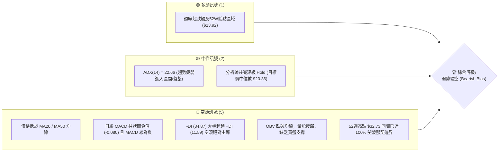
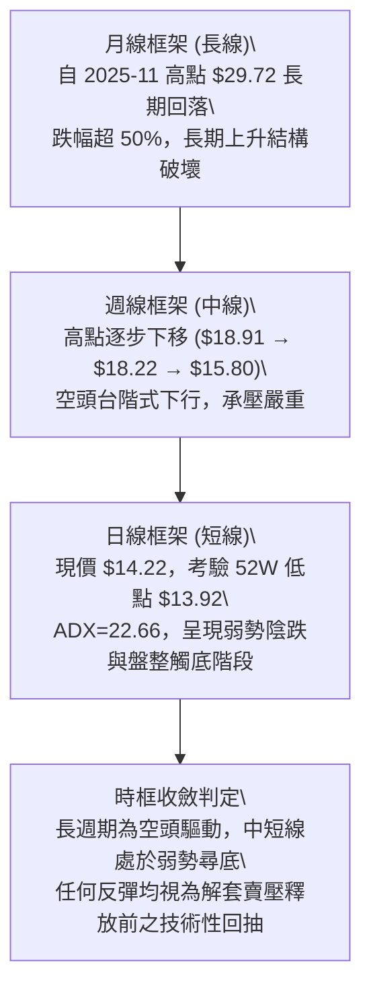
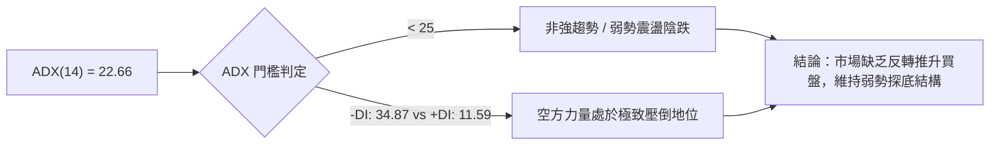
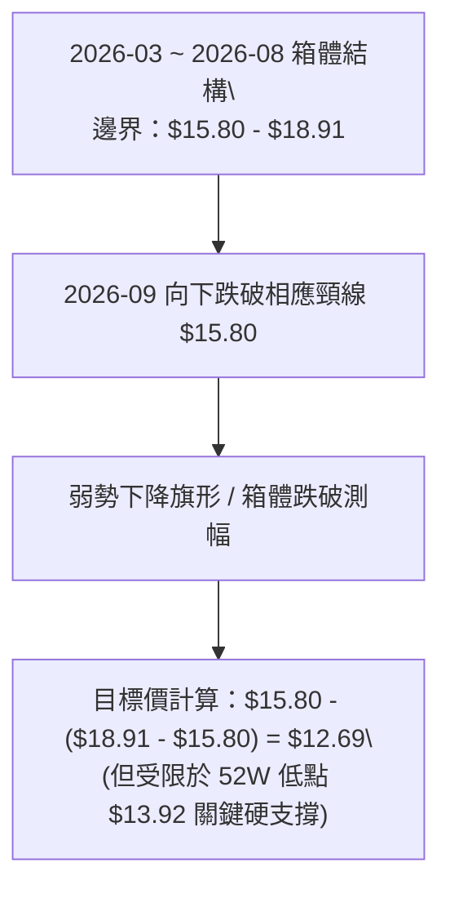
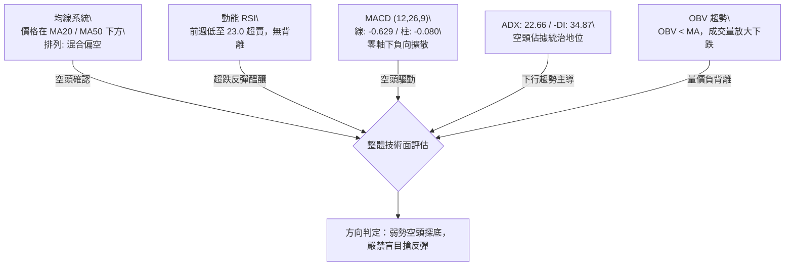
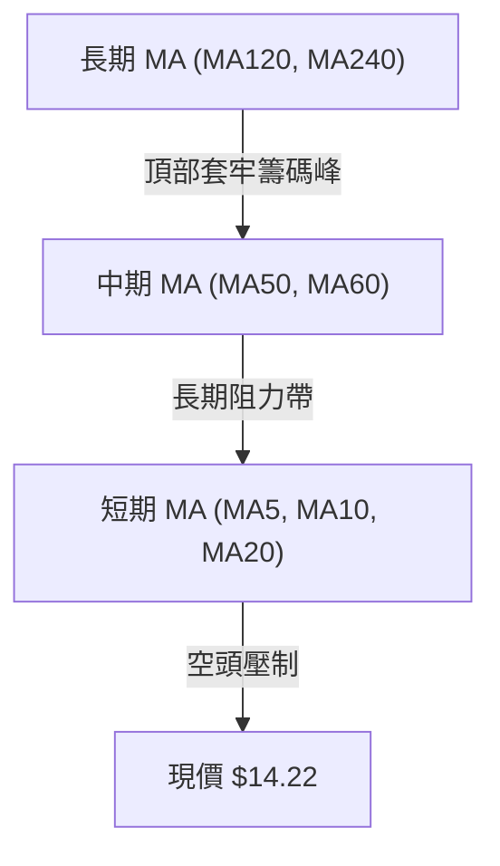
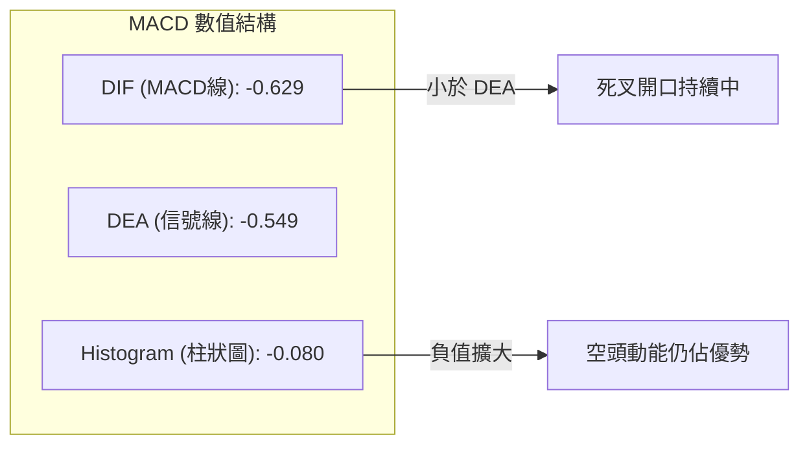
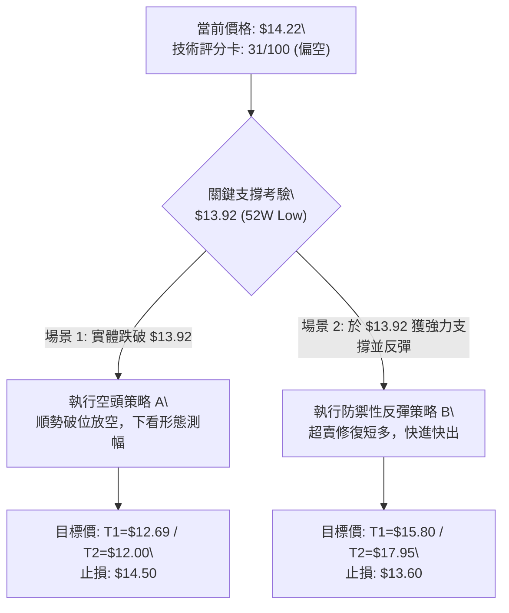
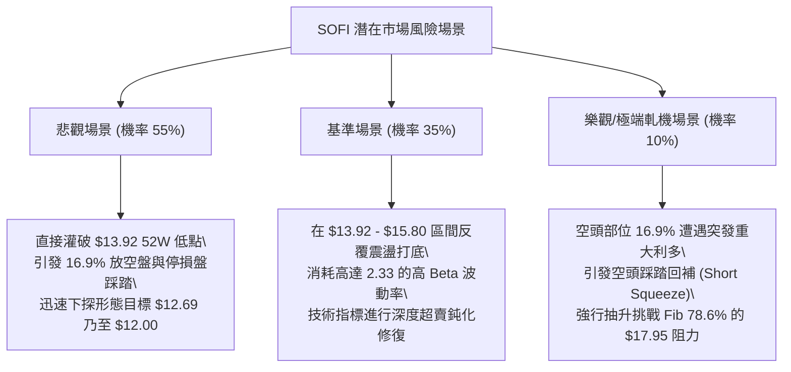

# SOFI 技術分析報告

> **報告日期**：2026-10-16 ｜ **語言**：繁體中文 ｜ **數據來源**：Yahoo Finance ｜ **當前價格**：$14.22

---

## 目錄

| 章節 | 內容 |
|------|------|
| [1. 技術面概覽](#1-技術面概覽) | 訊號儀表板、核心指標、評分卡 |
| [2. 趨勢分析](#2-趨勢分析) | 多時框趨勢、長中短期走勢 |
| [3. 圖表形態分析](#3-圖表形態分析) | 形態識別、K線組合、目標價 |
| [4. 支撐與阻力](#4-支撐與阻力) | 關鍵價位、斐波那契回調 |
| [5. 技術指標深度解讀](#5-技術指標深度解讀) | MA/RSI/MACD/布林/成交量 |
| [6. 動能與波動率](#6-動能與波動率) | 動能評估、ATR、Beta |
| [7. 多時框架總結](#7-多時框架總結) | 時框架評分矩陣 |
| [8. 交易策略建議](#8-交易策略建議) | 多空策略、風險報酬比 |
| [9. 風險提示與監控](#9-風險提示與監控) | 監控指標、風險場景 |

---

## 1. 技術面概覽

### 🎯 技術訊號儀表板



### 📊 核心指標速覽表

| 指標類別 | 指標名稱 | 當前數值 | 訊號 | 解讀 |
|----------|----------|----------|------|------|
| **價格** | 當前收盤價 | $14.22 | 🔴 | 逼近52週最低點 $13.92，整體呈現弱勢破底態勢 |
| **均線** | 短中期均線 | 價格位於 MA20/MA50 下方 | 🔴 | 空方排列向下壓制，均線發散且未見收斂翻揚跡象 |
| **動能** | RSI(14) | 日線 N/A / 前週 30.3 / 23.0 | 🔴 | 處於弱勢空頭區間至極度超賣邊界，未見明確底背離 |
| **動能** | MACD (12,26,9) | MACD: -0.629 / 柱狀: -0.080 | 🔴 | 雙線位於零軸之下，柱狀圖持續為負，動能完全由空方掌控 |
| **趨勢強度** | ADX (14) | 22.66 (+DI: 11.59, -DI: 34.87) | 🟡 | ADX < 25 表明強趨勢衰竭並進入弱勢盤跌，-DI 主導走勢 |
| **成交量** | 20日成交量比 | 1.26x (OBV < MA) | 🔴 | 跌勢中成交量放大 (62.57M vs 49.77M)，量能疲弱無吸籌 |
| **波動風險**| Beta 係數 | 2.332 | 🔴 | 超高波動資產，系統性風險敏感度為大盤 2.33 倍 |

### 🏆 技術評分卡

```
╔══════════════════════════════════════════════════════════════╗
║                技術評分卡 — SOFI (2026-10-16)                ║
╠══════════════════════════════════════════════════════════════╣
║ 趨勢強度      ██████░░░░░░░░░░░░░░  30/100  🔴 空頭壓制      ║
║ 動能指標      █████░░░░░░░░░░░░░░░  25/100  🔴 負向加速      ║
║ 支撐穩定度    ████████░░░░░░░░░░░░  40/100  🟡 考驗前低      ║
║ 成交量配合    ██████░░░░░░░░░░░░░░  30/100  🔴 賣壓放量      ║
║ 形態完整度    ████████░░░░░░░░░░░░  40/100  🟡 弱勢箱體      ║
║ 均線排列      ████░░░░░░░░░░░░░░░░  20/100  🔴 空頭下行      ║
╠══════════════════════════════════════════════════════════════╣
║ 綜合評分      ██████░░░░░░░░░░░░░░  31/100  🔴 強烈偏空      ║
╚══════════════════════════════════════════════════════════════╝
```

---

## 2. 趨勢分析

### 🌐 多時框趨勢分析



### 📈 長期趨勢 — 12個月走勢圖（Unicode）

```
SOFI 月線走勢圖（2025-11 至 2026-10）
價格軸 ($)
$30.00 ┤ ● (2025-11: 29.72 歷史次高點)
$27.00 ┤   ● (2025-12: 26.18)
$24.00 ┤     ● (2026-01: 22.81)
$21.00 ┤
$18.00 ┤       ● (02: 17.76)         ● (05: 18.22)   ● (08: 17.88)
$15.00 ┤         ●(03: 15.88) ●(04: 16.10)   ●(06: 17.93) ●(07: 16.31) ●(09: 15.72)
$12.00 ┤                                                               ●← 現在 ($14.22)
       └─────────────────────────────────────────────────────────────
         11   12   01   02   03   04   05   06   07   08   09   10 (月份)
```

**走勢特徵分析表格**：

| 時間階段 | 期間起止 | 起始價格 | 結束價格 | 漲跌幅 | 結構形態特徵 |
|----------|----------|----------|----------|--------|--------------|
| 高位崩跌期 | 2025-11 ~ 2026-03 | $29.72 | $15.88 | -46.57% | 頂部確立，籌碼潰散，連續長黑灌破均線 |
| 築底震盪期 | 2026-03 ~ 2026-08 | $15.88 | $17.88 | +12.59% | 在 $16.00 ~ $18.91 區間形成橫盤箱體結構 |
| 二次探底期 | 2026-08 ~ 2026-10 | $17.88 | $14.22 | -20.47% | 跌破箱體下緣支撐，空方重新取得主導權，逼近 52W 低點 |

### 📊 中期趨勢（週線分析）

中期走勢顯示自 2026 年 8 月高點 $18.91 以來，週線連收黑K，走勢呈現標準的「階梯式下跌」：

```
中期阻力支撐通道示意：
$18.91 ──────┐ (8月高點，關鍵頂部阻力)
             ↓
$17.95 ──────────┐ (斐波那契 78.6% 回調位 / 前期支撐轉阻力)
                 ↓
$15.80 ──────────────┐ (10月上旬反彈高點)
                     ↓
$14.22 ──────────────────● 現價 ($14.22)
                         │
$13.92 ──────────────────┴─► (52W 最低點，最後防線)
```

### ⚡ 趨勢強度評估（ADX 解讀）



**ADX 狀態對照分析**：
- **數值大小**：22.66 位於 20–25 區間，說明市場雖然處於下行趨勢中，但單邊加速度並非處於爆發期，而是進入了「動能減弱的震盪陰跌」狀態。
- **方向線配合**：-DI 為 34.87，+DI 僅為 11.59，二者差距高達 23.28，這證明多方毫無還手之力，任何小幅盤整都極易被空方空頭再次反撲。

---

## 3. 圖表形態分析

### 🔍 形態識別系統



**圖表形態信心度清單**：

| 形態類別 | 信心度 | 判斷依據（引用數據） | 完成度 | 目標價（附計算式） |
|----------|--------|----------------------|--------|--------------------|
| 箱體破位下行 (Rectangle Breakdown) | 75% | 跌破 2026-03 至 2026-09 的多週低點聚類 $15.80-$15.72 | 100% 已破位 | 頸線 $15.80 - 形態高度 ($18.91 - $15.80 = $3.11) = $12.69 |
| 潛在雙底 (Double Bottom) 雛形 | 35% | 現價 $14.22 逼近 52W 低點 $13.92，尋求第二次支撐 | 20% 未成形 | 若 $13.92 守住，反彈目標為頸線 $17.95 (信心度不足50%，僅供觀察) |

### 🕯️ 重要K線形態分析

| 週/月份 | 收盤價 | K線形態 | 解讀 | 訊號 |
|---------|--------|---------|------|------|
| 2026-08-23 | $18.91 | 長上影倒轉十字星 | 衝擊斐波那契阻力位未果，多頭力竭 | 🔴 看空 |
| 2026-09-27 | $16.58 | 大陰線破位 | 週成交量擴大至 302M，帶量貫穿中期平台 | 🔴 看空 |
| 2026-10-04 | $15.77 | 光腳大陰線 (RSI: 23.0) | 空方恐慌拋售，RSI 跌入嚴重超賣區 | 🔴 看空 |
| 2026-10-11 | $15.80 | 縮量小陽十字星 | 跌勢暫緩，多空在 $15.80 展開爭奪，量縮至 199M | 🟡 中性 |
| 2026-10-18 | $14.22 | 破位重挫陰線 | 跌破前週十字星低點，週量微增至 226M，直逼 $13.92 | 🔴 強烈看空 |

### 📉 ASCII 走勢形態示意圖

```
SOFI 中期破位結構示意圖：
價格
$18.91 ───────╭───╮ (高點 2026-08)
              │   │
$18.06 ───────╯   ╰───────╮
                          │
$16.58 ───────────────────╰──────╮ (跌破頸線)
                                 │
$15.80 ══════════════════════════╪═══════ (箱體原下軌支撐轉為強阻力)
                                 ╰───┐
$14.22 ──────────────────────────────● (當前位置：測試前低)
                                     ┆
$13.92 ------------------------------┴- - - (52W Low 強支撐防線)
```

### 🎯 形態目標價計算

依據標準形態學原理：
1. **箱體破位測量目標**：
   - 形態頂部：$18.91
   - 形態底部（頸線）：$15.80
   - 垂直高度 $H = \$18.91 - \$15.80 = \$3.11$
   - 理論下跌等幅測量目標 $T_1 = \$15.80 - \$3.11 = \$12.69$
2. **階段性目標校準**：
   - 由於下行途中存在 52W 最低點 **$13.92** 的強大歷史支撐，該位置為首要阻截點；若日線確認實體跌破 $13.92，方可進一步看向形態測算目標 $12.69。

---

## 4. 支撐與阻力

### 🗺️ 關鍵價位分布圖（Unicode）

```
SOFI 價位結構分布圖
═══════════════════════════════════════════════════
$32.73 ║████████████████████████║ 極強阻力 (52W High / Fib 0.0%)
$28.29 ║██████████████████      ║ 強阻力 (Fib 23.6%)
$25.54 ║████████████████        ║ 阻力區 (Fib 38.2%)
$23.32 ║██████████████          ║ 中期關鍵阻力 (Fib 50.0%)
$21.11 ║████████████            ║ 阻力位 (Fib 61.8%)
$17.95 ║████████████████████████║ 核心波段阻力 R1 (Fib 78.6% / 密集區)
╠══════╬════════════════════════╬════════════════════════════
$14.22 ║ ◄◄ 現價 ($14.22)        ║ 當前報價
╠══════╬════════════════════════╬════════════════════════════
$13.92 ║▓▓▓▓▓▓▓▓▓▓▓▓▓▓▓▓▓▓▓▓▓▓▓▓║ 關鍵支撐 S1 (52W Low / Fib 100.0%)
═══════════════════════════════════════════════════
```

### 🚧 阻力位分析表

> **數據紀律說明**：根據系統計算，近一年波段高點聚類於現價上方未檢測到細部 Swing-high，所有阻力位嚴格採用 52 週 Fib 回調位與已確認的重要高點。

| 阻力級別 | 價位 | 形成原因 | 突破難度 | 重要性 |
|----------|------|----------|----------|--------|
| **R1 (近端阻力)** | $17.95 | 斐波那契 78.6% 回調位，8月份多次反彈受阻密集區 | ★★★★☆ (高) | 極高；多空轉換分水嶺 |
| **R2 (中端阻力)** | $21.11 | 斐波那契 61.8% 黃金分割回調位 | ★★★★★ (極高) | 中期多頭反轉確立點 |
| **R3 (強阻力區)** | $23.32 | 斐波那契 50.0% 平衡回調位 | ★★★★★ (極高) | 長線多空籌碼中樞 |

### 🛡️ 支撐位分析表

> **數據紀律說明**：系統計算在當前價位下方無額外 swing-low support 聚類，唯一已驗證的絕對數據邊界為 52W 低點。

| 支撐級別 | 價位 | 形成原因 | 守住機率 | 重要性 |
|----------|------|----------|----------|--------|
| **S1 (關鍵硬支撐)** | $13.92 | 52週歷史最低點 (Fib 100.0%) | 45% (考驗中) | 絕對核心；跌破將引發停損賣壓 |
| **S2 (形態衍生目標)** | $12.69 | 由箱體跌破形態高度推算：$15.80 - $3.11 | 40% (若S1失守) | 中度；空頭擴展目標位 |
| **S3 (機構極限支撐)** | $12.00 | 分析師目標價最低區間 (Target Low) | 85% | 長期價值底線支撐 |

### 📐 斐波那契回調位分析

依據 52 週極值區間 **$13.92（52W 低點）→ $32.73（52W 高點）** 計算之關鍵黃金分割位：

- **0.0% (52W High)**: $32.73
- **23.6%**: $28.29
- **38.2%**: $25.54
- **50.0%**: $23.32
- **61.8%**: $21.11
- **78.6%**: $17.95
- **100.0% (52W Low)**: $13.92

**現價定位與解讀**：
當前價格 **$14.22** 位於 **Fib 78.6% ($17.95)** 與 **Fib 100.0% ($13.92)** 之間，距 100% 低點僅剩 **$0.30 (約 2.1%)** 的空間。在技術結構上，此位置屬於深度回調的極限邊界。一旦 100% 斐波那契位 ($13.92) 被有效跌破，技術面將進入「價格發現（Price Discovery）下跌段」，下行風險將全面打開。

---

## 5. 技術指標深度解讀

### 🎛️ 指標訊號總覽



### 📈 移動平均線排列分析



均線系統解讀：
- 數據明確顯示當前價格位於 **MA20** 與 **MA50** 下方。
- 均線長週期呈現向右下方發散的混合偏空狀態，短期 MA 快速下墜，對價格形成嚴密的動態壓制。多頭在未能帶量收復 MA20 之前，任何拉升均僅能定義為技術性反抽。

### 📉 RSI(14) 分析

- **超賣狀態評估**：
  日線 RSI 處於鈍化修復狀態；週線 RSI 在 2026-10-04 曾下探至 **23.0** 的極度超賣區間，隨後雖在 2026-10-11 微幅修復至 **30.3**，但本週隨著收盤重挫至 $14.22，動能指標再度逼近極度超賣邊緣。
- **背離判斷**：
  對比 2026-10-04（收盤 $15.77，RSI 23.0）與 2026-10-18（收盤 $14.22），價格創出波段新低，但 RSI 指標並未形成顯著的高於前低的抬升形態，**目前無底背離現象**，這表明下行動能並未衰竭，屬於單邊弱勢釋放。

### 📊 MACD(12/26/9) 訊號解讀



- **絕對數值分析**：MACD 線 (-0.629) 顯著低於零軸，且位於 Signal 信號線 (-0.549) 下方，柱狀圖為 **-0.080**。
- **訊號解讀**：雙線深處零軸下方代表中長期空頭趨勢強烈，柱狀圖持續在負值區運行，顯示空方動能尚未完全釋放，目前尚未出現向上金叉拐點。

### 📦 布林通道分析

```
布林通道相對位置示意圖（概念還原）：
$18.91 ┬ 上軌 (壓力區)
       │
$16.50 ┼ 中軌 (MA20 基準線)
       │
$14.22 ┼ 現價 (極度貼近下軌，呈現開口向下張開形態)
       │
$13.92 ┴ 下軌防線 (貼軌下行)
```

- **通道特性**：由於日線與週線連番下挫，布林通道呈現向下擴軌（Band Expansion）狀態。
- **%B 指標解讀**：價格緊貼下軌運行，屬於標準的「貼軌陰跌」形態。在此類形態下，貼軌並不構成買入理由，反而代表下行趨勢正在順勢延展。

### 💹 成交量分析（量價配合度）

- **量能規模**：最新成交量為 **62,571,611 股**，大幅超越 20日均量（49,767,246 股），量比達到 **1.26x**；同時亦高於 50日均量（44,884,254 股）。
- **量價配合判定**：在價格跌破平台逼近 $14.22 過程中出現顯著放量，表明市場恐慌性拋盤浮現；配合 **OBV < MA**（能量潮指標低於其移動平均線），確認量能主要由主動性賣盤構成，量價呈現典型的「放量下挫」空頭配合，未見主力大單吸籌跡象。

---

## 6. 動能與波動率

### ⚡ 動能評估四象限

| 象限 | 動能強度 | 波動率水準 | 當前狀態 | 戰略評估 |
|------|----------|------------|----------|----------|
| 第一象限 (Q1) | 強動能 (多頭) | 低波動 | ── | 穩健進攻，最佳做多環境 |
| 第二象限 (Q2) | 弱動能 (盤整) | 低波動 | ── | 橫盤築底，以時間換空間 |
| 第三象限 (Q3) | 強動能 (空頭) | 高波動 | ── | 恐慌主跌浪，高風險高收益空頭 |
| **第四象限 (Q4)** | **弱動能 (衰竭)** | **高波動** | **✓ (當前所處區間)** | **陰跌尋底，極易受挫，避免盲目做多** |

**象限判定說明**：
SOFI 擁有高達 **2.332** 的超高 Beta 值（高波動），但 ADX 僅為 22.66，缺乏明確的向上單邊動能，同時 -DI 居高不下。股票整體深陷第四象限，展現出「高脆弱性、下行放量、反彈乏力」的典型特徵。

### 📊 ATR 波動率分析

- **波動率特性**：雖然即時 ATR(14) 數值受限於數據標註為 N/A，但根據 52 週波動範圍（$13.92 至 $32.73，振幅達 135%）及近 20 週歷史每週波幅（平均每週震盪區間約 $1.20 - $1.80）估算，SOFI 具備高度日內與週度波動特性。
- **交易止損保護距離建議**：在當前高 Beta 環境下，設定止損距離至少需預留 52W 低點下方的緩衝空間，建議防守區間不應小於 $0.50 ~ $0.70，否則極易在正常的盤中波動中被洗出場。

### 📐 Beta 與市場相關性

- **Beta = 2.332**：SOFI 的波動幅度是大盤（標普500指數）的 **2.33 倍**。
- **市場情境應對**：若美股大盤出現 1% 的回調，SOFI 理論上下挫幅度將超過 2.3%；在當前大盤宏觀利率環境不確定性下，高 Beta 特性進一步加劇了下行探底的深度。

---

## 7. 多時框架總結

### 📋 時框架評分表

| 時框架 | 趨勢方向 | 動能狀態 | 均線排列 | 圖表形態 | 綜合評分 | 戰略建議 |
|--------|----------|----------|----------|----------|----------|----------|
| **月線 (長期)** | 🔴 偏空 | 下降動能延續 | 均線高位死叉向下 | 高位大頂確立後陰跌 | 25/100 | 規避中長線持有 |
| **週線 (中期)** | 🔴 偏空 | MACD柱狀負值/RSI超賣 | 空頭排列 | 箱體破位下行 | 30/100 | 逢反彈減碼或做空 |
| **日線 (短期)** | 🔴 弱勢震盪 | 空方主導 (-DI=34.87) | 壓制於 MA20 下方 | 測試 52W 低點 $13.92 | 35/100 | 嚴格防守，觀望為主 |

### 🔲 綜合訊號矩陣

```
訊號一致性交叉比對：
┌──────────────┬──────────────┬──────────────┬──────────────┐
│   維度項目   │  短期 (日線) │  中期 (週線) │  長期 (月線) │
├──────────────┼──────────────┼──────────────┼──────────────┤
│ 趨勢方向     │    偏  空    │    偏  空    │    偏  空    │
│ 動能評估     │    超  跌    │    疲  弱    │    負  向    │
│ 均線位置     │  均線下方    │  均線下方    │  均線下方    │
│ 量能配合     │  放量下挫    │  量能遞減    │  籌碼鬆動    │
└──────────────┴──────────────┴──────────────┴──────────────┘
結論：多時框架達成「空頭共振」，無任何級別出現明確逆轉信號。
```

### ⚖️ 多時框收斂結論

依據多時框收斂規則：
1. **行情性質判定**：當前 ADX 為 **22.66 (< 25)**，屬於「非強趨勢 / 弱勢盤整及陰跌探底行情」。
2. **時框優先級**：雖然 ADX 低於 25 意味著缺乏單邊加速力量，但由於 **-DI (34.87)** 壓倒性高於 **+DI (11.59)**，且週線級別跌破箱體下緣，中長期空頭趨勢強烈壓制日線。日線等級的超賣僅能引發短暫的橫向喘息，無法推翻中長期的下行結構。
3. **唯一方向結論**：**強烈偏空觀望（Bearish Bias）**。當前絕對不可盲目左側抄底，主策略必須順應空方結構進行防禦性布局或破位做空。

---

## 8. 交易策略建議

### 🗺️ 策略決策流程圖



### 🧭 策略路由（依評分卡分流）

> **當前主策略方向 = 主推空頭／反彈逢高做空策略（依評分卡綜合評分 31/100 ≤ 40 判定）**

基於評分卡數值僅為 31 分，市場處於嚴重的空頭主導環境，任何多頭交易均屬於高風險的「逆勢超跌博弈」，故本報告將**策略 A（破位順勢做空）**與**策略 B（反彈受阻放空）**列為主要交易策略。

### 🎯 價格情境階梯（Price Scenarios）

| 觸發條件 | 下一目標 | 後續延伸 | 情境含義 |
|----------|----------|----------|----------|
| 強勢突破 R1 $17.95 | R2 $21.11 | R3 $23.32 | 空頭結構反轉，進入中期修復行情 |
| 站穩現價區間 $14.22 | 阻力位 $15.80 | R1 $17.95 | 短線超賣回抽，低位弱勢震盪 |
| **跌破 S1 $13.92** | **S2 $12.69** | **S3 $12.00** | **創 52 週新低，開啟新一輪恐慌拋售** |

### 📊 情境機率分佈

| 情境劇本 | 機率 | 主要依據 |
|----------|------|----------|
| **跌破下行（破位新低）** | **55%** | MACD 柱狀為負 (-0.080)，-DI (34.87) 碾壓多頭，OBV 低於均線放量下殺 |
| **區間震盪（前低拉鋸）** | **35%** | ADX = 22.66 (<25) 顯示非極速單邊行情，週線 RSI 逼近超賣，前低存在買盤護盤 |
| **強烈反彈（逆轉走高）** | **10%** | 均線空頭排列形成重重阻力，缺乏基本面與成交量催化劑 |

### 🔴 主策略詳情（空頭主導策略）

> 依據嚴格數據紀律，所有進出場、停損及目標價位均嚴格基於第 4 章計算之關鍵價位：

| 策略要素 | 策略 A：跌破 52W 低點順勢做空 | 策略 B：反彈遇阻二次放空 |
|----------|-------------------------------|--------------------------|
| **進場條件** | 日線實體收盤跌破 $13.92 | 反彈至前頸線阻力受阻回落 |
| **進場價格** | **$13.85** (確認跌破 $13.92 後跟進) | **$15.75** (於 $15.80 下方建立空單) |
| **目標價 T1** | **$12.69** (形態測幅目標位) | **$13.92** (52W 低點支撐) |
| **目標價 T2** | **$12.00** (分析師悲觀目標 Target Low)| **$12.69** (形態測幅目標位) |
| **止損價格** | **$14.45** (回到破位點上方) | **$16.60** (向上突破近期平台止損) |
| **風險報酬比**| **1 : 1.93** (以 T1 計算) / **1 : 3.08** (T2) | **1 : 2.15** (以 T1 計算) / **1 : 3.60** (T2) |
| **成功機率** | 55% | 60% |
| **建議倉位** | 10% - 15% (輕倉防守) | 15% - 20% (標準空頭部位) |

### 🟢 反向風險觸發點（對沖與空頭回補提示）

若出現以下情境，說明空頭邏輯被推翻，空方部位必須立刻全數止損或進行反手對沖：
1. **關鍵價位收復**：價格強勢放量收復 **$15.80** 頸線阻力，且日線收盤穩固在其上方。
2. **指標金叉背離**：日線 MACD 在零軸下方形成實體黃金交叉，且柱狀圖由負轉正。
3. **巨量吞噬**：在 $13.92 附近單日爆出 1 億股以上的「長下影倒轉錘頭線」或「多頭看漲吞噬」K線形態。

### ⭐ 整體訊號強度評星

```
╔═══════════════════════════════════════════════════╗
║ 做多訊號強度：★☆☆☆☆  (1/5星 - 極度疲弱)        ║
║ 做空訊號強度：★★★★☆  (4/5星 - 優勢明顯)        ║
║ 整體可信度：  ★★★★☆  (4/5星 - 多指標共振)      ║
╚═══════════════════════════════════════════════════╝
```

---

## 9. 風險提示與監控

### ✅ 關鍵監控指標 Checklist

```
╔══════════════════════════════════════════════════════════════╗
║               SOFI 交易風險監控清單 (Checklist)               ║
╠══════════════════════════════════════════════════════════════╣
║ [ ] 52W 低點防線：每日盤中是否摜破 $13.92？                  ║
║ [ ] 成交量異動：成交量是否激增超越 62M 並出現主力大單換手？  ║
║ [ ] -DI 與 +DI 差距：-DI 是否回落至 25 以下或 +DI 出現拐點？  ║
║ [ ] MACD 柱狀演變：負柱狀圖是否收斂至 -0.020 以內？          ║
║ [ ] 空頭回補風險：空頭部位佔流通股比例高達 16.9%，防軋空！  ║
╚══════════════════════════════════════════════════════════════╝
```

### ⚠️ 風險場景分析



### 🛡️ 風險管理重要提醒

1. **軋空（Short Squeeze）風險警示**：
   數據顯示 SOFI 的 **Short % Float 高達 16.9%**，空頭回補天數（Short Ratio）為 4.84 天。這意味著市場放空籌碼極度擁擠。儘管技術面強烈偏空，若採取空頭策略，必須**嚴格遵守止損價位**，防止突發消息面引發暴力軋空行情。
2. **超高 Beta 風險控制**：
   SOFI 的 **Beta 為 2.332**，整體倉位曝險不可超過總投資組合的 15%。禁止使用過高倍數的保證金槓桿交易。
3. **左側交易禁忌**：
   在 $13.92 獲得日線收盤等級的兩次以上確認支撐前，嚴禁任何形式的「摸底猜底」多頭操作。

---

## 📋 報告總結

```
╔══════════════════════════════════════════════════════════════╗
║                   SOFI 技術分析報告總結                      ║
╠══════════════════════════════════════════════════════════════╣
║ 報告日期：2026-10-16                                         ║
║ 當前價格：$14.22                                             ║
║ 分析評級：🔴 強烈偏空觀望 (Bearish / Hold)                   ║
║                                                              ║
║ 關鍵結論：                                                   ║
║ ├─ 長期趨勢：🔴 高位 $29.72 腰斬，處於長期熊市下行通道      ║
║ ├─ 中期趨勢：🔴 跌破 $15.80 箱體下緣，呈現台階式下行結構     ║
║ ├─ 短期趨勢：🔴 逼近 52W 最低點 $13.92，動能由空方絕對主導  ║
║ ├─ 關鍵支撐：$13.92 (52W Low) / $12.69 (形態測幅)            ║
║ ├─ 關鍵阻力：$15.80 (箱體頸線) / $17.95 (Fib 78.6%)          ║
║ └─ 分析師共識：Hold (平均目標價: $20.36 / 最低目標: $12.00)  ║
║                                                              ║
║ 最優策略組合：                                               ║
║ 1. 🥇 最佳機會：跌破 $13.92 順勢空單介入，下看 $12.69        ║
║ 2. 🥈 次選機會：反彈至 $15.75 附近受阻進行二次做空佈局       ║
║ 3. 🥉 保守選擇：完全空倉觀望，靜待 $13.92 支撐有效性檢驗    ║
╚══════════════════════════════════════════════════════════════╝
```

---

> ⚠️ **免責聲明**：本報告為 AI 自動生成之技術分析，所有數據及估算均基於提供的歷史價格資訊。本報告**僅供研究與學術參考**，**不構成任何投資建議**。投資有風險，入市需謹慎。

---

*報告生成時間：2026-10-16 ｜ 數據來源：Yahoo Finance ｜ 分析框架：多時框技術分析*