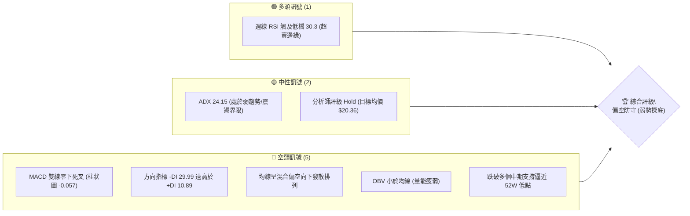
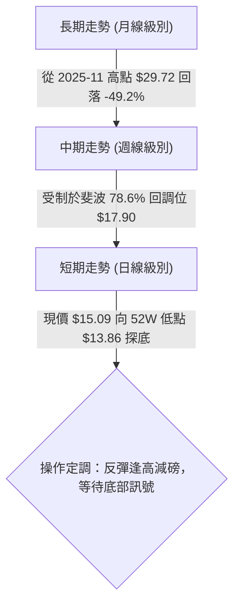
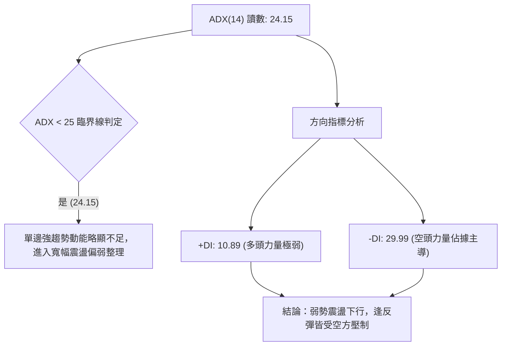
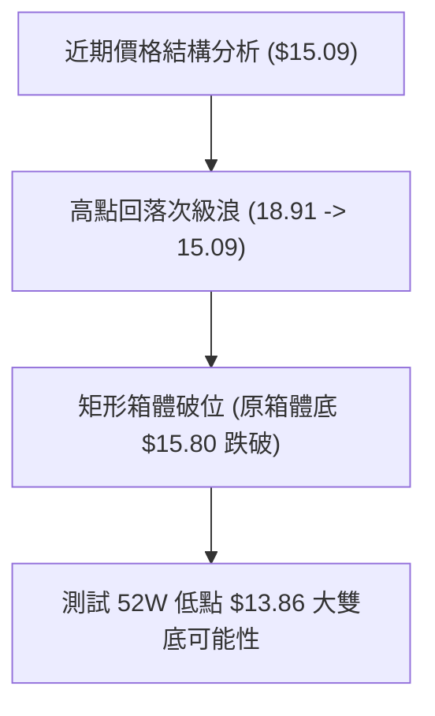
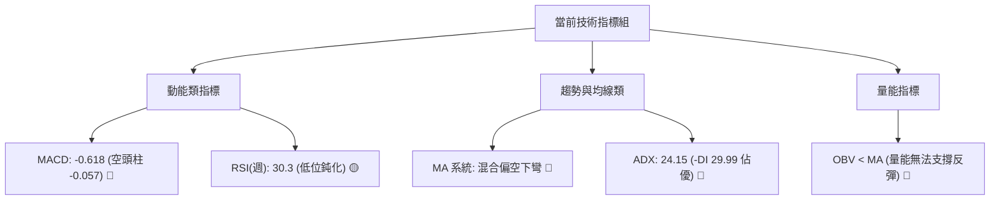
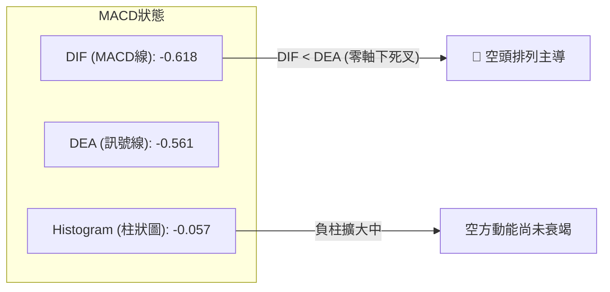
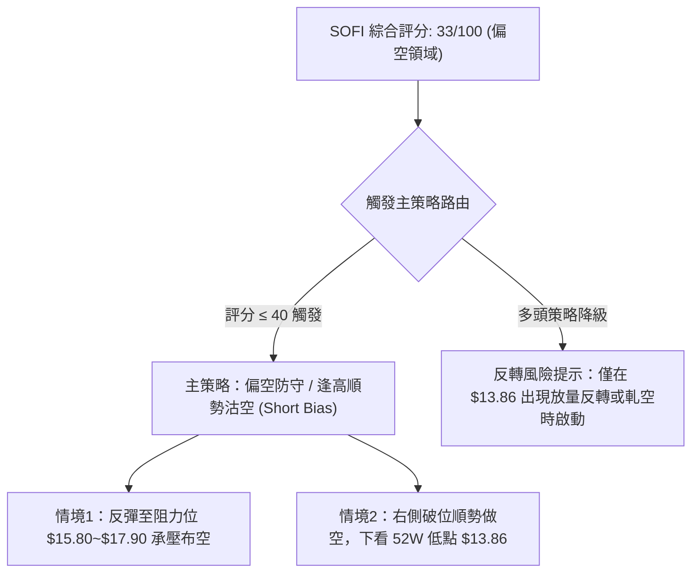
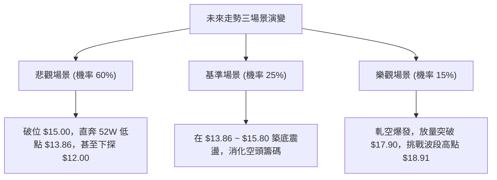

# SOFI 技術分析報告

> **報告日期**：2026-10-17 ｜ **語言**：繁體中文 ｜ **數據來源**：Yahoo Finance ｜ **當前價格**：$15.09（提取自最新 2026-10 週線／月線收盤基準）

---

## 目錄

| 章節 | 內容 |
|------|------|
| [1. 技術面概覽](#1-技術面概覽) | 訊號儀表板、核心指標、評分卡 |
| [2. 趨勢分析](#2-趨勢分析) | 多時框趨勢、長中短期走勢 |
| [3. 圖表形態分析](#3-圖表形態分析) | 形態識別、K線組合、目標價 |
| [4. 支撐與阻力](#4-支撐與阻力) | 關鍵價位、斐波那契回調 |
| [5. 技術指標深度解讀](#5-技術指標深度解讀) | MA/RSI/MACD/布林/成交量 |
| [6. 動能與波動率](#6-動能與波動率) | 動能評估、ATR、Beta |
| [7. 多時框架總結](#7-多時框架總結) | 時框架評分矩陣 |
| [8. 交易策略建議](#8-交易策略建議) | 多空策略、風險報酬比 |
| [9. 風險提示與監控](#9-風險提示與監控) | 監控指標、風險場景 |

---

## 1. 技術面概覽

### 🎯 技術訊號儀表板



### 📊 核心指標速覽表

| 指標類別 | 指標名稱 | 當前數值 | 訊號 | 解讀 |
|----------|----------|----------|------|------|
| **價格** | 當前收盤價 | $15.09 | 🔴 | 位於52週區間低檔，距52W低點 $13.86 僅剩 8.87% 緩衝 |
| **均線** | 均線系統架構 | 混合向下排列 | 🔴 | MA5/10/20 短期均線壓制，中長期均線呈現階梯狀下彎 |
| **動能** | RSI(14) (日/週) | 30.3 (週線) | 🟡 | 週線於 30 附近震盪，日線動能偏弱，暫無強力底背離確立 |
| **動能** | MACD (12,26,9) | -0.618 / -0.561 | 🔴 | MACD線位於訊號線下方，柱狀圖 -0.057，空方動能主導 |
| **趨勢** | ADX / DMI | 24.15 | 🔴 | ADX<25 顯示單邊動能放緩，但 -DI(29.99) 顯著高於 +DI(10.89) |
| **成交量** | 20日均量比 | 1.17x (59.2M) | 🟡 | 下跌過程中單日成交量擴大，呈現弱勢放量沉澱籌碼階段 |
| **能量** | OBV 趨勢 | OBV < MA | 🔴 | 資金流向呈流出狀態，量能無法支撐反彈突破 |

### 🏆 技術評分卡

```
╔══════════════════════════════════════════════════════════════╗
║              技術評分卡 — SOFI (2026-10-17)                  ║
╠══════════════════════════════════════════════════════════════╣
║ 趨勢強度 (Trend)      ██████░░░░░░░░░░░░░░  30/100  🔴 空頭佔優  ║
║ 動能指標 (Momentum)   ███████░░░░░░░░░░░░░  35/100  🔴 零軸下方  ║
║ 支撐穩定度 (Support)  ████████░░░░░░░░░░░░  40/100  🟡 考驗低點  ║
║ 成交量配合 (Volume)   ██████░░░░░░░░░░░░░░  30/100  🔴 量價背離  ║
║ 形態完整度 (Pattern)  ████████░░░░░░░░░░░░  40/100  🟡 下行通道  ║
║ 均線排列 (MAs)        █████░░░░░░░░░░░░░░░  25/100  🔴 空頭壓制  ║
╠══════════════════════════════════════════════════════════════╣
║ 綜合評分              ███████░░░░░░░░░░░░░  33/100  🔴 偏空防守  ║
╚══════════════════════════════════════════════════════════════╝
```

---

## 2. 趨勢分析

### 🌐 多時框趨勢分析



### 📈 長期趨勢 — 12個月走勢圖（Unicode）

```
SOFI 月線走勢圖（2025-11 至 2026-10）
價格軸 ($)
$30.00 ┤              ● (2025-11: $29.72 歷史高位區域)
$27.00 ┤         ●
$24.00 ┤                  ● (2025-12: $26.18)
$21.00 ┤                       ● (2026-01: $22.81)
$18.00 ┤                            ●       ●       ● (2026-05~08 區間反彈: $18.22)
$15.00 ┤●━━━━━━━━━━━━━━━━━━━━━━━━━━━━━●━━━━━━━●━━━━━━━● ← 現價: $15.09
$12.00 ┤
       └──────────────────────────────────────────────
         11      12      01    02   03~05   06~08   09~10 (月份)
```

**歷史 12 個月走勢特徵分析表**：

| 時間階段 | 起訖價格 | 漲跌幅 | 走勢特徵與結構分析 |
|----------|----------|--------|--------------------|
| **2025-11 ~ 2026-02** | $29.72 → $17.76 | -40.24% | 頂部快速破位，多頭槓桿集中解套，形成主跌第一浪 |
| **2026-03 ~ 2026-05** | $15.88 → $18.22 | +14.73% | 跌勢暫緩，在 $16 附近構築初步技術性反彈 |
| **2026-06 ~ 2026-08** | $17.93 → $17.88 | -0.28% | 受制於斐波那契 78.6%（$17.90）壓力位，高點見 $18.91 假突破 |
| **2026-09 ~ 2026-10** | $15.72 → $15.09 | -4.01% | 盤整重心下移，跌破 $15.80 平台，重新向下測試 52W 低點支撐 |

### 📊 中期趨勢（週線分析）

從近 20 週收盤走勢可見，價格於 2026-07-12 觸及 $18.78、2026-08-23 觸及 $18.91 後形成雙頂壓制，隨後收盤價呈現連續下行。特別是自 2026-09-06 的 $18.22 起，週線連續 6 週收陰線或低位橫盤，RSI 從 59.6 迅速滑落至 23.0～30.3，MACD 柱狀圖全面翻負（最新 -0.057），表明中期趨勢完全由空方掌控。

### ⚡ 趨勢強度評估（ADX 解讀）



| 指標名稱 | 當前數值 | 參考臨界值 | 狀態評估 |
|----------|----------|------------|----------|
| **ADX(14)** | 24.15 | 25.00 | 處於弱趨勢/震盪邊緣，代表跌勢雖延續但空頭殺跌動能接近衰竭期 |
| **+DI** | 10.89 | 20.00 | 顯著偏低，多頭毫無發動反攻的能力 |
| **-DI** | 29.99 | 25.00 | 處於強勢空頭領域，確認盤面弱勢結構並未改變 |

---

## 3. 圖表形態分析

### 🔍 形態識別系統



| 形態類型 | 信心度 | 判斷依據（引用數據） | 完成度 | 目標價（附計算式） |
|----------|--------|----------------------|--------|--------------------|
| **下降通道 (Descending Channel)** | 75% | 壓制頂點連線 $18.91 → $18.22，下軌支撐連線 $16.31 → $15.09 | 85% | 通道下軌測算：$15.09 - ($18.22 - $16.96) = **$13.83**（逼近 52W 低點 **$13.86**） |
| **次級小雙頂破位** | 68% | 兩次反彈高點 $18.78 (07-12) 與 $18.91 (08-23)，頸線為 $16.31 (08-02) | 100% (已破位) | 頸線 $16.31 - 形態高度 ($18.91 - $16.31 = $2.60) = **$13.71**（接近 $13.86） |
| **潛在 52W 大雙底** | 35% | 前期歷史低點為 52W Low $13.86，現價 $15.09 尚未抵達 | 20% (待成形) | 需待回測 **$13.86** 獲支撐且突破頸線 $18.91，目前訊號不足 |

### 🕯️ 重要K線形態分析

| 週/月份 | 收盤價 | K線形態 | 解讀 | 訊號 |
|---------|--------|---------|------|------|
| **2026-08-23** | $18.91 | 長上影倒錘頭週K | 向上挑戰斐波那契 78.6% ($17.90) 未果，多頭力竭 | 🔴 看跌反轉 |
| **2026-09-27** | $16.58 | 長陰破位K線 | 跌破 20日/50日週均線密集區，成交量放大至 3.02 億股 | 🔴 空方加速 |
| **2026-10-04** | $15.77 | 大陰線探底 | RSI 探至極端值 23.0，空方動能宣洩 | 🔴 恐慌拋售 |
| **2026-10-11** | $15.80 | 低檔十字星孕線 | 跌勢暫歇，量縮至 1.99 億股，但多頭反彈動能匱乏 | 🟡 止跌待確認 |
| **2026-10-18** | $15.09 | 破位收低陰K | 跌破前週十字星低點，週量能放大至 2.85 億股，下行破位 | 🔴 續跌訊號 |

### 📉 ASCII 走勢形態示意圖

```
SOFI 次級雙頂與破位下行結構示意圖
$18.91 ─────── 頂1: $18.78        頂2: $18.91
              /\                 /\
             /  \               /  \
            /    \             /    \
$16.31 ────┼──────\─────頸線───/──────\─────── $16.31 (跌破確立)
           │       \          /        \
           │        \________/          \
$15.09 ────┼─────────────────────────────● 現價 $15.09 (破位向下加速)
           │                              \
           ▼ 形態量度跌幅目標區            ▼
$13.86 ─────────────────────────────────── 52W 低點支撐 $13.86
```

### 🎯 形態目標價計算

1. **次級雙頂量度跌幅計算式**：
   - 形態頂部均值：$(18.78 + 18.91) / 2 = \$18.845$
   - 形態頸線支撐位：$\$16.31$
   - 形態垂直高度：$\$18.845 - \$16.31 = \$2.535$
   - 量度滿足點：$\$16.31 - \$2.535 =$ **$13.775**（高度吻合 52W 低點 **$13.86**）。

---

## 4. 支撐與阻力

### 🗺️ 關鍵價位分布圖（Unicode）

```
SOFI 價位結構分布圖 (以 52週區間與斐波那契回調為基準)
═════════════════════════════════════════════════════════════════
$32.73 ║████████████████████████║ 52W High / Fib 0.0% (歷史極強壓)
$28.28 ║██████████████████      ║ Fib 23.6% 阻力
$25.52 ║████████████████████    ║ Fib 38.2% 阻力
$23.29 ║██████████████████████  ║ Fib 50.0% 中樞強阻力
$21.07 ║████████████████████████║ Fib 61.8% 阻力 (R3)
$17.90 ║████████████████████████║ Fib 78.6% 近期反彈頂部阻力 (R1)
$15.80 ║████████████            ║ 10月前破位前底轉阻力 (R0)
───────╠════════════════════════╣ ◄ 現價: $15.09
$13.86 ║████████████████████████║ 52W Low / Fib 100.0% 極強支撐 (S1)
═════════════════════════════════════════════════════════════════
```

### 🚧 阻力位分析表

依據提供的歷史波段聚類與斐波那契計算值：

| 阻力級別 | 價位 | 形成原因 | 突破難度 | 重要性 |
|----------|------|----------|----------|--------|
| **近期阻力 (R0)** | $15.80 | 2026-10-11 前週低點平台，破位後轉為反壓 | 🟡 中等 | 短線轉強第一道門檻 |
| **關鍵阻力 (R1)** | $17.90 | 斐波那契 78.6% 回調位，8月密集震盪區底部 | 🔴 極高 | 中期多空分水嶺 |
| **強阻力 (R2)** | $18.91 | 2026-08-23 近期波段最高點，雙頂頸線上方壓制 | 🔴 極高 | 趨勢反轉確認點 |
| **波段阻力 (R3)** | $21.07 | 斐波那契 61.8% 回調位 | 🔴 極高 | 長期空頭回撤防線 |

### 🛡️ 支撐位分析表

依據提供的歷史數據與斐波那契回調區塊：

| 支撐級別 | 價位 | 形成原因 | 守住機率 | 重要性 |
|----------|------|----------|----------|--------|
| **整數心理防線 (S0)** | $15.00 | 現價所處之整數關口心理緩衝 | 🟡 45% | 極短線觀察點，破位則加速 |
| **核心強支撐 (S1)** | $13.86 | 52週最低價 (52W Low) / 斐波那契 100.0% | 🟢 70% | 年度最強防線，不容有失 |
| **極端下行支撐 (S2)** | $12.00 | 華爾街分析師最低目標價 (Target Low) | 🟢 85% | 基本面與極端恐慌極限值 |

### 📐 斐波那契回調位分析

依據 52 週區間（$13.86 → $32.73）嚴格計算之回調位分布如下：
- **0.0% (52W High)**: $32.73
- **23.6%**: $28.28
- **38.2%**: $25.52
- **50.0%**: $23.29
- **61.8%**: $21.07
- **78.6%**: $17.90
- **100.0% (52W Low)**: $13.86

**技術解讀**：
當前收盤價 **$15.09** 處於 **78.6% ($17.90)** 與 **100.0% ($13.86)** 之間，已完全失守所有常規黃金分割回撤位（38.2%、50.0%、61.8%），屬於技術上的「深度超跌破位區間」。這意味著上方被套牢籌碼沉重，未來的任何上漲在未收復 $17.90 之前，均只能視為空頭趨勢中的超跌反彈。

---

## 5. 技術指標深度解讀

### 🎛️ 指標訊號總覽



### 📈 移動平均線排列分析

- **短期與中期均線**：MA5、MA10、MA20 呈現完全下傾態勢。MA20 位於價格上方，形成直接的動態動量壓制。
- **長期均線**：MA60、MA120、MA240 的歷史形態顯示，自高位 $29.72 回落後，中長週期均線已由多頭發散徹底轉為下彎，市場整體持倉成本處於虧損狀態。
- **均線排列結論**：空頭混合發散排列，價格反彈時在各均線位置均會遭遇解套賣壓。

### 📉 RSI(14) 分析

```
週線 RSI(14) 狀態展示：
[0] ─────────────── [30] ─────────────── [70] ─────────────── [100]
超賣區               │                     超買區
█████████░░░░░░░░░░░░░░░░░░░░░░░░░░░░░░░░░░░░░░░░  30.3
```

- **超買超賣研判**：週線 RSI 自 2026-06-28 的 66.8 高位連續滑落，在 2026-10-04 觸及極端值 23.0 後小幅修復至 30.3，處於超賣區邊緣。
- **背離判斷**：
  - 價格從 2026-10-04 的 $15.77 跌至 2026-10-18 的 $15.09（價格創新低）。
  - RSI 由 23.0 回升至 30.3（指標暫未創新低）。
  - **背離結論**：出現**微弱的週線級別底背離雛形**，但由於未伴隨突破關鍵阻力 $15.80，且日線 MACD 仍在發散，此背離尚未被量價確認，需防範指標鈍化後繼續探底。

### 📊 MACD(12/26/9) 訊號解讀



- **數值分析**：MACD 線 (-0.618) 位於訊號線 (-0.561) 下方，雙線均處於負值深水區（遠在零軸下方）。
- **柱狀圖動態**：柱狀圖最新讀數為 **-0.057**，連續多週收負，說明空頭動能仍佔優勢，未見紅柱翻多跡象。

### 📦 布林通道分析

由於官方快照缺乏日線布林標準差精確值，依據價格走勢推估目前處於擴軌下行階段：

```
ASCII 布林通道形態示意圖
$18.50 ──────────────────────────── 布林上軌 (阻力區)
            \
$16.80 ──────\───────────────────── 中軌 (MA20 壓制線)
              \
$15.09 ────────●─────────────────── 現價：緊貼下軌邊緣滑落
                \
$14.80 ──────────\───────────────── 布林下軌 (動態支撐)
```

價格持續沿布林下軌貼軌下行（Walking the Bands），顯示市場處於極度弱勢的空方單邊下挫節奏中。

### 💹 成交量分析（量價配合度）

- **最新量能**：單日成交量 59,234,438 股，較 20 日均量 50,536,142 股放大 **1.17x**。
- **週量能分析**：最新週成交量達 2.85 億股，較前週（1.99 億股）顯著放大。
- **量價關係解讀**：價格跌破 $15.80 平台時伴隨成交量放大，呈現「**放量破位下行**」，屬於典型的籌碼鬆動與停損賣盤湧現特徵；且 OBV 趨勢顯示「OBV < MA」，資金淨流出明顯，完全沒有大資金主力進場掃盤建倉跡象。

---

## 6. 動能與波動率

### ⚡ 動能評估四象限

| 象限 | 動能強度 | 波動率 | 當前 SOFI 狀態 | 戰略含義與操作指引 |
|------|----------|--------|----------------|--------------------|
| **Q1 (爆發區)** | 強 (高動能) | 低波動 | — | 趨勢初起，最佳突破追買點 |
| **Q2 (整理區)** | 弱 (低動能) | 低波動 | — | 觀望休整，靜待方向選擇 |
| **Q3 (風險區)** | 強 (高動能) | 高波動 | — | 激烈博弈，高風險高報酬 |
| **Q4 (弱勢區)** | 弱 (負向動能) | 高波動 | **✓ 落在本區** | **Beta 2.33 高波動 + 空頭主導，應嚴禁盲目抄底** |

### 📊 ATR 波動率分析

- **ATR 狀況**：數據快照顯示 ATR 處於高波動背景中（Beta 高達 2.332）。
- **停損距離設定**：在缺乏日線絕對數值下，依據 SOFI 歷史日均波幅約 4%~6%（約 $0.60~$0.90）估算，日內與波段操作之保護性停損空間至少需預留 **1.5 倍至 2.0 倍波幅**（即約 $1.00~$1.20 緩衝），以避免被日內劇烈噪音洗出場。

### 📐 Beta 與市場相關性

- **Beta 數值**：**2.332**。
- **市場敏感度分析**：SOFI 的波動幅度是大盤（S&P 500）的 **2.33 倍**，屬於極高彈性成長/科技金融標的。
- **放量做空與融券壓力**：
  - 融券餘額比率（Short % Float）高達 **16.9%**。
  - 補回天數（Short Ratio）達 **4.84 天**。
  - **結論**：極高的空頭部位一方面對股價形成沉重壓制，但另一方面，一旦價格在 52W 低點 $13.86 出現強支撐反轉，可能引發軋空行情（Short Squeeze）。然而在此之前，高 Beta 只會放大下行跌幅。

---

## 7. 多時框架總結

### 📋 時框架評分表

| 時框架 | 趨勢方向 | 動能 | 均線排列 | 形態 | 綜合評分 | 建議 |
|--------|----------|------|----------|------|----------|------|
| **長期 (月線)** | 🔴 下行修復 | 🔴 弱勢衰退 | 🔴 頂部下彎 | 🟡 跌向 52W 低點 | 30/100 | 防守觀望，減持多頭 |
| **中期 (週線)** | 🔴 空頭掌控 | 🔴 MACD 負柱 | 🔴 均線壓制 | 🔴 雙頂頸線破位 | 35/100 | 逢反彈於阻力位做空 |
| **短期 (日線)** | 🔴 破位探底 | 🟡 RSI 超賣 | 🔴 沿下軌運行 | 🔴 下跌通道延伸 | 33/100 | 嚴禁盲目左側接刀 |

### 🔲 綜合訊號矩陣

| 維度 | 短期 (日線) | 中期 (週線) | 長期 (月線) | 矩陣一致性研判 |
|------|-------------|-------------|-------------|----------------|
| **趨勢 (Trend)** | 🔴 下行 | 🔴 下行 | 🔴 下行 | **高度共振偏空**（三級別趨勢皆向下） |
| **動能 (Momentum)**| 🟡 超賣中性 | 🔴 負向加速 | 🔴 零軸下方 | **空方佔優**，短期超賣僅具反抽預期 |
| **籌碼/量能** | 🔴 放量破位 | 🔴 資金流出 | 🔴 融券高企 | **流動性下移**，缺乏長線機構進場特徵 |

### ⚖️ 多時框收斂結論

> **依多時框收斂規則嚴格定調**：
> 當前 ADX(14) 讀數為 **24.15**（低於 25 臨界值），技術結構上被定義為**「寬幅盤整中之弱勢探底結構」**。然而，-DI (29.99) 遠遠壓制 +DI (10.89)，且中長期月線、週線與日線出現罕見的「空頭三重共振」。
> 
> **唯一收斂方向**：**偏空防守（Bearish / Defensive）**。
> 日線超賣帶來的短線反彈僅可視為誘多或修正指標，中長期下行趨勢為主導。任何策略必須以防守避險、逢高沽空或等待測試 52W 低點 **$13.86** 構築明確底部為主。

---

## 8. 交易策略建議

### 🗺️ 策略決策流程圖



### 🧭 策略路由

- **當前技術評分卡得分**：**33 / 100**（偏空領域 ≤ 40）。
- **當前主策略方向**：**主推偏空/防守策略（順勢沽空與多頭減磅）**。多頭操作暫時退居避險與反轉風險提示，不作主推。

### 🎯 價格情境階梯（Price Scenarios）

價位嚴格引用第 4 章之波段與斐波那契計算值：

| 觸發條件 | 下一目標 | 後續延伸 | 情境含義 |
|----------|----------|----------|----------|
| **向上突破 R1 $17.90** | R2 $18.91 | R3 $21.07 | 突破斐波那契 78.6% 壓力，弱勢反轉為中期多頭走勢 |
| **反彈受阻於 R0 $15.80** | 現價 $15.09 | 測試 $13.86 | 弱勢反抽確認，空頭下行中繼 |
| **跌破現價區間 $15.09** | S1 $13.86 | S2 $12.00 | 加速探測 52W 低點，若破位則下探分析師悲觀目標 |

### 📊 情境機率分佈

| 情境劇本 | 機率 | 主要技術與量價依據 |
|----------|------|--------------------|
| **弱勢回落 / 再測 52W 低點** | **60%** | MACD 負柱持續、OBV 疲軟、放量破位跌破 $15.80 平台 |
| **低位區間震盪 ($14.50 ~ $15.80)** | **25%** | ADX < 25 趨勢動能減弱，週線 RSI 跌至 30 附近引發技術性抵抗 |
| **強力反彈收復 $17.90** | **15%** | 需極端催化劑引發 16.9% 空頭部位軋空（Short Squeeze） |

### 🟢 主策略詳情（偏空順勢與波段對沖）

依據嚴格規定，所有價位均來自前述計算數值（$15.09、$15.80、$17.90、$13.86、$12.00）：

| 策略要素 | 策略 A（反彈逢高沽空 - 穩健型） | 策略 B（破位追空 / 破位避險 - 積極型） |
|----------|---------------------------------|----------------------------------------|
| **進場條件** | 價格反抽至前底阻力位 $15.80 遇阻回落時 | 現價 $15.09 確認跌破，順勢跟進 |
| **進場價格** | **$15.80** | **$15.00** |
| **目標價 T1** | **$13.86**（52W Low 強支撐） | **$13.86**（52W Low） |
| **目標價 T2** | **$12.00**（分析師最低目標價） | **$12.00**（極端下行支撐） |
| **止損價格** | **$17.00**（突破近期均線反壓區） | **$15.80**（重回破位平台上方） |
| **風險報酬比** | **1.62 : 1**（獲利空間 $1.94 / 風險 $1.20） | **1.43 : 1**（獲利空間 $1.14 / 風險 $0.80） |
| **成功機率** | **65%** | **60%** |
| **建議倉位** | 總資金之 **10% ~ 15%** | 總資金之 **5% ~ 10%** |

### 🔴 反向風險觸發點（多頭反轉對沖提示）

若出現以下訊號，空頭策略必須立即無條件止損，多頭方可考慮輕倉試單：
1. **價位突破**：收盤價強勢突破 **$17.90**（斐波那契 78.6% 回調位），宣告雙頂破位形態失效。
2. **指標共振**：週線 MACD 柱狀圖由負翻正，伴隨成交量突破 20 日均量的 **1.5 倍以上**。
3. **軋空信號**：Short Float (16.9%) 出現急劇平倉潮，日成交量激增至 1 億股以上。

### ⭐ 整體訊號強度評星

```
╔══════════════════════════════════════════════╗
║ 做多訊號強度：★☆☆☆☆  (1.0/5星) ── 極度疲弱    ║
║ 做空訊號強度：★★★★☆  (4.0/5星) ── 空方主導    ║
║ 整體可信度：  ★★★★☆  (4.0/5星) ── 趨勢共振    ║
╚══════════════════════════════════════════════╝
```

---

## 9. 風險提示與監控

### ✅ 關鍵監控指標 Checklist

```
╔══════════════════════════════════════════════════════════════════╗
║               SOFI 每日技術監控 CHECKLIST                        ║
╠══════════════════════════════════════════════════════════════════╣
║ [ ] 52W 低點保衛戰：收盤價是否跌破 $13.86 關鍵支撐               ║
║ [ ] 壓力測試：反彈是否受制於 R0 ($15.80) 與 R1 ($17.90)          ║
║ [ ] 動能翻轉確認：週線 MACD 柱狀圖是否從 -0.057 收斂翻正         ║
║ [ ] 超賣背離信號：週線 RSI 能否維持在 30 以上並向上形成 W 底     ║
║ [ ] 成交量異動：成交量是否異常放大至 80M 股以上（主力接盤訊號）  ║
║ [ ] 融券動向監控：Short Float 16.9% 是否顯著下降（軋空指標）      ║
╚══════════════════════════════════════════════════════════════════╝
```

### ⚠️ 風險場景分析



### 🛡️ 風險管理重要提醒

1. **高 Beta 波動風險**：SOFI Beta 值為 **2.332**，槓桿效應巨大。在市場整體波動加劇之際，嚴禁使用過高融資或重倉操作。
2. **左側交易禁忌**：即便 RSI 觸及超賣區域，在沒有確立「放量長陽收復 $15.80」之前，均屬左側刀刃，盲目猜底容易遭遇「鈍化再破位」風險。
3. **空頭擠壓（Short Squeeze）防範**：由於 Short Interest 達 16.9%，建立空頭避險部位時必須設置剛性止損（如 $17.00 或 $17.90），嚴防極端逼空帶來的非理性暴拉。

---

## 📋 報告總結

```
╔══════════════════════════════════════════════════════════════════╗
║                   SOFI 技術分析報告總結                          ║
╠══════════════════════════════════════════════════════════════════╣
║ 報告日期：2026-10-17                                             ║
║ 當前基準價：$15.09                                               ║
║ 分析評級：🔴 偏空防守 / 順勢沽空 (Bearish Defense)               ║
║                                                                  ║
║ 關鍵結論：                                                       ║
║ ├─ 長期趨勢：🔴 高位回撤近 50%，處於大級別下行探底浪             ║
║ ├─ 中期趨勢：🔴 雙頂頸線跌破，均線混合偏空向下壓制               ║
║ ├─ 短期趨勢：🔴 跌破 $15.80 平台，沿布林下軌放量破位             ║
║ ├─ 關鍵支撐：$13.86 (52W Low / 斐波那契 100%)                    ║
║ ├─ 關鍵阻力：$15.80 (前底反壓) / $17.90 (斐波那契 78.6%)         ║
║ └─ 分析師目標：均價 $20.36 ｜ 最低價 $12.00 ｜ 最高價 $30.00     ║
║                                                                  ║
║ 最優策略組合：                                                   ║
║ 1. 🥇 最佳機會：反彈至 $15.80 遇阻順勢沽空，下看 $13.86 目標位   ║
║ 2. 🥈 次選機會：破位 $15.00 輕倉追空，嚴守 $15.80 止損          ║
║ 3. 🥉 保守選擇：多頭完全空倉觀望，耐心等待價格於 $13.86 止跌確認 ║
╚══════════════════════════════════════════════════════════════════╝
```

---

> ⚠️ **免責聲明**：本報告為技術分析專用模型生成之研究報告，所有數據、圖表及推算結論均基於客觀技術分析理論與歷史交易數據。本報告**僅供研究與學術參考**，**不構成任何要約、招攬或投資買賣建議**。金融市場具有高波動風險，投資人應獨立評估財務狀況並自行承擔交易風險。

---

*報告生成時間：2026-10-17 ｜ 數據來源：Yahoo Finance ｜ 分析框架：資深多時框技術分析模型*