# SOFI 技術分析報告

> **報告日期**：2026-10-18 ｜ **語言**：繁體中文 ｜ **數據來源**：Yahoo Finance ｜ **當前價格**：$14.55

---

## 目錄

| 章節 | 內容 |
|------|------|
| [1. 技術面概覽](#1-技術面概覽) | 訊號儀表板、核心指標、評分卡 |
| [2. 趨勢分析](#2-趨勢分析) | 多時框趨勢、長中短期走勢 |
| [3. 圖表形態分析](#3-圖表形態分析) | 形態識別、K線組合、目標價 |
| [4. 支撐與阻力](#4-支撐與阻力) | 關鍵價位、斐波那契回調 |
| [5. 技術指標深度解讀](#5-技術指標深度解讀) | MA/RSI/MACD/布林/成交量 |
| [6. 動能與波動率](#6-動能與波動率) | 動能評估、ATR、Beta |
| [7. 多時框架總結](#7-多時框架總結) | 時框架評分矩陣 |
| [8. 交易策略建議](#8-交易策略建議) | 多空策略、風險報酬比 |
| [9. 風險提示與監控](#9-風險提示與監控) | 監控指標、風險場景 |

---

## 1. 技術面概覽

### 🎯 技術訊號儀表板

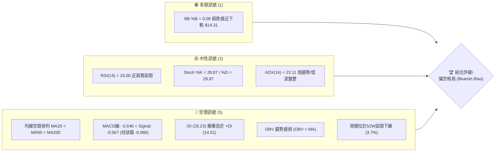

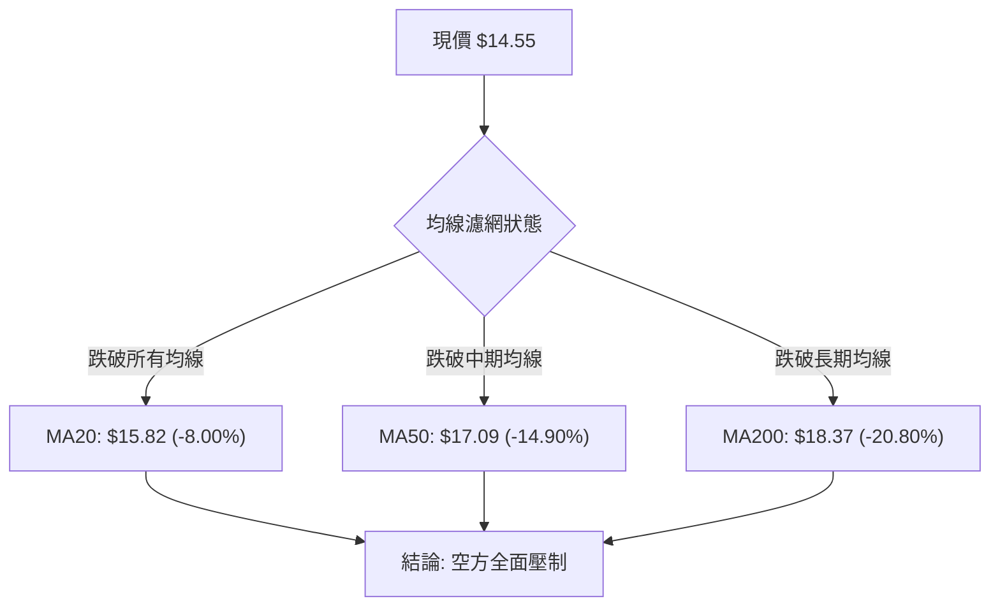

### 📊 核心指標速覽表

| 指標類別 | 指標名稱 | 當前數值 | 訊號 | 解讀 |
|----------|----------|----------|------|------|
| **價格** | 當前價格 | $14.55 | 🔴 | 位於 52 週低點 $13.86 上方僅 4.98%，區間百分位 3.7% |
| **均線** | MA20 | $15.82 | 🔴 | 價格低於 MA20 達 -8.00%，短期動能疲弱受壓制 |
| **均線** | MA50 | $17.09 | 🔴 | 價格低於 MA50 達 -14.90%，中期空頭壓制明確 |
| **均線** | MA200 | $18.37 | 🔴 | 價格低於牛熊分界 MA200 達 -20.80%，長期處於弱勢空頭 |
| **動能** | RSI(14) | 33.00 | 🟡 | 位於弱勢中性區間（30-70），逼近 30 超賣門檻但無底背離 |
| **動能** | MACD(12,26,9) | -0.646 / -0.567 | 🔴 | 雙線位於零軸下方發散，柱狀圖 -0.080，空頭掌握主導權 |
| **動能** | 隨機指標 %K/%D | 28.87 / 28.97 | 🟡 | 位於低檔鈍化邊緣，無黃金交叉，尚未出現反轉觸發點 |
| **趨勢** | ADX / DI | 23.11 / -DI 28.23 | 🔴 | ADX<25 顯示整體趨勢減速盤跌，但 -DI 遠高於 +DI 展現空方優勢 |
| **波動** | ATR(14) | $0.61 | 🟡 | 每日波幅佔股價 4.16%，波幅適中，具備高 Beta 彈性特性 |
| **通道** | 布林通道 %B | 0.08 (下軌 $14.31) | 🟡 | 股價貼近布林通道下軌，存在短線均值回歸的超賣反抽動能 |
| **量能** | 量比 / OBV | 1.17x / 疲弱 | 🔴 | 今日放量 59.38M 超越均量，但 OBV < MA 顯示資金持續淨流出 |

### 🏆 技術評分卡

```
╔══════════════════════════════════════════════════════════════╗
║                技術評分卡 — SOFI (2026-10-18)                ║
╠══════════════════════════════════════════════════════════════╣
║ 趨勢強度 (ADX=23.11,-DI主導)   ██████░░░░░░░░░░░░░░  30/100 🔴 ║
║ 動能指標 (RSI=33, MACD雙跌)    ██████░░░░░░░░░░░░░░  32/100 🔴 ║
║ 支撐穩定度 (僅依賴52W低點)     ████████░░░░░░░░░░░░  40/100 🟡 ║
║ 成交量配合 (量大但OBV疲弱)     ██████░░░░░░░░░░░░░░  30/100 🔴 ║
║ 形態完整度 (自高點跌破各頸線)  ████████░░░░░░░░░░░░  38/100 🔴 ║
║ 均線排列 (MA20<MA50<MA200)     ████░░░░░░░░░░░░░░░░  20/100 🔴 ║
╠══════════════════════════════════════════════════════════════╣
║ 綜合評分                       ██████░░░░░░░░░░░░░░  31/100 🔴 ║
║ 評級結論                       偏空震盪探底 (Bearish Consolidation)║
╚══════════════════════════════════════════════════════════════╝
```

---

## 2. 趨勢分析

### 🌐 多時框趨勢分析

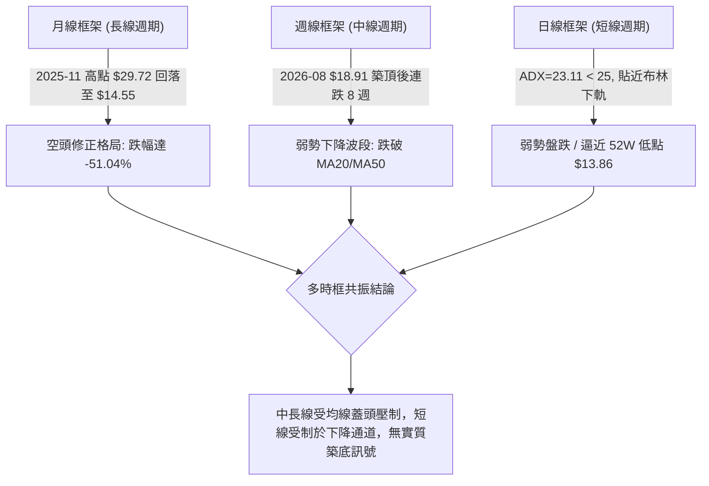

### 📈 長期趨勢 — 12個月走勢圖（Unicode）

```
SOFI 月線走勢圖（過去12個月：2025-10 至 2026-10）
價格軸 ($)
$30.00 ┤        ●(2025-11: $29.72 歷史波段雙頂)
$28.00 ┤  ●(10月 $29.68)
$26.00 ┤              ●(12月 $26.18)
$24.00 ┤
$22.00 ┤                    ●(01月 $22.81)
$20.00 ┤
$18.00 ┤                          ●(02月 $17.76)    ●(05月 $18.22)    ●(08月 $17.88)
$16.00 ┤                                ●(03月 $15.88) ●(04月 $16.10) ●(06月 $17.93) ●(07月 $16.31) ●(09月 $15.72)
$14.00 ┤                                                                                            ●(10月現價 $14.55)
$12.00 ┤
       └────────────────────────────────────────────────────────────────────────────────────────────
          10月  11月  12月  01月  02月  03月  04月  05月  06月  07月  08月  09月  10月 (2026)
```

#### 長期走勢特徵分析表格

| 階段週期 | 起訖月份 | 起訖價位 ($) | 漲跌幅 (%) | 價量特徵與形態解讀 |
|----------|----------|--------------|------------|--------------------|
| 頂部構築期 | 2025-10 ~ 2025-11 | $29.68 → $29.72 | +0.13% | 衝高觸及 52 週高點 $32.73 後收盤於 $29.72，構築雙頂鈍化形態 |
| 主跌加速期 | 2025-11 ~ 2026-03 | $29.72 → $15.88 | -46.57% | 跌破所有短期均線，呈現無支撐單邊拋售，空頭極度強勢 |
| 中期箱體震盪 | 2026-03 ~ 2026-08 | $15.88 → $17.88 | +12.59% | 於 $15.88 ~ $18.91 區間來回整理，MA60/MA120 走平下彎 |
| 二次破位探底 | 2026-08 ~ 2026-10 | $17.88 → $14.55 | -18.62% | 跌破區間底部，連破 MA5/10/20，直逼 52 週低點 $13.86 |

### 📊 中期趨勢（週線分析）

```
SOFI 週線近期高低點結構示意圖
$19.00 ┤       ● (08-23 週高點 $18.91)
$18.00 ┤    ●     ● (08-30 $18.06) ● (09-06 $18.22)
$17.00 ┤                           ● (09-13 $17.32)
$16.00 ┤                                 ● (09-20 $16.96) ● (09-27 $16.58)
$15.00 ┤                                                       ● (10-04 $15.77) ● (10-11 $15.80)
$14.00 ┤                                                                            ● (10-18 當前收盤 $14.55)
       └─────────────────────────────────────────────────────────────────────────────
         08/16   08/23   08/30   09/06   09/13   09/20   09/27   10/04   10/11   10/18
```

中期週線數據明確顯示「高點遞低 (Lower Highs)、低點遞低 (Lower Lows)」的標準空頭下降常態：
- 2026-08-23 收盤 $18.91 形成波段頂點；
- 2026-09-06 反彈至 $18.22 即告衰竭；
- 2026-09-27 連續長陰破位跌至 $16.58；
- 2026-10-18 最新週線收跌至 $14.55，週成交量放大至 286,126,400 股，週陰線伴隨量能回升，空方賣壓持續湧現。

### ⚡ 趨勢強度評估（ADX 解讀）

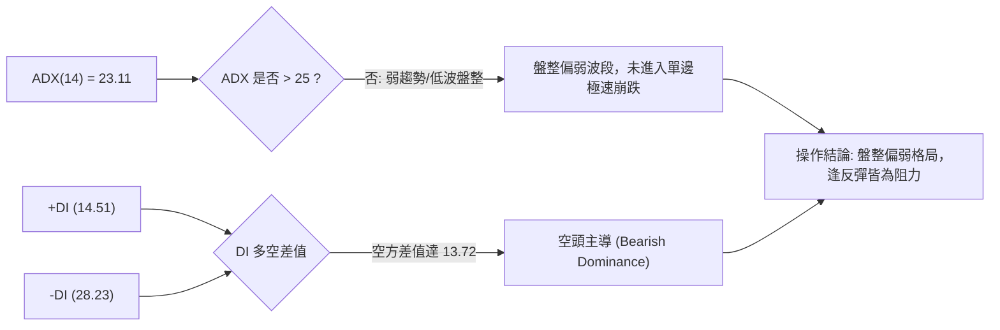

#### ADX 數值強度對照表

| 指標名稱 | 當前數值 | 臨界標準 | 趨勢狀態判定 |
|----------|----------|----------|--------------|
| **ADX(14)** | 23.11 | 25.00 | **弱趨勢/無方向性趨勢**（處於盤跌但尚未觸發極端殺跌） |
| **+DI** | 14.51 | 20.00 | **多方極度匱乏**，買盤毫無抵抗意願 |
| **-DI** | 28.23 | 25.00 | **空方實質主導**，賣盤控制盤面節奏 |
| **DI差值 (-DI - +DI)** | +13.72 | 0.00 | 空頭優勢極度明確，無多頭轉折徵兆 |

---

## 3. 圖表形態分析

### 🔍 形態識別系統

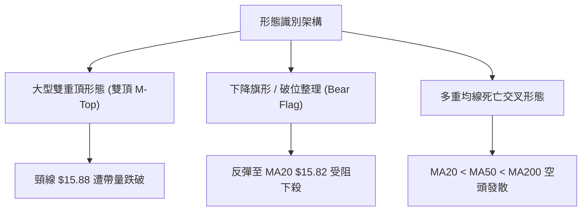

#### 圖表形態信心度清單

| 形態類別 | 信心度 (%) | 判斷依據（引用數據） | 完成度 (%) | 目標價（附嚴格計算式） |
|----------|------------|----------------------|------------|------------------------|
| **大週期雙頂形態 (M-Top)** | 85% | 2025-10 高點 $29.68 與 2025-11 高點 $29.72 構築雙頂，頸線為 2026-03 收盤低點 $15.88 | 90% (已破頸線) | 頸線 $15.88 - 形態高度 ($29.72 - $15.88 = $13.84) = **$2.04**（僅作極端量度參考） |
| **中期下降通道破位** | 75% | 自 2026-08 週高點 $18.91 連續壓低，跌破 2026-09 整理下軌 $15.72 | 100% | 破位價 $15.72 - (前波反彈高 $18.22 - $15.72 = $2.50) = **$13.22**（由形態高度推算） |
| **指標型超跌收斂** | 50% | 現價 $14.55 貼近布林下軌 $14.31，但數據中無波段低點支撐 | 未確認 | 數據中未偵測到下方支撐聚類，依布林中軌回調推算阻力為 **$15.82** |

### 🕯️ 重要K線形態分析

| 週期/月份 | 收盤價 ($) | K線形態名稱 | 技術解讀 | 訊號方向 |
|-----------|------------|-------------|----------|----------|
| 2025-11 | 29.72 | 長上影十字星 (Doji) | 歷史高點 $32.73 處遭遇強烈拋壓，多頭動能耗盡形成波段反轉 | 🔴 強烈看空 |
| 2026-03 | 15.88 | 探底長下影小陽線 | 跌至 $15.88 出現空頭回補，形成中短期箱體頸線支撐 | 🟡 短線反彈 |
| 2026-08 | 17.88 | 假突破倒錘頭 (Inverted Hammer) | 衝高 $18.91 失敗收低於 $17.88，確認中長期均線下壓阻力沉重 | 🔴 假突破翻空 |
| 2026-09 | 15.72 | 實體陰線 (Bearish Candle) | 全月收低於 $15.72，實體吞噬 8 月整固區，下行空間開啟 | 🔴 空方延續 |
| 2026-10 | 14.55 | 大陰破位線 (Breakdown) | 跌穿 9 月低點 $15.72 及 3 月低點 $15.88，直探 52W 低點 $13.86 | 🔴 極度弱勢 |

### 📉 ASCII 走勢形態示意圖

```
雙頂及頸線破位示意圖
$29.72 頂部1 ────┐            ┌──── $29.72 頂部2
                 \            /
                  \          /
                   \  $22.81/
                    \      /
                     \    /
$15.88 ───────────────\──/── 頸線位 (2026-03 建立之關鍵支撐線)
                       \/
                        \
                         \─── 現價 $14.55 (頸線已實質失守，形成向下加速態勢)
                          \
$13.86 ────────────────────┴─ 52 週最低點 (最後防線)
```

### 🎯 形態目標價計算

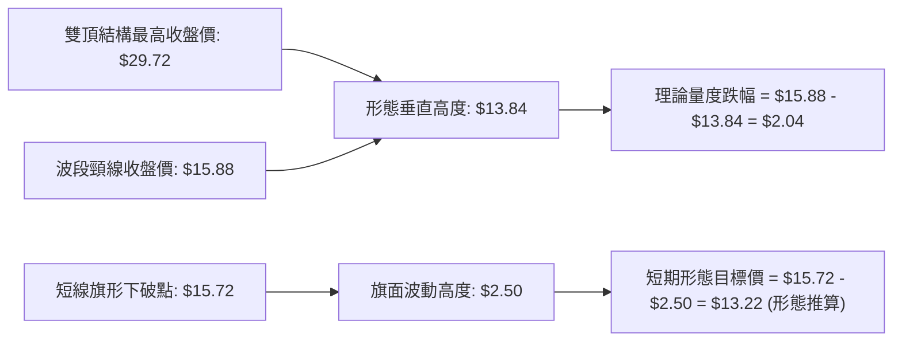

---

## 4. 支撐與阻力

### 🗺️ 關鍵價位分布圖（Unicode）

```
SOFI 價位結構分布圖 (依據關鍵高低點聚類與斐波那契回調)
═══════════════════════════════════════════════════════════════════════════
$19.62 ║████████████████████████████████████║ 強阻力 R3 (近一年波段高點聚類)
$18.79 ║████████████████████████████        ║ 阻力 R2 (近一年波段高點聚類)
$18.37 ║────────────────────────────────────║ 長期均線 MA200 壓制位
$17.96 ║████████████████████████████████████║ 關鍵阻力 R1 (波段高點聚類 / Fib 78.6%: $17.90)
$17.09 ║────────────────────────────────────║ 中期均線 MA50 壓制位
$15.82 ║▓▓▓▓▓▓▓▓▓▓▓▓▓▓▓▓▓▓▓▓▓▓▓▓            ║ 短期均線 MA20 / 布林中軌壓制
$14.55 ╠════════════════════════════════════╣ ◄ 當前市價 ($14.55)
$14.31 ║░░░░░░░░░░░░░░░░░░                  ║ 動態支撐: 布林通道下軌 (BB Lower)
$13.86 ║████████████████████████████████████║ 斐波那契 100.0% / 52週歷史低點 (最後硬支撐)
(下無) ║────────────────────────────────────║ 數據中未偵測到現價下方之近一年波段低點聚類
═══════════════════════════════════════════════════════════════════════════
```

### 🚧 阻力位分析表

所有價位均直接引用數據「關鍵價位」區塊之波段高點聚類數值：

| 阻力級別 | 價位 ($) | 距現價幅標 (%) | 形成原因與技術共振 | 突破難度 | 重要性評級 |
|----------|----------|----------------|--------------------|----------|------------|
| **R1** | $17.96 | +23.44% | 近一年波段高點聚類，與斐波那契 78.6% 回調位 ($17.90) 及 MA60 ($17.10) 形成密集阻力帶 | 極高 | ★★★★★ |
| **R2** | $18.79 | +29.11% | 近一年波段高點聚類，接近 2026-08-23 週高點 ($18.91) 及長期均線 MA200 ($18.37) | 極高 | ★★★★☆ |
| **R3** | $19.62 | +34.83% | 近一年波段高點聚類，接近 MA240 ($19.95) 大週期強壓 | 極高 | ★★★☆☆ |

### 🛡️ 支撐位分析表

依據數據「關鍵價位」區塊：波段低點聚類顯示 `(no swing-low support detected below current price)`。現價下方僅存在 52 週最低點與斐波那契極限支撐：

| 支撐級別 | 價位 ($) | 距現價幅標 (%) | 形成原因與技術共振 | 守住機率 | 重要性評級 |
|----------|----------|----------------|--------------------|----------|------------|
| **S1 (動態)** | $14.31 | -1.65% | 布林通道下軌動態邊界，短期超賣乖離率保護區間 | 50% | ★★★☆☆ |
| **S2 (極限)** | $13.86 | -4.74% | 52 週最低點 (52W Low) 及 52 週區間斐波那契 100.0% 回調位 | 40% | ★★★★★ |
| **S3** | 數據未偵測 | — | 數據中未偵測到更低波段低點聚類，跌破 $13.86 將進入歷史空白區 | — | — |

### 📐 斐波那契回調位分析

依據數據所提供之 52 週區間（$13.86 → $32.73）斐波那契回調精確數值：

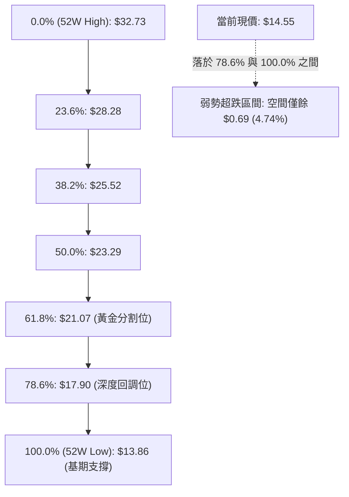

#### 斐波那契回調解讀表

| 回調層級 | 價位 ($) | 與當前市價 ($14.55) 相對關係 | 技術意義解讀 |
|----------|----------|------------------------------|--------------|
| **0.0%** | $32.73 | 上方 +124.95% | 52 週最高點，強大多頭天花板 |
| **23.6%** | $28.28 | 上方 +94.36% | 波段牛市第一次衰竭區 |
| **38.2%** | $25.52 | 上方 +75.40% | 弱勢修正回吐位 |
| **50.0%** | $23.29 | 上方 +60.07% | 多空平衡分水嶺，失守後宣告中長期多頭瓦解 |
| **61.8%** | $21.07 | 上方 +44.81% | 黃金分割強防守位（失守確認轉入熊市週期） |
| **78.6%** | $17.90 | 上方 +23.02% | 深度回調阻力，高度重合阻力位 R1 ($17.96) |
| **100.0%** | $13.86 | 下方 -4.74% | 52 週最低點，多頭最後退路，失守將開啟全新下行通道 |

---

## 5. 技術指標深度解讀

### 🎛️ 指標訊號總覽

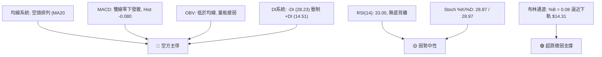

### 📈 移動平均線排列分析

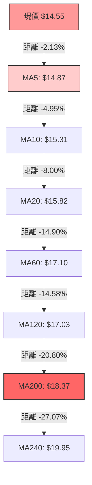

均線系統呈現完美的**空頭排列**（MA5 < MA10 < MA20 < MA60 < MA200 < MA240）。
- 短期 MA5 ($14.87)、MA10 ($15.31) 陡峭下穿；
- 股價與 MA20 ($15.82) 負乖離率達 -8.00%，顯示空方動能強大；
- 牛熊分界線 MA200 ($18.37) 與 MA240 ($19.95) 穩步向下，長期趨勢受壓制。

### 📉 RSI(14) 分析

```
RSI(14) 指標狀態：33.00
0         30   33.00                  70       100
[超賣區間] ├────┼───────────────────────┤ [超買區間]
█████████░░░░░░░░░░░░░░░░░░░░░░░░░░░░░░░░░░░░░░░░░░  33.00%
```

- **區間評估**：RSI 位於 33.00，徘徊於 30 超賣門檻上方，屬於弱勢空頭控盤區間。
- **背離判斷**：
  - 檢視近 4 週收盤價：$16.58 (RSI 28.9) → $15.77 (RSI 23.0) → $15.80 (RSI 30.3) → $14.55 (RSI 33.0)。
  - 雖然 10-18 股價跌破前低但 RSI(33.0) 略高於 10-04 之低點 (23.0)，但日線級別數據明確判定：「RSI 背離：無明顯背離」。
  - 結論：指標反彈僅為技術性鈍化，無足夠量能與多頭形態確認底背離。

### 📊 MACD(12/26/9) 訊號解讀

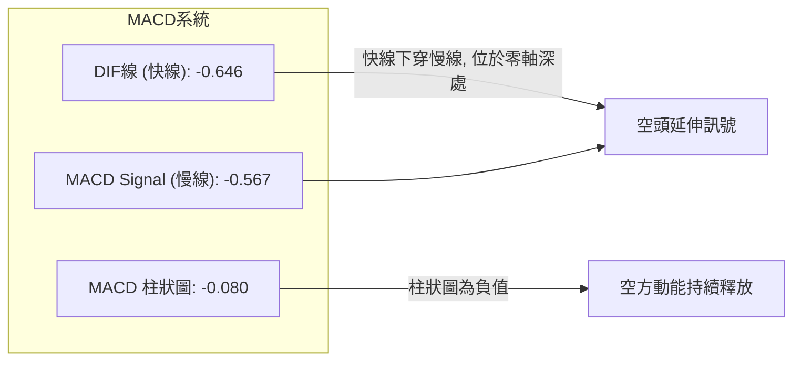

- **MACD 快線**：-0.646
- **MACD Signal 慢線**：-0.567
- **MACD 柱狀圖**：-0.080
- **深度解讀**：雙線處於零軸下方（代表中長期空頭市場），快線持續在慢線下方發散，且柱狀圖維持為負值（-0.080）。近期週線 MACD 柱狀圖自 2026-09-06 起已連續 7 週為負值（-0.065 → -0.147 → -0.145 → -0.084 → -0.117 → -0.025 → -0.080），完全確認目前處於空頭動能釋放週期，未見金叉跡象。

### 📦 布林通道分析

```
布林通道 (20, 2) 結構圖
$17.32 ┬─────────────────────────────────────────── BB 上軌
       │
$15.82 ┼ - - - - - - - - - - - - - - - - - - - - - -  BB 中軌 (MA20)
       │
$14.55 ┼ ◄ 現價 ($14.55, %B = 0.08)
$14.31 ┴─────────────────────────────────────────── BB 下軌
```

- **上軌**：$17.32 ｜ **中軌 (MA20)**：$15.82 ｜ **下軌**：$14.31
- **通道寬度**：($17.32 - $14.31) / $15.82 = 19.03%
- **%B 指標**：0.08（接近 0.0，顯示極度逼近下軌）
- **技術含義**：股價緊貼下軌運行，通常為「弱勢走下軌」行情。由於 %B = 0.08 尚未向外刺破下軌（無出現超賣開口發散），反映賣壓雖穩定但尚未引發恐慌性暴跌拋售。

### 💹 成交量分析（量價配合度）

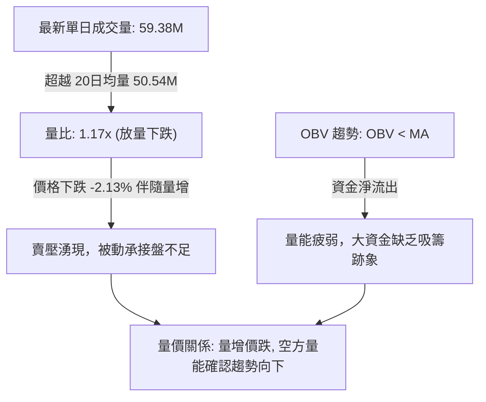

---

## 6. 動能與波動率

### ⚡ 動能評估四象限

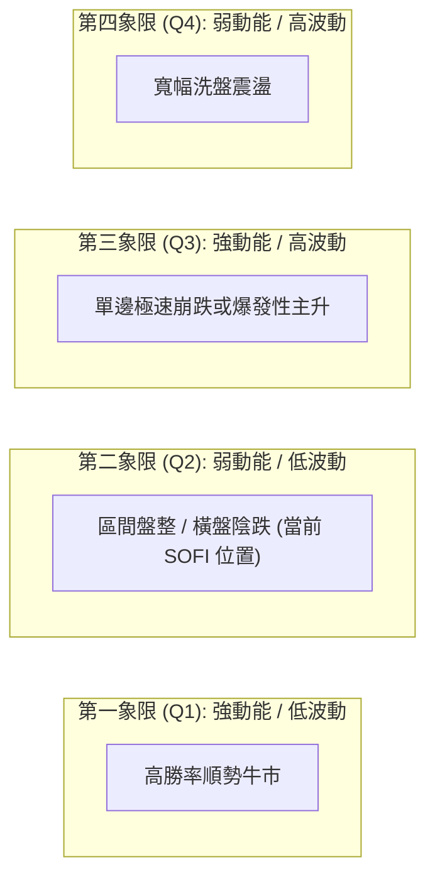

| 象限分區 | 動能狀態 | 波動率狀態 | 標的所處狀態 | 戰略應對評估 |
|----------|----------|------------|--------------|--------------|
| **Q1** | 強 | 低 | — | 最佳波段做多機會 |
| **Q2** | **弱 (ADX=23.11, RSI=33)** | **中低 (ATR% 4.16%, BB收斂)** | **✓ SOFI 當前定位** | **謹慎觀望，反彈做空為宜** |
| **Q3** | 強 | 高 | — | 極高風險激進突破操作 |
| **Q4** | 弱 | 高 | — | 避免交易，多空雙巴 |

### 📊 ATR 波動率分析

- **ATR(14)**：$0.61
- **波動佔比**：$0.61 / $14.55 = **4.16%**
- **風控數值建議**：
  - **極短線動態波幅**：1.0 倍 ATR = **$0.61**
  - **標準風控止損距離**：1.5 倍 ATR = **$0.92**（空單進場後向上防守 $14.55 + $0.92 = $15.47）
  - **寬幅結構止損距離**：2.0 倍 ATR = **$1.22**

### 📐 Beta 與市場相關性

- **Beta 係數**：**2.332**
- **市場屬性解讀**：
  - SOFI 的 Beta 高達 2.332，顯示其為極高彈性之高 Beta 成長型/金融科技標的。
  - 當大盤（標普 500 指數）下跌 1% 時，SOFI 理論平均跌幅達 2.33%；反之亦然。
  - **空頭市場風險乘數**：在整體宏觀高利率或信用服務板塊承壓背景下，2.332 的 Beta 會加速個股向下探底的跌勢。

---

## 7. 多時框架總結

### 📋 時框架評分表

| 時框架 | 趨勢方向 | 動能狀態 | 均線排列狀況 | 形態結構 | 綜合評分 | 建議操作策略 |
|--------|----------|----------|--------------|----------|----------|--------------|
| **長期 (月線)** | 🔴 實質空頭 | 弱 (自高點對折) | 跌破 MA200/240 | 雙頂跌破頸線 | **25/100** | 逢高減倉 / 長期避險 |
| **中期 (週線)** | 🔴 下降通道 | 負值發散 (MACD柱負) | MA20 < MA50 | 頂部遞低下降走勢 | **30/100** | 反彈逢阻力偏空操作 |
| **短期 (日線)** | 🟡 盤跌探底 | RSI 33, BB%B 0.08 | 均線完全空頭排列 | 逼近 52W 低點整理 | **38/100** | 嚴禁搶反彈，靜待破位 |

### 🔲 綜合訊號矩陣

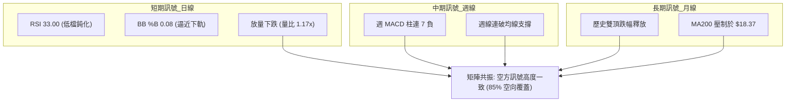

### ⚖️ 多時框收斂結論

依據多時框收斂優先級規則：
1. **趨勢/盤整判定**：當前 ADX(14) 數值為 **23.11 (< 25)**，嚴格定義為**盤整行情 / 弱趨勢盤跌階段**。
2. **主導時框與交易區間**：在 ADX < 25 條件下，日線布林通道區間（**下軌 $14.31 ～ 上軌 $17.32**，中軌 $15.82）為主要觀察邊界。
3. **方向性收斂**：雖然 ADX < 25，但 -DI (28.23) 顯著壓制 +DI (14.51)，且中長期週線與月線均線呈現全面空頭排列。因此收斂後的唯一方向性結論為：**偏空震盪（Bearish Consolidation）**。
4. **衝突取捨**：短期布林通道下軌雖然提供微弱超賣支撐，但不得作為做多理由；所有短線反彈均應視為均線空頭排列下的逢高做空或多頭解套機會。

---

## 8. 交易策略建議

### 🗺️ 策略決策流程圖

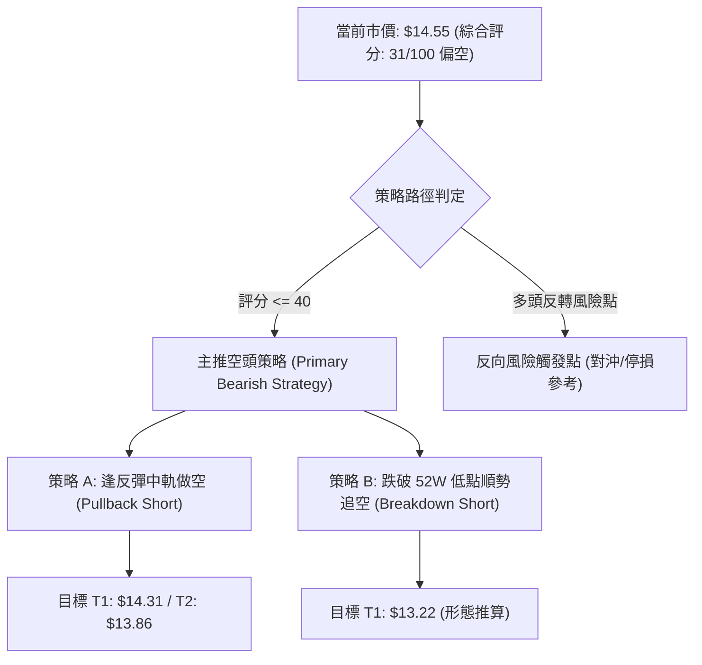

### 🧭 策略路由（依評分卡分流）

> **當前主策略方向 = 主推空頭策略（依綜合技術評分：31/100 🔴）**

由於技術面評分為 31/100（≤ 40 門檻），均線呈現空頭排列且 -DI 壓制，市場主路徑為偏空尋求支撐。主策略推行「逢反彈阻力做空」與「跌破關鍵支撐順勢沽空」，多頭策略僅保留為極限風險觸發點。

### 🎯 價格情境階梯（Price Scenarios）

以當前價格 $14.55 為基準，所有引述價位皆為數據已列出的波段高低點與斐波那契回調位：

| 觸發條件 | 下一目標 | 後續延伸 | 情境含義解讀 |
|----------|----------|----------|--------------|
| **向上突破 R1 $17.96** | R2 $18.79 | R3 $19.62 | 突破波段高點聚類與 Fib 78.6%，中長期多頭反轉 |
| **向上反彈 MA20 $15.82** | MA50 $17.09 | R1 $17.96 | 短線均值回歸修復，布林中軌處面臨空頭強阻力 |
| **當前市價 $14.55** | BB 下軌 $14.31 | 52W 低點 $13.86 | 弱勢盤跌，測試年內最後防線 |
| **有效跌破 52W 低點 $13.86** | 形態目標 $13.22 | 數據未偵測支撐 | 跌破 52 週最低點，開啟全新無支撐真空跌勢 |

### 📊 情境機率分佈

```
情境機率分佈條形圖
繼續回落再探底 (55%) : ███████████████████████████░░░░░░░░░░░░
區間弱勢震盪   (35%) : █████████████████░░░░░░░░░░░░░░░░░░░░░
強勢反彈向上   (10%) : █████░░░░░░░░░░░░░░░░░░░░░░░░░░░░░░░░░
```

| 情境劇本 | 機率估計 (%) | 主要指標依據 |
|----------|--------------|--------------|
| **回落再探底 (跌向 $13.86)** | **55%** | 均線空頭排列，MACD 負向發散 (-0.080)，量比 1.17x 放量收陰，OBV 疲弱 |
| **區間震盪 ($14.31 ~ $15.82)** | **35%** | ADX = 23.11 (< 25) 顯示趨勢動能減速，布林通道下軌 $14.31 具短期緩衝 |
| **強勢反彈 (挑戰 $17.96)** | **10%** | RSI 33.00 處於低位，但缺乏量能與背離支持，需重大基本面消息刺激 |

### 🟢 主策略詳情（方向：主推空頭策略）

所有價位均直接引用自數據或明確計算：

| 策略要素 | 策略 A：反彈布林中軌做空 (Pullback Short) | 策略 B：跌破 52 週低點追空 (Breakdown Short) |
|----------|-------------------------------------------|----------------------------------------------|
| **操作邏輯** | 股價反抽受阻於 MA20 / 布林中軌，順勢做空 | 跌破最後防線 $13.86，順應空頭突破加速 |
| **進場價格** | **$15.82** (MA20 / 布林中軌壓制位) | **$13.80** (跌破 52W 低點 $13.86 後順勢進場) |
| **目標價 T1** | **$14.55** (現價水平，收回部分利潤) | **$13.22** (由下降通道形態高度推算之目標價) |
| **目標價 T2** | **$13.86** (52 週最低點，全數獲利了結) | 數據中未偵測到更低支撐，採動態 2x ATR 停利 |
| **止損價格** | **$16.43** (MA20 $15.82 + 1.0x ATR $0.61) | **$14.41** (破位點 $13.80 + 1.0x ATR $0.61) |
| **風險報酬比** | **1 : 3.21** (風險 $0.61，目標盈利 $1.96) | **1 : 1.00** (風險 $0.61，目標盈利 $0.58) |
| **預估勝率** | **65%** | **55%** |
| **建議倉位** | **15%** (總資金規模) | **10%** (破位波動較大，輕倉順勢) |

### 🔴 反向風險觸發點（對沖提示）

若出現以下訊號，空頭主策略**立即失效並無條件停損出場**：
1. **收盤價實體站上 $15.82 (MA20)**：突破布林通道中軌，宣告短期弱勢陰跌格局遭到破壞。
2. **週線突破 R1 $17.96**：帶量突破波段高點聚類與斐波那契 78.6% 回調位，確立中長期反轉。
3. **空頭避險操作**：持有大量現貨之投資人，可在現價 $14.55 或跌破 $13.86 時買入價外看跌期權 (Put) 進行對沖。

### ⭐ 整體訊號強度評星

```
╔══════════════════════════════════════════════════════════════╗
║ 做多訊號強度：★☆☆☆☆  (1/5星 - 極弱，僅依賴布林下軌超賣)      ║
║ 做空訊號強度：★★★★☆  (4/5星 - 強烈，均線空頭排列量價配合)   ║
║ 整體可信度：  ★★★★☆  (4/5星 - 多時框趨勢共振偏空)           ║
╚══════════════════════════════════════════════════════════════╝
```

---

## 9. 風險提示與監控

### ✅ 關鍵監控指標 Checklist

```
╔══════════════════════════════════════════════════════════════╗
║               SOFI 技術面日常監控清單 (Checklist)            ║
╠══════════════════════════════════════════════════════════════╣
║ [ ] 52週低點防守線 $13.86：收盤價是否跌破？(破位將引發止損潮)║
║ [ ] 布林中軌 $15.82 (MA20)：反彈是否受阻？(空頭最佳加碼點)   ║
║ [ ] RSI(14) 數值：是否跌破 30 進入深度超賣？有無底背離產生？ ║
║ [ ] MACD 柱狀圖：是否收斂轉正？(若由負轉正需防禦空單回補)    ║
║ [ ] 成交量變化：下跌時單日成交量是否大於 50.54M (均量)？      ║
║ [ ] 放空比率監控：Short % Float 達 16.9%，警惕軋空風險 (Short Squeeze)║
╚══════════════════════════════════════════════════════════════╝
```

### ⚠️ 風險場景分析

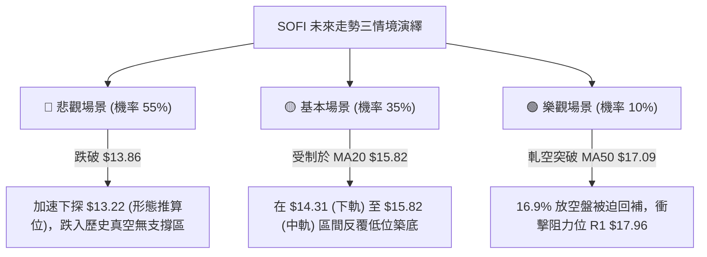

### 🛡️ 風險管理重要提醒

1. **軋空風險防範（Short Squeeze Alert）**：
   - 數據顯示 SOFI 當前 **Short % Float 高達 16.9%**，空頭回補天數 (Short Ratio) 為 **4.84 天**。
   - 儘管技術面處於絕對劣勢，但極高的空頭部位隨時可能因市場突發利好（如降息預期或金融科技題材）引發暴力軋空反彈。空頭交易者必須嚴格執行 $16.43 之止損線，切忌抱有僥倖心理。
2. **Beta 槓桿風險**：
   - 標的 **Beta 為 2.332**，市場系統性波動對其具備放大效應。若大盤指數走弱，其跌速將極為迅速；反之大盤反彈時其漲幅亦極為劇烈。
3. **倉位管理嚴律**：
   - 單筆策略倉位上限控制在 **10% ~ 15%**，整體曝險不得超過投資組合之 20%。
   - 採用 ATR 計算動態止損，確保每筆交易之最大資本虧損控制在總資金的 **1% ~ 1.5%** 以內。

---

## 📋 報告總結

```
╔══════════════════════════════════════════════════════════════════╗
║                    SOFI 技術分析報告總結                         ║
╠══════════════════════════════════════════════════════════════════╣
║ 報告日期：2026-10-18                                             ║
║ 當前價格：$14.55                                                 ║
║ 分析評級：🔴 偏空震盪探底 (Bearish Consolidation)                ║
║                                                                  ║
║ 關鍵技術維度結論：                                               ║
║ ├─ 長期趨勢：🔴 空頭主導 (雙頂破頸線 $15.88，回吐 51%)          ║
║ ├─ 中期趨勢：🔴 弱勢下降波段 (連 8 週下行，MACD 柱連 7 負)       ║
║ ├─ 短期趨勢：🟡 弱勢盤跌 (ADX=23.11 盤整，貼近布林下軌 $14.31)   ║
║ ├─ 關鍵支撐：極限支撐 $13.86 (52W Low / Fib 100%)                ║
║ ├─ 關鍵阻力：短期阻力 $15.82 (MA20)，強阻力 $17.96 (R1 / Fib 78.6%)║
║ └─ 機構共識：Hold / 23 位分析師平均目標價 $20.36 (最低 $12.00)   ║
║                                                                  ║
║ 最優策略組合建議：                                               ║
║ 1. 🥇 最佳機會：策略 A — 逢反彈至 MA20 $15.82 順勢放空，止損 $16.43║
║ 2. 🥈 次選機會：策略 B — 破位 $13.86 追空至形態目標 $13.22       ║
║ 3. 🥉 保守選擇：完全空倉觀望，待日線底背離或重新站上 $17.09 再評估║
╚══════════════════════════════════════════════════════════════════╝
```

---

> ⚠️ **免責聲明**：本報告為 AI 自動生成之技術分析，所有數據及估算均基於提供的歷史價格資訊。本報告**僅供研究與學術參考**，**不構成任何投資建議**。投資有風險，入市需謹慎。

---

*報告生成時間：2026-10-18 ｜ 數據來源：Yahoo Finance ｜ 分析框架：多時框技術分析*