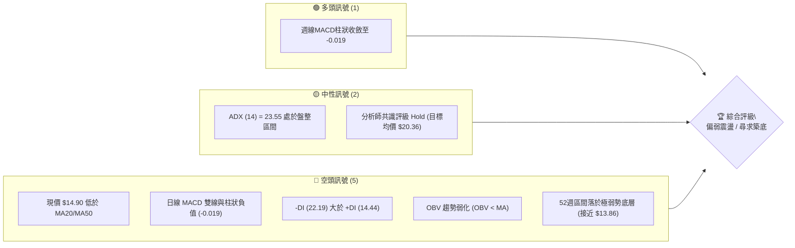
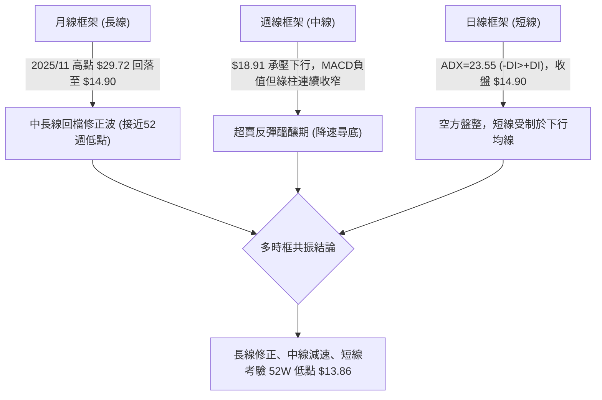
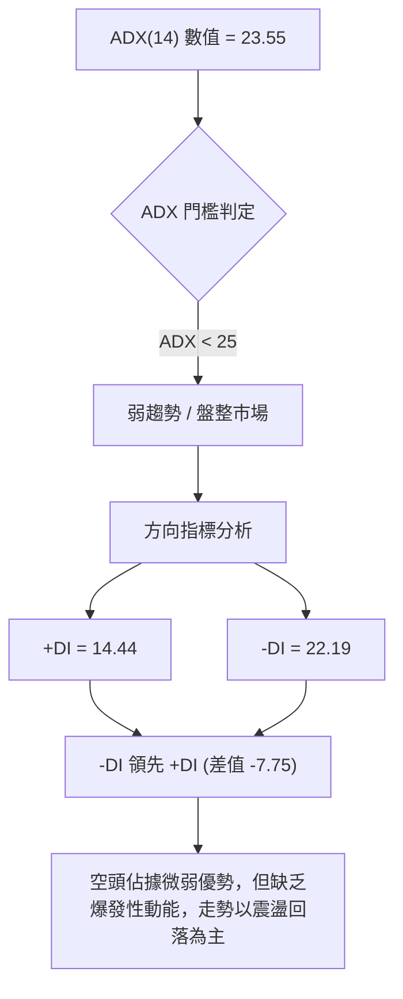
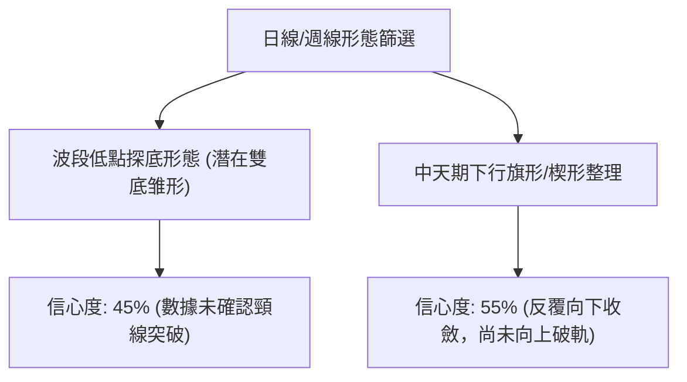
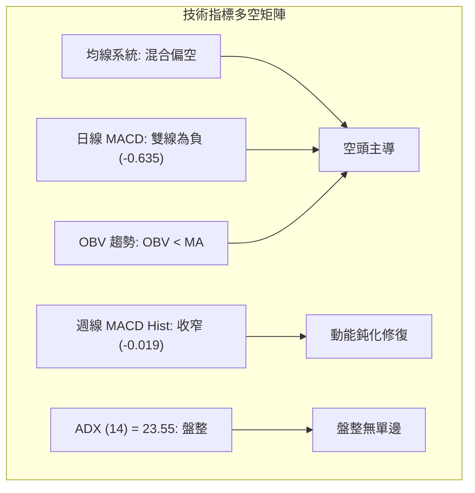
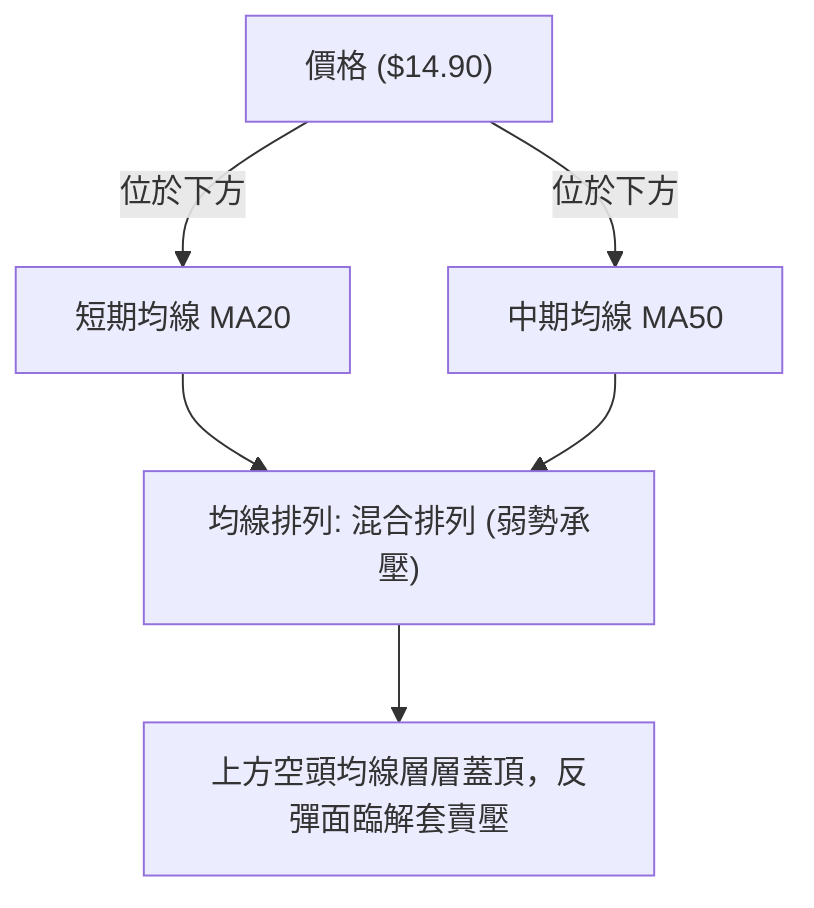
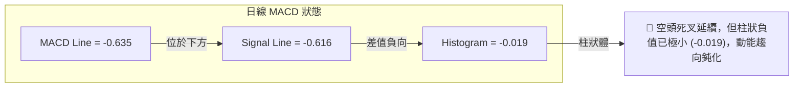
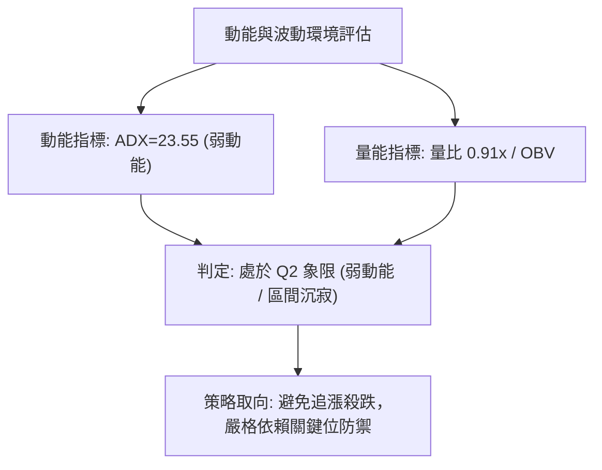
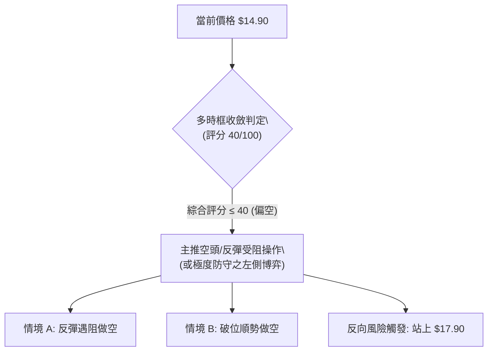
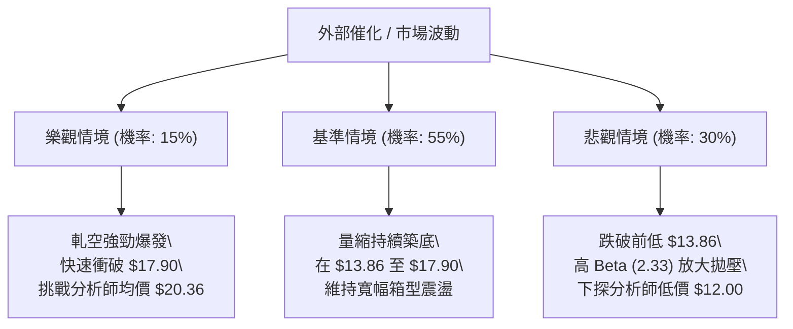

# SOFI 技術分析報告

> **報告日期**：2026-10-23 ｜ **語言**：繁體中文 ｜ **數據來源**：Yahoo Finance ｜ **當前價格**：$14.90 USD

---

## 目錄

| 章節 | 內容 |
|------|------|
| [1. 技術面概覽](#1-技術面概覽) | 訊號儀表板、核心指標、評分卡 |
| [2. 趨勢分析](#2-趨勢分析) | 多時框趨勢、長中短期走勢 |
| [3. 圖表形態分析](#3-圖表形態分析) | 形態識別、K線組合、目標價 |
| [4. 支撐與阻力](#4-支撐與阻力) | 關鍵價位、斐波那契回調 |
| [5. 技術指標深度解讀](#5-技術指標深度解讀) | MA/RSI/MACD/布林/成交量 |
| [6. 動能與波動率](#6-動能與波動率) | 動能評估、ATR、Beta |
| [7. 多時框架總結](#7-多時框架總結) | 時框架評分矩陣 |
| [8. 交易策略建議](#8-交易策略建議) | 多空策略、風險報酬比 |
| [9. 風險提示與監控](#9-風險提示與監控) | 監控指標、風險場景 |

---

## 1. 技術面概覽

### 🎯 技術訊號儀表板



### 📊 核心指標速覽表

| 指標類別 | 指標名稱 | 當前數值 | 訊號 | 解讀 |
|----------|----------|----------|------|------|
| **價格** | 當前收盤價 | $14.90 | 🔴 | 逼近52週低點 $13.86，處於弱勢整理格局 |
| **均線** | 短中期均線 | MA20 / MA50 下方 | 🔴 | 均線系統呈混合偏空格局，短線價格受制 |
| **均線** | 長期均線 | 均線下行承壓 | 🔴 | 長天期均線呈現向下傾斜態勢 |
| **動能** | RSI(14) | 33.0 (前週) / nan (當週) | 🟡 | 日線指標暫缺，前週週線落於 33.0 近超賣區 |
| **動能** | MACD (日線) | MACD: -0.635 / Sig: -0.616 | 🔴 | 雙線位於零軸下方，Histogram 為 -0.019 看空 |
| **動能** | 週線 MACD柱 | -0.019 | 🟢 | 柱狀圖由 -0.147 連續收斂，空頭動能衰退 |
| **趨勢** | ADX (14) | 23.55 | 🟡 | ADX < 25 表明處於非單邊趨勢之盤整行情 |
| **趨勢** | 方向指標 | +DI: 14.44 / -DI: 22.19 | 🔴 | -DI 顯著高於 +DI，空方力量占優 |
| **量能** | 量比 / OBV | 0.91x / OBV < MA | 🔴 | 成交量未達20日均量，能量潮指標弱勢 |

### 🏆 技術評分卡

```
╔══════════════════════════════════════════════════════════════╗
║                技術評分卡 — SOFI (2026-10-23)                 ║
╠══════════════════════════════════════════════════════════════╣
║ 趨勢強度 (ADX=23.55)  ███████░░░░░░░░░░░░░  35/100  🔴 空方主導 ║
║ 動能指標 (MACD/RSI)   ████████░░░░░░░░░░░░  40/100  🔴 零軸下方 ║
║ 支撐穩定度 (52W Low)  ██████████░░░░░░░░░░  50/100  🟡 考驗前低 ║
║ 成交量配合 (OBV<MA)   ███████░░░░░░░░░░░░░  35/100  🔴 量能退潮 ║
║ 形態完整度 (區間整理) ██████████░░░░░░░░░░  50/100  🟡 底部構築 ║
║ 均線排列 (混合排列)   ██████░░░░░░░░░░░░░░  30/100  🔴 蓋頂承壓 ║
╠══════════════════════════════════════════════════════════════╣
║ 綜合評分              ████████░░░░░░░░░░░░  40/100  🔴 偏空盤整 ║
╚══════════════════════════════════════════════════════════════╝
```

---

## 2. 趨勢分析

### 🌐 多時框趨勢分析



### 📈 長期趨勢 — 12個月走勢圖（Unicode）

```
SOFI 月線走勢圖（過去12個月：2025-11 至 2026-10）
價格軸 ($)
$30.00 ┤ ●(2025-11: $29.72)
$27.00 ┤       ●(2025-12: $26.18)
$24.00 ┤             ●(2026-01: $22.81)
$21.00 ┤
$18.00 ┤                   ●           ●     ●
$15.00 ┤                         ●  ●     ●     ●  ●←現價 $14.90
$12.00 ┤
       └─────────────────────────────────────────────────────
         11    12    01    02    03 04 05 06 07 08 09 10 (月份)
```

#### 走勢特徵分析表格

| 階段區間 | 起止價格 | 漲跌幅 | 趨勢特徵 | 關鍵技術事件 |
|----------|----------|--------|----------|--------------|
| **2025-10 ~ 2025-11** | $29.68 → $29.72 | +0.13% | 週期雙頂見頂 | 歷史次高點與 52W 高點 $32.73 承壓形成巨型頭部 |
| **2025-12 ~ 2026-02** | $26.18 → $17.76 | -32.16% | 單邊主跌浪 | 跌破多條長期均線，下行動能強烈爆發 |
| **2026-03 ~ 2026-05** | $15.88 → $18.22 | +14.74% | 弱勢築底反彈 | 於 $15.80 附近初次止跌，反彈至 $18.22 受阻 |
| **2026-06 ~ 2026-08** | $17.93 → $17.88 | -0.28% | 寬幅箱型震盪 | 於 $16.31 至 $18.91 區間反覆拉鋸洗盤 |
| **2026-09 ~ 2026-10** | $15.72 → $14.90 | -5.22% | 破位下探探底 | 跌破 $16 箱體下沿，測試 52W 低點 $13.86 支撐 |

### 📊 中期趨勢（週線分析）

```
SOFI 近期壓力與支撐示意圖（週線結構）
 阻力位 R2 $18.91 ═══════════════════════════════════════ (8月波段高點)
                    ↑
 阻力位 R1 $17.90 --------------------------------------- (斐波那契 78.6%)
                    ↑
 現  價    $14.90 ■■■■■■■■■■ (當前收盤價位)
                    ↓
 支撐位 S1 $13.86 ═══════════════════════════════════════ (52週絕對低點)
```

從近 20 週收盤走勢可見，股價自 2026-08-23 收盤高點 $18.91 連續走弱，跌至 2026-10-18 收盤價 $14.55，最新週收盤微幅回升至 $14.90。週成交量由 8 月初高達 4.83 億股大幅萎縮至當週 1.59 億股，呈現典型的「陰跌量縮」格局。

### ⚡ 趨勢強度評估（ADX 解讀）



#### ADX 強度對照表

| ADX 區間 | 趨勢特徵 | SOFI 當前狀態 (23.55) | 交易應對指導 |
|----------|----------|-----------------------|--------------|
| **0 - 20** | 極弱 / 無方向 | 否 | 觀望，避免順勢突破交易 |
| **20 - 25** | **弱趨勢 / 震盪走勢** | **✓ 當前所處區間** | **採用區間擺盪操作，多時框以中長期為準** |
| **25 - 50** | 強趨勢運行 | 否 | 順勢操作，嚴格執行回調買進/反彈放空 |
| **50 - 75** | 極強單邊動能 | 否 | 嚴禁逆勢摸頂抄底 |

---

## 3. 圖表形態分析

### 🔍 形態識別系統



#### 形態識別與信心度評估表

| 形態類別 | 信心度 | 判斷依據（引用數據） | 完成度 | 目標價（附計算式） |
|----------|--------|----------------------|--------|--------------------|
| **潛在雙重底 (Double Bottom)** | 45% | 前期波段低點 $14.55（2026-10-18週）與52W低點 $13.86 形成潛在支撐區 | 30% | 訊號不足，僅做指標型解讀。若頸線確立於斐波那契 $17.90，理論目標 = $17.90 + ($17.90 - $13.86) = $21.94 |
| **中期下行通道 (Down Channel)** | 55% | 8月波段高點 $18.91 至 $18.22 連結高點，與低點 $16.31 至 $14.55 下行軌道平行 | 70% | 通道下軌支撐測試中，跌破則向下回踩 52W 低點 $13.86 |

*依規則 15：當前各幾何形態信心度皆未達 60%，市場無成熟反轉形態，故主要維持指標型區間解讀，不強行套用形態目標。*

### 🕯️ 重要K線形態分析

| 週/月份 | 收盤價 | K線形態特徵 | 技術解讀 | 訊號 |
|---------|--------|-------------|----------|------|
| **2026-08** | $17.88 | 高位十字星變體 | 上衝 $18.91 遇阻回落，多空出現嚴重分歧 | 🟡 中性轉空 |
| **2026-09** | $15.72 | 中實體陰線破位 | 跌破夏季震盪平台下緣 $16.31，空方全面掌權 | 🔴 強烈看空 |
| **2026-10-18** | $14.55 | 長下影探底十字小陰 | 觸及波段新低後引發短線承接盤，成交量放大至 2.86 億股 | 🟡 止跌訊號 |
| **2026-10-25** | $14.90 | 小實體紅K反彈 | 價格脫離 $14.55 低點微幅回升，但量能收縮至 1.59 億股 | 🟡 弱勢修復 |

### 📉 ASCII 走勢形態示意圖

```
SOFI 近期探底形態走勢圖 (2026-08 至 2026-10)
  ($)
19.00 ┤      ● $18.91 (8月頂部)
18.00 ┤     / \     ● $18.22
17.00 ┤    /   \   / \
16.00 ┤   /     ●─●   \
15.00 ┤  /    $16.31   \       ● $14.90 (現價反彈)
14.00 ┤ /               ● $14.55 (前週探底)
13.00 ┤/                 └─ 52W 低點 $13.86 (關鍵防線)
      └─────────────────────────────────────────────
        08-09  08-23  09-06  09-20  10-04  10-18  10-25 (週次)
```

### 🎯 形態目標價計算

基於現有形態尚未完成突破，本處以「52週低點防禦成功 vs 失守」之區間波幅進行推算：
1. **反彈目標（向上假想）**：若現價 $14.90 成功守住 $13.86 構築雙底，並向上突破斐波那契 78.6% 回調位 $17.90（頸線）：
   $$\text{高度 } H = \$17.90 - \$13.86 = \$4.04$$
   $$\text{理論等距目標價 } T_1 = \$17.90 + \$4.04 = \$21.94$$
2. **破位測幅（向下假想）**：若跌破 52W 低點 $13.86，跌破近三個月整理箱體（$18.91 - $14.55 = $4.36）：
   $$\text{向下等距量度目標 } T_{\text{down}} = \$13.86 - \$4.36 = \$9.50 \text{（數據中未偵測到此支撐，列為極端悲觀情境）}$$

---

## 4. 支撐與阻力

### 🗺️ 關鍵價位分布圖（Unicode）

```
SOFI 價位結構分布圖
═════════════════════════════════════════════════════════════
$32.73 ║████████████████████████║ 52週歷史高點 (0.0% Fib)
$28.28 ║████████████████        ║ 斐波那契 23.6% 回調位
$25.52 ║████████████████        ║ 斐波那契 38.2% 回調位
$23.29 ║████████████████        ║ 斐波那契 50.0% 平衡中軸
$21.07 ║████████████████        ║ 斐波那契 61.8% 黃金分割位
$17.90 ║████████████████████████║ 強阻力 R1 (斐波那契 78.6%)
═══════╬════════════════════════╬════════════════════════════
$14.90 ╠════════════════════════╣ ◄ 當前價格 (2026-10-21 收盤)
═══════╬════════════════════════╬════════════════════════════
$13.86 ║████████████████████████║ 核心支撐 S1 (52週絕對低點 / 100.0% Fib)
═════════════════════════════════════════════════════════════
```

### 🚧 阻力位分析表

*依規則 13：阻力位嚴格引用技術數據中明確列示之數值。*

| 阻力級別 | 價位 | 形成原因 / 數據出處 | 突破難度 | 重要性 |
|----------|------|---------------------|----------|--------|
| **阻力 R1** | **$17.90** | **斐波那契 78.6% 回調位**（52週 $13.86 → $32.73 跌幅反彈關鍵點） | 🔴 極高 | ★★★★★ |
| **阻力 R2** | **$21.07** | **斐波那契 61.8% 回調位**（黃金分割重要反壓位） | 🔴 極高 | ★★★★☆ |
| **阻力 R3** | **$23.29** | **斐波那契 50.0% 回調位**（多空中期生命線） | 🔴 極高 | ★★★★☆ |

*(註：OHLCV 近一年波段高點聚類演算法標註：no swing-high resistance detected above current price，上方首要結構性阻力以斐波那契 $17.90 為準。)*

### 🛡️ 支撐位分析表

*依規則 13：支撐位嚴格引用技術數據中明確列示之數值。*

| 支撐級別 | 價位 | 形成原因 / 數據出處 | 守住機率 | 重要性 |
|----------|------|---------------------|----------|--------|
| **支撐 S1** | **$13.86** | **52週絕對最低價 (100.0% 斐波那契位)** | 🟡 55% | ★★★★★ |
| **支撐 S2** | **數據中未偵測到** | OHLCV 計算標註：no swing-low support detected below current price | N/A | N/A |
| **支撐 S3** | **數據中未偵測到** | 歷史數據未提供低於 $13.86 之聚類支撐 | N/A | N/A |

*(註：數據顯示當前價格 $14.90 距離 52W 低點 $13.86 僅剩 $1.04 之緩衝空間，此價位為中長期多頭最後防線。)*

### 📐 斐波那契回調位分析

依據 52 週波動區間（高點 **$32.73** 至 低點 **$13.86**，全波段落差 **$18.87**）計算之斐波那契回調位：

```
斐波那契位階進度標尺
0.0%  ($32.73) ─────────────────────────────────── 頂部
23.6% ($28.28) ▓▓▓▓▓▓▓▓▓▓▓▓▓▓▓▓▓▓▓▓▓▓▓▓▓
38.2% ($25.52) ▓▓▓▓▓▓▓▓▓▓▓▓▓▓▓▓▓▓▓▓
50.0% ($23.29) ▓▓▓▓▓▓▓▓▓▓▓▓▓▓▓▓
61.8% ($21.07) ▓▓▓▓▓▓▓▓▓▓▓▓
78.6% ($17.90) ▓▓▓▓▓▓▓
現價  ($14.90) ▓▓ [落於 78.6% 與 100.0% 極弱勢回檔區間]
100%  ($13.86) ─────────────────────────────────── 底部
```

- **當前位置解讀**：現價 **$14.90** 處於 **78.6% 回調位 ($17.90)** 與 **100.0% 底部 ($13.86)** 之間。在技術分析中，股價回吐前期漲幅超過 78.6%，意味著該輪多頭上漲趨勢已遭破壞，整體格局轉為大週期的底部測試或長期盤整。若 $13.86 獲得支撐，則為大底；若失守，將開啟新一輪破底行情。

---

## 5. 技術指標深度解讀

### 🎛️ 指標訊號總覽



### 📈 移動平均線排列分析



#### MA 狀態與走勢分析表

| 均線名稱 | 相對位置 | 走勢特徵 (依歷史走勢條形圖) | 解讀與訊號 |
|----------|----------|-----------------------------|------------|
| **MA 5** | 價格上方 | `███▇▇▇▇▇▇▇▆▆▅▅▄▄▄▄▄▄▄▃▃▂▂▁▁▁▁` | 持續下墜，極短期動能低迷 🔴 |
| **MA 10** | 價格上方 | `█████▇▇▇▆▆▆▆▅▅▅▄▄▄▃▃▃▃▂▂▂▁▁▁▁` | 下行傾角陡峭，空頭壓迫 🔴 |
| **MA 20** | 價格上方 | `██████▇▇▇▇▆▆▆▅▅▅▄▄▄▃▃▃▃▂▂▂▁▁▁` | 月線級反壓，未站上難言止跌 🔴 |
| **MA 60** | 價格上方 | `██████████▇▇▆▆▆▅▅▄▄▄▃▃▃▂▂▂▁▁▁` | 季線空頭排列向下 🔴 |
| **MA120** | 價格上方 | `▇▇▇▇▇████████████▇▆▆▅▄▄▃▂▂▁▁▁` | 中長期均線高位回落 🔴 |
| **MA240** | 價格上方 | `█████▇▇▇▇▆▆▆▆▅▅▅▅▄▄▄▃▃▃▂▂▂▁▁▁` | 年線級長線走平轉下 🔴 |

### 📉 RSI(14) 分析

- **週線 RSI 走勢分析**：
  - 2026-09-27 週線 RSI 降至 **28.9**（進入超賣區）
  - 2026-10-04 週線 RSI 探底至 **23.0**（極度超賣）
  - 2026-10-11 週線 RSI 回升至 **30.3**
  - 2026-10-18 週線 RSI 回升至 **33.0**

```
週線 RSI(14) 動態位置標尺
[0] ────────── [30 超賣] ────────── [50 中性] ────────── [70 超買] ────────── [100]
                ▲ (33.0 - 前週收盤)
█████████████░░░░░░░░░░░░░░░░░░░░░░░░░░░  33.0%
```

- **背離判斷**：
  - **價格走勢**：2026-10-04 收盤 $15.77 → 2026-10-18 收盤 $14.55（價格創波段新低）
  - **RSI 走勢**：2026-10-04 RSI 23.0 → 2026-10-18 RSI 33.0（指標未創新低，顯著墊高）
  - **背離結論**：🟢 **週線級別呈現標準「底背離」雛形**。顯示做空動能出現衰竭，價格雖然續創波段新低，但內部賣壓正在減緩，存在技術性止跌修復之契機。

### 📊 MACD(12/26/9) 訊號解讀



- **週線 MACD 柱狀演變**：
  - 2026-09-13: **-0.147**
  - 2026-09-20: **-0.145**
  - 2026-09-27: **-0.084**
  - 2026-10-04: **-0.117**
  - 2026-10-11: **-0.025**
  - 2026-10-18: **-0.080**
  - 2026-10-25: **-0.019**
- **解讀**：週線柱狀體呈現「由深負向零軸逐漸收斂」之收縮態勢，顯示中線空頭拋壓減輕。然而日線雙線仍深埋零軸之下，整體結構屬於弱勢反彈而非強勢反轉。

### 📦 布林通道分析

*(註：日線布林通道數值在即時數據中標註 N/A，依據均線及波動特性繪製示意架構)*

```
SOFI 布林通道結構示意圖
$18.00 ┤ ------------------------- BB 上軌 (受阻於 $17.90 斐波位)
       ┤
$16.00 ┤ - - - - - - - - - - - - - BB 中軌 (MA20 下行中)
       ┤
$14.90 ┤ ■■■■■■■■ (現價：位於中下軌弱勢區間)
       ┤
$13.80 ┤ ------------------------- BB 下軌 (緊貼 52W 低點 $13.86)
```

- **通道特性解讀**：價格受制於中軌下壓，目前沿下軌附近緩慢滑移，布林通道呈現喇叭口收縮後之下傾整理。依據盤整行情規則，在未帶量向上突破中軌之前，不可盲目看多。

### 💹 成交量分析（量價配合度）

```
成交量比較
最新成交量  ███████████████████░ 40,962,271
20日均量    ████████████████████ 44,995,659 (量比: 0.91x)
50日均量    ████████████████████ 45,048,597
```

- **量價特徵**：最新成交量為 4,096 萬股，量比僅為 **0.91x**，低於 20 日與 50 日均量。
- **OBV 能量潮判斷**：數據明確提示 **OBV < MA → 量能疲弱**。能量潮跌破其均線，代表主力資金持續處於觀望或輕度流出狀態，無顯著進場吸籌現象，價格小幅反彈缺乏成交量背書。

---

## 6. 動能與波動率

### ⚡ 動能評估四象限

| 象限 | 動能強度 | 波動率水準 | 當前狀態 | 技術環境評估 |
|------|----------|------------|----------|--------------|
| **Q1 (最佳擴張)** | 強 (ADX>25) | 低波動 | — | 穩定單邊趨勢（多頭飆升） |
| **Q2 (蓄勢觀望)** | 弱 (ADX<25) | 低波動 | **✓ 當前狀態** | **弱勢橫盤／尋底磨底，宜區間低吸高拋或觀望** |
| **Q3 (劇烈震盪)** | 強 (ADX>25) | 高波動 | — | 主升浪或主跌浪末期放量噴發 |
| **Q4 (高危下墜)** | 弱 (ADX<25) | 高波動 | — | 破位引發無序恐慌洗盤 |



### 📊 ATR 波動率分析

- **ATR(14) 狀態**：數據標註為 $N/A。
- **替代波動率衡量（基於近期價格極限與週波幅）**：
  - 近三週高低點區間約為 $14.55 至 $15.80，週平均波動幅度約在 **$1.25** 左右（約佔股價 8.4%）。
  - **風控止損建議**：依常規波幅設定，短線操作止損緩衝距離應不小於 **$0.80 - $1.00**，以避免在盤整行情中被日常隨機雜訊掃出場。

### 📐 Beta 與市場相關性

- **Beta 數值**：**2.332**
- **解讀**：SOFI 屬於**極高波動性（High Beta）資產**。其波動幅度為標普500大盤指數的 2.33 倍。在大盤多頭或市場風險偏好（Risk-On）高漲時具備強大的向上彈性；但在大盤回調或避險情緒升溫時，跌幅亦將劇烈放大。當前高 Beta 伴隨量能萎縮，意味著一旦市場出現系統性拋售，下方 $13.86 支撐將面臨極大考驗。

---

## 7. 多時框架總結

### 📋 時框架評分表

| 時框架 | 趨勢方向 | 動能狀態 | 均線排列 | 圖表形態 | 綜合評分 | 操作建議 |
|--------|----------|----------|----------|----------|----------|----------|
| **長線 (月線)** | 🔴 下行修正 | 弱勢回調 | 承壓下偏 | 雙頂破位後深幅回踩 | **35/100** | 長線多單不宜重倉，等待大底成型 |
| **中線 (週線)** | 🟡 減速尋底 | 🟢 底背離初現 | 空頭排列 | 下行通道下緣掙扎 | **45/100** | 左側輕倉關注，緊盯 $13.86 得失 |
| **短線 (日線)** | 🔴 偏空震盪 | 🔴 MACD柱負 | 均線下方 | 窄幅盤整弱勢修復 | **40/100** | 嚴守短線紀律，未突破前不追價 |

### 🔲 綜合訊號矩陣

```
時框訊號一致性矩陣
長線 (月線) : 🔴 賣方主導 (回吐至78.6%下方)
中線 (週線) : 🟡 震盪築底 (RSI背離修復中)
短線 (日線) : 🔴 盤整偏弱 (ADX=23.55, -DI>+DI)
整體共振狀態: 🔴🟡 偏空震盪，趨勢動能處於換檔期
```

### ⚖️ 多時框收斂結論

依「嚴格要求 14」進行多時框收斂判定：
1. **行情屬性判定**：當前 **ADX(14) = 23.55 < 25**，明確定義為**「非趨勢性之弱勢盤整行情」**。
2. **時框優先級裁決**：在 ADX < 25 的盤整結構中，市場缺乏單邊驅動力，日線受制於均線壓制，中線（週線）出現 RSI 底背離及 MACD 負柱狀收窄之減速訊號。依規則，不應採取單邊追空策略，而應以**「關鍵支撐/阻力之區間操作」**為主導。
3. **唯一方向性結論**：**【中性偏弱震盪觀望（綜合評分 40/100）】**。短線有技術性反彈修復需求，但在有效突破阻力位前，整體趨勢仍由空方控盤。

---

## 8. 交易策略建議

### 🗺️ 策略決策流程圖



### 🧭 策略路由（依評分卡分流）

> **當前主策略方向 = 偏空盤整防禦 / 逢高反彈做空（依綜合評分 40/100）**

因技術評分卡綜合得分為 40/100（落於 ≤40 偏空區間），本報告主推**「反彈遇阻做空」與「破位追空」**策略，多頭反彈僅作為極端防禦或對沖參考。

### 🎯 價格情境階梯（Price Scenarios）

*本處所有價位嚴格引用技術數據已確認之價位：*

| 觸發條件 | 下一目標 | 後續延伸 | 情境含義 |
|----------|----------|----------|----------|
| **向上突破 R1 $17.90** | $21.07 | $23.29 | 多頭強勢反轉，填補中期跌幅（機率較低） |
| **維持在 $13.86 ~ $17.90** | $14.90 | — | 弱勢低位橫向箱型整理，消化賣壓 |
| **跌破 S1 $13.86** | 數據未偵測支撐 | 極端下行 | 52週新低破位，引發停損賣壓與融券擴大 |

### 📊 情境機率分佈

| 情境 | 機率 | 主要依據 |
|------|------|----------|
| **區間弱勢震盪** | **55%** | ADX = 23.55 顯示缺乏趨勢動能，週線 RSI 出現底背離減速 |
| **向下破位探底** | **30%** | -DI (22.19) > +DI (14.44)，均線全面蓋頂，OBV 量能低迷 |
| **強勢反轉上行** | **15%** | 缺乏成交量配合，上方 $17.90 斐波那契壓力沉重 |

### 🔴 主策略詳情（空頭主導 / 防禦佈局）

| 策略要素 | 策略 A（反彈遇阻放空 - 推薦） | 策略 B（關鍵支撐破位放空） |
|----------|-------------------------------|---------------------------|
| **操作邏輯** | 趁週線底背離引發反彈時，於強阻力位做空 | 跌破 52 週最低點順勢跟進追空 |
| **進場條件** | 價格反彈至斐波那契 $17.90 附近出現上影線滯漲 | 日線實體陰線跌破 52W 低點 $13.86 且帶量確認 |
| **進場價格** | **$17.80**（接近阻力 R1 $17.90） | **$13.75**（跌破 $13.86 後） |
| **目標價 T1** | **$14.90**（當前平台支撐） | **$12.00**（分析師共識最低目標價） |
| **目標價 T2** | **$13.86**（52週低點） | **數據中未偵測到**（依波幅推算約 $10.00） |
| **止損價格** | **$18.95**（突破前波波段高點 $18.91） | **$14.55**（重回前週收盤低點之上） |
| **風險報酬比** | **1 : 2.52** | **1 : 2.18** |
| **成功機率** | **60%** | **50%** |
| **建議倉位** | **15% - 20%** | **10%** |

*計算式範例（策略 A）：*
- 風險（止損距離）= $18.95 - $17.80 = $1.15
- 報酬（目標距離）= $17.80 - $14.90 = $2.90
- 風險報酬比 = 1.15 : 2.90 ≈ 1 : 2.52

### 🟢 反向風險觸發點（對沖與多頭認錯信號）

若持有空頭部位或欲參與超跌反彈，需嚴格監控下列多頭反轉條件：
1. **多頭止損 / 翻多條件**：日線收盤價強勢突破 **$17.90（斐波那契 78.6%）**，且單日成交量放大超過 20 日均量（>4,500萬股）。
2. **左側超跌博弈買點（非主推，僅限極激進者）**：
   - 進場點：**$14.00 - $14.20**（極度貼近 52W 低點 $13.86）
   - 止損點：**$13.70**（堅決跌破 $13.86 立即離場，最大虧損控制在 3% 內）
   - 目標價：**$17.90**

### ⭐ 整體訊號強度評星

```
做多訊號強度：★★☆☆☆  (2/5星 - 僅具備週線指標背離，缺乏動能與趨勢確認)
做空訊號強度：★★★★☆  (4/5星 - 均線偏空、空方DI主導、中長期位階低迷)
整體可信度：  ★★★☆☆  (3/5星 - 處於盤整低量階段，容易出現區間反覆洗盤)
```

---

## 9. 風險提示與監控

### ✅ 關鍵監控指標 Checklist

```
╔══════════════════════════════════════════════════════════════╗
║               SOFI 交易風控與關鍵指標監控清單                ║
╠══════════════════════════════════════════════════════════════╣
║ [ ] 52W 低點保衛：收盤價是否跌破 $13.86？ (破位視為新一輪主跌) ║
║ [ ] 關鍵阻力突破：日線是否帶量站上 $17.90？ (站上則空頭結構失效)║
║ [ ] 動能變更：ADX(14) 是否向上突破 25？ (確認單邊趨勢成型)    ║
║ [ ] 方向切換：+DI 是否上穿 -DI？ (多頭奪回主導權訊號)          ║
║ [ ] MACD 零軸考驗：日線 MACD 雙線能否由 -0.63 向上靠攏零軸？   ║
║ [ ] 量能異動：日成交量是否爆出大於 6,000 萬股的異常買盤？      ║
║ [ ] 空頭避險：Short % Float 高達 16.9%，提防突發性軋空風險      ║
╚══════════════════════════════════════════════════════════════╝
```

### ⚠️ 風險場景分析



### 🛡️ 風險管理重要提醒

1. **軋空（Short Squeeze）風險警示**：
   - 數據顯示 SOFI **Short % Float 高達 16.9%**，Short Ratio 為 4.84。此類高放空比例標的在低位一旦遭遇大盤強彈或利多消息刺激，極易引發軋空行情。因此執行任何空頭策略時，**止損位（如 $18.95）必須設定嚴格的條件單自動執行，嚴禁抗單**。
2. **高 Beta 特性控倉**：
   - 由於 SOFI **Beta 高達 2.332**，其單日波動率顯著高於一般金融股與大盤。建議單筆交易曝險金額不宜超過總帳戶權益的 **2%**，總持倉部位建議控制在 **10% - 20%** 以內，避免在劇烈波動中產生心理壓力導致紀律失效。
3. **現金流赤字之基本面陰影**：
   - 雖然本報告專注於技術面，但必須注意財務數據中 TTM 自由現金流為負（$-8.80B），在缺乏強大基本面現金流托底時，純技術面跌破 $13.86 支撐將難以迅速吸引長線價值買盤。

---

## 📋 報告總結

```
╔══════════════════════════════════════════════════════════════╗
║                    SOFI 技術分析報告總結                     ║
╠══════════════════════════════════════════════════════════════╣
║ 報告日期：2026-10-23                                         ║
║ 當前價格：$14.90 USD                                         ║
║ 分析評級：🔴 偏空盤整（綜合評分：40 / 100）                  ║
║                                                              ║
║ 關鍵結論：                                                   ║
║ ├─ 長期趨勢：🔴 下行回調，股價回吐高點以來超過 78.6% 漲幅   ║
║ ├─ 中期趨勢：🟡 弱勢磨底，週線 RSI 出現底背離，下行動能減速 ║
║ ├─ 短期趨勢：🔴 盤整偏弱，受制於下行均線，ADX=23.55 缺乏方向 ║
║ ├─ 核心支撐：$13.86 (52週歷史低點 / 100% 斐波那契)           ║
║ ├─ 關鍵阻力：$17.90 (斐波那契 78.6% 回調位)                 ║
║ └─ 分析師目標均價：$20.36 (華爾街共識為 Hold)                ║
║                                                              ║
║ 最優策略組合：                                               ║
║ 1. 🥇 最佳機會：反彈至阻力位 $17.80-$17.90 遇阻時佈局放空   ║
║ 2. 🥈 次選機會：帶量跌破 52W 低點 $13.86 順勢輕倉追空        ║
║ 3. 🥉 保守選擇：空手觀望，靜待日線突破 $17.90 或底型構築確認 ║
╚══════════════════════════════════════════════════════════════╝
```

---

> ⚠️ **免責聲明**：本報告為 AI 自動生成之技術分析，所有數據及估算均基於提供的歷史價格資訊。本報告**僅供研究與學術參考**，**不構成任何投資建議**。投資有風險，入市需謹慎。

---

*報告生成時間：2026-10-23 ｜ 數據來源：Yahoo Finance ｜ 分析框架：多時框技術分析*