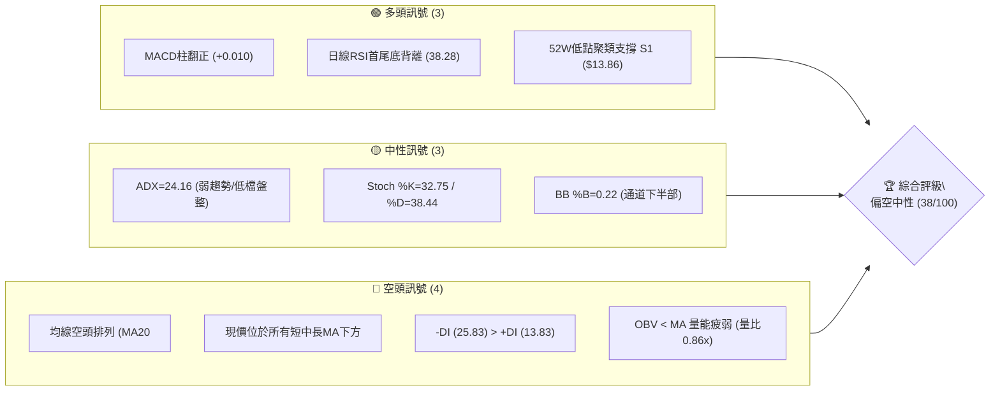
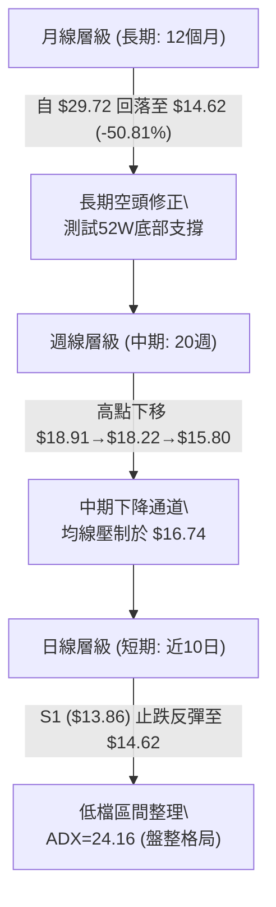
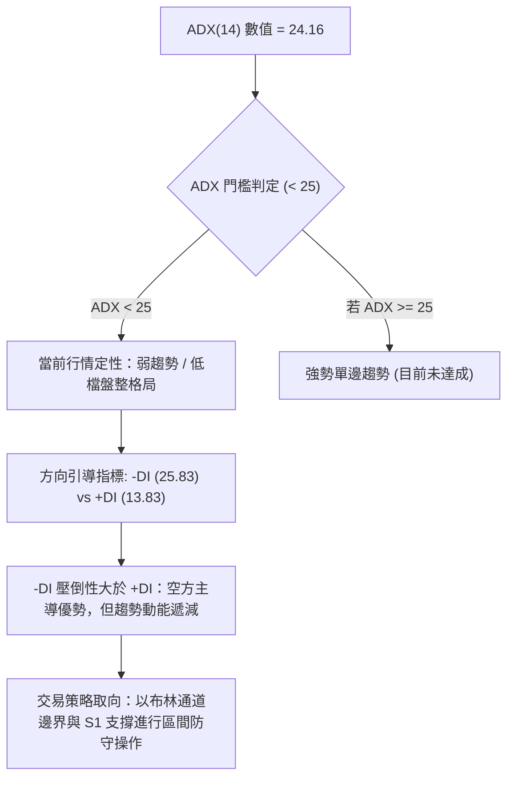
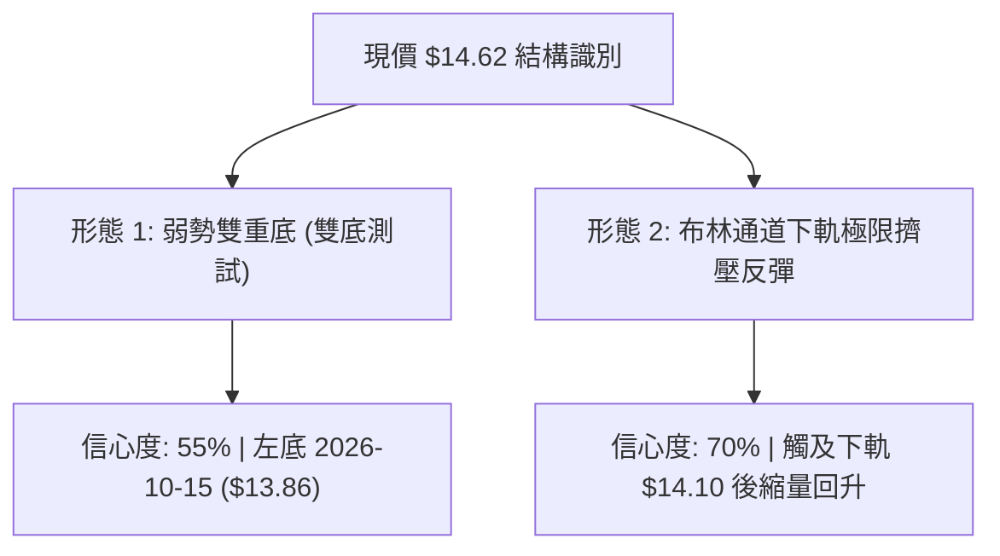
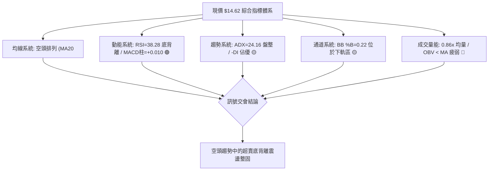
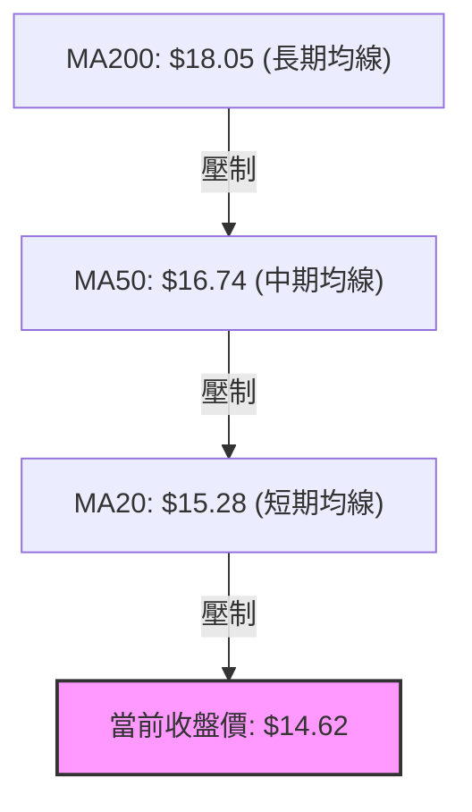
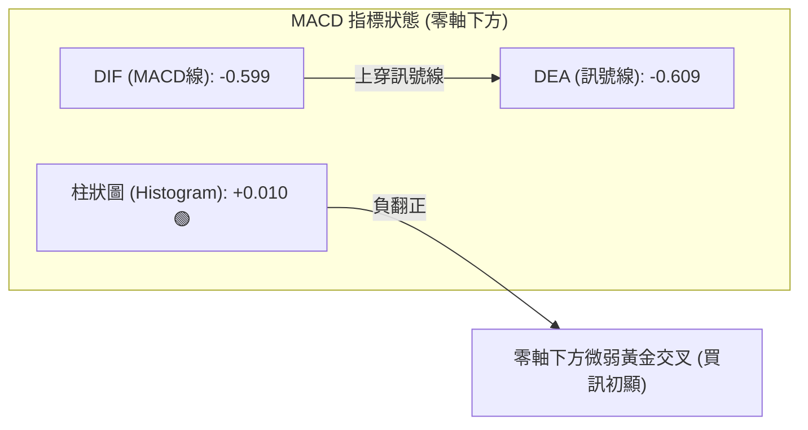
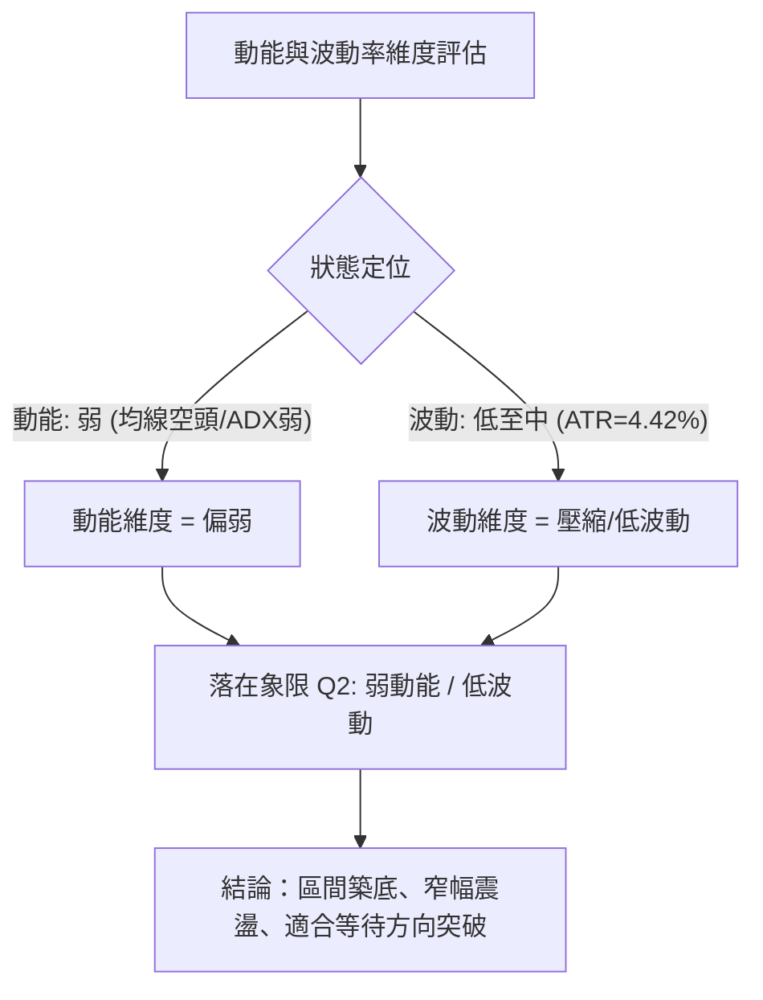
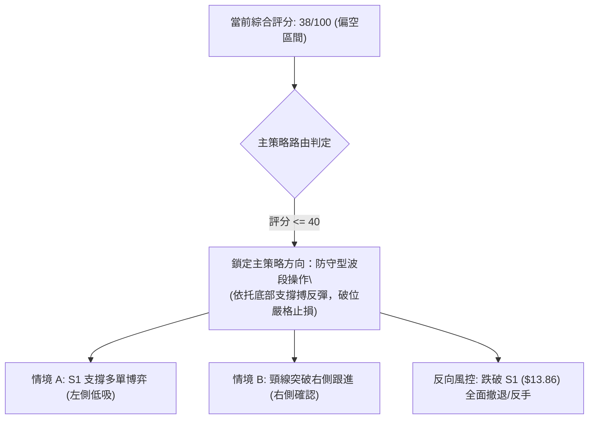
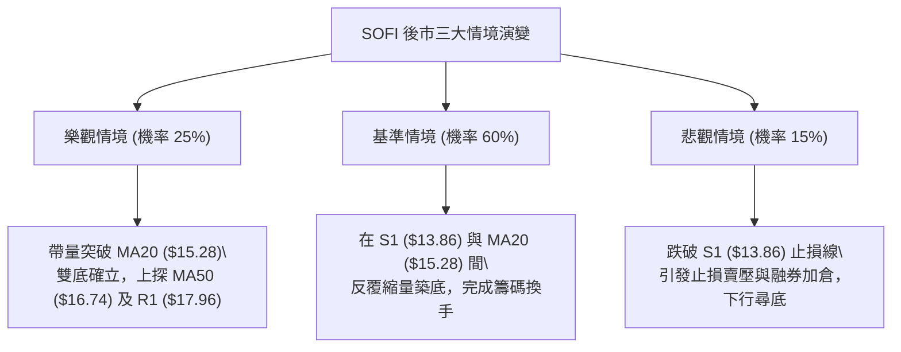

# SOFI 技術分析報告

> **報告日期**：2026-10-24 ｜ **語言**：繁體中文 ｜ **數據來源**：Yahoo Finance ｜ **當前價格**：$14.62

---

## 目錄

| 章節 | 內容 |
|------|------|
| [1. 技術面概覽](#1-技術面概覽) | 訊號儀表板、核心指標、評分卡 |
| [2. 趨勢分析](#2-趨勢分析) | 多時框趨勢、長中短期走勢 |
| [3. 圖表形態分析](#3-圖表形態分析) | 形態識別、K線組合、目標價 |
| [4. 支撐與阻力](#4-支撐與阻力) | 關鍵價位、斐波那契回調 |
| [5. 技術指標深度解讀](#5-技術指標深度解讀) | MA/RSI/MACD/布林/成交量 |
| [6. 動能與波動率](#6-動能與波動率) | 動能評估、ATR、Beta |
| [7. 多時框架總結](#7-多時框架總結) | 時框架評分矩陣 |
| [8. 交易策略建議](#8-交易策略建議) | 多空策略、風險報酬比 |
| [9. 風險提示與監控](#9-風險提示與監控) | 監控指標、風險場景 |

---

## 1. 技術面概覽

### 🎯 技術訊號儀表板



### 📊 核心指標速覽表

| 指標類別 | 指標名稱 | 當前數值 | 訊號 | 解讀 |
|----------|----------|----------|------|------|
| **價格** | 當前價格 | $14.62 | 🔴 | 位於 52 週區間底部 4.0%，距 52W 低點僅 +5.48% |
| **均線** | MA20 | $15.28 | 🔴 | 價格在 MA20 下方 -4.32%，短期下壓顯著 |
| **均線** | MA50 | $16.74 | 🔴 | 價格在 MA50 下方 -12.66%，中期空頭壓制 |
| **均線** | MA200 | $18.05 | 🔴 | 價格在 MA200 下方 -19.00%，長期趨勢偏空 |
| **動能** | RSI(14) | 38.28 | 🟡 | 位於中性偏弱區間（30-70），伴隨首尾底背離 |
| **動能** | MACD Hist | +0.010 | 🟢 | 負值區間微幅黃金交叉翻正，動能呈現微弱修復 |
| **動能** | Stoch %K/%D | 32.75 / 38.44 | 🟡 | 脫離超賣區但尚未形成明確黃金交叉 |
| **趨勢** | ADX(14) | 24.16 | 🟡 | ADX < 25，單邊動能衰退，呈現弱勢震盪整固 |
| **波動** | ATR(14) | $0.65 | 🟡 | 佔股價 4.42%，日波動適中，提供明確止損邊界 |
| **量能** | 量比 / OBV | 0.86x / 弱 | 🔴 | 成交量 38.79M 低於 20日均量 45.36M，量能未確認反轉 |

### 🏆 技術評分卡

```
╔══════════════════════════════════════════════════════════════╗
║                技術評分卡 — SOFI (2026-10-24)               ║
╠══════════════════════════════════════════════════════════════╣
║ 趨勢強度      ██████░░░░░░░░░░░░░░  30/100  🔴 空頭壓制中     ║
║ 動能指標      ██████████░░░░░░░░░░  50/100  🟡 底背離初現     ║
║ 支撐穩定度    ████████████░░░░░░░░  60/100  🟢 S1聚類防守有效 ║
║ 成交量配合    ██████░░░░░░░░░░░░░░  30/100  🔴 量能疲弱量縮   ║
║ 形態完整度    ████████░░░░░░░░░░░░  40/100  🟡 弱勢區間築底中 ║
║ 均線排列      ████░░░░░░░░░░░░░░░░  20/100  🔴 完全空頭排列   ║
╠══════════════════════════════════════════════════════════════╣
║ 綜合評分      ████████░░░░░░░░░░░░  38/100  🔴 偏空觀望       ║
╚══════════════════════════════════════════════════════════════╝
```
*註：綜合評分由六項子評分算術平均得出：(30 + 50 + 60 + 30 + 40 + 20) ÷ 6 = 230 ÷ 6 = 38.33，四捨五入為 38/100。*

---

## 2. 趨勢分析

### 🌐 多時框趨勢分析



### 📈 長期趨勢 — 12個月走勢圖（Unicode）

```
SOFI 月線走勢圖（過去12個月：2025-11 至 2026-10）
價格軸 ($)
$30.00 ┤ ● (2025-11: $29.72 高點)
$27.00 ┤   ● (2025-12: $26.18)
$24.00 ┤     ● (2026-01: $22.81)
$21.00 ┤
$18.00 ┤       ● (02: $17.76)   ● (05: $18.22)   ● (08: $17.88)
$15.00 ┤         ●(03: $11.63)    ●(04: $12.51)    ●(06: $17.93) ●(07: $16.31) ●(09: $15.72) 
$12.00 ┤                                                                         ●(10: $14.62 現價)
       └─────────────────────────────────────────────────────────────────────────────
         11   12   01   02   03   04   05   06   07   08   09   10  (月份)
```

**走勢特徵分析表格**：

| 階段區間 | 起止價格 | 漲跌幅 | 走勢特徵與結構 |
|----------|----------|--------|----------------|
| **頂部構築 (2025-10 ~ 2025-11)** | $29.68 → $29.72 | +0.13% | 歷史波段雙頂高位滯漲，動能衰竭 |
| **主跌下殺 (2025-11 ~ 2026-03)** | $29.72 → $15.88 | -46.57% | 連續4個月大陰線下挫，單邊流暢空頭 |
| **箱體震盪 (2026-04 ~ 2026-08)** | $16.10 → $17.88 | +11.06% | 圍繞 $17-$18 築底盤整，多頭多次試圖反攻 |
| **二次探底 (2026-08 ~ 2026-10)** | $17.88 → $14.62 | -18.23% | 再次下破均線支撐，測試波段低位 S1 ($13.86) |

### 📊 中期趨勢（週線分析）

中期走勢圖示：近期週線呈現高點由 2026-08-21 的 $18.91，逐步走低至 2026-09-04 的 $18.22，再跌破 $16.00 關卡。

```
週線關鍵阻力與支撐格局示意：
 $18.91 ─────────────────── [8月波段高點]
          ╲
 $17.96 ───╲─────────────── [強阻力 R1 (Fib 78.6% $17.90)]
            ╲
 $16.74 ─────╲───────────── [MA50 中期下壓均線]
              ╲
 $15.28 ───────╲─────────── [BB中軌 / MA20 關鍵頸線阻力]
                ● $14.62 ── [現價位置：區間超賣築底]
 $13.86 ─────────────────── [52W 低點波段強支撐 S1]
```

### ⚡ 趨勢強度評估（ADX 解讀）



**ADX 強度對照分析**：

| 指標變量 | 數值 | 狀態評估 | 實戰指引 |
|----------|------|----------|----------|
| **ADX(14)** | 24.16 | 弱趨勢/盤整 (<25) | 趨勢動能鈍化，單邊追空風險增大，適用區間高拋低吸思維 |
| **+DI (14)** | 13.83 | 多方動能極弱 | 多頭尚未發起有效進攻，向上突破缺乏持續買盤推動 |
| **-DI (14)** | 25.83 | 空方佔優但未爆發 | 空頭雖掌控盤面，但未見發散加速跡象，偏向陰跌或整理 |

---

## 3. 圖表形態分析

### 🔍 形態識別系統



**形態信心度與目標價計算表**（依規則 15、17）：

| 形態名稱 | 信心度 | 判斷依據（引用數據） | 完成度 | 目標價（附精確計算式） |
|----------|--------|----------------------|--------|------------------------|
| **潛在弱雙底 (W底)** | 55% | 2026-10-15 最低跌至波段低點 $13.86（S1），隨後連續7日守於上方 | 40% (頸線未過) | 頸線以 MA20 ($15.28) 計，形態高度 = 頸線 $15.28 − 低點 $13.86 = $1.42；突破目標價 = $15.28 + $1.42 = **$16.70**（接近 MA50 $16.74） |
| **布林下軌超賣抽頭** | 70% | 2026-10-14 最低 $13.92 跌破 BB 下軌 $14.10，隨後快速拉回中軌方向 | 65% | 目標價為回歸布林中軌（MA20）= **$15.28** |

### 🕯️ 重要K線形態分析

依規則 19，完全依據數據中「近10根日K」與「近8根週K」的實際 OHLCV 分析：

| 日期（日K/週K） | 開 | 高 | 低 | 收 | K線形態 | 解讀 | 訊號 |
|-----------------|---|---|---|---|---------|------|------|
| **2026-10-14 (日K)** | 14.92 | 15.04 | 13.92 | 14.22 | 帶長下影大陰線 | 恐慌拋售盤湧現，下探下軌引發抄底量（92.17M） | 🔴 空方釋放 |
| **2026-10-15 (日K)** | 13.89 | 15.13 | 13.86 | 15.09 | 長陽反轉吞噬 (錘頭特徵) | 探 52W 低點 $13.86 後強勢拉升 1.20 美元，多頭強烈抵抗 | 🟢 短線見底 |
| **2026-10-16 (日K)** | 15.07 | 15.54 | 14.33 | 14.55 | 長上影紡錘陰線 | 衝高 $15.54 遭遇 MA20 附近拋壓回落，多空爭奪激烈 | 🟡 阻力確認 |
| **2026-10-19 (日K)** | 14.75 | 14.76 | 14.27 | 14.30 | 光頭小陰線 | 量縮回踩，未破前低，屬於弱勢震盪調整 | 🔴 短線偏弱 |
| **2026-10-20 (日K)** | 14.20 | 14.99 | 14.18 | 14.68 | 下影中陽線 | 低開高走，多頭在 $14.20 附近再度發力守護 | 🟢 支撐抬高 |
| **2026-10-21 (日K)** | 14.84 | 15.11 | 14.65 | 14.90 | 溫和小陽線 | 向上試探 $15.00 關卡，但成交量僅 33.65M 略顯不足 | 🟡 量能待補 |
| **2026-10-22 (日K)** | 14.57 | 15.07 | 14.57 | 14.77 | 上影十字陽線 | 多次衝高至 $15.07 受阻，短線動能出現停滯 | 🟡 盤整確認 |
| **2026-10-23 (日K)** | 14.54 | 14.71 | 14.23 | 14.62 | 窄幅微陽十字星 | 振幅收斂至 $0.48，進入方向選擇前的極致壓縮 | 🟡 變盤前夕 |
| **2026-10-16 (週K)** | 15.47 | 15.68 | 13.86 | 14.55 | 帶長下影長陰棒 | 週量放大至 286.32M，探底 $13.86 後回升，支撐測試成功 | 🟢 週線防守 |
| **2026-10-23 (週K)** | 14.75 | 15.11 | 14.18 | 14.62 | 低檔縮量孕線星 | 收盤 $14.62 守在上週實體內，成交量收縮至 198.41M | 🟡 止跌孕育 |

### 📉 ASCII 走勢形態示意圖

```
SOFI 近期日K線形態結構圖（2026-10-12 至 2026-10-23）
$15.68 ┬──────┬─────────────────────────────── (10-12 高點)
$15.54 ┼      │        ┌─┐ (10-16 試探頸線阻力)
$15.28 ┼──────┼────────┼─┼──────────── [MA20 / 頸線阻力位]
$15.09 ┼      │  ┌─┐   │ │      ┌─┐
$14.62 ┼      │  │ │   │ │  ┌─┐ │ │ ┌─┐ (10-23 現價 $14.62)
$14.22 ┼  ┌─┐ │  │ │   └─┘  │ │ │ │ └─┘
$13.86 ┴──┴─┴──┴──┴─┴────────┴─┴─┴─┴────── (10-15 探底波段低點 S1)
        10-12  10-14 10-15   10-19 10-21 10-23
```

### 🎯 形態目標價計算

1. **頸線位置判定**：短期結構頸線鎖定在日線 MA20（$15.28），此處亦為 10-16 試探失敗之密集受阻區。
2. **形態高度**：$15.28（頸線）− $13.86（波段低點 S1）= $1.42。
3. **等距向上推算目標**：
   - **T1 目標**：頸線突破點 = **$15.28**（BB 中軌）。
   - **T2 目標（形態等距測幅）**：$15.28 + $1.42 = **$16.70**（高度重合 MA50 $16.74）。

---

## 4. 支撐與阻力

### 🗺️ 關鍵價位分布圖（Unicode）

```
SOFI 價位結構分布圖（OHLCV 聚類與斐波那契基準）
═══════════════════════════════════════════════════════════════
$32.73 ║██████████████████████████████║ 52W 高點 (Fib 0.0%)
$28.28 ║████████████████████████      ║ Fib 23.6% 回調位
$25.52 ║████████████████████          ║ Fib 38.2% 回調位
$23.29 ║██████████████████            ║ Fib 50.0% 關鍵分水嶺
$21.07 ║██████████████                ║ Fib 61.8% 黃金回調位
$19.62 ║██████████████████████████████║ 強阻力 R3 (MA240 $19.65 聚類)
$18.79 ║████████████████████          ║ 阻力 R2 (近一年波段高點聚類)
$17.96 ║██████████████████████████████║ 關鍵阻力 R1 (Fib 78.6% $17.90 / MA200 $18.05)
───────╫──────────────────────────────╫───────────────────────────────
$16.74 ║▒▒▒▒▒▒▒▒▒▒▒▒▒▒▒▒              ║ 中期動態阻力 (MA50 / 形態高度目標 $16.70)
$15.28 ║▓▓▓▓▓▓▓▓▓▓▓▓▓▓▓▓▓▓▓▓          ║ 短期防守頸線 (BB中軌 / MA20)
$14.62 ╠══════════════════════════════╣ ◄ 當前價格 ($14.62)
$14.10 ║░░░░░░░░░░░░░░░░░░░░░░░░      ║ 短期通道下限 (BB下軌)
$13.86 ║██████████████████████████████║ 52W 最低點強支撐 S1 (Fib 100.0%)
═══════════════════════════════════════════════════════════════
```

### 🚧 阻力位分析表

*註：價位嚴格引用技術數據「關鍵價位」區塊。*

| 阻力級別 | 價位 | 形成原因 | 突破難度 | 重要性 |
|----------|------|----------|----------|--------|
| **R1** | $17.96 | 近一年波段高點聚類、重合 Fib 78.6% ($17.90) 及 MA200 ($18.05) | ★★★★☆ | 極高（多空牛熊中長期分水嶺） |
| **R2** | $18.79 | 近一年波段次高聚類，2026-08 週線高點密集套牢區 | ★★★★☆ | 高（波段反彈強阻力帶） |
| **R3** | $19.62 | 近一年頂部聚類高點，重合長期 MA240 ($19.65) | ★★★★★ | 極高（中期強反轉必須逾越的防線） |

### 🛡️ 支撐位分析表

*註：價位嚴格引用技術數據「關鍵價位」區塊。*

| 支撐級別 | 價位 | 形成原因 | 守住機率 | 重要性 |
|----------|------|----------|----------|--------|
| **S1** | $13.86 | 52週歷史最低點、近一年波段低點聚類、Fib 100.0% 終極支撐 | 75% | 極高（多頭底線，破位將引發無支撐崩跌） |
| **動態支撐** | $14.10 | 布林通道下軌動態邊界，10-14 探底後迅速收復 | 80% | 中（短線區間波動下沿） |

### 📐 斐波那契回調位分析

*基準區間：52週最高點 $32.73 → 52週最低點 $13.86，總落差 $18.87*

```
斐波那契各級別回調階梯：
 0.0% (52W High) ─── $32.73
23.6% ────────────── $28.28
38.2% ────────────── $25.52
50.0% ────────────── $23.29
61.8% ────────────── $21.07
78.6% ────────────── $17.90  ◄◄ 聚類阻力 R1 ($17.96)
[現價 $14.62 區間]
100.0% (52W Low) ──── $13.86  ◄◄ 聚類支撐 S1 ($13.86)
```

**解讀**：
- 當前價格 **$14.62** 處於 **78.6% 回調位（$17.90）與 100.0% 回調位（$13.86）之間**，極度貼近 100.0% 底部位階（僅高出 $0.76 或 +5.48%）。
- 斐波那契深幅回撤表明長期多頭趨勢已被徹底摧毀，目前屬於典型的空頭趨勢衰竭期；現價在此處獲得支撐屬於超深回調後的技術性抗跌反應，但上方自 $17.90 開始存在沉重解套賣壓。

---

## 5. 技術指標深度解讀

### 🎛️ 指標訊號總覽



### 📈 移動平均線排列分析



**均線狀態矩陣**：

| 均線名稱 | 數值 | 現價差距 | 傾斜走勢 (歷史趨勢) | 訊號強度 |
|----------|------|----------|-------------------|----------|
| **MA5** | $14.65 | -0.26% | 走平略降，短期止跌纏繞 | 🟡 中性 |
| **MA10** | $14.76 | -0.98% | 下行放緩，即將接受價格考驗 | 🟡 中性 |
| **MA20** | $15.28 | -4.33% | 持續向下傾斜，短期第一強阻力 | 🔴 看空 |
| **MA50** | $16.74 | -12.66% | 穩定下行，中期空頭強壓線 | 🔴 看空 |
| **MA60** | $16.95 | -13.80% | 下行壓制中 | 🔴 看空 |
| **MA120** | $16.96 | -13.80% | 走平偏下 | 🔴 看空 |
| **MA200** | $18.05 | -19.00% | 下穿壓制，長期多空分水嶺 | 🔴 看空 |
| **MA240** | $19.65 | -25.62% | 長期下傾 | 🔴 看空 |

*排列結論：MA20 < MA50 < MA200，所有均線系統呈現完整空頭排列，價格受到多重均線層層下壓。*

### 📉 RSI(14) 分析

- **RSI 數值進度條**：
  ```
  RSI(14) = 38.28  [ 0 ──────── 30 ────── 50 ────── 70 ──────── 100 ]
  數值進度:       ███████████████░░░░░░░░░░░░░░░░░░░░░░░░  38.28%
  區間定位:       [  超賣區間  |   弱勢區   |   強勢區   |  超買  ]
                               ▲ 當前位置
  ```
- **區間評估**：RSI 脫離極端超賣區（<30），回升至 38.28，位於 30-50 弱勢盤整區間。
- **背離判斷**：
  - **形態定性**：⚠️ **明確底背離 (Bullish Divergence)**。
  - **數據驗證**：近 20 根 K 棒首尾比較，價格在 2026-10-15 下探 52W 新低 $13.86，較前期低點大幅下移；然而日線 RSI(14) 卻自低檔持續抬升至 38.28（未隨價格破底而創出新低）。週線 RSI 亦由 10-16 的 34.7 回升至 10-23 的 38.3。
  - **結論**：指標與價格形成典型正向背離，預示空頭拋售竭盡，具備強烈的均值回歸修復需求。

### 📊 MACD(12/26/9) 訊號解讀



**解讀**：
- DIF (-0.599) 微幅超越 DEA (-0.609)，使得柱狀圖自負值翻正至 **+0.010**。
- 週線 MACD 柱狀圖亦由 10-16 的 -0.080 翻正至 10-23 的 **+0.010**。
- 雙時框 MACD 柱狀圖同步由負翻正，確認短期動能由下行轉為震盪反彈；但由於 DIF 與 DEA 仍深處零軸（0.00）下方，此訊號目前僅定性為「空頭市場中的弱勢金叉反彈」，不可視為反轉暴漲。

### 📦 布林通道分析

```
布林通道結構與現價示意（20日參數）：
 $16.45 ┬─────────────────────────────── [布林上軌]
        │
 $15.28 ┼─────────────────────────────── [布林中軌 (MA20)]
        │
 $14.62 ┼───────────────●─────────────── [當前收盤價 ($14.62, %B=0.22)]
        │
 $14.10 ┴─────────────────────────────── [布林下軌]
```

**解讀**：
- **上軌**：$16.45 ｜ **中軌 (MA20)**：$15.28 ｜ **下軌**：$14.10 ｜ **帶寬**：$2.35。
- **%B 指標**：**0.22**。數值處於 0.00 至 0.50 之間，表明價格受到中軌壓制，但已脫離下軌超賣區。
- **運行狀態**：股價在下探 $13.86 刺破下軌後獲得支撐，目前沿下軌至中軌之間進行箱體窄幅修復，第一阻力目標即為中軌 $15.28。

### 💹 成交量分析（量價配合度）

```
近期成交量對比：
最新日成交量:  38,787,877
20日平均量:    45,359,819  (量比: 0.86x) ── 縮量
50日平均量:    44,588,676
10-14 爆量點:  92,173,600  (恐慌釋放)
```

**量價解讀**：
- **量比 0.86x**：價格在 $14.62 窄幅震盪，成交量縮減至均量下方，反映市場追空力道竭盡，但場外多頭買盤亦保持觀望。
- **OBV 趨勢**：數據顯示「OBV < MA → 量能疲弱」，OBV 位於均線下方，說明資金累積效應尚未形成，目前的反彈缺乏大資金主動進場推動，屬於典型的存量籌碼博弈與技術性反抽。

---

## 6. 動能與波動率

### ⚡ 動能評估四象限



**動能評估矩陣表**：

| 象限 | 動能強度 | 波動率水準 | 當前狀態標記 | 戰術指引 |
|------|----------|------------|--------------|----------|
| **Q1 (順勢衝刺)** | 強 (Bullish) | 低 (穩定推進) | — | 最佳順勢加碼區間 |
| **Q2 (盤整整固)** | 弱 (Bearish/Neutral) | 低 (壓縮收斂) | **✓ 當前 SOFI 定位** | **謹慎觀望，防守型區間波段操作** |
| **Q3 (極限搏殺)** | 強 (爆發) | 高 (劇烈擴張) | — | 突破單邊行情，盈虧比極大 |
| **Q4 (恐慌出逃)** | 弱 (向下加速) | 高 (失控拋售) | — | 剛經歷 10-14 恐慌釋放，目前已脫離此區 |

### 📊 ATR 波動率分析

- **ATR(14)**：**$0.65**（佔當前股價 $14.62 的 **4.42%**）。
- **波動意義**：目前 SOFI 的單日平均波動區間為 0.65 美元。價格自 10-14 的寬幅震盪（振幅 $1.12）收斂至 10-23 的窄幅震盪（振幅 $0.48，低於 ATR），顯示波動率正在極致壓縮，預示後市即將迎來變盤突破。
- **風控止損應用**：
  - **多單保護止損距離**：建議設定 1.0 至 1.5 倍 ATR（即 $0.65 ~ $0.98）。以進場點計，剛好能有效覆蓋波段低點 S1（$13.86）下方，防範假跌破。

### 📐 Beta 與市場相關性

- **Beta 係數**：**2.332**。
- **風險特徵解讀**：
  - SOFI 的 Beta 高達 2.332，屬於**高彈性、高貝塔（High Beta）金融科技標的**。
  - 當標普500指數波動 1% 時，SOFI 理論波動幅度達 2.33%。
  - 在目前中長期趨勢偏空的格局下，高 Beta 特性意味著大盤若出現下挫，SOFI 極易受到放大性的流動性擠壓；反之，若大盤企穩發動反彈，其短線爆發力亦將顯著高於傳統金融類股。

---

## 7. 多時框架總結

### 📋 時框架評分表

| 時框架 | 趨勢方向 | 動能狀態 | 均線排列 | 形態特徵 | 綜合評分 | 操作建議 |
|--------|----------|----------|----------|----------|----------|----------|
| **月線 (長期)** | 🔴 強烈看空 | 下行趨勢中 | MA240 ($19.65) 下方 | 雙頂破位下跌回調 | 25/100 | 長期資金嚴格控制倉位 |
| **週線 (中期)** | 🔴 偏空震盪 | MACD柱翻正 (+0.010) | MA50/200 下方 | 止跌孕線星，測試底線 | 35/100 | 等待突破 MA50 頸線再論翻多 |
| **日線 (短期)** | 🟡 築底盤整 | RSI底背離 / MACD微金叉 | MA20 壓制中 | S1 ($13.86) 弱雙底構建 | 45/100 | 短線依托 S1 進行防守型博弈 |

### 🔲 綜合訊號矩陣

```
時框訊號收斂分析表：
┌──────────┬─────────────┬─────────────┬─────────────┐
│ 分析維度 │ 短期 (日線) │ 中期 (週線) │ 長期 (月線) │
├──────────┼─────────────┼─────────────┼─────────────┤
│ 趨勢方向 │ 🟡 盤整震盪 │ 🔴 空頭壓制 │ 🔴 空頭修正 │
│ 均線系統 │ 🔴 壓制下方 │ 🔴 完全空頭 │ 🔴 長期走弱 │
│ 動能指標 │ 🟢 底背離   │ 🟢 柱狀翻正 │ 🔴 動能不足 │
│ 成交量能 │ 🔴 量縮疲弱 │ 🟡 低檔收斂 │ 🔴 拋壓釋放 │
│ 關鍵防線 │ S1 ($13.86) │ S1 ($13.86) │ S1 ($13.86) │
└──────────┴─────────────┴─────────────┴─────────────┘
```

### ⚖️ 多時框收斂結論

**行情定性與主導時框裁決（依嚴格要求 14）**：
1. **行情屬性判定**：當前日線 ADX(14) 為 **24.16（ADX < 25）**，明確定義當前處於**低檔弱趨勢 / 盤整震盪行情**。
2. **多時框衝突收斂規則**：依規則 14，在 ADX < 25 的盤整格局下，市場無單邊動能，**以日線布林通道上下軌（$14.10 ~ $16.45）及 S1 支撐作為主要交易區間**。中長期週線雖偏空，但在短線超賣與 RSI 底背離支撐下，盲目追空極易遭遇均值回歸軋空。
3. **唯一方向性結論**：**【偏空觀望，區間低吸防守】**（與第 1 章技術評分卡 38/100 完全一致）。中長期趨勢依舊處於空頭控盤，但短線在波段低點 S1（$13.86）出現強烈抵抗信號，交易應以「區間下沿小倉博反彈，阻力位堅決減倉」為主，絕不追高。

---

## 8. 交易策略建議

### 🗺️ 策略決策流程圖



### 🧭 策略路由（依評分卡分流，不得兩頭下注）

> **當前主策略方向 = 【偏空防守，僅限於支撐位之高盈虧比超賣博弈】（依綜合評分 38/100 判定）**
> 
> *依規則：評分 ≤ 40 偏空。當前市場中長期均線呈空頭排列，但鑑於日線 ADX=24.16 為盤整格局，且現價極度貼近 52W 低點 S1 ($13.86) 伴隨 RSI 底背離，禁止在底部追空。主策略以依托 S1 支撐的「低檔區間修復波段」為主，若跌破 S1 則觸發徹底轉空止損。*

### 🎯 價格情境階梯（Price Scenarios）

*註：價位嚴格引用第 4 章及關鍵價位區塊實際數據。*

| 觸發條件 | 下一目標 | 後續延伸 | 情境含義 |
|----------|----------|----------|----------|
| **突破 MA20 ($15.28)** | MA50 ($16.74) | 阻力 R1 ($17.96) | 短線確認 W 底反彈，挑戰中期下壓線 |
| **站穩現價區間 ($14.10-$14.62)** | BB中軌 ($15.28) | MA50 ($16.74) | 區間低檔橫盤整固，蓄積反彈動能 |
| **跌破 S1 ($13.86)** | 下方無數據 (歷史新低) | 探底尋求新支撐 | 52W 低點失守，空頭單邊暴跌展開 |

### 📊 情境機率分佈

| 情境 | 機率 | 主要依據 |
|------|------|----------|
| **低檔反彈修復** | 50% | 日線 RSI 首尾底背離、MACD 柱負翻正 (+0.010)、10-15 下影長陽線防守有效 |
| **區間窄幅震盪** | 35% | ADX=24.16（弱趨勢）、量比僅 0.86x 量能不足、布林帶寬收窄在 $14.10-$15.28 |
| **破底向下崩跌** | 15% | 均線完全空頭排列、-DI (25.83) 主導盤面、若市場突發系統性風險跌破 S1 |

### 🟢 主策略詳情（方向依上方路由）

*註：風險報酬比嚴格依規則 17 計算：(目標價 T1 − 進場價) ÷ (進場價 − 止損價)，小數點後兩位。*

| 策略要素 | 策略 A：S1 支撐低吸波段 (左側防守型) | 策略 B：MA20 突破順勢交易 (右側確認型) |
|----------|-------------------------------------|---------------------------------------|
| **進場條件** | 價格回踩布林下軌 $14.10 至現價區間不破 | 日線收盤價帶量突破並站穩 MA20 ($15.28) |
| **進場價格** | **$14.36**（取 $14.10-$14.62 區間中點） | **$15.28**（精確突破進場點） |
| **目標價 T1** | **$15.28**（BB中軌 / MA20 頸線） | **$16.74**（中期 MA50 阻力位） |
| **目標價 T2** | **$16.74**（MA50 / 形態高度目標 $16.70） | **$17.96**（關鍵阻力 R1 / Fib 78.6%） |
| **止損價格** | **$13.80**（跌破波段低點 S1 $13.86 清倉） | **$14.62**（回跌至前期震盪平台收盤價）|
| **風險報酬比** | **1 : 1.64（以 T1 計）** *(註1)* | **1 : 2.21（以 T1 計）** *(註2)* |
| **成功機率** | 60% | 50% |
| **建議倉位** | 10% (輕倉防守) | 15% (突破加碼) |

- *註1：策略 A 計算：($15.28 − $14.36) ÷ ($14.36 − $13.80) = $0.92 ÷ $0.56 = 1.6428 → **1 : 1.64**。若以 T2 計為 ($16.74 − $14.36) ÷ $0.56 = $2.38 ÷ $0.56 = **1 : 4.25（以 T2 計）**。*
- *註2：策略 B 計算：($16.74 − $15.28) ÷ ($15.28 − $14.62) = $1.46 ÷ $0.66 = 2.2121 → **1 : 2.21**。若以 T2 計為 ($17.96 − $15.28) ÷ $0.66 = $2.68 ÷ $0.66 = **1 : 4.06（以 T2 計）**。*

### 🔴 反向風險觸發點（對沖提示）

若出現以下情境，宣告低吸主策略徹底失敗，多頭部位必須嚴格止損撤退，並轉為全面看空：
1. **硬性止損觸發**：日線收盤價**跌破 S1 ($13.86)**。此處為 52 週最低點，一旦實體跌破，代表自 2025-11 以來的一年大底徹底瓦解，下方無任何技術支撐，將開啟新一輪流動性踩踏。
2. **動能破位確認**：MACD 柱狀圖由當前 +0.010 重新轉負，且 RSI(14) 跌穿 30 進入深度超賣且無背離。

### ⭐ 整體訊號強度評星

```
做多訊號強度：★★☆☆☆  (2.5/5星 — 僅有底背離與 S1 支撐，均線全面壓制)
做空訊號強度：★★★☆☆  (3.0/5星 — 中長線空頭排列，但短線超賣面臨反彈)
整體可信度：  ★★★☆☆  (3.5/5星 — ADX 顯示盤整，區間上下沿明確)
```

---

## 9. 風險提示與監控

### ✅ 關鍵監控指標 Checklist

```
╔══════════════════════════════════════════════════════════════╗
║                 日常盤面關鍵風控監控清單                     ║
╠══════════════════════════════════════════════════════════════╣
║ [ ] 核心防線：收盤價是否嚴格守在 S1 ($13.86) 之上？           ║
║ [ ] 動能警戒：MACD 柱狀圖是否維持在正值區間 (> 0.000)？       ║
║ [ ] 阻力測試：股價能否帶量挑戰日線 MA20 ($15.28) 頸線？       ║
║ [ ] 量能驗證：反彈日成交量是否放大突破 20日均量 (45.36M)？    ║
║ [ ] 波動異常：單日震盪幅度是否異常超過 ATR ($0.65) 的 2 倍？  ║
║ [ ] 趨勢警報：-DI 是否重新發散擴大 (> 30.00)？               ║
╚══════════════════════════════════════════════════════════════╝
```

### ⚠️ 風險場景分析



### 🛡️ 風險管理重要提醒

1. **高 Beta 波動風險控制**：
   - SOFI 的 Beta 值高達 **2.332**，槓桿效應顯著。短線交易者必須根據 $0.65 的 ATR 設置防禦邊界，絕不可使用過高槓桿。
2. **空頭排列下的逆勢操作紀律**：
   - 當前所有中長期均線（MA50、MA200）均處於空頭下壓形態。在均線空頭排列中進行的任何買入操作，性質上皆屬於「逆勢超賣博弈」。
   - **部位規模控制**：建議整體倉位嚴格控制在總資金的 **10% ~ 15%** 以內，且採取「分批進場、觸及目標價堅決分批止盈」的短線戰術，切忌長線死守。
3. **止損紀律絕對執行**：
   - 本報告所依據之做多博弈邏輯全數建立於「S1 ($13.86) 具備歷史波段低點支撐」之假設。若股價不幸實體跌破 $13.86（策略設定止損 $13.80），必須無條件止損離場，嚴禁凹單。

---

## 📋 報告總結

```
╔══════════════════════════════════════════════════════════════╗
║                   SOFI 技術分析報告總結                      ║
╠══════════════════════════════════════════════════════════════╣
║ 報告日期：2026-10-24                                         ║
║ 當前價格：$14.62                                             ║
║ 分析評級：⚖️ 偏空中性 (綜合評分 38/100，低檔盤整整固)        ║
╠══════════════════════════════════════════════════════════════╣
║ 關鍵結論：                                                   ║
║ ├─ 長期趨勢：🔴 空頭修正 (自 $29.72 回落，處於 52W 區間 4.0%) ║
║ ├─ 中期趨勢：🔴 弱勢整理 (週線承壓於 MA50 $16.74 之下)       ║
║ ├─ 短期趨勢：🟡 築底盤整 (ADX=24.16，RSI 38.28 現日線底背離)║
║ ├─ 關鍵支撐：S1: $13.86 (52W 最低點與 Fib 100.0%)           ║
║ ├─ 關鍵阻力：頸線 MA20: $15.28 ｜ 聚類阻力 R1: $17.96        ║
║ └─ 分析師目標：共識均價 $20.23 (當前評級 Hold)               ║
╠══════════════════════════════════════════════════════════════╣
║ 最優策略組合：                                               ║
║ 1. 🥇 最佳機會：策略 A (依託 S1 於 $14.36 低吸，風報比 1:1.64)║
║ 2. 🥈 次選機會：策略 B (突破 MA20 $15.28 順勢進場，風報比 1:2.21)║
║ 3. 🥉 保守選擇：場外空倉觀望，靜待日線站穩 MA20 後再行介入   ║
╚══════════════════════════════════════════════════════════════╝
```

---

> ⚠️ **免責聲明**：本報告為 AI 自動生成之技術分析，所有數據及估算均基於提供的歷史價格資訊。本報告**僅供研究與學術參考**，**不構成任何投資建議**。投資有風險，入市需謹慎。

---

*報告生成時間：2026-10-24 ｜ 數據來源：Yahoo Finance ｜ 分析框架：多時框技術分析*