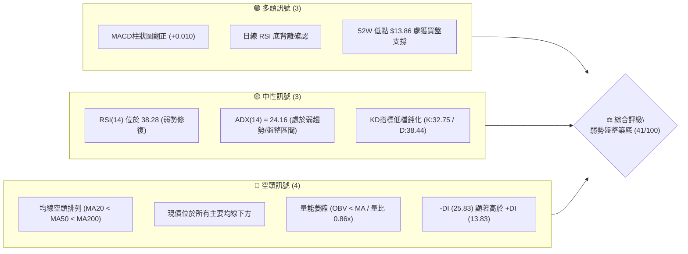
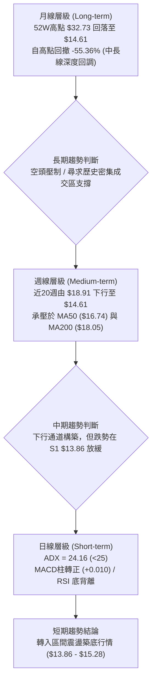
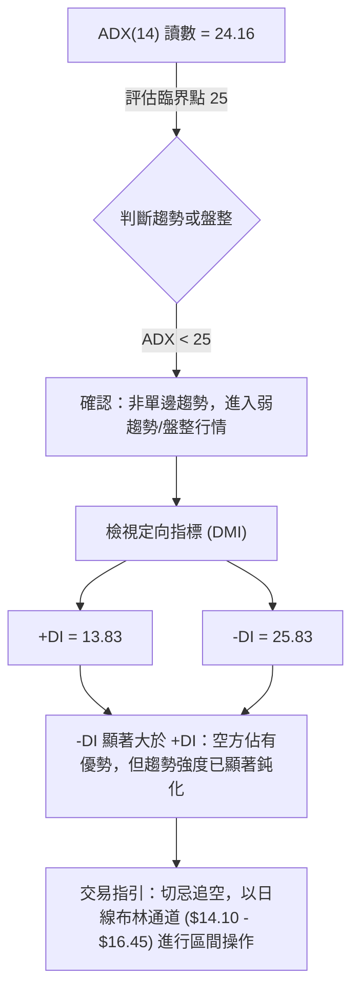
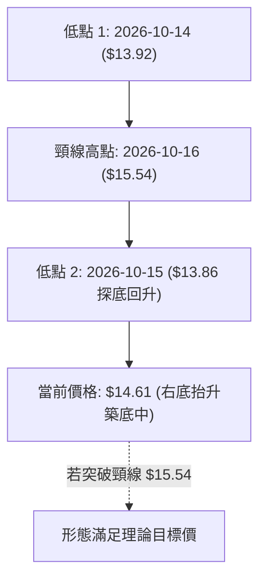
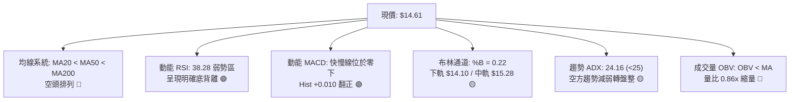
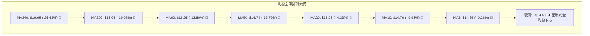
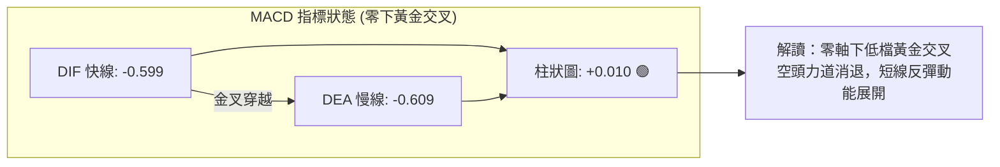
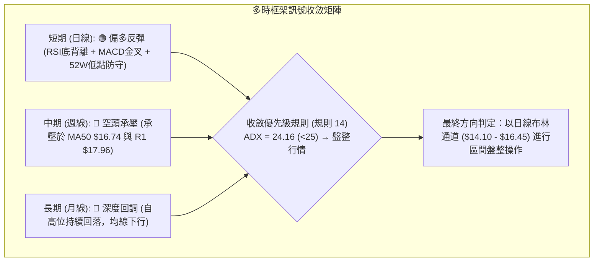
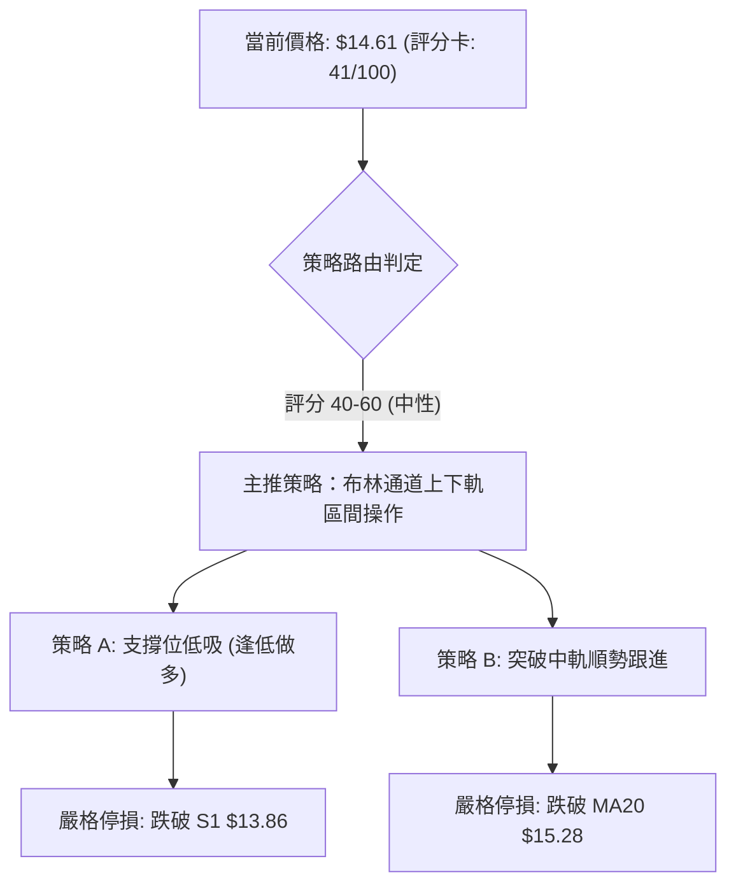
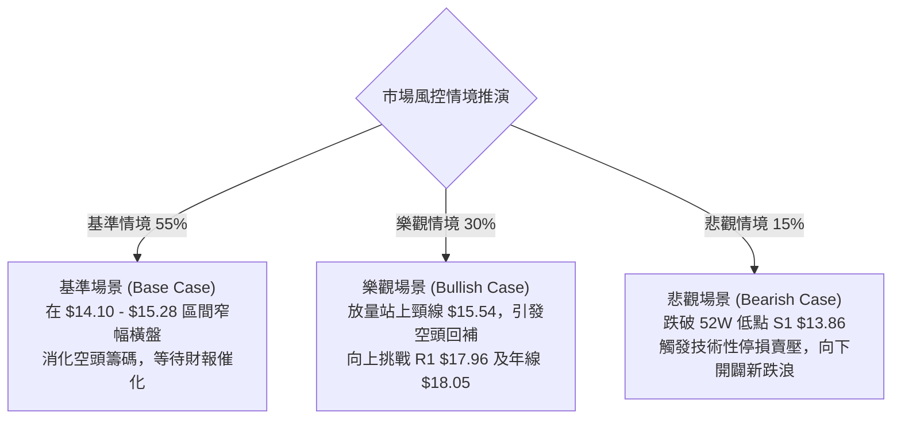

# SOFI 技術分析報告

> **報告日期**：2026-10-25 ｜ **語言**：繁體中文 ｜ **數據來源**：Yahoo Finance ｜ **當前價格**：$14.61

---

## 目錄

| 章節 | 內容 |
|------|------|
| [1. 技術面概覽](#1-技術面概覽) | 訊號儀表板、核心指標、評分卡 |
| [2. 趨勢分析](#2-趨勢分析) | 多時框趨勢、長中短期走勢、12個月走勢圖、ADX解讀 |
| [3. 圖表形態分析](#3-圖表形態分析) | 形態識別、K線組合、形態示意圖、目標價計算 |
| [4. 支撐與阻力](#4-支撐與阻力) | 關鍵價位分布、阻力位分析、支撐位分析、斐波那契回調 |
| [5. 技術指標深度解讀](#5-技術指標深度解讀) | 均線系統、RSI背離、MACD、布林通道、成交量與OBV |
| [6. 動能與波動率](#6-動能與波動率) | 動能評估四象限、ATR波動率、Beta與大盤敏感度 |
| [7. 多時框架總結](#7-多時框架總結) | 時框架評分矩陣、綜合訊號矩陣、多時框收斂結論 |
| [8. 交易策略建議](#8-交易策略建議) | 策略決策流程、策略路由、價格情境階梯、主策略詳情、評星 |
| [9. 風險提示與監控](#9-風險提示與監控) | 監控清單、風險情境分析、風險管理原則 |
| [10. 報告總結](#10-報告總結) | 核心總結儀表板與最優策略組合 |

---

## 1. 技術面概覽

### 🎯 技術訊號儀表板



---

### 📊 核心指標速覽表

| 指標類別 | 指標名稱 | 當前數值 | 訊號 | 解讀 |
|----------|----------|----------|:----:|------|
| **價格** | 當前收盤價 | $14.61 | 🔴 | 位於 52 週低點區間上緣 4.0%，短期拋壓暫緩但趨勢受壓 |
| **均線** | MA20 (月線) | $15.28 | 🔴 | 價格低於 MA20 (-4.33%)，短線反彈首道均線動態阻力 |
| **均線** | MA50 (季線) | $16.74 | 🔴 | 價格低於 MA50 (-12.72%)，中期趨勢依舊處於空方壓制區 |
| **均線** | MA200 (年線)| $18.05 | 🔴 | 價格低於 MA200 (-19.06%)，長期多空分水嶺尚未收復 |
| **動能** | RSI(14) | 38.28 | 🟡 | 脫離超賣區，具備短線底背離跡象，動能處於中性偏弱修復 |
| **動能** | MACD (12/26/9) | -0.599 / -0.609 | 🟢 | 快線黃金交叉慢線，柱狀圖轉正 (+0.010)，初顯築底反彈動能 |
| **趨勢** | ADX(14) | 24.16 | 🟡 | 數值低於 25，表明單邊下跌趨勢衰竭，進入低位橫盤震盪格局 |
| **通道** | 布林通道 %B | 0.22 | 🟡 | 位於下軌 ($14.10) 與中軌 ($15.28) 之間，觸軌反彈測試中軌中 |
| **量能** | 20日成交量比 | 0.86x | 🔴 | 最新量 38.84M 跌破 20 日均量 45.36M，量能萎縮反映追價意願不足 |
| **波動** | ATR(14) | $0.65 | 🟡 | 佔股價 4.42%，日波動幅度中等，交易止損安全邊界需覆蓋 $0.65 |

---

### 🏆 技術評分卡

```
╔══════════════════════════════════════════════════════════════╗
║               技術評分卡 — SOFI (2026-10-25)                 ║
╠══════════════════════════════════════════════════════════════╣
║ 趨勢強度 (Trend)     ███████░░░░░░░░░░░░░  35/100  🔴 空頭主導║
║ 動能指標 (Momentum)  ██████████░░░░░░░░░░  48/100  🟡 底背離萌芽║
║ 支撐穩定度 (Support) ██████████░░░░░░░░░░  50/100  🟡 S1暫獲支撐║
║ 成交量配合 (Volume)  ███████░░░░░░░░░░░░░  38/100  🔴 量能疲弱  ║
║ 形態完整度 (Pattern) █████████░░░░░░░░░░░  45/100  🟡 潛在雙底  ║
║ 均線排列 (Moving Avg)██████░░░░░░░░░░░░░░  30/100  🔴 典型空頭  ║
╠══════════════════════════════════════════════════════════════╣
║ 綜合評分 (Overall)   ████████░░░░░░░░░░░░  41/100  🟡 中性偏弱  ║
║                     （算術平均：246 ÷ 6 = 41，規則 18）      ║
╚══════════════════════════════════════════════════════════════╝
```

---

## 2. 趨勢分析

### 🌐 多時框趨勢分析



---

### 📈 長期趨勢 — 12個月走勢圖（Unicode）

以下為 SOFI 過去 12 個月（2025-11 至 2026-10）價格走勢與關鍵轉折示意圖：

```
SOFI 月線走勢圖（2025-11 至 2026-10）
價格軸 ($)
$30.00 ┤ ●(2025-11: $29.72 波段頂部)
$28.00 ┤  ╲
$26.00 ┤   ●(2025-12: $26.18)
$24.00 ┤    ╲
$22.00 ┤     ●(2026-01: $22.81)
$20.00 ┤      ╲
$18.00 ┤       ╲      ●(2026-05: $18.22)   ●(2026-08: $17.88)
$16.00 ┤        ●────●                  ╲ ╱ ╲
$14.00 ┤         (03:$15.88)                 ●(2026-10: $14.61 ◄現價)
$12.00 ┤                                      ▲ (52W低點: $13.86)
       └─┬────┬────┬────┬────┬────┬────┬────┬────┬────┬────┬────
       11月 12月 01月 02月 03月 04月 05月 06月 07月 08月 09月 10月
       (2025)                      (2026)
```

#### 走勢特徵分析表格

| 階段區間 | 起止月份 | 價格變化 | 累計漲跌幅 | 主要技術特徵與驅動結構 |
|----------|----------|----------|------------|------------------------|
| **高檔派發期** | 2025-11 → 2026-01 | $29.72 → $22.81 | -23.25% | 月線雙頂確立（歷史高位 $29.72-$32.73），籌碼大幅鬆動，均線自多頭轉向死叉 |
| **加速崩跌期** | 2026-01 → 2026-03 | $22.81 → $15.88 | -30.38% | 跌破多條長期均線支撐，出現恐慌性殺跌，成交量放大形成波段跳水 |
| **弱勢抵抗期** | 2026-03 → 2026-08 | $15.88 → $17.88 | +12.59% | 於 $16.00-$18.91 區間形成長達 5 個月的矩形整理，多次上攻 $18.91 未果 |
| **破底探底期** | 2026-08 → 2026-10 | $17.88 → $14.61 | -18.29% | 整理區間向下破位，於 2026-10-15 下探 52 週最低點 $13.86，當前展開低位修復 |

---

### 📊 中期趨勢（週線分析）

從近 20 週收盤走勢觀察，SOFI 在 2026-07-10 創下中期反彈高點 $18.78 後，呈現「一浪低於一浪」的高點下移結構（Lower Highs）：
- **波段高點壓制**：07-10 高點 $18.78 → 08-21 高點 $18.91 → 09-04 高點 $18.22 → 09-25 高點 $16.58。
- **週線量價關係**：在 2026-07-31 單週大跌至 $16.31 時，成交量爆出 483.42M 的波段巨量，顯示籌碼嚴重套牢於 $17-$18 區間。
- **近四週企穩訊號**：10-16 週觸及 52 週低點 $13.86，單週成交量擴大至 286.32M 收出長下影線（當週收 $14.55）；隨後 10-23 週收在 $14.61，週 MACD 柱狀圖由 -0.080 收斂轉正至 +0.010，顯示中期空頭動能開始衰退。

---

### ⚡ 趨勢強度評估（ADX 解讀）



#### ADX 數值強度對照表

| 指標名稱 | 當前數值 | 參考區間 | 趨勢屬性 | 實質市場含義 |
|----------|----------|----------|:--------:|--------------|
| **ADX(14)** | **24.16** | < 25.0 | 弱趨勢 / 盤整 | 過去兩週加速下跌的單邊趨勢已宣告瓦解，行情轉為箱型震盪 |
| **+DI (14)** | **13.83** | 0 - 50.0 | 多頭微弱 | 多方主動進攻意願極低，追價買盤匱乏 |
| **-DI (14)** | **25.83** | 0 - 50.0 | 空頭主導 | 空方雖掌握主控權，但數值已自 35 以上高位回落，拋售意願減弱 |
| **DI 差值** | **-12.00**| 負向收斂 | 偏空震盪 | 空方動能呈衰竭式整理，利於短期打底結構完成 |

---

## 3. 圖表形態分析

### 🔍 形態識別系統

在日線圖形中，價格於 10 月中旬下探 52 週低點 $13.86 後迅速拉升，目前在日線級別具備「雙重底（W底）」雛形，但受制於頸線阻力，形態尚未完全突破。



#### 形態識別與信心度評估表

| 識別形態 | 信心度 | 判斷依據（引用數據） | 完成度 | 目標價（附計算式，依規則13/15） |
|----------|:------:|----------------------|:------:|----------------------------------|
| **潛在日線雙底 (W-Bottom)** | **58%** | 兩次低點落於 10-14 ($13.92) 與 10-15 ($13.86，見支撐位 S1 $13.86)；隨後收盤站回 $14.50 之上，且 RSI 出現底背離 | 65% | 頸線取 10-16 日高點 $15.54，形態高度 = $15.54 − $13.86 = $1.68。<br/>推算目標價 = 頸線 $15.54 + $1.68 = **$17.22** |
| **下行通道收斂** | **45%** | 訊號不足，僅做指標型解讀。雖有高點下移，但因 ADX 降至 24.16，邊界模糊，未達幾何確認標準 | N/A | 信心度 < 50%，不推算幾何目標價 |

---

### 🕯️ 重要K線形態分析

嚴格依據提供的「近10根日K」與「近8根週K」之開高低收數據進行客觀解讀：

#### 近 10 根日 K 線形態解讀

| 日期（日K） | 開盤價 | 最高價 | 最低價 | 收盤價 | 成交量 | K線形態名稱 | 技術解讀與訊號 |
|-------------|--------|--------|--------|--------|--------|-------------|----------------|
| **2026-10-12** | $15.47 | $15.68 | $15.19 | $15.23 | 40,615,900 | 實體黑K | 🔴 跌破開盤價，短線承壓，測試 $15.20 關卡 |
| **2026-10-13** | $15.12 | $15.33 | $15.09 | $15.24 | 31,007,100 | 小陽十字星 | 🟡 開收相近，成交量萎縮，市場觀望氣氛濃厚 |
| **2026-10-14** | $14.92 | $15.04 | $13.92 | $14.22 | 92,173,600 | 爆量長黑下影 | 🔴 盤中重挫下殺至 $13.92，成交量暴增至 92M，恐慌盤湧出 |
| **2026-10-15** | $13.89 | $15.13 | $13.86 | $15.09 | 62,946,600 | 破底翻大陽線 | 🟢 觸及 52W 低點 $13.86 後強勢反包，單日大漲 $1.20，主力進場打底 |
| **2026-10-16** | $15.07 | $15.54 | $14.33 | $14.55 | 59,576,000 | 倒錘長上影黑K | 🔴 上衝 $15.54 遭遇解套賣壓，收盤壓回至 $14.55 |
| **2026-10-19** | $14.75 | $14.76 | $14.27 | $14.30 | 39,764,900 | 盤跌中黑K | 🔴 開盤即最高，空方下壓測試 10-15 低點支撐 |
| **2026-10-20** | $14.20 | $14.99 | $14.18 | $14.68 | 45,156,800 | 探底回升中陽K | 🟢 最低 $14.18 未破前低，收於高檔，右底抬升訊號初顯 |
| **2026-10-21** | $14.84 | $15.11 | $14.65 | $14.90 | 33,652,600 | 溫和量縮小陽K | 🟢 延續反彈，收盤逼近 $15.00 整數關卡，但量能不足 |
| **2026-10-22** | $14.57 | $15.07 | $14.57 | $14.77 | 41,048,400 | 衝高回落小陽K | 🟡 最高觸及 $15.07 後受阻於 MA20 ($15.28)，買盤追高謹慎 |
| **2026-10-23** | $14.55 | $14.71 | $14.23 | $14.61 | 38,841,900 | 紡錘十字小陽K | 🟡 振幅收斂至 $0.48，回踩下影線至 $14.23 獲支撐，等待方向抉擇 |

#### 近 8 根週 K 線形態解讀

| 日期（週K） | 開盤價 | 最高價 | 最低價 | 收盤價 | 成交量 | K線形態名稱 | 技術解讀與訊號 |
|-------------|--------|--------|--------|--------|--------|-------------|----------------|
| **2026-09-04** | $17.75 | $18.71 | $16.92 | $18.22 | 191,950,700 | 長下影中紅K | 🟢 週線下探 $16.92 獲強力承接，收於高位 |
| **2026-09-11** | $18.22 | $18.35 | $16.93 | $17.32 | 126,330,300 | 轉折黑K棒 | 🔴 多頭無力維持在 $18 之上，週線失守 |
| **2026-09-18** | $17.00 | $17.75 | $16.53 | $16.96 | 220,325,500 | 盤跌下影黑K | 🔴 跌破 $17.00 關卡，空方主導推進 |
| **2026-09-25** | $17.46 | $17.96 | $16.20 | $16.58 | 302,278,600 | 放量衝高回落黑K | 🔴 觸及 R1 $17.96 後引發大量拋盤，收於當週低檔 |
| **2026-10-02** | $16.32 | $16.42 | $15.53 | $15.77 | 223,038,900 | 下跳空破位黑K | 🔴 跌破 $16.00 支撐，開啟新一輪下跌 |
| **2026-10-09** | $15.77 | $16.19 | $15.25 | $15.80 | 199,427,700 | 底部小實體陽線 | 🟡 跌勢暫歇，在 $15.25-$16.19 狹幅換手 |
| **2026-10-16** | $15.47 | $15.68 | $13.86 | $14.55 | 286,319,200 | 放量長下影錘頭棒 | 🟢 探底至 52W 低點 $13.86 後強勁抽腳，下影線長達 $0.69，具強烈止跌信號 |
| **2026-10-23** | $14.75 | $15.11 | $14.18 | $14.61 | 198,464,600 | 縮量孕線小實體K | 🟡 位於前一週實體波動範圍內，低點抬高至 $14.18，空頭殺跌力竭 |

---

### 📉 ASCII 走勢形態示意圖

```
日線潛在雙底（W底）架構示意圖：
價格
$15.54 ┤           頸線阻力位 (10-16高點)
       │           ┌─●─┐
$15.00 ┤     ┌─●───┘   └───●───┐
       │     │                 │   ● ← 現價 $14.61
$14.50 ┤     │                 └───┘
       │     │                   (右底: 10-20 $14.18 / 10-23 $14.23)
$14.00 ┤ ────● (左底: 10-14 $13.92)
$13.86 ┴──────┴───● (52W最低點: 10-15 $13.86，S1 強支撐)
       └─────────────────────────────────────────────► 時間
```

---

### 🎯 形態目標價計算

根據日線雙底幾何形態與斐波那契回調結構推導：
1. **雙底形態高度**：
   - 形態底部：$13.86（2026-10-15 最低點）
   - 形態頸線：$15.54（2026-10-16 最高點）
   - 形態垂直高度 $H = \$15.54 - \$13.86 = \$1.68$
2. **第一理論目標價 (T1)**：
   - 頸線向上等距映射：$\text{T1} = \$15.54 + \$1.68 =$ **$17.22**
   - 該點位低於 78.6% 斐波那契回調位 $17.90 及強阻力位 R1 $17.96。
3. **第二目標價 (T2)**：
   - 引用關鍵阻力位 **R1: $17.96**（重疊 78.6% 斐波那契回調位 $17.90）。

---

## 4. 支撐與阻力

### 🗺️ 關鍵價位分布圖（Unicode）

```
╔══════════════════════════════════════════════════════════════════╗
║                    SOFI 關鍵價位結構分布圖                       ║
╠══════════════════════════════════════════════════════════════════╣
║ $19.62 ║████████████████████████████████║ 強波段阻力 R3          ║
║ $18.79 ║████████████████████████        ║ 次級波段阻力 R2        ║
║ $18.05 ║────────────────────────────────║ MA200 年線長期分水嶺   ║
║ $17.96 ║████████████████████████████████║ 核心阻力 R1 (Fib 78.6%)║
║ $16.74 ║────────────────────────────────║ MA50 季線中期動態壓制  ║
║ $16.45 ║┄┄┄┄┄┄┄┄┄┄┄┄┄┄┄┄┄┄┄┄┄┄┄┄┄┄┄┄┄┄║ 布林通道上軌           ║
║ $15.28 ║════════════════════════════════║ MA20 月線 / 布林中軌   ║
║ $14.61 ╠════════════════════════════════╣ ◄ 當前收盤價           ║
║ $14.10 ║┄┄┄┄┄┄┄┄┄┄┄┄┄┄┄┄┄┄┄┄┄┄┄┄┄┄┄┄┄┄║ 布林通道下軌           ║
║ $13.86 ║▓▓▓▓▓▓▓▓▓▓▓▓▓▓▓▓▓▓▓▓▓▓▓▓▓▓▓▓▓▓▓▓║ 52週絕對支撐 S1 (年低) ║
║  N/A   ║░░░░░░░░░░░░░░░░░░░░░░░░░░░░░░░░║ S2: 數據中未偵測到     ║
╚══════════════════════════════════════════════════════════════════╝
```

---

### 🚧 阻力位分析表

嚴格引用數據中「關鍵價位」區塊之波段高點聚類數值：

| 阻力級別 | 價位 | 與現價距離 | 形成原因與技術共振 | 突破難度 | 重要性 |
|:--------:|:----:|:----------:|--------------------|:--------:|:------:|
| **R1** | **$17.96** | +22.89% | 近一年波段高點聚類；與 52 週回調 78.6% 位 ($17.90) 及 MA200 ($18.05) 重疊共振 | 極高 | 🔴 關鍵多空樞紐 |
| **R2** | **$18.79** | +28.53% | 近一年密集震盪頂部區間（2026-07-10 高點 $18.78 與 08-21 高點 $18.91 聚類） | 高 | 🔴 中期反彈極限 |
| **R3** | **$19.62** | +34.23% | 長期大型籌碼套牢平台底頸線，與 MA240 ($19.65) 完全重合 | 極高 | 🔴 長期牛熊分界 |

---

### 🛡️ 支撐位分析表

嚴格引用數據中「關鍵價位」區塊之波段低點聚類數值：

| 支撐級別 | 價位 | 與現價距離 | 形成原因與技術共振 | 守住機率 | 重要性 |
|:--------:|:----:|:----------:|--------------------|:--------:|:------:|
| **S1** | **$13.86** | -5.17% | 52 週最低點（2026-10-15 探底回升點）；斐波那契 100.0% 終極支撐位 | 70% | 🟢 多頭生命線 |
| **S2** | **N/A（數據未提供）** | N/A | 數據中未偵測到更低層級聚類支撐（依規則 13/16 明確標注） | N/A | ⚪ 無數據支撐 |
| **S3** | **N/A（數據未提供）** | N/A | 數據中未偵測到更低層級聚類支撐（依規則 13/16 明確標注） | N/A | ⚪ 無數據支撐 |

---

### 📐 斐波那契回調位分析

依據 52 週最高點 $32.73 至最低點 $13.86 之黃金分割回調結構（全距 $18.87）：

| 回調比例 | 斐波那契價位 | 當前狀態與技術意義解讀 |
|:--------:|:------------:|------------------------|
| **0.0% (52W High)** | **$32.73** | 歷史極值壓力區，遠端阻力 |
| **23.6%** | **$28.28** | 高階回調位，長期牛市第一防線（已失守） |
| **38.2%** | **$25.52** | 強趨勢多頭防守點（2025-08/12 密集成交區） |
| **50.0%** | **$23.29** | 多空力量對稱中軸 |
| **61.8%** | **$21.07** | 黃金分割強防守位，跌破後確認進入深度熊市回調 |
| **78.6%** | **$17.90** | **深度回調關鍵壓制**（與 R1 $17.96 形成強阻力共振帶） |
| **100.0% (52W Low)**| **$13.86** | **全區間起漲點/終極支撐**（當前正於此處尋求築底） |

> **現價位置解讀**：當前收盤價 **$14.61** 處於 **78.6% 回調位 ($17.90)** 與 **100.0% 回調位 ($13.86)** 之間。此區間為整個 52 週波動週期的最後防線（僅高於 52W 低點 4.0%）。若能於 $13.86 之上確認打底，理論反彈第一目標將指向 78.6% 位 ($17.90)。

---

## 5. 技術指標深度解讀

### 🎛️ 指標訊號總覽



---

### 📈 移動平均線排列分析



#### 均線矩陣詳細分析表

| 均線名稱 | 當前價位 | 與現價乖離 | 走勢趨向 | 技術含義 |
|:--------:|:--------:|:----------:|:--------:|----------|
| **MA5**  | $14.65 | -0.26% | 走平微跌 | 極短線緊貼價格，反彈首道微型壓力 |
| **MA10** | $14.76 | -0.98% | 下彎放緩 | 過去兩週成本線，站穩此線為短線轉強第一步 |
| **MA20** | $15.28 | -4.33% | 持續向下 | 月線壓力位（布林中軌），反彈的主要目標壓制 |
| **MA50** | $16.74 | -12.72% | 穩定下行 | 中期波段防守線，中線空方核心陣地 |
| **MA60** | $16.95 | -13.80% | 穩定下行 | 季線級別套牢成本 |
| **MA120**| $16.96 | -13.80% | 走平下彎 | 半年線壓制 |
| **MA200**| $18.05 | -19.06% | 緩步下行 | 年線多空分水嶺，與 R1 $17.96 形成雙重阻力 |
| **MA240**| $19.65 | -25.62% | 緩步下行 | 長期均線壓制，與 R3 $19.62 高度重疊 |

---

### 📉 RSI(14) 分析

當前 Wilder RSI(14) 讀數為 **38.28**，處於 30–70 中性弱勢區間。

```
RSI(14) 強度儀表板：
38.28 / 100: [███████████████░░░░░░░░░░░░░░░░░░░░░░░░] 38.28%
0           30 (超賣區間)    50 (多空中軸)    70 (超買區間)         100
                   ▲ (38.28 現值：自超賣區修復回升)
```

#### 背離判斷與深度解讀
- **背離類型**：⚠️ **日線底背離 (Bullish Divergence) 確認**。
- **指標依據**：比對近 20 根 K 棒走勢，價格在 2026-10-15 創下 52 週新低 **$13.86**（低於前波低點），然而 RSI 指標在此期間未創新低，反而自極端超賣區域向上抬升至 **38.28**（近20週數據顯示週 RSI 自 10-16 的 34.7 揚升至 10-23 的 38.3）。
- **背離結論**：空方下殺動能已出現結構性竭盡，日線級別具備技術性向上修復的內在驅動力。

---

### 📊 MACD(12/26/9) 訊號解讀



- **快慢線位置**：DIF (-0.599) 向上穿越 DEA (-0.609)，在零軸下方深水區形成**低檔黃金交叉**。
- **柱狀圖動態**：Histogram 由前一週的 -0.080 正式翻紅為 **+0.010**，終結連續數週的負值走勢。
- **交叉有效性**：由於雙線仍深處於零軸下方（<-0.5），此黃金交叉目前定義為「超跌弱勢反彈」，非全面反轉；若欲轉為強勢多頭，快慢線需進一步回升突破零軸。

---

### 📦 布林通道分析

當前布林通道（參數 20, 2）數據：
- **上軌 (Upper Band)**：$16.45
- **中軌 (Middle Band / MA20)**：$15.28
- **下軌 (Lower Band)**：$14.10
- **帶寬與位置 (%B)**：0.22（介於 0 與 0.5 之間，偏向通道下部）

```
布林通道現狀示意圖：
$16.45 ┬────────────────────────────────────────── 布林上軌 (BB Upper)
       │
$15.28 ┼ - - - - - - - - - - - - - - - - - - - - - 布林中軌 (MA20 / 短期目標)
       │                   ▲
$14.61 ┤ ◄ 現價 ($14.61, %B = 0.22)
       │                   ▼
$14.10 ┴────────────────────────────────────────── 布林下軌 (BB Lower / 動態支撐)
```

- **通道形態**：帶寬目前為 $16.45 − $14.10 = $2.35，上下軌呈現開口後略微走平特徵。
- **軌道互動**：價格在 10-15 擊穿下軌後迅速抽回，當前連續數日維持在下軌 $14.10 之上震盪，正試圖向中軌 $15.28 發起回測。

---

### 💹 成交量分析（量價配合度）

- **量比現狀**：最新單日成交量為 **38,841,900**，對比 20 日均量 **45,362,520**，量比僅 **0.86x**；對比 50 日均量 **44,589,756** 同樣處於縮量狀態。
- **OBV 能量潮趨勢**：數據顯示 `OBV < MA`，能量潮線持續處於均線下方，反映量能累積疲弱，資金回流力度不足。
- **量價背離分析**：在 10-14 恐慌殺跌時爆出 92.17M 巨量，而在後續 10-20 至 10-23 的反彈過程中，日均量降至 33M-41M。此種「跌時放量、漲時縮量」的特徵，說明當前上漲主要由「空頭惜售／拋壓減輕」推動，而非增量資金主動買入。

---

## 6. 動能與波動率

### ⚡ 動能評估四象限

```
動能與波動率矩陣分佈：
         高波動 (High Volatility)
                  │
        Q3        │        Q4
   高風險高收益   │     避免進場
                  │
──────────────────┼──────────────────
                  │   ★ SOFI 當前位置
        Q1        │        Q2
     最佳機會     │     謹慎觀望
   (強動能/低波動)│  (弱動能/中低波動)
                  │
         低波動 (Low Volatility)
  ─────── 強動能 ──────────── 弱動能 ───────
```

| 象限 | 動能維度 | 波動維度 | 當前狀態標註 | 核心技術評估 |
|:----:|:--------:|:--------:|:------------:|--------------|
| **Q1** | 強動能 | 低波動 | — | 趨勢穩健推進階段，突破後的最佳進場點 |
| **Q2** | **弱動能** | **中低波動** | **✓ (SOFI)** | **動能修復但趨勢未成，處於低位盤整築底，建議謹慎觀望或小幅區間操作** |
| **Q3** | 強動能 | 高波動 | — | 爆發性單邊行情，伴隨高滑點與高風險 |
| **Q4** | 弱動能 | 高波動 | — | 恐慌崩跌派發期（SOFI 於 2026-10-14 曾短暫落入此區） |

---

### 📊 ATR 波動率分析

- **ATR(14) 讀數**：**$0.65**（採 Wilder 計算法），佔當前股價比例為 **4.42%**。
- **每日波動幅度**：代表 SOFI 當前正常交易日之典型波動區間為 ±$0.65。
- **止損距離建議**：
  - 激進型交易：1.0 × ATR = **$0.65**（止損設於進場點下方 $0.65）。
  - 穩健型交易：1.5 × ATR = **$0.98**（可有效過濾盤中毛刺與假突破）。
  - 當前現價 $14.61 距關鍵支撐 S1 $13.86 之空間為 $0.75，恰好落在 1.15 × ATR 區間，具備合理的技術止損防守縱深。

---

### 📐 Beta 與市場相關性

- **Beta 係數**：**2.332**（極高 Beta 屬性）。
- **市場敏感度**：SOFI 的波動彈性為大盤（S&P 500）的 2.33 倍。當整體市場出現系統性波動時，該股將呈現顯著放大的順勢或逆勢波動。
- **空頭部位壓力**：當前放空比率（Short % Float）高達 **16.9%**，空頭回補天數（Short Ratio）為 **4.84 天**。高 Beta 結合近 17% 的高放空比例，一旦股價向上突破關鍵均線（如 MA20 $15.28），極易引發軋空（Short Squeeze）連鎖反應。

---

## 7. 多時框架總結

### 📋 時框架評分表

| 時框架 | 趨勢方向 | 動能狀態 | 均線排列 | 圖表形態 | 綜合評分 | 建議操作維度 |
|:------:|:--------:|:--------:|:--------:|:--------:|:--------:|--------------|
| **日線 (Daily)** | 盤整築底 | RSI 底背離 / MACD 翻正 | 空頭排列 (承壓MA20) | 潛在雙底雛形 | **52/100** 🟡 | 依布林區間低吸高拋 |
| **週線 (Weekly)** | 中期下行 | 週 MACD 柱微轉正 (+0.010) | 空頭壓制 (承壓MA50) | 探底長下影錘頭 | **40/100** 🔴 | 逢反彈減碼，中線觀望 |
| **月線 (Monthly)**| 長期深調 | 自高位 $29.72 回落 -50% | 長期均線下彎 | 自高位派發後尋底 | **32/100** 🔴 | 長線趨勢尚未扭轉 |

---

### 🔲 綜合訊號矩陣



---

### ⚖️ 多時框收斂結論

嚴格遵循本報告「嚴格要求 14」之收斂優先級規則判定：
1. **行情屬性判斷**：當前 ADX(14) 讀數為 **24.16**，低於臨界值 25，確定當前不屬於強單邊趨勢行情，而屬於典型**「低位弱勢盤整行情」**。
2. **優先級收斂**：在盤整行情下，市場主導權交由日線震盪指標與布林通道。日線級別出現 RSI 底背離及 MACD 柱狀圖翻正，提供了短線技術性反彈的觸發條件；但週線與月線均處於空頭壓制之下，抑制了向上反轉的高度。
3. **唯一收斂結論**：**中性觀望，區間震盪操作**。向上以布林中軌（MA20 $15.28）及上軌（$16.45）為獲利了結點，向下以 52 週最低點（S1 $13.86）為絕對防守點。

---

## 8. 交易策略建議

### 🗺️ 策略決策流程圖



---

### 🧭 策略路由

> **當前主策略方向 = 中性區間操作（依評分卡 41/100，落於 40–60 區間）**
> 
> 當前 ADX 低於 25，市場缺乏單邊趨勢，交易策略嚴禁追高殺跌。主策略以日線布林通道下軌與關鍵支撐 S1 為買點，以上軌與關鍵阻力 R1 為目標進行區間高拋低吸。

---

### 🎯 價格情境階梯（Price Scenarios）

以當前收盤價 $14.61 為基準，向上與向下情境階梯如下（價位嚴格引用自關鍵價位與均線）：

| 觸發條件 | 下一目標 | 後續延伸 | 情境含義與技術應對 |
|----------|----------|----------|--------------------|
| **強勢突破 R1 $17.96** | **R2 $18.79** | **R3 $19.62** | **中長線反轉確認**：攻克年線與 78.6% Fib，引發空頭踩踏軋空 |
| **向上突破 MA20 $15.28** | **BB上軌 $16.45** | **R1 $17.96** | **短線反彈轉強**：突破頸線與月線壓制，回補上方跳空缺口 |
| **站穩現價區間 ($14.10-$15.28)** | **BB中軌 $15.28** | — | **區間震盪築底**：以布林帶寬為活動範圍，等待量能放大 |
| **跌破 S1 $13.86 (52W Low)** | **N/A（數據未提供）** | — | **破底崩跌**：創 52 週歷史新低，空頭趨勢重啟，多單全面停損 |

---

### 📊 情境機率分佈

| 價格情境 | 機率估計 | 主要技術指標依據 |
|----------|:--------:|------------------|
| **區間震盪築底** | **55%** | ADX = 24.16 (<25) 鎖定盤整架構；布林通道帶寬收窄；量比 0.86x 顯示突破動能不足 |
| **向上反彈測試** | **30%** | MACD 柱翻正 (+0.010)；RSI 底背離成立；空頭回補壓力（Short Float 16.9%） |
| **破底再度下探** | **15%** | 全均線呈空頭排列；OBV < MA 量能持續萎縮；若大盤劇震易受高 Beta (2.33) 拖累 |

---

### 🟢 主策略詳情（區間與反彈策略）

嚴格依據規則 13（引用關鍵價位／形態計算）與規則 17（風險報酬比計算式）制定：

| 策略要素 | 策略 A（區間低吸 / 支撐反彈） | 策略 B（突破追蹤 / 雙底形態跟進） |
|----------|--------------------------------|----------------------------------|
| **策略類型** | 區間下緣低吸（逆勢短多） | 頸線突破順勢追單（順勢短多） |
| **進場條件** | 股價回踩布林下軌 $14.10 附近企穩，現價亦可輕倉佈局 | 實體日 K 帶量突破雙底頸線 $15.54 確認 |
| **進場價格** | **$14.61**（當前收盤價） | **$15.54**（突破頸線進場點） |
| **目標價 T1** | **$17.22**（由雙底形態高度推算：$15.54 + $1.68） | **$17.96**（引用核心阻力位 R1） |
| **目標價 T2** | **$17.96**（引用核心阻力位 R1） | **$18.79**（引用次級阻力位 R2） |
| **止損價格** | **$13.86**（引用 52 週最低點 S1） | **$14.61**（原突破起漲點 / 當前收盤價） |
| **風險報酬比 (T1)** | **1 : 3.48（以 T1 計）**<br/>計算式：($17.22 − $14.61) ÷ ($14.61 − $13.86) = $2.61 ÷ $0.75 | **1 : 2.60（以 T1 計）**<br/>計算式：($17.96 − $15.54) ÷ ($15.54 − $14.61) = $2.42 ÷ $0.93 |
| **風險報酬比 (T2)** | 1 : 4.47（以 T2 計，($17.96 − $14.61) ÷ $0.75） | 1 : 3.49（以 T2 計，($18.79 − $15.54) ÷ $0.93） |
| **成功機率** | **55%** | **45%** |
| **建議倉位** | **8% - 10%**（輕倉試單） | **12% - 15%**（突破確認後加碼） |

---

### 🔴 反向風險觸發點（對沖與風控提示）

若出現以下訊號，宣告短線築底失敗，應即刻終止多頭策略：
1. **跌破核心防線 S1 $13.86**：若日線收盤價跌破 $13.86，意味 52 週支撐徹底破位，下方無聚類支撐保護，多頭必須無條件全數止損離場。
2. **反彈受阻於 MA20 $15.28**：若多次上碰布林中軌 $15.28 均收長上影線且成交量無法放大至 50M 以上，應平倉多單，轉為觀望。

---

### ⭐ 整體訊號強度評星

```
做多訊號強度：★★☆☆☆  (2.5/5星 — 底背離支持反彈，但受制於空頭均線)
做空訊號強度：★★★☆☆  (3.0/5星 — 趨勢偏空，但接近52W低點且ADX鈍化，盈虧比不佳)
整體可信度：  ★★★☆☆  (3.5/5星 — 盤整架構明確，技術指標互相印證)
```

---

## 9. 風險提示與監控

### ✅ 關鍵監控指標 Checklist

```
╔══════════════════════════════════════════════════════════════╗
║               SOFI 每日交易風控監控清單 (Checklist)           ║
╠══════════════════════════════════════════════════════════════╣
║ [ ] 價格防禦：日線收盤價是否嚴格維持在 S1 $13.86 之上？      ║
║ [ ] 動能確認：日線 MACD 柱狀圖是否持續維持在正值 (> 0)？     ║
║ [ ] 動能轉強：RSI(14) 能否進一步放量突破 50 多空中軸？        ║
║ [ ] 均線考驗：股價回測 MA20 ($15.28) 時能否帶量突破收復？    ║
║ [ ] 趨勢演變：ADX(14) 是否持續在 25 以下，或突破 25 展開趨勢？║
║ [ ] 量能驗證：單日成交量是否回升至 20 日均量 (45.36M) 以上？  ║
║ [ ] 軋空監控：借券賣出比例 (Short Float 16.9%) 是否顯著下降？║
╚══════════════════════════════════════════════════════════════╝
```

---

### ⚠️ 風險場景分析



---

### 🛡️ 風險管理重要提醒

1. **極高波動性風險 (Beta = 2.332)**：
   SOFI 具有顯著高於大盤的波動特徵，每日平均 ATR 達到 $0.65（4.42%）。在進行倉位配置時，單一標的風險敞口不宜超過總投資組合的 10%–15%，並建議將單筆最大虧損限制在總資產的 1% 以內。
2. **財報與基本面負現金流隱患**：
   基本面數據顯示 TTM 自由現金流（FCF）為 $-8.80B，營運現金流承壓。雖然最新季度營收年增 42.6%，但在高利率與信貸收緊環境下，金融科技板塊估值易受市場情緒衝擊，技術分析停損位必須嚴格執行，切勿逆勢硬抗。
3. **區間操作紀律**：
   在 ADX 未確認突破 25 前，切忌單邊重倉追高。達到目標價 T1（$17.22）或碰觸 R1（$17.96）時應嚴格執行分批獲利了結。

---

## 10. 報告總結

```
╔══════════════════════════════════════════════════════════════════╗
║                     SOFI 技術分析報告總結                        ║
╠══════════════════════════════════════════════════════════════════╣
║ 報告日期：2026-10-25                                             ║
║ 當前價格：$14.61                                                 ║
║ 綜合技術評分：41/100 (算術平均值) ｜ 評級：⚖️ 中性偏弱（區間操作） ║
╠══════════════════════════════════════════════════════════════════╣
║ 關鍵結構解讀：                                                   ║
║ ├─ 長期趨勢：🔴 深度回調（52W高點 $32.73 回撤逾 50%，均線空頭） ║
║ ├─ 中期趨勢：🔴 下行趨勢未扭轉，但跌勢在 S1 $13.86 處獲初步承接  ║
║ ├─ 短期趨勢：🟡 ADX=24.16 轉入盤整；RSI底背離與MACD金叉支持反彈  ║
║ ├─ 關鍵支撐：S1: $13.86（52週最低點，多頭生命線）                ║
║ ├─ 核心阻力：R1: $17.96（重疊 Fib 78.6% 與 MA200 年線防線）      ║
║ └─ 華爾街共識目標價：$20.23（最高 $30.00 / 最低 $12.00）        ║
╠══════════════════════════════════════════════════════════════════╣
║ 最優交易策略矩陣：                                               ║
║ 1. 🥇 最佳機會（策略 A）：現價 $14.61 輕倉佈局區間反彈，以 S1    ║
║    $13.86 為嚴格止損（風險僅 $0.75），目標上看 T1 $17.22，      ║
║    風險報酬比高達 1 : 3.48（以 T1 計）。                         ║
║ 2. 🥈 次選機會（策略 B）：耐心等待帶量突破雙底頸線 $15.54 後順勢 ║
║    進場，停損設於 $14.61，目標指向 R1 $17.96，風險報酬比 1 : 2.60║
║ 3. 🥉 保守選擇：完全空倉觀望，直至日線收盤價有效站穩 MA20       ║
║    ($15.28) 且成交量顯著放大後再行介入。                         ║
╚══════════════════════════════════════════════════════════════════╝
```

---

> ⚠️ **免責聲明**：本報告為技術分析研究，所有數據、圖表及價位推算均嚴格基於所提供的歷史交易資訊與量化模型計算。本報告**僅供學術研究與參考**，**不構成任何要約、招攬或投資建議**。金融市場具有高度風險，投資人應獨立評估自身風險承受能力並自負盈虧。

---

*報告生成時間：2026-10-25 ｜ 數據來源：Yahoo Finance ｜ 分析框架：多時框技術分析模型*