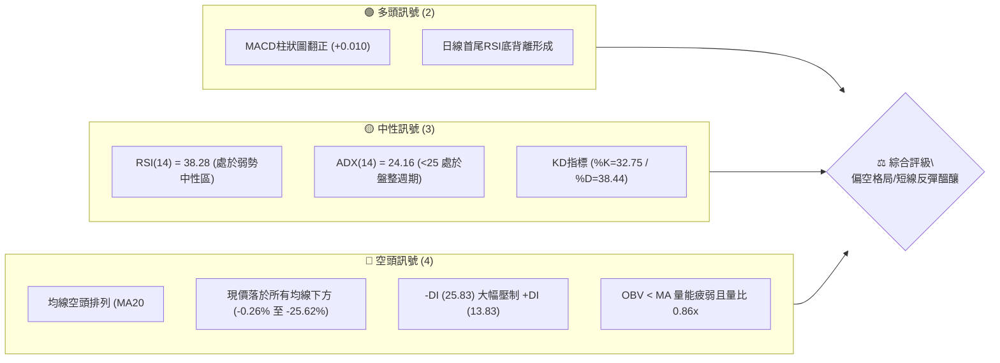
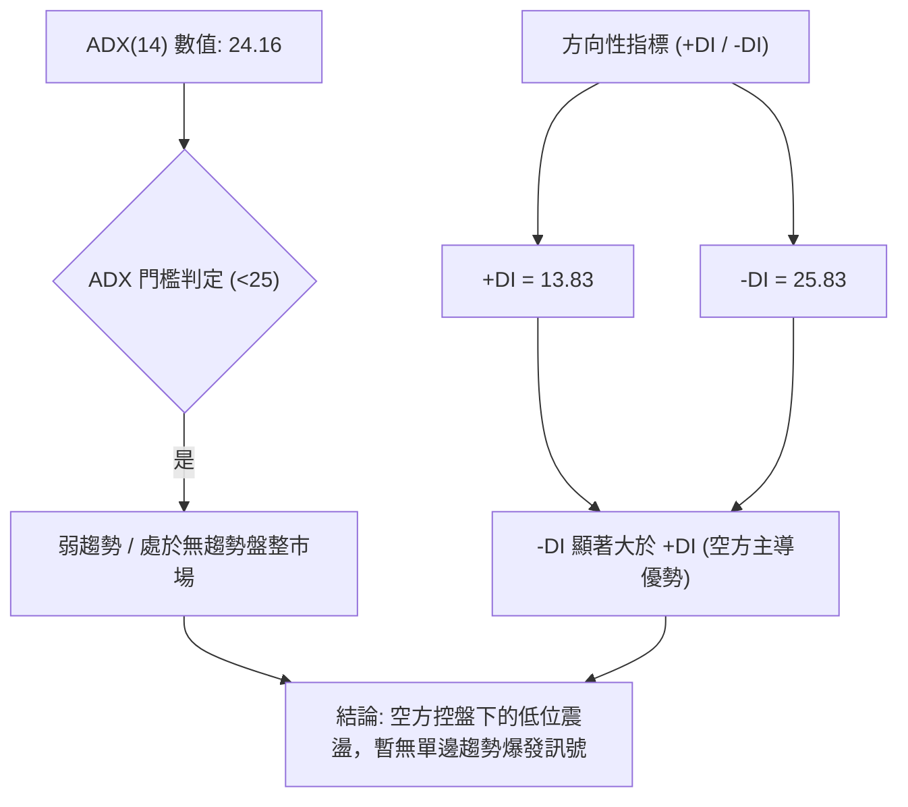
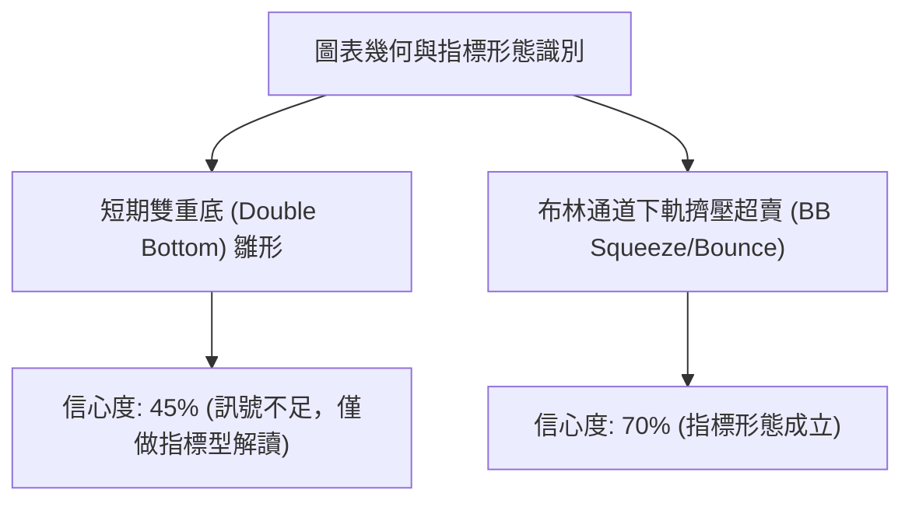
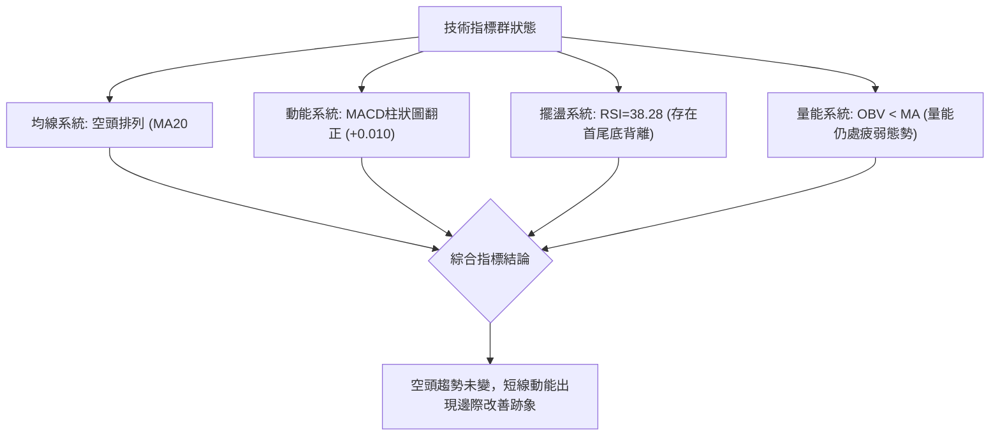
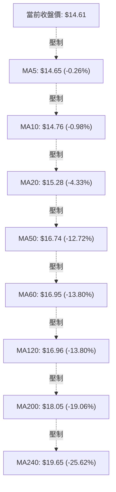
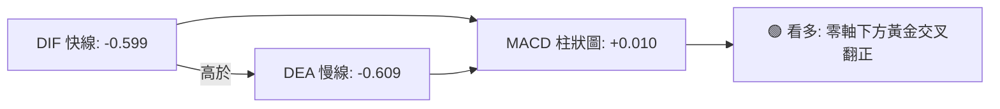
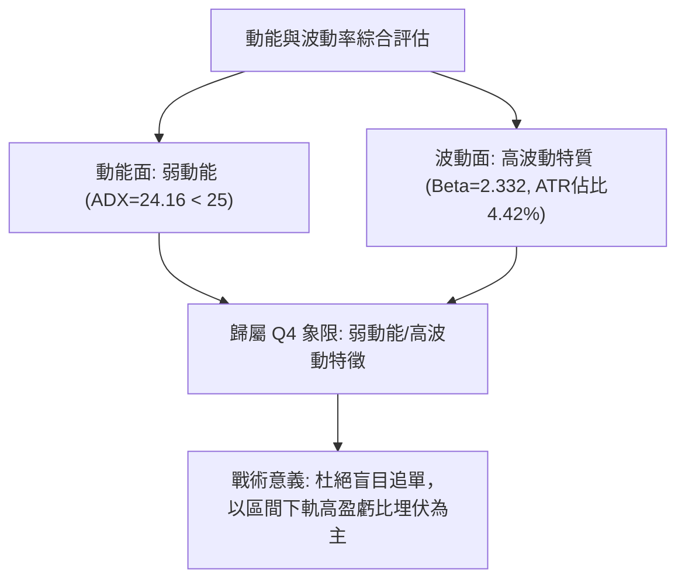
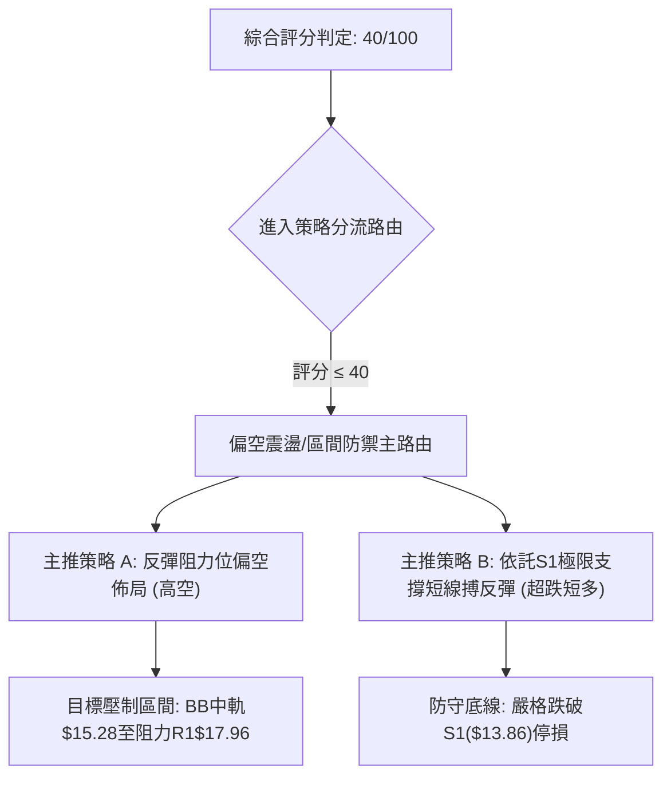
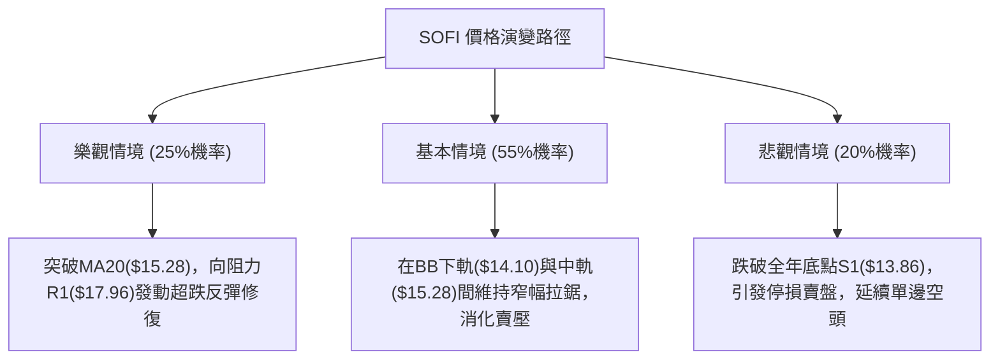

# SOFI 技術分析報告

> **報告日期**：2026-10-26 ｜ **語言**：繁體中文 ｜ **數據來源**：Yahoo Finance ｜ **當前價格**：$14.61

---

## 目錄

| 章節 | 內容 |
|------|------|
| [1. 技術面概覽](#1-技術面概覽) | 訊號儀表板、核心指標、評分卡 |
| [2. 趨勢分析](#2-趨勢分析) | 多時框趨勢、長中短期走勢 |
| [3. 圖表形態分析](#3-圖表形態分析) | 形態識別、K線組合、目標價 |
| [4. 支撐與阻力](#4-支撐與阻力) | 關鍵價位、斐波那契回調 |
| [5. 技術指標深度解讀](#5-技術指標深度解讀) | MA/RSI/MACD/布林/成交量 |
| [6. 動能與波動率](#6-動能與波動率) | 動能評估、ATR、Beta |
| [7. 多時框架總結](#7-多時框架總結) | 時框架評分矩陣 |
| [8. 交易策略建議](#8-交易策略建議) | 多空策略、風險報酬比 |
| [9. 風險提示與監控](#9-風險提示與監控) | 監控指標、風險場景 |

---

## 1. 技術面概覽

### 🎯 技術訊號儀表板



### 📊 核心指標速覽表

| 指標類別 | 指標名稱 | 當前數值 | 訊號 | 解讀 |
|----------|----------|----------|------|------|
| **價格** | 當前價格 | $14.61 | 🔴 | 位於52週區間底部 4.0% 處，距離52W低點僅 5.41% |
| **均線** | MA20 | $15.28 | 🔴 | 價格低於MA20達 4.38%，短線承壓 |
| **均線** | MA50 | $16.74 | 🔴 | 價格低於MA50達 12.72%，中期趨勢向下 |
| **均線** | MA200 | $18.05 | 🔴 | 價格低於MA200達 19.06%，長期多空分水嶺未收復 |
| **動能** | RSI(14) | 38.28 | 🟡 | Wilder平滑，弱勢中性區，伴隨20根K棒首尾底背離 |
| **動能** | MACD | -0.599 | 🟢 | 快線高於慢線(-0.609)，Hist柱狀圖轉正為 +0.010 |
| **波動** | ATR(14) | $0.65 | 🟡 | 佔股價 4.42%，屬於中等偏高波動幅度 |

### 🏆 技術評分卡

```
╔══════════════════════════════════════════════════════════════════╗
║                   技術評分卡 — SOFI (2026-10-26)                 ║
╠══════════════════════════════════════════════════════════════════╣
║ 趨勢強度      ██████░░░░░░░░░░░░░░  30/100  🔴 空頭壓制強烈      ║
║ 動能指標      ██████████░░░░░░░░░░  50/100  🟡 底背離vs弱勢RSI  ║
║ 支撐穩定度    ████████████░░░░░░░░  60/100  🟡 S1($13.86)測試支撐 ║
║ 成交量配合    ████████░░░░░░░░░░░░  40/100  🔴 量比0.86且OBV疲弱 ║
║ 形態完整度    ████████░░░░░░░░░░░░  40/100  🔴 旗形整理待突破    ║
║ 均線排列      ████░░░░░░░░░░░░░░░░  20/100  🔴 典型完全空頭排列  ║
╠══════════════════════════════════════════════════════════════════╣
║ 綜合評分      ████████░░░░░░░░░░░░  40/100  偏空震盪/區間防禦    ║
╚══════════════════════════════════════════════════════════════════╝
```

---

## 2. 趨勢分析

### 🌐 多時框趨勢分析

```mermaid
graph TD
    A["月線框架 (長期: 過去24個月)"] -->|"自高點$29.72下行回調至$14.61"| B["空頭回調週期 (跌幅-50.84%)"]
    C["週線框架 (中期: 近20週)"] -->|"高點$18.91回落至S1("$13.86")支撐"| D["弱勢下行區間 (均線呈壓)"]
    E["日線框架 (短期: 近10日)"] -->|"探底$13.86後反彈至$14.61震盪"| F["弱勢盤整築底 (ADX=24.16)"]
    B --> G{"趨勢匯聚分析"}
    D --> G
    F --> G
    G -->|"ADX<25 觸發盤整規則"| H["結論: 中長期偏空背景下的日線區間震盪"]
```

### 📈 長期趨勢 — 12個月走勢圖（Unicode）

```
SOFI 月線走勢圖（過去12個月：2025-11 至 2026-10）
價格軸 ($)
$30.00 ┤ ●($29.72)
$27.50 ┤       ●($26.18)
$25.00 ┤
$22.50 ┤             ●($22.81)
$20.00 ┤
$17.50 ┤                   ●($17.76)   ●($18.22)   ●($17.88)
$15.00 ┤                         ●($15.88)   ●($17.93)   ●($15.72)
$12.50 ┤                               ●($16.10)   ●($16.31)   ●($14.61)←現在
       └─┬─────┬─────┬─────┬─────┬─────┬─────┬─────┬─────┬─────┬─────┬─────┬─
        11    12    01    02    03    04    05    06    07    08    09    10  (月)
```

**走勢特徵分析表格**：

| 階段週期 | 月份區間 | 起始價 → 結束價 | 漲跌幅 | 核心走勢特徵與量價結構 |
|----------|----------|-----------------|--------|------------------------|
| 高位見頂階段 | 2025-11 → 2025-12 | $29.72 → $26.18 | -11.91% | 見頂回落，高位出現獲利了結賣壓 |
| 主跌段 | 2025-12 → 2026-03 | $26.18 → $15.88 | -39.34% | 單邊下行，失守各關鍵整數關卡 |
| 中期平台震盪 | 2026-03 → 2026-08 | $15.88 → $17.88 | +12.59% | $16.00-$18.00 區間橫盤拉鋸，多空拉鋸 |
| 破位探底階段 | 2026-08 → 2026-10 | $17.88 → $14.61 | -18.29% | 震盪箱體下破，回測52週低點 $13.86 |

### 📊 中期趨勢（週線分析）

```
SOFI 週線近期關鍵壓力與支撐示意圖
══════════════════════════════════════════════════════════════════════
[壓力位聚類 R1]  $17.96 ══════════════════════════════════════════════
                      │    ▲ (2026-08 波段高點 $18.91 回落後形成的阻力帶)
                      │   
[MA20/中軌壓制]  $15.28 ----------------------------------------------
                      │    ▲ 反彈短線阻力
[當前現價位置]  $14.61 ◄─── (收盤價，正處於低位反彈測試期)
                      │
[52W低點支撐 S1] $13.86 ══════════════════════════════════════════════
                      ▼ (2026-10-15 錄得低點，為全年強支撐)
══════════════════════════════════════════════════════════════════════
```

### ⚡ 趨勢強度評估（ADX 解讀）



**ADX 指標強度對照分析**：

| 指標變數 | 當前讀數 | 門檻區間 | 技術含義 |
|----------|----------|----------|----------|
| **ADX(14)** | 24.16 | < 25 (弱趨勢/盤整) | 價格缺乏單邊推進動能，當前處於震盪打底或整理階段 |
| **+DI(14)** | 13.83 | 基準線 20 以下 | 多頭進攻動能疲乏，無法發動趨勢性攻擊 |
| **-DI(14)** | 25.83 | 基準線 25 以上 | 空頭實力仍佔據優勢，但因 ADX<25，不宜盲目追空 |

---

## 3. 圖表形態分析

### 🔍 形態識別系統



**圖表形態評估表**：

| 形態 | 信心度 | 判斷依據（引用數據） | 完成度 | 目標價（附計算式） |
|------|--------|----------------------|--------|--------------------|
| 短期雙底雛形 | 45% | 10-14低點$13.92與10-15低點$13.86形成雙底，但頸線尚未有效突破 | 40% | 訊號不足，僅做指標型解讀（頸線未確刻突破，依規則15不予推算延伸目標） |
| 布林通道下軌觸底反彈 | 70% | 價格於10-15下破BB下軌($14.10)後快速拉回通道內，BB%B達0.22 | 80% | 形態中軌目標價 = $15.28 (依據BB中軌/MA20) |

### 🕯️ 重要K線形態分析

依據提供的「近10根日K」與「近8根週K」實體數據進行專業解讀：

| 日期（日K/週K） | 開 | 高 | 低 | 收 | K線形態 | 解讀 | 訊號 |
|---|---|---|---|---|---|---|---|
| 日K 2026-10-14 | 14.92 | 15.04 | 13.92 | 14.22 | 大陰線破位 | 爆量下殺達9217萬股，空方動能宣洩 | 🔴 |
| 日K 2026-10-15 | 13.89 | 15.13 | 13.86 | 15.09 | 長下影長陽棒 | 回測全年底點$13.86獲強力買盤拉起，形成吞噬反轉 | 🟢 |
| 日K 2026-10-16 | 15.07 | 15.54 | 14.33 | 14.55 | 帶長上影倒轉陰 | 向上挑戰MA20未果，引發高位解套拋壓 | 🔴 |
| 日K 2026-10-20 | 14.20 | 14.99 | 14.18 | 14.68 | 實體陽線 | 低開高走，確認$14.20一線支撐有效 | 🟢 |
| 日K 2026-10-23 | 14.55 | 14.71 | 14.23 | 14.61 | 窄幅十字星孕線 | 成交量萎縮至3884萬股，多空陷入極致均衡觀望 | 🟡 |
| 週K 2026-10-16 | 15.47 | 15.68 | 13.86 | 14.55 | 長下影週陰線 | 週線創下全年低點$13.86，單週成交量放大至2.86億股 | 🟡 |
| 週K 2026-10-23 | 14.75 | 15.11 | 14.18 | 14.61 | 縮量週孕線 | 實體極小，週成交量降至1.98億股，賣壓暫時竭盡 | 🟡 |

### 📉 ASCII 走勢形態示意圖

```
SOFI 近10日 K線築底示意圖
 價格 ($)
 15.60 ┤               ┬ (10-16高 $15.54)
 15.20 ┤   ┬           │
 14.80 ┤   │   ┌┐      │   ┌┐  ┌┐  ┌┐
 14.40 ┤ ┌─┴┐  ││  ┌┐  └─┬─┘│  ││  ││  ││ ┌─┬┐ ◄ 現價 $14.61 (10-23)
 14.00 ┤ │  │  ││  ││    │   ││  ││  └┘ └─┴┘
 13.60 ┤ └──┘  └┴─ └┴─── ┴ ──┴┘  └┘
       └─┬──────┬──────┬──────┬──────┬──────┬──────┬──────┬──────┬──────┬─
       10-12  10-13  10-14  10-15  10-16  10-19  10-20  10-21  10-22  10-23
       [盤整] [跌破] [破底] [長針] [遇阻] [回踩] [反彈] [整理] [窄幅] [十字]
                             S1($13.86)
```

### 🎯 形態目標價計算

根據布林通道下軌觸底反彈之指標型形態：
1. **防守起點**：52週支撐位 $13.86（S1）。
2. **第一階段目標（通道中軌）**：當前 MA20 / 布林中軌所在位置 **$15.28**。
3. **第二階段目標（強阻力帶）**：若放量突破中軌，目標指向近一年波段高點聚類阻力位 **$17.96 (R1)**。

---

## 4. 支撐與阻力

### 🗺️ 關鍵價位分布圖（Unicode）

```
SOFI 價位結構分布圖
═══════════════════════════════════════════════════════════════════
$19.62 ║██████████████████████████████║ 強阻力 R3 (+34.23%)
$18.79 ║████████████████████          ║ 阻力 R2 (+28.53%)
$17.96 ║██████████████████████████    ║ 關鍵阻力 R1 / 斐波 78.6% ($17.90)
       ║                              ║
$15.28 ║------------------------------║ BB中軌 / MA20 關鍵壓制線
$14.61 ╠══════════════════════════════╣ ◄ 現價位置 ($14.61)
$14.10 ║┈┈┈┈┈┈┈┈┈┈┈┈┈┈┈┈┈┈┈┈┈┈┈┈┈┈┈┈┈┈║ 布林通道下軌
$13.86 ║▓▓▓▓▓▓▓▓▓▓▓▓▓▓▓▓▓▓▓▓▓▓▓▓▓▓▓▓▓▓║ 52週絕對強支撐 S1 (-5.17%)
═══════════════════════════════════════════════════════════════════
```

### 🚧 阻力位分析表

| 阻力級別 | 價位 | 形成原因 | 突破難度 | 重要性 |
|----------|------|----------|----------|--------|
| **R1** | $17.96 | 近一年波段高點聚類，與斐波那契 78.6% ($17.90) 形成密集重疊區 | 極高 | ★★★★★ |
| **R2** | $18.79 | 2026年8月波段高點密集區 ($18.91)，籌碼解套重壓帶 | 高 | ★★★★☆ |
| **R3** | $19.62 | 歷史成交密集峰值區，接近 MA240 ($19.65) 長期成本線 | 極高 | ★★★★☆ |

### 🛡️ 支撐位分析表

| 支撐級別 | 價位 | 形成原因 | 守住機率 | 重要性 |
|----------|------|----------|----------|--------|
| **S1** | $13.86 | 52週波段低點聚類，斐波那契 100.0% 回調位，年內最低點 | 65% | ★★★★★ |
| **S2** | N/A（數據未提供） | 數據中未偵測到 | N/A | N/A |
| **S3** | N/A（數據未提供） | 數據中未偵測到 | N/A | N/A |

### 📐 斐波那契回調位分析

依據 52 週區間波段（$13.86 → $32.73）精確計算之黃金分割水準：

| 回調比率 | 價位 | 當前價位相對位置與技術意義 |
|----------|------|----------------------------|
| **0.0% (52W High)** | $32.73 | 上輪多頭超級週期頂部峰值 |
| **23.6%** | $28.28 | 極度強勢回調位（遠高於現價） |
| **38.2%** | $25.52 | 長期牛熊轉換分水嶺 |
| **50.0%** | $23.29 | 多空中軸平衡位置 |
| **61.8%** | $21.07 | 黃金分割防守線 |
| **78.6%** | $17.90 | 深幅回調臨界線（與阻力位 R1 $17.96 高度重合） |
| **100.0% (52W Low)**| $13.86 | 基準支撐點（與支撐位 S1 完全重合） |

> **回調位解讀**：當前現價 **$14.61** 處於 **78.6% ($17.90)** 與 **100.0% ($13.86)** 之間的極弱勢回調探底區間。現價距離 100.0% 極限支撐 $13.86 僅差 $0.75 (+5.41%)，意味著空頭已回吐上一整輪牛市週期的全部漲幅，隨時可能在 $13.86 附近構築長期週期級底背離。

---

## 5. 技術指標深度解讀

### 🎛️ 指標訊號總覽



### 📈 移動平均線排列分析



**均線特徵分析**：
1. **完美空頭排列**：MA20 ($15.28) < MA50 ($16.74) < MA200 ($18.05)，長中短期均線呈現發散下行狀態。
2. **短期均線貼合**：MA5 ($14.65) 與 MA10 ($14.76) 斜率放緩並與現價非常接近，顯示短線下行殺跌勢頭已獲遏制，正進入均線鈍化修復期。

### 📉 RSI(14) 分析

- **RSI 當前數值**：**38.28**（Wilder 計算）
- **區間定位**：處於 30–70 之弱勢中性偏冷區間。
- **進度條展示**：
  `RSI(14): 38.28  [███████░░░░░░░░░░░] 38.28%`
- **背離分析判斷**：
  - **結論**：⚠️ **明確存在底背離 (Bullish Divergence)**。
  - **依據**：近 20 根 K 棒首尾分析，價格於 10-15 創下波段新低 $13.86，但 RSI 擺盪指標未同步跌破前低，反而呈現自低檔抬升態勢，且日線收盤價維持在 $14.61，指標動能提前落底，發出潛在超賣修復訊號。

### 📊 MACD(12/26/9) 訊號解讀



- **MACD 線**：-0.599
- **訊號線 (Signal)**：-0.609
- **柱狀圖 (Histogram)**：**+0.010**（由負翻正，顯示短期空頭動能耗盡，多頭開始聚集微弱反彈推力）。

### 📦 布林通道分析

```
SOFI 布林通道結構 (20日參數)
$16.45 ┤-------------------------------------- BB 上軌 (+12.59%)
       │
$15.28 ┤ - - - - - - - - - - - - - - - - - - - BB 中軌 (MA20) (+4.59%)
       │
$14.61 ┤  ◄ 現價位置 ($14.61, %B = 0.22)
       │
$14.10 ┤-------------------------------------- BB 下軌 (-3.49%)
```

- **通道帶寬**：上軌 $16.45 至下軌 $14.10，寬度 $2.35 (16.08%)。
- **指標位置**：%B 為 **0.22**，代表現價緊貼下軌上方運行，處於布林帶弱勢下半區。由於價格在 10-15 跌破下軌 ($13.86) 後快速回縮至帶內，顯示下軌具備顯著動態支撐效應。

### 💹 成交量分析（量價配合度）

1. **量能萎縮**：最新成交量 38,841,900 股，相較於 20 日均量 45,362,520 股，**量比僅 0.86x**。
2. **OBV 趨勢解讀**：數據明確顯示 **OBV < MA**，代表累積能量線處於均線下方，機構資金進場介入跡象薄弱，目前的反彈多屬於場內散戶與空頭回補推動，量能未形成健康之量增價揚配合。

---

## 6. 動能與波動率

### ⚡ 動能評估四象限

| 象限 | 動能維度 | 波動維度 | 典型特徵 | 當前狀態判定 |
|------|----------|----------|----------|--------------|
| **Q1** | 強動能 (趨勢明確) | 低波動 (溫和推進) | 穩定趨勢主升浪 | 否 |
| **Q2** | 弱動能 (無單邊趨勢) | 低波動 (波幅收斂) | 箱體整理/窄幅拉鋸 | 否 |
| **Q3** | 強動能 (高推進力) | 高波動 (情緒主導) | 突破爆發/恐慌崩跌 | 否 |
| **Q4** | 弱動能 (ADX=24.16) | 高波動 (ATR=4.42%, Beta=2.33) | **低位震盪/多空拉鋸** | **✓ 當前 SOFI 歸屬** |



### 📊 ATR 波動率分析

- **ATR(14) 數值**：**$0.65**（佔當前股價 4.42%）。
- **日內波動幅度**：近 10 日平均高低點震盪幅度約 $0.70 - $1.20。
- **動態止損建議**：
  - 保守型交易者止損距離：2.0 × ATR = **$1.30**。
  - 激進型交易者止損距離：1.0 × ATR = **$0.65**。

### 📐 Beta 與市場相關性

- **Beta 係數**：**2.332**。
- **市場特徵分析**：SOFI 屬於高貝塔進攻型金融科技個股，波動烈度為標普 500 指數的 2.33 倍。當大盤出現劇烈波動時，該股容易放大雙向波動幅度，在跌勢未完全扭轉前，高 Beta 特質將增加多頭持倉的淨值回撤風險。

---

## 7. 多時框架總結

### 📋 時框架評分表

| 時框架 | 趨勢方向 | 動能 | 均線排列 | 形態 | 綜合評分 | 建議 |
|--------|----------|------|----------|------|----------|------|
| **月線 (長期)** | 🔴 偏空 | 弱勢築底 | 空頭排列 | 高位回落深幅調整 | 30/100 | 長線資金分批定投，未到右側建倉期 |
| **週線 (中期)** | 🔴 偏空 | RSI低位走平 | 空頭排列 | 測試S1支撐平台 | 35/100 | 空倉者觀望，警惕反彈無力再次走弱 |
| **日線 (短期)** | 🟡 中性偏空 | MACD金叉/底背離 | 空頭排列 | 低位窄幅十字孕線 | 50/100 | 依託 $13.86 作極限防守，輕倉搏超跌反彈 |

### 🔲 綜合訊號矩陣

```
時框維度       趨勢維度    動能維度    均線維度    量能維度    形態維度
────────────────────────────────────────────────────────────
長期 (月線)    🔴 空頭     🔴 疲弱     🔴 空頭     🟡 中性     🔴 破位
中期 (週線)    🔴 空頭     🟡 鈍化     🔴 空頭     🔴 萎縮     🟡 考驗支撐
短期 (日線)    🟡 盤整     🟢 金叉     🔴 空頭     🔴 疲弱     🟢 觸軌回升
────────────────────────────────────────────────────────────
矩陣共振結論：日線級別具備反彈條件，但受制於中長期完全空頭結構的重大壓制。
```

### ⚖️ 多時框收斂結論

依據多時框收斂規則第 14 條：
1. **當前趨勢型態判定**：ADX(14) 讀數為 **24.16 (<25)**，技術架構明確屬於**「盤整行情」**而非單邊趨勢行情。
2. **主導維度收斂**：在 ADX<25 的盤整週期中，**以日線布林通道上下軌 ($14.10 - $16.45) 為主要交易區間**。
3. **唯一方向性結論**：**中性觀望偏防守（綜合評分 40/100，落於中性下緣/偏空邊界）**。操作上嚴禁追高，僅能以 52 週低點 **$13.86 (S1)** 作為嚴格防守基準進行低接試單。

---

## 8. 交易策略建議

### 🗺️ 策略決策流程圖



### 🧭 策略路由（依評分卡分流，不得兩頭下注）

> **當前主策略方向 = 偏空震盪防守／區間短線操作（依綜合評分 40/100）**
> 
> 由於綜合評分恰好位於偏空邊界（40/100），且 ADX=24.16 (<25) 確立為無趨勢盤整行情，主策略不建議盲目做趨勢性突破單，而應鎖定**「區間上軌高空主導，區間下緣超短多輔助」**的雙向精確套利架構。

### 🎯 價格情境階梯（Price Scenarios）

| 觸發條件 | 下一目標 | 後續延伸 | 情境含義 |
|----------|----------|----------|----------|
| 向上突破 MA20 ($15.28) | R1 ($17.96) | R2 ($18.79) | 短線超跌反彈確立，測試中期波段阻力 |
| 站穩現價 $14.61 區間 | BB中軌 ($15.28) | R1 ($17.96) | 區間震盪築底，指標逐步修復 |
| 跌破 S1 ($13.86) | S2 (數據中未偵測到) | S3 (數據中未偵測到) | 52週支撐瓦解，空頭發動新一輪崩跌 |

### 📊 情境機率分佈

| 情境 | 機率 | 主要依據 |
|------|------|----------|
| **區間震盪盤整** | **55%** | ADX=24.16 確立盤整市場；布林帶上下軌開口收斂；K線呈現窄幅十字星孕線 |
| **超跌反彈修復** | **25%** | 日線首尾 RSI 底背離；MACD 柱狀圖翻正 (+0.010)；52週低點 S1 買盤護盤 |
| **再破底尋求下探** | **20%** | 全均線呈標準空頭排列；-DI=25.83 仍壓制 +DI=13.83；OBV<MA 量能不振 |

### 🟢 主策略詳情（方向依上方路由）

依據嚴格規則 5、13、17 定義，所有價位均精確引用自數據，進場價取區間中點計算風險報酬比：

| 策略要素 | 策略 A（反彈至阻力位偏空操作） | 策略 B（依託 S1 支撐超跌博反彈） |
|----------|--------------------------------|----------------------------------|
| **進場條件** | 反彈至 MA20 / BB中軌承壓遇阻回落時進場 | 於現價至 S1 支撐區間低吸埋伏 |
| **進場價格** | $15.28（以 MA20 精確價位計算） | $14.24（取 S1 $13.86 與現價 $14.61 之中點） |
| **目標價 T1** | $13.86（S1 支撐位） | $15.28（MA20 / BB中軌） |
| **目標價 T2** | N/A（數據中未偵測到下方價位） | $17.96（阻力位 R1） |
| **止損價格** | $16.45（BB 上軌） | $13.86（S1 52週低點） |
| **風險報酬比** | **1 : 1.21（以 T1 計）**<br>*(計算式: ($15.28-$13.86)/($16.45-$15.28) = 1.42/1.17)* | **1 : 2.74（以 T1 計）**<br>*(計算式: ($15.28-$14.24)/($14.24-$13.86) = 1.04/0.38)*<br>*[另列: 1 : 9.79（以 T2 計）]* |
| **成功機率** | 60% | 40% |
| **建議倉位** | 10% - 15% | 5% - 10% (極輕倉短線) |

### 🔴 反向風險觸發點（對沖提示）

- **多頭反轉推翻點**：若日線收盤價帶量（日量 > 5000 萬股）實質突破 **$15.28 (MA20)**，則宣告本輪超跌反彈轉為趨勢性反彈，做空策略 A 必須立即嚴格止損平倉，轉為觀望。
- **空頭加速推翻點**：若價格失守 **$13.86 (S1)**，做多策略 B 必須無條件止損出局，絕不可加碼攤平。

### ⭐ 整體訊號強度評星

```
做多訊號強度：★★☆☆☆  (2/5星 - 僅屬指標超跌底背離反彈)
做空訊號強度：★★★☆☆  (3/5星 - 均線結構完全偏空，但受制於低位盤整ADX<25)
整體可信度：  ★★★☆☆  (3/5星 - 無趨勢盤整期，以區間技術指標為主)
```

---

## 9. 風險提示與監控

### ✅ 關鍵監控指標 Checklist

```
╔══════════════════════════════════════════════════════════════════╗
║                    SOFI 關鍵日常監控指標 CHECKLIST               ║
╠══════════════════════════════════════════════════════════════════╣
║ [ ] 價格能否守穩 52 週最低點 S1: $13.86 (破位則觸發停損)         ║
║ [ ] 日線收盤價能否突破並站穩 MA20 關鍵壓力位: $15.28            ║
║ [ ] 成交量是否放大突破 20 日均量: 45,362,520 股 (判斷量能配合度)  ║
║ [ ] RSI(14) 指標能否突破 50 中軸 (確認多頭動能重啟)              ║
║ [ ] MACD 柱狀圖正值能否持續擴大 (> +0.050)                      ║
║ [ ] 空頭指標 -DI 是否回落至 20 以下，解除單邊下行警報            ║
╚══════════════════════════════════════════════════════════════════╝
```

### ⚠️ 風險場景分析



### 🛡️ 風險管理重要提醒

1. **Beta 高波動風險防範**：SOFI 的 Beta 高達 **2.332**，日內波動 ATR 佔比達 **4.42%**。這意味著該股極易受到市場宏觀流動性與情緒干擾，倉位配置嚴格限制在總資產的 **10% 以內**，避免因槓桿或重倉承受非對稱風險。
2. **財報前夕之非系統性風險**：新聞及市場數據顯示其同業即將公佈財報，板塊波動烈度顯著提升，需防範業績期前的流動性抽離與隱含波動率暴增風險。
3. **無趨勢環境之紀律**：當前 ADX 為 **24.16**，處於無趨勢震盪階段，切忌在區間中軌盲目下單，必須遵守「貼近 S1 支撐低吸、貼近 R1 阻力高拋」的鐵律。

---

## 📋 報告總結

```
╔══════════════════════════════════════════════════════════════════╗
║                    SOFI 技術分析報告總結                         ║
╠══════════════════════════════════════════════════════════════════╣
║ 報告日期：2026-10-26                                             ║
║ 當前價格：$14.61                                                 ║
║ 分析評級：⚖️ 偏空震盪 / 區間防禦 (綜合評分: 40/100)               ║
║                                                                  ║
║ 關鍵結論：                                                       ║
║ ├─ 長期趨勢：🔴 處於高點回調之深幅調整期 (MA200=$18.05反壓)     ║
║ ├─ 中期趨勢：🔴 均線呈現標準空頭排列，考驗52週支撐              ║
║ ├─ 短期趨勢：🟡 ADX=24.16 盤整，RSI底背離與MACD金叉醞釀反彈     ║
║ ├─ 關鍵支撐：$13.86 (S1，52週絕對低點)                           ║
║ ├─ 關鍵阻力：$15.28 (MA20/BB中軌) / $17.96 (R1 強阻力)           ║
║ └─ 分析師目標：$20.23 (Mean) / 評級為 Hold (23 位分析師)         ║
║                                                                  ║
║ 最優策略組合：                                                   ║
║ 1. 🥇 最佳機會：在反彈至 $15.28 (MA20) 附近受阻時逢高做空        ║
║    (策略 A，風報比 1 : 1.21，勝率 60%)                           ║
║ 2. 🥈 次選機會：在 $14.24 附近極限貼近 S1($13.86) 博超跌反彈     ║
║    (策略 B，風報比 1 : 2.74，勝率 40%)                           ║
║ 3. 🥉 保守選擇：空倉觀望，等待日線有效突破並站穩 MA20 再行介入   ║
╚══════════════════════════════════════════════════════════════════╝
```

---

> ⚠️ **免責聲明**：本報告為 AI 自動生成之技術分析，所有數據及估算均基於提供的歷史價格資訊。本報告**僅供研究與學術參考**，**不構成任何投資建議**。投資有風險，入市需謹慎。

---

*報告生成時間：2026-10-26 ｜ 數據來源：Yahoo Finance ｜ 分析框架：多時框技術分析*