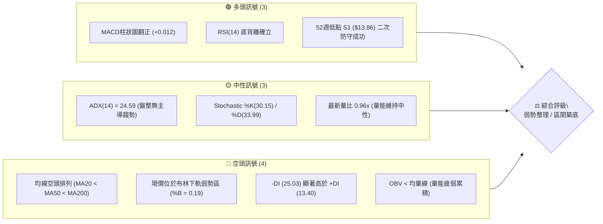
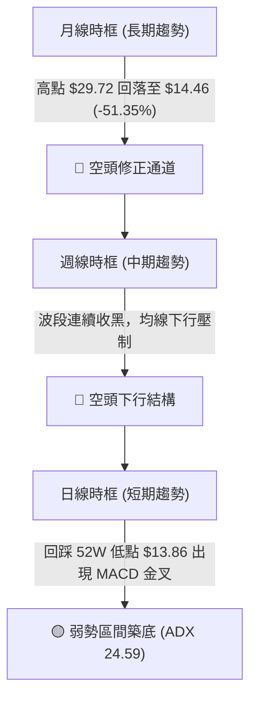
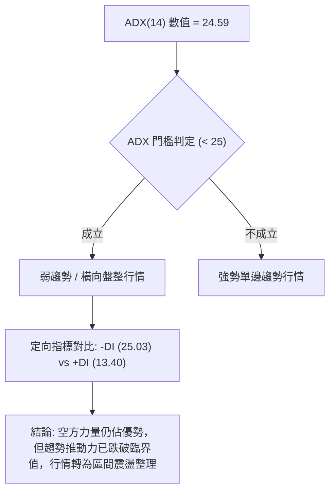
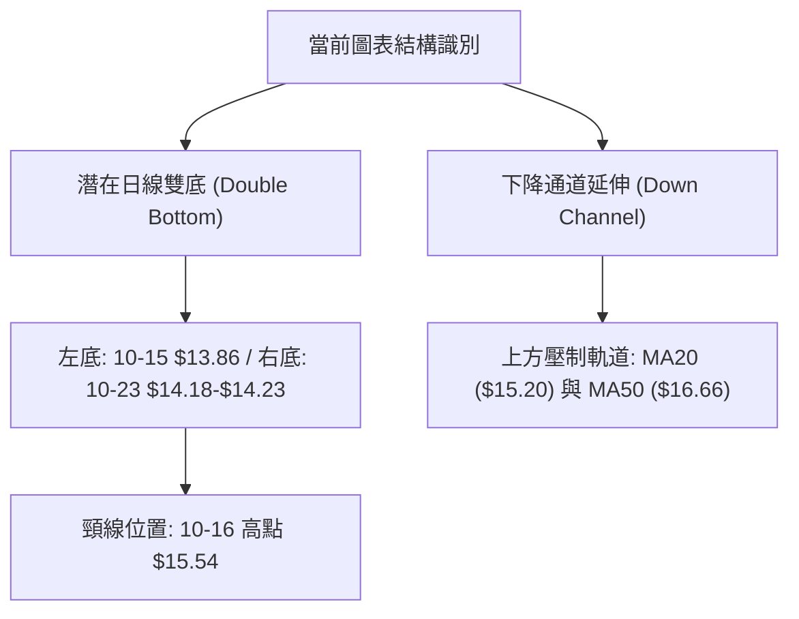
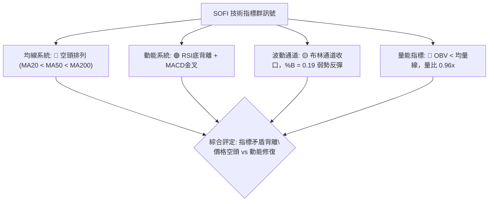
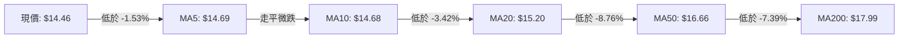
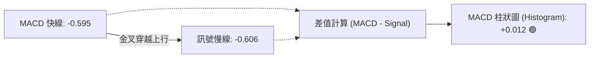
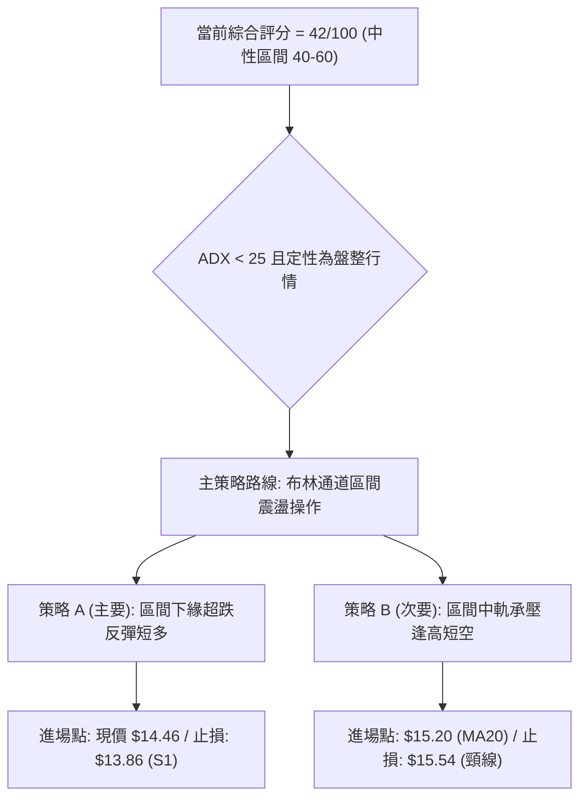
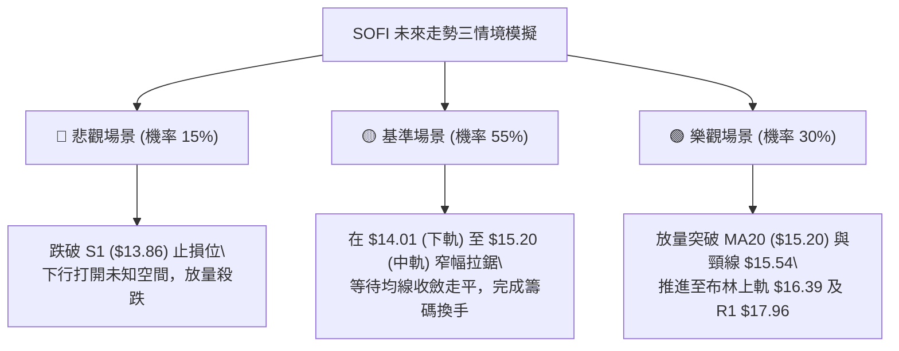

# SOFI 技術分析報告

> **報告日期**：2026-10-27 ｜ **語言**：繁體中文 ｜ **數據來源**：Yahoo Finance ｜ **當前價格**：$14.46 USD

---

## 目錄

| 章節 | 內容 |
|------|------|
| [1. 技術面概覽](#1-技術面概覽) | 訊號儀表板、核心指標、評分卡 |
| [2. 趨勢分析](#2-趨勢分析) | 多時框趨勢、長中短期走勢、ADX解讀 |
| [3. 圖表形態分析](#3-圖表形態分析) | 形態識別、K線組合、目標價推算 |
| [4. 支撐與阻力](#4-支撐與阻力) | 關鍵價位分布、斐波那契回調結構 |
| [5. 技術指標深度解讀](#5-技術指標深度解讀) | 均線系統、RSI背離、MACD、布林通道、量價OBV |
| [6. 動能與波動率](#6-動能與波動率) | 動能四象限、ATR波幅、Beta市場敏感度 |
| [7. 多時框架總結](#7-多時框架總結) | 時框架矩陣、多時框收斂定調 |
| [8. 交易策略建議](#8-交易策略建議) | 策略路由、主策略詳情、情境階梯、風險報酬比 |
| [9. 風險提示與監控](#9-風險提示與監控) | 監控清單、情境模擬、風控指引 |

---

## 1. 技術面概覽

### 🎯 技術訊號儀表板



### 📊 核心指標速覽表

| 指標類別 | 指標名稱 | 當前數值 | 訊號 | 解讀 |
|:---|:---|:---|:---:|:---|
| **價格** | 當前收盤價 | $14.46 | 🔴 | 位於 52 週價格區間的 3.2% 底部邊界，整體處於弱勢格局 |
| **均線** | 短期 MA20 | $15.20 | 🔴 | 價格低於 MA20 (-4.88%)，短期反彈第一道動態均線阻力 |
| **均線** | 中期 MA50 | $16.66 | 🔴 | 價格低於 MA50 (-13.21%)，中期空方主導壓制 |
| **均線** | 長期 MA200 | $17.99 | 🔴 | 價格低於 MA200 (-19.62%)，長期牛熊分界線高懸於上方 |
| **動能** | RSI(14) | 36.91 | 🟡 | 位於偏弱中性區間，尚未進入嚴重超賣，但已呈現底背離雛形 |
| **動能** | MACD (12,26,9) | -0.595 / -0.606 | 🟢 | MACD 線金叉訊號線，柱狀圖轉正為 +0.012，短線下行動能衰竭 |
| **趨勢** | ADX(14) | 24.59 | 🟡 | ADX < 25 指標指示單邊趨勢動能減弱，當前進入橫盤震盪盤整期 |
| **通道** | 布林通道 | $14.01 - $16.39 | 🟡 | %B 為 0.19，價格逼近下軌 $14.01 後反彈，處於下半通道震盪 |
| **成交量** | 20日成交量比 | 0.96x | 🔴 | 成交量 42.62M 低於 20 日均量 44.56M，反彈缺乏增量資金承接 |
| **波動** | ATR(14) | $0.62 | 🟡 | 每日平均波幅佔股價 4.29%，屬於中高波動率資產，需拉寬止損 |

### 🏆 技術評分卡

```
╔══════════════════════════════════════════════════════════════════╗
║                   技術評分卡 — SOFI (2026-10-27)                 ║
╠══════════════════════════════════════════════════════════════════╣
║ 趨勢強度 (Trend)        ██████░░░░░░░░░░░░░░  32/100  🔴 空頭主導 ║
║ 動能指標 (Momentum)      ██████████░░░░░░░░░░  52/100  🟡 底背修復 ║
║ 支撐穩定度 (Support)    ██████████░░░░░░░░░░  50/100  🟡 低點考驗 ║
║ 成交量配合 (Volume)     ███████░░░░░░░░░░░░░  34/100  🔴 量能匱乏 ║
║ 形態完整度 (Pattern)    █████████░░░░░░░░░░░  44/100  🟡 潛在雙底 ║
║ 均線排列 (MA System)    ████████░░░░░░░░░░░░  40/100  🔴 空頭發散 ║
╠══════════════════════════════════════════════════════════════════╣
║ 綜合評分 (Overall)      ████████░░░░░░░░░░░░  42/100  🟡 區間震盪 ║
║                                    （評級：中性偏弱 / 區間操作） ║
╚══════════════════════════════════════════════════════════════════╝
```
*計算依據：(32 + 52 + 50 + 34 + 44 + 40) ÷ 6 = 42.0 分（四捨五入至整數）。*

---

## 2. 趨勢分析

### 🌐 多時框趨勢分析



### 📈 長期趨勢 — 12 個月走勢圖

過去 12 個月（2025-11 至 2026-10），SOFI 經歷了顯著的主跌浪與尋底過程：

```
SOFI 月線收盤價格走勢圖（2025-11 至 2026-10）
價格軸 ($)
$30.00 ┤ ●(2025-11: $29.72 歷史波段高點)
$27.00 ┤    ●(2025-12: $26.18)
$24.00 ┤       ●(2026-01: $22.81)
$21.00 ┤
$18.00 ┤          ●(2026-02: $17.76)         ●(2026-05: $18.22)   ●(2026-08: $17.88)
$15.00 ┤             ●(03: $15.88) ●(04: $16.10)   ●(06: $17.93) ●(07: $16.31) ●(09: $15.72)
$12.00 ┤                                                                            ●(現在: $14.46)
       └─────────────────────────────────────────────────────────────────────────────►
        M1    M2    M3    M4    M5    M6    M7    M8    M9    M10   M11   M12 (2026-10)
```

#### 長期走勢特徵分析

| 階段 | 時間區間 | 起止收盤價 | 區間漲跌幅 | 形態特徵與技術解讀 |
|:---|:---|:---|:---:|:---|
| **第一階段：高位崩跌** | 2025-11 ~ 2026-03 | $29.72 → $15.88 | -46.57% | 自歷史波段天花板單邊重挫，連破整數關卡，各級均線反轉下穿 |
| **第二階段：箱型平台** | 2026-04 ~ 2026-08 | $16.10 → $17.88 | +11.06% | 圍繞 $16.00 ~ $18.90 區間進行籌碼換手，形成中期箱型中繼平臺 |
| **第三階段：破位探底** | 2026-09 ~ 2026-10 | $17.88 → $14.46 | -19.13% | 箱型下軌失守，跌破 2026 年初低點，直接下探 52 週低位 $13.86 |

### 📊 中期趨勢（週線分析）

中期技術架構由近 20 週數據觀察，呈現明確的「下降高點（Lower Highs）」與「下降低點（Lower Lows）」：
- 2026 年 8 月中旬週線高點為 $18.91，隨後 9 月初反彈高點降至 $18.22，9 月底高點降至 $17.96，10 月中旬高點僅達 $15.68。
- 支撐方面，7 月底低點 $16.31 失守後，10 月中旬（10-16 當週）直接創出 52 週新低 $13.86。
- 最新兩週（10-23 週收 $14.61、當前 10-26 收 $14.46）展現出低檔抗跌性，週線 MACD 柱狀圖由 -0.080 翻紅至 +0.010 與 +0.012，代表中期空頭摜壓力量正在減弱。

```
中期支撐與阻力示意圖（週線視角）
$18.79 ────────────────────── R2（中期強阻力，8月反彈密集區）
          ▼
$17.96 ────────────────────── R1 / 78.6% Fib（中期波段頸線阻力）
             ▼
$15.20 ────────────────────── BB中軌 / MA20（短期多空分水嶺）
                ▼
$14.46 ══════════════════════ [ 現價 $14.46 ]
             ▲
$13.86 ────────────────────── S1 / 52週低點（關鍵結構生命線）
```

### ⚡ 趨勢強度評估（ADX 解讀）



#### ADX 趨勢強度對照

| 指標名稱 | 當前數值 | 門檻基準 | 狀態評估 | 實戰交易含義 |
|:---|:---:|:---:|:---:|:---|
| **ADX(14)** | 24.59 | 25.00 | 弱趨勢 / 盤整 | 趨勢跟隨策略（單邊追空）失效，市場轉入區間均值回歸交易 |
| **+DI (多方)** | 13.40 | > 20 為多頭動能 | 動能低迷 | 多頭主動發起攻擊的能量薄弱，缺乏機構大規模追價意願 |
| **-DI (空方)** | 25.03 | > 20 為空頭主導 | 空方主控 | 雖然空方處於主導地位，但因 ADX 走平跌破 25，空方動能不再擴散 |

---

## 3. 圖表形態分析

### 🔍 形態識別系統



#### 形態識別與信心度評估表

| 識別形態 | 信心度 | 判斷依據（引用數據） | 完成度 | 目標價（附嚴謹計算式） |
|:---|:---:|:---|:---:|:---|
| **潛在日線雙底** | 55% | 2026-10-15 錄得低點 $13.86，2026-10-23 再次探底 $14.23 未破前低，構成低點墊高雛形 | 60% | 頸線 $15.54 + 形態高度 ($15.54 - $13.86 = $1.68) = **$17.22** |
| **空頭下行通道** | 70% | 價格受制於下行的 MA20 ($15.20) 與布林中軌，自 8 月 $18.91 以來維持規律下傾通道 | 85% | 通道下軌測量目標直接對應 52W 低點 **$13.86**（已達成測試） |
| **頭肩頂形態** | <30% | 數據中缺乏右肩對稱結構與量能確認 | 0% | 訊號不足，僅做指標型解讀 |

### 🕯️ 重要 K 線形態分析

依據提供的「近 10 根日 K」與「近 8 根週 K」實際數據進行詳細解讀：

#### 近 10 根日 K 棒線識別表

| 日期 | 開 | 高 | 低 | 收 | K線形態 | 技術解讀 | 訊號 |
|:---|:---:|:---:|:---:|:---:|:---|:---|:---:|
| **2026-10-13** | 15.12 | 15.33 | 15.09 | 15.24 | 窄幅整理小陽線 | 振幅僅 1.59%，量能萎縮至 31.0M，顯示下挫前市場觀望 | 🟡 |
| **2026-10-14** | 14.92 | 15.04 | 13.92 | 14.22 | 放量大陰線 | 當日放巨量 92.17M 跌破 $14.00 關卡，空方主力恐慌性拋售 | 🔴 |
| **2026-10-15** | 13.89 | 15.13 | 13.86 | 15.09 | 長下影穿刺陽線 | 探底 52W 低點 $13.86 後強勁抽腳收高，單日長紅反包，成交量 62.95M 確認買盤承接 | 🟢 |
| **2026-10-16** | 15.07 | 15.54 | 14.33 | 14.55 | 長上影流星陰線 | 衝高觸碰 $15.54（波段頸線）遭遇獲利盤與解套盤壓制，留長上影線 | 🔴 |
| **2026-10-19** | 14.75 | 14.76 | 14.27 | 14.30 | 光頭下行陰線 | 低開低走收於最低點附近，顯示多頭短線動能不足 | 🔴 |
| **2026-10-20** | 14.20 | 14.99 | 14.18 | 14.68 | 探底回升中陽線 | 開盤回測 $14.18 獲支撐，收盤拉升至 $14.68，呈現抗跌性 | 🟢 |
| **2026-10-21** | 14.84 | 15.11 | 14.65 | 14.90 | 溫和上漲陽線 | 高點突破 $15.11，但成交量 33.65M 萎縮，出現量價微背離 | 🟡 |
| **2026-10-22** | 14.57 | 15.07 | 14.57 | 14.77 | 帶上影小陽線 | 再次挑戰 $15.00 整數阻力未果，短線進入多空拉鋸 | 🟡 |
| **2026-10-23** | 14.55 | 14.71 | 14.23 | 14.61 | 下影十字星線 | 最低點回踩 $14.23 後回升，多空雙方在 $14.60 附近達成暫時均衡 | 🟡 |
| **2026-10-26** | 14.53 | 14.67 | 14.40 | 14.46 | 窄幅實體小陰線 | 波動幅度收斂至 $0.27，量能平穩，面臨變盤突破節點 | 🟡 |

#### 近 8 根週 K 棒線識別表

| 週末交易日 | 開 | 高 | 低 | 收 | K線形態 | 技術解讀 | 訊號 |
|:---|:---:|:---:|:---:|:---:|:---|:---|:---:|
| **2026-09-11** | 18.22 | 18.35 | 16.93 | 17.32 | 破位長陰線 | 跌破 $18.00 平台，量能萎縮但實體長度放大 | 🔴 |
| **2026-09-18** | 17.00 | 17.75 | 16.53 | 16.96 | 震盪十字陰線 | 嘗試反彈受制於 $17.75，空方掌控局勢 | 🔴 |
| **2026-09-25** | 17.46 | 17.96 | 16.20 | 16.58 | 放量下影陰線 | 放量至 302.28M，創 $16.20 新低後引發短線抽腳 | 🔴 |
| **2026-10-02** | 16.32 | 16.42 | 15.53 | 15.77 | 連續下行陰線 | 收盤價正式跌破 $16.00 大關，空頭加速推進 | 🔴 |
| **2026-10-09** | 15.77 | 16.19 | 15.25 | 15.80 | 底部下影十字星 | 實體極小，多空在 $15.80 換手，賣壓出現減緩跡象 | 🟡 |
| **2026-10-16** | 15.47 | 15.68 | 13.86 | 14.55 | 巨幅長下影陰錘 | 探 52W 新低 $13.86 引爆 286.32M 籌碼換手，形成長達 $0.69 的下影線 | 🟢 |
| **2026-10-23** | 14.75 | 15.11 | 14.18 | 14.61 | 孕線收小紅星 | 高低點均包含在上一週影線範圍內，形成「內困/孕線」整理形態 | 🟡 |
| **2026-10-26** | 14.53 | 14.67 | 14.40 | 14.46 | 週初窄幅運行 | 僅單一交易日數據，處於區間低位靜態沉澱 | 🟡 |

### 📉 ASCII 走勢形態示意圖

```
SOFI 潛在雙底與頸線結構示意圖
價格 ($)
$15.54 ─────────────────┬───────────────── 頸線位置（2026-10-16 反彈高點）
                        │ 形態高度 H = $1.68
$14.46 ═════════════════╪═════════════════ [ 當前收盤價 ]
          ╲            ╱ ╲            ╱
$14.18 ─── ╲          ╱   ╲          ╱ ─── 右底回踩點（2026-10-20 & 10-23）
            ╲        ╱     ╲        ╱
$13.86 ──────●──────         ──────●────── 52週低點 S1（2026-10-15 左底低點）
          【左底 (Bottom 1)】   【右底 (Bottom 2)】
```

### 🎯 形態目標價計算

若多頭能放量站穩 MA20 並突破 10-16 形成的波段頸線高點 $15.54，則日線級別雙底結構正式確立：
1. **形態底部低點（Bottom）**：$13.86
2. **形態頸線阻力（Neckline）**：$15.54
3. **垂直形態高度（Height, H）**：$15.54 - $13.86 = **$1.68**
4. **理論突破測量目標價（Target）**：$15.54 + $1.68 = **$17.22**
   - 該目標價精準指向斐波那契 78.6% 回調位 $17.90 與阻力位 R1 $17.96 下方密集套牢區的下邊緣。

---

## 4. 支撐與阻力

### 🗺️ 關鍵價位分布圖

```
SOFI 關鍵價位結構分布圖
═══════════════════════════════════════════════════════════════
$19.62 ║██████████████████████████████║ 強阻力 R3（波段極限阻力）
$18.79 ║████████████████████          ║ 阻力 R2（8月密集高點區）
$17.96 ║██████████████████████████████║ 關鍵阻力 R1（頸線/MA200密集帶）
$16.39 ║▓▓▓▓▓▓▓▓▓▓▓▓▓▓▓▓              ║ 布林通道上軌（動態波段阻力）
$15.20 ║▓▓▓▓▓▓▓▓                      ║ MA20 / 布林中軌（短線分水嶺）
$14.46 ╠══════════════════════════════╣ ◄ 當前收盤價 ($14.46)
$14.01 ║░░░░░░░░                      ║ 布林通道下軌（短線動態支撐）
$13.86 ║██████████████████████████████║ 核心支撐 S1（52週波段低點）
  N/A  ║[ 數據中未偵測到 S2 / S3 聚類 ]║ 破位後進入未知真空區
═══════════════════════════════════════════════════════════════
```

### 🚧 阻力位分析表

數據中經由 OHLCV 聚類計算的關鍵阻力位如下：

| 阻力級別 | 價位 | 形成原因 | 突破難度 | 重要性 |
|:---|:---:|:---|:---:|:---|
| **第一阻力 (R1)** | **$17.96** | 近一年波段高點聚類位，重合長期 MA200 ($17.99) 與斐波那契 78.6% ($17.90) | 🔴 極高 | ★★★★★<br>（牛熊分水嶺，站上才意味著中期反轉） |
| **第二阻力 (R2)** | **$18.79** | 近一年波段次高點聚類位，為 2026 年 8 月反彈頂部平台 | 🔴 高 | ★★★★☆<br>（波段反彈強阻力帶） |
| **第三阻力 (R3)** | **$19.62** | 近一年波段高點聚類極限，重疊長期均線 MA240 ($19.58) | 🔴 極高 | ★★★☆☆<br>（長期多頭擴展目標） |

### 🛡️ 支撐位分析表

數據中經由 OHLCV 聚類計算的關鍵支撐位如下：

| 支撐級別 | 價位 | 形成原因 | 守住機率 | 重要性 |
|:---|:---:|:---|:---:|:---|
| **核心支撐 (S1)** | **$13.86** | 52 週最低點，近一年唯一經 OHLCV 聚類計算出的波段低點支撐 | 65% | ★★★★★<br>（多頭最後防線，失守將開啟無支撐下行） |
| **次級支撐 (S2)** | **N/A** | 數據中未偵測到 | N/A | 數據中未提供 |
| **遠端支撐 (S3)** | **N/A** | 數據中未偵測到 | N/A | 數據中未提供 |

### 📐 斐波那契回調位分析

依據 52 週極端區間（高點 $32.73 → 低點 $13.86，落差 $18.87）計算的回調位分布：

| 斐波那契比例 | 基準價位 | 距現價空間 | 技術意涵與位置解讀 |
|:---:|:---:|:---:|:---|
| **0.0% (52W High)** | **$32.73** | +126.35% | 2025 年牛市高點天花板 |
| **23.6%** | **$28.28** | +95.57% | 牛市深度回調第一防線 |
| **38.2%** | **$25.52** | +76.49% | 2025 年秋季整理中樞平台 |
| **50.0%** | **$23.29** | +61.07% | 全年多空籌碼對稱平衡位 |
| **61.8%** | **$21.07** | +45.71% | 黃金分割強防守位，失守後宣告中長期走熊 |
| **78.6%** | **$17.90** | +23.79% | 極限回調支撐轉阻力位，精準共振 R1 ($17.96) 與 MA200 ($17.99) |
| **100.0% (52W Low)**| **$13.86** | -4.15% | 全年波段最低點 S1，當前最重要的絕對防守關卡 |

**斐波那契結構解讀**：
當前價格 **$14.46** 正處於 **78.6% ($17.90)** 與 **100.0% ($13.86)** 之間，屬於極度深幅回撤的底部弱勢盤整區間。當前股價距離 100.0% 低點僅有 4.15% 緩衝空間，而向上距離 78.6% 阻力帶擁有高達 23.79% 的修復潛力，整體風險與報酬處於高度不對稱區域。

---

## 5. 技術指標深度解讀

### 🎛️ 指標訊號總覽



### 📈 移動平均線排列分析



#### 均線階層與乖離分析表

| 均線名稱 | 數值 | 距現價幅度 | 運行狀態 | 趨勢解讀 |
|:---|:---:|:---:|:---:|:---|
| **MA5** | $14.69 | -1.53% | ▼ 微幅下行 | 超短線壓制，但與 MA10 距離極小，形成走平鈍化 |
| **MA10** | $14.68 | -1.52% | ▼ 走平下行 | 短線多空糾結線，即將與 MA5 形成微型黏合金叉 |
| **MA20** | $15.20 | -4.88% | ▼ 陡峭下行 | 短期趨勢生命線，亦為布林通道中軌，反彈首要考驗 |
| **MA50** | $16.66 | -13.21% | ▼ 下行開口 | 中期季度趨勢線，對反彈構成強大空頭壓迫力 |
| **MA60** | $16.92 | -14.56% | ▼ 下行開口 | 季線級別空方壓制 |
| **MA120** | $16.94 | -14.65% | ▼ 緩步下行 | 半年線壓制 |
| **MA200** | $17.99 | -19.62% | ▼ 穩定下行 | 長期年線牛熊分水嶺，壓制波段空間 |
| **MA240** | $19.58 | -26.16% | ▼ 長期壓制 | 超長期週期均線 |

均線排列為典型標準的「完美空頭排列」（MA5 < MA10 < MA20 < MA50 < MA60 < MA120 < MA200 < MA240），這代表中長期持倉者普遍處於套牢狀態。然而，超短期 MA5 ($14.69) 與 MA10 ($14.68) 已開始收斂黏合，代表單邊加速下跌動能告一段落，市場正式進入「空頭排列下的減速整理期」。

### 📉 RSI(14) 分析

當前數值：**36.91**（Wilder 計算方法）

```
RSI(14) 區間位置標記
0        20       30  36.91          50                 70       80       100
├────────┼────────┼───▼──────────────┼──────────────────┼────────┼────────┤
│ 極度超賣│ 超賣區 │ 偏弱修復區        │     多空平衡區    │ 超買區 │ 極度超買│
└────────┴────────┴──────────────────┴──────────────────┴────────┴────────┘
當前強度: ███████░░░░░░░░░░░░░ (36.91%)
```

#### RSI 底背離（Bullish Divergence）驗證

```
RSI 底背離結構對照圖
價格走勢 (Price)
2026-10-02 收盤 $15.77 ──────┐
                             ╲
                              ╲
2026-10-26 收盤 $14.46 ────────▼───► 價格創下波段顯著新低（Lower Low 🔴）

RSI(14) 走勢
2026-10-02 RSI = 36.2  ──────┐
                             ╱
                            ╱
2026-10-26 RSI = 36.91 ───────▲───► RSI 數值反而墊高，未創新低（Higher Low 🟢）
```
- **結論**：近 20 根 K 棒首尾價格自 $15.77 跌至 $14.46，但 RSI(14) 由 36.2 抬升至 36.91。此為標準的「正規多頭底背離（Regular Bullish Divergence）」，表明雖然空方將價格壓出新低，但內在下行動能實質衰退，往往預告短線反彈或區間築底行情即將展開。

### 📊 MACD(12/26/9) 訊號解讀



- **MACD 快線**：-0.595
- **MACD 訊號線**：-0.606
- **MACD 柱狀圖**：**+0.012**（由負翻正）
- **技術解讀**：雙線目前仍在零軸下方（代表長期格局偏空），但快線已於零軸下方深度區域與訊號線形成低位「黃金交叉」，且柱狀圖已由 10-16 當週的 -0.080 收斂並在 10-23/10-26 連續翻出正值（+0.010 → +0.012）。這釋放出強烈的動能止跌訊號，配合 RSI 底背離，為短線超跌反彈提供了堅實的量化動能依據。

### 📦 布林通道分析

```
布林通道 (Bollinger Bands, 20, 2) 結構分布
$16.39 ──────────────────────── 上軌 (Upper Band)
          ▲
          │ 帶寬區間：$2.38
          ▼
$15.20 ──────────────────────── 中軌 (Middle Band = MA20)
          ▲
          │
$14.46 ═══╪════════════════════ [ 當前收盤價 ($14.46), %B = 0.19 ]
          │
$14.01 ──────────────────────── 下軌 (Lower Band)
```

- **上軌**：$16.39
- **中軌 (MA20)**：$15.20
- **下軌**：$14.01
- **通道指標 %B**：**0.19**（公式：%B = (現價 - 下軌) / (上軌 - 下軌) = ($14.46 - $14.01) / ($16.39 - $14.01) = $0.45 / $2.38 = 0.189）
- **形態分析**：
  - %B = 0.19 顯示現價處於通道下軌上方附近。先前在 10-14/10-15 價格曾跌破下軌觸發超賣抽腳，目前回到下軌之上。
  - 通道整體維持下行傾斜，但上下軌帶寬開始收斂，代表價格進入壓縮整理。中軌 $15.20 為當前反彈的第一個硬性壓力位。

### 💹 成交量分析（量價配合度）

- **最新成交量 (2026-10-26)**：42,624,600 股
- **20 日均量**：44,560,410 股（量比 0.96x）
- **50 日均量**：44,757,404 股
- **OBV 趨勢**：OBV < MA（能量潮指標低於均線）

```
量價關聯矩陣分析
成交量狀態: [ 最新 42.62M < 20日均量 44.56M ] (量比 0.96x) ──► 縮量整理
價格狀態:   [ 橫盤於 $14.46 附近震盪 ]                 ──► 波動收斂
量價關係:   價跌量縮、反彈微放量（10-15 放量 62.95M、10-14 恐慌量 92.17M 後量能沉澱）
結論評定:   目前處於典型的「拋壓衰竭型縮量」，但同時「追價買盤匱乏」，缺乏推動單邊行情的量能條件。
```

---

## 6. 動能與波動率

### ⚡ 動能評估四象限

```
動能與波動率四象限定位矩陣
       高波動 (ATR% > 5%)
            │
    Q3      │      Q4
  強動能    │    弱動能
  高波動    │    高波動
────────────┼────────────► 動能強度 (RSI / MACD)
    Q1      │      Q2 [★ SOFI 當前位置]
  強動能    │    弱動能
  低波動    │    低波動 (ATR% = 4.29%)
            │
       低波動 (ATR% < 5%)
```

#### 動能四象限狀態分析表

| 象限 | 動能狀態 | 波動狀態 | 當前狀態評估 | 策略應對方針 |
|:---:|:---:|:---:|:---:|:---|
| **Q1** | 強動能 | 低波動 | — | 穩定單邊趨勢，最佳加碼擴大收益階段 |
| **Q2** | **弱動能** | **低/中波動** | **✓ (SOFI 當前定位)** | **動能見底但尚未爆發，波動壓縮，適合區間高拋低吸或等待突破** |
| **Q3** | 強動能 | 高波動 | — | 暴利暴跌階段，高風險高收益 |
| **Q4** | 弱動能 | 高波動 | — | 恐慌崩跌拋售期，應絕對避免盲目進場 |

SOFI 當前 ATR 佔比為 4.29%（低於其歷史極端波動期），且動能指標正處於底背離初期的低速修復階段，整體定格於 **Q2 象限**。

### 📊 ATR 波動率分析

- **ATR(14)**：**$0.62**（佔股價 4.29%，Wilder 平滑）
- **波動特性解讀**：
  - 日均常態波動為 $0.62，代表日內或隔夜波幅超過 4% 屬於常規現象。
  - **風控止損空間指引**：在設定技術止損時，必須預留至少 1.0 ~ 1.5 倍 ATR（即 **$0.62 ~ $0.93**）的安全緩衝墊，以避免被日內隨機雜訊洗盤掃出場。
  - 當前收盤價 $14.46 距離 S1 支撐 $13.86 的差距正好為 **$0.60**（約 0.97 倍 ATR），這意味著只要股價不跌破 S1，目前的震盪均屬於合理抗跌範疇。

### 📐 Beta 與市場相關性

- **Beta 係數**：**2.332**
- **市場敏感度分析**：
  - SOFI 具備高 Beta 成長型 Fintech 屬性，其波動幅度為標普 500 指數的 **2.33 倍**。
  - **高彈性雙刃劍效應**：在整體美股大盤走強時，SOFI 具備極強的向上反彈爆發力；但在大盤承壓或降息預期降溫時，其下行殺傷力亦成倍放大。交易此標的時，倉位規模必須相應縮小，以抵消高 Beta 帶來的淨值波動風險。

---

## 7. 多時框架總結

### 📋 時框架評分表

| 時框架 | 趨勢方向 | 動能狀態 | 均線排列 | 圖表形態 | 綜合評分 | 操作建議 |
|:---|:---:|:---:|:---:|:---:|:---:|:---|
| **月線時框 (長期)** | 🔴 強烈空頭 | 🔴 下行發散 | 🔴 空頭排列 | 自高點下行破位 | **25 / 100** | 長期投資者保持觀望，不宜左側重倉 |
| **週線時框 (中期)** | 🔴 空頭承壓 | 🟡 柱狀收斂 | 🔴 空頭排列 | 箱型破位探底 | **38 / 100** | 逢反彈測試關鍵阻力時控制風險 |
| **日線時框 (短期)** | 🟡 橫向震盪 | 🟢 底背離金叉 | 🔴 空頭但鈍化 | 潛在雙底雛形 | **55 / 100** | 依據布林通道與 S1/MA20 進行區間波段交易 |

### 🔲 綜合訊號矩陣

```
時框架訊號衝突與一致性檢驗矩陣
┌──────────────┬──────────────┬──────────────┬──────────────┐
│ 分析維度     │ 短期 (日線)  │ 中期 (週線)  │ 長期 (月線)  │
├──────────────┼──────────────┼──────────────┼──────────────┤
│ 主導趨勢     │ 🟡 盤整震盪  │ 🔴 下降通道  │ 🔴 單邊下行  │
│ 動能方向     │ 🟢 底部金叉  │ 🟡 跌勢趨緩  │ 🔴 負向擴散  │
│ 均線壓制     │ 🔴 MA20阻力  │ 🔴 MA50阻力  │ 🔴 MA200阻力 │
│ 量價結構     │ 🟡 縮量止跌  │ 🔴 放量破位  │ 🔴 籌碼鬆動  │
└──────────────┴──────────────┴──────────────┴──────────────┘
訊號一致性評估：衝突明顯（短期超跌反彈動能 vs 中長期結構性空頭趨勢）
```

### ⚖️ 多時框收斂結論

依據多時框收斂規則嚴格定調：
1. **行情性質判定**：當前日線 **ADX(14) = 24.59（< 25）**，技術架構明確屬於**「盤整行情（非單邊趨勢）」**。
2. **主導維度依歸**：在 ADX < 25 的盤整環境下，趨勢跟隨型指標（如均線交叉、單邊追空）將頻繁發出假訊號，**交易策略必須以「日線布林通道上下軌 ($14.01 - $16.39) 與關鍵支撐阻力 S1/MA20」作為核心交易區間**。
3. **收斂方向唯一結論**：**【中性觀望 / 區間震盪操作】**。
   - 中長期空頭排列限制了上行高度，但在 52 週低點 S1 ($13.86) 出現 MACD 金叉與 RSI 底背離的情況下，盲目追空風險極高；最合理的交易邏輯是**在布林下軌及 S1 附近進行防守型反彈多頭博弈，並在反彈至布林中軌 MA20 ($15.20) 至上軌 ($16.39) 時執行獲利了結或反手防守**。此結論嚴格對應技術評分卡之 **42 分**。

---

## 8. 交易策略建議

### 🗺️ 策略決策流程圖



### 🧭 策略路由

> **當前主策略方向 = 區間震盪操作（依評分 42/100，介於 40–60 之中性區間，以日線布林上下軌與 S1 為主要操作邊界，等待突破確認）**

### 🎯 價格情境階梯（Price Scenarios）

價位嚴格引用關鍵價位與斐波那契回調點位：

| 觸發條件 | 下一目標 | 後續延伸 | 情境含義 |
|:---|:---|:---|:---|
| **向上突破 R1 ($17.96)** | **R2 ($18.79)** | **R3 ($19.62)** | 突破牛熊分界線與波段頸線，中期反轉確立，開啟大級別多頭浪 |
| **向上突破 MA20 ($15.20)** | **布林上軌 ($16.39)** | **斐波 78.6% ($17.90) / R1** | 短線走出底部壓縮區，超跌反彈轉為波段反彈 |
| **維持於 $14.01 - $15.20** | **—** | **—** | 維持布林下半通道窄幅震盪，底背離動能緩步修復籌碼 |
| **跌破 S1 ($13.86)** | **數據中未偵測到 S2** | **N/A** | 破位 52 週新低，跌破歷史支撐，開啟無支撐加速主跌浪 |

### 📊 情境機率分佈

| 情境劃分 | 發生機率 | 主要技術依據 |
|:---|:---:|:---|
| **情境一：低位區間震盪築底** | **55%** | ADX = 24.59 (< 25) 顯示無單邊趨勢；布林通道帶寬收斂；成交量量比 0.96x 維持縮量均衡 |
| **情境二：超跌反彈測試中軌** | **30%** | RSI(14) 出現清晰多頭底背離；MACD 柱狀圖翻正至 +0.012；S1 ($13.86) 二次探底收下影線 |
| **情境三：跌破 S1 加速破位** | **15%** | 均線系統呈絕對空頭排列；-DI (25.03) 顯著高於 +DI (13.40)；OBV 指標持續疲弱低於均線 |

### 🟢 主策略詳情

本策略組合嚴格依據區間震盪特性，規劃多空雙向精確數值策略：

| 策略要素 | 策略 A（主選：區間下緣超跌反彈多） | 策略 B（次選：區間中軌承壓逢高空） |
|:---|:---|:---|
| **交易方向** | 做多（Long） | 做空（Short） |
| **進場條件** | 現價收盤確認或回測布林下軌守穩 | 股價反彈觸及 MA20 遭遇明顯滯漲拋壓 |
| **進場價格** | **$14.46**（當前現價收盤價） | **$15.20**（MA20 / 布林中軌） |
| **目標價 T1** | **$15.20**（BB 中軌 / MA20） | **$14.46**（當前現價 / 區間中部） |
| **目標價 T2** | **$16.39**（BB 上軌） | **$13.86**（S1 關鍵支撐低點） |
| **止損價格** | **$13.86**（跌破 52W 低點 S1 即止損） | **$15.54**（突破 10-16 反彈頸線高點止損） |
| **風險報酬比 (T1)** | **1 : 1.23（以 T1 計）**<br>*(計算式：(15.20 - 14.46) / (14.46 - 13.86) = 0.74 / 0.60)* | **1 : 2.18（以 T1 計）**<br>*(計算式：(15.20 - 14.46) / (15.54 - 15.20) = 0.74 / 0.34)* |
| **風險報酬比 (T2)** | **1 : 3.22（以 T2 計）**<br>*(計算式：(16.39 - 14.46) / (14.46 - 13.86) = 1.93 / 0.60)* | **1 : 3.94（以 T2 計）**<br>*(計算式：(15.20 - 13.86) / (15.54 - 15.20) = 1.34 / 0.34)* |
| **勝率估計** | 50% | 55% |
| **建議倉位** | 10%（防守型試倉） | 10%（順勢防守空） |

### 🔴 反向風險觸發點（對沖與風控提示）

- **多頭止損觸發點**：日線收盤價**跌破 $13.86**。此處為 52 週唯一聚類支撐，一旦實體陰線跌破，代表底背離失效，必須無條件止損出局，不可扛單。
- **空頭止損觸發點**：日線收盤價**帶量突破 $15.54**。此處為 10 月 16 日反彈高點頸線，一旦被放量突破，雙底形態確立，短期反彈目標將直指 $17.22 至 R1 ($17.96)，所有空單必須嚴格止損。

### ⭐ 整體訊號強度評星

```
做多訊號強度：★★☆☆☆  (2.5/5 星 — 僅限於超跌底背離反彈，受壓於下行均線)
做空訊號強度：★★★☆☆  (3.0/5 星 — 大趨勢偏空，但短線動能衰竭不宜追空)
整體可信度：  ★★★☆☆  (3.5/5 星 — 處於 ADX 盤整期，區間邊界有效度高)
```

---

## 9. 風險提示與監控

### ✅ 關鍵監控指標 Checklist

```
╔══════════════════════════════════════════════════════════════════╗
║                    每日盤後技術監控清單 (Checklist)              ║
╠══════════════════════════════════════════════════════════════════╣
║ [ ] 價格邊界：收盤價是否跌破 52W 低點 S1 ($13.86)？              ║
║ [ ] 均線動態：股價能否收復 MA20 ($15.20) 並帶動 MA5/10 金叉？   ║
║ [ ] 動能連續性：MACD 柱狀圖是否持續維持在零軸上方 (> 0)？        ║
║ [ ] 背離確認：RSI(14) 能否突破 40 阻力線並維持上升走勢？         ║
║ [ ] 異常放量：成交量是否突破 50 日均量 (44.75M) 出現方向選擇？  ║
║ [ ] 趨勢重啟：ADX(14) 是否反彈突破 25，指示新一輪趨勢展開？     ║
╚══════════════════════════════════════════════════════════════════╝
```

### ⚠️ 風險場景分析



### 🛡️ 風險管理重要提醒

1. **Beta 係數風控調整**：SOFI 的 Beta 高達 **2.332**，其波動劇烈程度遠超傳統金融股。若標準美股投資組合單一標的曝險為 10%，則操作 SOFI 時應主動將名目倉位壓縮至 **4% ~ 5%**，以維持整體投資組合的常態風險敞口不被扭曲。
2. **財報與事件風險前瞻**：根據最新新聞摘要，公司即將發布 Q3 財報，歷史數據顯示財報日當天隱含波動率極高，跳空幅度常超越 ATR 常態值。在財報公布日前，嚴禁以高槓桿重倉賭方向。
3. **絕對止損紀律**：下方數據中在 $13.86 之下「未偵測到任何聚類支撐（S2/S3 均為 N/A）」，這意味著一旦跌破 $13.86，下方將是長達數年的歷史籌碼真空區，缺乏任何錨定支撐。嚴格執行以 $13.86 為底線的止損指令是避免毀滅性回撤的唯一手段。

---

## 📋 報告總結

```
╔══════════════════════════════════════════════════════════════════╗
║                   SOFI 技術分析報告總結                          ║
╠══════════════════════════════════════════════════════════════════╣
║ 報告日期：2026-10-27                                             ║
║ 當前價格：$14.46 USD                                             ║
║ 分析評級：⚖️ 中性偏弱 / 區間震盪（技術評分：42 / 100）           ║
╠══════════════════════════════════════════════════════════════════╣
║ 關鍵結論：                                                       ║
║ ├─ 長期趨勢：🔴 月線自高點 $29.72 重挫 -51.35%，空頭發散壓制    ║
║ ├─ 中期趨勢：🔴 週線下降通道運行，受阻於 R1 ($17.96) 與 MA200    ║
║ ├─ 短期趨勢：🟡 ADX 24.59 指示盤整，RSI 底背離 + MACD 金叉修復  ║
║ ├─ 關鍵支撐：$13.86 (S1，52週絕對生命線)                         ║
║ ├─ 關鍵阻力：$15.20 (MA20/中軌) ｜ $17.96 (R1/牛熊分水嶺)       ║
║ └─ 分析師目標：共識均價 $20.22 (高 $30.00 / 低 $12.00)           ║
╠══════════════════════════════════════════════════════════════════╣
║ 最優策略組合：                                                   ║
║ 1. 🥇 最佳機會（短線多）：現價 $14.46 進場博反彈，止損 $13.86，  ║
║    目標 T1 $15.20 (風報比 1:1.23)，目標 T2 $16.39 (風報比 1:3.22)║
║ 2. 🥈 次選機會（逢高空）：反彈至 MA20 $15.20 受阻做空，           ║
║    止損 $15.54，目標 T1 $14.46 (風報比 1:2.18)，目標 T2 $13.86   ║
║ 3. 🥉 保守選擇：保持觀望，等待日線實體有效突破 $15.54 頸線或     ║
║    跌破 $13.86 後方向明確，再行順勢介入。                       ║
╚══════════════════════════════════════════════════════════════════╝
```

---

> ⚠️ **免責聲明**：本報告為技術分析專用模型生成之研究報告，所有引述之價位、形態與指標均嚴格基於歷史 OHLCV 數據計算與量化推導。本報告**僅供學術研究與投資分析決策參考**，**不構成任何要約、推薦或實質投資建議**。金融市場存在高度波動與本金虧損風險，投資人應依個人風險承受能力獨立判斷並自負盈虧。

---
*報告生成時間：2026-10-27 ｜ 數據來源：Yahoo Finance ｜ 分析框架：多時框技術分析體系*