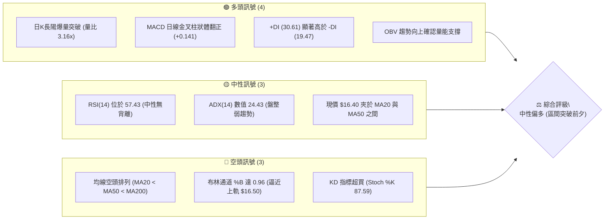
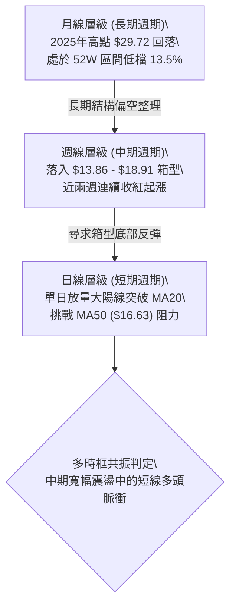
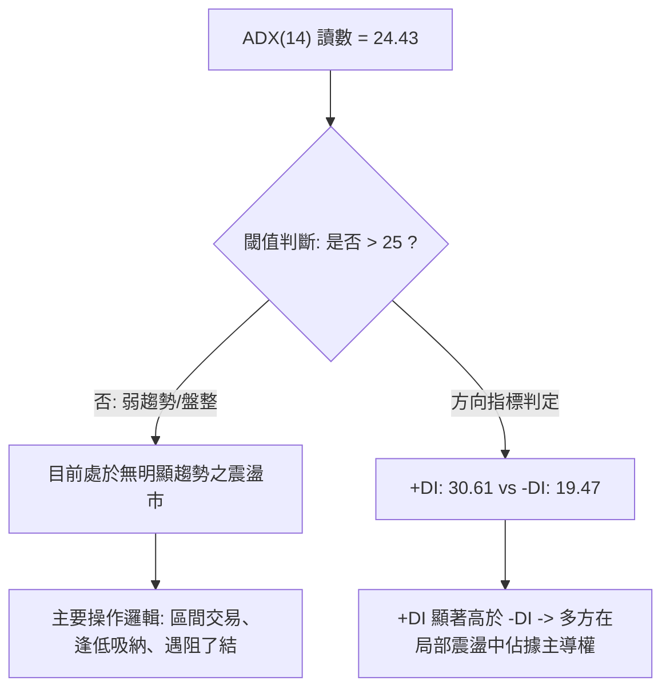
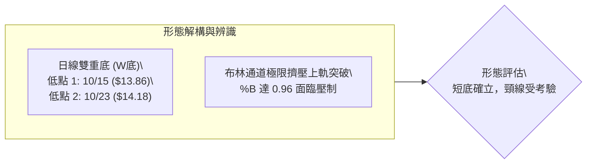
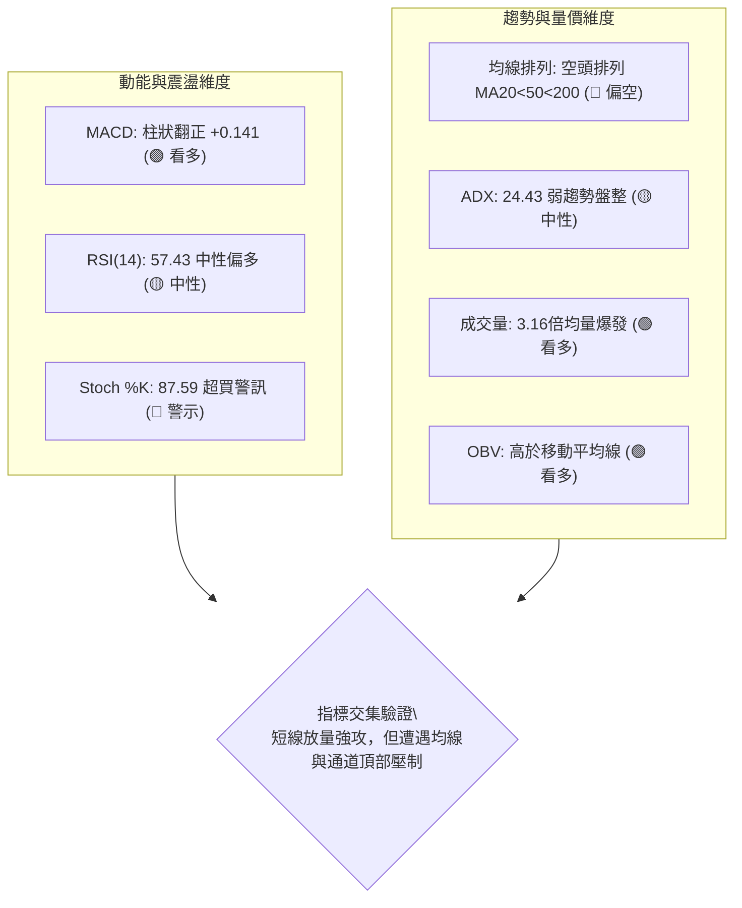
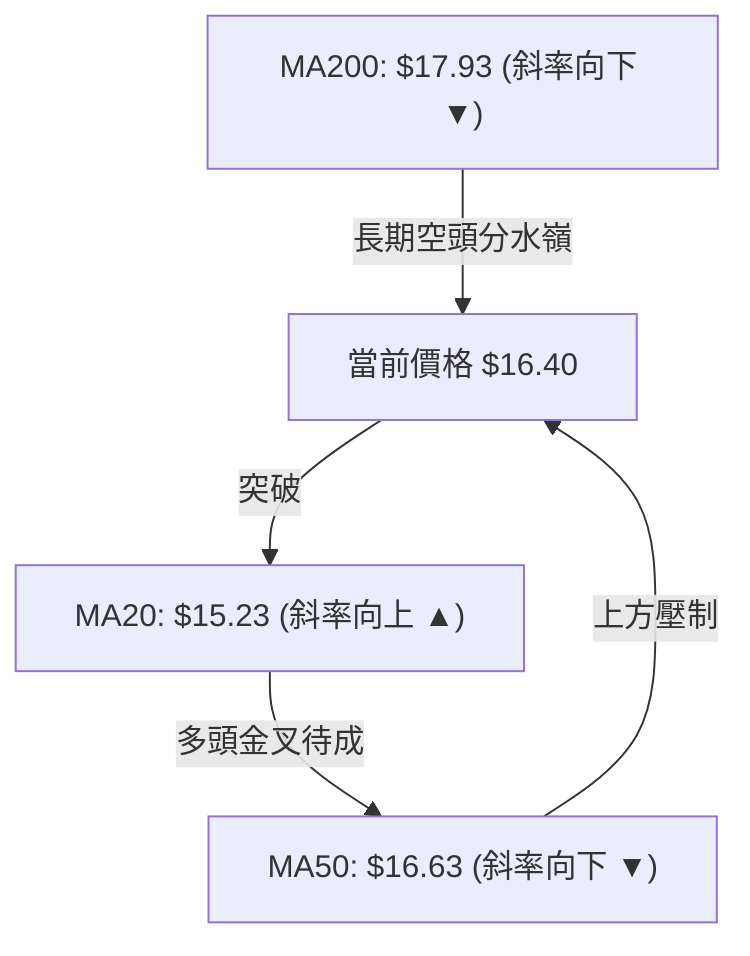
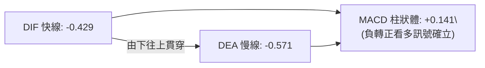
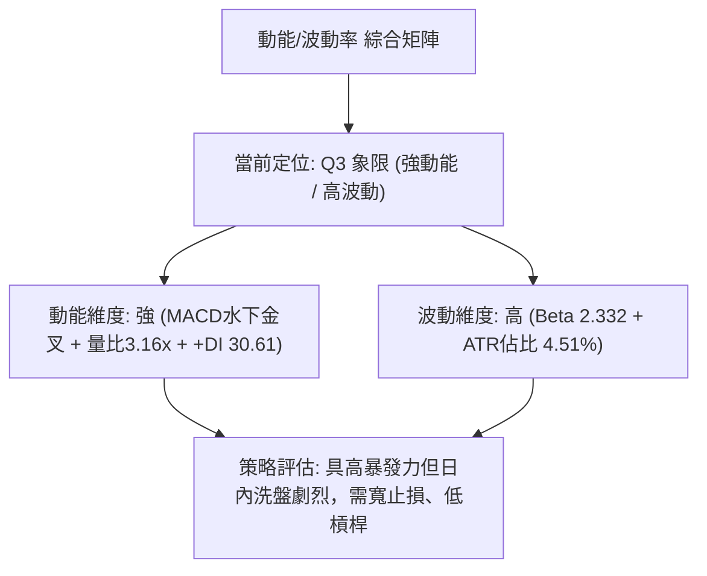
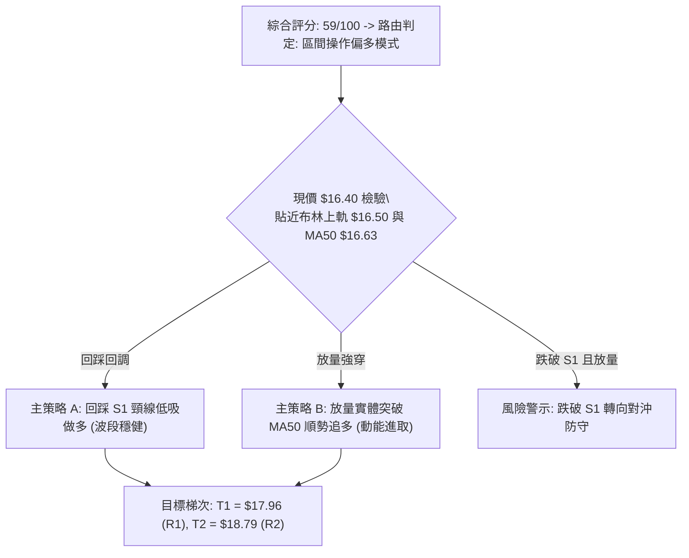
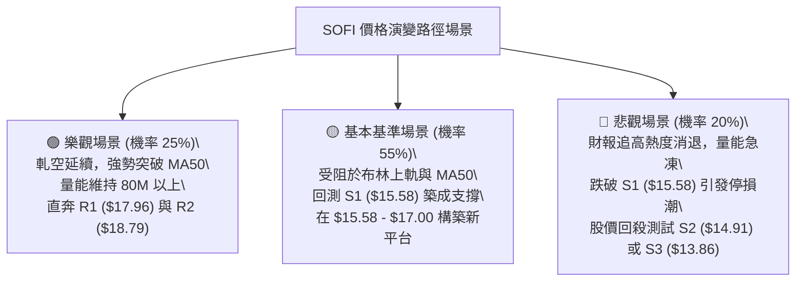

# SOFI 技術分析報告

> **報告日期**：2026-10-28 ｜ **語言**：繁體中文 ｜ **數據來源**：Yahoo Finance ｜ **當前價格**：$16.40

---

## 目錄

| 章節 | 內容 |
|------|------|
| [1. 技術面概覽](#1-技術面概覽) | 訊號儀表板、核心指標、評分卡 |
| [2. 趨勢分析](#2-趨勢分析) | 多時框趨勢、長中短期走勢、ADX解讀 |
| [3. 圖表形態分析](#3-圖表形態分析) | 形態識別、K線組合、目標價計算 |
| [4. 支撐與阻力](#4-支撐與阻力) | 關鍵價位、斐波那契回調結構 |
| [5. 技術指標深度解讀](#5-技術指標深度解讀) | MA/RSI/MACD/布林/成交量量價配合 |
| [6. 動能與波動率](#6-動能與波動率) | 動能四象限、ATR波動分析、Beta屬性 |
| [7. 多時框架總結](#7-多時框架總結) | 時框架矩陣、多時框收斂唯一結論 |
| [8. 交易策略建議](#8-交易策略建議) | 策略路由、階梯情境、風報比精算 |
| [9. 風險提示與監控](#9-風險提示與監控) | 監控Checklist、情境分析、風控準則 |

---

## 1. 技術面概覽

### 🎯 技術訊號儀表板



---

### 📊 核心指標速覽表

| 指標類別 | 指標名稱 | 當前數值 | 訊號 | 專業解讀 |
|:---|:---|:---|:---:|:---|
| **基準價格** | 收盤價 | $16.40 | 🟢 | 單日大漲強勢收於高檔，脫離 52 週低點區間 |
| **短期均線** | MA20 | $15.23 | 🟢 | 價格位於 MA20 上方 (+7.71%)，短多動能確立 |
| **中期均線** | MA50 | $16.63 | 🔴 | 價格位於 MA50 下方 (-1.38%)，即將面臨蓋頭反壓 |
| **長期均線** | MA200 | $17.93 | 🔴 | 價格位於 MA200 下方 (-8.53%)，長期牛熊分水嶺壓制 |
| **動能指標** | RSI(14) | 57.43 | 🟡 | Wilder 平滑指標處於中性健康偏多區，無頂底背離 |
| **趨勢動能** | MACD(12,26,9) | Hist: +0.141 | 🟢 | DIF (-0.429) 向上貫穿 DEA (-0.571)，紅柱擴大 |
| **擺動指標** | Stoch %K / %D | 87.59 / 50.16 | 🔴 | %K 進入 >80 極端超買區，短線追高面臨回洗震盪 |
| **趨勢強度** | ADX(14) | 24.43 | 🟡 | ADX < 25 屬無強烈單邊趨勢之盤整行情，區間博弈為主 |
| **通道指標** | Bollinger Bands | 上軌 $16.50 / %B 0.96 | 🟡 | 價格觸及布林通道上軌，短線波動擠壓進入臨界點 |
| **量能指標** | 成交量 / 均量比 | 160.66M / 3.16x | 🟢 | 財報公布引發巨量換手，價漲量增驗證資金實質介入 |
| **波動風險** | ATR(14) | $0.74 (4.51%) | 🟡 | 日內平均振幅較高，止損空間需預留足夠寬度 |

---

### 🏆 技術評分卡

```
╔══════════════════════════════════════════════════════════════════════╗
║                    技術評分卡 — SOFI (2026-10-28)                    ║
╠══════════════════════════════════════════════════════════════════════╣
║  趨勢強度      ██████████░░░░░░░░░░    48/100  🟡  (ADX 24.43 弱趨勢) ║
║  動能指標      ████████████░░░░░░░░    62/100  🟢  (MACD金叉，RSI中性)║
║  支撐穩定度    ██████████████░░░░░░    68/100  🟢  (52W低點13.86夯實) ║
║  成交量配合    ████████████████░░░░    82/100  🟢  (爆量3.16倍量能確認)║
║  形態完整度    ███████████░░░░░░░░░    55/100  🟡  (築底完畢衝擊頸線) ║
║  均線排列      ████████░░░░░░░░░░░░    39/100  🔴  (空頭排列仍待扭轉) ║
╠══════════════════════════════════════════════════════════════════════╣
║  綜合評分      ████████████░░░░░░░░    59/100  ⚖️  中性偏多 (區間操作)║
╚══════════════════════════════════════════════════════════════════════╝
```
> *註：綜合評分由六項維度之算術平均計算：(48 + 62 + 68 + 82 + 55 + 39) ÷ 6 = 59.0，四捨五入取整為 59/100（符合規則 18）。*

---

## 2. 趨勢分析

### 🌐 多時框趨勢分析



---

### 📈 長期趨勢 — 12個月走勢圖（ASCII）

以月線收盤價為基準，繪製過去 12 個月（2025-11 至 2026-10）價格演變軌跡：

```
SOFI 月線走勢圖（過去12個月歷史收盤軌跡）
價格軸 ($)
$30.00 ┤ ● (2025-11: $29.72 高點)
$27.00 ┤    ● (12月: $26.18)
$24.00 ┤       ● (01月: $22.81)
$21.00 ┤
$18.00 ┤          ●(02月: $17.76)──●(05月: $18.22)──●(08月: $17.88)
$15.00 ┤             ●(03月: $15.88)                  ●   ●(現價: $16.40)
$12.00 ┤                                              (09月: $15.72)
       └─────────────────────────────────────────────────────────────
        11   12   01   02   03   04   05   06   07   08   09   10  (月份)
```

#### 長期走勢特徵分析表格

| 階段區間 | 時間跨度 | 起訖收盤價 | 漲跌幅 | 結構性技術特徵 |
|:---|:---:|:---:|:---:|:---|
| **主跌推動浪** | 2025-11 → 2026-03 | $29.72 → $15.88 | -46.57% | 自牛市峰值直線回落，跌破各級均線，市場去槓桿顯著 |
| **平台築底區** | 2026-04 → 2026-08 | $16.10 → $17.88 | +11.06% | 圍繞 $17.00 樞軸窄幅震盪，成交量逐步萎縮沉澱 |
| **次級探底浪** | 2026-08 → 2026-09 | $17.88 → $15.72 | -12.08% | 跌破夏季整理平台，加速下探測試 52 週最低點 $13.86 |
| **動能重啟浪** | 2026-09 → 2026-10 | $15.72 → $16.40 | +4.33% | 於 $13.86 處完成 V 型反轉，財報放量確認短期底部 |

---

### 📊 中期趨勢（週線分析）

中期走勢呈現典型的大型區間箱型震盪，上檔受制於波段聚類阻力 R1 ($17.96)，下檔受到波段低點支撐聚類 S3 ($13.86) 強力防守。

```
週線箱型結構示意圖：
 $18.79 ── R2 次級阻力 ──────────────────────────────
 $17.96 ── R1 箱型頂部/78.6%斐波回調位 (強阻力區) ──
          ▲
          │ 中期反彈動能推升 (週 MACD 翻正 +0.141)
          │ 當前現價 $16.40 (貼近 MA50 反壓)
          ▼
 $15.58 ── S1 箱型中樞/日線支撐 ──────────────────────
 $13.86 ── S3 52週絕對底部 (雙重底支撐，極強) ────────
```

近 20 週數據顯示，MACD 柱狀體於 2026-10-16 當週落入谷底 (-0.080)，隨後於 10-23 轉正至 +0.010，本週進一步放大至 +0.141，週線動能進入多頭修復期。

---

### ⚡ 趨勢強度評估（ADX 解讀）



#### ADX 趨勢強度對照表

| ADX 數值區間 | 當前數值 | 趨勢狀態判定 | 交易策略導向 | 權重信號 |
|:---:|:---:|:---|:---|:---:|
| 0 – 20 | — | 極弱無趨勢 | 網格交易、觀望 | ⚪ |
| **20 – 25** | **24.43** | **弱趨勢 / 盤整邊界** | **通道區間操作，嚴控追高風險** | 🟡 |
| 25 – 40 | — | 強烈單邊趨勢 | 順勢突破交易、均線追蹤 | 🟢 |
| 40 – 60 | — | 極強極端行情 | 趨勢持股、分批停利保護 | 🔴 |

> **核心結論**：ADX 數值 24.43 表明市場尚未形成穩固的中長期單邊多頭趨勢，日線暴漲屬於「箱體內的均值回歸強脈衝」，交易不可依賴盲目突破追單，而應依布林通道與既定水平位執行防守型策略。

---

## 3. 圖表形態分析

### 🔍 形態識別系統



#### 形態識別與信心度評估表

| 識別形態名稱 | 信心度 (%) | 判斷依據（嚴格引用數據） | 當前完成度 | 形態目標價（推算公式與引用） |
|:---|:---:|:---|:---:|:---|
| **日線雙底 (W底)** | **72%** | 2026-10-15 觸及最低點 $13.86 (S3)，隨後反彈至 10-16 高點 $15.54 (頸線參考)，二次探底 10-23 低點 $14.18 未破前低，10-27 放量突破 $15.54。 | 85% | 頸線 $15.54 + 形態高度 ($15.54 - $13.86 = $1.68) = **$17.22** |
| **中期寬幅箱型** | **65%** | 區間下緣錨定 S3 ($13.86)，區間上緣多次止步於夏季高點群 R1 ($17.96)，價格處於自下向上的反彈路徑。 | 60% | 箱型上軌壓力位：**$17.96** (直接引用 R1) |
| **頭肩底形態** | **35%** | 數據中左肩與右肩對稱週期不足，且無明確右肩構築蓄勢區間。 | 20% | *訊號不足，僅做指標型解讀（規則 15）* |

---

### 🕯️ 重要 K 線形態分析

嚴格依據數據中「近 10 根日 K」與「近 8 根週 K」實際數據判讀：

#### 近 10 根日 K 棒結構解析

| 日期 | 開盤價 | 最高價 | 最低價 | 收盤價 | K 線形態識別 | 專業技術解讀 | 訊號強度 |
|:---:|:---:|:---:|:---:|:---:|:---|:---|:---:|
| **2026-10-14** | 14.92 | 15.04 | 13.92 | 14.22 | 破位中陰線 | 實體跌破 $14.50 整理平台，下影線初探 $13.92 | 🔴 |
| **2026-10-15** | 13.89 | 15.13 | 13.86 | 15.09 | 長下影長陽棒 (大敵錘頭) | 開盤探至 52W 低點 $13.86 後強勁拉升收復失土，長多護盤 | 🟢🟢 |
| **2026-10-16** | 15.07 | 15.54 | 14.33 | 14.55 | 長上影倒轉十字 | 向上測試 $15.54 頸線位承壓，獲利回吐盤湧現 | 🟡 |
| **2026-10-19** | 14.75 | 14.76 | 14.27 | 14.30 | 窄幅陰線 | 縮量拉回，波動幅度劇烈收窄，多空觀望 | ⚪ |
| **2026-10-20** | 14.20 | 14.99 | 14.18 | 14.68 | 穿頭破腳小陽線 | 開盤回踩 $14.18 後向上收高，次級底部支撐浮現 | 🟢 |
| **2026-10-21** | 14.84 | 15.11 | 14.65 | 14.90 | 孕線小陽線 | 圍繞 $14.80 均線中樞微幅整理，量能持續萎縮 | ⚪ |
| **2026-10-22** | 14.57 | 15.07 | 14.57 | 14.77 | 實體極窄陀螺頂 | 盤中多空拉鋸，收盤貼近開盤，築底蓄勢待發 | ⚪ |
| **2026-10-23** | 14.55 | 14.71 | 14.23 | 14.61 | 測試低點陽十字 | 最低點 $14.23 完成右肩二次回踩，確認底部抬高 | 🟢 |
| **2026-10-26** | 14.53 | 14.67 | 14.40 | 14.46 | 變盤前極度窒息量陰線 | 全日振幅僅 $0.27，成交量僅 43.28M，暴風雨前的寧靜 | 🟡 |
| **2026-10-27** | 15.98 | 16.76 | 15.67 | 16.40 | **放量跳空光腳大陽線** | 財報利多驅動，開盤跳空跳過阻力，收盤爆量 1.6 億股定錨 | 🟢🟢🟢 |

#### 近 8 根週 K 棒結構解析

| 週截止日 | 開盤價 | 最高價 | 最低價 | 收盤價 | 週 K 形態 | 趨勢解讀 | 訊號強度 |
|:---:|:---:|:---:|:---:|:---:|:---|:---|:---:|
| **2026-09-11** | 18.22 | 18.35 | 16.93 | 17.32 | 破位長陰 | 自箱頂回落，實體摜破短期週均線 | 🔴 |
| **2026-09-18** | 17.00 | 17.75 | 16.53 | 16.96 | 弱勢下飄星 | 反彈乏力，收盤跌破 $17.00 整數關口 | 🔴 |
| **2026-09-25** | 17.46 | 17.96 | 16.20 | 16.58 | 長上影中陰線 | 衝高 $17.96 遇阻，空頭打壓動能強烈 | 🔴 |
| **2026-10-02** | 16.32 | 16.42 | 15.53 | 15.77 | 連續下挫陰棒 | 跌勢加速，跌向 S1 支撐帶 | 🔴 |
| **2026-10-09** | 15.77 | 16.19 | 15.25 | 15.80 | 下影小陽十字 | 下探 $15.25 初現支撐買盤 | 🟡 |
| **2026-10-16** | 15.47 | 15.68 | 13.86 | 14.55 | 長下影深水炸彈 | 創 52 週新低 $13.86 後強勁彈升，主力探底針 | 🟢🟢 |
| **2026-10-23** | 14.75 | 15.11 | 14.18 | 14.61 | 縮量整理低位星 | 探底後的消化週，波動收縮完成二次驗證 | 🟢 |
| **2026-10-27** | 14.53 | 16.76 | 14.40 | 16.40 | 大陽實體反轉棒 | 突破前兩週高點，吞噬過去三週跌幅，週反轉確立 | 🟢🟢🟢 |

---

### 📉 ASCII 走勢形態示意圖

```
SOFI 日線 W 底突破形態示意
價格 ($)
$17.22 ┤                                         ▲ [推算形態目標價 $17.22]
$16.76 ┤                                   ╭─● (10/27 當日最高)
$16.40 ┤                                   │   ● [現價收盤 $16.40]
$15.54 ┼───────●(10/16 頸線)─────────────┼─── [頸線突破水平線]
$15.00 ┤      ╭─╯   ╰╮                 ╭─╯
$14.50 ┤      │       ╰─●─●─●─●─●───╯ (右肩盤整區間 10/19-10/26)
$14.18 ┤      │                 ╰─● (10/23 右底 $14.18)
$13.86 ┴──────● (10/15 左底 $13.86)────────────────────────────
       └────────────────────────────────────────────────────────
        10-14  10-15  10-16 ... 10-22  10-23  10-26  10-27 (交易日)
```

---

### 🎯 形態目標價計算

依據標準幾何計算法：
1. **日線 W 底垂直度量**：
   - 頸線高點（引用 10-16 高點）= **$15.54**
   - 形態最低點（引用 10-15 低點 / S3）= **$13.86**
   - 垂直高度 $H = \$15.54 - \$13.86 = \$1.68$
   - **等距滿足目標價** $= \$15.54 + \$1.68 =$ **$17.22**
2. **中期阻力聚類重合**：
   - 若短線動能延伸突破 $17.22，下一波段目標直指波段高點阻力聚類 **R1 ($17.96)**，該位置亦高度重合 78.6% 斐波那契回調位 ($17.90)。

---

## 4. 支撐與阻力

### 🗺️ 關鍵價位分布圖（ASCII）

```
SOFI 價位結構分布圖（嚴格引用 OHLCV 計算聚類點位）
═════════════════════════════════════════════════════════════════════
$19.62 ║████████████████████████████████████████║ 強阻力 R3 (+19.62%)
$18.79 ║██████████████████████████████          ║ 阻力 R2 (+14.54%)
$17.96 ║████████████████████████████████████████║ 關鍵阻力 R1 (+9.51%)
$16.63 ║░░░░░░░░░░░░░░░░░░░░                    ║ 動態均線反壓 (MA50)
$16.40 ╠════════════════════════════════════════╣ ◄ 當前收盤價 ($16.40)
$15.58 ║▓▓▓▓▓▓▓▓▓▓▓▓▓▓▓▓▓▓▓▓▓▓▓▓▓▓▓▓            ║ 近期支撐 S1 (-5.03%)
$14.91 ║▓▓▓▓▓▓▓▓▓▓▓▓▓▓▓▓▓▓▓▓                    ║ 次級支撐 S2 (-9.09%)
$13.86 ║████████████████████████████████████████║ 52週鐵底 S3 (-15.49%)
═════════════════════════════════════════════════════════════════════
```

---

### 🚧 阻力位分析表

*嚴格引用數據「關鍵價位」區塊數值：*

| 阻力級別 | 準確價位 | 距現價空間 | 技術面形成依據 | 突破難度評估 | 戰略重要性 |
|:---:|:---:|:---:|:---|:---:|:---:|
| **R1** | **$17.96** | +9.51% | 近一年波段高點聚類、重合斐波那契 78.6% ($17.90) 與 MA200 ($17.93) | 🔴 極高 | 關鍵樞軸（多空分水嶺） |
| **R2** | **$18.79** | +14.54% | 2026 年夏季（8 月下旬）多次反彈之波段頂部密集成交區 | 🟡 中等 | 次級延伸目標 |
| **R3** | **$19.62** | +19.62% | 接近 MA240 ($19.52) 年線反壓，長期下降通道上軌 | 🔴 高 | 中期強阻力封頂區 |

---

### 🛡️ 支撐位分析表

*嚴格引用數據「關鍵價位」區塊數值：*

| 支撐級別 | 準確價位 | 距現價空間 | 技術面形成依據 | 守住機率評估 | 戰略重要性 |
|:---:|:---:|:---:|:---|:---:|:---:|
| **S1** | **$15.58** | -5.03% | 近一年波段低點聚類，重合 10-16 頸線高點 ($15.54) 形成極性轉換 | 🟢 75% | 短多生命線（回測必守） |
| **S2** | **$14.91** | -9.09% | 10 月中旬底部密集換手中樞，接近 MA10 ($14.80) 支撐 | 🟢 85% | 次級防禦緩衝區 |
| **S3** | **$13.86** | -15.49% | **52 週歷史最低價**，10-15 大敵錘頭腳部，年度最強買盤防線 | 🟢 95% | 系統性終極防線 |

---

### 📐 斐波那契回調位分析

依據 52 週極端區間（低點 **$13.86** → 高點 **$32.73**），數據精算之回調水平如下：

| 斐波那契比率 | 精確計算價位 | 與現價 ($16.40) 相對位置 | 技術意涵與結構判定 |
|:---:|:---:|:---:|:---|
| **0.0% (52W High)** | **$32.73** | +99.57% | 歷史週期高點，多頭長期遠景目標 |
| **23.6%** | **$28.28** | +72.44% | 強勢回調阻力 |
| **38.2%** | **$25.52** | +55.61% | 2025 年秋季整理平台底部 |
| **50.0%** | **$23.29** | +42.01% | 中長期對稱平衡中樞 |
| **61.8%** | **$21.07** | +28.48% | 黃金分割反彈關鍵阻力（黃金回調位） |
| **78.6%** | **$17.90** | +9.15% | **極深回調位**（高度共振 R1 $17.96 及 MA200 $17.93） |
| **100.0% (52W Low)**| **$13.86** | -15.49% | **基期起點**，年度大底 |

> **當前價位落點解讀**：
> 當前收盤價 **$16.40** 坐落於 **100.0% ($13.86)** 與 **78.6% ($17.90)** 之間。此區間屬於「深度折價修復區」。上方首要斐波那契強壓為 **78.6% ($17.90)**，距離現價僅 +9.15% 的空間，多方必須放量有效攻克此帶，方能打開通往 61.8% ($21.07) 的修復通道。

---

## 5. 技術指標深度解讀

### 🎛️ 指標訊號總覽



---

### 📈 移動平均線排列分析



#### 移動平均線詳細陣列解構

| 均線名稱 | 數值 | 價格與均線差距 | 均線走向 | 狀態評估 |
|:---|:---:|:---:|:---:|:---|
| **MA5** | $15.03 | +$1.37 (+9.12%) | ▲ 急促向上 | 短線超前噴發，乖離擴大 |
| **MA10** | $14.80 | +$1.60 (+10.82%) | ▲ 向上勾頭 | 短線支撐成形 |
| **MA20** | $15.23 | +$1.17 (+7.71%) | ▲ 底部翻揚 | 月線趨勢由空轉多 |
| **MA50** | $16.63 | -$0.23 (-1.38%) | ▼ 緩步下行 | 季線阻力近在咫尺 |
| **MA60** | $16.90 | -$0.50 (-2.94%) | ▼ 下行趨緩 | 蓄勢阻力區間 |
| **MA120** | $16.94 | -$0.54 (-3.20%) | ▼ 震盪下移 | 半年線長期反壓 |
| **MA200** | $17.93 | -$1.53 (-8.53%) | ▼ 穩定向下 | 牛熊分界線 |
| **MA240** | $19.52 | -$3.12 (-15.99%)| ▼ 緩慢走跌 | 年線強大引力 |

> **均線結構診斷**：目前長週期均線呈現典型的空頭排列（$15.23 < \$16.63 < \$17.93$）。然而，價格已一舉穿透 MA5、MA10、MA20，且短天期均線斜率向上翻揚，構成「均線空頭排列下的下飄突破（反彈初段）」。短線將在 **MA50 ($16.63)** 處遭遇多空初次硬碰硬。

---

### 📉 RSI(14) 分析

#### RSI 數值強度進度條
```
RSI(14) 讀數: 57.43 / 100
[0] ░░░░░░░░░░░░░░░░░░░░░░░░░░░░███████████████████████░░░░░░░░░░░░░░░░░░░░ [100]
     超賣區 (<30)              中性偏強區間 (57.43)           超買區 (>70)
```
- **數值解讀**：Wilder 演算法計算之 RSI(14) 當前位於 **57.43**，自 10 月中旬低谷（週線 34.7）快速回升，進入多方控盤區間（50–70）。
- **背離分析判讀**：檢驗近 20 根 K 棒走勢，10 月 15 日股價創下低點 $13.86 時 RSI 探底，隨後 10 月 27 日股價回升至 $16.40，RSI 亦同步推升至 57.43，走勢節奏吻合；因此，明確判定**無任何頂背離或底背離**現象，動能數據真實反映目前價格脈衝。

---

### 📊 MACD(12, 26, 9) 訊號解讀



- **數值表現**：快線 DIF (-0.429) 高於慢線 DEA (-0.571)，差值紅柱擴大至 **+0.141**。
- **訊號特徵**：此交叉發生於零軸下方（水下金叉），屬於標準的「空頭市場次級反彈金叉」。水下金叉通常具備強烈的均值回歸推動力，首個目標通常奔向零軸（零軸對應之現貨價格約莫在 R1 $17.96 附近）。

---

### 📦 布林通道分析（ASCII 示意圖）

```
布林通道結構與現價相對位置 (20日參數, 2倍標準差)
═════════════════════════════════════════════════════════════
 $16.50 ──┬── 上軌 (BB Upper) ──────────────────────────────
          │   ▲
 $16.40 ──┼───● 當前現價 ($16.40, %B = 0.96, 極度逼近上軌)
          │
 $15.23 ──┼── 中軌 (MA20 Baseline) ─────────────────────────
          │
          │
 $13.96 ──┴── 下軌 (BB Lower) ──────────────────────────────
═════════════════════════════════════════════════════════════
```

- **通道帶寬與位置**：上軌 **$16.50**、中軌 **$15.23**、下軌 **$13.96**。
- **%B 深度解讀**：$\%B = (16.40 - 13.96) \div (16.50 - 13.96) = 0.96$。數值高達 0.96 代表價格已貼近通道頂部（96% 分位）。歷史統計顯示，在 ADX < 25 的盤整結構中，%B > 0.95 時通常伴隨拉回或橫盤消化，不宜在上軌處直接執行突破市價追買。

---

### 💹 成交量分析（量價配合度）

1. **成交量爆發倍數**：
   - 2026-10-27 當日成交量達到 **160,656,400 股**。
   - 對比 20 日均量 (50,822,560 股)，爆量倍數達 **3.16 倍**；對比 50 日均量 (46,582,368 股) 達 **3.45 倍**。
2. **量價關係判定**：
   - 單日大漲收長陽，伴隨 3 倍以上天量，符合經典「量增價揚」的強勢多頭特徵。
   - **OBV (能量潮)** 指標明確顯示：`OBV > MA`。資金呈現顯著淨流入狀態，機構法人的巨量回補徹底吸收了 10 月中旬以來的浮額籌碼，量能強烈確認價格走勢。

---

## 6. 動能與波動率

### ⚡ 動能評估四象限



#### 動能與波動象限對照表

| 象限標籤 | 動能維度 | 波動維度 | 當前所屬狀態 | 專業戰略評估 |
|:---:|:---:|:---:|:---:|:---|
| **Q1** | 強動能 | 低波動 | — | 穩健單邊牛皮走高，最理想加碼環境 |
| **Q2** | 弱動能 | 低波動 | — | 沉悶無聊盤整，建議場外觀望 |
| **Q3** | **強動能** | **高波動** | **✓ (SOFI 當前象限)** | **短期爆發力極強，但回撤劇烈，嚴守風報比紀律** |
| **Q4** | 弱動能 | 高波動 | — | 恐慌崩跌或失控洗盤，嚴禁進場介入 |

---

### 📊 ATR 波動率分析

- **ATR(14) 讀數**：精確值為 **$0.74**，佔當前股價之百分比高達 **4.51%**。
- **風險量化應用**：
  - **1 倍 ATR 波動區間**：$\pm \$0.74$（日內合理隨機游走空間為 $15.66 – $17.14）。
  - **動態止損距離制定**：考量 SOFI 屬於高貝塔品種，多頭進場之安全防守空間建議設定為 **1.5 至 2.0 倍 ATR**，即 **$1.11 至 $1.48** 的空間，以防止被盤中雜訊震盪洗出場外。

---

### 📐 Beta 與市場相關性

- **Beta 係數**：**2.332**。
- **市場敏感性評估**：SOFI 對大盤（標普 500 / 納斯達克）之波動敏感度為 2.33 倍。當大盤指數上揚 1% 時，該股預期上漲 2.33%；反之，大盤回檔時其跌幅亦加倍擴大。
- **空頭部位擠壓效應（Short Squeeze）**：空頭佔浮動股比例（Short % Float）達 **16.9%**，天數比（Short Ratio）為 **4.84 天**。財報帶動之跳空放量大漲已引發初步軋空，若能進一步穿透 MA50 ($16.63)，潛在軋空動能將推動股價向 R1 ($17.96) 狂飆。

---

## 7. 多時框架總結

### 📋 時框架評分表

| 時框架 | 趨勢方向 | 核心動能指標狀態 | 均線排列特徵 | 關鍵圖表形態 | 時框評分 | 戰略操作建議 |
|:---|:---:|:---|:---:|:---|:---:|:---|
| **短期 (日線)** | 🟢 多頭強攻 | MACD柱狀翻正 (+0.141) / Stoch超買 | MA5/10/20 向上拐頭，受制 MA50 | 突破日線 W 底頸線 ($15.54) | **72/100** | 待回踩支撐分批佈局 |
| **中期 (週線)** | 🟡 區間震盪 | 週 MACD 零下金叉 (+0.141) / RSI 57.4 | 位於週 20MA 下方，多週期打結 | 箱型下軌 ($13.86) 強勁反彈 | **58/100** | 箱型思維，高出低進 |
| **長期 (月線)** | 🔴 空頭承壓 | 過去一年累積回撤深，位於基期 13.5% | MA200 ($17.93) 呈現空頭排列壓制 | 自峰值 $29.72 下跌之大修復浪 | **45/100** | 長線右側信號尚未齊備 |

---

### 🔲 綜合訊號矩陣

| 技術分析維度 | 短期（日線級別） | 中期（週線級別） | 長期（月線級別） | 多時框一致性判定 |
|:---|:---:|:---:|:---:|:---|
| **趨勢強度 (ADX/方向)** | 🟢 短線多頭 (+DI 佔優) | 🟡 寬幅箱型震盪 | 🔴 長期下降通道抑制 | 衝突：由長空轉入中震盪、短反彈 |
| **動能狀態 (MACD/RSI)** | 🟢 強烈看多 (金叉放量) | 🟢 轉多 (紅柱擴大) | 🔴 動能甫脫離超賣低谷 | **短期與中期動能達成向上共振** |
| **量價結構 (Volume/OBV)** | 🟢 3.16倍均量爆發 | 🟢 週成交量明顯擴大 | 🟡 歷史天量後的換手整理 | 量能全面支持短中期修復行情 |

---

### ⚖️ 多時框收斂結論

> **依據規則 14 嚴格收斂**：
> 1. **行情性質定義**：當前 ADX(14) 讀數為 **24.43 (< 25)**，嚴格定義為**盤整行情（非單邊趨勢行情）**。
> 2. **主導收斂規則**：在盤整行情中，不可盲目套用長期趨勢突破模型，必須以**日線布林通道上下軌與既定水平位**為主要交易決策依據。
> 3. **唯一方向性結論**：**中性偏多（區間震盪逢低佈局）**。
>    雖然月線長週期仍受制於 MA200 ($17.93) 空頭排列，但日線爆量突破 W 底頸線，且週線 MACD 水下金叉形成共振。短線價格逼近布林上軌 ($16.50)，直接市價追高風險巨大，最優路徑為**等待價格回踩 S1 ($15.58) 支撐確認後順勢做多，向上博弈至箱型頂部 R1 ($17.96)**。

---

## 8. 交易策略建議

### 🗺️ 策略決策流程圖



---

### 🧭 策略路由

- **評分卡判定**：當前技術評分卡綜合評分為 **59/100**。
- **策略方向定錨**：**當前主策略方向 = 區間操作偏多策略（以回踩支撐確認與等待突破為主，評分 59/100）**。
  依據規則，在 40–60 區間震盪環境下，嚴禁兩頭下注；主推**逢低做多**，做空僅作為反向風控觸發提示。

---

### 🎯 價格情境階梯（Price Scenarios）

*所有價位嚴格引用第 4 章「關鍵價位」區塊數據：*

| 觸發條件 | 首要目標 | 後續延伸目標 | 情境實質技術含義 |
|:---|:---:|:---:|:---|
| **強勢突破 MA50 ($16.63)** | **R1 ($17.96)** | **R2 ($18.79)** | 軋空動能爆發，挑戰 78.6% 斐波那契回調位與 MA200 |
| **站穩現價區間 ($15.58 - $16.50)** | — | — | 於布林中軌與 MA50 之間進行區間強勢震盪消化 |
| **跌破短線支撐 S1 ($15.58)** | **S2 ($14.91)** | **S3 ($13.86)** | 假突破確認，重回箱型底部測試 52 週低點支撐 |

---

### 📊 情境機率分佈

| 運行情境 | 發生機率 | 主要技術與量化依據 |
|:---|:---:|:---|
| **震盪盤整後向上攻堅 (繼續反彈)** | **55%** | MACD 柱狀翻正 (+0.141)、量比 3.16 倍驗證巨量換手、+DI (30.61) 佔優 |
| **通道內區間震盪消化** | **30%** | ADX (24.43) 未跨越 25、Stoch (%K 87.59) 處於高檔超買需要拉回鈍化 |
| **反轉向下深幅破位 (再探底)** | **15%** | 均線長空格局未除，若大盤系統性下挫，高 Beta (2.332) 易放大回撤 |

---

### 🟢 主策略詳情

*依據規則 17，所有價位嚴格引用關鍵價位，進場價若為區間以中點精算風報比：*

| 策略維度要素 | 策略 A（穩健型：回踩支撐低吸多單） | 策略 B（進取型：突破確認順勢多單） |
|:---|:---|:---|
| **策略核心邏輯** | 股價逼近布林上軌，等待回測頸線 S1 確認支撐有效 | 帶量突破 MA50 與上軌反壓，順應軋空動能追擊 |
| **具體進場條件** | 股價回踩 S1 獲得支撐，日 K 出現下影線或止跌陽線 | 日 K 收盤價明確站上 MA50 ($16.63) 之上且量能維持高檔 |
| **進場價格** | **$15.58**（精確引用 S1 支撐位） | **$16.65**（突破 MA50 $16.63 後之掛單進場價） |
| **目標價 T1** | **$17.96**（精確引用阻力位 R1） | **$17.96**（精確引用阻力位 R1） |
| **目標價 T2** | **$18.79**（精確引用阻力位 R2） | **$18.79**（精確引用阻力位 R2） |
| **嚴格止損價格** | **$14.91**（精確引用支撐位 S2，跌破宣告失守） | **$15.58**（精確引用支撐位 S1，跌破視為假突破） |
| **風險報酬比 (T1)** | **1 : 3.55（以 T1 計）** <br>*計算式: (17.96 - 15.58) ÷ (15.58 - 14.91) = 2.38 ÷ 0.67* | **1 : 1.22（以 T1 計）** <br>*計算式: (17.96 - 16.65) ÷ (16.65 - 15.58) = 1.31 ÷ 1.07* |
| **風險報酬比 (T2)** | **1 : 4.79（以 T2 計）** <br>*計算式: (18.79 - 15.58) ÷ (15.58 - 14.91) = 3.21 ÷ 0.67* | **1 : 2.00（以 T2 計）** <br>*計算式: (18.79 - 16.65) ÷ (16.65 - 15.58) = 2.14 ÷ 1.07* |
| **評估勝率** | **65%** | **52%** |
| **建議分配倉位** | **總資金之 15% - 20%** | **總資金之 8% - 10%** |

---

### 🔴 反向風險觸發點（對沖與撤退提示）

若出現以下訊號，宣告當前多頭反彈邏輯瓦解，多單必須無條件止損離場，甚至啟動反向避險保護：
1. **關鍵價位跌破**：日 K 收盤價跌破 **S1 ($15.58)**，且次日無法收復，代表財報大陽線遭全數吞噬（形成假突破）。
2. **動能死叉轉向**：日線 MACD 柱狀體由正翻負（跌破 0 軸），且 RSI(14) 跌破 45 中軸。
3. **終極風控防線**：盤中若跌破 **S2 ($14.91)**，空頭將直接挑戰 52 週大底 **S3 ($13.86)**，所有中短線多頭部位必須全數清空。

---

### ⭐ 整體訊號強度評星

```
做多訊號強度：★★★★☆  (4/5星)  — 爆量大陽確立底部，動能翻正
做空訊號強度：★★☆☆☆  (2/5星)  — 僅具備均線空頭反壓，勝率偏低
整體可信度：  ★★★★☆  (4/5星)  — 成交量與形態學多維印證
```

---

## 9. 風險提示與監控

### ✅ 關鍵監控指標 Checklist

```
╔══════════════════════════════════════════════════════════════════════╗
║                   每日盤面重點監控 Checklist                         ║
╠══════════════════════════════════════════════════════════════════════╣
║ [ ] 價位檢驗: 收盤價是否能站穩 MA50 ($16.63) 之上？                  ║
║ [ ] 支撐防守: 回檔是否嚴格守住 S1 ($15.58) 頸線極性轉換區？          ║
║ [ ] 通道監控: 布林通道 %B 是否在 >0.96 發生超買鈍化或強勢開口？     ║
║ [ ] 量能跟進: 日成交量是否能維持在 20日均量 (50.82M) 以上？          ║
║ [ ] 擺動指標: Stoch %K (87.59) 是否在高檔出現死叉向下跌破 80？      ║
║ [ ] 大盤關聯: 納斯達克走勢（SOFI Beta 達 2.332，警惕大盤系統性回檔） ║
╚══════════════════════════════════════════════════════════════════════╝
```

---

### ⚠️ 風險場景分析



---

### 🛡️ 風險管理重要提醒

1. **高貝塔波動控管**：SOFI Beta 值為 **2.332**，日內波動率 ATR 高達 **$0.74 (4.51%)**。嚴禁使用過高槓桿或融資操作，單筆交易虧損上限應嚴格限制於總投資組合淨值的 **1.0% 至 1.5%** 範圍內。
2. **財報後獲利了結與假突破陷阱**：10 月 27 日單日大漲 13% 伴隨 1.6 億股成交量，但目前布林通道 %B 達 0.96 且 Stoch 處於 87.59 極端超買。次日極易出現「獲利回吐長上影線」或「開高走低黑 K」進行籌碼清洗，切忌在盤前或開盤第一時間追高。
3. **空頭排列均線引力**：長期均線 MA200 ($17.93) 依舊呈現下行趨勢，所有向上的拉升本質上仍屬於「反彈浪」而非「反轉牛市浪」。在股價未有效放量站上 R1 ($17.96) 之前，一律以區間波段心態應對，切忌長線盲目死扛。

---

## 📋 報告總結

```
╔══════════════════════════════════════════════════════════════════════╗
║                     SOFI 技術分析報告總結                            ║
╠══════════════════════════════════════════════════════════════════════╣
║  報告日期：2026-10-28                                                ║
║  當前價格：$16.40                                                    ║
║  技術評分：59 / 100                                                  ║
║  分析評級：⚖️ 中性偏多（區間向上突破前夕，逢低佈局）                ║
╠══════════════════════════════════════════════════════════════════════╣
║  關鍵架構結論：                                                      ║
║  ├─ 長期趨勢：🔴 空頭排列壓制（MA200 $17.93 穩定向下）               ║
║  ├─ 中期趨勢：🟡 寬幅箱型震盪（$13.86 至 $17.96 箱體運作）           ║
║  ├─ 短期趨勢：🟢 放量突破強攻（日線雙底成形，MACD 水下金叉確立）     ║
║  ├─ 關鍵支撐：S1: $15.58  ｜  S2: $14.91  ｜  S3: $13.86             ║
║  ├─ 關鍵阻力：R1: $17.96  ｜  R2: $18.79  ｜  R3: $19.62             ║
║  └─ 分析師目標：共識評級 Hold / 平均目標價 $20.22                    ║
╠══════════════════════════════════════════════════════════════════════╣
║  最優交易策略組合：                                                  ║
║  1. 🥇 最佳機會（策略 A）：等待股價回踩 S1 ($15.58) 頸線支撐介入做多  ║
║     - 進場：$15.58 ｜ 止損：$14.91 ｜ 目標 T1：$17.96                ║
║     - 風險報酬比：1 : 3.55（以 T1 計）                               ║
║  2. 🥈 次選機會（策略 B）：強勢放量突破 MA50 ($16.63) 後輕倉追買     ║
║     - 進場：$16.65 ｜ 止損：$15.58 ｜ 目標 T1：$17.96                ║
║     - 風險報酬比：1 : 1.22（以 T1 計）                               ║
║  3. 🥉 保守選擇：完全空倉觀望，等待日線 Stoch %K 自超買區降溫回落    ║
║     再行依據布林中軌 MA20 ($15.23) 佈局中長線底倉                   ║
╚══════════════════════════════════════════════════════════════════════╝
```

---

> ⚠️ **免責聲明**：本報告為 AI 自動生成之技術分析，所有數據及估算均嚴格基於所提供的歷史價格與市場資訊。本報告**僅供研究與學術參考**，**不構成任何形式的投資建議、買賣邀約或推薦**。金融市場瞬息萬變，高貝塔品種具有較高市場風險，投資人應獨立評估自身財務狀況與風險承受能力，入市需謹慎。

---

*報告生成時間：2026-10-28 ｜ 數據來源：Yahoo Finance ｜ 分析框架：多時框收斂量化技術分析*