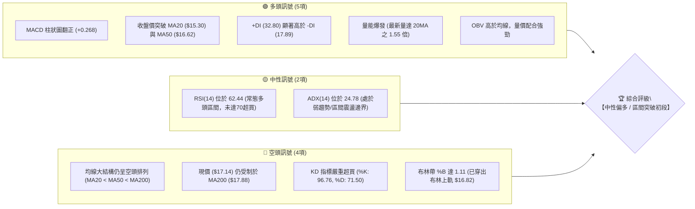
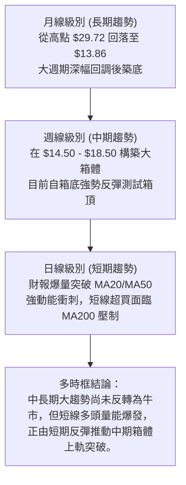
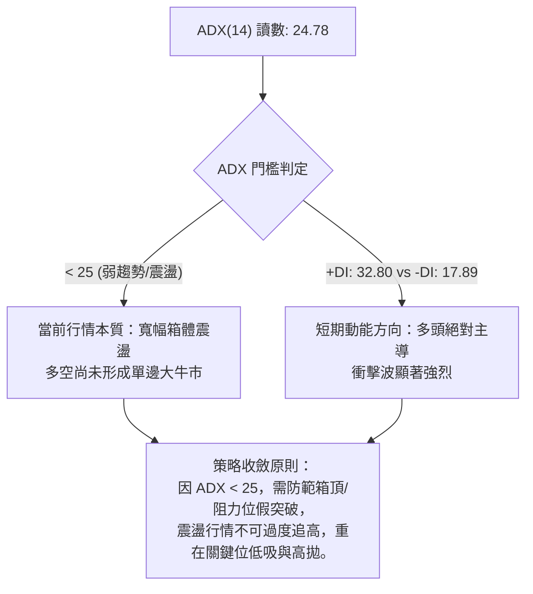
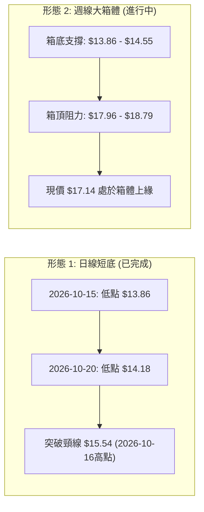
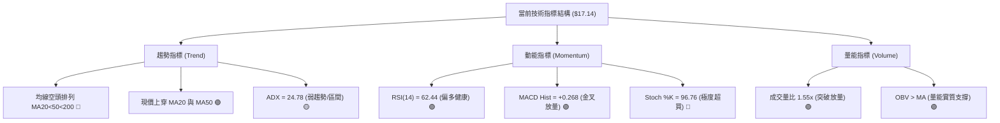
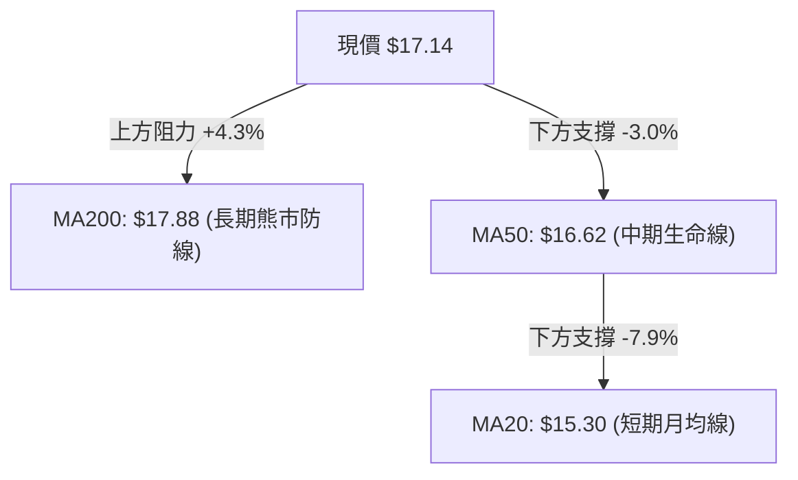
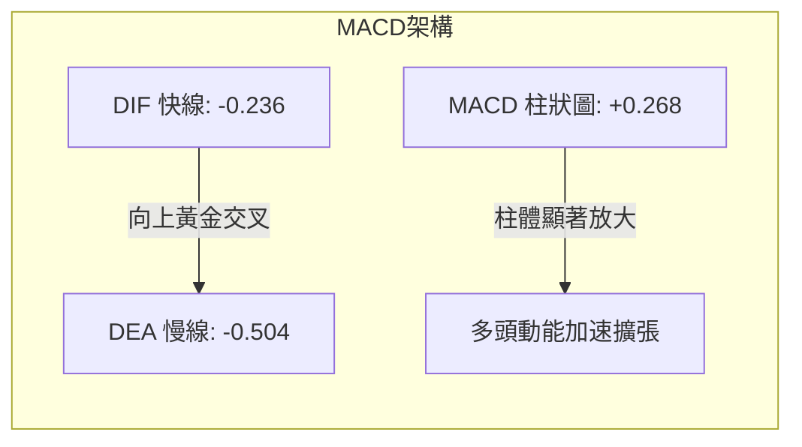
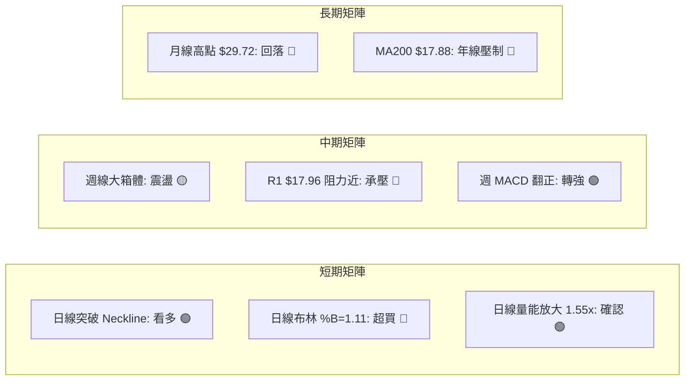
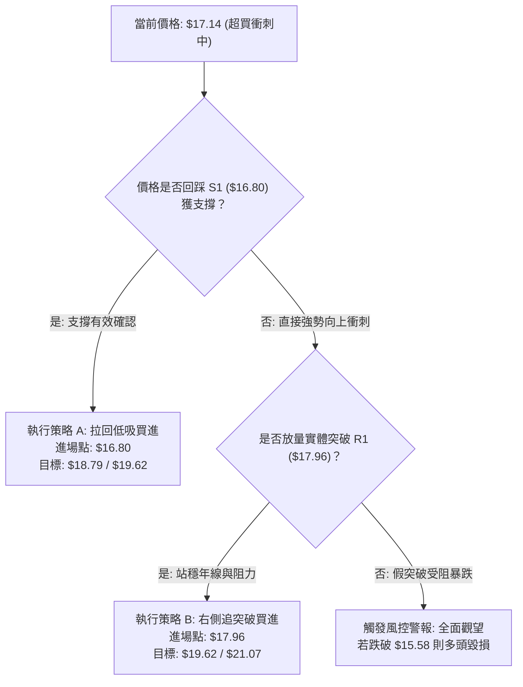
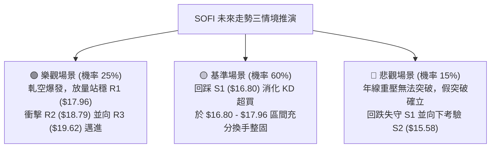

# SOFI 技術分析報告

> **報告日期**：2026-10-29 ｜ **語言**：繁體中文 ｜ **數據來源**：Yahoo Finance ｜ **當前價格**：$17.14

---

## 目錄

| 章節 | 內容 |
|------|------|
| [1. 技術面概覽](#1-技術面概覽) | 訊號儀表板、核心指標、評分卡 |
| [2. 趨勢分析](#2-趨勢分析) | 多時框趨勢、長中短期走勢、ADX解讀 |
| [3. 圖表形態分析](#3-圖表形態分析) | 形態識別、K線組合、目標價計算 |
| [4. 支撐與阻力](#4-支撐與阻力) | 關鍵價位、斐波那契回調結構 |
| [5. 技術指標深度解讀](#5-技術指標深度解讀) | 均線系統、RSI、MACD、布林通道、成交量 |
| [6. 動能與波動率](#6-動能與波動率) | 動能評估四象限、ATR、Beta與市場特徵 |
| [7. 多時框架總結](#7-多時框架總結) | 時框架評分矩陣、多時框收斂結論 |
| [8. 交易策略建議](#8-交易策略建議) | 策略路由、主策略詳情、風險報酬比 |
| [9. 風險提示與監控](#9-風險提示與監控) | 關鍵監控清單、情境分析、風控準則 |

---

## 1. 技術面概覽

### 🎯 技術訊號儀表板



---

### 📊 核心指標速覽表

| 指標類別 | 指標名稱 | 當前數值 | 訊號 | 專業解讀 |
|:---|:---|:---|:---:|:---|
| **價格** | 當前收盤價 | $17.14 | 🟢 | 近期自 $13.86 強勁反彈，位於52週區間 17.4% 位置 |
| **均線** | 短期 MA20 | $15.30 | 🟢 | 現價高於 MA20 達 +12.04%，短多格局確立 |
| **均線** | 中期 MA50 | $16.62 | 🟢 | 現價強勢收復 MA50 (+3.13%)，中期扣抵壓力緩解 |
| **均線** | 長期 MA200 | $17.88 | 🔴 | 現價低於 MA200 (-4.14%)，長期年線壓力位近在咫尺 |
| **動能** | RSI(14) | 62.44 | 🟡 | 進入多頭發力區，但尚未進入 >70 極端超買區間 |
| **動能** | MACD (12,26,9) | Hist: +0.268 | 🟢 | 快慢線負值區黃金交叉，多頭動能柱顯著擴張 |
| **震盪** | Stoch %K / %D | 96.76 / 71.50 | 🔴 | 進入極度超買區，存在技術性乖離修正回洗需求 |
| **通道** | 布林通道 (%B) | 1.11 | 🟡 | 破軌運行 (現價 $17.14 > 上軌 $16.82)，短期極端延展 |
| **趨勢** | ADX (14) | 24.78 | 🟡 | 低於 25 臨界線，定性為寬幅盤整中的動能爆發行情 |
| **量能** | 當日成交量 | 82,067,400 | 🟢 | 為 20 日均量 (52,875,375) 的 1.55 倍，量能支撐突破 |
| **波動** | ATR(14) | $0.75 | 🟡 | 每日波幅佔股價 4.36%，屬於高波動成長型標的 |

---

### 🏆 技術評分卡

```
╔══════════════════════════════════════════════════════════════╗
║                技術評分卡 — SOFI (2026-10-29)                ║
╠══════════════════════════════════════════════════════════════╣
║ 趨勢強度 (Trend)     ██████████░░░░░░░░░░  48/100   🟡 中性  ║
║ 動能指標 (Momentum)  ██████████████░░░░░░  68/100   🟢 偏多  ║
║ 支撐穩定 (Support)   ████████████░░░░░░░░  62/100   🟢 穩固  ║
║ 成交量能 (Volume)    ████████████████░░░░  78/100   🟢 強勁  ║
║ 形態結構 (Pattern)   ████████████░░░░░░░░  58/100   🟡 築底  ║
║ 均線架構 (Moving Avg)█████████░░░░░░░░░░░  46/100   🔴 承壓  ║
╠══════════════════════════════════════════════════════════════╣
║ 綜合評分 (Overall)   ████████████░░░░░░░░  60/100   🟡 偏多  ║
╚══════════════════════════════════════════════════════════════╝
```
> **計算依據（規則 18）**：綜合評分 = (48 + 68 + 62 + 78 + 58 + 46) ÷ 6 = 360 ÷ 6 = **60/100**。評級為「**🟡 中性偏多 / 區間突破初段**」。

---

## 2. 趨勢分析

### 🌐 多時框趨勢分析



---

### 📈 長期趨勢 — 12個月走勢圖（Unicode）

以下為 SOFI 過去 12 個月（2025年11月至2026年10月）月線收盤價走勢圖，清晰展示股價自波段歷史高點暴跌後於低檔築底的軌跡：

```
SOFI 月線收盤走勢圖（2025-11 至 2026-10）
價格軸 ($)
$29.72 ┤ ●(2025-11 峰值)
$27.00 ┤  ╲
$25.00 ┤   ●(2025-12: $26.18)
$23.00 ┤    ╲
$21.00 ┤     ●(2026-01: $22.81)
$19.00 ┤      ╲         ●(2026-05: $18.22)  ●(2026-08: $17.88)
$17.00 ┤       ●(02:$17.76)   ╲      ●(06:$17.93)   ╲        ●(現價: $17.14)
$15.00 ┤        ╲              ●(04:$16.10)          ●(07:$16.31) ●(09:$15.72)
$13.00 ┤         ●(2026-03: $15.88)
       └─┬──┬──┬──┬──┬──┬──┬──┬──┬──┬──┬──┬─────────────────────
        11 12 01 02 03 04 05 06 07 08 09 10  (月份: 2025-11 至 2026-10)
```

#### 走勢特徵階段性分析表

| 階段時間 | 區間收盤價 | 累計漲跌幅 | 走勢特徵與結構意涵 |
|:---|:---|:---:|:---|
| **2025-11 至 2026-03** | $29.72 → $15.88 | -46.57% | **主跌段**：自波段高點持續單邊下行，失守多道關鍵均線支撐。 |
| **2026-04 至 2026-06** | $16.10 → $17.93 | +11.37% | **第一波反彈構築**：在 $16.00 形成初步支撐，反彈受阻於 $18.00。 |
| **2026-07 至 2026-09** | $16.31 → $15.72 | -3.62% | **次級回踩確認**：持續在 $15.50 - $18.00 窄幅整理，籌碼反覆換手。 |
| **2026-10 (當前)** | $15.72 → $17.14 | +9.03% | **財報動能放量長紅**：探底 $13.86 後強勢回升，收復全月跌幅。 |

---

### 📊 中期趨勢（週線分析）

從近 20 週收盤走勢觀察，SOFI 在 2026 年下半年呈現明確的「**大箱體震盪**」格局：
- **上方阻力區**：集中於 $18.20 - $18.91（見 2026-07-10 收 $18.78、2026-08-21 收 $18.91）。
- **下方支撐區**：集中於 $14.50 - $15.50（見 2026-10-16 收 $14.55，最低見 $13.86）。

```
SOFI 週線箱體結構與近期波段示意圖
$19.62 ┤                                            [強阻力 R3]
$18.79 ┤      ●───────●                             [箱頂阻力 R2]
$17.96 ┤──────┼───────┼───────────────────────▲───── [關鍵阻力 R1 / MA200]
$17.14 ┤      │       │                       │ (現價衝刺中)
$16.80 ┤──────┼───────┼───────────────────────┴───── [支撐位 S1]
$15.58 ┤      │       │                             [支撐位 S2]
$14.55 ┤      │       ▼─────●                       [箱底強支撐]
$13.86 ┤      │             └─────●(52週低點)
       └──────┴─────────────┴───────────────────────
            2026-07       2026-09    2026-10
```

---

### ⚡ 趨勢強度評估（ADX 解讀）



#### ADX 數值強度對照表

| 指標變數 | 當前讀數 | 狀態級別 | 意涵與操作指引 |
|:---|:---:|:---:|:---|
| **ADX(14)** | 24.78 | 🟡 臨界弱趨勢 (<25) | 趨勢強度尚未成熟，目前屬箱體下軌到上軌的波段衝刺，並非單邊牛市。 |
| **+DI(14)** | 32.80 | 🟢 強勢多頭 | 短期買盤極為凶猛，多頭佔據絕對優勢。 |
| **-DI(14)** | 17.89 | 🟢 空頭退縮 | 空方力道快速減弱，空頭打壓暫時停歇。 |
| **多空差值** | +14.91 | 🟢 多頭擴張 | 動能差值顯著放大，支持股價挑戰更高阻力位。 |

---

## 3. 圖表形態分析

### 🔍 形態識別系統



#### 圖表形態信心度評估表（依規則 15）

| 形態名稱 | 信心度 | 判斷依據（引用數據） | 完成度 | 目標價（附嚴謹計算式） |
|:---|:---:|:---|:---:|:---|
| **日線雙重底 (W-Bottom)** | **75%** | 兩次低點分別為 10-15 的 $13.86 與 10-20 的 $14.18，頸線為 10-16 高點 $15.54。10-27 以 $16.40 放量突破頸線。 | **95%** | 形態高度 = $15.54 − $13.86 = $1.68。<br/>**測幅目標價** = $15.54 + $1.68 = **$17.22**。<br/>（現價 $17.14 已基本達成此目標） |
| **週線大箱體震盪** | **70%** | 近20週內多次在 $18.78 (7月) 及 $18.91 (8月) 見頂回落，並在 $14.55 (10月) 獲支撐。 | **80%** | 箱底 = S2 ($15.58) ~ 52W低點 ($13.86)；<br/>箱頂目標即為阻力位 **R1: $17.96** 與 **R2: $18.79**。 |
| **頭肩底 / 旗形** | **<50%** | 數據不足以確認完整右肩或延續旗形。 | N/A | **訊號不足，僅做指標型解讀**（依規則 15）。 |

---

### 🕯️ 重要K線形態分析

根據提供的「近10根日K」與「近8根週K」實際開高低收數據進行嚴格形態判斷：

| 日期（週期） | 開盤價 | 最高價 | 最低價 | 收盤價 | 成交量 | K線形態名稱 | 技術解讀與多空訊號 |
|:---|:---:|:---:|:---:|:---:|:---:|:---|:---|
| **2026-10-15 (日)** | $13.89 | $15.13 | $13.86 | $15.09 | 62.95M | **長下影長紅棒** | 🟢 觸及52週低點 $13.86 後強勁拉升，確立波段極限底部。 |
| **2026-10-16 (日)** | $15.07 | $15.54 | $14.33 | $14.55 | 59.58M | **高檔回吐黑棒** | 🔴 衝高至 $15.54 受阻回落，形成雙底形態之初始頸線高點。 |
| **2026-10-20 (日)** | $14.20 | $14.99 | $14.18 | $14.68 | 45.16M | **探底回升紅棒** | 🟢 最低見 $14.18 未破前低，確立第二隻腳（右腳較高）。 |
| **2026-10-26 (日)** | $14.53 | $14.67 | $14.40 | $14.46 | 43.29M | **窄幅整理紡錘線**| 🟡 量縮至近期低檔，籌碼高度沉澱，蓄勢待發。 |
| **2026-10-27 (日)** | $15.98 | $16.76 | $15.67 | $16.40 | 160.99M| **跳空突破長紅棒**| 🟢 財報利多爆出 1.6 億巨量，跳空越過頸線，確立波段主升。 |
| **2026-10-28 (日)** | $16.56 | $17.25 | $16.56 | $17.14 | 82.07M | **續攻實體陽線** | 🟢 延續強勢攻破 $17.00，收於高檔，但上影線顯示有微幅獲利壓。 |
| **2026-10-16 (週)** | $15.47 | $15.68 | $13.86 | $14.55 | 286.32M| **週線長下影槌頭**| 🟢 在 52W 低點爆量收長下影線，構成典型週線級別反轉錘。 |
| **2026-10-28 (週)** | $14.53 | $17.25 | $14.40 | $17.14 | 286.35M| **週線大實體長紅**| 🟢 單週大漲 +17.32%，完全包吞前兩週陰線，多頭轉向反攻。 |

---

### 📉 ASCII 走勢形態示意圖

```
SOFI 短期雙重底 (W-Bottom) 突破測幅示意圖
價格 ($)
$17.22 ┼ - - - - - - - - - - - - - - - - - - - - - - - ┬── 形態測幅目標 ($17.22)
$17.14 ┼                                      ●現價    │
$16.40 ┼                                 █             │ 形態等幅高度:
$15.54 ┼───────●(頸線高點 10-16)─────────█────────────┼── $1.68
$15.00 ┼       █                       █              │
$14.50 ┼       █        ●              █              │
$14.18 ┼       █        █    ●(右腳 10-20)            │
$13.86 ┼───────●(左腳 10-15)──────────────────────────┴── 波段起漲基點
       └───────┴────────┴────┴─────────┴───────────────
             10-15    10-16 10-20    10-27
```

---

## 4. 支撐與阻力

### 🗺️ 關鍵價位分布圖（Unicode）

```
SOFI 價位結構分布圖
══════════════════════════════════════════════════════════════════
$19.62 ║████████████████████████████████████████║ 強阻力 R3 (+14.45%)
$18.79 ║██████████████████████████████          ║ 中期箱頂阻力 R2 (+9.60%)
$17.96 ║████████████████████████████████████████║ 關鍵阻力 R1 / MA200 (+4.78%)
$17.14 ╠════════════════════════════════════════╣ ◄ 現價 (2026-10-28 收盤)
$16.80 ║▓▓▓▓▓▓▓▓▓▓▓▓▓▓▓▓▓▓▓▓                    ║ 近期支撐 S1 / BB上軌 (-1.98%)
$15.58 ║████████████████████████████████████████║ 強支撐 S2 / 前頸線區 (-9.13%)
$14.91 ║████████████████████                    ║ 深層波段支撐 S3 (-13.01%)
══════════════════════════════════════════════════════════════════
```

---

### 🚧 阻力位分析表

所有價位均嚴格引用提供之技術數據（波段高點聚類）：

| 阻力級別 | 精確價位 | 與現價距離 | 技術形成原因與特徵 | 突破難度 | 重要性 |
|:---|:---:|:---:|:---|:---:|:---:|
| **R1** | **$17.96** | +4.78% | 近一年波段高點聚類；極度接近長期 **MA200 ($17.88)** 與斐波那契 78.6% 回調位 ($17.90)。三線合一之重壓區。 | 🔴 極高 | ★★★★★ |
| **R2** | **$18.79** | +9.60% | 2026年7-8月兩次週線波段反彈高點（7月收 $18.78、8月收 $18.91）構成的中期大箱體頂部。 | 🟡 偏高 | ★★★★☆ |
| **R3** | **$19.62** | +14.45% | 上方強阻力位，對應 MA240 ($19.46) 長期均線壓力密集帶，多頭中期反轉終極防線。 | 🔴 極高 | ★★★☆☆ |

---

### 🛡️ 支撐位分析表

所有價位均嚴格引用提供之技術數據（波段低點聚類）：

| 支撐級別 | 精確價位 | 與現價距離 | 技術形成原因與特徵 | 守住機率 | 重要性 |
|:---|:---:|:---:|:---|:---:|:---:|
| **S1** | **$16.80** | -1.98% | 近一年波段低點聚類；同時高度吻合日線布林通道上軌 ($16.82) 與 MA60 ($16.87)。已由阻力轉化為短線第一道支撐。 | 🟢 70% | ★★★★☆ |
| **S2** | **$15.58** | -9.13% | 雙重底頸線突破位（10-16高點 $15.54）與 MA20 ($15.30) 共同構築的強支撐平台。 | 🟢 85% | ★★★★★ |
| **S3** | **$14.91** | -13.01% | 近期打底平台中軸，跌破則宣告多頭結構遭到嚴重破壞。 | 🟢 95% | ★★★☆☆ |

---

### 📐 斐波那契回調位分析

依據 52 週完整區間（最低點 $13.86 至 最高點 $32.73）計算之標準斐波那契回調水平如下：

| 回調比例 | 價位 | 當前相對位置與技術意義解讀 |
|:---|:---:|:---|
| **0.0% (52W High)** | **$32.73** | 週期最高峰值，長期牛市極限目標。 |
| **23.6%** | **$28.28** | 長期深幅套牢區間。 |
| **38.2%** | **$25.52** | 中長期牛熊分水嶺。 |
| **50.0%** | **$23.29** | 52週多空中間平衡中樞。 |
| **61.8%** | **$21.07** | 黃金分割重要防守阻力位。 |
| **78.6%** | **$17.90** | **關鍵壓制位**：現價落於 78.6% ($17.90) 與 100% ($13.86) 之間。 |
| **100.0% (52W Low)**| **$13.86** | 週期絕對低點，底背離打底起漲點。 |

> **深入解讀**：現價 **$17.14** 目前正處於自 $13.86 反彈以來的「**78.6% 回調壓制區下方**（$17.90）」。此位置與阻力位 **R1 ($17.96)** 及 **MA200 ($17.88)** 高度共振。若多頭無法有效突破 $17.90 - $17.96 區間，將受制於回調浪壓制並引發拉回測試。

---

## 5. 技術指標深度解讀

### 🎛️ 指標訊號總覽



---

### 📈 移動平均線排列分析



#### 均線系統綜合分析表

| 均線名稱 | 數值 | 價格相對位置 | 排列狀態 | 技術含義解讀 |
|:---|:---:|:---:|:---:|:---|
| **MA 5** | $15.48 | +10.74% | 向上發散 | 短線極速拉升，短線乖離率過高。 |
| **MA 10** | $15.09 | +13.58% | 向上發散 | 短期攻擊線強勁，構成第一道回踩均線。 |
| **MA 20** | $15.30 | +12.04% | 拐頭向上 | 突破月線，確立短線轉強。 |
| **MA 50** | $16.62 | +3.13% | 走平微揚 | 收復季線，化解中期加速破底風險。 |
| **MA 60** | $16.87 | +1.60% | 走平 | 貼近現價，提供即時動態支撐。 |
| **MA 120** | $16.95 | +1.11% | 走平 | 半年線位置，多空爭奪激烈。 |
| **MA 200** | $17.88 | -4.14% | 下行壓制 | **年線大關**，尚未站上；整體格局仍為 MA20<MA50<MA200 長期空頭架構。 |
| **MA 240** | $19.46 | -11.91% | 下行 | 長期下降趨勢壓制線。 |

---

### 📉 RSI(14) 分析

- **當前讀數**：**62.44**（Wilder 計算方法）。
- **數值進度條**：
  ```
  0 [░░░░░░░░░░░░░░░░░░░░█████████████████████░░░░░░░░░░░░░] 100
  超賣區 (<30)              常態多頭區 (62.44)       超買區 (>70)
  ```
- **區間分析**：RSI 自 10 月中旬的 34.7 一路飆升至當前的 62.44，脫離超賣區進入強勢多方控盤區間（50–70），顯示多方買盤力道充足，且尚未觸及 70 以上的過熱警戒線，動能具備健康延續空間。
- **背離判斷**：根據近 20 根 K 棒的首尾對比，價格由 $15.09 走高至 $17.14，RSI 亦同步由 30 水平拉升至 62.44，**確認無頂背離或底背離現象**，指標與價格保持同向確認。

---

### 📊 MACD(12,26,9) 訊號解讀

- **MACD 線**：-0.236
- **訊號線 (Signal)**：-0.504
- **柱狀圖 (Histogram)**：**+0.268**（🟢 強烈看多）


> **解讀**：雖然快慢線仍位於零軸下方（代表長期趨勢仍處弱勢週期），但 DIF 向上穿過 DEA 產生強勁「**零下黃金交叉**」，柱狀圖擴張至 +0.268，顯示低檔反彈動能正處於最強盛期。

---

### 📦 布林通道分析

- **布林上軌 (Upper Band)**：$16.82
- **布林中軌 (Middle Band / MA20)**：$15.30
- **布林下軌 (Lower Band)**：$13.78
- **通道指標 (%B)**：**1.11**（數值大於 1.0 表明已脫離上軌運行）

```
SOFI 布林通道與價格相對位置示意圖
價格 ($)
$17.14 ┼────────────────────────────── ●現價 ($17.14，破軌運行 %B=1.11)
$16.82 ┼- - - - - - - - - - - - - - - ┬── BB 上軌 ($16.82)
       │                              │
$15.30 ┼──────────────────────────────┼── BB 中軌 / MA20 ($15.30)
       │                              │
$13.78 ┼- - - - - - - - - - - - - - - ┴── BB 下軌 ($13.78)
```
> **解讀**：布林帶寬開口擴大，現價收於 $17.14，高於上軌 $16.82。短期內出現「通道外過度延展」，依統計學均值回歸原理，未來 1–3 個交易日內高機率拉回回踩上軌 $16.82 或於其上方震盪洗盤。

---

### 💹 成交量分析（量價配合度）

- **最新單日成交量**：82,067,400 股。
- **20日均量 (Volume MA20)**：52,875,375 股（**量比 1.55x**）。
- **50日均量 (Volume MA50)**：47,578,302 股。
- **OBV（能量潮）狀態**：**OBV > MA**，量能線持續走高。
- **量價配合評估**：10月27日財報跳空當日爆出 160,995,100 股的天量，10月28日續漲仍維持 8,200 萬股以上的充沛換手量。量能放大直接印證了買盤的主動攻擊性質，OBV 突破均線明確確認價格走勢，無量價背離跡象。

---

## 6. 動能與波動率

### ⚡ 動能評估四象限

```
動能與波動率象限分析 (SOFI 當前定位)
      高波動率 (High Volatility)
           │
     Q4    │    Q3 ★ SOFI 當前位置 (強動能 / 高波動)
 (弱動能/高波動)│ (ATR 4.36% / Beta 2.33 / MACD金叉放量)
           │
───────────┼─────────── 動能強度 (Momentum)
           │
     Q2    │    Q1
 (弱動能/低波動)│ (強動能/低波動)
           │
      低波動率 (Low Volatility)
```

| 象限 | 動能維度 | 波動維度 | SOFI 狀態 | 特徵與操作定位 |
|:---:|:---:|:---:|:---:|:---|
| **Q1** | 強 | 低 | — | 穩健突破（低風險高收益） |
| **Q2** | 弱 | 低 | — | 沉悶築底（觀望蓄勢） |
| **Q3** | **強** | **高** | **✓ 當前狀態** | **高爆發、高風險、高彈性**：動能充沛但回撤劇烈，嚴控部位規模。 |
| **Q4** | 弱 | 高 | — | 恐慌破位（避免介入） |

---

### 📊 ATR 波動率分析

- **ATR(14) 當前數值**：**$0.75**（佔股價比例高達 **4.36%**）。
- **歷史波動特徵**：單日平均真實波幅近 1 美元，意味著日內波動常態可達 4%–6%。
- **風控止損距離建議**：
  - **極短線交易**：1.0 × ATR = **$0.75** 緩衝空間。
  - **波段擺盪交易**：1.5 × ATR = **$1.13** 緩衝空間。
  - **趨勢保護防守**：2.0 × ATR = **$1.50** 緩衝空間。

---

### 📐 Beta 與市場相關性

- **Beta 係數**：**2.332**。
- **特徵解讀**：SOFI 的系統性市場敏感度極高，其波動彈性為標普500指數的 **2.33 倍**。
- **做空比率（Short Interest）**：**17.2% of Float**（Short Ratio 4.44 天）。
- **軋空潛力（Short Squeeze）**：空頭部位極重，一旦股價放量站上關鍵阻力 R1 ($17.96) 與 MA200，極易引發高達 4.44 天回補週期的軋空連鎖反應。

---

## 7. 多時框架總結

### 📋 時框架評分表

| 時框架 | 趨勢方向 | 動能狀態 | 均線排列 | 圖表形態 | 綜合評分 | 操作指引 |
|:---|:---:|:---:|:---:|:---:|:---:|:---|
| **日線 (短期)** | 🟢 強勢反彈 | 🟢 MACD金叉/放量 | 🟡 站上MA20/50 | 🟢 雙底突破完成 | **72/100** | 逢拉回支撐位找買點，不盲目追高。 |
| **週線 (中期)** | 🟡 箱體震盪 | 🟢 柱狀圖翻正 | 🔴 承壓於MA200下方 | 🟡 箱體衝刺上軌 | **56/100** | 關注箱頂 $17.96 - $18.79 壓力釋放。 |
| **月線 (長期)** | 🔴 熊市修復 | 🟡 低檔收斂 | 🔴 空頭排列 | 🔴 深跌築底階段 | **42/100** | 長期大底構築中，尚需時間化解套牢籌碼。 |

---

### 🔲 綜合訊號矩陣



---

### ⚖️ 多時框收斂結論（依規則 14 嚴格收斂）

1. **趨勢/盤整行情定性**：當前 **ADX(14) 讀數為 24.78 (< 25)**，嚴格判定當前市場本質仍屬於「**寬幅盤整震盪行情**」，尚未形成單邊單向牛市。
2. **主導時框優先級收斂**：
   - 根據規則 14，在 ADX < 25 的盤整震盪行情中，「**以日線布林通道上下軌與既定箱體為主要交易區間**」。
   - 目前日線收盤價 $17.14 已經越出布林上軌 ($16.82)，且上方僅距長期年線 MA200 ($17.88) 與波段阻力 R1 ($17.96) 僅 4.78%。
   - 日線超買訊號（KD: 96.76、%B: 1.11）與週線箱頂壓制產生共振。
3. **唯一方向性結論**：**【中性偏多，短線嚴禁追高，優先等待拉回確認支撐】**。
   - 綜合評分為 **60/100**，策略重心完全鎖定在「**偏多策略**」，但切入點必須等待價格自布林軌外回測支撐位 S1 ($16.80) 或確認帶量站穩 R1 ($17.96)。

---

## 8. 交易策略建議

### 🗺️ 策略決策流程圖



---

### 🧭 策略路由（依規則 18 綜合評分 60/100 分流）

> **當前主策略方向 = 🟢 偏多主導（依綜合評分 60/100 判定）**
> 因綜合評分達 60 分臨界標桿，主推多頭操作策略；空方不主動開倉，僅列為持股者之反轉對沖風控提示。

---

### 🎯 價格情境階梯（Price Scenarios）

所有價位均嚴格引用提供之技術數據（波段高低點與斐波那契）：

| 觸發條件 | 下一目標 | 後續延伸目標 | 情境技術含義 |
|:---|:---:|:---:|:---|
| **強勢突破 R1 ($17.96)** | **R2: $18.79** | **R3: $19.62** | 突破年線 MA200，引發 17.2% 空頭部位軋空，多頭中期反轉。 |
| **維持在現價區間震盪** | **$16.80 ~ $17.50** | — | 消化超買指標，於布林上軌附近高檔換手，蓄勢整理。 |
| **回檔跌破 S1 ($16.80)** | **S2: $15.58** | **S3: $14.91** | 乖離過大引發技術性回吐，回測突破頸線與 MA20/MA50。 |

---

### 📊 情境機率分佈

| 預期情境 | 發生機率 | 主要技術依據（引用指標狀態） |
|:---|:---:|:---|
| **拉回確認後再向上衝刺** | **55%** | MACD 柱狀圖顯著翻正 (+0.268)、成交量維持 1.55 倍放量、OBV > MA 量價配合，多頭具備持續推升底氣。 |
| **高檔強勢區間震盪** | **30%** | ADX = 24.78 (< 25 缺乏強趨勢)，上方 MA200 ($17.88) 重壓，使價格需在 $16.80 - $17.96 間震盪沉澱。 |
| **受阻深幅回落再探底** | **15%** | Stoch %K 高達 96.76 極度超買，若大盤系統性下行，可能引發均值回歸回測 S2 ($15.58)。 |

---

### 🟢 主策略詳情（精確數值計算，嚴格遵守規則 17）

所有價位精確引用 S1 ($16.80)、S2 ($15.58)、R1 ($17.96)、R2 ($18.79)、R3 ($19.62) 及 Fibo 61.8% ($21.07)：

| 策略要素 | 策略 A（左側/順勢：拉回支撐位低吸） | 策略 B（右側/動能：放量突破阻力追買） |
|:---|:---|:---|
| **進場條件** | 現價自超買區回踩支撐位 S1 獲支撐企穩 | 放量實體 K 棒向上突破並站穩阻力位 R1 / MA200 |
| **進場價格** | **$16.80**（S1 支撐位） | **$17.96**（R1 阻力位突破點） |
| **目標價 T1** | **$18.79**（R2 中期箱頂阻力） | **$19.62**（R3 強阻力位） |
| **目標價 T2** | **$19.62**（R3 強阻力位） | **$21.07**（斐波那契 61.8% 回調位） |
| **止損價格** | **$15.58**（S2 強支撐位，破頸線即止損） | **$16.80**（S1 原阻力轉化支撐，失守止損） |
| **風險報酬比** | **1 : 1.63（以 T1 計）**<br/>算式：($18.79 − $16.80) ÷ ($16.80 − $15.58)<br/>= $1.99 ÷ $1.22 = 1.631 | **1 : 1.43（以 T1 計）**<br/>算式：($19.62 − $17.96) ÷ ($17.96 − $16.80)<br/>= $1.66 ÷ $1.16 = 1.431 |
| **延伸風報比** | **1 : 2.31（以 T2 計）**<br/>算式：($19.62 − $16.80) ÷ $1.22 = 2.311 | **1 : 2.68（以 T2 計）**<br/>算式：($21.07 − $17.96) ÷ $1.16 = 2.681 |
| **成功機率預期** | **65%** | **55%** |
| **建議倉位管理** | **15% - 20%** 總風險資本 | **10% - 15%** 總風險資本 |

---

### 🔴 反向風險觸發點（對沖提示）

- **多單失效風控點**：若價格未能站穩 S1 ($16.80) 並進一步跌破 **S2 ($15.58)**，代表雙底突破屬假突破，多頭結構完全被空頭反撲瓦解，所有多頭部位應無條件止損離場。
- **對沖啟動訊號**：若價格衝擊 **R1 ($17.96)** 時出現日線長上影射擊之星且成交量萎縮，持股者應於 $17.96 附近減倉 50% 或買入等值保護性賣權（Protective Put）。

---

### ⭐ 整體訊號強度評星

```
做多訊號強度：★★★★☆  (4/5星：短線動能與量能爆發，但受制於年線壓制)
做空訊號強度：★★☆☆☆  (2/5星：逆勢做空風險極大，僅存技術超買回調空間)
整體可信度：  ★★★★☆  (4/5星：財報爆量與指標同向確認，數據一致性高)
```

---

## 9. 風險提示與監控

### ✅ 關鍵監控指標 Checklist

```
╔══════════════════════════════════════════════════════════════╗
║                   關鍵技術監控指標 CHECKLIST                 ║
╠══════════════════════════════════════════════════════════════╣
║ [ ] R1 阻力位攻防：觀察 $17.96 與 MA200 ($17.88) 的突破力道 ║
║ [ ] 布林收斂情況：確認現價能否回踩收斂至上軌 ($16.82) 之內  ║
║ [ ] KD 過熱降溫：監控 Stoch %K (96.76) 是否形成高檔死叉回洗 ║
║ [ ] 支撐 S1 防守：回踩 $16.80 時成交量是否萎縮（良性換手）   ║
║ [ ] 空頭回補動態：Short Float 17.2% 是否出現軋空量能暴增    ║
║ [ ] 終極防守基準：多頭波段生命線嚴格鎖定 S2 ($15.58) 頸線    ║
╚══════════════════════════════════════════════════════════════╝
```

---

### ⚠️ 風險場景分析



---

### 🛡️ 風險管理重要提醒

1. **極高波動性防護**：SOFI 之 Beta 高達 **2.332**，且 ATR 為 **$0.75 (4.36%)**，單日波動劇烈。建議單筆交易所承擔之本金損失上限不得超過總投資組合淨值的 **1.5%**。
2. **切忌追高破軌資產**：布林帶 %B 達 1.11 顯示股價已處於統計學上的過度擴張狀態，在未出現回測 S1 ($16.80) 或橫盤消化超買前，絕對避免市價追高。
3. **空頭部位的雙面刃**：17.2% 的空頭浮額一方面具備軋空上漲潛力，另一方面也顯示機構避險空單部位龐大。若大盤指數走弱，SOFI 通常跌幅會被 Beta 放至兩倍以上，務必嚴格執行止損紀律。

---

## 📋 報告總結

```
╔══════════════════════════════════════════════════════════════╗
║                   SOFI 技術分析報告總結                      ║
╠══════════════════════════════════════════════════════════════╣
║ 報告日期：2026-10-29                                         ║
║ 當前價格：$17.14                                             ║
║ 分析評級：🟡 偏多（綜合評分：60/100，處於區間向上突破初段）  ║
╠══════════════════════════════════════════════════════════════╣
║ 關鍵技術結論：                                               ║
║ ├─ 長期趨勢：🔴 弱勢修復（均線仍空頭排列，但築底跡象浮現）    ║
║ ├─ 中期趨勢：🟡 箱體震盪（自箱底強彈，正衝擊箱頂壓制區）    ║
║ ├─ 短期趨勢：🟢 強勁攻擊（財報跳空爆量，雙底突破完成）      ║
║ ├─ 關鍵支撐：S1: $16.80  /  S2: $15.58                      ║
║ ├─ 關鍵阻力：R1: $17.96  /  R2: $18.79                      ║
║ └─ 分析師目標：均價 $20.60（潛在上行空間 +20.19%）           ║
╠══════════════════════════════════════════════════════════════╣
║ 最優交易策略組合：                                           ║
║ 1. 🥇 最佳機會（策略 A）：等待拉回 S1 ($16.80) 低吸進場，    ║
║    止損設於 S2 ($15.58)，第一目標 R2 ($18.79)，風報比 1:1.63 ║
║ 2. 🥈 次選機會（策略 B）：強勢放量突破 R1 ($17.96) 右側追買，║
║    止損設於 S1 ($16.80)，第一目標 R3 ($19.62)，風報比 1:1.43 ║
║ 3. 🥉 保守選擇：完全空倉觀望，等待日線 KD 超買指標回落至 50 ║
║    且價格守住 $16.80 後再行分批布局。                        ║
╚══════════════════════════════════════════════════════════════╝
```

---

> ⚠️ **免責聲明**：本報告為技術量化分析研究所得，所有數據及結論均基於歷史價格與成交量統計。本報告**僅供研究與學術參考**，**不構成任何個人化投資建議或買賣邀約**。金融市場投資具有極高本金損失風險，投資人應依個人財務狀況與風險承受度獨立判斷，並自負盈虧。

---

*報告生成時間：2026-10-29 ｜ 數據來源：Yahoo Finance ｜ 分析框架：多時框技術分析模型*